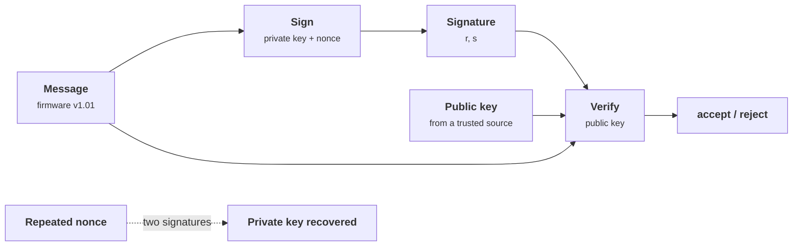
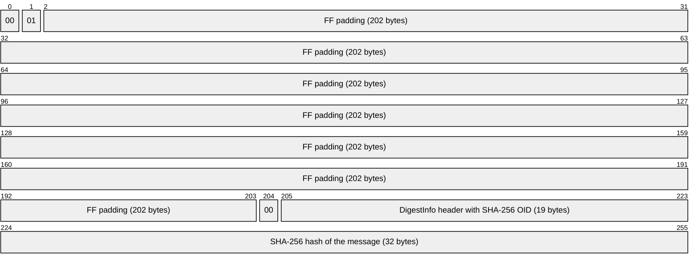
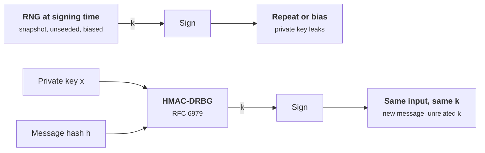
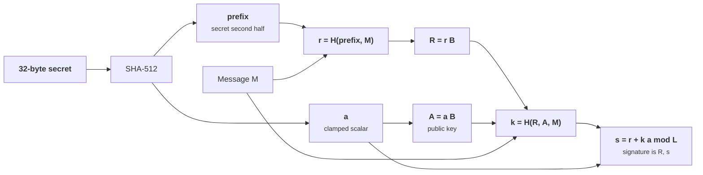

+++
title = 'Digital signatures'
description = 'A signature proves that the holder of one private key approved these exact bytes; it fails completely if the per-signature nonce repeats or the verifier trusts the wrong key.'
question = 'What does a signature prove, and how do ECDSA, RSA-PSS, and Ed25519 fail differently?'
weight = 2
difficulty = 3
prerequisites = ['/notes/cryptography/foundations/03-hash-functions', '/notes/cryptography/public-key-cryptography/01-key-exchange']
date = 2026-08-21
lastmod = 2026-08-21
verified = 2026-08-21
+++

## The idea in one minute

A digital signature is a value that only the holder of a private key can
produce for a given message, and that anyone with the matching public key can
check. It gives **integrity** (the bytes were not changed) and **origin** (the
key holder produced them), and unlike a MAC it does so without the verifier
holding any secret. That asymmetry is why signatures sit under software
updates, certificates, package registries, tokens, and the TLS handshake.

What a signature does not give is just as important. It says nothing about
*when* something was signed, whether the signer meant it, or whether the
public key you used belongs to who you think it does. And two of the three
schemes in wide use, ECDSA and DSA, have a sharp edge: each signature needs a
fresh secret **nonce**, and if the same nonce is ever used twice, anyone
holding the two signatures can compute the private key with school algebra.
The consequence to act on: **prefer Ed25519 or deterministic ECDSA, verify
against a key you obtained through a trusted path, and treat signing keys as
the most valuable secrets you have**.

## A picture



## How it really works

### What a signature proves, and what it does not

| A valid signature shows | A valid signature does not show |
| --- | --- |
| The message is byte-for-byte what was signed | That the message is safe, current, or meant for you |
| Someone with the private key produced it | That the private key was not stolen or misused |
| The verifier needs no secret to check it | That the public key belongs to the claimed person or service |
| It can be checked later by third parties | When it was signed (add a trusted timestamp) |

Signatures are often said to provide **non-repudiation**: the signer cannot
later deny signing. That is a legal and procedural property built on top of
the math. It holds only if the key was protected, the signer's identity was
bound to the key, and the signer actually saw what was signed. A key on a
compromised build server signs malware just as validly as a release.

The verifier checks the key, not the intent: once an attacker reaches the signing key, malware and the real release are indistinguishable.

```mermaid {title="A compromised signer produces perfectly valid signatures"}
flowchart LR
  Dev(["Developer"])
  Att(["Attacker"])
  CI("Build server + signing key")
  Rel["<b>Release</b><br/><small>signed</small>"]
  Mal["<b>Malware</b><br/><small>signed with the same key</small>"]
  Dv("Devices: both verify")
  Dev -->|commit| CI
  Att -.->|compromise| CI
  CI --> Rel
  CI --> Mal
  Rel --> Dv
  Mal --> Dv
  class Rel io
  class Mal warn
```

Two practical consequences follow. First, a signature over a message must
cover everything the verifier will act on: the payload *and* its type, version,
target, and expiry. Signing a bare payload and sending its metadata alongside
invites substitution. Second, replay is not prevented: a validly signed
"rotate key now" message is valid every time it is sent unless it contains a
nonce, a counter, or a timestamp that the verifier checks.

### RSA signatures: PKCS #1 v1.5 and PSS

RSA signing raises an encoded hash to the private exponent: `s = m^d mod n`.
Verification raises it to the public exponent: `s^e mod n` must equal the
encoded hash. Everything interesting is in the **encoding** of `m`, defined in
PKCS #1 (RFC 8017).

- **RSASSA-PKCS1-v1_5** pads deterministically:
  `00 01 FF FF ... FF 00 || DigestInfo(hash algorithm OID, hash)`. No attack on
  the scheme itself is known when verifiers check the whole encoding. The
  failures come from **lenient parsers**: Bleichenbacher showed in 2006 that
  verifiers which skipped trailing bytes could be fed forged signatures for
  public exponent `e = 3` because they did not check that nothing followed
  the hash, and variants of the same mistake in ASN.1 parsing
  (BERserk, 2014) kept reappearing. The safe way to verify is to build the
  expected encoding and compare it byte for byte.
- **RSASSA-PSS** (Bellare and Rogaway's probabilistic signature scheme) mixes a
  random salt into the encoding and has a security proof that reduces forgery
  to the RSA problem. TLS 1.3 requires PSS for signatures made during the
  handshake (`CertificateVerify`) and allows v1.5 only for signatures inside
  certificates, for compatibility.

This is the full v1.5 encoding for a 2048-bit key and SHA-256, one cell per byte. A strict verifier rebuilds all 256 bytes and compares them, so there is no room for trailing garbage.



Use 2048-bit or larger moduli, `e = 65537`, and PSS for new designs. RSA keys
are large and signing is slow compared with elliptic curves, which is why most
new protocols reach for Ed25519 or ECDSA instead.

### ECDSA and the nonce

ECDSA (FIPS 186-5) and its finite-field ancestor DSA sign like this, with
group order `q`, private key `x`, and public key `Y = x * G`:

1. Hash the message to an integer `h`.
2. Pick a secret nonce `k` in `[1, q-1]`.
3. `r` is the x-coordinate of `k * G`, reduced mod `q` (for DSA,
   `(g^k mod p) mod q`).
4. `s = k^-1 (h + x * r) mod q`. The signature is `(r, s)`.

Look at step 4 as an equation with two unknowns, `k` and `x`. One signature
gives one equation. If the signer uses the same `k` for two messages, the two
signatures share `r`, and the attacker has two equations:

```text
s1 = k^-1 (h1 + x r)    and    s2 = k^-1 (h2 + x r)    (mod q)
s1 - s2 = k^-1 (h1 - h2)   =>   k = (h1 - h2) / (s1 - s2)
                               x = (s1 k - h1) / r
```

That is the whole attack. It is not theoretical. At the Chaos Communication
Congress in December 2010 (27C3), the fail0verflow team showed that Sony's
PlayStation 3 code-signing implementation used the **same `k` for every
ECDSA signature**, which let them compute Sony's private signing key from
signed binaries that anyone could download. Nothing about the curve or the
hash was weak.

Follow the attacker's steps: everything used is public, and two lines of modular arithmetic finish the job.

```mermaid {title="Two signatures with one nonce give away the private key"}
sequenceDiagram
  autonumber
  participant S as Signer (key x)
  participant W as Public downloads
  participant A as Attacker
  S->>W: sign m1 with nonce k, giving (r, s1)
  S->>W: sign m2 with the same k, giving (r, s2)
  W->>A: m1, m2, both signatures, public key
  Note over A: same r in both, so the same k
  rect rgb(249, 226, 233)
    Note over A: k = (h1 - h2) / (s1 - s2) mod q
    Note over A: x = (s1 k - h1) / r mod q
  end
  A->>W: forged signature on attacker firmware
  Note over W: verifies under the signer's real public key
```

Exact reuse is the extreme case. Because the nonce must be uniformly random
and fully secret, much smaller defects also leak the key:

- **Biased nonces.** If even a few bits of `k` are predictable across many
  signatures, lattice techniques recover `x`. Published attacks have exploited
  timing leaks that revealed nonce lengths in TPMs and smart cards
  (TPM-Fail, 2019; Minerva, 2020).
- **Bad randomness.** A virtual machine restored from a snapshot, or a
  generator that was never seeded properly, can hand out the same "random"
  `k` twice. In 2013, a flaw in random number generation on Android led to
  Bitcoin wallets producing repeated ECDSA nonces and losing funds.

Put the incidents in this lesson on one line and the pattern is plain: the math held, while nonces and parsers failed, and each fix followed a break.

```mermaid {title="Signature failures came from nonces and parsers, not from the math"}
timeline
  title Signature failures and fixes
  2006 : Bleichenbacher forges RSA v1.5 signatures for e = 3 against lenient parsers
  2010 : PS3 signs every binary with one ECDSA nonce
  2013 : Android RNG flaw repeats Bitcoin wallet nonces
       : RFC 6979 deterministic nonces
  2014 : BERserk ASN.1 parsing forgeries
  2017 : RFC 8032 specifies Ed25519
  2019 : TPM-Fail recovers keys from nonce timing leaks
  2020 : Minerva finds the same leak in smart cards
  2023 : FIPS 186-5 approves deterministic ECDSA and EdDSA
```

### Deterministic nonces (RFC 6979)

The fix is to stop asking a random number generator for `k` at all. RFC 6979
(August 2013) derives `k` from the private key and the message hash with an
HMAC-based deterministic generator. Same key and message, same `k`; different
message, unrelated `k`. Signatures remain fully compatible with standard ECDSA
verifiers, because the verifier never learns how `k` was chosen. FIPS 186-5
(February 2023) approves deterministic ECDSA.

Compare where `k` comes from: one path depends on the RNG being perfect at every signing, the other only on the key and the message.



Deterministic signing has its own caveat: it makes some **fault attacks**
easier, since an attacker who can glitch one of two signings of the same
message gets two related signatures. Hedged designs mix fresh randomness
*into* the deterministic derivation, so a weak RNG no longer leaks the key and
faults are harder to exploit. Ask your library which mode it uses.

### Ed25519 (RFC 8032)

EdDSA, specified in RFC 8032 (January 2017) and approved in FIPS 186-5, is a
Schnorr-style signature over twisted Edwards curves. Ed25519 uses the curve
behind X25519. Its design choices close the failure modes above:

- **The nonce is derived, never drawn.** `r = SHA-512(prefix || message)`,
  where `prefix` is the secret second half of the hashed private key. No RNG is used at
  signing time.
- **Complete, simple formulas.** Edwards addition has no special cases, which
  makes constant-time implementations straightforward.
- **The public key is hashed into the challenge.** `k = SHA-512(R || A || M)`
  binds each signature to one key.
- **Small and fast.** 32-byte public keys, 64-byte signatures, fast
  verification and batch verification.

Trace Ed25519 signing as the `sign` function in the code below performs it: the nonce `r` comes out of a hash, and the public key `A` is hashed into the challenge.



Two implementation details are worth knowing. RFC 8032 requires rejecting a
signature whose scalar `s` is not below the group order `L`, which prevents a
second valid encoding of the same signature (**malleability**). And libraries
historically disagreed on edge cases such as non-canonical point encodings and
whether to multiply by the cofactor during verification, which matters when
many nodes must agree exactly on which signatures are valid, as in consensus
systems.

### Choosing a scheme

| Scheme | Nonce risk | Sizes (pub / sig) | Use when |
| --- | --- | --- | --- |
| **Ed25519** | None: derived from key and message | 32 B / 64 B | New designs, unless a standard requires something else |
| **ECDSA P-256**, RFC 6979 or hedged | Low: no RNG needed at signing time | 33-65 B / 64-72 B | WebAuthn, hardware that lacks EdDSA, FIPS environments with older modules |
| **ECDSA P-256**, random `k` | Depends entirely on the RNG at every signing | same | Avoid if you control the choice |
| **RSA-PSS 3072** | Salt only affects proof, not key safety | 384 B / 384 B | Interoperating with RSA-only systems |
| **RSA PKCS #1 v1.5** | None, but verifier parsing must be strict | same | Legacy certificate chains only |

The sizes from the table as bars, using the larger ECDSA encodings: the first bar in each group is the public key, the second the signature.

```mermaid {title="RSA keys and signatures are several times larger than elliptic-curve ones"}
xychart-beta
  x-axis ["Ed25519", "ECDSA P-256", "RSA-PSS 3072"]
  y-axis "Bytes" 0 --> 400
  bar [32, 65, 384]
  bar [64, 72, 384]
```

Post-quantum signatures (ML-DSA in FIPS 204, SLH-DSA in FIPS 205) are larger
and are the subject of
[post-quantum migration](/notes/cryptography/applied-cryptography/03-post-quantum-migration/).

## Code

The first program signs two firmware images with a DSA-style scheme and a
fixed nonce, then plays the attacker: it notices the repeated `r`, recovers the
nonce and the private key from public data alone, and forges a signature on
new firmware. It ends with a simplified deterministic nonce to show the fix.

```python {title="nonce_reuse.py"}
"""nonce_reuse.py: recover a DSA-style private key from two signatures that
share a nonce, the mistake behind the 2010 PS3 signing-key recovery (ECDSA).

TOY PARAMETERS: q = 2^61 - 1 and a 128-bit p. The algebra is the same as DSA
and ECDSA; the sizes are not. Standard library only; offline; deterministic.
"""

from __future__ import annotations

import hashlib
import hmac
from dataclasses import dataclass

Q = 2**61 - 1  # prime order of the subgroup
P = 73786976294838206548 * Q + 1  # prime, so Q divides P - 1
G = pow(2, (P - 1) // Q, P)  # generator of the order-Q subgroup


@dataclass(frozen=True)
class Sig:
    r: int
    s: int


def h(msg: bytes) -> int:
    return int.from_bytes(hashlib.sha256(msg).digest(), "big") % Q


def sign(x: int, msg: bytes, k: int) -> Sig:
    r = pow(G, k, P) % Q
    s = pow(k, -1, Q) * (h(msg) + x * r) % Q
    return Sig(r, s)


def verify(y: int, msg: bytes, sig: Sig) -> bool:
    if not (0 < sig.r < Q and 0 < sig.s < Q):
        return False
    w = pow(sig.s, -1, Q)
    u1, u2 = h(msg) * w % Q, sig.r * w % Q
    return pow(G, u1, P) * pow(y, u2, P) % P % Q == sig.r


def recover(m1: bytes, s1: Sig, m2: bytes, s2: Sig) -> tuple[int, int]:
    """Two equations s_i = k^-1 (h_i + x r) with the same k and r: solve for k, then x."""
    k = (h(m1) - h(m2)) * pow(s1.s - s2.s, -1, Q) % Q
    x = (s1.s * k - h(m1)) * pow(s1.r, -1, Q) % Q
    return k, x


def deterministic_k(x: int, msg: bytes) -> int:
    """The idea of RFC 6979 in one line: the nonce is a keyed hash of the
    private key and the message. (The real algorithm is an HMAC-DRBG loop.)"""
    mac = hmac.new(x.to_bytes(8, "big"), hashlib.sha256(msg).digest(), hashlib.sha256)
    return int.from_bytes(mac.digest(), "big") % (Q - 1) + 1


def main() -> None:
    x = 0x1D2C3B4A59687706 % Q  # the signer's private key
    y = pow(G, x, P)  # the public key everyone knows
    fixed_k = 0x0BADC0DE  # a "random" number that never changes

    m1, m2 = b"firmware v1.00", b"firmware v1.01"
    s1, s2 = sign(x, m1, fixed_k), sign(x, m2, fixed_k)
    print(f"sig 1: r={s1.r:#x} s={s1.s:#x}  valid={verify(y, m1, s1)}")
    print(f"sig 2: r={s2.r:#x} s={s2.s:#x}  valid={verify(y, m2, s2)}")
    print(f"same r in both signatures: {s1.r == s2.r}  (same k gives same r)")

    k, x_found = recover(m1, s1, m2, s2)
    print(f"recovered k = {k:#x}, x = {x_found:#x}")
    print(f"recovered key matches public key: {pow(G, x_found, P) == y}")

    evil = b"attacker firmware"
    forged = sign(x_found, evil, 12345)
    print(f"forged signature on {evil.decode()!r} verifies: {verify(y, evil, forged)}")

    print("with deterministic nonces:")
    d1 = sign(x, m1, deterministic_k(x, m1))
    d2 = sign(x, m2, deterministic_k(x, m2))
    again = sign(x, m1, deterministic_k(x, m1))
    print(f"  r differs across messages: {d1.r != d2.r}")
    print(f"  same message, same signature: {d1 == again}")
    print(f"  both verify: {verify(y, m1, d1) and verify(y, m2, d2)}")


if __name__ == "__main__":
    main()
```

Run it with `python3 nonce_reuse.py`:

```text
sig 1: r=0x1931f0caf6b6b93 s=0x102aaf1faa08db19  valid=True
sig 2: r=0x1931f0caf6b6b93 s=0x1dad307d56a8cbde  valid=True
same r in both signatures: True  (same k gives same r)
recovered k = 0xbadc0de, x = 0x1d2c3b4a59687706
recovered key matches public key: True
forged signature on 'attacker firmware' verifies: True
with deterministic nonces:
  r differs across messages: True
  same message, same signature: True
  both verify: True
```

The attacker used only the two messages, the two signatures, and the public
key. The recovered `x` matches the one the signer chose, and the forged
signature verifies under the signer's real public key, so every device that
trusts that key would accept the attacker's firmware. Revoking the key is the
only remedy, which for a key burned into hardware may be impossible.

The second program implements Ed25519 signing and verification from RFC 8032
and checks it against the first two test vectors in section 7.1.

```python {title="ed25519.py"}
"""ed25519.py: Ed25519 signing and verification from RFC 8032, section 5.1,
checked against the RFC's test vectors.

Readable, NOT constant time, NOT for real keys: use libsodium or
pyca/cryptography. Standard library only; offline.
"""

from __future__ import annotations

import hashlib

P = 2**255 - 19
L = 2**252 + 27742317777372353535851937790883648493  # order of the base point
D = -121665 * pow(121666, -1, P) % P
SQRT_M1 = pow(2, (P - 1) // 4, P)
Point = tuple[int, int, int, int]  # extended coordinates (X, Y, Z, T)


def add(a: Point, b: Point) -> Point:
    A = (a[1] - a[0]) * (b[1] - b[0]) % P
    B = (a[1] + a[0]) * (b[1] + b[0]) % P
    C, Dd = 2 * a[3] * b[3] * D % P, 2 * a[2] * b[2] % P
    E, F, G, H = B - A, Dd - C, Dd + C, B + A
    return (E * F % P, G * H % P, F * G % P, E * H % P)


def mul(s: int, pt: Point) -> Point:
    q: Point = (0, 1, 1, 0)  # the neutral element
    while s:
        if s & 1:
            q = add(q, pt)
        pt, s = add(pt, pt), s >> 1
    return q


def encode(pt: Point) -> bytes:
    zi = pow(pt[2], P - 2, P)
    x, y = pt[0] * zi % P, pt[1] * zi % P
    return (y | (x & 1) << 255).to_bytes(32, "little")


def decode(b: bytes) -> Point | None:
    y = int.from_bytes(b, "little")
    sign, y = y >> 255, y & ((1 << 255) - 1)
    if y >= P:
        return None
    x2 = (y * y - 1) * pow(D * y * y + 1, P - 2, P) % P
    x = pow(x2, (P + 3) // 8, P)
    if (x * x - x2) % P:
        x = x * SQRT_M1 % P
    if (x * x - x2) % P or (x == 0 and sign):
        return None
    if x & 1 != sign:
        x = P - x
    return (x, y, 1, x * y % P)


BY = 4 * pow(5, P - 2, P) % P
BASE = decode(BY.to_bytes(32, "little"))


def sha512_int(*parts: bytes) -> int:
    return int.from_bytes(hashlib.sha512(b"".join(parts)).digest(), "little")


def expand(secret: bytes) -> tuple[int, bytes]:
    hh = hashlib.sha512(secret).digest()
    a = int.from_bytes(hh[:32], "little")
    a = (a & ((1 << 254) - 8)) | (1 << 254)  # clamp
    return a, hh[32:]


def public_key(secret: bytes) -> bytes:
    return encode(mul(expand(secret)[0], BASE))


def sign(secret: bytes, msg: bytes) -> bytes:
    a, prefix = expand(secret)
    A = encode(mul(a, BASE))
    r = sha512_int(prefix, msg) % L  # deterministic nonce: no RNG at signing time
    R = encode(mul(r, BASE))
    k = sha512_int(R, A, msg) % L
    return R + ((r + k * a) % L).to_bytes(32, "little")


def verify(public: bytes, msg: bytes, sig: bytes) -> bool:
    A, R = decode(public), decode(sig[:32])
    s = int.from_bytes(sig[32:], "little")
    if A is None or R is None or s >= L:  # s >= L rejected: no malleable copies
        return False
    k = sha512_int(sig[:32], public, msg) % L
    lhs, rhs = mul(8 * s, BASE), add(mul(8, R), mul(8 * k, A))  # cofactored check
    return encode(lhs) == encode(rhs)


VECTORS = [  # RFC 8032 section 7.1, TEST 1 and TEST 2: (secret, public, msg, sig)
    ("9d61b19deffd5a60ba844af492ec2cc44449c5697b326919703bac031cae7f60",
     "d75a980182b10ab7d54bfed3c964073a0ee172f3daa62325af021a68f707511a", "",
     "e5564300c360ac729086e2cc806e828a84877f1eb8e5d974d873e06522490155"
     "5fb8821590a33bacc61e39701cf9b46bd25bf5f0595bbe24655141438e7a100b"),
    ("4ccd089b28ff96da9db6c346ec114e0f5b8a319f35aba624da8cf6ed4fb8a6fb",
     "3d4017c3e843895a92b70aa74d1b7ebc9c982ccf2ec4968cc0cd55f12af4660c", "72",
     "92a009a9f0d4cab8720e820b5f642540a2b27b5416503f8fb3762223ebdb69da"
     "085ac1e43e15996e458f3613d0f11d8c387b2eaeb4302aeeb00d291612bb0c00"),
]

if __name__ == "__main__":
    for i, (sk, pk, msg, sig) in enumerate(VECTORS, 1):
        sk_b, msg_b = bytes.fromhex(sk), bytes.fromhex(msg)
        ok_pk = public_key(sk_b).hex() == pk
        ok_sig = sign(sk_b, msg_b).hex() == sig
        print(f"TEST {i}: public key matches {ok_pk}, signature matches {ok_sig}, "
              f"verifies {verify(bytes.fromhex(pk), msg_b, bytes.fromhex(sig))}")

    sk = bytes.fromhex(VECTORS[1][0])
    pk, sig = public_key(sk), sign(sk, b"release 2.4.1")
    print(f"same message signed twice is identical: {sig == sign(sk, b'release 2.4.1')}")
    print(f"tampered message verifies: {verify(pk, b'release 2.4.2', sig)}")
    bad = sig[:40] + bytes([sig[40] ^ 1]) + sig[41:]
    print(f"tampered signature verifies: {verify(pk, b'release 2.4.1', bad)}")
    other = public_key(bytes.fromhex(VECTORS[0][0]))
    print(f"right signature, wrong public key verifies: {verify(other, b'release 2.4.1', sig)}")
```

Run it with `python3 ed25519.py`:

```text
TEST 1: public key matches True, signature matches True, verifies True
TEST 2: public key matches True, signature matches True, verifies True
same message signed twice is identical: True
tampered message verifies: False
tampered signature verifies: False
right signature, wrong public key verifies: False
```

Signing the same message twice gives the same 64 bytes: there is no nonce for
an RNG to get wrong. The last line is the failure the next lesson is about: the
signature is genuine, but checked against the wrong public key it proves
nothing. Like the X25519 program, this code is not constant time and must not
handle real keys.

## Where it breaks

- **The wrong public key.** Signature verification is only as good as the
  path by which you got the key. A key fetched from the same server as the
  signed file proves nothing if the server is compromised. This is the problem
  certificates solve, in
  [certificates and PKI](/notes/cryptography/public-key-cryptography/03-certificates-and-pki/).
- **Signing oracles.** A service that signs whatever it is asked to, such as a
  CI job with access to a release key, is a signing oracle for whoever controls
  its input. Protect the authorization to sign, not only the key.
- **Algorithm confusion.** Verifiers that let the message choose the algorithm
  (the JWT `alg` header is the classic case) can be tricked into checking an
  RSA public key as an HMAC secret, or into accepting `none`. Fix the
  algorithm per key; see
  [tokens and JWT pitfalls](/notes/application-security/authentication/04-tokens-and-jwt-pitfalls/).
- **Malleability.** For ECDSA, `(r, q - s)` is also valid for the same message.
  Systems that use a signature's bytes as an identifier, such as transaction
  IDs, must normalize or use a non-malleable scheme.
- **Key compromise is silent.** A stolen key produces perfect signatures.
  Short-lived keys, hardware protection, transparency logs, and revocation are
  how you limit the damage; see
  [HSMs and key ceremonies](/notes/cryptography/key-management/03-hsms-and-key-ceremonies/).
- **What the toy does not show.** `nonce_reuse.py` uses a 61-bit group and a
  one-line keyed-hash nonce that only illustrates the idea of RFC 6979, which
  specifies an HMAC-DRBG loop and careful reduction. Its arithmetic is DSA's;
  ECDSA uses curve points in place of `g^k mod p`, with the same algebra.

## Remember this

- A signature proves "this key signed these bytes", not who holds the key,
  when, or why.
- ECDSA and DSA leak the private key from two signatures with the same nonce,
  and from many signatures with slightly biased nonces.
- Prefer Ed25519; otherwise use deterministic (RFC 6979) or hedged ECDSA.
- For RSA, use PSS for new designs and strict, byte-for-byte checks for v1.5.
- Sign everything the verifier acts on, including type, target, and expiry,
  and fix the algorithm per key.

## Try it

1. In `nonce_reuse.py`, replace the fixed nonce with `k1` and `k2 = k1 + 1`.
   The attacker learns that the two nonces differ by one. Rewrite `recover` to
   solve for `x` in this case.
2. Change `deterministic_k` so it hashes only the message, not the private
   key. Show that the attacker can now recover the private key from a
   *single* signature. Why does RFC 6979 key the HMAC with the private key?
3. In `ed25519.py`, add `L` to the scalar half of a valid signature
   (`s + L`, still 32 bytes) and verify. What does the `s >= L` check stop?
4. Find out how the release artifacts of a project you depend on are signed.
   Which scheme, where is the private key held, and how does a user obtain
   the public key?

## Check yourself

1. Why does reusing an ECDSA nonce reveal the private key?

   
   Each signature gives the linear equation `s = k^-1 (h + x r) mod q` in the
   two unknowns `k` and `x`. With the same `k`, two signatures share `r` and
   give two equations; subtracting them eliminates `x` and yields
   `k = (h1 - h2) / (s1 - s2)`, after which `x = (s k - h) / r`.
   

2. What did the PS3 signing failure have in common with a broken random number
   generator?

   
   In both cases the nonce was not fresh and secret for each signature. Sony's
   code used a constant `k`; a broken RNG may repeat or bias `k`. The curve,
   hash, and key size were irrelevant, because the scheme's security depends
   on every `k` being uniformly random and unknown.
   

3. How do RFC 6979 signatures stay compatible with existing ECDSA verifiers?

   
   Only the signer's choice of `k` changes. The signature is still `(r, s)`
   computed with the standard equations, and the verifier never learns or
   checks how `k` was produced, so any conforming verifier accepts it.
   

4. Why does TLS 1.3 require RSA-PSS for `CertificateVerify` but allow PKCS #1
   v1.5 in certificates?

   
   PSS has a tighter security proof and a randomized encoding that is not
   subject to the v1.5 parsing pitfalls, so new handshake signatures use it.
   Certificates are issued by CAs and must remain verifiable by existing
   clients, so v1.5 signatures there are allowed for compatibility.
   

5. A valid signature verifies under a public key you downloaded from the same
   web page as the signed file. What has been proven?

   
   Only that the file and the key came from the same place. Anyone who can
   replace the file can replace the key. The signature adds security only when
   the public key reaches you through a separate trusted path: a certificate
   chain, a pinned key, or a key distributed in advance.
   

## Sources

- NIST, [FIPS 186-5: Digital Signature Standard (DSS)](https://csrc.nist.gov/pubs/fips/186-5/final), February 2023.
- S. Josefsson, I. Liusvaara, [RFC 8032: Edwards-Curve Digital Signature Algorithm (EdDSA)](https://www.rfc-editor.org/rfc/rfc8032), IRTF, January 2017.
- T. Pornin, [RFC 6979: Deterministic Usage of the Digital Signature Algorithm (DSA) and Elliptic Curve Digital Signature Algorithm (ECDSA)](https://www.rfc-editor.org/rfc/rfc6979), August 2013.
- K. Moriarty et al., [RFC 8017: PKCS #1: RSA Cryptography Specifications Version 2.2](https://www.rfc-editor.org/rfc/rfc8017), November 2016.
- E. Rescorla, [RFC 8446: The Transport Layer Security (TLS) Protocol Version 1.3](https://www.rfc-editor.org/rfc/rfc8446), IETF, August 2018 (section 4.2.3 on signature algorithms).
- fail0verflow, "Console Hacking 2010: PS3 Epic Fail", 27th Chaos Communication Congress (27C3), December 2010.
- M. Bellare, P. Rogaway, "The Exact Security of Digital Signatures: How to Sign with RSA and Rabin", EUROCRYPT 1996.
- D. Moghimi et al., "TPM-FAIL: TPM meets Timing and Lattice Attacks", USENIX Security 2020.
- J. Jancar et al., "Minerva: The curse of ECDSA nonces", IACR TCHES 2020.
