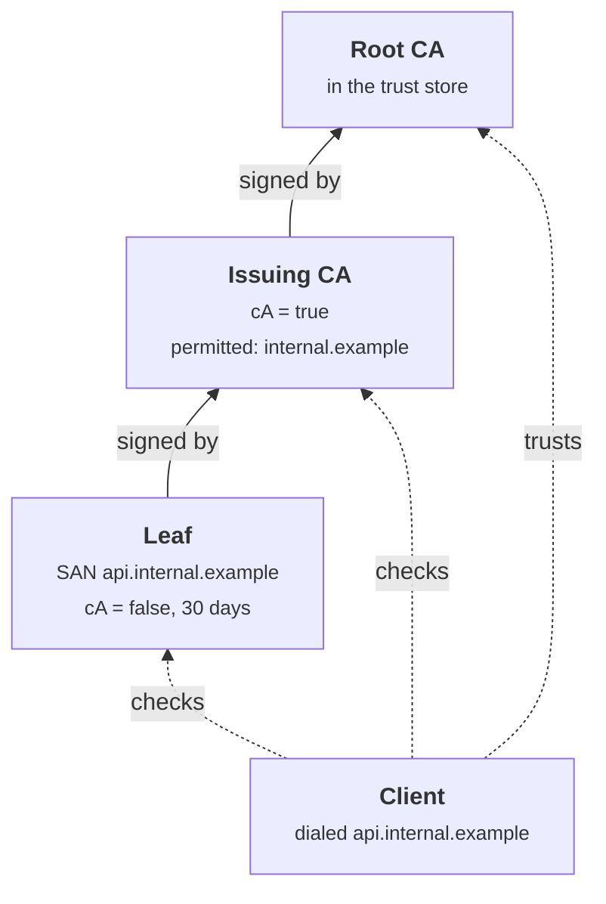
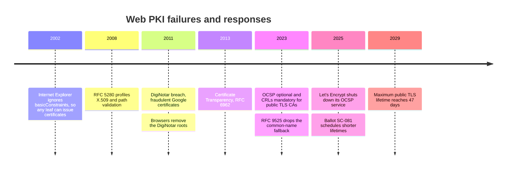
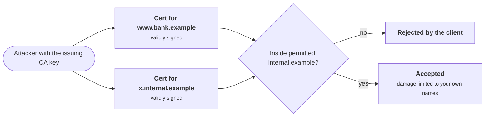

+++
title = 'Certificates and PKI'
description = 'A certificate is a signed claim that a public key belongs to a name; trusting it means checking a chain of such claims back to a key you already trust, with every constraint along the way.'
question = 'How does a client decide that a public key really belongs to a server name?'
weight = 3
difficulty = 3
prerequisites = ['/notes/cryptography/public-key-cryptography/02-digital-signatures']
date = 2026-08-23
lastmod = 2026-08-23
verified = 2026-08-23
+++

## The idea in one minute

A signature proves that a private key signed something. It cannot tell you
whose key it is. A **certificate** fills that gap: it is a small document that
says "this public key belongs to `api.example.com` until this date", signed by
a **certificate authority** (CA). The CA's own key is vouched for by another
certificate, and so on up to a **trust anchor**, a root key your operating
system, browser, or service already trusts because it was installed in
advance. Following and checking that sequence is **path validation**.

Every link adds a check, and every check exists because someone once forged a
chain that slipped past a client that skipped it: the signature linking each
certificate to its issuer, the validity dates, the flag that says a
certificate may act as a CA, constraints on which names a CA may vouch for,
the match between the certificate and the name you dialed, and whether the
certificate has been revoked. The consequence to act on: **use your platform's
validator, never turn it off, and design your internal PKI so that a
compromised issuing CA can vouch for as little as possible**.

## A picture



The server sends the leaf and the intermediate. The client already has the
root, and checks every arrow and every box.

## How it really works

### What is in an X.509 certificate

X.509 version 3, profiled for the internet by RFC 5280 (May 2008), is a
DER-encoded ASN.1 structure. The part that is signed, `tbsCertificate`,
contains:

| Field | Purpose |
| --- | --- |
| `serialNumber` | Unique per issuer; revocation lists refer to it |
| `signature` algorithm, `issuer` | Who signed this, and how |
| `validity` (`notBefore`, `notAfter`) | The window in which the claim holds |
| `subject`, `subjectPublicKeyInfo` | The key being vouched for, and a (legacy) name |
| **`subjectAltName`** (SAN) | The DNS names, IP addresses, URIs, or emails the key is valid for |
| **`basicConstraints`** | `cA` true or false, and an optional `pathLenConstraint` |
| `keyUsage`, `extendedKeyUsage` | What the key may do: `keyCertSign`, `digitalSignature`, `serverAuth`, `clientAuth` |
| **`nameConstraints`** | For CAs: name subtrees it may (or may not) issue for |
| `authorityKeyIdentifier`, `subjectKeyIdentifier` | Help clients find the right issuer when building a path |
| `cRLDistributionPoints`, `authorityInfoAccess` | Where to find revocation data and the issuer's certificate |
| Embedded SCTs | Proof the certificate was submitted to Certificate Transparency logs |

The issuer signs the DER bytes of `tbsCertificate`. Change any field and the
signature no longer verifies, which is why the forged SAN in the code below
fails.

Seen as blocks, the certificate is a signed body plus the signature over it: every field in the top section is covered, so none can be edited afterward.

```mermaid {title="The issuer's signature covers every field of tbsCertificate"}
block-beta
  columns 3
  T["tbsCertificate: the signed bytes"]:3
  F1["serial, issuer, validity"] F2["subject, public key"] F3["SAN, basicConstraints"]
  F4["keyUsage, extendedKeyUsage"] F5["nameConstraints, key IDs"] F6["CRL, AIA, embedded SCTs"]
  A["signatureAlgorithm"] S["signatureValue = issuer signs tbsCertificate"]:2
```

**Names live in the SAN.** RFC 9525 (November 2023), which replaced RFC 6125,
says clients match the server's DNS name against SAN `dNSName` entries and no
longer fall back to the subject's common name. A wildcard such as
`*.example.com` covers exactly one label at the far left: it matches
`api.example.com`, not `example.com` or `a.b.example.com`.

### Chains and trust anchors

A trust anchor is a **public key plus a name**, usually distributed as a
self-signed root certificate. Its self-signature proves nothing; it is trusted
because it is in the store, and stores are curated: Mozilla, Apple, Microsoft,
and Google run root programs that audit public CAs against the CA/Browser
Forum Baseline Requirements and remove CAs that fail. Public roots are kept
offline and sign a few **intermediate** CAs, which do day-to-day issuance. If
an intermediate is compromised, it can be revoked without replacing the root
in every device.

Look at where the power sits: an offline root signs a few intermediates that do the issuing, and the root programs decide which roots each platform ships.

```mermaid {title="Root programs ship roots, roots sign intermediates, intermediates issue leaves"}
flowchart TB
  ST["<b>Root programs</b><br/><small>Mozilla, Apple, Microsoft, Google</small>"]
  R("Root CA, offline")
  I1("Intermediate A")
  I2("Intermediate B, revocable")
  L1("shop.example")
  L2("api.example")
  L3("mail.example")
  CH("Chrome")
  FF("Firefox")
  SF("Safari")
  ST -.->|audits, includes| R
  ST -.->|ships trust store| CH
  ST -.->|ships trust store| FF
  ST -.->|ships trust store| SF
  R -->|signs| I1
  R -->|signs| I2
  I1 -->|issues| L1
  I1 -->|issues| L2
  I2 -->|issues| L3
  class ST good
```

Servers send their leaf plus intermediates; clients build a path to any anchor
they trust. Path *building* is harder than it looks when cross-signed
intermediates create several possible paths (RFC 4158 covers the problem), and
a server that omits its intermediate works in clients that cache or fetch it
and fails in others.

The trust store is your single most powerful configuration. Anything in it can
vouch for any name, unless constrained. In 2011 the Dutch CA DigiNotar was
breached and fraudulent certificates for Google domains were used to intercept
users' traffic; browsers removed DigiNotar's roots and the company went
bankrupt. The episode is why Certificate Transparency exists.

Most rules in this lesson have a dated failure or change behind them; this is the sequence the lesson refers to.



### Path validation, step by step

RFC 5280 section 6 defines the algorithm. A simplified version of what a
client checks for each certificate, from the anchor down to the leaf:

1. **Signature.** The certificate verifies under the public key of the one
   above it, and its `issuer` equals that certificate's `subject`.
2. **Anchor.** The topmost certificate is signed by a key in the trust store.
   An anchor is a key, not a name; a self-made root that copies a trusted name
   fails here.
3. **Validity.** The current time is inside `notBefore` to `notAfter` for
   every certificate in the path.
4. **CA flag and path length.** Every certificate used to sign another has
   `basicConstraints cA = true` and `keyCertSign` in `keyUsage`, and the path
   is no longer than any `pathLenConstraint` allows. A leaf must not be usable
   as a CA. In 2002 Moxie Marlinspike showed that Internet Explorer did not
   check this flag, so any site's ordinary certificate could issue a valid
   certificate for any other site.
5. **Name constraints.** If a CA carries `nameConstraints`, every name in
   certificates below it falls inside its permitted subtrees and outside its
   excluded ones.
6. **Policy and usage.** Certificate policies, and `extendedKeyUsage` such as
   `serverAuth` for a TLS server.
7. **Revocation.** None of the certificates has been revoked.

Then, separately from path validation, the client checks that **the leaf's
SAN matches the name it intended to reach** (RFC 9525), and the TLS handshake
checks that the server **holds the leaf's private key** by verifying its
signature over the handshake transcript.

Read the checks in order: every box must pass, and any single failure rejects the connection. The last two are not part of path validation, but the client still needs them.

```mermaid {title="Seven path checks, then the name, then proof of the private key"}
flowchart LR
  subgraph PV["Path validation, RFC 5280 section 6"]
    direction TB
    C1["1 Signature and issuer name"] --> C2["2 Anchor key in store"] --> C3["3 Validity dates"] --> C4["4 cA flag and path length"] --> C5["5 Name constraints"] --> C6["6 Policy and EKU"] --> C7["7 Not revoked"]
  end
  subgraph ID["Identity and possession"]
    direction TB
    HN["SAN matches the dialed name<br/><small>RFC 9525</small>"] --> CV["CertificateVerify<br/><small>server holds the leaf key</small>"]
  end
  C7 --> HN
  CV --> OK["Trust this key for this name"]
  class C1,C2,C3,C4,C5,C6,C7 compute
  class HN,CV io
  class OK good
```

### Name constraints and private CAs

Public TLS certificates are for names on the public internet. Internal
services (databases, queues, service meshes, admin panels) usually get
certificates from a **private CA** that only your own clients trust. That
gives you control over lifetimes, naming, and automation, and moves the risk
into your hands:

- **Constrain the issuing CA.** An intermediate with `nameConstraints` that
  permit only `internal.example` cannot issue a usable certificate for
  `www.bank.example`, even if its key is stolen. Constraints are enforced by
  the client, so test that the clients you rely on honor them.
- **Keep the root offline** and issue from intermediates; see
  [HSMs and key ceremonies](/notes/cryptography/key-management/03-hsms-and-key-ceremonies/).
- **Do not add a private root to the system-wide store** of every machine if
  only one application needs it. Pin it in that application's trust
  configuration instead; a root in the system store vouches for every name for
  every program on the host.
- **Automate issuance and renewal**, for example with ACME (RFC 8555) against
  an internal CA, or with workload identity systems such as SPIFFE, covered in
  [attestation and SPIFFE](/notes/infrastructure-security/workload-identity/02-attestation-and-spiffe/).

Follow the stolen issuing-CA key: it can still produce validly signed certificates, but clients refuse every one outside the permitted subtree.



### Revocation

A certificate stays cryptographically valid until it expires, so when a key is
compromised or a certificate was misissued, clients need another way to learn
it should no longer be trusted.

| Mechanism | How it works | Weakness |
| --- | --- | --- |
| **CRL** (RFC 5280) | The CA publishes a signed list of revoked serial numbers | Lists can grow large; clients must fetch them |
| **OCSP** (RFC 6960) | The client asks the CA about one certificate | Leaks browsing to the CA; slow; clients usually **soft-fail** when the responder is unreachable, so an attacker who blocks it wins |
| **OCSP stapling** (RFC 6066) | The server attaches a recent signed OCSP response to the handshake | Optional unless Must-Staple (RFC 7633) is set, and that saw little support |
| **Browser-pushed lists** | Browsers ship compact revocation sets (Mozilla's CRLite, Chrome's CRLSets) | Coverage and freshness vary by vendor |
| **Short-lived certificates** | Certificates expire in days, so revocation matters less | Requires reliable automation; an outage of the CA becomes an outage of your services |

Watch the `alt` branch: the attacker using a revoked certificate is usually also in a position to drop the OCSP query, and a soft-failing client then accepts.

```mermaid {title="OCSP soft-fail hands the decision to whoever blocks the responder"}
sequenceDiagram
  autonumber
  participant C as Client
  participant M as Attacker (on path)
  participant O as OCSP responder
  C->>M: TLS handshake, believing it is the server
  M->>C: revoked but unexpired certificate
  alt attacker drops the status query
    C-xO: OCSP query, dropped on the path
    Note over C: timeout, soft-fail, accept the certificate
  else responder reachable
    C->>O: OCSP query for the serial number
    O->>C: signed status, revoked
    Note over C: reject
  end
```

The public web is moving from OCSP toward CRLs plus shorter lifetimes. In 2023
the CA/Browser Forum made OCSP optional and CRLs mandatory for publicly
trusted TLS CAs, and Let's Encrypt removed OCSP URLs from its certificates and
shut down its OCSP service during 2025. As of October 2026, the CA/Browser
Forum has also adopted a schedule (ballot SC-081, 2025) that shrinks the
maximum public TLS certificate lifetime in steps to 47 days by 2029. Check the
current Baseline Requirements before relying on exact dates.

For a private PKI, short-lived certificates (hours to days) issued
automatically are usually simpler and stronger than running revocation
infrastructure, as long as clients check expiry and the CA is highly
available.

### Certificate Transparency

Revocation only helps once someone notices a bad certificate. **Certificate
Transparency** (CT, RFC 6962, June 2013, with version 2.0 in RFC 9162) makes
issuance public. CAs submit each certificate (or a precertificate) to
append-only logs built as Merkle trees and receive **signed certificate
timestamps** (SCTs), which are embedded in the certificate or delivered in the
handshake. Browsers including Chrome and Safari require SCTs for publicly
trusted TLS certificates. Domain owners then **monitor** the logs for
certificates naming their domains that they did not request.

CT adds two parties to issuance: a public log that every certificate must reach, and a monitor that someone has to run.

```mermaid {title="Certificate Transparency makes issuance visible to a monitor"}
sequenceDiagram
  autonumber
  participant CA as CA
  participant L as CT log (Merkle tree)
  participant B as Browser
  participant MO as Domain owner monitor
  CA->>L: submit precertificate
  L->>CA: SCT, a signed promise to include it
  CA->>B: certificate with embedded SCTs, via the server
  Note over B: requires SCTs, else rejects
  loop continuously
    MO->>L: fetch new entries naming my domains
  end
  opt certificate the owner never requested
    MO->>MO: alert, investigate, request revocation
  end
```

CT does not prevent misissuance; it makes it detectable. It is only useful if
someone watches: set up monitoring for your domains. Private CAs do not log to
public CT, so an internal PKI needs its own issuance log and alerting.

## Code

The program builds a small private PKI (a root in the trust store, a
name-constrained issuing CA, and a leaf), then validates seven chains: one
legitimate and six forged or misused, each designed to slip past exactly one
check. HMAC with a per-key secret stands in for real signatures; the
`_SECRETS` table plays the role of the math, so only a key's holder can sign
while anyone can verify.

```python {title="chain_check.py"}
"""chain_check.py: X.509-style chain validation in miniature, and which check
catches which forged chain.

TOY SIGNATURES: HMAC keyed by a per-key secret stands in for a real signature.
The _SECRETS table plays the role of the math: only the key holder can sign,
anyone can verify. Real chains use RSA or ECDSA and parsed DER (RFC 5280).
Standard library only; offline; deterministic.
"""

from __future__ import annotations

import hashlib
import hmac
from dataclasses import dataclass, field, replace

_SECRETS: dict[str, bytes] = {}  # key id -> signing secret (private to holders)


def new_key(key_id: str) -> str:
    _SECRETS[key_id] = hashlib.sha256(b"toy secret for " + key_id.encode()).digest()
    return key_id


@dataclass(frozen=True)
class Cert:
    subject: str
    issuer: str
    key: str  # the subject's public key (a key id here)
    not_before: int  # days since an arbitrary epoch
    not_after: int
    is_ca: bool  # basicConstraints cA
    sans: tuple[str, ...] = ()  # subjectAltName dNSName entries
    permitted: tuple[str, ...] = ()  # nameConstraints permitted DNS subtrees
    sig: bytes = field(default=b"", compare=False)

    def tbs(self) -> bytes:  # "to be signed": every field except the signature
        return repr(replace(self, sig=b"")).encode()


def issue(cert: Cert, signer_key: str) -> Cert:
    return replace(cert, sig=hmac.new(_SECRETS[signer_key], cert.tbs(), "sha256").digest())


def sig_ok(cert: Cert, key: str) -> bool:
    good = hmac.new(_SECRETS[key], cert.tbs(), "sha256").digest()
    return hmac.compare_digest(good, cert.sig)


def in_tree(name: str, base: str) -> bool:
    return name == base or name.endswith("." + base)


def matches(pattern: str, host: str) -> bool:  # RFC 9525: wildcard is one left label
    if pattern.startswith("*."):
        return "." in host and host.split(".", 1)[1] == pattern[2:]
    return pattern == host


def checks(chain: list[Cert], anchors: dict[str, str], host: str, now: int) -> dict[str, bool]:
    """chain[0] is the leaf; chain[-1] must be signed by a trust anchor's key."""
    leaf, cas, top = chain[0], chain[1:], chain[-1]
    return {
        # The anchor is a key, not a name: look it up, then check the signature.
        "anchor": top.issuer in anchors and sig_ok(top, anchors[top.issuer]),
        # Each certificate names, and is signed by, the next one up.
        "signature": all(c.issuer == up.subject and sig_ok(c, up.key)
                         for c, up in zip(chain, chain[1:])),
        "validity": all(c.not_before <= now <= c.not_after for c in chain),
        "ca_flag": all(c.is_ca for c in cas) and not leaf.is_ca,
        "name_constr": all(any(in_tree(n, b) for b in ca.permitted)
                           for ca in cas if ca.permitted for n in leaf.sans),
        "hostname": any(matches(p, host) for p in leaf.sans),
    }


def main() -> None:
    root_k, int_k, leaf_k = new_key("root"), new_key("issuing"), new_key("api")
    evil_k, evil_root_k = new_key("evil"), new_key("evil-root")
    anchors = {"Corp Root CA": root_k}  # the trust store: name -> key (the root itself)
    now = 400

    inter = issue(Cert("Corp Issuing CA", "Corp Root CA", int_k, 0, 1825, True,
                       permitted=("internal.example",)), root_k)
    leaf = issue(Cert("api", "Corp Issuing CA", leaf_k, 390, 420, False,
                      sans=("api.internal.example",)), int_k)
    good = [leaf, inter]  # servers send leaf + intermediates; the root is in the store

    # A legitimately issued leaf the attacker controls (cA = false).
    evil_leaf = issue(Cert("dev", "Corp Issuing CA", evil_k, 390, 420, False,
                           sans=("dev.internal.example",)), int_k)
    # A self-made root that copies the real root's name but not its key.
    fake_root = issue(Cert("Corp Root CA", "Corp Root CA", evil_root_k, 0, 3650, True),
                      evil_root_k)
    scenarios = {
        "legitimate chain": (good, "api.internal.example", now),
        "attacker's own root": ([issue(replace(leaf, issuer="Corp Root CA"), evil_root_k),
                                 fake_root], "api.internal.example", now),
        "SAN edited after signing": ([replace(leaf, sans=("pay.internal.example",)), inter],
                                     "pay.internal.example", now),
        "expired leaf": (good, "api.internal.example", 430),
        "leaf used as a CA": ([issue(replace(leaf, issuer="dev", key=evil_k), evil_k),
                               evil_leaf, inter], "api.internal.example", now),
        "issuing CA signs bank.example": ([issue(replace(leaf, sans=("www.bank.example",)),
                                                 int_k), inter], "www.bank.example", now),
        "right chain, wrong host": (good, "db.internal.example", now),
    }
    names = list(checks(good, anchors, "x", now))
    print(f"{'scenario':<31}" + "".join(f"{n:>12}" for n in names) + "   verdict")
    for label, (chain, host, when) in scenarios.items():
        result = checks(chain, anchors, host, when)
        cells = "".join(f"{'ok' if v else 'FAIL':>12}" for v in result.values())
        print(f"{label:<31}{cells}   {'ACCEPT' if all(result.values()) else 'reject'}")


if __name__ == "__main__":
    main()
```

Run it with `python3 chain_check.py`:

```text
scenario                             anchor   signature    validity     ca_flag name_constr    hostname   verdict
legitimate chain                         ok          ok          ok          ok          ok          ok   ACCEPT
attacker's own root                    FAIL          ok          ok          ok          ok          ok   reject
SAN edited after signing                 ok        FAIL          ok          ok          ok          ok   reject
expired leaf                             ok          ok        FAIL          ok          ok          ok   reject
leaf used as a CA                        ok          ok          ok        FAIL          ok          ok   reject
issuing CA signs bank.example            ok          ok          ok          ok        FAIL          ok   reject
right chain, wrong host                  ok          ok          ok          ok          ok        FAIL   reject
```

Read the table by column. Each check catches a different attack, and each
forged chain passes every check but one, so **dropping any single check lets
one of these attacks through**:

| Forged chain | What the attacker had | Caught by |
| --- | --- | --- |
| Attacker's own root | A self-signed root reusing the trusted root's name | Anchor: the trusted key did not sign it |
| SAN edited after signing | A real leaf, edited to name another host | Signature: the bytes changed |
| Expired leaf | A real leaf past `notAfter`, perhaps with a long-leaked key | Validity |
| Leaf used as a CA | A legitimately issued leaf for `dev` and its private key | CA flag: a `cA = false` certificate signed another |
| Issuing CA signs `bank.example` | Control of the issuing CA's key | Name constraints |
| Right chain, wrong host | A valid certificate for a different service | Hostname matching |

The fifth row is the one to dwell on: a stolen intermediate key produced a
correctly signed, unexpired chain from a trusted root, and only the name
constraint, set when the CA was created, contained the damage.

## Where it breaks

- **Disabled verification.** `verify=False`, `InsecureSkipVerify: true`,
  `-k`, or a custom trust manager that accepts everything turns TLS into
  unauthenticated DH, which the
  [key exchange](/notes/cryptography/public-key-cryptography/01-key-exchange/)
  lesson showed is open to any interceptor. These flags are added to get past a
  certificate error and then never removed. Fix the trust configuration
  instead.
- **Hostname not checked.** Low-level TLS APIs in several languages validate
  the chain but leave the name check to the caller. A valid certificate for
  any domain then works for every domain.
- **Too much trust.** Every root in a store can vouch for every name. Corporate
  inspection proxies, development roots, and private CAs added system-wide all
  widen that set.
- **Revocation that fails open.** If an attacker can block the OCSP responder
  and the client soft-fails, revocation offers no protection against that
  attacker. Short lifetimes are the dependable alternative.
- **Unmonitored issuance.** CT only helps if you watch the logs for your
  names, and private CAs need their own issuance records.
- **Parsing bugs.** X.509 and ASN.1 parsing has a long history of
  vulnerabilities. Use the platform validator or a mature library; never parse
  certificates by hand for a trust decision.
- **What the toy does not show.** Real validators parse DER, check key usage,
  extended key usage, policies, path length, revocation, and algorithm
  strength, and build paths among many candidates. The HMAC stand-in also means
  the "public" verification key is secret in practice; real chains use
  asymmetric signatures so verifiers hold no signing capability.

## Remember this

- A certificate binds a public key to names; the SAN is where the names are.
- A trust anchor is a key, not a name, and every key in the store can vouch
  for every name unless constrained.
- Validate signature linkage, anchor, validity, CA flag, name constraints,
  revocation, and then the hostname. Skipping any one admits a known forgery.
- Name-constrain private issuing CAs, keep roots offline, and prefer short-lived,
  automated certificates over revocation infrastructure.
- Certificate Transparency makes misissuance visible only to those who monitor.

## Try it

1. In `chain_check.py`, add a `path_len` field to `Cert` and a check that
   enforces it. Build a chain in which the issuing CA (path length 0) issues
   another CA, which issues a leaf.
2. Add a `revoked: set[tuple[str, str]]` of `(issuer, subject)` pairs and a
   `revocation` column. Revoke the issuing CA and confirm every chain under it
   fails. Then make the check soft-fail when the revocation set is `None`
   ("responder unreachable") and explain which attacker benefits.
3. Inspect a real chain:
   `openssl s_client -connect example.com:443 -showcerts </dev/null` and then
   `openssl x509 -noout -text` on each certificate. Find the SAN,
   `basicConstraints`, key usage, validity, and embedded SCTs.
4. List the roots your internal services trust. Which are public CAs that
   never issue for your internal names, and could you remove them from those
   services' trust configuration?

## Check yourself

1. Why does a trust anchor's self-signature not establish trust?

   
   Anyone can generate a key pair and sign a certificate with it under any
   name. The self-signature only shows the certificate is internally
   consistent. Trust comes from the key being installed in the trust store in
   advance through a curated process, which is why validation compares the
   key, not the name.
   

2. What attack does the `basicConstraints cA` check stop?

   
   Using an ordinary end-entity certificate, which an attacker can obtain
   legitimately for a domain they control, to sign certificates for other
   names. Without the check, the forged leaf chains to a trusted root through
   the attacker's leaf. Internet Explorer's failure to check it was disclosed
   in 2002.
   

3. An issuing CA's private key is stolen. Which certificate fields limit the
   damage, and which operational measures?

   
   `nameConstraints` on the issuing CA limit which names forged certificates
   can be valid for, and `pathLenConstraint` stops it from creating further
   CAs. Operationally: revoke the intermediate, rely on CT monitoring (for
   public CAs) or the private CA's issuance log to find what was issued, and
   use short-lived leaves so forged ones expire quickly.
   

4. Why has OCSP revocation checking been described as failing open, and what
   is replacing it?

   
   Clients usually accept a certificate when the OCSP responder cannot be
   reached, so an attacker who can block that request (often the same attacker
   using the revoked certificate) bypasses revocation. The public web is moving
   to CRLs, browser-distributed revocation sets, and much shorter certificate
   lifetimes.
   

5. What does Certificate Transparency guarantee, and what does it not?

   
   It guarantees that publicly trusted certificates accepted by CT-enforcing
   clients appear in public, append-only logs, so misissuance can be detected.
   It does not prevent a CA from issuing a bad certificate, and it detects
   nothing unless the domain owner or someone else monitors the logs.
   

## Sources

- D. Cooper et al., [RFC 5280: Internet X.509 Public Key Infrastructure Certificate and CRL Profile](https://www.rfc-editor.org/rfc/rfc5280), IETF, May 2008.
- P. Saint-Andre, R. Salz, [RFC 9525: Service Identity in TLS](https://www.rfc-editor.org/rfc/rfc9525), IETF, November 2023.
- S. Santesson et al., [RFC 6960: X.509 Internet Public Key Infrastructure Online Certificate Status Protocol (OCSP)](https://www.rfc-editor.org/rfc/rfc6960), IETF, June 2013.
- B. Laurie, A. Langley, E. Kasper, [RFC 6962: Certificate Transparency](https://www.rfc-editor.org/rfc/rfc6962), IETF, June 2013.
- B. Laurie, E. Messeri, R. Stradling, [RFC 9162: Certificate Transparency Version 2.0](https://www.rfc-editor.org/rfc/rfc9162), IETF, December 2021.
- M. Cooper et al., [RFC 4158: Certification Path Building](https://www.rfc-editor.org/rfc/rfc4158), IETF, September 2005.
- R. Barnes et al., [RFC 8555: Automatic Certificate Management Environment (ACME)](https://www.rfc-editor.org/rfc/rfc8555), IETF, March 2019.
- CA/Browser Forum, [Baseline Requirements for the Issuance and Management of Publicly-Trusted TLS Server Certificates](https://cabforum.org/working-groups/server/baseline-requirements/), current version.
- Let's Encrypt, [Ending OCSP Support in 2025](https://letsencrypt.org/2024/12/05/ending-ocsp/), December 2024.
- Fox-IT, "Black Tulip: Report of the investigation into the DigiNotar Certificate Authority breach", 2012.
