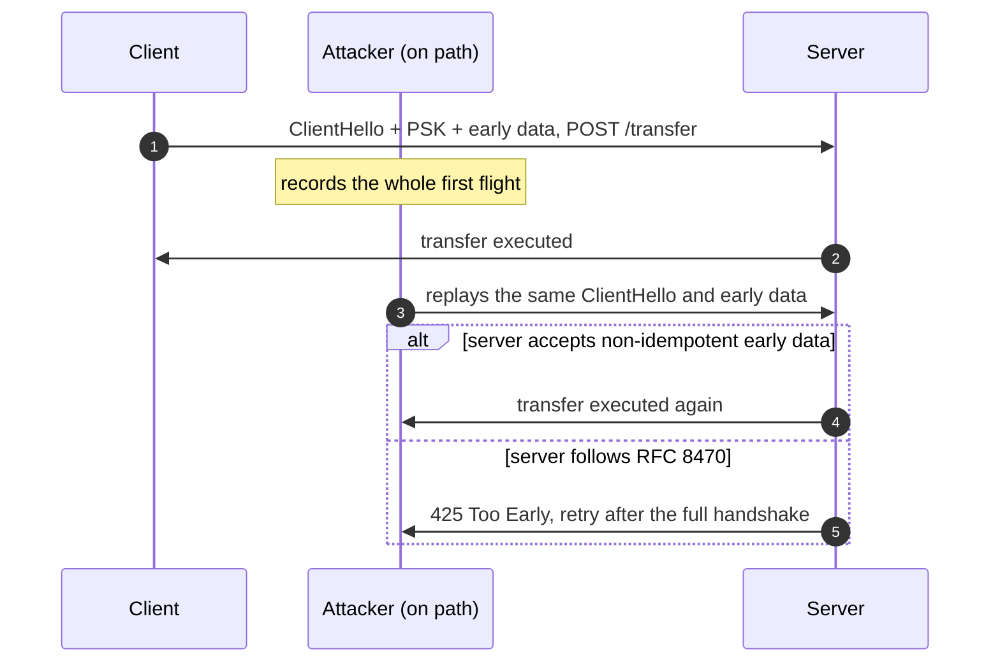

+++
title = 'The TLS handshake'
description = 'TLS 1.3 combines an ephemeral key exchange, a certificate chain, a signature over the transcript, and an HKDF key schedule so that any tampering with the handshake makes it fail.'
question = 'How does TLS 1.3 turn key exchange, signatures, and certificates into an authenticated channel?'
weight = 4
difficulty = 4
prerequisites = ['/notes/cryptography/public-key-cryptography/01-key-exchange', '/notes/cryptography/public-key-cryptography/03-certificates-and-pki', '/notes/cryptography/symmetric-cryptography/04-key-derivation']
date = 2026-08-25
lastmod = 2026-08-25
verified = 2026-08-25
+++

## The idea in one minute

The TLS 1.3 handshake (RFC 8446, August 2018) is the previous three lessons
assembled into one protocol. The client and server run an **ephemeral
X25519 or hybrid key exchange** in their first two messages. The server sends
its **certificate chain**, which the client validates against the name it
dialed. The server then **signs a hash of every handshake message so far**
with the certificate's private key, proving it holds that key *and* saw the
same conversation. Finally both sides send a **Finished MAC** over the
transcript, keyed from the shared secret. Every key is derived from the
DH output and the transcript hash with **HKDF**.

The single idea that makes this work is the **transcript hash**. Because the
signature, the MACs, and the keys all depend on a hash of every byte both
sides sent and received, an attacker who changes, removes, or reorders
anything (a cipher suite, a key share, an extension) produces a handshake
that fails. The consequence to act on: **the handshake is only as strong as
the client's certificate validation**. With validation off, TLS 1.3 is an
unauthenticated DH exchange, and the transcript checks happily confirm a
connection to the attacker.

## A picture

```mermaid {title="A full TLS 1.3 handshake, with optional client certificate"}
sequenceDiagram
  participant C as Client
  participant S as Server
  C->>S: ClientHello: random, suites, key_share (X25519), SNI
  S->>C: ServerHello: random, suite, key_share
  Note over C,S: both: DH secret + hash(CH..SH) -> handshake keys
  S->>C: {EncryptedExtensions}
  S->>C: {CertificateRequest} (only for mTLS)
  S->>C: {Certificate}: chain for the server name
  S->>C: {CertificateVerify}: signature over hash(CH..Certificate)
  S->>C: {Finished}: HMAC over hash(CH..CertificateVerify)
  Note over C: validate chain and name, check signature, check Finished
  C->>S: {Certificate, CertificateVerify} (only for mTLS)
  C->>S: {Finished}
  Note over C,S: application keys from hash(CH..server Finished)
  C->>S: [application data]
```

Braces mark messages encrypted under handshake keys. Everything after
ServerHello, including the server's certificate, is encrypted.

## How it really works

### One round trip

TLS 1.2 needed two round trips before the client could send data and
negotiated the key exchange before running it. TLS 1.3 has the client
**guess**: its ClientHello already carries a key share for the group it
expects the server to pick, usually X25519 or, as of 2026 in major browsers, a
hybrid of X25519 and ML-KEM-768. If the server supports that group, it replies
with its own share and both sides have a shared secret after one round trip.
If not, the server sends a **HelloRetryRequest** naming a group it does
support, costing one extra round trip.

Counted in round trips before the client can send application data: the guessed key share is what makes TLS 1.3 faster, and 0-RTT (covered below) removes the wait entirely.

```mermaid {title="TLS 1.3 needs one round trip before data, unless its guess misses"}
xychart-beta
  x-axis ["TLS 1.2", "TLS 1.3", "TLS 1.3 with HRR", "TLS 1.3 0-RTT"]
  y-axis "Round trips before data" 0 --> 3
  bar [2, 1, 2, 0]
```

TLS 1.3 also removed most of what went wrong in earlier versions:

| Removed in TLS 1.3 | Why |
| --- | --- |
| Static RSA and static DH key exchange | No forward secrecy (see [key exchange](/notes/cryptography/public-key-cryptography/01-key-exchange/)) |
| CBC-mode and RC4 cipher suites, MAC-then-encrypt | Padding oracles and biases; only AEADs remain |
| Renegotiation, compression | Attacks such as renegotiation injection and CRIME |
| Arbitrary DH groups chosen by the server | Weak or backdoored parameters; only named groups remain |
| Unencrypted server certificate | Privacy: observers no longer see which certificate was sent |

Only five cipher suites remain, and they name just an AEAD and a hash:
`TLS_AES_128_GCM_SHA256`, `TLS_AES_256_GCM_SHA384`,
`TLS_CHACHA20_POLY1305_SHA256`, and two AES-CCM suites. Key exchange and
signature algorithms are negotiated separately, in extensions.

**Downgrade protection.** A TLS 1.3 server that is forced to negotiate TLS 1.2
or below puts a fixed sentinel (`DOWNGRD` followed by a version byte) in the
last eight bytes of its random. Because the random is covered by the signature,
a TLS 1.3 client that sees the sentinel knows an attacker interfered and
aborts.

### The key schedule

Section 7.1 of RFC 8446 derives every secret from three inputs: an optional
pre-shared key, the (EC)DHE shared secret, and the transcript hash at fixed
points. It is built on HKDF (RFC 5869), with one helper that adds a label and
context:

```text
HKDF-Expand-Label(Secret, Label, Context, Length)
    = HKDF-Expand(Secret, [Length, "tls13 " + Label, Context], Length)
Derive-Secret(Secret, Label, Messages)
    = HKDF-Expand-Label(Secret, Label, Transcript-Hash(Messages), Hash.length)

Early Secret     = HKDF-Extract(salt = 0,     IKM = PSK or zeros)
Handshake Secret = HKDF-Extract(salt = Derive-Secret(Early, "derived", ""),
                                IKM  = (EC)DHE shared secret)
  c hs traffic   = Derive-Secret(Handshake, "c hs traffic", CH..SH)
  s hs traffic   = Derive-Secret(Handshake, "s hs traffic", CH..SH)
Master Secret    = HKDF-Extract(salt = Derive-Secret(Handshake, "derived", ""),
                                IKM  = zeros)
  c ap traffic   = Derive-Secret(Master, "c ap traffic", CH..server Finished)
  s ap traffic   = Derive-Secret(Master, "s ap traffic", CH..server Finished)
```

Read the schedule top to bottom: each Extract mixes in one new input, and each traffic secret is tied to the transcript at a fixed point.

```mermaid {title="The key schedule chains three Extracts and branches at transcript points"}
flowchart TB
  PSK["PSK or zeros"] -->|"Extract, salt 0"| ES["<b>Early Secret</b>"]
  ES -->|derived| HX["HKDF-Extract"]
  DHE["(EC)DHE shared secret"] --> HX
  HX --> HS["<b>Handshake Secret</b>"]
  HS -->|"hash(CH..SH)"| HT["<b>c and s hs traffic</b><br/><small>handshake keys</small>"]
  HS -->|derived| MX["HKDF-Extract"]
  ZZ["zeros"] --> MX
  MX --> MS["<b>Master Secret</b>"]
  MS -->|"hash(CH..server Finished)"| AT["<b>c and s ap traffic</b><br/><small>application keys</small>"]
  MS --> OT["<b>exp and res master</b><br/><small>exporters, resumption</small>"]
  class PSK,DHE,ZZ io
  class ES,HS,MS memory
  class HX,MX compute
  class HT,AT,OT good
```

Each traffic secret then yields an AEAD key and IV with
`HKDF-Expand-Label(secret, "key", "", key_length)` and `"iv"`. Several design
choices are visible here:

- **Every key is bound to the transcript.** The handshake keys depend on
  `hash(ClientHello..ServerHello)`. If an attacker altered either hello, the
  two sides derive different keys and the first encrypted message fails to
  decrypt.
- **Separate keys per direction and per phase.** Client and server never share
  a traffic key, and handshake keys are never used for application data.
- **Labels separate purposes.** The same secret expanded with different labels
  gives unrelated outputs, the standard KDF discipline from
  [key derivation](/notes/cryptography/symmetric-cryptography/04-key-derivation/).
- **Later secrets.** `exp master` feeds keying-material exporters (used for
  channel binding), `res master` produces resumption PSKs, and a `KeyUpdate`
  message ratchets traffic secrets forward during long connections.

### Certificate verification inside the handshake

Three checks together authenticate the server, and none is enough alone:

1. **Certificate.** The client validates the chain to a trust anchor and checks
   that a SAN matches the name it intended to reach, as in
   [certificates and PKI](/notes/cryptography/public-key-cryptography/03-certificates-and-pki/).
   This binds a public key to the name.
2. **CertificateVerify.** The server signs 64 bytes of `0x20`, the context
   string `TLS 1.3, server CertificateVerify`, a zero byte, and the transcript
   hash up to and including the Certificate message. This proves the server
   holds the private key **now, for this handshake**. The padding and context
   string stop a signature from one protocol or role being replayed in
   another.
3. **Finished.** `HMAC(finished_key, Transcript-Hash(..))`, where
   `finished_key` is expanded from the handshake traffic secret. This
   confirms both sides derived the same keys from the same transcript.

This is the exact content the server signs in check 2, one cell per byte, with SHA-256 as the transcript hash. The fixed prefix and context string fill the first 98 bytes.

```mermaid {title="CertificateVerify signs a fixed prefix, a context string, and the transcript hash"}
packet-beta
  0-63: "64 bytes of 0x20 (spaces)"
  64-96: "TLS 1.3, server CertificateVerify (33 bytes)"
  97: "00"
  98-129: "Transcript-Hash through Certificate (32 bytes)"
```

A man in the middle who substitutes her own key share and certificate passes
check 3 (she computed the keys herself) and can pass check 2 (she has her own
key). Only check 1 stops her. That is why disabling certificate verification
is so damaging, and why the program below shows it explicitly.

Follow Mallory through the client's checks in order: only the first can stop her, and if it is switched off the other two pass because she made them.

```mermaid {title="Certificate validation is the only check a MITM cannot pass"}
flowchart LR
  M(["Mallory: own key share and certificate"])
  CE["<b>1 Certificate</b><br/><small>chain and SAN for api.example.com</small>"]
  AB["<b>Abort</b><br/><small>not trusted for this name</small>"]
  CV["<b>2 CertificateVerify</b><br/><small>passes: her own key</small>"]
  FI["<b>3 Finished</b><br/><small>passes: she derived the keys</small>"]
  CO["<b>Connected to Mallory</b>"]
  M --> CE
  CE -->|validation on| AB
  CE -.->|validation off| CV
  CV --> FI
  FI --> CO
  class CE,AB good
  class CV,FI neutral
  class CO warn
```

### Mutual TLS

In **mTLS** the server sends a `CertificateRequest`, and the client answers
with its own Certificate, CertificateVerify, and Finished. The server
validates the client's chain against the CAs it trusts for clients and
authorizes based on the identity in it, typically a SAN URI such as a SPIFFE
ID or a DNS name. In TLS 1.3 the client certificate is sent encrypted, so a
passive observer cannot read it. mTLS gives strong, phishing-resistant
authentication of machines; the operational side (issuing, rotating, and
authorizing workload certificates in a mesh) is covered in
[mutual TLS between services](/notes/infrastructure-security/workload-identity/04-mutual-tls-between-services/).

Two common mistakes: accepting any client certificate that chains to a
public CA (anyone can get one), and authenticating the certificate but then
not authorizing which identities may call which service.

In a mesh, both services hold certificates from the same private CA, and the called service still checks a policy for the caller's identity.

```mermaid {title="mTLS authenticates both workloads, and policy still authorizes"}
flowchart TB
  subgraph g_k8s["Cluster"]
    n_ca["Private CA"]
    n_orders["orders"]
    n_pay["payments"]
    n_authz["Authz policy"]
  end
  n_ca --> n_orders
  n_ca --> n_pay
  n_orders --> n_pay
  n_pay --> n_authz
```

### 0-RTT and replay

When a client resumes with a PSK from an earlier session, TLS 1.3 lets it send
application data in its first flight, **0-RTT early data**, encrypted under a
key derived from the PSK and the ClientHello alone. It saves a round trip and
gives up two properties:

- **No replay protection across connections.** An attacker can record the
  ClientHello and early data and resend them; the server cannot tell from the
  cryptography alone. RFC 8446 (section 8) describes single-use tickets and
  ClientHello recording as mitigations, but they are hard to make complete in
  distributed deployments.
- **No forward secrecy for the early data** with respect to the PSK, since no
  fresh DH contributes to its key.

The rule: **only send idempotent requests as early data**. RFC 8470 defines
how HTTP servers handle this, including the `425 Too Early` status for
requests they will not process in 0-RTT. A `POST /transfer` in early data
can be executed twice.

Watch the replay: the server cannot tell the copy from the original, so the outcome depends on whether it accepts non-idempotent early data.



### What TLS does not protect

| Not protected | Why it matters |
| --- | --- |
| **The endpoints** | Data is plaintext in both applications. Malware, a compromised server, a TLS-terminating proxy, or a logging pipeline sees everything |
| **IP addresses, timing, and sizes** | Observers learn who talks to whom, when, and how much; padding exists but is rarely used |
| **The server name (SNI)** | Sent in the clear in the ClientHello, unless Encrypted Client Hello is used |
| **DNS lookups** | A separate protocol; protected only by DNS over TLS or HTTPS |
| **Authorization** | TLS authenticates a peer; deciding what that peer may do is the application's job |
| **Bad certificate decisions** | A client that skips validation, or trusts too many roots, authenticates nothing |

Only content inside the tunnel is hidden; the dashed lines show what an observer still learns, and the hop after the terminating proxy may carry plaintext.

```mermaid {title="TLS hides content, not metadata, DNS, or the hop after termination"}
flowchart LR
  BR("Browser")
  DN("DNS lookup")
  subgraph T["TLS tunnel"]
    EN["<b>Encrypted</b><br/><small>content, server certificate</small>"]
  end
  LB("Load balancer, TLS ends")
  AP("App server")
  OB(["Network observer"])
  BR -.->|"name, unless DoH or DoT"| DN
  BR --> EN
  EN --> LB
  LB -->|"next hop, maybe plaintext"| AP
  OB -.->|"IPs, timing, sizes, SNI"| EN
  OB -.->|queries| DN
  class EN good
```

**Encrypted Client Hello** (ECH), developed by the IETF TLS working group
(draft-ietf-tls-esni), encrypts the real ClientHello, including SNI, inside an
outer ClientHello addressed to a shared front-end name. It uses HPKE (RFC
9180), and clients find the server's ECH configuration in DNS HTTPS records
(RFC 9460). It only hides names when many sites share the same front end, and
as of October 2026 support depends on the browser, the TLS library, and the
hosting provider. Check its current status at the IETF before relying on it.

## Code

The program walks a simplified TLS 1.3-style handshake: real X25519 key
shares, a running transcript, the RFC 8446 key schedule on HKDF, a
CertificateVerify over the specified signed content, and the server Finished
MAC. Messages are plain byte strings and nothing is encrypted; the certificate
check is a one-line trust-store lookup and the signature is an HMAC stand-in.
The first line checks the schedule's starting value against the RFC 8448
example trace.

```python {title="toy_tls13.py"}
"""toy_tls13.py: the shape of a TLS 1.3 handshake. X25519 key shares, a running
transcript hash, the RFC 8446 section 7.1 key schedule built on HKDF (RFC 5869),
CertificateVerify, and Finished MACs.

TOY PARTS: messages are plain byte strings, nothing is encrypted, and the
certificate check and CertificateVerify "signature" are HMAC stand-ins with a
lookup table for the trust store. X25519 and HKDF are real but NOT constant
time. Standard library only; offline; deterministic.
"""

from __future__ import annotations

import hashlib
import hmac

H, HLEN = hashlib.sha256, 32  # as for TLS_AES_128_GCM_SHA256
P = 2**255 - 19
BASE = (9).to_bytes(32, "little")


def x25519(k: bytes, u: bytes) -> bytes:  # RFC 7748 section 5 (see lesson 3.a)
    n = int.from_bytes(k, "little") & ~7 & ((1 << 254) - 1) | (1 << 254)
    x1 = int.from_bytes(u, "little") & ((1 << 255) - 1)
    x2, z2, x3, z3 = 1, 0, x1, 1
    for t in reversed(range(255)):
        if (n >> t) & 1:
            x2, x3, z2, z3 = x3, x2, z3, z2
        a, b, c, d = x2 + z2, x2 - z2, x3 + z3, x3 - z3
        aa, bb, da, cb = a * a % P, b * b % P, d * a % P, c * b % P
        x3, z3 = (da + cb) ** 2 % P, x1 * (da - cb) ** 2 % P
        x2, z2 = aa * bb % P, (aa - bb) * (aa + 121665 * (aa - bb)) % P
        if (n >> t) & 1:
            x2, x3, z2, z3 = x3, x2, z3, z2
    return (x2 * pow(z2, P - 2, P) % P).to_bytes(32, "little")


def extract(salt: bytes, ikm: bytes) -> bytes:  # HKDF-Extract
    return hmac.new(salt or bytes(HLEN), ikm, H).digest()


def expand_label(secret: bytes, label: str, context: bytes, length: int) -> bytes:
    full = b"tls13 " + label.encode()  # HkdfLabel struct from RFC 8446 7.1
    info = length.to_bytes(2, "big") + bytes([len(full)]) + full + bytes([len(context)]) + context
    out, block = b"", b""
    for i in range(1, -(-length // HLEN) + 1):  # HKDF-Expand
        block = hmac.new(secret, block + info + bytes([i]), H).digest()
        out += block
    return out[:length]


def derive(secret: bytes, label: str, transcript: bytes) -> bytes:  # Derive-Secret
    return expand_label(secret, label, H(transcript).digest(), HLEN)


def finished(base: bytes, transcript: bytes) -> bytes:
    key = expand_label(base, "finished", b"", HLEN)
    return hmac.new(key, H(transcript).digest(), H).digest()


def toy_sign(key: str, data: bytes) -> bytes:  # stand-in for an Ed25519/ECDSA signature
    return hmac.new(key.encode(), data, H).digest()


def cv_content(transcript: bytes) -> bytes:  # RFC 8446 4.4.3 signed content
    return b" " * 64 + b"TLS 1.3, server CertificateVerify\x00" + H(transcript).digest()


TRUSTED = {"api.example.com": "server-key"}  # stand-in for chain validation (3.c)


def server(ch: bytes, cert_name: str, cert_key: str, eph: bytes) -> tuple[list[bytes], bytes]:
    peer_share = bytes.fromhex(ch.split(b"share=")[1].decode())
    sh = b"ServerHello|suite=TLS_AES_128_GCM_SHA256|share=" + x25519(eph, BASE).hex().encode()
    hs = extract(derive(extract(b"", bytes(HLEN)), "derived", b""), x25519(eph, peer_share))
    s_hs = derive(hs, "s hs traffic", ch + sh)
    ee, cert = b"EncryptedExtensions|alpn=h2", f"Certificate|{cert_name}|{cert_key}".encode()
    cv = b"CertificateVerify|" + toy_sign(cert_key, cv_content(ch + sh + ee + cert))
    fin = b"Finished|" + finished(s_hs, ch + sh + ee + cert + cv)
    master = extract(derive(hs, "derived", b""), bytes(HLEN))
    return [sh, ee, cert, cv, fin], derive(master, "s ap traffic", ch + sh + ee + cert + cv + fin)


def client(flight: list[bytes], ch: bytes, eph: bytes, check_cert: bool) -> tuple[str, bytes]:
    sh, ee, cert, cv, fin = flight
    peer_share = bytes.fromhex(sh.split(b"share=")[1].decode())
    hs = extract(derive(extract(b"", bytes(HLEN)), "derived", b""), x25519(eph, peer_share))
    s_hs = derive(hs, "s hs traffic", ch + sh)
    _, name, key = cert.decode().split("|")
    if check_cert and TRUSTED.get(name) != key:
        return "abort: certificate not trusted for this name", b""
    failed = [what for what, ok in (
        ("CertificateVerify", hmac.compare_digest(cv[18:], toy_sign(key, cv_content(
            ch + sh + ee + cert)))),
        ("Finished", hmac.compare_digest(fin[9:], finished(s_hs, ch + sh + ee + cert + cv))),
    ) if not ok]
    if failed:
        return f"abort: {' and '.join(failed)} fail on my transcript", b""
    master = extract(derive(hs, "derived", b""), bytes(HLEN))
    return "connected", derive(master, "s ap traffic", ch + sh + ee + cert + cv + fin)


def run(label: str, tamper: bool = False, mitm: bool = False, check_cert: bool = True) -> None:
    c_eph, s_eph, m_eph = (H(s).digest() for s in (b"client eph", b"server eph", b"mallory eph"))
    ch = (b"ClientHello|sni=api.example.com|suites=TLS_AES_256_GCM_SHA384,"
          b"TLS_AES_128_GCM_SHA256|share=" + x25519(c_eph, BASE).hex().encode())
    seen = ch.replace(b"TLS_AES_256_GCM_SHA384,", b"") if tamper else ch  # on the wire
    if mitm:  # Mallory answers herself, with her own key share and certificate
        flight, s_key = server(seen, "api.example.com", "mallory-key", m_eph)
    else:
        flight, s_key = server(seen, "api.example.com", "server-key", s_eph)
    status, c_key = client(flight, ch, c_eph, check_cert)
    peer = "mallory" if mitm else "server"
    same = f"; client and {peer} share keys: {c_key == s_key}" if c_key else ""
    print(f"{label:<34} {status}{same}")


if __name__ == "__main__":
    early = extract(b"", bytes(HLEN))  # no PSK: the RFC 8448 trace starts here
    rfc8448 = "33ad0a1c607ec03b09e6cd9893680ce210adf300aa1f2660e1b22e10f170f92a"
    print(f"early secret matches RFC 8448:    {early.hex() == rfc8448}")
    run("1. honest handshake")
    run("2. ClientHello edited in transit", tamper=True)
    run("3. MITM with her own certificate", mitm=True)
    run("4. same MITM, client skips checks", mitm=True, check_cert=False)
```

Run it with `python3 toy_tls13.py`:

```text
early secret matches RFC 8448:    True
1. honest handshake                connected; client and server share keys: True
2. ClientHello edited in transit   abort: CertificateVerify and Finished fail on my transcript
3. MITM with her own certificate   abort: certificate not trusted for this name
4. same MITM, client skips checks  connected; client and mallory share keys: True
```

The four runs map onto the three checks:

| Run | What happened | What caught it |
| --- | --- | --- |
| 1 | Nothing | Both sides derive the same traffic secret |
| 2 | An attacker deleted a cipher suite from the ClientHello | The server signed and MACed a transcript that differs from the client's, so CertificateVerify and Finished both fail. In real TLS the handshake keys would also differ, so decryption fails first |
| 3 | Mallory answered with her own key share and certificate | Certificate validation: her key is not trusted for `api.example.com` |
| 4 | Same as 3, with certificate checks turned off | Nothing. CertificateVerify and Finished verify, because Mallory made them, and the client shares keys with her |

Run 4 is the one that matters in practice. The transcript machinery did its job
perfectly and confirmed a secure channel to the attacker.

## Where it breaks

- **Certificate validation turned off or incomplete.** As run 4 shows, nothing
  else in the handshake makes up for it. Hostname checking is part of
  validation, not an optional extra.
- **0-RTT for non-idempotent requests.** Replayable by design; disable early
  data or restrict it to safe methods.
- **Termination points.** TLS ends at a load balancer, CDN, or sidecar, and
  the hop behind it may be plaintext. Know where every connection terminates
  and protect the next hop.
- **Weak resumption.** Session ticket keys that are long-lived or shared
  across a fleet become a key that decrypts resumed sessions; rotate them and
  use `psk_dhe_ke`.
- **Downgrade to older versions.** TLS 1.0 and 1.1 were formally deprecated by
  RFC 8996 (March 2021). Disable them, and keep TLS 1.2 limited to AEAD suites
  with ECDHE where it must remain.
- **Implementation bugs.** Heartbleed (2014) was a memory-safety bug in
  OpenSSL's heartbeat extension, not a protocol flaw. Keep TLS libraries
  patched, and prefer memory-safe ones where possible.
- **What the toy does not show.** No record encryption, no real signature or
  chain, no client Finished, no HelloRetryRequest, PSK, or extensions parsing,
  and messages are not encoded as TLS structures. Only the HKDF labels and the
  CertificateVerify content follow RFC 8446 exactly; the early secret matches
  RFC 8448, but the rest of the trace is not comparable because the messages
  differ.

## Remember this

- TLS 1.3 = ephemeral (EC)DHE + certificate chain + signature over the
  transcript + Finished MAC, all keyed by an HKDF schedule.
- The transcript hash makes any change to the handshake fail.
- Only certificate validation stops a man in the middle; never disable it.
- 0-RTT early data is replayable: idempotent requests only.
- mTLS authenticates clients; authorization is still your job.
- TLS hides content, not endpoints, metadata, or (without ECH) the server name.

## Try it

1. Add the client Finished to `toy_tls13.py`: derive `c hs traffic`, compute
   the MAC over the transcript through the server Finished, and have the
   server verify it. Then derive `c ap traffic` and confirm both directions'
   keys differ.
2. In run 2, move the tampering to the ServerHello instead (change the chosen
   suite). Which checks fail now, and why?
3. Modify `server()` so that in run 3 Mallory sends the real server's
   Certificate (`server-key`) but signs CertificateVerify with `mallory-key`.
   Which check fails? Why could she pass it trivially in the toy, but not
   against a real signature scheme?
4. Run `openssl s_client -connect example.com:443 -tls1_3 -msg </dev/null`
   against a public site and identify each handshake message and the group
   that was negotiated.
5. Find whether your edge proxy accepts 0-RTT early data and which HTTP
   methods it allows in it.

## Check yourself

1. Why does changing one byte of the ClientHello make a TLS 1.3 handshake fail?

   
   The handshake traffic keys, the server's CertificateVerify signature, and
   both Finished MACs are all computed over a hash of the transcript, which
   includes the ClientHello. The two sides hash different bytes, so the keys
   differ and the signature and MACs do not verify.
   

2. A MITM uses her own key share and her own certificate. Which of
   Certificate, CertificateVerify, and Finished stops her, and why not the
   others?

   
   Only certificate validation. She holds the private key for her own
   certificate, so her CertificateVerify is valid, and she computed the shared
   secret with the client, so her Finished is valid. What she lacks is a
   certificate that chains to a trusted anchor for the name the client dialed.
   

3. What two properties does 0-RTT early data give up, and what is the
   application rule that follows?

   
   It is not protected against replay across connections, and it lacks forward
   secrecy with respect to the resumption PSK. Only idempotent requests should
   be sent or accepted as early data; servers can answer `425 Too Early`
   (RFC 8470) to force a retry after the full handshake.
   

4. Why does the CertificateVerify signed content start with 64 spaces and a
   context string?

   
   To make the signed bytes unambiguous: a signature made for a TLS 1.3 server
   CertificateVerify cannot be reused as a client CertificateVerify, as a
   signature in an earlier TLS version, or in another protocol that signs with
   the same key. In TLS 1.2, server signatures began with the client random,
   which an attacker could choose; the fixed 64-byte prefix keeps TLS 1.3
   signed content from being confused with that format.
   

5. A service uses TLS 1.3 with valid certificates. Name three things an
   observer on the network can still learn.

   
   The client and server IP addresses, the timing and sizes of the traffic,
   and, unless Encrypted Client Hello is used, the server name from SNI. DNS
   queries may also reveal the name if they are not encrypted.
   

## Sources

- E. Rescorla, [RFC 8446: The Transport Layer Security (TLS) Protocol Version 1.3](https://www.rfc-editor.org/rfc/rfc8446), IETF, August 2018.
- H. Krawczyk, P. Eronen, [RFC 5869: HMAC-based Extract-and-Expand Key Derivation Function (HKDF)](https://www.rfc-editor.org/rfc/rfc5869), IETF, May 2010.
- M. Thomson, [RFC 8448: Example Handshake Traces for TLS 1.3](https://www.rfc-editor.org/rfc/rfc8448), IETF, January 2019.
- M. Thomson, M. Nottingham, W. Tarreau, [RFC 8470: Using Early Data in HTTP](https://www.rfc-editor.org/rfc/rfc8470), IETF, September 2018.
- A. Langley, M. Hamburg, S. Turner, [RFC 7748: Elliptic Curves for Security](https://www.rfc-editor.org/rfc/rfc7748), IETF, January 2016.
- K. Moriarty, S. Farrell, [RFC 8996: Deprecating TLS 1.0 and TLS 1.1](https://www.rfc-editor.org/rfc/rfc8996), IETF, March 2021.
- IETF TLS Working Group, [TLS Encrypted Client Hello](https://datatracker.ietf.org/doc/draft-ietf-tls-esni/) (draft-ietf-tls-esni).
- R. Barnes et al., [RFC 9180: Hybrid Public Key Encryption](https://www.rfc-editor.org/rfc/rfc9180), IRTF, February 2022.
- B. Schwartz, M. Bishop, E. Nygren, [RFC 9460: Service Binding and Parameter Specification via the DNS (SVCB and HTTPS Resource Records)](https://www.rfc-editor.org/rfc/rfc9460), IETF, November 2023.
