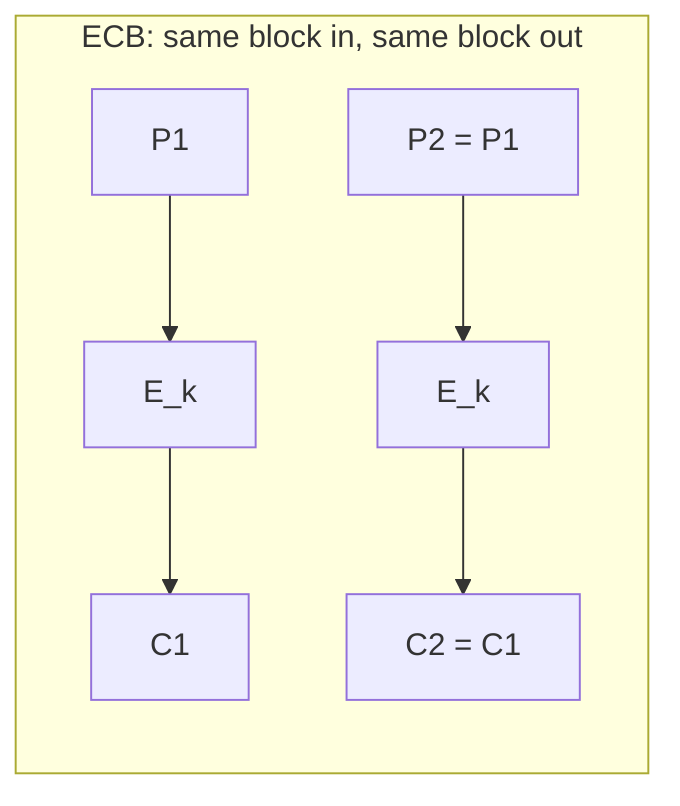
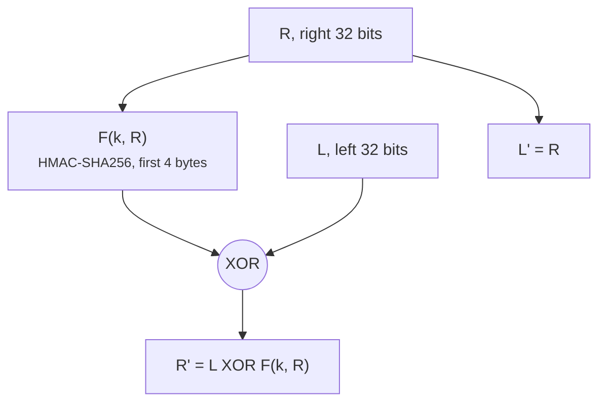
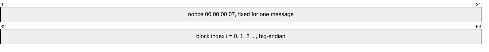

+++
title = 'Block ciphers and modes'
description = 'A block cipher only scrambles one fixed-size block. The mode of operation decides what a long message leaks, and ECB leaks its shape.'
question = 'What does a block cipher actually do, and why does the mode matter more than the cipher?'
weight = 1
difficulty = 2
prerequisites = ['/notes/cryptography/foundations/01-start-from-the-property', '/notes/cryptography/foundations/02-randomness-and-entropy']
date = 2026-08-11
lastmod = 2026-10-30
verified = 2026-08-11
+++

## The idea in one minute

A **block cipher** is a keyed permutation: for each key it maps every possible
block of a fixed size (128 bits for AES) to a distinct block of the same size,
and back again with the same key. That is all it does. It cannot encrypt a
message of 37 bytes, or of 37 gigabytes, without a **mode of operation**: a
recipe that chains many block-cipher calls together.

The mode, not the cipher, decides most of what an attacker learns. AES is
unbroken after more than two decades of public analysis, yet AES in **ECB** mode
leaks which blocks of a message are equal, enough to show the outline of an
encrypted picture. **CBC** hides that with a random IV but needs padding and
falls to padding oracles when errors are visible. **CTR** turns the block cipher
into a stream cipher with no padding at all, and fails completely if a nonce
repeats. None of them detects tampering.

The consequence to act on: **never choose "AES" alone; choose an authenticated
mode** (next lesson), and treat any design that names a bare mode such as ECB,
CBC, or CTR as unfinished.

## A picture



```mermaid {title="CBC chains the previous ciphertext, CTR encrypts a counter"}
flowchart LR
  subgraph CBC["CBC: chain the previous ciphertext"]
    IV["random IV"] --> X1(("XOR"))
    Q1["P1"] --> X1 --> F1["E_k"] --> D1["C1"]
    D1 --> X2(("XOR"))
    Q2["P2"] --> X2 --> F2["E_k"] --> D2["C2"]
  end
  subgraph CTR["CTR: encrypt a counter, XOR the result"]
    N1["nonce, 1"] --> G1["E_k"] --> Y1(("XOR")) --> R1["C1"]
    S1["P1"] --> Y1
    N2["nonce, 2"] --> G2["E_k"] --> Y2(("XOR")) --> R2["C2"]
    S2["P2"] --> Y2
  end
  class F1,F2,G1,G2 compute
  class IV,N1,N2 memory
  class D2,R2 good
```

In ECB the cipher sees the plaintext directly, so equal inputs give equal
outputs. CBC and CTR make every block-cipher input different, by chaining in
CBC and by counting in CTR.

## How it really works

### A block cipher is a keyed permutation

Fix a key `k`. A block cipher `E_k` is a function from 128-bit blocks to
128-bit blocks that is a **permutation**: every input maps to a different output,
so `D_k`, the inverse, exists. The security goal is that, without the key, `E_k`
is indistinguishable from a permutation chosen uniformly at random from all
permutations of 128-bit blocks. Cryptographers call this a **pseudorandom
permutation** (PRP). An attacker who can ask for encryptions and decryptions of
blocks of their choice should learn nothing that lets them predict the output
for a block they have not asked about.

Notice what the definition does *not* promise. It says nothing about messages
longer than one block, nothing about integrity, and nothing about what happens if
you encrypt the same block twice. A deterministic permutation always maps the
same input to the same output; that is not a flaw, it is what a permutation is.
Everything else is the mode's job.

### AES

The **Advanced Encryption Standard** is specified in NIST FIPS 197. It is the
Rijndael cipher by Joan Daemen and Vincent Rijmen, selected through an open
competition that NIST ran from 1997 to 2000. AES has a 128-bit block and three
key sizes:

| Variant | Key size | Rounds |
| --- | --- | --- |
| AES-128 | 128 bits | 10 |
| AES-192 | 192 bits | 12 |
| AES-256 | 256 bits | 14 |

Each round applies byte substitution through a fixed S-box, a row shift, a
column mix, and an XOR with a round key derived from the main key. AES is not a
Feistel network; it is a **substitution–permutation network**, and decryption
runs inverse operations. Most server and phone CPUs implement AES rounds in
hardware (AES-NI on x86, the cryptography extensions on ARMv8), which makes it
both fast and resistant to the cache-timing leaks of table-based software
implementations.

Each AES round runs the same four steps on the 128-bit state, and only the round key changes from round to round.

```mermaid {title="AES repeats one substitution-permutation round 10, 12 or 14 times"}
block-beta
  columns 1
  P["plaintext block, 128 bits"]
  SB["SubBytes: each byte through a fixed S-box"]
  SR["ShiftRows: rotate the rows of the 4x4 byte grid"]
  MC["MixColumns: mix the bytes of each column"]
  ARK["AddRoundKey: XOR with round key i from the key schedule"]
  C["ciphertext block after 10, 12 or 14 rounds"]
  P --> SB
  SB --> SR
  SR --> MC
  MC --> ARK
  ARK --> C
```

For a practical engineer, AES itself is not where things go wrong. No attack
known in public is meaningfully better than brute force against full-round AES.
The failures are in the mode, the IV or nonce, the key handling, and the
missing integrity check.

### The toy cipher in this lesson

Python's standard library has no AES, so the program below uses a **Feistel
network**, the structure behind DES. A Feistel round splits the block into a
left half `L` and a right half `R` and computes:

```text
L' = R
R' = L XOR F(k, R)
```

The round function `F` can be any keyed function; it does not need to be
invertible, because decryption runs the rounds backwards and recomputes
`F(k, L')` to undo the XOR. Luby and Rackoff proved in 1988 that a few Feistel
rounds with a pseudorandom round function give a pseudorandom permutation.
That makes it a clean way to build a working block cipher from HMAC-SHA256 in a
dozen lines. It is still a **toy**: a 64-bit block is too small (see "Where it
breaks"), the design has had no analysis, and it is slow.

In one round, only the right half goes through `F`; the left half is merely XORed, which is why `F` never has to be inverted.



### ECB: the mode that is not a mode

**Electronic codebook** mode splits the padded message into blocks and
encrypts each one independently:

```text
C_i = E_k(P_i)
```

It is the obvious thing to do, and it is wrong for almost every purpose. Because
`E_k` is deterministic, **equal plaintext blocks produce equal ciphertext
blocks**, anywhere in the message and across messages under the same key. For
structured data that is a lot of information: repeated database fields, the
same file header in every encrypted file, large areas of one color in a bitmap.
The well-known picture of a penguin encrypted with ECB is still recognizably a
penguin, because every run of identical pixels becomes a run of identical
ciphertext blocks. ECB also lets an attacker cut, reorder, and replay blocks,
since each one decrypts on its own.

ECB has a legitimate niche: encrypting a single block that is already
unpredictable, such as wrapping a random key or computing `E_k(0)` inside
another construction (GCM does exactly this). If you find it encrypting user
data, it is a bug.

### CBC: chaining with a random IV

**Cipher block chaining**, defined with the other classic modes in NIST
SP 800-38A, XORs each plaintext block with the previous ciphertext block before
encrypting it. The first block is XORed with an **initialization vector**:

```text
C_0 = IV
C_i = E_k(P_i XOR C_(i-1))
P_i = D_k(C_i) XOR C_(i-1)
```

If the IV is fresh and **unpredictable** for each message, every block-cipher
input looks random, equal plaintext blocks no longer produce equal ciphertext,
and encrypting the same message twice gives unrelated ciphertexts. SP 800-38A
requires the IV to be unpredictable, not just unique. A counter IV is not
enough: if an attacker can predict the next IV and choose part of the next
plaintext, they can cancel the IV and test guesses about earlier blocks. This
is the mechanism behind the BEAST attack on TLS 1.0, which used the last
ciphertext block of one record as the IV of the next.

CBC has three properties worth knowing:

- **Encryption is sequential**: block `i` needs `C_(i-1)`. Decryption can run in
  parallel.
- **It needs padding** to a whole number of blocks (below), and padding is where
  the worst CBC attacks live.
- **It is malleable in a structured way.** Flipping a bit in `C_(i-1)` flips the
  same bit in `P_i` (and garbles `P_(i-1)`). An attacker who knows the format can
  make targeted edits without the key.

Follow the attacker's single flipped bit through CBC decryption: it garbles one block and lands precisely in the next.

```mermaid {title="Flipping a bit in one CBC block flips the same bit in the next plaintext"}
flowchart LR
  A(["Attacker, no key"])
  C1["C_(i-1)<br/><small>bit j flipped</small>"]
  C2["C_i<br/><small>untouched</small>"]
  D1["D_k"]
  D2["D_k"]
  X(("XOR"))
  P1["P_(i-1)<br/><small>garbled</small>"]
  P2["P_i<br/><small>exactly bit j flipped</small>"]
  A --> C1
  C1 --> D1 --> P1
  C2 --> D2 --> X --> P2
  C1 --> X
  class C1,P2 warn
  class D1,D2 compute
```

### Padding

ECB and CBC can only process whole blocks, so the message is padded first. The
common scheme is **PKCS#7** (RFC 5652): append `n` bytes each of value `n`, where
`n` is between 1 and the block size. A message that already fills its last block
gets a whole extra block of padding, so the receiver can always strip it
unambiguously.

Read each row as one 8-byte block of the toy cipher: a short message is filled with copies of the pad length, and a full block earns a whole block of padding.

```mermaid {title="Padding always adds 1 to 8 bytes, each holding the count"}
---
config:
  packet:
    bitsPerRow: 8
---
packet-beta
  0: "h"
  1: "i"
  2: "06"
  3: "06"
  4: "06"
  5: "06"
  6: "06"
  7: "06"
  8-15: "ATTACK!! fills a whole block"
  16: "08"
  17: "08"
  18: "08"
  19: "08"
  20: "08"
  21: "08"
  22: "08"
  23: "08"
```

The trouble is the check on the receiving side. If a server decrypts a CBC
ciphertext and responds differently when the padding is malformed (an error
message, a status code, or just a different response time), it has built a
**padding oracle**. Serge Vaudenay showed in 2002 that such an oracle lets an
attacker decrypt any ciphertext a byte at a time by editing the previous block
and watching which edits produce valid padding. Variants of this idea broke SSL
3.0 (POODLE) and parts of TLS's CBC record protection (Lucky Thirteen). The root
cause is the same each time: the receiver processed ciphertext whose integrity it
had not verified.

The attack is a loop of yes/no questions, and each "yes" pins down one plaintext byte.

```mermaid {title="A padding oracle answers one yes/no question per request"}
sequenceDiagram
  autonumber
  actor A as Attacker
  participant S as Server, CBC without a MAC
  Note over A: holds C_(i-1) and C_i, wants the last byte of P_i
  loop guess g = 0 to 255
    A->>S: C_(i-1) with last byte XOR g, then C_i
    S->>S: decrypt, check padding
    alt padding valid
      S-->>A: some other error or success
    else padding invalid
      S-->>A: bad padding, by message, code or timing
    end
  end
  Note over A: valid means last byte of P_i XOR g = 01, so the byte is g XOR 01
  A->>S: next byte, now aiming for padding 02 02
```

### CTR: a block cipher as a stream cipher

**Counter mode** never feeds the plaintext through the block cipher. It
encrypts a sequence of counter blocks, usually a per-message nonce followed by a
block counter, and XORs the result, the **keystream**, into the plaintext:

```text
S_i = E_k(nonce || i)
C_i = P_i XOR S_i
```

In the toy cipher each 8-byte counter block is the message nonce followed by the block index, so no two blocks under one key and nonce are ever equal.



Decryption is the same operation. CTR has attractive engineering properties:
no padding (truncate the last keystream block), fully parallel in both
directions, random access to any block, and only `E_k` is needed, never `D_k`.
That is why the modern authenticated modes, GCM among them, are built on it.

Its failure mode is absolute. The keystream depends only on the key and the
counter blocks, so if the same `(key, nonce)` pair is ever used for two
messages, the keystreams are identical and `C1 XOR C2 = P1 XOR P2`. Knowing or
guessing either plaintext reveals the other. CTR also offers **no integrity at
all**: flipping ciphertext bit `j` flips plaintext bit `j`, exactly. Lesson 2
demonstrates both.

### Comparing the modes

| Mode | Equal blocks visible? | Padding? | IV or nonce rule | Parallel encrypt? | Main failure |
| --- | --- | --- | --- | --- | --- |
| ECB | Yes | Yes | None | Yes | Leaks structure; blocks can be cut and replayed |
| CBC | No | Yes | Unpredictable per message | No | Padding oracles; predictable IVs |
| CTR | No | No | Unique per key, never reused | Yes | Nonce reuse leaks XOR of plaintexts |
| XTS (disks, SP 800-38E) | Per sector position only | No (ciphertext stealing) | Sector number as tweak | Yes | Deterministic per sector; no integrity |

None of these rows authenticates anything. That gap is the subject of the next
lesson.

## Code

The program builds the toy Feistel cipher, shows that decryption inverts it,
pads with PKCS#7, and then encrypts a 16-by-8 "image" in which each pixel is
one 8-byte block of white or black. Each ciphertext block is drawn as a
character chosen by its first byte, so equal ciphertext blocks are drawn the
same.

```python {title="toy_modes.py"}
"""toy_modes.py: one toy block cipher, three modes, and what each mode leaks.

TOY ONLY. The cipher is a 64-bit Feistel network whose round function is
HMAC-SHA256. It shows the mechanism of a keyed permutation; it has no security
analysis behind it. Real systems use AES through a vetted library.
Standard library only; offline; deterministic (fixed key, IV and nonce).
"""

from __future__ import annotations

import hashlib
import hmac

BLOCK = 8  # bytes: a 64-bit block, half the size of an AES block
ROUNDS = 8


def xor(a: bytes, b: bytes) -> bytes:
    return bytes(x ^ y for x, y in zip(a, b))


def f(key: bytes, rnd: int, half: bytes) -> bytes:
    """Round function: any keyed function works; it need not be invertible."""
    return hmac.new(key, bytes([rnd]) + half, hashlib.sha256).digest()[:4]


def encrypt_block(key: bytes, block: bytes) -> bytes:
    left, right = block[:4], block[4:]
    for rnd in range(ROUNDS):
        left, right = right, xor(left, f(key, rnd, right))
    return left + right


def decrypt_block(key: bytes, block: bytes) -> bytes:
    left, right = block[:4], block[4:]
    for rnd in reversed(range(ROUNDS)):
        left, right = xor(right, f(key, rnd, left)), left
    return left + right


def pad(data: bytes) -> bytes:  # PKCS#7: append n copies of the byte n
    n = BLOCK - len(data) % BLOCK
    return data + bytes([n]) * n


def unpad(data: bytes) -> bytes:
    n = data[-1]
    if not 1 <= n <= BLOCK or data[-n:] != bytes([n]) * n:
        raise ValueError("bad padding")
    return data[:-n]


def blocks(data: bytes) -> list[bytes]:
    return [data[i:i + BLOCK] for i in range(0, len(data), BLOCK)]


def ecb(key: bytes, pt: bytes) -> bytes:
    return b"".join(encrypt_block(key, b) for b in blocks(pad(pt)))


def cbc(key: bytes, iv: bytes, pt: bytes) -> bytes:
    out, prev = [], iv
    for b in blocks(pad(pt)):
        prev = encrypt_block(key, xor(b, prev))
        out.append(prev)
    return b"".join(out)


def ctr(key: bytes, nonce: bytes, pt: bytes) -> bytes:
    """Encrypt nonce||counter to make a keystream; XOR it in. No padding."""
    stream = b"".join(encrypt_block(key, nonce + i.to_bytes(4, "big"))
                      for i in range(len(pt) // BLOCK + 1))
    return xor(pt, stream)


LOCK = ["......####......",
        ".....#....#.....",
        ".....#....#.....",
        "....########....",
        "....###..###....",
        "....###..###....",
        "....########....",
        "................"]


def to_pixels(art: list[str]) -> bytes:
    """Each pixel is one 8-byte block: white or black, like raw image data."""
    return b"".join(b"\xff" * BLOCK if ch == "." else b"\x00" * BLOCK
                    for row in art for ch in row)


def render(ct: bytes, width: int) -> list[str]:
    glyphs = ".:-=+*#%@"
    cells = [glyphs[b[0] % len(glyphs)] for b in blocks(ct)]
    return ["".join(cells[i:i + width]) for i in range(0, len(cells), width)]


if __name__ == "__main__":
    key = hashlib.sha256(b"demo key, never hard-code one").digest()
    iv = bytes(range(8))           # real IVs: 16 random bytes per message
    nonce = b"\x00\x00\x00\x07"    # real nonces: unique per key, never reused

    ct = encrypt_block(key, b"ATTACK!!")
    print("E(ATTACK!!) =", ct.hex(), "->", decrypt_block(key, ct))
    print("PKCS#7 pad of b'hi':", pad(b"hi"), "->", unpad(pad(b"hi")))
    msg = b"attack at dawn"
    print(f"{len(msg)}-byte message: ECB/CBC ciphertext {len(ecb(key, msg))} bytes,"
          f" CTR ciphertext {len(ctr(key, nonce, msg))} bytes")
    print()

    image = to_pixels(LOCK)
    cts = {"ECB": ecb(key, image)[:len(image)],  # drop the final padding block
           "CBC": cbc(key, iv, image)[:len(image)],
           "CTR": ctr(key, nonce, image)}
    panels = {"plaintext": LOCK} | {m: render(c, 16) for m, c in cts.items()}
    print("   ".join(f"{name:<16}" for name in panels).rstrip())
    for row in range(len(LOCK)):
        print("   ".join(p[row] for p in panels.values()))
    print()
    for mode, c in cts.items():
        print(f"{mode}: {len(blocks(image))} plaintext blocks (2 distinct) -> "
              f"{len(set(blocks(c)))} distinct ciphertext blocks")
```

Run it with `python3 toy_modes.py`:

```text
E(ATTACK!!) = 173dc4511870829e -> b'ATTACK!!'
PKCS#7 pad of b'hi': b'hi\x06\x06\x06\x06\x06\x06' -> b'hi'
14-byte message: ECB/CBC ciphertext 16 bytes, CTR ciphertext 14 bytes

plaintext          ECB                CBC                CTR
......####......   ======::::======   :@@@%-%%#::-.@-=   =#+@-@%%@*=#*-=:
.....#....#.....   =====:====:=====   -+%%*.%=+*=%@.#:   *@=:#::-=.-@*%:=
.....#....#.....   =====:====:=====   .=%::%.:-@#==*:#   %#*--=+.-=:+%=#=
....########....   ====::::::::====   #=.#@.#--:::..@*   @@*-%%*@-+.==:%-
....###..###....   ====:::==:::====   #=*#*%:=-+%=*=-%   :%@=:+-:@#:@=.%.
....###..###....   ====:::==:::====   :-@+*--::+**.%-*   -#*+:=-.*=*:*+.*
....########....   ====::::::::====   *:+@+@:+@.:.--++   .%#+-*-==-.:::%:
................   ================   %:*:%.:*--+:@==%   #@.#%+**@++-**%#

ECB: 128 plaintext blocks (2 distinct) -> 2 distinct ciphertext blocks
CBC: 128 plaintext blocks (2 distinct) -> 128 distinct ciphertext blocks
CTR: 128 plaintext blocks (2 distinct) -> 128 distinct ciphertext blocks
```

The plaintext has only two distinct blocks, white and black. ECB faithfully
maps them to two distinct ciphertext blocks and the padlock survives
encryption, inverted in color but perfectly legible. CBC and CTR produce 128
different blocks and the picture is gone. Nothing about the toy cipher is
special here: AES-ECB on a real bitmap does the same thing, which is where the
penguin comes from.

## Where it breaks

- **The block size is a budget.** With an `n`-bit block, CBC and CTR start to
  leak after about `2^(n/2)` blocks under one key, because collisions between
  block-cipher inputs or outputs become likely (the birthday bound). For a
  64-bit block that is about 32 GiB, which a long-lived HTTPS connection can
  reach: the Sweet32 attack (Bhargavan and Leurent, 2016) recovered secrets from
  3DES and Blowfish connections this way. AES's 128-bit block pushes the limit
  out of practical reach for a single message, but key-usage limits still exist,
  and they matter more for GCM. The toy cipher's 64-bit block has the same
  problem as 3DES.

  The bars show log2 of the bytes one key can encrypt before a block collision
  becomes likely: 35 is 32 GiB for a 64-bit block, 68 is far beyond any real
  workload.

  ```mermaid {title="The birthday bound grows with block size"}
  xychart-beta
    x-axis "Block size in bits" ["32", "48", "64 (3DES)", "96", "128 (AES)"]
    y-axis "log2 of bytes under one key" 0 --> 70
    bar [18, 26.6, 35, 51.6, 68]
  ```

- **Hiding equal blocks is not hiding everything.** CBC and CTR ciphertexts are
  as long as the plaintext, rounded up to a block or exact. Length alone can
  identify a file, a web page, or a short answer such as "yes" versus "no".
  Padding messages to fixed sizes is an application decision.
- **Confidentiality modes are malleable.** An attacker can flip chosen bits in
  CTR plaintexts and make structured edits to CBC plaintexts without the key. If
  the system acts on decrypted data that was never authenticated, these modes
  give no protection at all.
- **Error behavior is part of the cipher.** A CBC receiver that distinguishes
  "bad padding" from "bad data", by message, status code, or timing, has handed
  over a decryption oracle. The cure is to verify a MAC over the ciphertext
  before decrypting, or to use an AEAD mode.
- **What the demo does not show.** It shows equality leakage only. It says
  nothing about whether the toy Feistel cipher is a good PRP (it has had no
  analysis), and the fixed IV and nonce in the program are there for
  reproducible output. In real code they come from a CSPRNG or a counter that
  never repeats.

## Remember this

- A block cipher is a keyed permutation on one fixed-size block; the mode makes
  it encryption.
- ECB leaks equal blocks. Do not use it for data.
- CBC needs an unpredictable IV and padding, and padding errors become oracles.
- CTR needs a nonce that never repeats under a key; one repeat leaks the XOR of
  two plaintexts.
- No classic mode provides integrity. Pick an AEAD mode instead of a bare mode.
- Block size bounds how much data one key may protect; 64-bit blocks are too
  small today.

## Try it

1. Run `toy_modes.py`. Change `ROUNDS` to 1 and encrypt two blocks that share a
   right half. What do you notice about the ciphertexts, and why does a single
   Feistel round fail to hide it?
2. Call `cbc` twice with the same IV on two messages that share their first
   8 bytes and differ afterwards. Which ciphertext blocks are equal, and what
   does that tell an observer?
3. Encrypt two different images with `ctr` and the same nonce. XOR the two
   ciphertexts and render the result. What do you see?
4. Write a `cbc_decrypt` that raises one exception for bad padding and another
   for everything else. Explain in a sentence why that difference is dangerous.
5. Compute the birthday bound in bytes for a 64-bit and a 128-bit block cipher.

## Check yourself

1. Why does ECB reveal the outline of an encrypted image even with a strong
   cipher such as AES?

   
   ECB encrypts each block independently with the same key, and a block cipher
   is deterministic, so identical plaintext blocks give identical ciphertext
   blocks. Large areas of one color become runs of one repeated ciphertext block,
   and the boundaries between areas stay where they were. The cipher's strength
   is irrelevant; the mode reveals equality by design.
   

2. Why must a CBC IV be unpredictable, not merely unique?

   
   The first block-cipher input is `P_1 XOR IV`. If an attacker can predict the
   IV of a future message and choose its first block, they can choose the
   block-cipher input directly, for example to equal an earlier input they want
   to test a guess against. Comparing the resulting ciphertext block with an
   earlier one confirms or refutes the guess. BEAST used this against TLS 1.0's
   chained IVs.
   

3. What exactly leaks when a CTR nonce is reused?

   
   The two messages are XORed with the same keystream, so the XOR of the two
   ciphertexts equals the XOR of the two plaintexts. If either plaintext is known
   or partly guessable, the corresponding part of the other is revealed directly.
   With many messages under one nonce, statistical analysis recovers them
   without any known plaintext.
   

4. What is a padding oracle, and what single design choice prevents it?

   
   A receiver that reveals, by any observable difference, whether decrypted CBC
   data had valid padding. An attacker edits the previous ciphertext block and
   uses the yes/no answers to recover plaintext a byte at a time. Authenticating
   the ciphertext (encrypt-then-MAC, or an AEAD) and rejecting it before
   decryption or padding checks removes the oracle.
   

5. Why are modern authenticated modes built on CTR rather than CBC?

   
   CTR needs no padding, so there is no padding check to leak; it is parallel in
   both directions and allows random access; and it needs only the forward
   block-cipher direction. Its one sharp edge, nonce uniqueness, is made explicit
   in the AEAD interface.
   

## Sources

- NIST, [FIPS 197: Advanced Encryption Standard (AES)](https://csrc.nist.gov/pubs/fips/197/final), November 2001, updated May 2023.
- M. Dworkin, [NIST SP 800-38A: Recommendation for Block Cipher Modes of Operation: Methods and Techniques](https://csrc.nist.gov/pubs/sp/800/38/a/final), NIST, December 2001.
- M. Dworkin, [NIST SP 800-38E: The XTS-AES Mode for Confidentiality on Storage Devices](https://csrc.nist.gov/pubs/sp/800/38/e/final), NIST, January 2010.
- R. Housley, [RFC 5652: Cryptographic Message Syntax (CMS)](https://www.rfc-editor.org/rfc/rfc5652), IETF, September 2009 (section 6.3, content-encryption padding).
- M. Luby and C. Rackoff, "How to Construct Pseudorandom Permutations from Pseudorandom Functions," *SIAM Journal on Computing* 17(2), 1988.
- S. Vaudenay, "Security Flaws Induced by CBC Padding: Applications to SSL, IPSEC, WTLS...," EUROCRYPT 2002.
- K. Bhargavan and G. Leurent, "On the Practical (In-)Security of 64-bit Block Ciphers: Collision Attacks on HTTP over TLS and OpenVPN," ACM CCS 2016.
