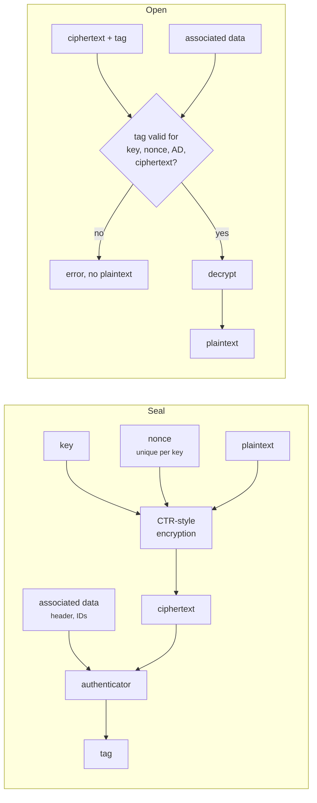
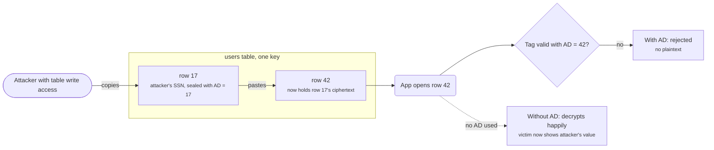
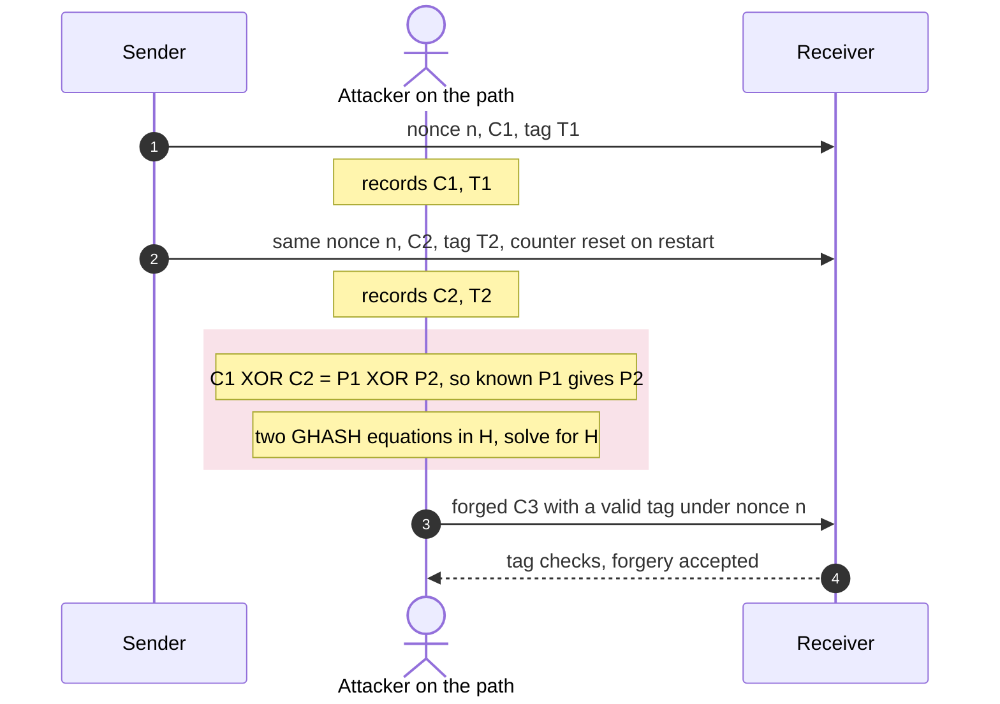

+++
title = 'Authenticated encryption'
description = 'An AEAD encrypts and authenticates in one call, binds unencrypted context to the ciphertext, and demands one thing in return: never reuse a nonce under the same key.'
question = 'What does an AEAD guarantee, and what happens when a nonce repeats?'
weight = 2
difficulty = 3
prerequisites = ['/notes/cryptography/symmetric-cryptography/01-block-ciphers-and-modes']
date = 2026-08-13
lastmod = 2026-10-30
verified = 2026-08-13
+++

## The idea in one minute

Encryption alone gives confidentiality. Real systems almost always need
**integrity** too: proof that the ciphertext was produced by someone holding
the key and has not been changed. The previous lesson showed that CTR and CBC
let an attacker edit plaintexts without the key, and that CBC padding errors
leak plaintext. **Authenticated encryption with associated data** (AEAD) fixes
both in a single primitive. It takes a key, a nonce, a plaintext, and some
**associated data** that stays in the clear, and returns a ciphertext with a
tag. Decryption either returns the exact plaintext, or returns an error and
nothing else.

The two AEADs in everyday use are **AES-GCM** (NIST SP 800-38D) and
**ChaCha20-Poly1305** (RFC 8439). Both are fast, both are in TLS 1.3, and both
fail the same way: if the same nonce is used twice with the same key,
confidentiality of those messages is lost, and the attacker can usually forge
new messages too.

The consequence to act on: **use an AEAD for every symmetric encryption, put
the context that must not be swapped into the associated data, and have a
written plan for how nonces stay unique**. If you cannot guarantee uniqueness,
choose a construction that tolerates repeats: AES-GCM-SIV, or XChaCha20 with
random nonces.

## A picture



The nonce is highlighted because it is the one input the caller must manage
correctly. Everything else the primitive handles.

## How it really works

### The interface

RFC 5116 defines the AEAD interface that IETF protocols use:

```text
seal(key, nonce, plaintext, associated_data) -> ciphertext_with_tag
open(key, nonce, ciphertext_with_tag, associated_data) -> plaintext | FAIL
```

The security goal combines two properties. **Confidentiality**: ciphertexts
reveal nothing about plaintexts beyond their length, even to an attacker who can
get chosen messages encrypted. **Integrity of ciphertexts**: an attacker cannot
produce any `(nonce, ciphertext, associated data)` triple that opens
successfully, other than ones the key holder actually produced. The second
property is what kills padding oracles and bit-flipping attacks: modified
ciphertext never reaches the decryption logic.

Both properties are conditional on the caller supplying a **nonce that is
unique for each seal under a given key**. The nonce does not need to be secret
or unpredictable for GCM or ChaCha20-Poly1305; it needs to be unique. That is a
different requirement from a CBC IV, and it is the most important line in the
contract.

Laid out byte by byte, a sealed record from this lesson's demo has four parts, and only the ciphertext is secret.

```mermaid {title="A sealed record: clear context, nonce, ciphertext, tag"}
packet-beta
  0-11: "associated data, 12 B, in clear"
  12-23: "nonce, 12 B, unique per key"
  24-38: "ciphertext, 15 B, plaintext length"
  39-54: "tag, 16 B, covers all of it"
```

### Associated data

Associated data is authenticated but not encrypted. It exists because messages
travel with context that must stay readable but must not be swapped: a packet
header, a record sequence number, a database row ID, a tenant ID, a protocol
version, a key ID.

The classic bug it prevents is a **cut-and-paste attack**. Suppose a database
stores each user's encrypted SSN in a column, all under one key. Without
associated data, an attacker with write access to the table can copy their own
ciphertext into the victim's row, or the victim's into theirs, and the
application decrypts it happily. If the row ID is the associated data, the
moved ciphertext fails authentication because it was sealed for a different
row. The rule of thumb: **anything the application uses to decide what a
ciphertext means belongs in the associated data**.

The copied ciphertext is byte-for-byte valid, so only the row ID in the associated data can tell the application it is in the wrong place.



### AES-GCM

**Galois/Counter Mode** combines AES in CTR mode with a polynomial MAC called
GHASH. In outline:

1. Derive the hash key `H = AES_k(0^128)`.
2. With the recommended 96-bit nonce, form the counter block `J_0 = nonce || 1`.
   Encrypt the plaintext in CTR mode starting from the next counter.
3. Compute GHASH over the associated data, the ciphertext, and a final block
   holding both their lengths. GHASH evaluates them as a polynomial in `H` over
   the field GF(2^128).
4. Encrypt the GHASH result with `AES_k(J_0)` to get the tag.

The four steps fit together like this: CTR does the encrypting, GHASH under `H` does the authenticating, and `AES_k(J_0)` masks the result.

```mermaid {title="GCM is CTR encryption plus a GHASH tag masked by AES of J0"}
flowchart LR
  N["96-bit nonce"] --> J0["2. J0 = nonce, counter 1"]
  J0 --> E0["AES_k(J0)"]
  J0 --> KS["CTR keystream<br/><small>from J0 + 1</small>"]
  PT["plaintext"] --> X1(("XOR"))
  KS --> X1 --> CT["ciphertext"]
  H["1. H = AES_k(0)"] --> GH["3. GHASH under H<br/><small>AD, ciphertext, lengths</small>"]
  AD["associated data"] --> GH
  CT --> GH
  GH --> X2(("XOR"))
  E0 --> X2 --> TAG["4. tag"]
  class E0,KS,GH,H compute
  class N memory
  class TAG good
```

GCM is very fast with hardware AES and carry-less multiplication instructions,
and it is the default AEAD in TLS, IPsec, and most cloud KMS APIs. SP 800-38D
sets limits that matter in design:

- **Nonce size.** 96 bits is the efficient and recommended length; other lengths
  are hashed into `J_0` and complicate the analysis.
- **Tag size.** 128 bits is the norm. SP 800-38D permits shorter tags with
  extra restrictions; there is rarely a reason to use them.
- **Message size.** At most 2^39 − 256 bits (about 64 GiB) of plaintext per
  message.
- **Invocations per key.** With randomly generated 96-bit nonces, no more than
  2^32 messages under one key, to keep the probability of a nonce collision
  negligible.

### ChaCha20-Poly1305

RFC 8439 combines the **ChaCha20** stream cipher with the **Poly1305**
one-time authenticator. ChaCha20 generates a keystream from a 256-bit key, a
96-bit nonce, and a 32-bit block counter using only additions, rotations, and
XORs, which are fast and constant-time in plain software. For each message, the
first ChaCha20 block derives a fresh one-time Poly1305 key; the tag is Poly1305
over the associated data, the ciphertext, and their lengths.

It exists because AES without hardware support is slow, and table-based AES in
software leaks timing through the CPU cache. On devices without AES
instructions, ChaCha20-Poly1305 is the faster and safer choice. With them,
the two are comparable. Its nonce rule is identical to GCM's: unique per key.

### Why nonce reuse is catastrophic

Both AEADs encrypt with a keystream that depends only on the key and nonce. Use
the same pair twice and the two plaintexts are XORed with the same keystream.
The attacker computes `C1 XOR C2 = P1 XOR P2`, and any known or guessable part
of one message reveals the matching part of the other. That loss alone is
serious, but the authentication side is worse:

- In **GCM**, two messages under the same nonce give the attacker two
  polynomial equations in the secret hash key `H`. Solving them, which is
  practical, recovers `H`, and with `H` the attacker can forge valid tags for
  arbitrary ciphertexts under that nonce. Antoine Joux described this
  "forbidden attack" in comments to NIST during GCM's standardization. In 2016,
  Böck, Zauner, Devlin, Somorovsky, and Jovanovic scanned the internet and found
  HTTPS servers that repeated GCM nonces, and demonstrated forgeries against
  them.
- In **ChaCha20-Poly1305**, a repeated nonce repeats the one-time Poly1305 key,
  and two messages authenticated with the same one-time key are enough to
  recover it and forge.

So one repeated nonce costs confidentiality of those messages and, in practice,
integrity of everything sealed under that key and nonce. The fix is not to try
harder at the call site. It is to design so that repeats cannot happen.

Follow the attack in order: two recorded messages under one nonce are enough to read one plaintext and to forge new ones.



### Strategies that keep nonces unique

| Strategy | How | Safe while | Breaks when |
| --- | --- | --- | --- |
| **Counter** | Increment a per-key message counter | One writer, state never rolls back | Two processes share a key; a VM snapshot or backup restores an old counter |
| **Implicit sequence numbers** | TLS 1.3 XORs the record sequence number into a per-connection IV | Keys are per connection and per direction | Never in TLS 1.3, by design: fresh keys every connection |
| **Random 96-bit nonces** | Draw from a CSPRNG | Well under 2^32 messages per key | High-volume keys; a broken or forked RNG |
| **Random 192-bit nonces** | XChaCha20-Poly1305 | Practically unlimited messages | A broken RNG |
| **Misuse-resistant AEAD** | AES-GCM-SIV | Repeats leak only equality of identical messages | Used as an excuse to stop caring about nonces at all |
| **Fresh key per message** | Derive a per-message key with a KDF | The KDF input is unique | Then nonce uniqueness has just moved into the KDF input |

TLS 1.3 (RFC 8446) is a good model: each direction of each connection gets its
own key from the handshake, and the nonce is the 64-bit record sequence number
XORed into a per-connection IV. No randomness, no shared state, and the
sequence number cannot repeat without the connection ending.

Placed by how much state discipline they need and how much volume they tolerate, the strategies from the table sort into clear groups.

```mermaid {title="Nonce strategies: state needed versus volume tolerated"}
quadrantChart
  x-axis Little state to manage --> Strict state discipline
  y-axis Fails at high volume --> Safe at high volume
  quadrant-1 Safe while state holds
  quadrant-2 Safe and easy
  quadrant-3 Easy but limited
  quadrant-4 Fragile
  Counter: [0.82, 0.78]
  TLS 1.3 sequence numbers: [0.55, 0.93]
  Random 96-bit: [0.15, 0.2]
  XChaCha20 random 192-bit: [0.15, 0.9]
  AES-GCM-SIV: [0.28, 0.72]
  Key per message: [0.68, 0.6]
```

### Nonce-misuse resistance: AES-GCM-SIV

**AES-GCM-SIV** (RFC 8452) changes the order of operations. It first computes
the tag, from a polynomial hash (POLYVAL) over the associated data and the
plaintext, then uses the tag as the initial counter for CTR encryption. The nonce is still an input,
and the per-message keys are derived from it, but if the same nonce is reused
with different messages, the counters differ because the plaintexts differ. The
only leak from reuse is that **identical (nonce, associated data, plaintext)
triples produce identical ciphertexts**, which reveals that the same message was
sent twice. Forgery stays infeasible.

The price: encryption needs two passes over the plaintext, so it cannot stream,
and the per-message key derivation adds a fixed cost. It is a good fit where
nonces come from a random number generator across many machines, or where you
cannot rule out state rollback.

### Extended nonces: XChaCha20-Poly1305

XChaCha20-Poly1305 uses a 192-bit nonce. It runs HChaCha20 on the key and the
first 128 bits of the nonce to derive a subkey, then runs ordinary
ChaCha20-Poly1305 with the remaining 64 bits. With 192 bits, random nonces are
safe for any realistic number of messages, so callers can draw a fresh random
nonce every time and stop managing counters. It is widely implemented
(libsodium, for example), but as of October 2026 its IETF specification is an
Internet-Draft from the CFRG, not an RFC.

Using `n^2 / 2^(b+1)`, the upper line is 96-bit random nonces and the lower line is 192-bit: at 2^32 messages the first is about 2^-33 and the second is about 2^-129.

```mermaid {title="Random-nonce collision probability, 96-bit versus 192-bit"}
xychart-beta
  x-axis "Messages under one key" ["2^24", "2^28", "2^32", "2^36", "2^40", "2^44", "2^48"]
  y-axis "log2 of collision probability" -150 --> 0
  line [-49, -41, -33, -25, -17, -9, -1]
  line [-145, -137, -129, -121, -113, -105, -97]
```

## Code

The program builds a toy AEAD the way the theory says to: CTR-style encryption
(with HMAC-SHA256 as the keystream function, since the standard library has no
AES), then HMAC-SHA256 over the associated data, nonce, and ciphertext, with
each field length-prefixed. It shows bit flipping succeeding without the tag
check and failing with it, the associated data binding a ciphertext to its
context, and a nonce reuse that exposes a plaintext.

```python {title="toy_aead.py"}
"""toy_aead.py: a toy AEAD built as encrypt-then-MAC, and what nonce reuse does.

TOY ONLY. The "cipher" is HMAC-SHA256 used as a PRF in counter mode; the tag is
HMAC-SHA256 over the associated data, nonce and ciphertext. It shows the shape
of an AEAD interface. Real systems use AES-GCM or ChaCha20-Poly1305 from a
vetted library. Standard library only; offline; deterministic.
"""

from __future__ import annotations

import hashlib
import hmac

TAG = 16  # bytes; HMAC-SHA256 truncated to 128 bits, the same size as a GCM tag


class InvalidTag(Exception):
    pass


def xor(a: bytes, b: bytes) -> bytes:
    return bytes(x ^ y for x, y in zip(a, b))


def subkeys(key: bytes) -> tuple[bytes, bytes]:
    """Two independent keys from one: never use one key for both jobs."""
    return (hmac.new(key, b"toy-aead enc", hashlib.sha256).digest(),
            hmac.new(key, b"toy-aead mac", hashlib.sha256).digest())


def keystream(enc_key: bytes, nonce: bytes, n: int) -> bytes:
    out = b"".join(hmac.new(enc_key, nonce + i.to_bytes(4, "big"), hashlib.sha256).digest()
                   for i in range(n // 32 + 1))
    return out[:n]


def mac_input(aad: bytes, nonce: bytes, ct: bytes) -> bytes:
    # Length-prefix every field so (aad, ct) boundaries cannot be shifted.
    return b"".join(len(x).to_bytes(8, "big") + x for x in (aad, nonce, ct))


def seal(key: bytes, nonce: bytes, plaintext: bytes, aad: bytes) -> bytes:
    enc_key, mac_key = subkeys(key)
    ct = xor(plaintext, keystream(enc_key, nonce, len(plaintext)))
    tag = hmac.new(mac_key, mac_input(aad, nonce, ct), hashlib.sha256).digest()[:TAG]
    return ct + tag


def open_(key: bytes, nonce: bytes, sealed: bytes, aad: bytes) -> bytes:
    enc_key, mac_key = subkeys(key)
    ct, tag = sealed[:-TAG], sealed[-TAG:]
    want = hmac.new(mac_key, mac_input(aad, nonce, ct), hashlib.sha256).digest()[:TAG]
    if not hmac.compare_digest(tag, want):  # verify first, decrypt only after
        raise InvalidTag("authentication failed; no plaintext released")
    return xor(ct, keystream(enc_key, nonce, len(ct)))


def try_open(label: str, key: bytes, nonce: bytes, sealed: bytes, aad: bytes) -> None:
    try:
        print(f"{label:<32} -> {open_(key, nonce, sealed, aad)!r}")
    except InvalidTag as e:
        print(f"{label:<32} -> REJECTED ({e})")


if __name__ == "__main__":
    key = hashlib.sha256(b"demo key, never hard-code one").digest()
    nonce = (1).to_bytes(12, "big")  # 96-bit nonce, as in GCM and RFC 8439
    aad = b"to=acct-1001"            # sent in the clear, but authenticated
    msg = b"pay $100 to bob"

    sealed = seal(key, nonce, msg, aad)
    print("sealed:", sealed[:-TAG].hex(), "| tag", sealed[-TAG:].hex())
    try_open("honest open", key, nonce, sealed, aad)

    # Malleability: CTR alone lets an attacker who knows the format edit it.
    edit = bytearray(len(msg))
    edit[5] = ord("1") ^ ord("9")  # turn "$100" into "$900"
    flipped = xor(sealed[:-TAG], edit) + sealed[-TAG:]
    enc_key, _ = subkeys(key)
    print(f"{'flip one byte, no MAC check':<32} -> "
          f"{xor(flipped[:-TAG], keystream(enc_key, nonce, len(msg)))!r}")
    try_open("flip one byte, with MAC check", key, nonce, flipped, aad)
    try_open("same ciphertext, AAD changed", key, nonce, sealed, b"to=acct-6666")
    try_open("same ciphertext, nonce changed", key, (2).to_bytes(12, "big"), sealed, aad)
    print()

    # Nonce reuse: two messages under one (key, nonce) share a keystream.
    m1 = b"meet at the north gate at 9pm"
    m2 = b"the vault code is 4471-0093-2"
    c1 = seal(key, nonce, m1, b"")[:-TAG]
    c2 = seal(key, nonce, m2, b"")[:-TAG]
    print("c1 XOR c2 == m1 XOR m2:", xor(c1, c2) == xor(m1, m2))
    print("attacker knows m1, recovers m2:", xor(xor(c1, c2), m1))
    c3 = seal(key, (3).to_bytes(12, "big"), m2, b"")[:-TAG]
    print("fresh nonce instead, same trick:", xor(xor(c1, c3), m1).hex()[:32], "(noise)")
```

Run it with `python3 toy_aead.py`:

```text
sealed: b9000870eb7f083b33022df9823c35 | tag cca51ebf1eaf7441dee6e52ca8c7c735
honest open                      -> b'pay $100 to bob'
flip one byte, no MAC check      -> b'pay $900 to bob'
flip one byte, with MAC check    -> REJECTED (authentication failed; no plaintext released)
same ciphertext, AAD changed     -> REJECTED (authentication failed; no plaintext released)
same ciphertext, nonce changed   -> REJECTED (authentication failed; no plaintext released)

c1 XOR c2 == m1 XOR m2: True
attacker knows m1, recovers m2: b'the vault code is 4471-0093-2'
fresh nonce instead, same trick: eac933776d8eaa9dc002274db90f90c4 (noise)
```

The second line is the attack the previous lesson warned about: knowing only
the message format, the attacker changed `$100` to `$900` by XORing one byte of
ciphertext. With the tag checked, the same edit is rejected before decryption.
Moving the ciphertext to a different account, by changing the associated data,
is rejected too. The last block shows that encryption under a repeated nonce is
no encryption at all for the second message, while a fresh nonce defeats the
same trick.

> [!WARNING] Toy, not a recommendation
> Encrypt-then-MAC with independent keys and a length-prefixed MAC input is a
> sound generic composition, but this code has had no review, is slow, and
> skips limits a real AEAD enforces. Use AES-GCM, ChaCha20-Poly1305, or
> AES-GCM-SIV from a vetted library such as pyca `cryptography` or libsodium.

## Where it breaks

- **Nonce reuse.** Covered above, and still the most common way AEADs fail in
  practice. Look for keys shared across processes or regions with independent
  counters, counters kept in memory and reset on restart, and random 96-bit
  nonces on keys that encrypt billions of messages.
- **Releasing unverified plaintext.** An AEAD only protects you if nothing uses
  the plaintext before the tag has been checked. Streaming decryption that
  writes plaintext to disk or a socket chunk by chunk, before the final tag
  arrives, gives the attacker back the malleability of CTR. For large objects,
  split the data into chunks that are each sealed separately, with the chunk
  index and a final-chunk flag in the associated data.
- **Truncation and reordering across messages.** An AEAD protects one message.
  It does not stop an attacker from dropping, replaying, or reordering whole
  messages. Protocols add sequence numbers (often in the nonce or associated
  data) for that.
- **Key commitment.** GCM and ChaCha20-Poly1305 do not commit to the key: it is
  possible to craft one ciphertext that opens successfully under two different
  keys, to two different plaintexts. That rarely matters for a single sender
  and receiver, but it has enabled attacks on systems that assume a ciphertext
  identifies its key, such as message franking in end-to-end encrypted
  messaging (Dodis, Grubbs, Ristenpart, and Woodage, 2018). If several keys may
  be tried, add a key commitment.
- **Length is not hidden.** AEAD ciphertext is the plaintext length plus the tag.
  Compression before encryption makes it worse: when attacker-chosen and secret
  data are compressed together, the length leaks the secret, the basis of the
  CRIME and BREACH attacks on TLS and HTTP.
- **What the demo does not show.** The toy uses HMAC, so a repeated nonce does
  not leak its MAC key; in GCM and ChaCha20-Poly1305 it does. The demo also has
  no usage limits, no constant-time guarantees beyond `compare_digest`, and a
  hard-coded key.

## Remember this

- Use an AEAD for every symmetric encryption; a bare mode is unfinished.
- Decryption returns the exact plaintext or an error, never a partly checked
  result.
- Put identifiers and context that give a ciphertext its meaning into the
  associated data.
- A nonce must be unique per key; reuse leaks plaintext and, in GCM and
  ChaCha20-Poly1305, enables forgery.
- Prefer designs where uniqueness is structural: per-connection keys with
  sequence numbers, XChaCha20 random nonces, or AES-GCM-SIV.
- Respect key-usage limits: about 2^32 messages per key with random 96-bit
  GCM nonces.

## Try it

1. Run `toy_aead.py`. Change `mac_input` to plain `aad + ct`, with no nonce and
   no length prefixes, and find two different `(aad, ciphertext)` pairs that
   produce the same MAC input. What could an attacker do with that?
2. Change `open_` so it decrypts first and checks the tag afterwards, but still
   returns an error on a bad tag. Is it still safe? What if the caller logs the
   decrypted plaintext on failure?
3. Store three encrypted records with the row ID as associated data. Swap two
   ciphertexts between rows and confirm both fail to open.
4. Estimate the probability of a collision among `2^32` random 96-bit nonces
   using `n^2 / 2^(b+1)`. Repeat for 192-bit nonces.
5. Sketch the nonce strategy for a service that encrypts with one key from
   twenty stateless replicas. Which option from the table fits, and why?

## Check yourself

1. What is the difference between the nonce requirement of AES-GCM and the IV
   requirement of CBC?

   
   GCM needs the nonce to be unique for each message under a key; it may be
   predictable, even a simple counter. CBC needs the IV to be unpredictable to
   the attacker; uniqueness alone is not enough. Mixing up the two produces
   either predictable CBC IVs or random GCM nonces on keys that encrypt too many
   messages.
   

2. Why does associated data stop the cut-and-paste attack on encrypted database
   fields?

   
   The tag covers the associated data, so a ciphertext sealed with row ID 17
   only opens when the caller supplies 17. Copied into row 42, it is opened with
   42 as the associated data, the tag check fails, and no plaintext is returned.
   The attacker would need the key to produce a valid tag for the new row.
   

3. Why is nonce reuse worse for GCM than for plain CTR mode?

   
   Both lose confidentiality of the affected messages, because the keystream
   repeats. GCM additionally leaks enough about its GHASH key `H` that the
   attacker can recover `H` and forge tags under that nonce, so integrity, the
   property GCM was chosen for, is lost too.
   

4. What does AES-GCM-SIV leak if a nonce is reused, and what does it cost?

   
   Only whether two messages with the same nonce and associated data had
   identical plaintexts. Confidentiality of distinct messages and integrity are
   preserved. The cost is two passes over the data, so encryption cannot stream,
   plus a small per-message key derivation.
   

5. Why can XChaCha20-Poly1305 use random nonces safely when AES-GCM struggles at
   scale?

   
   Collision probability among random nonces grows with the square of the number
   of messages divided by the nonce space. With 96 bits, it becomes
   uncomfortable around 2^32 messages per key. With 192 bits, the number of
   messages needed for a meaningful collision probability is far beyond what any
   system will encrypt under one key.
   

## Sources

- M. Dworkin, [NIST SP 800-38D: Recommendation for Block Cipher Modes of Operation: Galois/Counter Mode (GCM) and GMAC](https://csrc.nist.gov/pubs/sp/800/38/d/final), NIST, November 2007.
- Y. Nir and A. Langley, [RFC 8439: ChaCha20 and Poly1305 for IETF Protocols](https://www.rfc-editor.org/rfc/rfc8439), IRTF, June 2018.
- D. McGrew, [RFC 5116: An Interface and Algorithms for Authenticated Encryption](https://www.rfc-editor.org/rfc/rfc5116), IETF, January 2008.
- S. Gueron, A. Langley, Y. Lindell, [RFC 8452: AES-GCM-SIV: Nonce Misuse-Resistant Authenticated Encryption](https://www.rfc-editor.org/rfc/rfc8452), IRTF, April 2019.
- E. Rescorla, [RFC 8446: The Transport Layer Security (TLS) Protocol Version 1.3](https://www.rfc-editor.org/rfc/rfc8446), IETF, August 2018 (section 5.3, per-record nonce).
- S. Arciszewski, [XChaCha: eXtended-nonce ChaCha and AEAD_XChaCha20_Poly1305](https://datatracker.ietf.org/doc/draft-irtf-cfrg-xchacha/), IRTF CFRG Internet-Draft.
- A. Joux, "Authentication Failures in NIST version of GCM," comment to NIST, 2006.
- H. Böck, A. Zauner, S. Devlin, J. Somorovsky, P. Jovanovic, "Nonce-Disrespecting Adversaries: Practical Forgery Attacks on GCM in TLS," USENIX WOOT 2016.
- M. Bellare and C. Namprempre, "Authenticated Encryption: Relations among Notions and Analysis of the Generic Composition Paradigm," ASIACRYPT 2000.
- Y. Dodis, P. Grubbs, T. Ristenpart, J. Woodage, "Fast Message Franking: From Invisible Salamanders to Encryptment," CRYPTO 2018.
