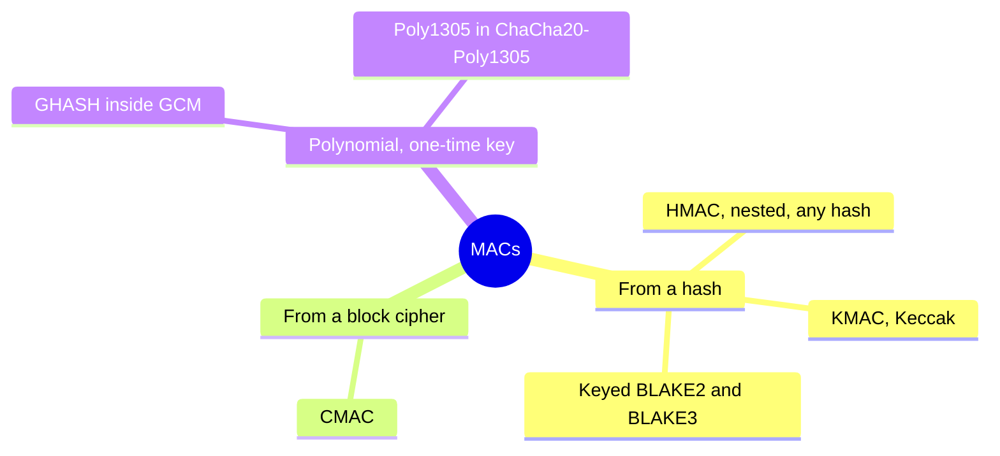
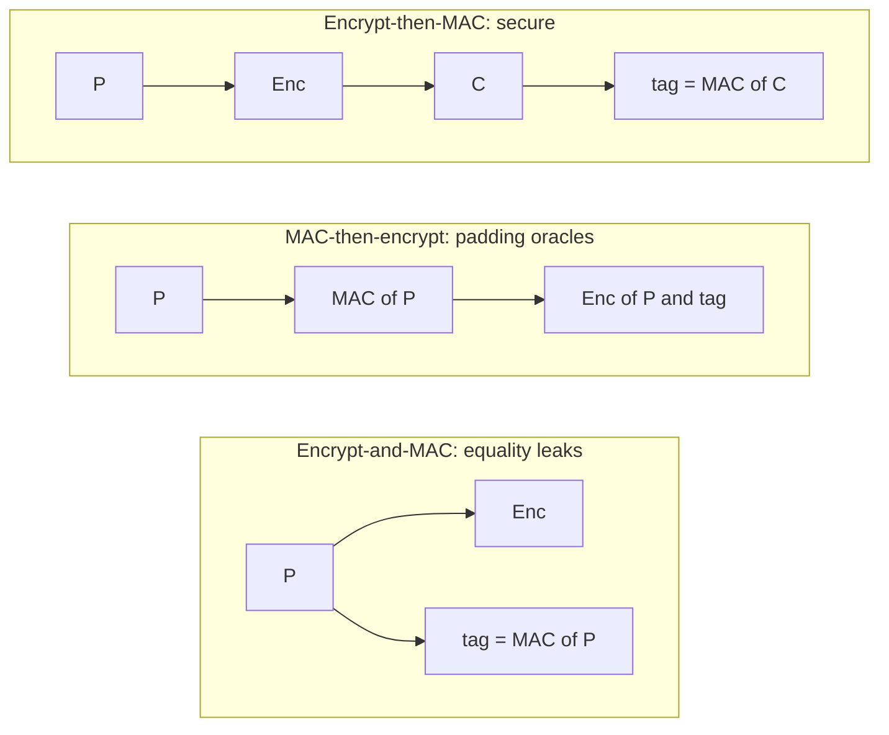

+++
title = 'MACs and HMAC'
description = 'A MAC proves a message came from a key holder and was not changed. A hash of key and message does not, because of length extension; HMAC does.'
question = 'Why is HMAC built the way it is, and how do MAC checks go wrong in practice?'
weight = 3
difficulty = 3
prerequisites = ['/notes/cryptography/foundations/03-hash-functions', '/notes/cryptography/symmetric-cryptography/02-authenticated-encryption']
date = 2026-08-15
lastmod = 2026-08-15
verified = 2026-08-15
+++

## The idea in one minute

A **message authentication code** (MAC) is a short tag computed from a secret
key and a message. Anyone who holds the key can compute and check tags; anyone
who does not cannot produce a valid tag for any new message, even after seeing
tags for as many messages as they like. A MAC gives **integrity and
authenticity between parties who share a key**. It does not hide the message,
and it does not prove to a third party who sent it, because the receiver could
have computed the same tag.

A hash function is not a MAC, and the obvious way to make one,
`sha256(key || message)`, is broken for SHA-256 and every other Merkle–Damgård
hash: given one valid tag, an attacker can compute a valid tag for the message
with extra data appended, without knowing the key. **HMAC** (RFC 2104) wraps
the hash twice with the key, which removes that attack and turns any decent hash
into a MAC with a security proof.

The consequence to act on: **use HMAC (or a dedicated MAC such as KMAC or
keyed BLAKE2) rather than any home-made hash of a key, compare tags in constant
time, and MAC exactly the bytes you will act on**.

## A picture

```mermaid {title="Why sha256(key || message) can be extended and HMAC cannot"}
flowchart TB
  subgraph Naive["sha256(key || msg)"]
    A1["key || msg || pad"] --> S1["internal state<br/><small>= the published tag</small>"]
    S1 --> A2["+ attacker's extra blocks"] --> T2["valid tag for<br/>key || msg || pad || extra"]
  end
  subgraph HMAC["HMAC"]
    B1["(key XOR ipad) || msg"] --> I["inner hash"]
    I --> B2["(key XOR opad) || inner hash"] --> O["outer hash = tag"]
  end
  class S1,T2 warn
  class I compute
  class O good
```

In the naive construction the published tag *is* the hash function's internal
state, so anyone can resume hashing from it. In HMAC the published tag is the
output of a second, keyed hash, and the inner state is never revealed.

## How it really works

### What a MAC promises

The standard security notion is **existential unforgeability under chosen
message attack**. The attacker may ask for tags on any messages they choose,
adaptively. They win if they output any message they did not ask about together
with a valid tag. A secure MAC makes the winning probability negligible, close
to guessing a random tag.

The game runs in two phases: the attacker collects as many tags as it likes, then must produce a tag for a message it never asked about.

```mermaid {title="Unforgeability: chosen-message queries, then one new forgery"}
sequenceDiagram
  autonumber
  actor A as Attacker
  participant O as Tag oracle, holds the key
  loop as many times as the attacker likes
    A->>O: message m_i of its choice
    O-->>A: valid tag t_i
  end
  A->>O: new message m, never queried, with a guessed tag t
  alt t is valid for m
    O-->>A: forgery, attacker wins
  else
    O-->>A: rejected
  end
  Note over A,O: secure MAC means winning is about as likely as guessing a random tag
```

Three consequences follow, and each is a common misunderstanding:

| A MAC does | A MAC does not |
| --- | --- |
| Detect any change to the message | Hide the message (use an AEAD for that) |
| Prove the sender held the key | Prove *which* key holder sent it; both sides can compute the tag (use a digital signature) |
| Bind the tag to the exact bytes | Stop replay of an old, valid message and tag (add a nonce, timestamp, or sequence number) |

The middle row is why MACs are not signatures. A webhook receiver that shares
an HMAC key with the sender can verify the sender, but it cannot prove to a
court that the sender, rather than the receiver, created a message. When you
need that property, you need the public-key signatures in
[digital signatures](/notes/cryptography/public-key-cryptography/02-digital-signatures/).

Both parties can produce the same tag with the shared key, so the judge has nothing to tell them apart.

```mermaid {title="A shared-key MAC cannot say which key holder made the tag"}
flowchart LR
  AL(["Alice"])
  BO(["Bob"])
  K("Shared HMAC key")
  M["message + valid tag"]
  J("Judge")
  Q@{ shape: diam, label: "Who made the tag?" }
  U["Cannot tell<br/><small>non-repudiation needs a signature</small>"]
  K --- AL
  K --- BO
  AL -.->|could have| M
  BO -.->|could have| M
  M --> J --> Q --> U
  class U warn
```

### Why a hash is not a MAC

A cryptographic hash has no key, so anyone can compute it. Prepending a key
looks like it should fix that, and for some hash designs it does, but SHA-256
and its relatives are built with the **Merkle–Damgård** construction:

1. Pad the message: append the byte `0x80`, then zeros, then the message length
   in bits as a 64-bit integer, so the total is a multiple of 64 bytes.
2. Start from a fixed initial state of eight 32-bit words.
3. For each 64-byte block, run the compression function on the current state
   and the block to get the next state.
4. The final state, written out, is the digest.

The digest is the complete internal state after the last block. If an attacker
knows `sha256(key || msg)` and the length of `key || msg`, they can work out the
padding that was appended (call it `glue`), load the digest back as the state,
and keep compressing more blocks of their own. The result is exactly
`sha256(key || msg || glue || extra)`, a valid naive tag for a message the key
holder never signed. The key length is not secret in any useful sense: an
attacker tries each plausible length.

Here is the demo's forged message laid out in bytes, 32 per row: the first 64 bytes are exactly the block the server hashed, so its published tag is the state after them, and the attacker hashes only the last row.

```mermaid {title="The forged message: original block, glue padding, attacker's extension"}
packet-beta
  0-26: "secret key, 27 B, only its length guessed"
  27-48: "user=alice&role=viewer, 22 B"
  49: "80"
  50-55: "00 x6"
  56-63: "length 392 bits"
  64-74: "&role=admin, 11 B"
```

This is a **length-extension attack**. It affects MD5, SHA-1, SHA-256, and
SHA-512. It does not affect SHA-3, BLAKE2, or BLAKE3, which use different
constructions, or the truncated variants SHA-512/256 and SHA-384, whose
digests leave part of the state hidden. In 2009, Thai Duong and Juliano Rizzo
used it to forge signed requests to the Flickr API, which authenticated calls
with an MD5 hash of a secret followed by the parameters.

The program in the next section implements SHA-256's compression function in
Python, checks it against `hashlib`, and performs the attack.

### HMAC

HMAC was designed by Bellare, Canetti, and Krawczyk (1996) and published as
RFC 2104; NIST adopted it in FIPS 198-1. For a hash `H` with block size `B`
bytes (64 for SHA-256):

```text
K'   = H(K) if K is longer than B, else K; then pad K' with zeros to B bytes
HMAC(K, m) = H( (K' XOR opad) || H( (K' XOR ipad) || m ) )
ipad = the byte 0x36 repeated B times
opad = the byte 0x5c repeated B times
```

The **inner hash** processes the message under one key-derived prefix. The
**outer hash** processes the inner result under a different key-derived
prefix. Length extension of the inner hash is useless, because the attacker
never sees its output; extending the outer hash is useless, because its input
is a fixed-size inner digest and the attacker cannot produce a valid outer tag
for a different inner value without the key. The security proof needs only that
the compression function behaves like a pseudorandom function when keyed
through its state, a weaker assumption than collision resistance. That is why
collisions in SHA-1 and MD5 did not translate into practical forgeries against
HMAC-SHA1 or HMAC-MD5, though there is no reason to choose either today.

Read the rows top to bottom: each hash input starts with a key-derived block, and the only thing the outer hash sees from the message is the fixed-size inner digest.

```mermaid {title="HMAC is two keyed hashes, and only the outer one is published"}
block-beta
  columns 3
  KI["padded key XOR ipad, 64 B"] M["message, any length"]:2
  IN["inner hash of the row above: 32 B, never published"]:3
  KO["padded key XOR opad, 64 B"] ID["inner digest, 32 B"]:2
  TAG["outer hash of the row above = the published tag"]:3
```

Practical notes:

- **Key length.** Use a random key at least as long as the hash output (32 bytes
  for HMAC-SHA256). Longer than the block size is allowed but gets hashed down.
- **Truncation.** RFC 2104 allows truncating the tag to the leftmost `t` bits
  and recommends `t` of at least half the hash length and at least 80 bits.
  Many protocols use 128-bit tags.
- **Algorithm choice.** HMAC-SHA256 is the default almost everywhere.
  HMAC-SHA512 is often faster on 64-bit CPUs.

### Other MACs you will meet

| MAC | Built from | Where it appears |
| --- | --- | --- |
| HMAC | Any hash (RFC 2104, FIPS 198-1) | JWT HS256, AWS Signature Version 4, webhooks, TLS 1.2 PRF, HKDF |
| CMAC | A block cipher (NIST SP 800-38B) | Payment systems, some hardware |
| GMAC / GHASH | GF(2^128) multiplication, inside GCM | AES-GCM tags |
| Poly1305 | A one-time polynomial MAC (RFC 8439) | ChaCha20-Poly1305; the key must never be reused |
| KMAC | SHA-3's Keccak (NIST SP 800-185) | Where SHA-3 is preferred; no nested construction needed |
| Keyed BLAKE2 / BLAKE3 | A native key input (RFC 7693 for BLAKE2) | libsodium's generic hash, file integrity |

Poly1305 deserves a warning: it is a **one-time** authenticator. Two messages
under the same Poly1305 key reveal the key. ChaCha20-Poly1305 derives a fresh
Poly1305 key per nonce for exactly this reason, which is one reason nonce reuse
is fatal there.

Grouped by what they are built from, the MACs in the table fall into three families.



### Comparing tags in constant time

A server checks a tag by recomputing it and comparing. If the comparison stops at
the first differing byte, as `==` on bytes and `memcmp` typically do, the time
it takes depends on how many leading bytes of the guess are right. An attacker
who can measure that time, even noisily over many requests, can find the tag
one byte at a time: try all 256 values for the first byte, keep the one that
takes longest, and move on. That turns a `2^128` guessing problem into a few
thousand guesses per byte.

The fix is a comparison whose running time does not depend on where the inputs
differ. Python provides `hmac.compare_digest`, documented to reduce the risk of
timing attacks for exactly this purpose; most languages have an equivalent
(`crypto.timingSafeEqual` in Node.js, `subtle.ConstantTimeCompare` in Go,
`MessageDigest.isEqual` in modern Java). The second program in this lesson
simulates the attack, using a count of compared bytes in place of time so the
output is reproducible.

### Ordering with encryption

When you combine a cipher with a MAC yourself, the order matters. There are
three generic compositions:

| Composition | What is sent | Verdict |
| --- | --- | --- |
| **Encrypt-then-MAC** | `C = Enc(P)`, tag = `MAC(C)` | Secure generically; the receiver rejects tampered ciphertext before decrypting |
| **MAC-then-encrypt** | `C = Enc(P || MAC(P))` | Decryption and padding checks run on unauthenticated data; source of padding oracles and Lucky Thirteen in TLS CBC suites |
| **Encrypt-and-MAC** | `C = Enc(P)`, tag = `MAC(P)` | The tag is over plaintext, so a deterministic MAC reveals when two plaintexts are equal |

Bellare and Namprempre proved in 2000 that encrypt-then-MAC, with a secure
cipher and a secure MAC under independent keys, gives authenticated encryption,
while the other two orders do not in general. TLS 1.2 originally used
MAC-then-encrypt for CBC suites; RFC 7366 added an encrypt-then-MAC extension
afterwards. TLS 1.3 removed the question entirely by allowing only AEADs. The
toy AEAD in the [previous lesson](/notes/cryptography/symmetric-cryptography/02-authenticated-encryption/)
is encrypt-then-MAC, and it MACs the nonce and associated data as well as the
ciphertext.

What the receiver can check before it touches the plaintext is the whole difference between the three orders.



### MAC the exact bytes

A tag authenticates a byte string. Bugs appear when the bytes that were MACed
and the meaning the application extracts from them can differ:

- **Ambiguous concatenation.** `MAC(user || role)` gives the same tag for
  `("ali", "cesuperadmin")` and `("alice", "superadmin")`. Length-prefix fields
  or use an unambiguous encoding.
- **Re-serialization.** Verifying a tag over parsed and re-encoded JSON, rather
  than over the received bytes, lets two encodings with different meanings
  share a tag. Verify the raw bytes, then parse.
- **Partial coverage.** A tag over the body but not the method, path, or
  destination lets an attacker replay the body elsewhere. AWS Signature
  Version 4 MACs a canonical form of the method, path, query, selected
  headers, and body hash for this reason.

## Code

The first program implements SHA-256 from FIPS 180-4 in pure Python, with the
option to resume from a published digest, verifies it against `hashlib`, and
forges a naive `sha256(key || msg)` tag for a message with `&role=admin`
appended. It then runs the same attack against HMAC-SHA256.

```python {title="length_extension.py"}
"""length_extension.py: forge sha256(key || msg) without the key; HMAC resists.

A pure-Python SHA-256 (FIPS 180-4), checked against hashlib, that can resume
from a published digest. That is all a length-extension attack needs.
Standard library only; offline; deterministic.
"""

from __future__ import annotations

import hashlib
import hmac
import struct

K = [int(x, 16) for x in """
428a2f98 71374491 b5c0fbcf e9b5dba5 3956c25b 59f111f1 923f82a4 ab1c5ed5
d807aa98 12835b01 243185be 550c7dc3 72be5d74 80deb1fe 9bdc06a7 c19bf174
e49b69c1 efbe4786 0fc19dc6 240ca1cc 2de92c6f 4a7484aa 5cb0a9dc 76f988da
983e5152 a831c66d b00327c8 bf597fc7 c6e00bf3 d5a79147 06ca6351 14292967
27b70a85 2e1b2138 4d2c6dfc 53380d13 650a7354 766a0abb 81c2c92e 92722c85
a2bfe8a1 a81a664b c24b8b70 c76c51a3 d192e819 d6990624 f40e3585 106aa070
19a4c116 1e376c08 2748774c 34b0bcb5 391c0cb3 4ed8aa4a 5b9cca4f 682e6ff3
748f82ee 78a5636f 84c87814 8cc70208 90befffa a4506ceb bef9a3f7 c67178f2""".split()]
H0 = [0x6A09E667, 0xBB67AE85, 0x3C6EF372, 0xA54FF53A,
      0x510E527F, 0x9B05688C, 0x1F83D9AB, 0x5BE0CD19]
M32 = 0xFFFFFFFF


def rotr(x: int, n: int) -> int:
    return ((x >> n) | (x << (32 - n))) & M32


def compress(state: list[int], block: bytes) -> list[int]:
    w = list(struct.unpack(">16I", block))
    for t in range(16, 64):
        s0 = rotr(w[t-15], 7) ^ rotr(w[t-15], 18) ^ (w[t-15] >> 3)
        s1 = rotr(w[t-2], 17) ^ rotr(w[t-2], 19) ^ (w[t-2] >> 10)
        w.append((w[t-16] + s0 + w[t-7] + s1) & M32)
    a, b, c, d, e, f, g, h = state
    for t in range(64):
        t1 = (h + (rotr(e, 6) ^ rotr(e, 11) ^ rotr(e, 25)) + ((e & f) ^ (~e & g))
              + K[t] + w[t]) & M32
        t2 = ((rotr(a, 2) ^ rotr(a, 13) ^ rotr(a, 22)) + ((a & b) ^ (a & c) ^ (b & c))) & M32
        a, b, c, d, e, f, g, h = (t1 + t2) & M32, a, b, c, (d + t1) & M32, e, f, g
    return [(x + y) & M32 for x, y in zip(state, [a, b, c, d, e, f, g, h])]


def padding(total_len: int) -> bytes:
    """What SHA-256 appends to a message of total_len bytes before hashing."""
    return b"\x80" + b"\x00" * ((55 - total_len) % 64) + struct.pack(">Q", total_len * 8)


def sha256(data: bytes, state: list[int] | None = None, prefix_len: int = 0) -> bytes:
    """SHA-256 of data; or, given a state, continue a hash already prefix_len long."""
    state = list(state or H0)
    data = data + padding(prefix_len + len(data))
    for i in range(0, len(data), 64):
        state = compress(state, data[i:i + 64])
    return struct.pack(">8I", *state)


# --- the server: holds a secret key, issues and checks tags ------------------
SECRET = b"k3y-the-attacker-never-sees"  # 27 bytes


def naive_tag(msg: bytes) -> bytes:
    return hashlib.sha256(SECRET + msg).digest()


def naive_ok(msg: bytes, tag: bytes) -> bool:
    return hmac.compare_digest(naive_tag(msg), tag)


def hmac_ok(msg: bytes, tag: bytes) -> bool:
    return hmac.compare_digest(hmac.new(SECRET, msg, hashlib.sha256).digest(), tag)


if __name__ == "__main__":
    for sample in (b"", b"abc", b"x" * 55, b"x" * 56, b"y" * 200):
        assert sha256(sample) == hashlib.sha256(sample).digest()
    print("pure-Python SHA-256 matches hashlib on 5 inputs")

    msg = b"user=alice&role=viewer"
    tag = naive_tag(msg)  # the attacker sees msg and tag, never SECRET
    print("issued:", msg, tag.hex()[:16] + "...")

    extra = b"&role=admin"
    for guess in range(20, 33):  # the attacker only needs the key's length
        glue = padding(guess + len(msg))
        state = list(struct.unpack(">8I", tag))
        forged_tag = sha256(extra, state, guess + len(msg) + len(glue))
        forged_msg = msg + glue + extra
        if naive_ok(forged_msg, forged_tag):
            print(f"key length {guess}: sha256(key||msg) ACCEPTS the forgery")
            print("forged message:", forged_msg)
            break

    hmac_tag = hmac.new(SECRET, msg, hashlib.sha256).digest()
    accepted = 0
    for guess in range(20, 33):
        glue = padding(guess + len(msg))
        state = list(struct.unpack(">8I", hmac_tag))
        forged_tag = sha256(extra, state, guess + len(msg) + len(glue))
        accepted += hmac_ok(msg + glue + extra, forged_tag)
    print(f"same attack on HMAC-SHA256: {accepted} of 13 key-length guesses accepted")
```

Run it with `python3 length_extension.py`:

```text
pure-Python SHA-256 matches hashlib on 5 inputs
issued: b'user=alice&role=viewer' e94df31815db7f2b...
key length 27: sha256(key||msg) ACCEPTS the forgery
forged message: b'user=alice&role=viewer\x80\x00\x00\x00\x00\x00\x00\x00\x00\x00\x00\x00\x00\x01\x88&role=admin'
same attack on HMAC-SHA256: 0 of 13 key-length guesses accepted
```

The forged message contains the SHA-256 padding bytes in the middle. A parser
that splits on `&` and keeps the last value of a repeated key now sees
`role=admin`, which is how the Flickr forgery worked. The attacker never saw
the key; they tried 8 key lengths before the server accepted. Against HMAC
every guess fails, because the published tag is not a resumable state.

The second program shows why the server's final comparison has to be constant
time. The attacker sends guesses for an 8-byte tag and observes how much work
the comparison did.

```python {title="compare_leak.py"}
"""compare_leak.py: why tag checks use hmac.compare_digest.

An early-exit comparison does less work when the first wrong byte comes sooner.
Here the "timing" is simulated as a count of byte comparisons, so the output is
deterministic; on a real server the same signal shows up, noisily, as time.
Standard library only; offline.
"""

from __future__ import annotations

import hashlib
import hmac

KEY = b"server-side secret"
MSG = b"transfer 10 to mallory"
TAG_LEN = 8  # a short, truncated tag keeps the demo small


def true_tag(msg: bytes) -> bytes:
    return hmac.new(KEY, msg, hashlib.sha256).digest()[:TAG_LEN]


def naive_equal(a: bytes, b: bytes) -> tuple[bool, int]:
    """Like ==: stops at the first difference. Returns (equal, bytes examined)."""
    for i, (x, y) in enumerate(zip(a, b)):
        if x != y:
            return False, i + 1
    return len(a) == len(b), len(a)


def constant_equal(a: bytes, b: bytes) -> tuple[bool, int]:
    """Like hmac.compare_digest: always examines every byte."""
    diff = 0
    for x, y in zip(a, b):
        diff |= x ^ y
    return diff == 0 and len(a) == len(b), len(a)


def recover(compare) -> tuple[bytes, int]:
    """Guess the tag one byte at a time, keeping the guess that costs the most work."""
    known, queries = b"", 0
    want = true_tag(MSG)
    for pos in range(TAG_LEN):
        best, best_work = 0, -1
        for guess in range(256):
            candidate = known + bytes([guess]) + bytes(TAG_LEN - pos - 1)
            ok, work = compare(want, candidate)
            queries += 1
            if ok:
                return candidate, queries
            if work > best_work:
                best, best_work = guess, work
        known += bytes([best])
    return known, queries


if __name__ == "__main__":
    print("real tag:          ", true_tag(MSG).hex())
    for name, fn in [("early-exit compare", naive_equal),
                     ("constant-time compare", constant_equal)]:
        tag, queries = recover(fn)
        verdict = "FORGED" if tag == true_tag(MSG) else "failed"
        print(f"{name:<22} {verdict}: guessed {tag.hex()} after {queries} queries")
    print(f"blind guessing would need about 2**{8 * TAG_LEN - 1} queries on average")
```

Run it with `python3 compare_leak.py`:

```text
real tag:           bf9ae5227e642957
early-exit compare     FORGED: guessed bf9ae5227e642957 after 1880 queries
constant-time compare  failed: guessed 0000000000000000 after 2048 queries
blind guessing would need about 2**63 queries on average
```

With an early-exit comparison, at most 256 guesses per byte recover the whole
tag. With a constant-time comparison every guess costs the same, the attacker
learns nothing, and is left with blind guessing.

Plotted from the run above, the early-exit line climbs one byte per 256 queries until all 8 bytes are known at query 1880, while the constant-time line never leaves zero.

```mermaid {title="Tag bytes recovered: early-exit versus constant-time compare"}
xychart-beta
  x-axis "Queries sent" ["0", "256", "512", "768", "1024", "1280", "1536", "1792", "1880"]
  y-axis "Tag bytes recovered" 0 --> 8
  line [0, 1, 2, 3, 4, 5, 6, 7, 8]
  line [0, 0, 0, 0, 0, 0, 0, 0, 0]
```

## Where it breaks

- **Key reuse across purposes.** Using one key as both an HMAC key and an
  encryption key, or for HMAC in two protocols, can let one context's tags be
  replayed in another. Derive separate keys with a KDF; see
  [key derivation](/notes/cryptography/symmetric-cryptography/04-key-derivation/).
- **Replay.** A valid message with a valid tag stays valid forever. Webhooks and
  signed URLs need a timestamp or nonce inside the MACed bytes and a receiver
  that rejects old or repeated ones.
- **Short or truncated tags.** A 32-bit tag can be guessed online in about two
  billion tries, which rate limits may not stop. Keep tags at 128 bits unless a
  standard says otherwise and the receiver limits attempts.
- **Timing elsewhere.** A constant-time comparison does not help if the server
  returns early on a malformed tag length, logs the expected tag, or reveals
  which check failed. All failures should look the same.
- **Weak or guessable keys.** HMAC with a human-chosen key is only as strong as
  the key. The JWT `HS256` algorithm with a short shared secret can be brute
  forced offline from any one token.
- **What the demos do not show.** The comparison leak is simulated as an exact
  count. Real timing signals are noisy and need many samples, but published
  attacks have recovered them over networks. And the pure-Python SHA-256 is for
  illustration; use `hashlib`.

## Remember this

- A MAC gives integrity and authenticity between key holders, not secrecy and
  not non-repudiation.
- `hash(key || msg)` is forgeable with SHA-256 and SHA-512 by length extension;
  use HMAC.
- HMAC hashes twice with two derived keys; the published tag is never a
  resumable state.
- Compare tags with `hmac.compare_digest` or the platform equivalent.
- Encrypt, then MAC the ciphertext, nonce, and associated data, with an
  independent key, or just use an AEAD.
- MAC the exact received bytes, unambiguously encoded, including anything that
  gives them meaning.

## Try it

1. Run `length_extension.py`. Change the server to use `hashlib.sha3_256` for
   the naive tag. Does the attack still work? Why?
2. Change the naive tag to `sha256(msg || key)`. Length extension no longer
   applies directly. What property of SHA-256 would an attacker need to break
   instead?
3. In `compare_leak.py`, make the oracle noisy: add a random amount (seeded)
   between 0 and 3 to the reported work. How many repeated queries per guess
   does the attacker need to still succeed?
4. Write `verify_webhook(body, header_tag, timestamp)` that rejects tags older
   than five minutes and uses `hmac.compare_digest`. Which bytes must the tag
   cover?
5. Find a place in a codebase you know that compares a secret with `==`. Is the
   value attacker-guessable byte by byte?

## Check yourself

1. Why can an attacker extend `sha256(key || msg)` without knowing the key?

   
   The SHA-256 digest is its full internal state after the last block. Knowing
   the total length of `key || msg`, the attacker computes the padding that was
   appended, loads the digest as the starting state, and continues compressing
   extra blocks. The result equals `sha256(key || msg || padding || extra)`,
   which the server accepts. Only the key's length is needed, and that can be
   guessed.
   

2. What does the outer hash in HMAC achieve?

   
   It hides the inner hash's state. The tag the attacker sees is the output of a
   second keyed hash over a fixed-size value, so there is no resumable state to
   extend, and producing a tag for any other inner value needs the key.
   

3. Alice and Bob share an HMAC key. Bob shows a judge a message with a valid tag
   and claims Alice sent it. Why should the judge be unconvinced?

   
   Bob holds the same key and could have computed the tag himself. A MAC proves
   that some key holder produced the message, not which one. Non-repudiation
   needs a digital signature, where only the signer holds the private key.
   

4. Why is MAC-then-encrypt dangerous with CBC mode?

   
   The receiver must decrypt and check padding before it can check the MAC, so
   it processes attacker-modified ciphertext. Any observable difference between
   padding failures and MAC failures, including timing, becomes a padding
   oracle, as in Lucky Thirteen. Encrypt-then-MAC rejects the modified
   ciphertext before decryption.
   

5. Why does `==` on two tags create a vulnerability that `hmac.compare_digest`
   does not?

   
   `==` stops at the first differing byte, so its running time reveals how many
   leading bytes of a guess are correct. That lets an attacker recover the tag a
   byte at a time with a few hundred guesses per byte. `compare_digest` takes
   time that does not depend on where the inputs differ.
   

## Sources

- H. Krawczyk, M. Bellare, R. Canetti, [RFC 2104: HMAC: Keyed-Hashing for Message Authentication](https://www.rfc-editor.org/rfc/rfc2104), IETF, February 1997.
- NIST, [FIPS 198-1: The Keyed-Hash Message Authentication Code (HMAC)](https://csrc.nist.gov/pubs/fips/198-1/final), July 2008.
- NIST, [FIPS 180-4: Secure Hash Standard (SHS)](https://csrc.nist.gov/pubs/fips/180-4/upd1/final), August 2015.
- M. Bellare, R. Canetti, H. Krawczyk, "Keying Hash Functions for Message Authentication," CRYPTO 1996.
- M. Bellare and C. Namprempre, "Authenticated Encryption: Relations among Notions and Analysis of the Generic Composition Paradigm," ASIACRYPT 2000.
- P. Gutmann, [RFC 7366: Encrypt-then-MAC for Transport Layer Security (TLS) and Datagram Transport Layer Security (DTLS)](https://www.rfc-editor.org/rfc/rfc7366), IETF, September 2014.
- N. J. AlFardan and K. G. Paterson, "Lucky Thirteen: Breaking the TLS and DTLS Record Protocols," IEEE Symposium on Security and Privacy, 2013.
- T. Duong and J. Rizzo, "Flickr's API Signature Forgery Vulnerability," September 2009.
- J. Kelsey, S. Chang, R. Perlner, [NIST SP 800-185: SHA-3 Derived Functions: cSHAKE, KMAC, TupleHash and ParallelHash](https://csrc.nist.gov/pubs/sp/800/185/final), NIST, December 2016.
- Python Software Foundation, [hmac: Keyed-Hashing for Message Authentication](https://docs.python.org/3/library/hmac.html), Python 3 documentation.
