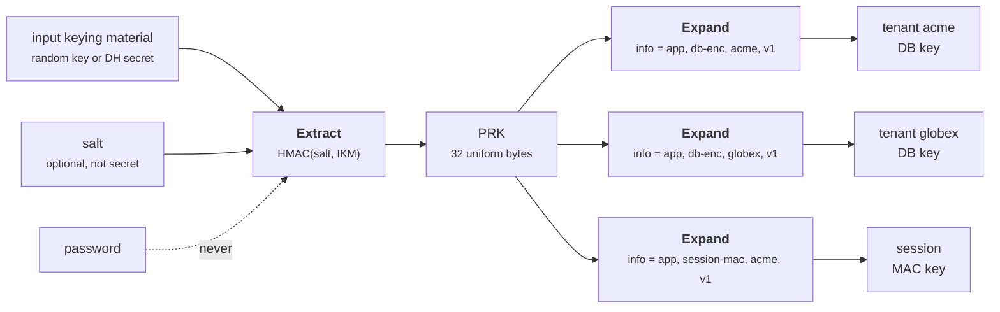
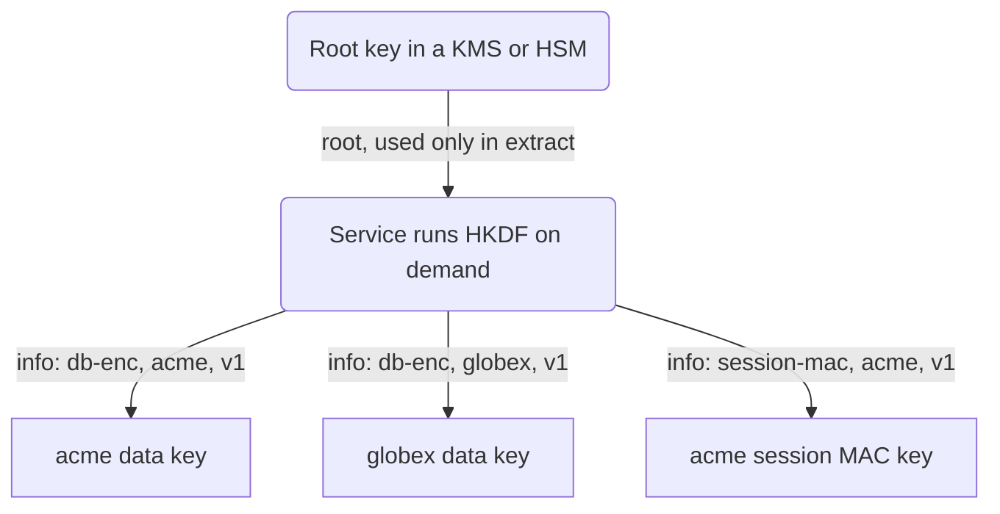
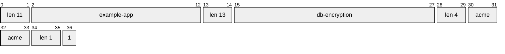
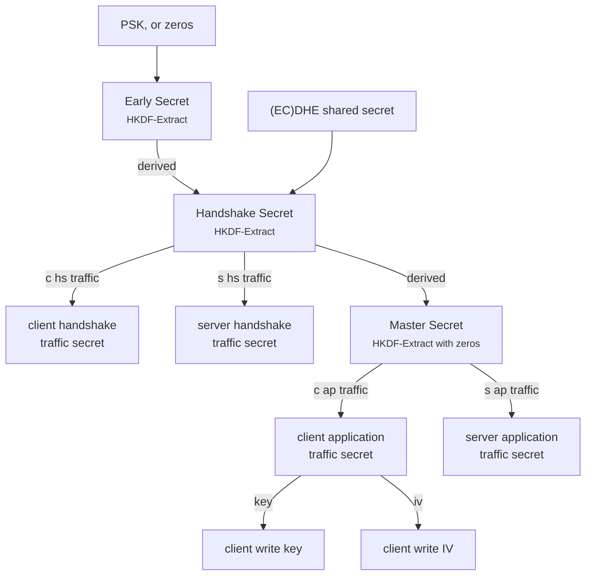
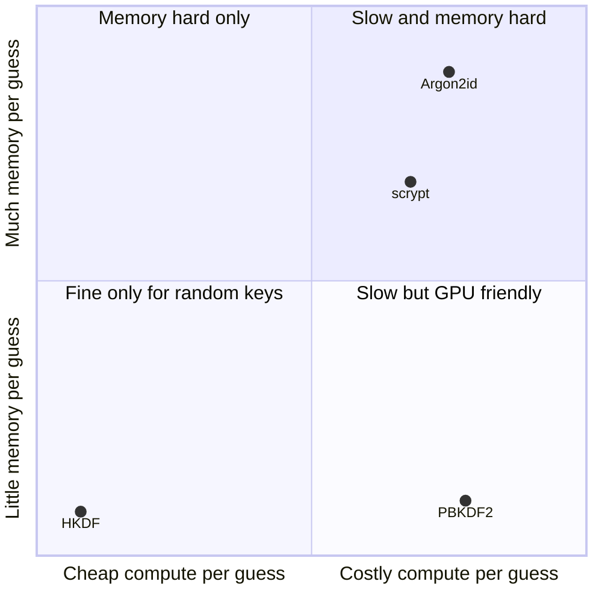
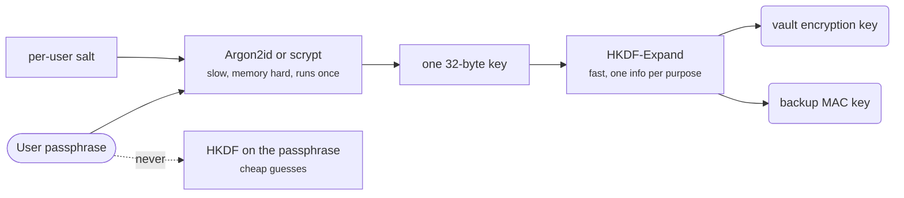

+++
title = 'Key derivation'
description = 'A KDF turns one secret into many independent keys, each bound to one purpose. HKDF does this for high-entropy secrets; passwords need a deliberately slow, memory-hard function instead.'
question = 'How do you turn one secret into many safe keys, and why are passwords different?'
weight = 4
difficulty = 3
prerequisites = ['/notes/cryptography/symmetric-cryptography/03-macs-and-hmac', '/notes/cryptography/foundations/02-randomness-and-entropy']
date = 2026-08-17
lastmod = 2026-08-17
verified = 2026-08-17
+++

## The idea in one minute

Systems need many keys: one to encrypt, another to MAC, a separate key per
tenant, per direction of a connection, per file, per version. Generating and
storing each one independently is expensive and error prone. A **key
derivation function** (KDF) takes one secret and a description of the purpose,
and returns a key that is independent of every key derived for a different
purpose. Compromise of one derived key reveals nothing about the root or the
siblings.

**HKDF** (RFC 5869) is the standard KDF for secrets that already have plenty of
entropy, such as a random master key or a Diffie–Hellman shared secret. It works
in two steps: **extract** concentrates the input's entropy into a fixed-size
pseudorandom key, and **expand** stretches that into as many output bytes as
needed, bound to an `info` string that names the purpose. That string is how
you get **domain separation**: two different `info` values give unrelated keys.

Passwords are a different problem. They have little entropy, so an attacker can
guess them, and a fast KDF like HKDF makes each guess cheap. **Password-based
KDFs** (PBKDF2, scrypt, Argon2) are deliberately slow and, in the better
designs, memory hungry, so each guess costs real resources.

The consequence to act on: **derive every working key from a root with HKDF and
a structured, unique `info` string, never use one key for two jobs, and never
feed a password to HKDF**.

## A picture



The root secret is used in exactly one place, extract. Every working key comes
from expand with its own `info`, so no two purposes ever share a key.

## How it really works

### Why derive keys at all

Three problems push designs towards derivation.

**One key, one purpose.** Using the same key for two algorithms or two
protocols can create attacks that neither has alone: a tag computed in one
context might be accepted as valid in another, or an encryption key that is
also a MAC key might let an attacker turn one operation into an oracle for the
other. The safe rule is that every key has exactly one algorithm and one
purpose. Derivation makes that rule cheap to follow.

**Non-uniform secrets.** The output of a Diffie–Hellman or ECDH exchange is a
group element. It has plenty of entropy, but its bytes are not uniformly
random: some bit patterns never occur. A cipher key must be uniform. A KDF's
extract step turns a high-entropy but structured secret into a uniform one.

**Scale and rotation.** Per-tenant, per-file, or per-session keys can be
recomputed on demand from a root and an identifier, instead of being generated,
wrapped, and stored individually. Rotating the root rotates everything derived
from it. This is the same idea that key hierarchies and
[envelope encryption](/notes/cryptography/key-management/02-envelope-encryption-and-kms/)
build on, with storage and access control added.

Only the root is stored and protected; every tenant key is recomputed from it on demand, so rotating the root changes them all.



### HKDF: extract, then expand

HKDF was designed by Hugo Krawczyk, analyzed in his 2010 paper on
extract-then-expand key derivation, and published as RFC 5869. It is built
entirely from HMAC:

```text
PRK = HMAC-Hash(salt, IKM)                       # extract

T(0) = empty
T(i) = HMAC-Hash(PRK, T(i-1) || info || byte(i))  # expand, i = 1, 2, ...
OKM  = first L bytes of T(1) || T(2) || ...
```

**Extract.** The salt is the HMAC key and the input keying material (IKM) is
the message. The result, the pseudorandom key (PRK), is one hash-length of
uniformly random-looking bytes. The salt does not need to be secret. RFC 5869
recommends a random salt of hash length when one is available, and notes that
even a fixed, application-specific salt adds value; with no salt, HKDF uses a
string of zero bytes. A salt strengthens extraction and separates applications
that might otherwise share input keying material.

**Expand.** The PRK keys an HMAC chain. Each block feeds in the previous block,
the `info` string, and a one-byte counter. Because the counter is one byte,
HKDF can produce at most 255 hash-lengths of output: 8,160 bytes with SHA-256.
Two properties follow from the construction and are visible in the program
below: the same PRK and `info` always give the same output, and asking for more
bytes extends the output rather than changing its beginning. The second one
means a 32-byte key and a 64-byte key derived with the same `info` share their
first 32 bytes, so put the length or purpose into `info` if both are ever needed.

Each output block feeds the next, so a 64-byte request is the 32-byte request with another block appended.

```mermaid {title="HKDF-Expand is an HMAC chain, and longer outputs share a prefix"}
flowchart LR
  PRK["PRK"] --> T1["T(1) = HMAC(PRK, info, 01)"]
  T1 --> T2["T(2) = HMAC(PRK, T(1), info, 02)"]
  T2 --> T3["... up to T(255)"]
  T1 --> O32["32-byte request<br/><small>T(1)</small>"]
  T1 --> O64["64-byte request<br/><small>T(1), T(2)</small>"]
  T2 --> O64
  class PRK memory
  class T1,T2,T3 compute
  class O32,O64 warn
```

**When to skip extract.** RFC 5869 section 3.3 allows skipping extract when
the input is already a uniformly random key of adequate length, such as 32
bytes from a CSPRNG or a key from a KMS. Running it anyway is harmless and is
the simpler rule to follow.

### Domain separation through info

The `info` string is where you name the purpose. Good `info` values have
three properties:

- **Unique per purpose.** Include the application, the key's role, any scope
  such as tenant or file ID, and a version. If two call sites can produce the
  same `info`, they will get the same key.
- **Unambiguous.** Encode fields so that no two different field tuples
  produce the same bytes. Naive concatenation fails: `"db-enc" + "ryption-acme"`
  and `"db-encryption" + "-acme"` are the same string. Length-prefix fields or
  use a fixed, canonical encoding.
- **Stable.** Changing the format of `info` changes every derived key. Treat
  it as part of your storage format and version it.

This is the exact `info` that `label("db-encryption", "acme", 1)` in the program below produces, byte by byte: every field carries a 2-byte length, so no field boundary can shift.



TLS 1.3 is a good model. Its key schedule (RFC 8446 section 7.1) runs HKDF
repeatedly, and every expansion goes through `HKDF-Expand-Label`, which encodes
the output length, the label prefixed with `"tls13 "`, and a context hash into
`info`. Traffic keys for client and server, handshake and application data,
and IVs all come from distinct labels such as `"c hs traffic"`, `"key"`, and
`"iv"`. No two keys in a TLS 1.3 connection share a derivation path.

A simplified view of that schedule shows extract steps chaining the secrets and labelled expands branching off each one.



### Other KDF standards

| Standard | Use |
| --- | --- |
| HKDF, RFC 5869 | General-purpose extract-then-expand; TLS 1.3, Signal, HPKE (RFC 9180), Noise |
| NIST SP 800-56C Rev. 2 | Two-step key derivation from a key-establishment shared secret, compatible with HKDF |
| NIST SP 800-108 Rev. 1 | Key-based KDFs in counter, feedback, and double-pipeline modes, with HMAC, CMAC, or KMAC |
| PBKDF2, RFC 8018 / NIST SP 800-132 | Password-based, iterated HMAC |
| scrypt, RFC 7914 | Password-based, memory hard |
| Argon2, RFC 9106 | Password-based, memory hard; winner of the Password Hashing Competition |

Compliance-driven environments often need SP 800-108 or SP 800-56C; HKDF with
HMAC fits the SP 800-56C two-step model.

### Passwords are low-entropy inputs

A random 256-bit key cannot be guessed. A human password usually can: attackers
work through leaked password lists and generated variations, and a fast function
lets them test billions of candidates per second on GPUs. HKDF is fast by
design, so `HKDF(password)` gives an attacker who steals the derived value, or
anything encrypted under it, a cheap offline guessing attack.

Password-based KDFs add **cost per guess**, paid once by the legitimate user and
once per candidate by the attacker:

- **PBKDF2** (RFC 8018) iterates HMAC `c` times per output block and XORs the
  intermediate values together. Its cost is pure computation, which GPUs and
  ASICs parallelize well. It is still required in some FIPS contexts.
- **scrypt** (Colin Percival, 2009; RFC 7914) fills a large buffer with
  pseudorandom data and then reads it back in a data-dependent order. Each
  guess needs about `128 * r * N` bytes of memory, which makes massively
  parallel hardware much more expensive.
- **Argon2** (RFC 9106) is memory hard with tunable time, memory, and
  parallelism. RFC 9106 recommends the **Argon2id** variant, which resists both
  GPU cracking and side-channel attacks. Its first recommended option is
  `t = 1` pass, 4 lanes, and 2 GiB of memory; a second option for
  memory-constrained systems is `t = 3` passes, 4 lanes, and 64 MiB.

Placing the four functions by what each guess costs an attacker shows why only the memory-hard ones belong near passwords.



Every password KDF also takes a **salt**, unique per password, so that two users
with the same password get different outputs and precomputed tables do not
help. Unlike the HKDF salt, this one is mandatory.

Password KDFs have two jobs: **storing password verifiers** (the server keeps
the derived value to check logins) and **deriving encryption keys from a
passphrase** (a password manager or an encrypted backup). The parameters,
upgrade strategy, and peppering for the first job are an application-security
decision covered in
[storing credentials](/notes/application-security/authentication/01-storing-credentials/).
For the second, derive one key from the passphrase with a password KDF, then use
HKDF from that key for every working key, so the slow step runs once.

For the passphrase case, the slow function runs once on the left and fast HKDF fans out to the right of it.



## Code

The first program implements HKDF in about twenty lines, checks it against test
case 1 from RFC 5869 (exact PRK and output bytes), and then derives a family of
keys from one root with structured, length-prefixed `info` strings.

```python {title="hkdf.py"}
"""hkdf.py: HKDF (RFC 5869) from HMAC, checked against the RFC, then used
to derive many independent keys from one secret with domain separation.
Standard library only; offline; deterministic.
"""

from __future__ import annotations

import hashlib
import hmac

HASH = hashlib.sha256
HASH_LEN = 32


def extract(salt: bytes, ikm: bytes) -> bytes:
    """Concentrate the input keying material's entropy into one PRK."""
    return hmac.new(salt or bytes(HASH_LEN), ikm, HASH).digest()


def expand(prk: bytes, info: bytes, length: int) -> bytes:
    """Stretch the PRK into `length` bytes bound to the context `info`."""
    if length > 255 * HASH_LEN:
        raise ValueError("HKDF-Expand can produce at most 255 blocks")
    okm, block = b"", b""
    for counter in range(1, -(-length // HASH_LEN) + 1):
        block = hmac.new(prk, block + info + bytes([counter]), HASH).digest()
        okm += block
    return okm[:length]


def hkdf(ikm: bytes, salt: bytes, info: bytes, length: int) -> bytes:
    return expand(extract(salt, ikm), info, length)


def check_rfc5869_case_1() -> None:
    ikm = bytes([0x0B] * 22)
    salt = bytes(range(0x00, 0x0D))
    info = bytes(range(0xF0, 0xFA))
    prk = extract(salt, ikm)
    okm = expand(prk, info, 42)
    assert prk.hex() == ("077709362c2e32df0ddc3f0dc47bba63"
                         "90b6c73bb50f9c3122ec844ad7c2b3e5")
    assert okm.hex() == ("3cb25f25faacd57a90434f64d0362f2a"
                         "2d2d0a90cf1a5a4c5db02d56ecc4c5bf"
                         "34007208d5b887185865")
    print("RFC 5869 test case 1: PRK and OKM match")


def label(purpose: str, tenant: str, version: int) -> bytes:
    """A structured, unambiguous info string: fields length-prefixed."""
    parts = [b"example-app", purpose.encode(), tenant.encode(), str(version).encode()]
    return b"".join(len(p).to_bytes(2, "big") + p for p in parts)


if __name__ == "__main__":
    check_rfc5869_case_1()
    print()

    # One root secret (in production: from a KMS or a key exchange, never a password).
    root = hashlib.sha256(b"demo root secret, never hard-code one").digest()
    salt = b"example-app 2026 salt"
    prk = extract(salt, root)  # extract once, expand many times

    jobs = [("db-encryption", "acme", 1), ("db-encryption", "globex", 1),
            ("session-mac", "acme", 1), ("db-encryption", "acme", 2)]
    keys = {}
    for job in jobs:
        keys[job] = expand(prk, label(*job), 32)
        purpose, tenant, version = job
        print(f"{purpose:<14} {tenant:<7} v{version} -> {keys[job].hex()[:24]}...")
    print("all four keys distinct:", len(set(keys.values())) == len(keys))

    again = expand(prk, label("db-encryption", "acme", 1), 32)
    print("same info again gives the same key:", again == keys[jobs[0]])

    # Why the info encoding must be unambiguous: naive concatenation collides.
    naive_a = expand(prk, b"db-enc" + b"ryption-acme", 32)
    naive_b = expand(prk, b"db-encryption" + b"-acme", 32)
    print("naive concatenation, two contexts, one key:", naive_a == naive_b)
    print("length-prefixed labels keep them apart:",
          label("db-enc", "ryption-acme", 1) != label("db-encryption", "-acme", 1))

    # Asking for more bytes extends, it does not change, the first bytes.
    short, long = expand(prk, b"ctx", 16), expand(prk, b"ctx", 64)
    print("first 16 of a 64-byte output equal the 16-byte output:", long[:16] == short)
```

Run it with `python3 hkdf.py`:

```text
RFC 5869 test case 1: PRK and OKM match

db-encryption  acme    v1 -> f3df46ef645a49ee8e3b0140...
db-encryption  globex  v1 -> e83d505a15b85e01af37166c...
session-mac    acme    v1 -> 71af8c6867d786e56f2d1b4c...
db-encryption  acme    v2 -> ccc6ab258a59b6abf4fc911e...
all four keys distinct: True
same info again gives the same key: True
naive concatenation, two contexts, one key: True
length-prefixed labels keep them apart: True
first 16 of a 64-byte output equal the 16-byte output: True
```

Changing any one field in `info` (purpose, tenant, or version) gives an
unrelated key, while repeating the same `info` reproduces the key exactly.
That determinism is the point: a service can recompute a tenant's key from the
root and the tenant ID instead of storing it. The naive concatenation line is
the bug that length prefixes prevent.

The second program writes PBKDF2 by hand, checks it against the RFC 6070 test
vectors and `hashlib.pbkdf2_hmac`, and counts the HMAC calls each password guess
costs. It ends with scrypt's memory cost, the property PBKDF2 lacks.

```python {title="stretch.py"}
"""stretch.py: PBKDF2 is HMAC iterated; the iteration count is the attacker's bill.

A hand-written PBKDF2-HMAC (RFC 8018), checked against the RFC 6070 test vectors
and hashlib.pbkdf2_hmac, then a count of HMAC calls per password guess.
Standard library only; offline; deterministic.
"""

from __future__ import annotations

import hashlib
import hmac


def pbkdf2(password: bytes, salt: bytes, iterations: int, dklen: int,
           hash_name: str = "sha256") -> tuple[bytes, int]:
    """Returns (derived key, number of HMAC calls made)."""
    hlen = hashlib.new(hash_name).digest_size
    out, calls = b"", 0
    for block in range(1, -(-dklen // hlen) + 1):
        u = hmac.new(password, salt + block.to_bytes(4, "big"), hash_name).digest()
        t, calls = bytearray(u), calls + 1
        for _ in range(iterations - 1):  # U_2 .. U_c, XORed together
            u = hmac.new(password, u, hash_name).digest()
            calls += 1
            t = bytearray(a ^ b for a, b in zip(t, u))
        out += bytes(t)
    return out[:dklen], calls


RFC6070 = [  # PBKDF2-HMAC-SHA1, password "password", salt "salt", 20-byte output
    (1, "0c60c80f961f0e71f3a9b524af6012062fe037a6"),
    (2, "ea6c014dc72d6f8ccd1ed92ace1d41f0d8de8957"),
    (4096, "4b007901b765489abead49d926f721d065a429c1"),
]

if __name__ == "__main__":
    for c, want in RFC6070:
        mine, _ = pbkdf2(b"password", b"salt", c, 20, "sha1")
        lib = hashlib.pbkdf2_hmac("sha1", b"password", b"salt", c, 20)
        print(f"RFC 6070, c={c:<5} hand-written {'ok' if mine.hex() == want else 'WRONG'},"
              f" hashlib {'ok' if lib.hex() == want else 'WRONG'}")
    print()

    salt = b"per-user-random-salt"
    for iterations in (1, 1_000, 100_000):
        _, calls = pbkdf2(b"x", salt, iterations, 32)
        print(f"{iterations:>7} iterations: {calls:>7} HMAC-SHA256 calls per guess")

    # Asking for more output than one hash length multiplies the defender's work,
    # but an attacker can usually check a guess against the first block alone.
    _, calls = pbkdf2(b"x", salt, 1_000, 64)
    print(f"64-byte output at 1000 iterations: {calls} calls (attacker needs 1000)")

    # scrypt adds memory cost: about 128 * r * n bytes per guess.
    n, r, p = 2**14, 8, 1
    key = hashlib.scrypt(b"correct horse", salt=salt, n=n, r=r, p=p, dklen=32)
    print(f"scrypt n=2**14 r=8 p=1 uses about {128 * r * n // 2**20} MiB per guess;"
          f" key {key.hex()[:16]}...")
```

Run it with `python3 stretch.py`:

```text
RFC 6070, c=1     hand-written ok, hashlib ok
RFC 6070, c=2     hand-written ok, hashlib ok
RFC 6070, c=4096  hand-written ok, hashlib ok

      1 iterations:       1 HMAC-SHA256 calls per guess
   1000 iterations:    1000 HMAC-SHA256 calls per guess
 100000 iterations:  100000 HMAC-SHA256 calls per guess
64-byte output at 1000 iterations: 2000 calls (attacker needs 1000)
scrypt n=2**14 r=8 p=1 uses about 16 MiB per guess; key fc4a65486c239659...
```

The iteration count multiplies the attacker's work linearly, which is all
PBKDF2 can do. The 64-byte line shows a known PBKDF2 quirk: asking for more
than one hash-length of output doubles the defender's work, but an attacker
checking a guess only needs the first block. Prefer a single hash-length output
and derive further keys with HKDF.

## Where it breaks

- **A weak root.** HKDF cannot create entropy. If the input keying material is a
  password, a timestamp, or a 32-bit seed, every derived key is exactly as
  guessable. Use a password KDF for passwords and a CSPRNG or key exchange for
  everything else.
- **Colliding info strings.** Two call sites that format `info` the same way, or
  an ambiguous encoding, silently share a key. Centralize derivation in one
  function that builds `info` from typed fields, as `label()` does here.
- **Derived keys share the root's fate.** If the root leaks, every key derived
  from it leaks, including past ones. Derivation reduces storage; it does not
  replace protecting the root in a KMS or HSM, and it does not give forward
  secrecy unless the root itself is ephemeral, as in a TLS handshake.
- **Rotation is coarse.** Rotating the root changes every derived key at once,
  and anything encrypted under the old keys must be re-encrypted or the old root
  kept. Put a version into `info` so old and new keys can coexist.

  The version field lets a derived key move through these states while the
  next version takes over encryption.

  ```mermaid {title="A derived key version from first use to retirement"}
  stateDiagram-v2
    [*] --> Active
    Active --> DecryptOnly: v2 info starts encrypting
    DecryptOnly --> Retired: all data re-encrypted under v2
    Active --> Exposed: root leaks
    DecryptOnly --> Exposed: root leaks
    Retired --> [*]
    Active: v1 encrypts and decrypts
    DecryptOnly: v1 decrypts old data only
    Retired: v1 never derived again
    Exposed: every key from that root, past ones too
  ```

- **Password KDF parameters age.** Hardware gets faster. Parameters that were
  costly when chosen become cheap, so store the algorithm and parameters with
  each hash and upgrade on login.
- **What the demos do not show.** The HKDF test proves the implementation
  matches the RFC on one vector, not that it is constant-time or suitable for
  production. Use the HKDF in pyca `cryptography`, libsodium, or your platform.
  Argon2 is not shown at all: `hashlib` exposes PBKDF2 and scrypt, and Argon2
  needs a separate library.

## Remember this

- Every key gets one purpose; derive keys instead of reusing them.
- HKDF is extract (make it uniform) then expand (bind it to `info`), both from
  HMAC.
- Domain separation lives in `info`: unique, unambiguous, versioned.
- HKDF is for high-entropy secrets only; never derive from a password with it.
- Passwords need a salted, slow, preferably memory-hard KDF: Argon2id, scrypt,
  or PBKDF2 where required.
- Derivation saves storage, not protection: the root still needs a KMS or HSM.

## Try it

1. Run `hkdf.py`. Add RFC 5869 test case 3 (no salt, empty `info`) and check it
   against the RFC.
2. Replace `label()` with a version that joins fields with `"|"`. Find two
   field tuples that collide. Does escaping fix it?
3. Derive a 32-byte encryption key and a 32-byte MAC key from one PRK in two
   ways: two calls with different `info`, and one 64-byte call split in half.
   Which do you prefer for a codebase that will grow, and why?
4. In `stretch.py`, time PBKDF2 at 100,000 and 600,000 iterations on your
   machine (outside the program). How many guesses per second would one core
   manage at each?
5. Sketch the key hierarchy for a multi-tenant service: one root in a KMS,
   per-tenant data keys, and per-tenant audit-log MAC keys. Write the `info`
   for each.

## Check yourself

1. What does HKDF's extract step do, and when may it be skipped?

   
   It runs HMAC with the salt as key over the input keying material to produce a
   fixed-length pseudorandom key. That turns a high-entropy but non-uniform
   secret, such as a Diffie–Hellman output, into a uniform one. RFC 5869 allows
   skipping it when the input is already a uniformly random key of adequate
   length.
   

2. Two services both call `expand(prk, b"encryption", 32)`. What is the problem?

   
   They derive the same key. A ciphertext from one service opens in the other,
   and a compromise of either exposes both. The `info` must name the
   application, purpose, scope, and version so that every distinct use gets a
   distinct key.
   

3. Why is `HKDF(password)` unsafe even with a random salt?

   
   HKDF is fast. The salt prevents precomputed tables and makes each user's
   output different, but an attacker who obtains the output can still test
   candidate passwords at billions per second. A password KDF makes each guess
   expensive in time and, for scrypt and Argon2, in memory.
   

4. What does a memory-hard function add over PBKDF2?

   
   PBKDF2's cost is computation only, which GPUs and ASICs run in massive
   parallel cheaply. Memory-hard functions force each guess to use a large
   amount of memory, which is far more expensive to provide per parallel guess,
   so dedicated hardware gains much less over a normal CPU.
   

5. A 64-byte HKDF output is split into an encryption key and a MAC key. A later
   change derives a 32-byte encryption key with the same `info`. What happens?

   
   HKDF-Expand outputs share a prefix, so the new 32-byte key equals the first
   half of the old output, the old encryption key. That may be harmless or may
   cause two code paths to share a key unexpectedly. Deriving each key with its
   own `info` avoids the question.
   

## Sources

- H. Krawczyk and P. Eronen, [RFC 5869: HMAC-based Extract-and-Expand Key Derivation Function (HKDF)](https://www.rfc-editor.org/rfc/rfc5869), IETF, May 2010.
- H. Krawczyk, "Cryptographic Extraction and Key Derivation: The HKDF Scheme," CRYPTO 2010.
- K. Moriarty, B. Kaliski, A. Rusch, [RFC 8018: PKCS #5: Password-Based Cryptography Specification Version 2.1](https://www.rfc-editor.org/rfc/rfc8018), IETF, January 2017.
- S. Josefsson, [RFC 6070: PKCS #5: Password-Based Key Derivation Function 2 (PBKDF2) Test Vectors](https://www.rfc-editor.org/rfc/rfc6070), IETF, January 2011.
- C. Percival and S. Josefsson, [RFC 7914: The scrypt Password-Based Key Derivation Function](https://www.rfc-editor.org/rfc/rfc7914), IETF, August 2016.
- A. Biryukov, D. Dinu, D. Khovratovich, S. Josefsson, [RFC 9106: Argon2 Memory-Hard Function for Password Hashing and Proof-of-Work Applications](https://www.rfc-editor.org/rfc/rfc9106), IRTF, September 2021.
- E. Rescorla, [RFC 8446: The Transport Layer Security (TLS) Protocol Version 1.3](https://www.rfc-editor.org/rfc/rfc8446), IETF, August 2018 (section 7.1, key schedule).
- L. Chen, [NIST SP 800-108 Rev. 1: Recommendation for Key Derivation Using Pseudorandom Functions](https://csrc.nist.gov/pubs/sp/800/108/r1/final), NIST, August 2022.
- E. Barker, L. Chen, R. Davis, [NIST SP 800-56C Rev. 2: Recommendation for Key-Derivation Methods in Key-Establishment Schemes](https://csrc.nist.gov/pubs/sp/800/56/c/r2/final), NIST, August 2020.
- M. S. Turan, E. Barker, W. Burr, L. Chen, [NIST SP 800-132: Recommendation for Password-Based Key Derivation, Part 1: Storage Applications](https://csrc.nist.gov/pubs/sp/800/132/final), NIST, December 2010.
