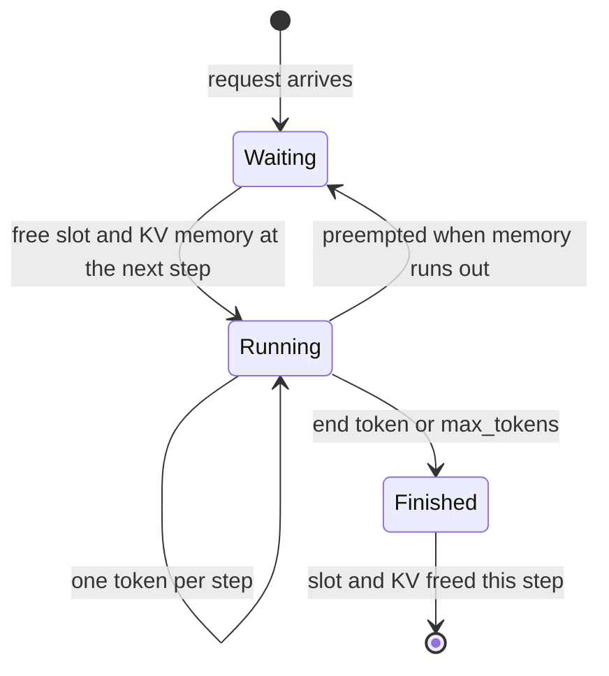

+++
title = 'Continuous batching'
description = 'Static batching runs a fixed group of requests until the longest finishes, so short requests hold empty slots and new ones wait outside. Continuous batching reschedules at every decode step: finished sequences leave, waiting ones join, and the GPU serves several times the traffic at lower latency.'
question = 'Why does batching once per group waste most of a GPU, and what does scheduling at every step change?'
weight = 1
difficulty = 3
prerequisites = ['/notes/inference-engineering/inference-mechanics/03-why-decode-is-memory-bound']
date = 2026-10-30T02:05:00Z
lastmod = 2026-10-30T02:05:00Z
verified = 2026-10-30
+++

## The idea in one minute

Batching is how decode becomes affordable: one read of the weights serves every
sequence in the batch. The question is when the batch is formed.

**Static batching** collects a group, runs it until every member has finished,
then starts the next. Output lengths are heavy-tailed, so most of the group
finishes early and its slots sit idle while the longest answer completes; new
requests wait outside the whole time. **Dynamic batching** adds a timeout so a
group starts before it is full, which bounds waiting but not the idle slots.

**Continuous batching**, introduced as iteration-level scheduling by Orca
(OSDI 2022), makes the decision at every decode step. A sequence that emits its
end token leaves at the end of that step; a waiting request takes its slot at
the next one. Nothing waits for anything except memory.

In the simulation below, with a realistic output-length distribution, the same
64-slot engine serves **4.4 times the throughput** with continuous batching,
and time to first token falls from minutes to milliseconds. The consequence to
act on: **any LLM server without iteration-level scheduling is leaving most of
its GPU unused**, and every modern engine (vLLM, SGLang, TensorRT-LLM's
in-flight batching, Text Generation Inference) is built around it.

## A picture

```mermaid {title="Static batch: slots idle until the longest request finishes"}
flowchart LR
  subgraph S["Static batch of 4, runs 400 steps"]
    direction TB
    R1["req A: 20 tokens<br/><small>then 380 idle steps</small>"]
    R2["req B: 60 tokens<br/><small>then 340 idle</small>"]
    R3["req C: 90 tokens<br/><small>then 310 idle</small>"]
    R4["req D: 400 tokens"]
  end
  Q["<b>Queue</b><br/><small>waits for all 4</small>"] --> S
  class R1,R2,R3 neutral
  class R4 compute
  class Q queue
```



## How it really works

### The waste in static batching

With static batching, each slot in a batch costs a step whether or not its
sequence is still generating. Utilization is:

```text
useful slot-steps ÷ total slot-steps = mean output length ÷ max output length in the batch
```

Output lengths follow a long-tailed distribution: most answers are short and a
few are very long. With 64 requests per batch, the longest member is usually
several times the median, so most slot-steps are padding. The simulation
measures 15% utilization. Padding is also not free in naive implementations,
which keep computing the finished rows.

There is a second cost. A request that arrives while a batch runs waits for the
whole batch to finish, and then for the next batch to fill. Under load the
queue grows without bound, because capacity is set by the slowest member of
each batch.

### Iteration-level scheduling

Orca's insight was that the transformer's forward pass does not care which
requests are in the batch from one step to the next, as long as each one
brings its own KV cache. So the engine loop becomes:

```text
loop:
    admit waiting requests while slots and KV memory allow
    build one batch: one new token per decoding sequence (+ prompt tokens for new ones)
    run one forward pass
    sample; append tokens; free every sequence that finished
```

Orca also introduced **selective batching**: matmuls run over the flattened
tokens of all requests together, while attention is computed per request
because each has a different context length. Modern attention kernels
(PagedAttention, FlashAttention's variable-length mode, FlashInfer) handle
ragged batches directly.

### What continuous batching depends on

- **KV memory that can be allocated per sequence on demand.** If each slot
  needs a contiguous region reserved at the maximum length, memory, not slots,
  limits the batch. The [next lesson](/notes/inference-engineering/batching-and-scheduling/02-paged-kv-memory/)
  covers paging.
- **A step that can mix prefill and decode.** A new request's prompt has to be
  processed somewhere. Early systems ran [prefill](/notes/inference-engineering/inference-mechanics/01-prefill-and-decode/)-only steps that stalled
  decodes; chunked prefill fixes that, in the
  [third lesson](/notes/inference-engineering/batching-and-scheduling/03-chunked-prefill-and-priority/).
- **A fast scheduler.** The scheduling decision is CPU work on the critical
  path of every step. At several hundred sequences and 10 to 20 ms steps, a
  slow scheduler loop or per-step Python overhead is visible in ITL; engines
  overlap scheduling with GPU execution for this reason.

### What it costs per user

Continuous batching keeps the batch as full as traffic allows, and a fuller
batch makes each step longer (lesson 1.3). Each user's ITL rises with the
number of concurrent users. That is the right trade for throughput, but an ITL
objective needs a cap on concurrent sequences (`--max-num-seqs` in vLLM) or an
admission controller in front.

### Dynamic batching still has a place

For models with a single forward pass per request, such as embedding models,
classifiers, and rerankers, there is no decode loop to schedule. Dynamic
batching with a size cap and a timeout of a few milliseconds is the right tool
there, and is what Triton Inference Server and similar servers provide.

## Code

The program runs one 64-slot engine three ways on the same 3,000 requests with
log-normal output lengths (median 92 tokens, maximum 2,000). Step time follows
the roofline from the previous module for Llama-3-8B on an H100. Prefill is
folded into the first step to keep the comparison about batching.

```python {title="batching.py"}
"""batching.py: static, dynamic and continuous batching on the same traffic.

A decode engine with room for MAX_BATCH sequences. Step time follows the
roofline from module 1 for Llama-3-8B on an H100: a fixed weight read plus each
sequence's KV read. Prefill is folded into the first step (lesson 3 treats it
properly). Standard library only; runs offline.
"""

from __future__ import annotations

import math
import random
from dataclasses import dataclass, field

MAX_BATCH = 64
WEIGHT_MS = 4.48                  # 15.0 GB of weights / 3.35 TB/s
KV_MS_PER_TOKEN = 131072 / 3.35e9  # 128 KiB per cached token, in ms
PROMPT = 1000
N_REQUESTS = 3000
WINDOW_MS = 50.0                  # dynamic batching: wait at most this long


@dataclass
class Req:
    arrival: float
    out_len: int
    generated: int = 0
    first_token: float = -1.0
    done: float = -1.0


@dataclass
class Stats:
    steps: int = 0
    busy_slots: int = 0
    reqs: list[Req] = field(default_factory=list)


def workload(rate: float, seed: int = 7) -> list[Req]:
    rng = random.Random(seed)
    t, out = 0.0, []
    for _ in range(N_REQUESTS):
        t += rng.expovariate(rate) * 1000
        n = min(max(int(math.exp(rng.gauss(4.5, 1.0))), 1), 2000)  # median ~90
        out.append(Req(t, n))
    return out


def step_ms(batch: list[Req]) -> float:
    ctx = sum(PROMPT + r.generated for r in batch)
    return WEIGHT_MS + ctx * KV_MS_PER_TOKEN


def run(policy: str, rate: float) -> Stats:
    reqs, s = workload(rate), Stats()
    s.reqs = reqs
    now, i, queue, running = 0.0, 0, [], []
    while i < len(reqs) or queue or running:
        while i < len(reqs) and reqs[i].arrival <= now:
            queue.append(reqs[i])
            i += 1
        no_more = i == len(reqs)
        if policy == "continuous":
            while queue and len(running) < MAX_BATCH:
                running.append(queue.pop(0))           # joins at the next step
        elif not running and queue:
            full = len(queue) >= MAX_BATCH
            waited = now >= queue[0].arrival + WINDOW_MS
            if full or no_more or (policy == "dynamic" and waited):
                running, queue = queue[:MAX_BATCH], queue[MAX_BATCH:]
        if not running:                                 # idle: jump to the next event
            nxt = [reqs[i].arrival] if not no_more else []
            if policy == "dynamic" and queue:
                nxt.append(queue[0].arrival + WINDOW_MS)
            now = max(now, min(nxt))
            continue
        now += step_ms(running)
        s.steps += 1
        active = [r for r in running if r.done < 0]
        s.busy_slots += len(active)
        for r in active:
            r.generated += 1
            if r.generated == 1:
                r.first_token = now
            if r.generated == r.out_len:
                r.done = now
        if policy == "continuous":
            running = [r for r in running if r.done < 0]
        elif not any(r.done < 0 for r in running):
            running = []                                # batch ends with its longest member
    return s


def pct(xs: list[float], p: float) -> float:
    xs = sorted(xs)
    return xs[min(len(xs) - 1, int(p * len(xs)))]


def main() -> None:
    lens = sorted(r.out_len for r in workload(1.0))
    print(f"{N_REQUESTS} requests, prompt {PROMPT}, output median {lens[len(lens) // 2]},"
          f" mean {sum(lens) / len(lens):.0f}, max {lens[-1]}; batch slots {MAX_BATCH}")
    for rate in (8.0, 40.0):
        print(f"\narrivals {rate:.0f}/s (demand {rate * sum(lens) / len(lens):.0f} tok/s)")
        print(f"{'policy':<11}{'tok/s':>8}{'slot use':>10}{'TTFT p50':>10}{'TTFT p99':>10}"
              f"{'e2e p50':>9}{'e2e p99':>9}")
        for policy in ("static", "dynamic", "continuous"):
            s = run(policy, rate)
            span = max(r.done for r in s.reqs) / 1000
            ttft = [(r.first_token - r.arrival) / 1000 for r in s.reqs]
            e2e = [(r.done - r.arrival) / 1000 for r in s.reqs]
            tokens = sum(r.out_len for r in s.reqs)
            use = s.busy_slots / (s.steps * MAX_BATCH)
            print(f"{policy:<11}{tokens / span:>8.0f}{100 * use:>9.0f}%{pct(ttft, .5):>9.2f}s"
                  f"{pct(ttft, .99):>9.2f}s{pct(e2e, .5):>8.1f}s{pct(e2e, .99):>8.1f}s")


if __name__ == "__main__":
    main()
```

Run it with `python3 batching.py`:

```text
3000 requests, prompt 1000, output median 92, mean 148, max 2000; batch slots 64

arrivals 8/s (demand 1185 tok/s)
policy        tok/s  slot use  TTFT p50  TTFT p99  e2e p50  e2e p99
static         1188       15%     5.59s    16.03s     6.6s    17.6s
dynamic        1186       12%     3.48s    14.04s     4.5s    15.5s
continuous     1200        9%     0.01s     0.01s     0.4s     4.4s

arrivals 40/s (demand 5927 tok/s)
policy        tok/s  slot use  TTFT p50  TTFT p99  e2e p50  e2e p99
static         1299       15%   124.53s   263.75s   125.2s   264.5s
dynamic        1322       15%   122.84s   258.31s   123.6s   258.9s
continuous     5710       54%     0.01s     0.01s     0.6s     5.7s
```

At 8 requests per second every policy keeps up, but static batching makes each
request wait for 63 others to arrive (5.6 s median TTFT), and dynamic batching
still waits for the running batch to drain. At 40 per second, static and
dynamic batching saturate near 1,300 tokens per second and the queue grows for
the whole run, while continuous batching delivers 5,700 tokens per second with
a 10 ms TTFT.

```mermaid {title="Throughput at 40 requests per second, same GPU and slots"}
xychart-beta
  x-axis ["static", "dynamic", "continuous"]
  y-axis "Output tokens per second" 0 --> 6000
  bar [1299, 1322, 5710]
```

## Where it breaks

- **Memory, not slots, is the real limit.** The model gives each slot unlimited
  KV memory. A real engine runs out of KV blocks first and must queue or
  preempt; that is the next lesson.
- **Prefill is not free.** Folding the prompt into one step hides the stall a
  long prompt causes for every decoding user.
- **Fuller batches mean slower streams.** At high load, continuous batching
  keeps ITL rising until the concurrency cap. Without a cap or admission
  control, overload shows up as slow tokens for everyone rather than rejection.
- **Fairness is not automatic.** First-come admission lets one client with many
  long requests hold most slots. Multi-tenant fairness needs a policy on top.
- **Per-step overhead scales with batch.** Building inputs, sampling, and
  detokenizing for hundreds of sequences per step is real CPU time.

## Remember this

- Static batching runs at mean ÷ max output length utilization, often under 20%.
- Continuous batching schedules every step: leave on finish, join on free slot.
- It improves throughput and TTFT at the same time; it trades per-user ITL for
  throughput as the batch fills.
- It needs on-demand KV allocation and mixed prefill/decode steps to work well.
- Cap concurrent sequences to hold an ITL objective.

## Try it

1. Set `MAX_BATCH = 256` and rerun. How much does continuous batching gain now,
   and what happens to the e2e p50?
2. Replace the log-normal output lengths with a fixed 148 tokens. How does the
   gap between static and continuous change, and why?
3. Add a `max_concurrent` cap lower than `MAX_BATCH` to the continuous policy
   and plot e2e p99 against throughput at 40 requests per second.
4. On a vLLM server, sweep `--max-num-seqs` across 16, 64, and 256 with a
   fixed request rate. Record output tokens per second and p99 ITL.

## Check yourself

1. Why does static batching waste capacity even when every slot is filled at
   the start?

   
   The batch runs until its longest member finishes. Every shorter request's
   slot is idle (or computing padding) from the moment it finishes until then,
   and new requests cannot use those slots.
   

2. What exactly does "iteration-level" mean in continuous batching?

   
   The scheduler decides the batch composition before every forward pass (one
   decode step), so requests can join or leave at any step instead of only at
   batch boundaries.
   

3. Continuous batching raised throughput fourfold, but users complain that
   tokens stream more slowly at peak. Is something broken?

   
   Probably not. A fuller batch makes each decode step longer, so per-user ITL
   rises with concurrency. Cap concurrent sequences or add admission control
   if the ITL objective matters more than peak throughput.
   

4. When is dynamic batching still the right choice?

   
   For models that serve each request with one forward pass, such as embedding
   and classification models. With no decode loop, there is nothing to
   reschedule per step, and a short timeout with a size cap captures the
   batching gain.
   

## Sources

- G.-I. Yu, J. S. Jeong, G.-W. Kim, S. Kim, B.-G. Chun, [Orca: A Distributed Serving System for Transformer-Based Generative Models](https://www.usenix.org/conference/osdi22/presentation/yu), OSDI 2022.
- W. Kwon et al., [Efficient Memory Management for Large Language Model Serving with PagedAttention](https://arxiv.org/abs/2309.06180), SOSP 2023.
- NVIDIA, [TensorRT-LLM documentation](https://nvidia.github.io/TensorRT-LLM/) (in-flight batching), accessed October 2026.
- vLLM project, [Optimization and tuning](https://docs.vllm.ai/en/latest/configuration/optimization.html), vLLM documentation, accessed October 2026.
- NVIDIA, [Triton Inference Server: dynamic batcher](https://docs.nvidia.com/deeplearning/triton-inference-server/user-guide/docs/user_guide/model_configuration.html#dynamic-batcher), accessed October 2026.
