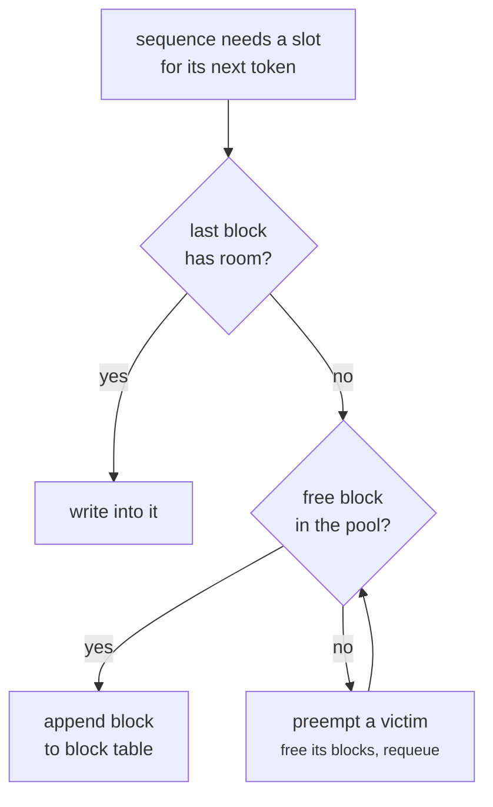
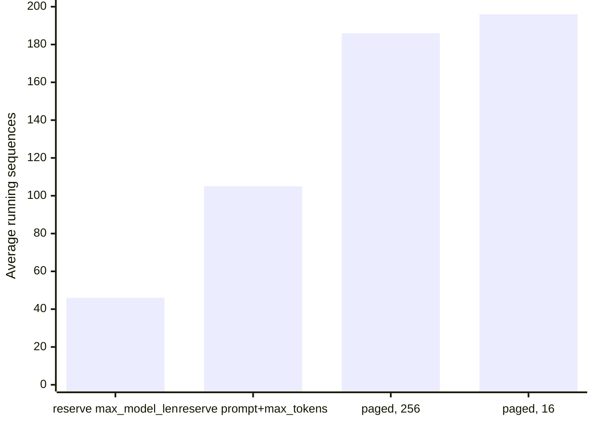

+++
title = 'Paged KV memory'
description = 'Reserving a contiguous KV region per request at its maximum length leaves most of the cache empty. Paging allocates fixed-size blocks on demand through a per-sequence block table, so nearly all KV memory holds real tokens, blocks can be shared, and concurrency roughly doubles or more.'
question = 'How does allocating the KV cache in small blocks let a GPU hold several times as many sequences?'
weight = 2
difficulty = 3
prerequisites = ['/notes/inference-engineering/batching-and-scheduling/01-continuous-batching', '/notes/inference-engineering/inference-mechanics/02-kv-cache-math']
date = 2026-10-30T02:10:00Z
lastmod = 2026-10-30T02:10:00Z
verified = 2026-10-30
+++

## The idea in one minute

A sequence's KV cache grows by one entry per layer per generated token, and
nobody knows in advance how long the answer will be. Early serving systems
handled this the simple way: reserve a contiguous region big enough for the
longest possible sequence. Most of that region is never written. Kwon et al.
measured that in such systems only **20 to 38% of KV memory held actual token
state**; the rest was reservation, internal fragmentation, and gaps between
regions.

**PagedAttention**, the core of vLLM (SOSP 2023), applies the operating
system's answer to the same problem. KV memory is split into fixed-size
**blocks** (16 tokens by default in vLLM). Each sequence has a **block table**
mapping its logical blocks to physical ones, and gets a new block only when its
last one fills. Waste is at most one partial block per sequence. The attention
kernel follows the table instead of assuming contiguity.

The consequence to act on: **with paging, the KV budget holds real tokens, so
concurrency is set by what sequences actually use, not what they might use**.
The cost is that memory can now run out mid-generation, so the engine needs a
preemption policy.

## A picture

```mermaid {title="Block tables map each sequence's logical blocks to scattered physical blocks"}
flowchart LR
  subgraph A["Sequence A: 40 tokens"]
    A0["logical 0"]
    A1["logical 1"]
    A2["logical 2<br/><small>8 of 16 used</small>"]
  end
  subgraph B["Sequence B: 20 tokens"]
    B0["logical 0"]
    B1["logical 1<br/><small>4 of 16 used</small>"]
  end
  subgraph P["Physical KV pool"]
    P3["block 3"]
    P7["block 7"]
    P1["block 1"]
    P4["block 4"]
    P9["block 9"]
    F["free blocks"]
  end
  A0 --> P7
  A1 --> P1
  A2 --> P9
  B0 --> P3
  B1 --> P4
  class A0,A1,B0 memory
  class A2,B1 compute
  class P3,P7,P1,P4,P9 memory
  class F neutral
```

The only wasted memory is the unused tail of each sequence's last block.

## How it really works

### Three sources of waste in contiguous allocation

1. **Reservation.** A region sized for `max_model_len` (or prompt plus
   `max_tokens`) holds empty slots for the whole life of the request, even
   though only the generated part is ever filled.
2. **Internal fragmentation.** The region is never filled if the answer stops
   early, which most do.
3. **External fragmentation.** Regions of different sizes leave gaps between
   them that no new request fits into.

Paging removes all three. Blocks are equal size, so any free block fits any
sequence, and a sequence holds only `ceil(tokens / block_size)` blocks.

### Block tables and the attention kernel

Physically, each block is a slice of a large preallocated tensor holding keys
and values for `block_size` consecutive tokens for each layer (engines lay this
out per layer or per layer group). The scheduler hands the worker, for every
sequence in the step, its block table and its token count. The PagedAttention
kernel walks the table, loading each block's keys and values and computing
attention over them; the new token's KV is written into the slot given by the
table. Block size is a trade:

| Block size | Waste per sequence | Kernel efficiency | Prefix sharing granularity |
| --- | --- | --- | --- |
| Small (8–16 tokens) | under one small block | more table lookups, smaller loads | fine |
| Large (128–256 tokens) | up to one large block | fewer, larger loads | coarse |

At 128 KiB per token (Llama-3-8B), a 16-token block is 2 MiB of KV across all
layers. A 256-token block wastes up to 32 MiB per sequence.

### Sharing and copy-on-write

Because the table is an indirection, two sequences can point at the same
physical block. Each block carries a reference count.

- **Parallel sampling** (`n > 1`) and beam search share the prompt's blocks
  across all candidates. When a candidate writes into a shared, partly filled
  block, the engine copies that block first: **copy-on-write**.
- **Prefix caching** keeps blocks of finished requests and maps a new request's
  identical prefix onto them; see
  [prefix caching](/notes/inference-engineering/making-it-cheaper/03-prefix-caching/).

### When the pool runs out: preemption

With on-demand allocation, a running sequence can need a new block when none is
free. The scheduler must take memory from someone:

- **Recompute.** Free the victim's blocks and put it back in the waiting queue.
  When readmitted, its prompt plus the tokens it has generated so far are
  prefilled again. vLLM's V1 engine uses recomputation. [Prefill](/notes/inference-engineering/inference-mechanics/01-prefill-and-decode/) is fast per
  token, so this is usually cheaper than it sounds, but it is still work done
  twice.
- **Swap.** Copy the victim's blocks to CPU memory and back later. This costs
  PCIe bandwidth instead of compute; vLLM's original engine supported it.

The victim is normally the most recently admitted request (or, with priority
scheduling, the lowest-priority one), which keeps older requests progressing.
Preemption shows up to the user as a stream that freezes and resumes. A steady
preemption rate means the engine is admitting more than memory can carry:
lower the concurrency cap, keep a free-block watermark, or add memory.



## Code

The program puts 4,000 queued requests through a KV pool sized for
Llama-3-8B on one 80 GB GPU (396,728 token slots), using continuous batching
and four allocation policies. Prompts are log-normal with a median of about
665 tokens; outputs have a median of about 120 and a cap of 2,048. Each step
generates one token per running sequence. Paged policies preempt the newest
request by recomputation.

```python {title="paged_kv.py"}
"""paged_kv.py: contiguous KV reservation versus paged blocks, same pool, same traffic.

A KV pool sized for Llama-3-8B on one 80 GB GPU (about 52 GB, 128 KiB per token).
Requests arrive with a backlog, run one decode token per step, and leave. The
policies differ only in how much KV memory a request holds while it runs.
Standard library only; runs offline.
"""

from __future__ import annotations

import math
import random
from dataclasses import dataclass

POOL_TOKENS = 52 * 10**9 // 131072   # ~396k token slots
MAX_MODEL_LEN = 8192
MAX_TOKENS = 2048                     # the caller's output cap
N_REQUESTS = 4000
MAX_SEQS = 1024


@dataclass
class Req:
    prompt: int
    out_len: int
    generated: int = 0
    held: int = 0                     # token slots held in the pool

    def tokens(self) -> int:
        return self.prompt + self.generated


def workload(seed: int = 3) -> list[Req]:
    rng = random.Random(seed)
    out = []
    for _ in range(N_REQUESTS):
        p = min(max(int(math.exp(rng.gauss(6.5, 1.0))), 16), 6000)    # median ~665
        o = min(max(int(math.exp(rng.gauss(4.8, 1.0))), 1), MAX_TOKENS)  # median ~120
        out.append(Req(p, o))
    return out


def need(r: Req, policy: str, block: int) -> int:
    """Slots a request must hold to run its next step under `policy`."""
    if policy == "reserve max_model_len":
        return MAX_MODEL_LEN
    if policy == "reserve prompt+max_tokens":
        return r.prompt + MAX_TOKENS
    return math.ceil((r.tokens() + 1) / block) * block   # paged: whole blocks, on demand


def run(policy: str, block: int = 16) -> dict[str, float]:
    waiting, running = workload(), []
    free, steps, conc, used, held, preempted = POOL_TOKENS, 0, 0, 0, 0, 0
    while waiting or running:
        # Grow running requests first; on a paged pool this can run out of blocks.
        for r in list(running):
            extra = need(r, policy, block) - r.held
            while extra > free and len(running) > 1:
                victim = running.pop()                 # newest admitted: recompute later
                free += victim.held
                victim.held, victim.generated = 0, 0
                waiting.insert(0, victim)
                preempted += 1
                if victim is r:
                    break
            if r in running:
                free -= extra
                r.held += extra
        while waiting and len(running) < MAX_SEQS:      # admit while memory allows
            r = waiting[0]
            want = need(r, policy, block)
            if want > free:
                break
            waiting.pop(0)
            free -= want
            r.held = want
            running.append(r)
        steps += 1
        conc += len(running)
        used += sum(r.tokens() for r in running)
        held += POOL_TOKENS - free
        for r in list(running):
            r.generated += 1
            if r.generated == r.out_len:
                running.remove(r)
                free += r.held
    return {"steps": steps, "conc": conc / steps, "util": used / held, "pre": preempted}


def main() -> None:
    print(f"pool {POOL_TOKENS:,} token slots; {N_REQUESTS} queued requests;"
          f" max_model_len {MAX_MODEL_LEN}, max_tokens {MAX_TOKENS}\n")
    print(f"{'policy':<28}{'avg running':>12}{'pool holding real KV':>22}{'steps':>8}{'preemptions':>13}")
    for policy, block in (("reserve max_model_len", 0), ("reserve prompt+max_tokens", 0),
                          ("paged", 256), ("paged", 16)):
        r = run(policy, block)
        name = policy if not block else f"paged, {block}-token blocks"
        print(f"{name:<28}{r['conc']:>12.0f}{100 * r['util']:>21.1f}%{r['steps']:>8}{r['pre']:>13}")


if __name__ == "__main__":
    main()
```

Run it with `python3 paged_kv.py`:

```text
pool 396,728 token slots; 4000 queued requests; max_model_len 8192, max_tokens 2048

policy                       avg running  pool holding real KV   steps  preemptions
reserve max_model_len                 46                 15.6%   18242            0
reserve prompt+max_tokens            105                 41.7%    7917            0
paged, 256-token blocks              186                 90.9%    4494          364
paged, 16-token blocks               196                 99.3%    4243          317
```

Reserving `max_model_len` holds 46 sequences on average, and only 15.6% of the
memory it holds contains tokens, below the 20 to 38% the vLLM paper measured
because its baselines reserved less aggressively. Reserving prompt plus `max_tokens` is better but still wastes
more than half. Paging with 16-token blocks holds 196 sequences, 4.3 times the
first policy, with 99.3% of held memory in use, and finishes the backlog in a
quarter of the steps. Large blocks give back some of that. The paged policies
pay for density with about 300 preemptions, which the reservation policies
never need.



## Where it breaks

- **Preemption is the price of density.** The simulation counts preemptions
  but does not charge for recomputation; in a real engine each one adds prefill
  work and a visible stall for the victim.
- **The attention kernel must be paged.** Every kernel that touches KV
  (attention, KV [quantization](/notes/inference-engineering/making-it-cheaper/01-quantization/), transfers between GPUs) has to follow block
  tables. Custom kernels that assume contiguous KV will not work.
- **Block size interacts with other features.** Prefix-cache hits come in
  whole blocks, and some hybrid models need much larger blocks for their
  state layers.
- **Memory for other things is fixed at startup.** Engines preallocate the KV
  pool; a process that later needs more activation memory, or another process
  on the same GPU, can trigger out-of-memory errors that paging does not
  prevent.
- **Pooling across GPUs is separate.** Paging manages one GPU's memory. Moving
  KV between GPUs or nodes (offload, [disaggregation](/notes/inference-engineering/distributed-inference/02-disaggregated-prefill-and-decode/)) is its own system.

## Remember this

- Contiguous reservation wastes most KV memory; paging wastes under one block
  per sequence.
- A block table maps logical to physical blocks; the attention kernel follows it.
- Reference-counted blocks enable sharing: parallel sampling, beam search,
  prefix caching, with copy-on-write.
- On-demand allocation can run out mid-generation, so engines preempt
  (recompute or swap).
- Watch the preemption rate; persistent preemption means admission exceeds
  memory.

## Try it

1. Add a watermark: admit a request only if at least 5% of the pool stays free
   afterwards. How do average concurrency and preemptions change?
2. Charge each preemption its recomputation cost (prompt plus generated tokens
   as extra prefill) and compare total work between paged-16 and reserve
   prompt+max_tokens.
3. Make outputs much longer (median 800). Does paging's advantage over
   prompt+max_tokens grow or shrink?
4. Start vLLM with `--block-size 16` and then 32 on the same model and
   compare the KV block count in the startup log and the maximum concurrency
   it reports.

## Check yourself

1. Name the three kinds of waste in contiguous KV allocation that paging
   removes.

   
   Reservation of space for tokens that are not generated yet, internal
   fragmentation when the answer stops before the reservation is full, and
   external fragmentation between variable-sized regions.
   

2. What is the worst-case KV waste per sequence with 16-token blocks for
   Llama-3-8B?

   
   Just under one block: 15 unused token slots × 128 KiB, about 1.9 MiB per
   sequence.
   

3. How does paging make parallel sampling cheaper?

   
   All samples point their block tables at the same physical blocks for the
   shared prompt, with reference counts. Only when a sample writes into a
   shared, partly filled block is that block copied (copy-on-write), so the
   prompt's KV is stored once.
   

4. Why can a paged engine need to preempt requests when a reservation-based
   engine never does?

   
   The reservation engine allocated each request's maximum up front, so it
   never needs more. The paged engine admits requests based on current use, and
   if running sequences grow faster than others finish, the pool runs out and
   some sequence must give up its blocks.
   

## Sources

- W. Kwon, Z. Li, S. Zhuang, Y. Sheng, L. Zheng, C. H. Yu, J. E. Gonzalez, H. Zhang, I. Stoica, [Efficient Memory Management for Large Language Model Serving with PagedAttention](https://arxiv.org/abs/2309.06180), SOSP 2023.
- vLLM project, [vLLM documentation](https://docs.vllm.ai/en/latest/) (design notes on the KV cache manager, `--block-size`, preemption), accessed October 2026.
- G.-I. Yu et al., [Orca: A Distributed Serving System for Transformer-Based Generative Models](https://www.usenix.org/conference/osdi22/presentation/yu), OSDI 2022.
- R. Prabhu, A. Nayak, J. Mohan, R. Ramjee, A. Panwar, [vAttention: Dynamic Memory Management for Serving LLMs without PagedAttention](https://arxiv.org/abs/2405.04437), ASPLOS 2025 (an alternative using virtual memory instead of block tables).
