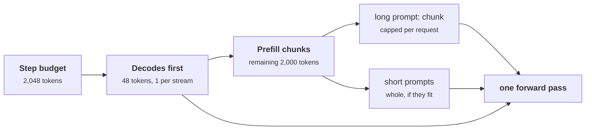
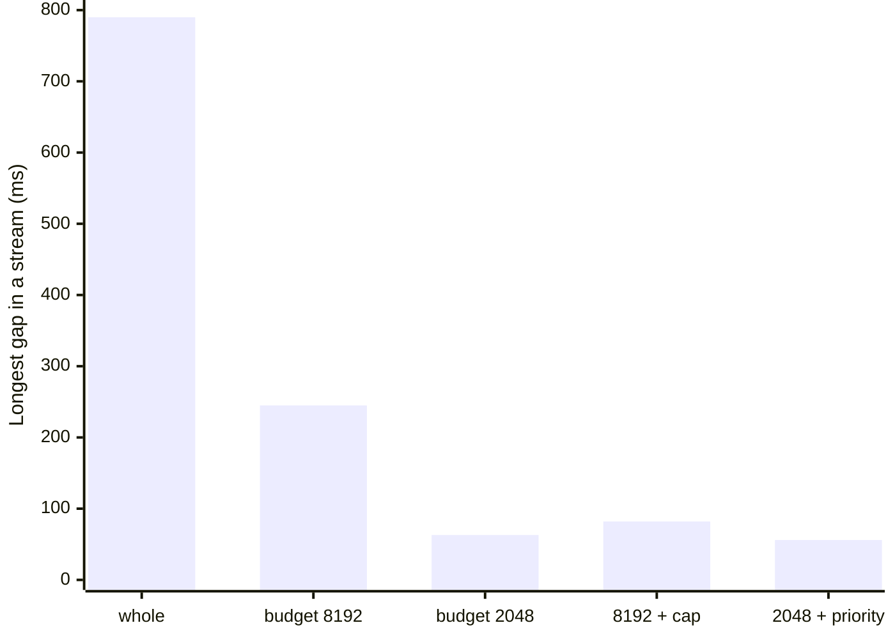

+++
title = 'Chunked prefill and priority'
description = 'A long prompt prefilled in one step freezes every decoding stream for its whole duration. A per-step token budget splits prefills into chunks that share steps with decodes, a per-request cap keeps one prompt from taking the whole budget, and priorities with preemption decide who yields when the engine is full.'
question = 'How does an engine keep a long prompt from stalling everyone else, and who waits when it cannot serve everyone?'
weight = 3
difficulty = 4
prerequisites = ['/notes/inference-engineering/batching-and-scheduling/02-paged-kv-memory', '/notes/inference-engineering/inference-mechanics/01-prefill-and-decode']
date = 2026-10-30T02:15:00Z
lastmod = 2026-10-30T02:15:00Z
verified = 2026-10-30
+++

## The idea in one minute

Continuous batching puts prefill and decode on the same GPU. A decode step for
48 users at 4k context takes about 12 ms. A 32,768-token prompt for Llama-3-8B
needs about 780 ms of arithmetic. If the engine runs that prefill as one step,
every one of the 48 streams freezes for 0.8 seconds. Users see a stall; ITL
objectives fail.

**Chunked prefill** fixes the shape. Each step has a **token budget**, for
example 2,048 tokens. Decoding sequences take one token each, scheduled first;
whatever budget is left goes to prompt chunks. A long prompt is spread over
many steps, each about as long as a normal step plus its chunk. Sarathi-Serve
(OSDI 2024) showed that this "stall-free" batching also uses decode's idle
tensor cores: decode is [memory-bound](/notes/inference-engineering/inference-mechanics/03-why-decode-is-memory-bound/), so prefill chunks ride along almost for
free.

The budget is one dial with two ends. Larger budgets finish prompts sooner
(better TTFT); smaller budgets keep steps short (better ITL). A **per-request
cap** stops one huge prompt from taking every step's budget, and **priorities**
decide which waiting requests get it at all. The consequence to act on:
**choose the token budget from your ITL objective, then protect short and
interactive requests from long ones explicitly**.

## A picture



## How it really works

### The stall without chunking

A step's time is the larger of its compute and memory time (module 1). Adding
prefill tokens adds compute; past a few hundred tokens, a step is
compute-bound and grows linearly with the prompt tokens in it. Older
schedulers, including vLLM's original engine by default, ran waiting prefills
as their own steps ahead of decodes. Every long prompt produced a step as long
as its whole prefill, and every decoding stream waited it out.

### Chunking with a budget

Splitting the prompt is safe because prefill of chunk `j` needs only the KV of
chunks `0 … j−1`, which earlier steps already wrote to the cache. Attention for
a chunk reads the prompt's existing KV and writes its own. The engine loop
becomes:

```text
budget = max_num_batched_tokens
for each running decode:   take 1 token          (decodes first: protect ITL)
for each waiting prefill:  take min(remaining prompt, budget left, per-request cap)
run one step over all scheduled tokens
```

A request emits its first token in the step that completes its last chunk. In
vLLM's V1 engine there is no separate prefill phase at all: every request has
a count of computed tokens, and each step advances requests toward their token
counts within the budget. The relevant controls in recent vLLM releases (flag
names change; check your version's engine arguments):

| Control | What it bounds |
| --- | --- |
| `--max-num-batched-tokens` | tokens per step across all requests (the budget) |
| `--max-num-seqs` | concurrent sequences per step |
| `--long-prefill-token-threshold` | tokens a single request may take per step |
| `--scheduling-policy priority` | order waiting and running requests by a `priority` field |

The default budget depends on the version, GPU memory, and whether you run the
server or the offline API; the startup log prints the value in force. Check it
rather than assume it.

### Choosing the budget from ITL

The step time with a full budget is roughly `budget × 2 × W ÷ (peak FLOP/s ×
efficiency)` once the step is compute-bound. For Llama-3-8B on an H100 at peak:

| Budget | Compute time for the budget alone | Effect |
| --- | --- | --- |
| 512 | 7.8 ms | under decode's memory time: chunks nearly free, slow TTFT |
| 2,048 | 31 ms | ITL spikes bounded near 60 ms with attention and KV reads |
| 8,192 | 124 ms | fast TTFT, long steps for every stream while a prompt runs |

So an ITL objective of 50 to 100 ms implies a budget of a few thousand tokens
for this model. Larger models and [tensor parallelism](/notes/inference-engineering/distributed-inference/01-tensor-pipeline-and-expert-parallelism/) change the constant, not
the method.

### Fairness among prefills

A budget alone does not stop one long prompt from taking it every step. In
first-come order, the 32k prompt arrives first and absorbs the whole remaining
budget for 16 steps while short prompts behind it wait. Two remedies:

- **A per-request cap** (vLLM's `--long-prefill-token-threshold`) limits the
  long prompt's share of each step, leaving room for short prompts.
- **Priority ordering** puts interactive requests ahead of batch or background
  ones in the waiting queue, so the budget goes to them first.

### Priorities and preemption

Priority scheduling also decides who loses when memory runs out. With vLLM's
priority policy, the client supplies an integer `priority` (lower runs
earlier), waiting requests are ordered by priority and then arrival, and when
a higher-priority request needs KV blocks the scheduler can **preempt** the
lowest-priority running request, freeing its blocks for recomputation later.

```mermaid {title="Admitting a high-priority request when the KV pool is full"}
sequenceDiagram
  autonumber
  participant G as Gateway
  participant S as Scheduler
  participant K as KV pool
  G->>S: request, priority 0 (interactive)
  S->>K: allocate blocks for prompt
  K-->>S: not enough free blocks
  rect rgb(243, 241, 234)
    S->>S: pick lowest-priority running request
    S->>K: free its blocks
    Note over S: victim returns to waiting, recomputes later
  end
  S->>K: allocate blocks
  S-->>G: prefill chunks start next step
```

Two cautions. The engine does not authenticate priority; a [gateway](/notes/systems-design/building-blocks/01-gateways-and-routers/) must set it
from the caller's identity and plan, or every client will claim priority 0.
And preemption wastes work: the victim's prompt and generated tokens are
computed again, so a priority scheme that preempts constantly lowers total
throughput.

## Code

The program models 48 streams decoding at 4k context, a 32,768-token prompt
arriving at 0.5 s, and 500-token interactive prompts every 50 ms, for
Llama-3-8B on an H100. Step time is the roofline lower bound for all tokens in
the step, including causal attention for each chunk over its earlier chunks.
Short prompts leave after their first token, so they add no decode load.

```python {title="chunked.py"}
"""chunked.py: what one long prompt does to everyone else's stream, with and without chunking.

Step time is the roofline lower bound for Llama-3-8B on an H100 SXM: the larger
of compute time and memory time for every token in the step. 48 streams are
decoding at 4k context. A 32k-token prompt arrives at 0.5 s; 500-token prompts
arrive every 50 ms. Standard library only; runs offline.
"""

from __future__ import annotations

from dataclasses import dataclass

PEAK, BW = 989e12, 3.35e12
W_PARAMS, LAYERS, D = 7.50e9, 32, 4096
KV_TOKEN = 131072
DECODERS, DECODE_CTX = 48, 4096
SIM_S = 3.0


@dataclass
class Prompt:
    arrival: float
    length: int
    interactive: bool
    done_tokens: int = 0
    ttft: float = -1.0


def step_seconds(decoders: int, chunks: list[tuple[int, int]]) -> float:
    """chunks: (tokens computed this step, tokens already in that request's KV)."""
    tokens = decoders + sum(c for c, _ in chunks)
    flops = 2 * W_PARAMS * tokens
    flops += sum(4 * LAYERS * D * c * (p + c / 2) for c, p in chunks)  # causal attention
    nbytes = 2 * W_PARAMS + KV_TOKEN * (decoders * DECODE_CTX + sum(p + c for c, p in chunks))
    return max(flops / PEAK, nbytes / BW)


def arrivals() -> list[Prompt]:
    out = [Prompt(0.05 * k, 500, True) for k in range(int(SIM_S / 0.05))]
    out.append(Prompt(0.5, 32768, False))
    return sorted(out, key=lambda p: p.arrival)


def simulate(budget: int | None, cap: int, priority: bool) -> dict:
    pending, waiting, now, gaps, finished = arrivals(), [], 0.0, [], []
    while now < SIM_S or waiting:
        while pending and pending[0].arrival <= now:
            waiting.append(pending.pop(0))
        if now >= SIM_S and not waiting:
            break
        order = sorted(waiting, key=lambda p: not p.interactive) if priority else list(waiting)
        left = (budget - DECODERS) if budget else 10**9
        chunks, sched = [], []
        for p in order:
            if left <= 0:
                break
            c = min(p.length - p.done_tokens, left, cap or 10**9)
            chunks.append((c, p.done_tokens))
            sched.append((p, c))
            left -= c
        dt = step_seconds(DECODERS, chunks)
        now += dt
        if now <= SIM_S:
            gaps.append(dt)
        for p, c in sched:
            p.done_tokens += c
            if p.done_tokens == p.length:
                p.ttft = now - p.arrival
                waiting.remove(p)
                finished.append(p)
    return {"gaps": gaps,
            "long": next(p.ttft for p in finished if not p.interactive),
            "short": [p.ttft for p in finished if p.interactive]}


def main() -> None:
    print("policy                         ITL p50  ITL max   long TTFT   short TTFT p50/max")
    for name, budget, cap, prio in (("no chunking (whole prompts)", None, 0, False),
                                    ("chunked, budget 8192", 8192, 0, False),
                                    ("chunked, budget 2048", 2048, 0, False),
                                    ("budget 8192, cap 2048/request", 8192, 2048, False),
                                    ("budget 2048, interactive first", 2048, 0, True)):
        res = simulate(budget, cap, prio)
        g = sorted(res["gaps"])
        s = sorted(res["short"])
        print(f"{name:<30}{1e3 * g[len(g) // 2]:>6.1f}ms{1e3 * g[-1]:>7.0f}ms"
              f"{res['long']:>10.2f}s{1e3 * s[len(s) // 2]:>11.0f}ms/{1e3 * s[-1]:.0f}ms")


if __name__ == "__main__":
    main()
```

Run it with `python3 chunked.py`:

```text
policy                         ITL p50  ITL max   long TTFT   short TTFT p50/max
no chunking (whole prompts)     12.2ms    790ms      0.80s         20ms/874ms
chunked, budget 8192            12.2ms    245ms      0.92s         21ms/868ms
chunked, budget 2048            12.2ms     63ms      0.82s         22ms/774ms
budget 8192, cap 2048/request   12.2ms     82ms      0.94s         21ms/142ms
budget 2048, interactive first  12.2ms     56ms      0.95s         21ms/97ms
```

Without chunking, every stream freezes for 790 ms while the long prompt
prefills, and short prompts that arrive behind it wait up to 874 ms. A budget
of 8,192 cuts the worst stall to 245 ms; 2,048 cuts it to 63 ms. Neither
protects the short prompts, because first-come order lets the long prompt take
each step's whole budget. A per-request cap of 2,048 tokens brings their worst
TTFT to 142 ms, and putting interactive requests first brings it to 97 ms
with the shortest stalls. The long prompt pays: its TTFT rises from 0.80 to
about 0.95 seconds, the cost of sharing.



## Where it breaks

- **Chunking adds attention reads.** Each chunk reads the prompt's earlier KV
  again, so a prompt split into many small chunks costs more total memory
  traffic than one pass. Very small budgets slow long prompts noticeably.
- **The model is a roofline.** Real steps have fixed overheads per step, so very
  small budgets cost more than the model suggests.
- **A budget does not prevent overload.** If prompts arrive faster than the
  budget can absorb, the waiting queue grows and TTFT climbs without bound.
  Admission control and load shedding still apply.
- **Priority without policy is a free-for-all.** Unauthenticated priority
  fields, or a top class with no quota, starve everyone else.
- **Interference is reduced, not removed.** At very large scale, separating
  prefill and decode onto different GPUs ([disaggregation](/notes/inference-engineering/distributed-inference/02-disaggregated-prefill-and-decode/)) removes it at the
  cost of moving KV between them; that is covered later in the course.

## Remember this

- An unchunked long prefill freezes every decoding stream for its full duration.
- Chunked prefill fills each step up to a token budget, decodes first.
- The budget trades TTFT (bigger) against ITL (smaller); choose it from the ITL
  objective.
- Cap tokens per request per step so one long prompt cannot starve short ones.
- Priorities order admission and pick preemption victims; set them at the
  gateway, never from the client.

## Try it

1. Sweep the budget over 512, 1,024, 4,096, and 16,384. Plot worst stall
   against long-prompt TTFT and find the knee.
2. Add a second 32k prompt at 0.6 s. What happens to short TTFT with and
   without the per-request cap?
3. Let short prompts keep decoding for 100 tokens after their first token. How
   does the extra decode load change ITL p50?
4. On a vLLM server, send eight streaming requests, then one 16k-token prompt.
   Record the largest gap between streamed chunks for budgets of 2,048 and
   8,192.

## Check yourself

1. Why is it safe to prefill a prompt in pieces across several steps?

   
   Under causal attention, the KV of chunk j depends only on tokens in chunks
   0 to j. Earlier chunks' KV is already in the cache when chunk j runs, so
   attending to it gives the same result as a single pass.
   

2. Why does chunked prefill often cost decoding users little throughput?

   
   Decode steps are memory-bound and leave the tensor cores mostly idle. Adding
   a prefill chunk uses that spare compute, so the step grows only once the
   chunk is large enough to make it compute-bound.
   

3. With a budget of 2,048, short prompts still waited 774 ms. Why, and what
   fixes it?

   
   First-come order let the long prompt, which arrived first, take the whole
   remaining budget every step until its prefill finished. A per-request cap
   or priority ordering leaves budget for the short prompts.
   

4. What two risks come with priority scheduling?

   
   Clients claiming high priority if the field is not set by a trusted gateway,
   and throughput lost to preemption, since preempted requests recompute their
   KV when they resume.
   

## Sources

- A. Agrawal, N. Kedia, A. Panwar, J. Mohan, N. Kwatra, B. S. Gulavani, A. Tumanov, R. Ramjee, [Taming Throughput-Latency Tradeoff in LLM Inference with Sarathi-Serve](https://arxiv.org/abs/2403.02310), OSDI 2024.
- A. Agrawal et al., [SARATHI: Efficient LLM Inference by Piggybacking Decodes with Chunked Prefills](https://arxiv.org/abs/2308.16369), 2023.
- C. Holmes et al., [DeepSpeed-FastGen: High-throughput Text Generation for LLMs via MII and DeepSpeed-Inference](https://arxiv.org/abs/2401.08671), January 2024 (Dynamic SplitFuse).
- vLLM project, [Optimization and tuning](https://docs.vllm.ai/en/latest/configuration/optimization.html) (chunked prefill, `max_num_batched_tokens`, preemption), vLLM documentation, accessed October 2026.
- vLLM project, [Engine arguments](https://docs.vllm.ai/en/latest/configuration/engine_args.html) (`--scheduling-policy`, `--long-prefill-token-threshold`), accessed October 2026.
- Y. Zhong et al., [DistServe: Disaggregating Prefill and Decoding for Goodput-optimized Large Language Model Serving](https://arxiv.org/abs/2401.09670), OSDI 2024.
