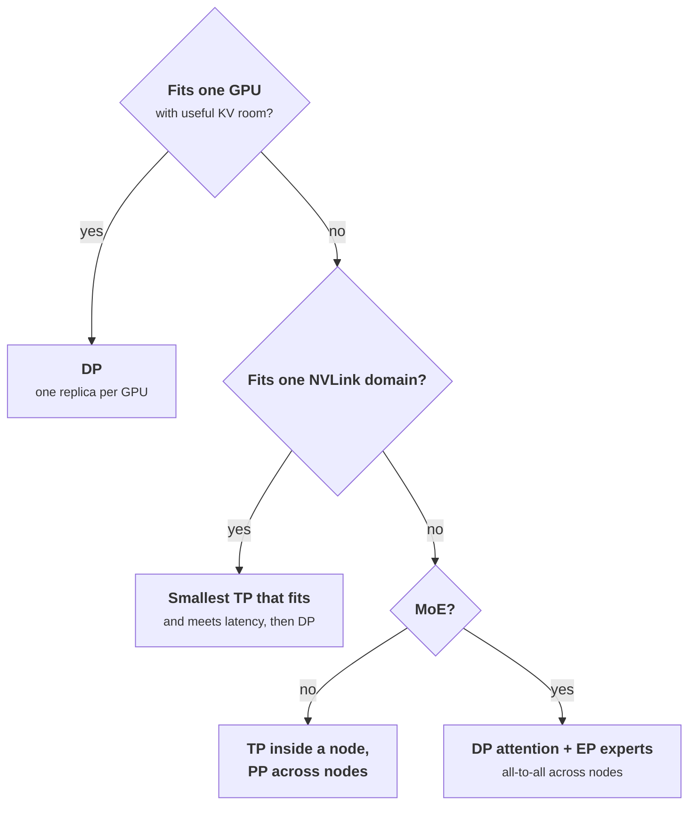

+++
title = 'Tensor, pipeline, and expert parallelism'
description = 'Tensor parallelism splits every layer and pays two all-reduces per layer; pipeline parallelism splits the layer stack and pays one small send per stage; expert parallelism spreads experts and pays two all-to-alls per MoE layer. Price each per step before choosing.'
question = 'When a model is spread over many GPUs, what crosses which link on every step, and which layout does that favor?'
weight = 1
difficulty = 4
prerequisites = ['/notes/systems-design/thinking-in-invariants/03-back-of-the-envelope-capacity']
date = 2026-10-30T06:05:00Z
lastmod = 2026-10-30T06:05:00Z
verified = 2026-10-30
+++

## The idea in one minute

There are three ways to put one copy of a model on several GPUs, and each
moves different data. **Tensor parallelism (TP)** splits every weight matrix,
so every GPU works on every token and the partial results are summed with an
**all-reduce** twice per layer. **Pipeline parallelism (PP)** gives each GPU a
contiguous block of layers and hands the activations to the next stage once
per stage boundary. **Expert parallelism (EP)** places a mixture-of-experts
model's experts on different GPUs and sends each token to the GPUs that hold
its experts, then back, with two **all-to-all** exchanges per MoE layer.
Running several independent copies is **data parallelism (DP)**, and moves
nothing between copies.

During decode a GPU spends most of each step reading its share of the weights
from HBM. Parallelism shortens that read, and the communication it adds is
time the GPUs are not reading. So the comparison is per step: **bytes moved,
divided by the bandwidth of the link they cross, plus a fixed cost per
collective, against the weight-read time saved**. Run that arithmetic and the
standard layout falls out: TP inside an NVLink domain, PP or DP across nodes,
EP for large MoE models, and the smallest TP that fits the model and meets
latency.

## A picture

```mermaid {title="Two nodes: tensor parallel inside each node, pipeline parallel across"}
flowchart LR
  IN["<b>Batch of tokens</b>"] --> N0
  subgraph N0["Node 0: layers 0 to 62, TP = 8"]
    direction TB
    A0["<b>8 GPUs</b><br/><small>each holds 1/8 of every layer</small>"]
    R0(["<b>2 all-reduces per layer</b><br/><small>NVLink, 450 GB/s per GPU</small>"])
    A0 <--> R0
  end
  subgraph N1["Node 1: layers 63 to 125, TP = 8"]
    direction TB
    A1["<b>8 GPUs</b><br/><small>each holds 1/8 of every layer</small>"]
    R1(["<b>2 all-reduces per layer</b><br/><small>NVLink</small>"])
    A1 <--> R1
  end
  N0 -->|"<b>one activation send</b><br/><small>batch x d_model, InfiniBand</small>"| N1
  N1 --> OUT["<b>Logits</b>"]
  class IN,OUT neutral
  class A0,A1 compute
  class R0,R1 io
```

The heavy, frequent traffic (two all-reduces per layer) stays on the fast
link. Only the light, infrequent traffic (one activation tensor per stage
boundary) crosses the slower network.

## How it really works

### Tensor parallelism: one all-reduce per block

The Megatron-LM layout (Shoeybi and colleagues, 2019) shards a transformer
block so that each GPU can run most of it without talking to the others. In
the MLP, the first projection (or the gate and up projections in a SwiGLU
MLP) is split by **columns**: each GPU computes a slice of the intermediate
activation and applies the nonlinearity locally. The down projection is split
by **rows**: each GPU multiplies its slice and produces a partial sum of the
full output. Summing partial sums across GPUs is exactly an all-reduce, so
the whole MLP needs one.

Attention splits the same way by heads. Each GPU owns a subset of query heads
and the matching key and value heads, computes attention for them, and
multiplies by its rows of the output projection, producing another partial
sum and another all-reduce. That is **two all-reduces per layer** in the
forward pass, each carrying `tokens × d_model` activations.

Two consequences come with the head split:

- **The KV cache shards with the heads.** Each GPU stores only its KV heads,
  so TP divides both the weights and the per-token KV bytes per GPU. Llama 3
  70B has 8 KV heads; at TP 8 each GPU holds one. At TP 16 there are not
  enough KV heads to go around and engines replicate them, so KV memory per
  GPU stops shrinking.
- **The group runs in lockstep.** Every rank executes the same step and waits
  at every collective. One slow or dead GPU stalls or kills the group. You
  cannot drain one GPU of a TP group, and a hung rank holds the others until
  a collective timeout fires.

### Pricing a collective

The standard cost model for a collective is `T = α + bytes / β`: a fixed
latency `α` (launch, synchronization, and per-hop costs) plus the bytes each
GPU must send divided by its link bandwidth `β`. For a ring all-reduce of an
`M`-byte message over `N` GPUs, each GPU sends `2 (N − 1) / N × M` bytes
(Patarasuk and Yuan showed this is bandwidth-optimal), half in a
reduce-scatter and half in an all-gather.

Decode and [prefill](/notes/inference-engineering/inference-mechanics/01-prefill-and-decode/) sit in different regimes of that formula:

| | Message per all-reduce (Llama 3 70B, BF16) | Dominant term |
| --- | --- | --- |
| Decode, batch 32 | `32 × 8192 × 2` bytes = 512 KiB | `α`: 160 collectives per step, each small |
| Prefill, 2,048 tokens | `2048 × 8192 × 2` bytes = 32 MiB | `bytes / β`: gigabytes per GPU per prefill |

That is why serving engines ship their own all-reduce for small messages.
vLLM's custom all-reduce writes directly into peer GPUs' memory over NVLink
instead of running NCCL's ring for decode-sized messages, and can fuse the
all-reduce with the following normalization. On H100 systems with
third-generation NVSwitch, NCCL can also use **NVLink SHARP**, where the
switch performs the reduction, which roughly halves the bytes each GPU sends.
The numbers below use a plain ring and an assumed `α`; measure both with
`nccl-tests` on your own hardware.

### Pipeline parallelism: small sends, a different cost

PP sends one activation tensor of `tokens × d_model` from each stage to the
next. For Llama 3 405B (`d_model` 16,384) at a batch of 32, that is 1 MiB per
boundary per step, against hundreds of megabytes for TP across the same
GPUs. This is why PP is the layer that crosses node boundaries.

Its cost is elsewhere. A token must still pass through every layer in order,
so **PP does not shorten per-token latency**; it adds the stage hand-offs to
it. To keep every stage busy, the engine needs as many independent batches in
flight as there are stages. vLLM does this with a batch queue: with `-pp 2`
it schedules two batches so each stage is always working on one of them.

Training texts quote a pipeline **bubble** of `(P − 1) / (M + P − 1)` for `P`
stages and `M` micro-batches (GPipe, 2018). That formula describes a training
step that flushes the pipeline before the backward pass. A [serving engine](/notes/inference-engineering/serving-systems/01-anatomy-of-a-serving-engine/)
never flushes; in steady state the idle time comes from **stage imbalance**
(the last stage also runs the LM head) and from not having `P` independent
batches. The larger cost in decode is subtler: with a fixed number of
concurrent sequences, splitting them into `P` batches means each GPU reads its
weights once per batch, `P` times per generated token, each read amortized
over `1/P` of the sequences. In the [memory-bound](/notes/inference-engineering/inference-mechanics/03-why-decode-is-memory-bound/) regime that costs throughput.

### Expert parallelism: all-to-all, twice per MoE layer

In an MoE layer, a router picks `k` of `E` expert MLPs for each token. With
EP, experts live on different GPUs. Each GPU sorts its tokens by destination,
sends them to the GPUs that own their experts (**dispatch**), runs its local
experts as a grouped matrix multiply, and sends the results back
(**combine**), where they are weighted and summed. Each token moves
`k × d_model` values out and the same back, per MoE layer.

All-to-all has no reduction to exploit: every GPU sends distinct data to
every other GPU, and the exchange is a barrier, so the slowest GPU sets the
step time. That makes EP sensitive to **load imbalance** across experts,
the subject of the third lesson in this module. vLLM pairs EP with data
parallelism for attention: each DP rank runs attention for its own requests,
and all ranks join every MoE layer, so idle ranks run dummy forward passes to
keep the collective aligned.

### Data and context parallelism, briefly

DP replicas share nothing, so they move nothing; a load balancer spreads
requests. For a dense model that fits on one GPU or one node, DP is the most
efficient use of extra GPUs. **Context parallelism** splits one long sequence
across GPUs, sharding its KV cache or its prefill queries; it matters for
contexts so long that one GPU group cannot hold or prefill them in time.

### Choosing a layout



Two rules sit behind the tree. Check **quantization first**: FP8 weights halve
the bytes, and Llama 3 405B in FP8 (about 405 GB) fits one 8-GPU H100 node
where BF16 (about 810 GB) needs two. And prefer the **smallest TP** that fits:
eight replicas of a model on one GPU each give nearly eight times the
throughput, while one replica at TP 8 gives each request a faster step but far
less than eight times the throughput.

## Code

The program prices one decode step per GPU for Llama 3 70B and 405B (layer
counts and widths from the Llama 3 paper) on H100 numbers: HBM at 3.35 TB/s,
NVLink at 450 GB/s per direction, one 400 Gb/s NIC (50 GB/s) per GPU. The
fixed cost per collective is an assumption, not a measurement.

```python {title="parallel_comm.py"}
"""parallel_comm.py: per-step communication of tensor, pipeline, and expert
parallelism, priced with an alpha-beta model and compared with the time to
read the weights. Standard library only; runs offline. Hardware numbers are
spec-sheet peaks or labeled assumptions; measure your own with nccl-tests.
"""

from __future__ import annotations

from dataclasses import dataclass

GB = 1e9
MB = 1e6


@dataclass(frozen=True)
class Model:
    name: str
    params: float      # parameters
    layers: int
    d_model: int
    bytes_per_param: float


@dataclass(frozen=True)
class Link:
    name: str
    bw: float          # bytes/s, one direction, per GPU
    alpha: float       # seconds of fixed cost per collective (assumption)


HBM_BW = 3.35e12                    # H100 SXM HBM3, bytes/s
NVLINK = Link("NVLink (H100)", 450 * GB, 10e-6)
IB = Link("InfiniBand 400G", 50 * GB, 25e-6)
PCIE = Link("PCIe Gen5 x16", 64 * GB, 20e-6)
ACT_BYTES = 2                       # BF16 activations

LLAMA70 = Model("Llama 3 70B BF16", 70.6e9, 80, 8192, 2)
LLAMA405 = Model("Llama 3 405B BF16", 405.9e9, 126, 16384, 2)


def weight_read_s(m: Model, gpus_sharing: int) -> float:
    """Decode floor: every step reads this GPU's share of the weights."""
    return m.params * m.bytes_per_param / gpus_sharing / HBM_BW


def tp_comm_s(m: Model, tp: int, tokens: int, link: Link) -> tuple[float, float, float]:
    """Two ring all-reduces per layer; returns (bytes per GPU, alpha term, beta term)."""
    if tp == 1:
        return 0.0, 0.0, 0.0
    msg = tokens * m.d_model * ACT_BYTES
    per_gpu = 2 * (tp - 1) / tp * msg * 2 * m.layers
    n_coll = 2 * m.layers
    return per_gpu, n_coll * link.alpha, per_gpu / link.bw


def pp_comm_s(m: Model, pp: int, tokens: int, link: Link) -> tuple[float, float]:
    """One point-to-point activation send per stage boundary."""
    msg = tokens * m.d_model * ACT_BYTES
    return (pp - 1) * msg, (pp - 1) * (link.alpha + msg / link.bw)


def tp_table() -> None:
    m = LLAMA70
    print(f"{m.name}, decode, batch 32: one step per GPU")
    print(f"{'layout':<16}{'weights/GPU':>12}{'read':>9}{'comm MB':>9}"
          f"{'alpha':>8}{'beta':>8}{'comm/read':>11}")
    for tp, link in [(2, NVLINK), (4, NVLINK), (8, NVLINK), (8, PCIE)]:
        read = weight_read_s(m, tp)
        vol, a, b = tp_comm_s(m, tp, 32, link)
        print(f"TP{tp} {link.name.split()[0]:<11}{m.params * 2 / tp / GB:>10.1f}GB"
              f"{read * 1e3:>7.1f}ms{vol / MB:>9.0f}{a * 1e3:>6.2f}ms{b * 1e3:>6.2f}ms"
              f"{(a + b) / read:>10.0%}")
    vol, a, b = tp_comm_s(m, 8, 2048, NVLINK)
    flops_s = 2 * m.params * 2048 / 8 / 600e12      # assume 600 TFLOP/s achieved
    print(f"\nprefill of 2,048 tokens at TP8: {vol / GB:.1f} GB per GPU, "
          f"alpha {a * 1e3:.1f} ms, beta {b * 1e3:.1f} ms, compute {flops_s * 1e3:.0f} ms")


def multinode() -> None:
    m = LLAMA405
    seqs = 64
    print(f"\n{m.name} on 2 nodes x 8 GPUs, decode, {seqs} concurrent sequences")
    # TP16: one batch of 64; the all-reduce ring crosses InfiniBand.
    read16 = weight_read_s(m, 16)
    vol, a, b = tp_comm_s(m, 16, seqs, IB)
    step16 = read16 + a + b
    # TP8 x PP2: two batches of 32 in flight; TP stays on NVLink in each stage.
    half = Model(m.name, m.params / 2, m.layers // 2, m.d_model, m.bytes_per_param)
    _, a8, b8 = tp_comm_s(half, 8, seqs // 2, NVLINK)
    pp_bytes, pp_t = pp_comm_s(m, 2, seqs // 2, IB)
    stage = weight_read_s(m, 16) + a8 + b8
    latency_pp = 2 * stage + pp_t
    print(f"{'layout':<12}{'token latency':>15}{'tokens/s':>11}")
    print(f"{'TP16':<12}{step16 * 1e3:>13.1f}ms{seqs / step16:>11,.0f}")
    print(f"{'TP8 x PP2':<12}{latency_pp * 1e3:>13.1f}ms{seqs / latency_pp:>11,.0f}")
    print(f"  TP16 comm per GPU per step: {vol / MB:.0f} MB over IB "
          f"(alpha {a * 1e3:.1f} ms, beta {b * 1e3:.1f} ms) vs reading weights {read16 * 1e3:.1f} ms")
    print(f"  PP2 send per batch: {pp_bytes / MB:.1f} MB, {pp_t * 1e6:.0f} us")


def pp_microbatches() -> None:
    """Same concurrency, split into P batches in flight: each batch is smaller,
    so the weight read is amortized over fewer sequences per stage pass."""
    print("\nPipeline stages with 64 concurrent sequences, Llama 3 70B BF16 on 8 GPUs")
    m = LLAMA70
    for tp, pp in [(8, 1), (4, 2), (2, 4)]:
        per_stage_read = m.params * 2 / (tp * pp) / HBM_BW
        half = Model(m.name, m.params / pp, m.layers // pp, m.d_model, 2)
        batch = 64 // pp
        _, a, b = tp_comm_s(half, tp, batch, NVLINK)
        stage = per_stage_read + a + b
        latency = pp * stage
        throughput = 64 / latency  # pp batches each finish one token per latency
        print(f"  TP{tp} x PP{pp}: batch {batch:>2} per stage pass, stage {stage * 1e3:.2f} ms, "
              f"token latency {latency * 1e3:.1f} ms, {throughput:,.0f} tokens/s")


if __name__ == "__main__":
    tp_table()
    multinode()
    pp_microbatches()
```

Run it with `python3 parallel_comm.py`:

```text
Llama 3 70B BF16, decode, batch 32: one step per GPU
layout           weights/GPU     read  comm MB   alpha    beta  comm/read
TP2 NVLink           70.6GB   21.1ms       84  1.60ms  0.19ms        8%
TP4 NVLink           35.3GB   10.5ms      126  1.60ms  0.28ms       18%
TP8 NVLink           17.6GB    5.3ms      147  1.60ms  0.33ms       37%
TP8 PCIe             17.6GB    5.3ms      147  3.20ms  2.29ms      104%

prefill of 2,048 tokens at TP8: 9.4 GB per GPU, alpha 1.6 ms, beta 20.9 ms, compute 60 ms

Llama 3 405B BF16 on 2 nodes x 8 GPUs, decode, 64 concurrent sequences
layout        token latency   tokens/s
TP16                 41.3ms      1,551
TP8 x PP2            33.9ms      1,889
  TP16 comm per GPU per step: 991 MB over IB (alpha 6.3 ms, beta 19.8 ms) vs reading weights 15.1 ms
  PP2 send per batch: 1.0 MB, 46 us

Pipeline stages with 64 concurrent sequences, Llama 3 70B BF16 on 8 GPUs
  TP8 x PP1: batch 64 per stage pass, stage 7.52 ms, token latency 7.5 ms, 8,509 tokens/s
  TP4 x PP2: batch 32 per stage pass, stage 6.21 ms, token latency 12.4 ms, 5,154 tokens/s
  TP2 x PP4: batch 16 per stage pass, stage 5.69 ms, token latency 22.8 ms, 2,811 tokens/s
```

Read the first table from the right. At TP 2 the step is dominated by reading
70 GB of weights, and communication adds 8%. At TP 8 the read shrinks to
5.3 ms but the 160 collectives do not shrink, so the fixed cost alone is a
third of the read. That is the shape of TP scaling: **the arithmetic divides
by N, the number of collectives does not**. Over PCIe the same layout spends
more time communicating than reading.

The prefill line flips the regime: 9.4 GB per GPU per 2,048-token prefill
makes bandwidth the dominant term, still smaller than the 60 ms of compute
and partly overlappable with it.

For 405B in BF16 across two nodes, TP 16 pushes about 1 GB per GPU per step
through the NICs, and both its latency and its throughput are worse than
TP 8 inside each node with PP 2 across them, whose only cross-node traffic is
1 MiB per batch. The last table shows the price of PP at fixed concurrency:
the token latency grows with every stage, and throughput falls because each
GPU now reads its weights once per smaller batch.

## Where it breaks

- **The model is a ranking tool.** It ignores overlap of communication with
  compute, NVLink SHARP, the LL protocols NCCL uses for small messages, kernel
  launch overheads, and achieved (not peak) HBM bandwidth. Use it to compare
  layouts and to see which term dominates; calibrate `α` and `β` with
  `nccl-tests` before trusting absolute times.
- **Concurrency changes the answer.** At batch 1, everything is latency; at
  very large batches, decode starts to become compute-bound and PP's extra
  weight reads stop mattering. Re-run the arithmetic at your real batch sizes.
- **Lockstep groups fail together.** A TP or PP group is one failure domain.
  Larger groups mean a single GPU fault (an Xid error, an ECC fault, a NIC
  flap) takes down more GPUs, and a restart reloads all of them.
- **Topology must match the plan.** A TP group that straddles two NVLink
  domains, or GPUs that talk through the CPU's PCIe root complex, gets the
  PCIe row of the table. Check `nvidia-smi topo -m` and pin groups to
  domains.
- **Uneven stages waste the pipeline.** The first stage holds the embedding
  and the last holds the LM head. An equal split of layers leaves the other
  stages waiting on the slowest one.

## Remember this

- TP: two all-reduces per layer, every step; keep it inside an NVLink domain.
- Decode collectives are latency-bound, prefill collectives bandwidth-bound.
- PP crosses nodes cheaply but never shortens per-token latency, and at fixed
  concurrency multiplies weight reads per token.
- EP: two all-to-alls per MoE layer, gated by the slowest GPU.
- Use the smallest TP that fits and meets latency; spend the rest on DP.
- Try FP8 before adding a second node.

## Try it

1. Set the NVLink `alpha` to 3 µs, as a well-tuned one-shot all-reduce might
   achieve. How do the TP 8 overhead and the TP 2 versus TP 8 comparison
   change?
2. Halve `bytes_per_param` for the 405B model (FP8) and run it at TP 8 on a
   single node. Compare its token latency with the two-node layouts.
3. Add a TP 4 × PP 4 layout for 405B on two nodes (two stages per node). How
   many sends cross the network per batch, and what happens to throughput at
   64 concurrent sequences?
4. Run `all_reduce_perf` from `nccl-tests` on a GPU node for message sizes
   from 64 KiB to 64 MiB and fit `α` and `β`. Replace the assumed values.
5. Extend `pp_comm_s` to model an uneven split where the last stage is 25%
   slower. What happens to throughput?

## Check yourself

1. Why does the Megatron layout split the first MLP projection by columns and
   the second by rows?

   
   Column-splitting the first projection gives each GPU a complete slice of the
   intermediate activation, so the nonlinearity runs locally. Row-splitting the
   second then gives each GPU a partial sum of the full output, and summing
   partial sums is one all-reduce. Any other combination needs an extra
   collective in the middle of the block.
   

2. Llama 3 70B decode at TP 8, batch 32: is the all-reduce cost dominated by
   latency or bandwidth, and what follows for engine design?

   
   Latency. Each message is about 512 KiB and there are 160 per step, so the
   fixed per-collective cost dominates the bytes. Engines therefore use
   specialized small-message all-reduce kernels (one-shot writes over NVLink,
   fused with the following normalization) rather than a general ring.
   

3. Why does pipeline parallelism not reduce per-token latency, and why can it
   reduce decode throughput at fixed concurrency?

   
   Each token still passes through every layer in order, plus the hand-offs
   between stages. With a fixed number of sequences split into P batches in
   flight, each GPU reads its weights once per batch, so P times per generated
   token, each read shared by fewer sequences. In memory-bound decode, that
   extra reading lowers tokens per second.
   

4. Why is TP 16 across two nodes a poor choice for a dense 405B model, even
   though it divides the weights over more GPUs?

   
   Every one of the 252 all-reduces per step crosses the inter-node network,
   which has roughly a ninth of NVLink's bandwidth and a higher fixed cost. The
   communication time becomes comparable to or larger than the weight read it
   saves. TP 8 per node with PP 2 across nodes keeps the all-reduces on NVLink
   and sends only one activation tensor per batch across the network.
   

5. What limits how far TP can usefully grow for a model with 8 KV heads?

   
   Beyond TP 8 there are fewer KV heads than GPUs, so KV heads are replicated
   and per-GPU KV memory stops shrinking; and the fixed cost of the two
   all-reduces per layer stays constant while the per-GPU weight read keeps
   shrinking, so communication becomes a growing share of each step.
   

## Sources

- M. Shoeybi, M. Patwary, R. Puri, P. LeGresley, J. Casper, B. Catanzaro, [Megatron-LM: Training Multi-Billion Parameter Language Models Using Model Parallelism](https://arxiv.org/abs/1909.08053), arXiv:1909.08053, 2019.
- R. Pope, S. Douglas, A. Chowdhery, J. Devlin, J. Bradbury, A. Levskaya, J. Heek, K. Xiao, S. Agrawal, J. Dean, [Efficiently Scaling Transformer Inference](https://arxiv.org/abs/2211.05102), MLSys 2023.
- Y. Huang et al., [GPipe: Efficient Training of Giant Neural Networks using Pipeline Parallelism](https://arxiv.org/abs/1811.06965), NeurIPS 2019.
- P. Patarasuk, X. Yuan, "Bandwidth optimal all-reduce algorithms for clusters of workstations", *Journal of Parallel and Distributed Computing* 69(2), 2009.
- Llama Team, AI at Meta, [The Llama 3 Herd of Models](https://arxiv.org/abs/2407.21783), arXiv:2407.21783, July 2024 (model dimensions, Table 3).
- D. Lepikhin et al., [GShard: Scaling Giant Models with Conditional Computation and Automatic Sharding](https://arxiv.org/abs/2006.16668), arXiv:2006.16668, 2020.
- NVIDIA, [H100 Tensor Core GPU datasheet](https://www.nvidia.com/en-us/data-center/h100/) (HBM3 bandwidth, NVLink bandwidth).
- NVIDIA, [NCCL documentation](https://docs.nvidia.com/deeplearning/nccl/user-guide/docs/index.html) and [nccl-tests](https://github.com/NVIDIA/nccl-tests).
- vLLM project, [Parallelism and scaling](https://docs.vllm.ai/en/latest/serving/parallelism_scaling.html) and [Expert parallel deployment](https://docs.vllm.ai/en/latest/serving/expert_parallel_deployment.html), as of October 2026.
