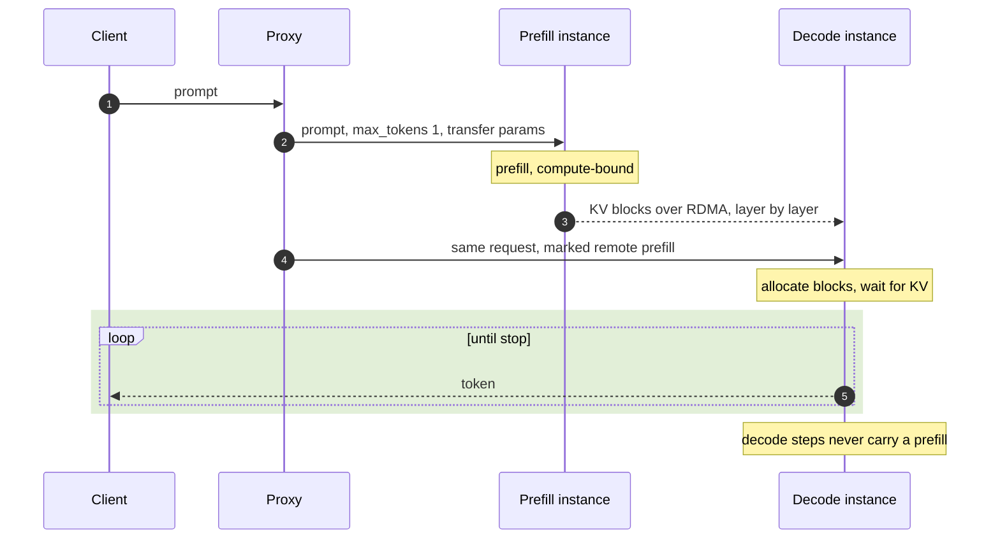
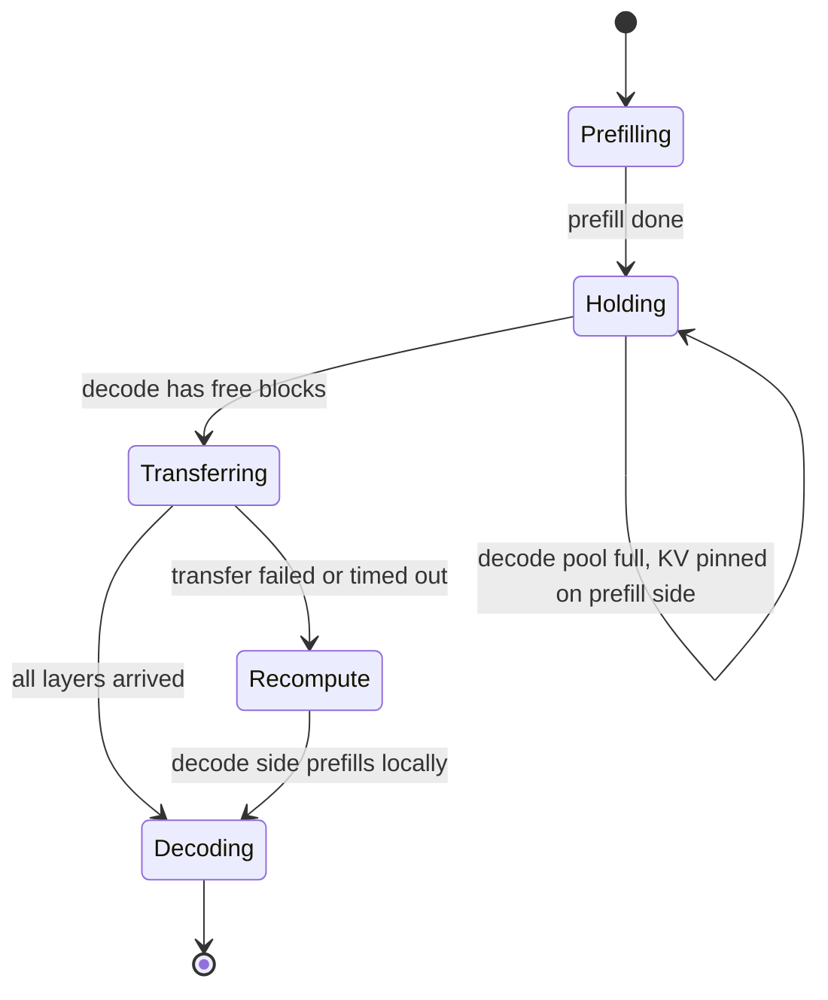

+++
title = 'Disaggregated prefill and decode'
description = 'Prefill is compute-bound and bursty; decode is memory-bound and steady. Running them on separate pools removes their interference and lets each be tuned alone, at the price of moving the KV cache and of sizing two pools whose right ratio depends on the traffic.'
question = 'When does it pay to run prefill and decode on different GPUs, and what does moving the KV cache between them cost?'
weight = 2
difficulty = 5
prerequisites = ['/notes/inference-engineering/distributed-inference/01-tensor-pipeline-and-expert-parallelism']
date = 2026-10-30T06:10:00Z
lastmod = 2026-10-30T06:10:00Z
verified = 2026-10-30
+++

## The idea in one minute

A request has two phases with opposite bottlenecks. **Prefill** processes the
whole prompt in one pass and is limited by compute. **Decode** generates one
token per step per sequence and is limited by memory bandwidth. In a
colocated engine both share every step: whenever a prompt is being prefilled,
the step that carries it takes longer, and every sequence that is decoding
waits for it. Chunked [prefill](/notes/inference-engineering/inference-mechanics/01-prefill-and-decode/) bounds that wait with a per-step token budget;
it does not remove it.

**Disaggregation** runs prefill on one pool of GPUs and decode on another and
ships the KV cache from the first to the second. Decode steps then never
carry a prefill, so inter-token latency is flat, and each pool can use its own
parallelism, batch limits, and even hardware. The costs are the KV transfer
(which must be cheaper than recomputing the prompt, and is, given an RDMA
network and a model with grouped-query attention), a two-step request
protocol, and two pools whose capacities must stay in the ratio the traffic
demands. The vLLM documentation states the tradeoff directly: disaggregated
prefill **does not improve throughput**; it improves latency control. Use it
when the latency objective, not the throughput, is what you cannot meet.

## A picture



## How it really works

### The interference disaggregation removes

In a continuous-batching engine a step's duration is set by the larger of its
memory time (weights plus the KV of running sequences) and its compute time
(tokens processed). A decode-only step for a 70B model on 8 H100s is a few
milliseconds of weight reading. Add a 2,048-token prefill chunk and the same
step becomes compute-bound at roughly ten times that. Every decoding sequence
in the batch sees one long gap in its token stream.

[Chunked prefill](/notes/inference-engineering/batching-and-scheduling/03-chunked-prefill-and-priority/) (Sarathi-Serve, Agrawal and colleagues, 2024) caps the prefill
tokens per step, so a long prompt spreads over many steps and each decode gap
is bounded by the chunk size. The cap is a dial between time to first token
and inter-token latency: a small budget keeps decode smooth and prefills
slowly; a large budget does the reverse. The vLLM documentation notes that
chunked prefill can reach the same goal in principle, but "in practice it's
hard to figure out the correct chunk size value".

Zhong and colleagues' **DistServe** (OSDI 2024) framed the alternative: place
prefill and decode on different GPUs, choose each phase's parallelism
separately, and optimize **goodput**, the request rate served within both the
time-to-first-token and time-per-output-token objectives. Patel and
colleagues' **Splitwise** (ISCA 2024) split the phases across machines and
used different GPU generations for each. Moonshot's **Mooncake** made the KV
cache the center of the design, a distributed store that prefill nodes write
and decode nodes read.

### What the KV transfer costs

KV bytes per token are `2 × layers × kv_heads × head_dim × bytes`. Prefill
compute per token is about `2 × parameters` FLOPs (plus attention, which grows
with context). Both scale with prompt length, so their ratio is a property of
the model and the hardware, **not of the prompt**:

```text
transfer / recompute  =  (KV bytes per token / network bandwidth)
                         / (2 x parameters / achieved FLOP/s)
```

| Model and link | KV per token | Transfer per token | Prefill per token | Ratio |
| --- | --- | --- | --- | --- |
| Llama 3 70B BF16, 8 GPUs, 8 x 400G NICs | 320 KiB | 1.0 µs | 29 µs | 3.5% |
| Same, one 100 Gb/s Ethernet NIC (about 10 GB/s) | 320 KiB | 33 µs | 29 µs | over 100% |
| Llama 3 8B BF16, 1 GPU, 1 x 400G NIC | 128 KiB | 3.3 µs | 27 µs | 12% |

Prefill per token assumes 600 TFLOP/s achieved per H100; NICs at 80% of line
rate. Grouped-query attention is what makes the first row cheap: 8 KV heads
instead of 64. Multi-head latent attention goes further; DeepSeek-V3 caches a
512-dimensional latent plus a 64-dimensional rotary key per layer, about 35
thousand values per token across 61 layers. A model with full multi-head
attention on a commodity network can make transfer slower than recompute.

Two techniques hide most of what remains:

- **Layer-wise streaming.** KV for layer `i` is final as soon as layer `i`
  finishes, so it can be sent while layers `i + 1` onward compute. If the
  transfer rate keeps up with prefill, only the last layer's transfer is
  exposed in the time to first token.
- **Sharded transfer.** With TP 8 on the prefill side, each GPU holds one
  eighth of the KV heads and sends them over its own NIC, so the aggregate
  bandwidth is eight NICs, not one.

### The protocol and its failure paths

In vLLM, disaggregation is built on the **KV connector** interface, a plug-in
point in the block allocation path described in
[the KV cache manager](/notes/inference-engineering/vllm-internals/03-the-kv-cache-manager/). A proxy
sends the prompt to a prefill instance (role `kv_producer`) with
`max_tokens: 1` and transfer parameters, then sends the same request to a
decode instance (role `kv_consumer`). The decode scheduler asks its connector
how many tokens it can supply remotely, allocates blocks for them, and parks
the request in a waiting-for-remote-KV state while other requests run. The
NIXL connector moves blocks over RDMA; Mooncake and LMCache connectors do the
same through their own transfer engines and stores. The vLLM documentation
marks the feature experimental as of October 2026.

Each step of that protocol has a failure path to design for:



- **No room on the decode side.** The prefill instance must keep the blocks
  until they are pulled, so a full decode pool backs up into prefill memory.
  vLLM's connector hook lets the scheduler delay freeing blocks until the
  transfer completes; without backpressure the prefill pool fills with KV
  nobody can accept.
- **A failed transfer.** vLLM marks the affected blocks invalid, rolls
  `num_computed_tokens` back, and recomputes the rest locally. That is correct
  but expensive: the decode instance now runs a prefill, the interference the
  design was meant to avoid.
- **Layout mismatch.** If the two pools use different TP sizes, KV heads are
  sharded differently on each side. Some connectors split or merge shards in
  transit; otherwise the pools must match, which removes one of the reasons
  to disaggregate.
- **Prefix reuse across turns.** The next turn of a conversation should land
  on a prefill instance that holds the conversation's prefix, but the freshest
  KV is on a decode instance. A shared KV store (the Mooncake design) or
  prefix-aware routing addresses this.

### The ratio problem

A colocated instance shifts between prefill and decode work every step as the
mix changes. Separate pools cannot: each must be sized for its own share of
the load, and the right ratio of prefill to decode instances depends on the
prompt and output length distribution. Long prompts with short answers
(retrieval, summarization, classification) need more prefill capacity; long
generations (reasoning, code) need more decode capacity. The ratio drifts
with product changes, so a disaggregated deployment needs **per-pool
autoscaling on per-pool signals**: prefill queue time for the prefill pool,
KV usage and step time for the decode pool. Projects such as llm-d and NVIDIA
Dynamo build this planning in.

The minimum deployment is also larger: at least one instance of each kind,
plus the proxy and an RDMA fabric, before any benefit appears.

## Code

The program compares four 8-GPU instances of a 70B model serving the same
synthetic traffic (prompts with median 2,000 tokens, outputs with median 200)
colocated with two chunk sizes, and disaggregated with three pool ratios. The
objective per request is a time to first token under 2 s and a mean time per
output token under 12 ms. `ITL99` is the 99th percentile gap between
consecutive tokens, weighted by tokens.

```python {title="disagg.py"}
"""disagg.py: colocated serving with chunked prefill versus prefill/decode
disaggregation, on the same number of 8-GPU instances of a 70B model.

Each instance is a step-level model: a step costs the larger of its memory time
(read this GPU's weights plus the KV of every running sequence) and its compute
time (tokens processed), plus a fixed overhead. KV moves between pools over
RDMA, streamed layer by layer during prefill. Standard library only; offline.
The constants are rough H100 figures, not measurements.
"""

from __future__ import annotations

import heapq
import math
import random
from dataclasses import dataclass, field

WEIGHT_READ = 141e9 / 8 / 3.35e12          # s per step: one GPU's share of BF16 weights
KV_PER_TOKEN = 2 * 80 * 8 * 128 * 2        # bytes, Llama 3 70B, BF16, all GPUs together
KV_READ_PER_TOKEN = KV_PER_TOKEN / 8 / 3.35e12
FLOP_TIME_PER_TOKEN = 2 * 70.6e9 / 8 / 600e12   # s, at 600 TFLOP/s achieved per GPU
OVERHEAD = 0.0008                          # s per step: scheduling, launch, sampling
LAYERS = 80
RDMA_BW = 8 * 50e9 * 0.8                   # 8 x 400G NICs at 80% efficiency
MAX_SEQS = 256
SIM_SECONDS = 240.0
TTFT_SLO, TPOT_SLO = 2.0, 0.012
GAPS: list[tuple[float, int]] = []    # (step duration, decoders in the step)


@dataclass(order=True)
class Req:
    arrival: float
    prompt: int = field(compare=False)
    output: int = field(compare=False)
    first: float = field(default=math.inf, compare=False)
    done: float = field(default=math.inf, compare=False)


def workload(rate: float, seed: int = 7) -> list[Req]:
    rng = random.Random(seed)
    t, reqs = 0.0, []
    while t < SIM_SECONDS:
        t += rng.expovariate(rate)
        prompt = min(16000, int(rng.lognormvariate(math.log(2000), 0.8)))
        output = max(2, min(1500, int(rng.lognormvariate(math.log(200), 0.7))))
        reqs.append(Req(t, prompt, output))
    return reqs


def step_time(tokens: int, ctx_tokens: int) -> float:
    memory = WEIGHT_READ + ctx_tokens * KV_READ_PER_TOKEN
    compute = tokens * FLOP_TIME_PER_TOKEN
    return max(memory, compute) + OVERHEAD


def run_instance(reqs: list[Req], budget: int, decode: bool, prefill: bool,
                 on_prefilled=None) -> None:
    """Simulate one engine. decode-only instances receive reqs whose `first` is
    already the time their KV arrived; prefill-only ones call on_prefilled."""
    pending = sorted(reqs, key=lambda r: r.first if not prefill else r.arrival)
    i, now, step = 0, 0.0, 0
    waiting: list[list] = []        # [req, prompt tokens left]
    running: list[tuple[int, int, Req]] = []   # heap of (finish step, id, req)
    ctx = 0                         # KV tokens held by running decodes
    while i < len(pending) or waiting or running:
        ready_at = (lambda r: r.arrival) if prefill else (lambda r: r.first)
        if not waiting and not running and i < len(pending):
            now = max(now, ready_at(pending[i]))
        while i < len(pending) and ready_at(pending[i]) <= now:
            r = pending[i]
            i += 1
            if prefill:
                waiting.append([r, r.prompt])
            else:                    # KV arrived: join the decode batch
                heapq.heappush(running, (step + r.output - 1, id(r), r))
                ctx += r.prompt
        tokens = len(running)
        left = budget - tokens
        finished_prefill = []
        for w in waiting:
            if left <= 0 or len(running) + len(finished_prefill) >= MAX_SEQS:
                break
            take = min(left, w[1])
            w[1] -= take
            left -= take
            tokens += take
            if w[1] == 0:
                finished_prefill.append(w)
        prefill_ctx = sum(w[0].prompt - w[1] for w in waiting if w[1] > 0)
        dt = step_time(tokens, ctx + prefill_ctx)
        if running:
            GAPS.append((dt, len(running)))
        now += dt
        step += 1
        ctx += len(running)          # each decode appended one token
        while running and running[0][0] <= step:
            _, _, r = heapq.heappop(running)
            r.done = now
            ctx -= r.prompt + r.output
        for w in finished_prefill:
            waiting.remove(w)
            r = w[0]
            if decode:               # colocated: first token now, then decode here
                r.first = now
                heapq.heappush(running, (step + r.output - 1, id(r), r))
                ctx += r.prompt
            else:
                on_prefilled(r, now)


def colocated(reqs: list[Req], instances: int, budget: int) -> None:
    for k in range(instances):
        run_instance(reqs[k::instances], budget, decode=True, prefill=True)


def disaggregated(reqs: list[Req], n_prefill: int, n_decode: int) -> None:
    handed: list[Req] = []

    def hand_off(r: Req, prefill_done: float) -> None:
        transfer = r.prompt * KV_PER_TOKEN / RDMA_BW
        r.first = prefill_done + transfer / LAYERS   # all but the last layer overlapped
        handed.append(r)

    for k in range(n_prefill):
        run_instance(reqs[k::n_prefill], 16384, decode=False, prefill=True,
                     on_prefilled=hand_off)
    handed.sort(key=lambda r: r.first)
    for k in range(n_decode):
        run_instance(handed[k::n_decode], 0, decode=True, prefill=False)


def report(label: str, reqs: list[Req], rate: float) -> None:
    measured = [r for r in reqs if 30.0 < r.arrival < SIM_SECONDS - 30.0]
    ttft = sorted(r.first - r.arrival for r in measured)
    tpot = sorted((r.done - r.first) / (r.output - 1) for r in measured)
    ok = sum(1 for r in measured
             if r.first - r.arrival <= TTFT_SLO
             and (r.done - r.first) / (r.output - 1) <= TPOT_SLO)
    p = lambda xs, q: xs[min(len(xs) - 1, int(q * len(xs)))]
    gaps = sorted(GAPS)
    total, seen, itl99 = sum(n for _, n in gaps), 0, 0.0
    for dt, n in gaps:               # token-weighted 99th percentile gap
        seen += n
        if seen >= 0.99 * total:
            itl99 = dt
            break
    GAPS.clear()
    print(f"{label:<22}{rate:>5.0f}{p(ttft, 0.5):>8.2f}{p(ttft, 0.95):>8.2f}"
          f"{p(tpot, 0.5) * 1e3:>8.1f}{p(tpot, 0.95) * 1e3:>8.1f}{itl99 * 1e3:>8.0f}"
          f"{ok / len(measured):>9.1%}")


def main() -> None:
    print(f"KV per token {KV_PER_TOKEN / 1024:.0f} KiB; a 4,000-token prompt is "
          f"{4000 * KV_PER_TOKEN / 1e9:.2f} GB, {4000 * KV_PER_TOKEN / RDMA_BW * 1e3:.1f} ms "
          f"over 8 NICs, prefill {4000 * FLOP_TIME_PER_TOKEN * 1e3:.0f} ms")
    print(f"SLO: TTFT <= {TTFT_SLO:.0f} s and TPOT <= {TPOT_SLO * 1e3:.0f} ms; four 8-GPU instances\n")
    print(f"{'layout':<22}{'req/s':>5}{'TTFT50':>8}{'TTFT95':>8}{'TPOT50':>8}{'TPOT95':>8}{'ITL99':>8}{'met SLO':>9}")
    for rate in (8, 16, 24):
        for label, run in [
            ("colocated, chunk 512", lambda r: colocated(r, 4, 512)),
            ("colocated, chunk 2048", lambda r: colocated(r, 4, 2048)),
            ("disagg 1P + 3D", lambda r: disaggregated(r, 1, 3)),
            ("disagg 2P + 2D", lambda r: disaggregated(r, 2, 2)),
            ("disagg 3P + 1D", lambda r: disaggregated(r, 3, 1)),
        ]:
            reqs = workload(rate)
            run(reqs)
            report(label, reqs, rate)
        print()


if __name__ == "__main__":
    main()
```

Run it with `python3 disagg.py`:

```text
KV per token 320 KiB; a 4,000-token prompt is 1.31 GB, 4.1 ms over 8 NICs, prefill 118 ms
SLO: TTFT <= 2 s and TPOT <= 12 ms; four 8-GPU instances

layout                req/s  TTFT50  TTFT95  TPOT50  TPOT95   ITL99  met SLO
colocated, chunk 512      8    0.07    0.23     6.7     7.7      16   100.0%
colocated, chunk 2048     8    0.07    0.22     6.9     8.4      61    99.9%
disagg 1P + 3D            8    0.16    0.70     6.2     6.4       6   100.0%
disagg 2P + 2D            8    0.07    0.28     6.3     6.5       7   100.0%
disagg 3P + 1D            8    0.06    0.22     6.6     6.9       7   100.0%

colocated, chunk 512     16    0.07    0.29     7.8     9.6      16    99.8%
colocated, chunk 2048    16    0.07    0.27     8.6    12.0      61    95.2%
disagg 1P + 3D           16   35.52   61.45     6.3     6.5       7     0.0%
disagg 2P + 2D           16    0.12    0.68     6.6     6.8       7   100.0%
disagg 3P + 1D           16    0.07    0.34     7.1     7.6       8   100.0%

colocated, chunk 512     24    0.09    0.37     9.3    12.1      16    94.5%
colocated, chunk 2048    24    0.08    0.35    11.5    18.0      61    58.0%
disagg 1P + 3D           24  114.43  194.71     6.3     6.5       7     0.0%
disagg 2P + 2D           24    1.52    5.75     6.8     7.1       7    60.5%
disagg 3P + 1D           24    0.11    0.60     7.8     8.3       9   100.0%
```

Four results:

1. **The transfer is small.** A 4,000-token prompt is 1.31 GB of KV and
   4.1 ms over eight NICs, against 118 ms to prefill it; streaming hides most
   of the 4.1 ms.
2. **Colocated tails follow the chunk size.** With a 2,048-token budget the
   99th percentile token gap is 61 ms at every load, because any step that
   carries a full chunk is that long. A 512-token budget cuts it to 16 ms.
   At 24 requests per second the colocated deployments start missing the TPOT
   objective, more often with the larger chunk.
3. **Disaggregated decode is flat.** Every disaggregated layout keeps the
   token gap under 10 ms at every load: decode steps never carry a prefill.
4. **The ratio decides everything else.** One prefill instance saturates
   between 8 and 16 requests per second and its queue grows without bound;
   two are at their limit at 24. Three prefill instances and one decode instance
   meet the objective for every request at 24 per second. The best ratio at
   one traffic mix is the worst at another.

## Where it breaks

- **The simulation is idealized.** It assumes perfect bandwidth, no
  scheduling or transfer jitter, round-robin routing, and no KV capacity
  limit on the decode side. Real engines run below these rates; the
  comparisons hold, the absolute numbers do not.
- **It does not add capacity.** The same GPUs do the same work. If the
  colocated deployment already meets its objectives, disaggregation adds
  machinery and a second failure domain for nothing.
- **It needs the network.** Without RDMA, a model with many KV heads, or both,
  the transfer can cost more than the prefill it replaces.
- **Mismatched pools fail in new ways.** A saturated prefill pool shows up as
  time-to-first-token explosions while decode GPUs sit idle, and the reverse.
  Fleet-wide utilization can look healthy while one pool is the bottleneck.
- **Prefix caching gets harder.** Each pool has its own cache, and multi-turn
  reuse needs routing or a shared store to keep hit rates up.

## Remember this

- Prefill and decode interfere because they share steps; chunked prefill
  bounds the damage, disaggregation removes it.
- KV transfer cost relative to recompute is fixed by the model and the
  network, not by prompt length; with GQA and RDMA it is a few percent.
- Stream KV layer by layer so only the last layer's transfer is exposed.
- Disaggregation controls latency; it does not raise throughput.
- The prefill-to-decode ratio must track the traffic mix, so autoscale the
  pools separately.

## Try it

1. Set `RDMA_BW` to `12.5e9 * 0.8` (one 100 Gb/s link) and rerun. At what
   load does the transfer start to show in TTFT?
2. Double the median prompt length in `workload`. Which disaggregated ratio
   now meets the objective at 16 requests per second?
3. Add a colocated layout with a 256-token budget. What happens to TTFT at
   24 requests per second?
4. Remove the `/ LAYERS` in `hand_off` (no layer-wise streaming) and measure
   the change in TTFT at each load.
5. Change the decode router from round-robin to least-loaded. Does it change
   the 3P + 1D result?

## Check yourself

1. Why does a colocated engine's 99th-percentile inter-token gap barely
   change with load in this simulation, while its median does?

   
   The tail is set by steps that carry a full prefill chunk, and their length
   is fixed by the chunk size. Load changes how often such steps happen, which
   moves the median and mean, but the longest gaps are already as long as one
   full chunk makes them.
   

2. Why is the ratio of KV transfer time to prefill time independent of prompt
   length?

   
   Both are linear in the number of prompt tokens: each token adds a fixed
   number of KV bytes and roughly a fixed number of FLOPs (ignoring the
   attention term, which makes long prompts relatively more expensive to
   recompute). The ratio is KV bytes per token over network bandwidth divided
   by FLOPs per token over achieved compute.
   

3. A disaggregated deployment has idle decode GPUs and a growing
   time to first token. What is wrong and what is the fix?

   
   The prefill pool is undersized for the current prompt mix. Move capacity
   from decode to prefill, and scale each pool on its own signal (prefill
   queue time for prefill, KV usage and step time for decode) rather than on
   fleet-wide utilization.
   

4. What happens in vLLM if a KV transfer fails, and why is that undesirable in
   a disaggregated deployment?

   
   The affected blocks are marked invalid, the request's computed-token count
   is rolled back, and the decode instance recomputes the missing prefix
   locally. The request completes, but the decode instance now runs a
   prefill, reintroducing the interference disaggregation was meant to
   remove.
   

5. When is disaggregation not worth it?

   
   When the colocated deployment, with a tuned chunked-prefill budget, already
   meets both the TTFT and inter-token objectives; when there is no RDMA-class
   network or the model's KV per token is large; or when the deployment is too
   small to run separate pools sized to the traffic mix.
   

## Sources

- Y. Zhong, S. Liu, J. Chen, J. Hu, Y. Zhu, X. Liu, X. Jin, H. Zhang, [DistServe: Disaggregating Prefill and Decoding for Goodput-optimized Large Language Model Serving](https://arxiv.org/abs/2401.09670), OSDI 2024.
- P. Patel, E. Choukse, C. Zhang, A. Shah, Í. Goiri, S. Maleki, R. Bianchini, [Splitwise: Efficient Generative LLM Inference Using Phase Splitting](https://arxiv.org/abs/2311.18677), ISCA 2024.
- R. Qin et al., [Mooncake: A KVCache-centric Disaggregated Architecture for LLM Serving](https://arxiv.org/abs/2407.00079), arXiv:2407.00079, 2024.
- A. Agrawal et al., [Taming Throughput-Latency Tradeoff in LLM Inference with Sarathi-Serve](https://arxiv.org/abs/2403.02310), OSDI 2024.
- DeepSeek-AI, [DeepSeek-V3 Technical Report](https://arxiv.org/abs/2412.19437), arXiv:2412.19437, December 2024 (multi-head latent attention dimensions).
- vLLM project, [Disaggregated prefilling (experimental)](https://docs.vllm.ai/en/latest/features/disagg_prefill.html) and the KV connector interface in `vllm/distributed/kv_transfer/`, as of October 2026.
- llm-d project, [llm-d](https://llm-d.ai/), and NVIDIA, [Dynamo](https://github.com/ai-dynamo/dynamo), as of October 2026.
