+++
title = 'Serving mixture-of-experts models'
description = 'A mixture-of-experts model computes like a small model and stores like a large one. Serving it well means spreading experts wide, gathering enough tokens per expert to amortize their weights, and keeping the hottest GPU from setting every step: through placement and replication, because serving engines do not drop tokens.'
question = 'What makes mixture-of-experts serving different from dense serving, and how do you keep one hot expert from slowing every step?'
weight = 3
difficulty = 5
prerequisites = ['/notes/inference-engineering/distributed-inference/01-tensor-pipeline-and-expert-parallelism']
date = 2026-10-30T06:15:00Z
lastmod = 2026-10-30T06:15:00Z
verified = 2026-10-30
+++

## The idea in one minute

In a mixture-of-experts (MoE) layer a small router picks `k` of `E` expert
MLPs for each token. DeepSeek-V3 has 256 routed experts plus one shared expert
per MoE layer and routes each token to 8; it has 671 billion parameters in
total and activates 37 billion per token. Compute per token looks like a 37B
model. Memory, and the bytes read per step once the batch is large enough to
touch every expert, look like a 671B model.

That asymmetry sets the serving design. Spread the experts over many GPUs
(**wide expert parallelism**), so each GPU stores and reads only a few. Run
attention data-parallel so many GPUs contribute tokens to every MoE layer, so
each expert sees enough tokens to amortize its weights. Move tokens with two
**all-to-all** exchanges per MoE layer, overlapped with compute. And manage
**load**: routing is learned and skewed, the all-to-all is a barrier, and the
GPU with the most tokens sets the step time for all of them. Serving engines
do not drop tokens to cap that skew, so it has to be fixed by placing and
replicating experts according to measured traffic, and by re-placing them as
traffic drifts.

## A picture

```mermaid {title="One MoE layer under expert parallelism"}
flowchart LR
  subgraph R["Every GPU, for its own tokens"]
    direction TB
    ATT["<b>Attention</b><br/><small>data parallel</small>"] --> RT["<b>Router</b><br/><small>top-k experts per token</small>"]
    RT --> SRT["<b>Sort by destination</b>"]
  end
  SRT -->|"<b>dispatch</b><br/><small>all-to-all, k x d per token</small>"| EXP
  subgraph EXP["Expert GPUs"]
    direction TB
    G1["<b>GPU 1</b><br/><small>grouped GEMM, 980 tokens</small>"]
    G2["<b>GPU 2</b><br/><small>grouped GEMM, 1,410 tokens</small>"]
    G3["<b>GPU 3</b><br/><small>grouped GEMM, 1,020 tokens</small>"]
  end
  EXP -->|"<b>combine</b><br/><small>all-to-all, weighted sum</small>"| NXT["<b>Next layer</b><br/><small>waits for the slowest GPU</small>"]
  class ATT,RT,SRT compute
  class G1,G3 compute
  class G2 warn
  class NXT neutral
```



GPU 2 received 40% more tokens than its peers. Everyone waits for it at the
combine, so the step runs at GPU 2's speed.

## How it really works

### Bytes, FLOPs, and the batch

A dense model reads all its weights every decode step and amortizes them over
the batch. An MoE layer reads only the experts that received at least one
token. With `B` tokens choosing `k` of `E` experts, the expected number of
experts touched is `E × (1 − (1 − k/E)^B)`. For DeepSeek-V3's 256 experts and
`k = 8`, 16 tokens already touch about 100 experts, and a few hundred touch
all of them. Beyond that point the layer reads all its expert weights each
step, like a dense model of the total size, while doing the FLOPs of the
active size.

The fix is to raise **tokens per expert per step**, which is
`B_total × k / E` for `B_total` tokens across the whole expert-parallel group.
With 256 experts and top-8, that is `B_total / 32`. An expert's grouped matrix
multiply needs on the order of a hundred or more tokens to stop being bound by
reading its weights, so the group needs thousands of tokens per step. No
single GPU's decode batch is that large, which is why attention runs
data-parallel across many GPUs and all of them feed the same MoE layer.

DeepSeek's deployment, described in the V3 technical report, shows the
resulting shape:

| | Prefill unit | Decode unit |
| --- | --- | --- |
| GPUs | 4 nodes, 32 GPUs | 40 nodes, 320 GPUs |
| Attention | TP 4 with sequence parallelism, DP 8 | TP 4 with sequence parallelism, DP 80 |
| Experts | EP 32: 8 experts plus 1 redundant per GPU | EP 320: one expert per GPU; 64 GPUs hold redundant and shared experts |
| Rebalancing | Hot experts detected from online statistics, adjusted periodically (for example every 10 minutes) | Same idea |

In decode, each GPU holds one routed expert per layer. At FP8 an expert of
DeepSeek-V3 (three 7,168 × 2,048 matrices) is about 44 MB, so 58 MoE layers
are about 2.6 GB per GPU, under a millisecond of HBM reading. The step time is
dominated by attention, the all-to-all, and waiting for the busiest GPU, not
by expert weights.

### The all-to-all and how it is hidden

Each MoE layer sends every token's hidden state to its `k` experts and brings
`k` results back. For DeepSeek-V3 (hidden size 7,168, top-8) with FP8 dispatch
and BF16 combine, that is 56 KiB out and 112 KiB back per token per MoE layer,
about 10 MB per token over 58 layers. At 2,000 tokens per second per GPU that
is 20 GB/s per GPU, a large share of one 400 Gb/s NIC.

Three techniques keep it off the critical path:

- **Overlap.** Split the batch into two micro-batches with similar work and
  run the attention and expert compute of one while the dispatch and combine
  of the other are in flight. DeepSeek reports doing this in [prefill](/notes/inference-engineering/inference-mechanics/01-prefill-and-decode/).
- **Hierarchical forwarding.** Send a token across the network once per
  destination node, then fan it out to that node's GPUs over NVLink. DeepSeek's
  open-source DeepEP library implements this for high-throughput kernels and a
  pure-RDMA low-latency path for decode. vLLM exposes a choice of all-to-all
  backends with `--all2all-backend`.
- **Bounded fan-out.** DeepSeek-V3 was trained with node-limited routing:
  each token's experts span at most 4 nodes, which bounds cross-node traffic
  per token by construction.

### Why the imbalance does not average out

Routing imbalance has two parts. **Sampling noise**, the random variation in
how many of this step's tokens pick each expert, shrinks as the batch grows.
**Structural skew**, some experts being more popular for the current traffic
mix, does not shrink at all. A larger batch removes the first and leaves the
second, so the hottest GPU's share converges to a fixed ratio above the mean.
The program below shows the plateau.

Training-time systems such as GShard and Switch Transformer capped each
expert's tokens with a **capacity factor** and dropped the overflow. Serving
engines are dropless: dropping tokens at inference changes the model's output.
DeepSeek-V3 drops no tokens in training or inference, relying instead on an
auxiliary-loss-free balancing method during training (a per-expert bias that
affects selection only). At serving time, imbalance therefore shows up as
**straggler time**, not as lost tokens.

### Placement, replication, and re-planning

The serving-time fixes are about where expert copies live:

1. **Placement.** Assign experts to GPUs so each GPU's summed load is even,
   instead of the default contiguous blocks. A greedy longest-first packing
   by measured load is close to optimal when each GPU holds several experts.
2. **Replication.** When a GPU holds one expert, placement cannot help: a hot
   expert is a hot GPU. Give the hottest experts extra copies on spare GPUs
   and split their traffic. DeepSeek's EPLB library assigns redundant slots to
   the experts with the highest load per copy, then packs copies onto GPUs,
   optionally keeping groups of experts within a node to limit cross-node
   traffic. vLLM integrates this as `--enable-eplb`.
3. **Re-planning.** Popularity depends on the traffic mix (languages, tasks,
   tenants), so a plan computed yesterday drifts. Collect per-expert token
   counts, recompute the plan on a window, and move weights in the background.
   Moving an expert is a weight copy of tens of megabytes per layer, cheap if
   done incrementally and expensive if done all at once.


### What to watch

- **Per-expert and per-GPU token counts.** The max-to-mean ratio per layer is
  the direct measure of lost efficiency: at 1.4, about 30% of the expert GPUs'
  time is spent waiting.
- **All-to-all time and exposure.** Time in dispatch and combine, and how much
  of it overlaps compute, from a profiler trace.
- **Tokens per expert per step.** If it is small, the experts are
  bandwidth-bound and more data-parallel attention ranks (or more batching)
  will help more than faster kernels.
- **Dummy steps.** Under EP, ranks with no requests still run forward passes
  so collectives stay aligned. Many dummy steps mean the EP group is wider
  than the load needs.

## Code

The program routes synthetic tokens through a DeepSeek-V3-shaped layer (256
experts, top-8) whose expert popularity is log-normally skewed, an assumed
distribution. It measures the busiest GPU's load relative to the mean as the
batch grows, then compares contiguous placement, greedy placement, and
replication, before and after the popularity drifts.

```python {title="moe_balance.py"}
"""moe_balance.py: expert-parallel load imbalance for a DeepSeek-V3-shaped MoE
layer (256 routed experts, top-8) spread over 32 GPUs, and what placement,
replication, and batch size do about it. Standard library only; offline.

Expert popularity is synthetic (log-normal skew, an assumption); measure your
router's real distribution before trusting any of these numbers.
"""

from __future__ import annotations

import math
import random

E, K, RANKS = 256, 8, 32
SLOTS_PER_RANK = E // RANKS


def popularity(rng: random.Random, sigma: float) -> list[float]:
    w = [math.exp(rng.gauss(0.0, sigma)) for _ in range(E)]
    s = sum(w)
    return [x / s for x in w]


def route(rng: random.Random, pop: list[float], tokens: int) -> list[int]:
    """Tokens per expert. Samples k experts per token with replacement, a close
    approximation when each expert's share is far below 1/k."""
    counts = [0] * E
    cum = []
    acc = 0.0
    for p in pop:
        acc += p
        cum.append(acc)
    for e in rng.choices(range(E), cum_weights=cum, k=tokens * K):
        counts[e] += 1
    return counts


def contiguous(ranks: int = RANKS) -> list[list[tuple[int, float]]]:
    """Expert e lives on rank e // (E / ranks), the default layout."""
    per = E // ranks
    return [[(e, 1.0) for e in range(r * per, (r + 1) * per)] for r in range(ranks)]


def balanced(pop: list[float], redundant: int,
             ranks: int = RANKS) -> list[list[tuple[int, float]]]:
    """Give each redundant slot to the expert with the highest load per copy
    (so a very hot expert can get several), split each expert's traffic evenly
    over its copies, then place copies heaviest-first on the least-loaded
    rank with a free slot (longest-processing-time greedy)."""
    copies = [1] * E
    for _ in range(redundant):
        e = max(range(E), key=lambda e: pop[e] / copies[e])
        copies[e] += 1
    items = []
    for e in range(E):
        items += [(pop[e] / copies[e], e, 1.0 / copies[e])] * copies[e]
    items.sort(reverse=True)
    slots = math.ceil((E + redundant) / ranks)
    load = [0.0] * ranks
    placed: list[list[tuple[int, float]]] = [[] for _ in range(ranks)]
    for w, e, share in items:
        r = min((r for r in range(ranks) if len(placed[r]) < slots), key=lambda r: load[r])
        placed[r].append((e, share))
        load[r] += w
    return placed


def imbalance(counts: list[int], layout: list[list[tuple[int, float]]]) -> float:
    loads = [sum(counts[e] * share for e, share in rank) for rank in layout]
    return max(loads) / (sum(loads) / len(loads))


def drop_rate(counts: list[int], capacity_factor: float) -> float:
    """Training-style capacity limit per expert: tokens above it are dropped."""
    cap = capacity_factor * sum(counts) / E
    return sum(max(0.0, c - cap) for c in counts) / sum(counts)


def main() -> None:
    rng = random.Random(11)
    pop = popularity(rng, sigma=0.6)
    hottest = max(pop) * E
    print(f"synthetic router: hottest expert gets {hottest:.1f}x its fair share\n")
    print(f"{'tokens/step':>11}{'experts hit':>13}{'max/mean rank load':>21}"
          f"{'GPU efficiency':>16}{'drop @ CF 1.25':>16}")
    for tokens in (16, 128, 1024, 8192, 65536):
        counts = route(rng, pop, tokens)
        hit = sum(1 for c in counts if c)
        ratio = imbalance(counts, contiguous())
        print(f"{tokens:>11,}{hit:>13}{ratio:>21.2f}{1 / ratio:>16.0%}"
              f"{drop_rate(counts, 1.25):>16.1%}")
    expected = E * (1 - (1 - K / E) ** 16)
    print(f"(expected experts hit by 16 tokens: {expected:.0f} of {E})\n")

    tokens = 8192
    counts = route(rng, pop, tokens)
    print(f"placement at {tokens:,} tokens per step, popularity known")
    for label, layout in [("contiguous, no replicas", contiguous()),
                          ("greedy placement", balanced(pop, 0)),
                          ("greedy + 32 replicas", balanced(pop, 32))]:
        print(f"  {label:<26} max/mean {imbalance(counts, layout):.2f}")

    print("one expert per GPU (256 GPUs, or 288 with 32 redundant copies)")
    print(f"  {'one expert per GPU':<26} max/mean {imbalance(counts, contiguous(256)):.2f}")
    print(f"  {'+ 32 replicas on 32 GPUs':<26} max/mean {imbalance(counts, balanced(pop, 32, 288)):.2f}")

    drifted = [0.5 * p + 0.5 * q for p, q in zip(pop, popularity(rng, 0.6))]
    s = sum(drifted)
    drifted = [x / s for x in drifted]
    stale = balanced(pop, 32)
    fresh = balanced(drifted, 32)
    counts = route(rng, drifted, tokens)
    print("after the traffic mix drifts")
    print(f"  {'stale placement':<26} max/mean {imbalance(counts, stale):.2f}")
    print(f"  {'re-balanced placement':<26} max/mean {imbalance(counts, fresh):.2f}\n")

    d, layers = 7168, 58
    dispatch, combine = K * d * 1, K * d * 2          # FP8 out, BF16 back
    per_token = (dispatch + combine) * layers
    print(f"all-to-all per token: {dispatch // 1024} KiB dispatch + {combine // 1024} KiB combine "
          f"per MoE layer, {per_token / 1e6:.1f} MB over {layers} layers")
    for rate in (1000, 2000):
        print(f"  at {rate:,} tokens/s per GPU: {rate * per_token / 1e9:.0f} GB/s per GPU "
              f"(one 400G NIC carries 50 GB/s)")


if __name__ == "__main__":
    main()
```

Run it with `python3 moe_balance.py`:

```text
synthetic router: hottest expert gets 6.2x its fair share

tokens/step  experts hit   max/mean rank load  GPU efficiency  drop @ CF 1.25
         16           93                 2.50             40%           54.6%
        128          231                 1.81             55%           23.9%
      1,024          256                 1.52             66%           18.2%
      8,192          256                 1.44             70%           16.7%
     65,536          256                 1.44             70%           16.7%
(expected experts hit by 16 tokens: 102 of 256)

placement at 8,192 tokens per step, popularity known
  contiguous, no replicas    max/mean 1.46
  greedy placement           max/mean 1.06
  greedy + 32 replicas       max/mean 1.06
one expert per GPU (256 GPUs, or 288 with 32 redundant copies)
  one expert per GPU         max/mean 5.99
  + 32 replicas on 32 GPUs   max/mean 2.06
after the traffic mix drifts
  stale placement            max/mean 1.22
  re-balanced placement      max/mean 1.06

all-to-all per token: 56 KiB dispatch + 112 KiB combine per MoE layer, 10.0 MB over 58 layers
  at 1,000 tokens/s per GPU: 10 GB/s per GPU (one 400G NIC carries 50 GB/s)
  at 2,000 tokens/s per GPU: 20 GB/s per GPU (one 400G NIC carries 50 GB/s)
```

The first table separates the two kinds of imbalance. From 16 to 1,024 tokens
per step, the max-to-mean ratio falls as sampling noise averages out; from
8,192 tokens on it stays at 1.44, the structural skew, and the GPUs average
70% efficiency no matter how large the batch. The capacity-factor column shows
why serving does not drop tokens: even at a generous 1.25, one in six tokens
would skip its expert.

The placement tables show what does work. With 8 experts per GPU, greedy
packing by known popularity takes the ratio from 1.46 to 1.06; replication
adds little because no single expert is larger than a GPU's fair share. With
one expert per GPU, packing has nothing to rearrange, the hottest expert's GPU
runs at six times the mean, and 32 replicas bring it to about 2. After the
traffic mix drifts, a stale plan degrades to 1.22 and a re-computed one
returns to 1.06. The last lines size the all-to-all: 10 MB per token across
58 layers, 10 to 20 GB/s per GPU at plausible decode rates.

## Where it breaks

- **The popularity is invented.** Real routers are trained with balancing
  objectives and are usually much less skewed than this; some layers are
  worse than others. Measure per-layer counts on your traffic before choosing
  a replica budget.
- **Replication costs memory and moves.** Every redundant expert is HBM not
  used for KV cache, and every re-plan copies weights. Re-planning too often
  wastes bandwidth; too rarely, the plan is stale.
- **Wide EP is one failure domain.** A 320-GPU decode unit steps together; a
  single GPU or NIC failure stalls all of it. Fault tolerance for wide EP is
  less mature than for independent replicas.
- **Small deployments get the costs without the benefit.** At low
  concurrency, an MoE model touches many experts per step, pays the
  all-to-all, and has too few tokens per expert to amortize anything. For a
  model that fits on one node, TP for attention and experts is often simpler
  and as fast.
- **Balanced load is not balanced latency.** Even with equal token counts,
  experts on GPUs that also run heavier attention batches finish later. The
  barrier waits for the slowest total, not the slowest expert.

## Remember this

- MoE computes like its active size and stores, and at large batch reads,
  like its total size.
- Tokens per expert per step is `B_total × k / E`; wide EP with data-parallel
  attention exists to make it large.
- Two all-to-alls per MoE layer; overlap them with the other micro-batch's
  compute.
- Larger batches remove sampling noise, not structural skew.
- Serving is dropless: fix skew with placement, replication, and periodic
  re-planning from measured counts.

## Try it

1. Set `sigma` to 0.2 and rerun. At what batch size does the imbalance
   plateau, and where?
2. Give the one-expert-per-GPU layout 64 redundant copies (320 GPUs, as in
   DeepSeek's decode unit). How close to 1.0 does the ratio get?
3. Change the drift mix from 50/50 to 80/20. How long can a placement go
   unrefreshed before it is worse than greedy placement without replicas?
4. Add a hierarchical constraint: 8 GPUs per node, and each token's 8 experts
   restricted to 4 nodes. How does the all-to-all's cross-node byte count
   change?
5. Compute tokens per expert per step for a 64-GPU EP group whose attention
   ranks each decode 64 sequences. Is it enough to make the expert GEMMs
   compute-bound?

## Check yourself

1. Why does a "37B active" MoE model not serve like a 37B dense model?

   
   All 671B parameters must be resident, so it needs the memory of the full
   model; at realistic batch sizes almost every expert receives a token each
   step, so the step reads nearly all expert weights; and each MoE layer adds
   two all-to-all exchanges and a barrier. Only the FLOPs per token look like
   37B.
   

2. Why does a larger batch reduce MoE load imbalance only up to a point?

   
   A larger batch averages out the random variation in which experts this
   step's tokens choose. It does nothing about some experts being more popular
   for the traffic mix, so the ratio of the busiest GPU to the mean levels off
   at the structural skew.
   

3. Why do serving systems not use a capacity factor to cap expert load?

   
   Tokens over the cap would skip their expert, changing the model's output
   from what it was trained and evaluated to produce. Serving engines are
   dropless, so imbalance costs time at the barrier rather than quality, and
   is addressed by placement and replication.
   

4. With one expert per GPU, why does greedy placement not help, and what does?

   
   Each GPU holds exactly one expert, so there is nothing to rearrange: the
   hottest expert's GPU carries that expert's whole load. Replication splits a
   hot expert's tokens across several copies on spare GPUs, which lowers the
   load of the busiest GPU.
   

5. Why does DeepSeek's decode deployment run attention with DP 80 rather than
   on a few GPUs?

   
   Each data-parallel attention rank contributes its batch to every MoE layer,
   so 80 ranks together give each of the 256 experts enough tokens per step to
   amortize reading its weights. A few attention GPUs could not produce enough
   tokens per expert.
   

## Sources

- DeepSeek-AI, [DeepSeek-V3 Technical Report](https://arxiv.org/abs/2412.19437), arXiv:2412.19437, December 2024 (architecture, auxiliary-loss-free balancing, node-limited routing, deployment units, redundant experts).
- DeepSeek-AI, [DeepEP](https://github.com/deepseek-ai/DeepEP) and [EPLB](https://github.com/deepseek-ai/EPLB), open-source repositories, 2025.
- D. Lepikhin et al., [GShard: Scaling Giant Models with Conditional Computation and Automatic Sharding](https://arxiv.org/abs/2006.16668), arXiv:2006.16668, 2020.
- W. Fedus, B. Zoph, N. Shazeer, [Switch Transformers: Scaling to Trillion Parameter Models with Simple and Efficient Sparsity](https://arxiv.org/abs/2101.03961), JMLR 2022.
- A. Q. Jiang et al., [Mixtral of Experts](https://arxiv.org/abs/2401.04088), arXiv:2401.04088, January 2024.
- T. Gale, D. Narayanan, C. Young, M. Zaharia, [MegaBlocks: Efficient Sparse Training with Mixture-of-Experts](https://arxiv.org/abs/2211.15841), MLSys 2023 (dropless MoE with block-sparse kernels).
- S. Rajbhandari et al., [DeepSpeed-MoE: Advancing Mixture-of-Experts Inference and Training to Power Next-Generation AI Scale](https://arxiv.org/abs/2201.05596), ICML 2022.
- vLLM project, [Expert parallel deployment](https://docs.vllm.ai/en/latest/serving/expert_parallel_deployment.html), as of October 2026.
