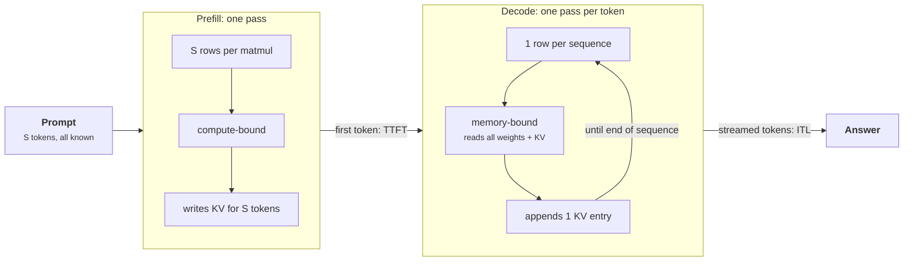

+++
title = 'Prefill and decode'
description = 'A request runs in two phases with opposite costs. Prefill processes the whole prompt in one parallel pass and is limited by arithmetic; decode produces one token per pass and is limited by memory bandwidth. TTFT and inter-token latency come from different phases and need different fixes.'
question = 'Why does one request behave like two different workloads, and what does each phase cost?'
weight = 1
difficulty = 2
prerequisites = []
date = 2026-10-30T01:05:00Z
lastmod = 2026-10-30T01:05:00Z
verified = 2026-10-30
+++

## The idea in one minute

A decoder-only transformer serves a request in two phases. **Prefill** runs the
whole prompt through the model in one forward pass. Every prompt token is known
in advance, so all of them are processed together, and the weight matmuls have
one row per prompt token. **Decode** then produces the answer one token at a
time, because token `n + 1` cannot be computed until token `n` exists. Each
decode pass has one row per sequence.

That difference in shape sets the cost. A matmul with thousands of rows reuses
each weight it loads thousands of times, so prefill is limited by arithmetic.
A matmul with one row loads every weight to use it once, so decode is limited
by how fast the GPU can read its memory. For an 8-billion-parameter model on an
H100, a 2,000-token prefill takes about 31 ms of arithmetic; each of the 500
decode steps that follow takes about 4.5 ms of memory reads, and decode is
**99% of the request's time**.

The consequence to act on: **time to first token (TTFT) and inter-token latency
(ITL) are different problems**. TTFT is prefill, which more FLOPs or less prompt
fixes. ITL is decode, which fewer bytes per token or more users per byte fixes.

## A picture



The two phases use the same weights and operators, but not the same bottleneck.

## How it really works

### Why prefill is parallel and decode is serial

Causal attention lets position `i` attend only to positions `0 … i`. During
prefill all prompt tokens are inputs, so the model computes every position's
output at once: the queries, keys, and values for the whole prompt are three
large matmuls per layer, and attention is one masked `S × S` computation. The
model also stores each position's key and value vectors, the **KV cache**, so
it never recomputes them.

During decode the input to step `n + 1` is the token sampled at step `n`. That
dependency is real: there is no way to compute the 50th output token before the
49th. Each step feeds one new token per sequence through every layer, appends
one key and one value per layer to the cache, and reads the cache back for
attention.

```text
prefill:  [t1 t2 t3 ... tS]       -> one pass, S rows, writes KV[1..S]
decode:   [tS+1]                  -> one pass, 1 row, reads KV[1..S], writes KV[S+1]
          [tS+2]                  -> one pass, 1 row, reads KV[1..S+1], writes KV[S+2]
```

### Counting FLOPs and bytes

For a dense model, a forward pass costs about **2 FLOPs per weight per token**
(one multiply, one add). Llama-3-8B has 8.03 billion parameters, but the token
embedding table is a lookup, not a matmul, so the weights that take part in
every token's arithmetic are the 32 transformer blocks plus the output
projection: **7.50 billion**, 15.0 GB in BF16. Attention adds work that grows
with context: per layer, `QKᵀ` and `AV` cost `4 · d_model` FLOPs per token pair,
halved by the causal mask during prefill.

| Phase | FLOPs | Bytes from HBM |
| --- | --- | --- |
| Prefill, prompt `S` | `2 · W · S + 2 · L · d · S²` | `2 · W` + KV written for `S` tokens |
| Decode step, batch `B`, context `C` | `B · (2 · W + 4 · L · d · C)` | `2 · W` + KV read for `B · C` tokens |

`W` is matmul weights, `L` layers, `d` model width, 2 bytes per BF16 value. The
weights are read once per pass, whether the pass carries one token or 8,000.

### The roofline decides which one wins

A kernel takes at least `FLOPs / peak FLOP/s` and at least
`bytes / bandwidth`; the larger is the bound. An H100 SXM is specified at
989 TFLOP/s dense BF16 and 3.35 TB/s of HBM3 bandwidth. Their ratio, **295
FLOPs per byte**, is the **ridge point**: below it a kernel waits on memory,
above it on arithmetic.

A weight matmul with `S` rows does `2 · S` FLOPs per weight and reads 2 bytes
per weight, so its intensity is about `S` FLOPs per byte. Prefill crosses the
ridge at roughly 300 prompt tokens. Decode at batch 1 sits at about 1 FLOP per
byte, almost 300 times below it. The tensor cores spend more than 99% of a
batch-1 decode step idle, not because the kernel is poor but because there is
nothing to compute until the next weights arrive.

### What this means for TTFT and ITL

- **TTFT** is queueing plus prefill. Above a few hundred tokens it grows
  linearly with prompt length, then faster than linearly once the `S²`
  attention term matters (around 8k tokens for this model, from the program
  below).
- **ITL** is one decode step. Its floor is `weight bytes / bandwidth`: 4.5 ms
  for this model on one H100, about 220 tokens per second for a single stream,
  no matter how fast the arithmetic is.
- **Long context taxes decode too.** Every step reads the whole KV cache: at
  32k context the step reads 19.3 GB instead of 15 GB.

| Workload | Prompt : output | Phase that dominates GPU time |
| --- | --- | --- |
| Chat | hundreds : hundreds | decode |
| Retrieval-augmented answer | thousands : hundreds | depends on batch size; prefill grows with documents |
| Summarization, agent tool loops | tens of thousands : tens to hundreds | prefill |

The split matters because optimizations are phase-specific. Weight-only
[quantization](/notes/inference-engineering/making-it-cheaper/01-quantization/) and [speculative decoding](/notes/inference-engineering/making-it-cheaper/02-speculative-decoding/) speed up decode; [prefix caching](/notes/inference-engineering/making-it-cheaper/03-prefix-caching/) and
faster arithmetic (FP8 tensor cores) speed up prefill.

```mermaid {title="Where a 2,000-in, 500-out request spends its time at batch 1"}
xychart-beta
  x-axis ["prefill (1 pass)", "decode (500 passes)"]
  y-axis "Milliseconds, roofline lower bound" 0 --> 2400
  bar [31, 2284]
```

### When phases meet in one batch

A [serving engine](/notes/inference-engineering/serving-systems/01-anatomy-of-a-serving-engine/) runs many requests at once, so prefill and decode share the
GPU. A long prefill in the same step as decodes makes that step long, and every
decoding user sees the stall as a gap in their stream. The fix, splitting
prefills into chunks that ride along with decode steps, is the subject of
[chunked prefill and priority](/notes/inference-engineering/batching-and-scheduling/03-chunked-prefill-and-priority/).
At large scale some operators go further and run prefill and decode on separate
GPU pools ([disaggregation](/notes/inference-engineering/distributed-inference/02-disaggregated-prefill-and-decode/)), covered later in the course.

## Code

The program counts FLOPs and bytes for both phases of Llama-3-8B (config
values from the published model card) and applies the H100 roofline. It is a
lower bound: it ignores activations, kernel launch overhead, and the fact that
real kernels reach perhaps half to three quarters of peak.

```python {title="phases.py"}
"""phases.py: FLOPs and bytes for prefill and decode, and the time each implies.

A roofline estimate for Llama-3-8B (BF16) on one H100 SXM. Every number is
arithmetic from the published config and datasheet; nothing runs on a GPU.
Standard library only; runs offline.
"""

from __future__ import annotations

from dataclasses import dataclass


@dataclass(frozen=True)
class Model:
    name: str
    layers: int
    d_model: int
    heads: int
    kv_heads: int
    d_ff: int
    vocab: int
    bytes_per_param: int = 2  # BF16

    @property
    def head_dim(self) -> int:
        return self.d_model // self.heads

    @property
    def matmul_params(self) -> int:
        """Weights that take part in a matmul for every token: blocks plus LM head."""
        kv = self.kv_heads * self.head_dim
        attn = self.d_model * (2 * self.d_model + 2 * kv)  # q, o, k, v
        mlp = 3 * self.d_model * self.d_ff                  # gate, up, down (SwiGLU)
        return self.layers * (attn + mlp) + self.vocab * self.d_model

    def kv_bytes_per_token(self) -> int:
        return 2 * self.layers * self.kv_heads * self.head_dim * self.bytes_per_param


@dataclass(frozen=True)
class GPU:
    name: str
    flops: float      # dense BF16 FLOP/s
    bandwidth: float  # HBM bytes/s


LLAMA3_8B = Model("Llama-3-8B", 32, 4096, 32, 8, 14336, 128256)
H100 = GPU("H100 SXM", 989e12, 3.35e12)


def prefill(m: Model, prompt: int) -> tuple[float, float]:
    """FLOPs and bytes for one prompt of `prompt` tokens, causal attention."""
    flops = 2 * m.matmul_params * prompt
    flops += m.layers * 2 * m.d_model * prompt * prompt   # QK^T and AV, causal half
    weights = m.matmul_params * m.bytes_per_param
    kv_written = m.kv_bytes_per_token() * prompt
    return flops, weights + kv_written


def decode_step(m: Model, batch: int, context: int) -> tuple[float, float]:
    """FLOPs and bytes for one decode step: `batch` sequences, `context` tokens each."""
    flops = batch * (2 * m.matmul_params + m.layers * 4 * m.d_model * context)
    weights = m.matmul_params * m.bytes_per_param
    kv_read = m.kv_bytes_per_token() * context * batch
    return flops, weights + kv_read


def roofline(g: GPU, flops: float, nbytes: float) -> tuple[float, float, str]:
    t_c, t_m = flops / g.flops, nbytes / g.bandwidth
    return t_c, t_m, ("compute" if t_c > t_m else "memory")


def main() -> None:
    m, g = LLAMA3_8B, H100
    print(f"{m.name}: {m.matmul_params / 1e9:.2f}B matmul weights, "
          f"{m.matmul_params * 2 / 1e9:.1f} GB in BF16, "
          f"KV {m.kv_bytes_per_token() // 1024} KiB/token")
    print(f"{g.name}: ridge point {g.flops / g.bandwidth:.0f} FLOP/byte\n")

    print("Prefill of one prompt (roofline lower bound on TTFT)")
    print(f"{'prompt':>7} {'GFLOP':>9} {'GB':>6} {'FLOP/B':>7} {'t_comp ms':>10}"
          f" {'t_mem ms':>9} {'bound':>8} {'tok/s':>9}")
    for s in (1, 16, 128, 256, 512, 2048, 8192, 32768):
        f, b = prefill(m, s)
        t_c, t_m, bound = roofline(g, f, b)
        t = max(t_c, t_m)
        print(f"{s:>7} {f / 1e9:>9.0f} {b / 1e9:>6.1f} {f / b:>7.0f} {t_c * 1e3:>10.2f}"
              f" {t_m * 1e3:>9.2f} {bound:>8} {s / t:>9.0f}")

    print("\nOne decode step, batch 1 (roofline lower bound on inter-token latency)")
    print(f"{'context':>7} {'GFLOP':>9} {'GB':>6} {'FLOP/B':>7} {'t_comp ms':>10}"
          f" {'t_mem ms':>9} {'bound':>8} {'tok/s':>9}")
    for ctx in (128, 2048, 8192, 32768):
        f, b = decode_step(m, 1, ctx)
        t_c, t_m, bound = roofline(g, f, b)
        t = max(t_c, t_m)
        print(f"{ctx:>7} {f / 1e9:>9.1f} {b / 1e9:>6.2f} {f / b:>7.1f} {t_c * 1e3:>10.3f}"
              f" {t_m * 1e3:>9.2f} {bound:>8} {1 / t:>9.0f}")

    ridge = g.flops / g.bandwidth
    print(f"\nPrefill turns compute-bound near {ridge:.0f} prompt"
          " tokens: intensity of a weight matmul ~ tokens in the batch.")
    p, out = 2000, 500
    f, b = prefill(m, p)
    t_pf = max(roofline(g, f, b)[:2])
    t_dec = sum(max(roofline(g, *decode_step(m, 1, p + i))[:2]) for i in range(out))
    print(f"Request of {p} in, {out} out at batch 1: prefill {t_pf * 1e3:.0f} ms,"
          f" decode {t_dec * 1e3:.0f} ms ({100 * t_dec / (t_pf + t_dec):.0f}% of the time)")


if __name__ == "__main__":
    main()
```

Run it with `python3 phases.py`:

```text
Llama-3-8B: 7.50B matmul weights, 15.0 GB in BF16, KV 128 KiB/token
H100 SXM: ridge point 295 FLOP/byte

Prefill of one prompt (roofline lower bound on TTFT)
 prompt     GFLOP     GB  FLOP/B  t_comp ms  t_mem ms    bound     tok/s
      1        15   15.0       1       0.02      4.48   memory       223
     16       240   15.0      16       0.24      4.48   memory      3571
    128      1925   15.0     128       1.95      4.49   memory     28537
    256      3860   15.0     257       3.90      4.49   memory     57010
    512      7753   15.1     514       7.84      4.50  compute     65308
   2048     31839   15.3    2084      32.19      4.56  compute     63617
   8192    140549   16.1    8739     142.11      4.80  compute     57645
  32768    773300   19.3   40058     781.90      5.76  compute     41908

One decode step, batch 1 (roofline lower bound on inter-token latency)
context     GFLOP     GB  FLOP/B  t_comp ms  t_mem ms    bound     tok/s
    128      15.1  15.03     1.0      0.015      4.49   memory       223
   2048      16.1  15.28     1.1      0.016      4.56   memory       219
   8192      19.3  16.08     1.2      0.020      4.80   memory       208
  32768      32.2  19.30     1.7      0.033      5.76   memory       174

Prefill turns compute-bound near 295 prompt tokens: intensity of a weight matmul ~ tokens in the batch.
Request of 2000 in, 500 out at batch 1: prefill 31 ms, decode 2284 ms (99% of the time)
```

Read the prefill table down the `bound` column: memory-bound to 256 tokens,
compute-bound from 512. Prefill throughput peaks around 65,000 tokens per
second and then falls, because attention work grows with the square of the
prompt. The decode table never leaves memory-bound, and its time barely moves
until the KV cache becomes a meaningful fraction of the weights.

## Where it breaks

- **Roofline numbers are floors.** Measured prefill usually reaches 40 to 70%
  of peak FLOPs, and decode kernels rarely reach full bandwidth at batch 1. Use
  the model to decide which resource binds, then measure the constant.
- **Batch changes decode's position.** At batch 64, the weight matmuls do 64
  FLOPs per byte. The next lessons show how far batching moves decode toward
  the ridge, and why KV reads stop it.
- **Mixture-of-experts models break the "2 FLOPs per weight" rule.** Each
  token activates a few experts, so FLOPs follow active parameters while bytes
  depend on how many distinct experts the batch touches.
- **Tensor parallelism splits both terms.** Each GPU reads `1/N` of the weights
  but adds communication per layer, which the model omits.
- **TTFT includes queueing.** Under load, waiting for a slot can dwarf prefill.

## Remember this

- Prefill: all prompt tokens in one pass, intensity about `S`, compute-bound
  above a few hundred tokens.
- Decode: one token per sequence per pass, intensity about the batch size,
  memory-bound.
- Ridge point = peak FLOP/s ÷ bandwidth; 295 FLOPs per byte on an H100 in BF16.
- Single-stream ITL floor = weight bytes ÷ HBM bandwidth.
- TTFT and ITL come from different phases; measure your prefill:decode split
  before choosing an optimization.

## Try it

1. Change `H100` to an A100 80 GB (312 TFLOP/s BF16, 2.04 TB/s). Where is the
   new ridge, and how do the prefill crossover and the decode floor move?
2. Add Llama-3-70B (80 layers, `d_model` 8192, 64 heads, 8 KV heads, `d_ff`
   28672). What is its single-GPU ITL floor, and why is that number academic?
3. Measure TTFT against prompt length on any OpenAI-compatible server you run
   (stream the response and timestamp the first chunk). Where does the curve
   bend upward?
4. Find your production prefill:decode token ratio from your engine's
   counters. Which phase dominates GPU time?

## Check yourself

1. Why can prefill process all prompt tokens at once while decode cannot?

   
   Every prompt token is known before the pass starts, and causal attention
   lets each position be computed from known earlier positions in the same
   pass. In decode, the input to each step is the token produced by the
   previous step, a true serial dependency.
   

2. Why is the arithmetic intensity of a weight matmul roughly the number of
   tokens in the pass?

   
   Each weight is read once (2 bytes in BF16) and used in one multiply-add per
   token row, which is 2 FLOPs per token. So FLOPs per byte is about the
   number of rows, `S` in prefill and the batch size in decode.
   

3. An 8B BF16 model on one H100: what is the minimum inter-token latency for a
   single stream, and what limits it?

   
   About 15 GB of matmul weights at 3.35 TB/s, roughly 4.5 ms per token or
   about 220 tokens per second. Memory bandwidth limits it; the arithmetic for
   one token takes about 0.015 ms.
   

4. A team serves a summarization workload with 30,000-token prompts and
   200-token answers. Which phase should they optimize first?

   
   Prefill. It dominates both TTFT and GPU time for this shape. Prefix
   caching, FP8 arithmetic, and attention kernel efficiency matter more than
   decode-side tricks such as weight-only quantization.
   

## Sources

- R. Pope, S. Douglas, A. Chowdhery, J. Devlin, J. Bradbury, A. Levskaya, J. Heek, K. Xiao, S. Agrawal, J. Dean, [Efficiently Scaling Transformer Inference](https://arxiv.org/abs/2211.05102), MLSys 2023.
- S. Williams, A. Waterman, D. Patterson, "Roofline: An Insightful Visual Performance Model for Multicore Architectures", *Communications of the ACM* 52(4), 2009.
- NVIDIA, [H100 Tensor Core GPU datasheet](https://www.nvidia.com/en-us/data-center/h100/) (SXM5: 989 TFLOP/s dense BF16, 3.35 TB/s HBM3).
- A. Grattafiori et al., [The Llama 3 Herd of Models](https://arxiv.org/abs/2407.21783), Meta, July 2024 (architecture table for the 8B and 70B models).
- A. Agrawal et al., [Taming Throughput-Latency Tradeoff in LLM Inference with Sarathi-Serve](https://arxiv.org/abs/2403.02310), OSDI 2024.
