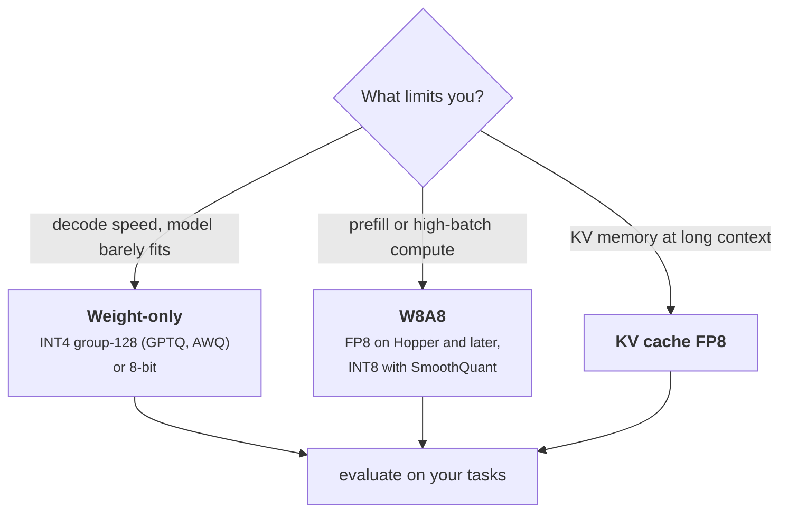

+++
title = 'Quantization'
description = 'Quantization stores weights, activations, or the KV cache in fewer bits. Decode reads fewer bytes and gets faster almost in proportion; prefill gets faster only when activations are quantized too. Error depends on the format and on how finely scales are chosen, and quality must be checked on your own task.'
question = 'How much memory and time does each quantization format save, and what does it cost in accuracy?'
weight = 1
difficulty = 3
prerequisites = ['/notes/inference-engineering/inference-mechanics/03-why-decode-is-memory-bound']
date = 2026-10-30T03:05:00Z
lastmod = 2026-10-30T03:05:00Z
verified = 2026-10-30
+++

## The idea in one minute

Decode time is roughly bytes read divided by bandwidth. **Quantization** stores
numbers in fewer bits: each value becomes a small integer or low-precision
float plus a shared **scale**, and kernels rebuild an approximation on the fly.
A 70B model is 141 GB in BF16, 71 GB in 8 bits, and about 36 GB in 4 bits with
group scales. Its single-GPU decode floor falls from 42 ms to 21 ms to 11 ms per
token.

There are three things to quantize, with different effects:

- **Weights only** (W8A16, W4A16) cuts the bytes decode reads. Arithmetic still
  runs in 16 bits, so compute-bound [prefill](/notes/inference-engineering/inference-mechanics/01-prefill-and-decode/) gains nothing.
- **Weights and activations** (W8A8 in FP8 or INT8) also halves the cost of
  each tensor-core operation on GPUs that support it, so prefill speeds up too.
- **KV cache** (FP8, sometimes lower) halves KV memory and KV reads, which
  doubles concurrency at long context.

The error depends on bits and on **granularity**: one scale per tensor is
ruined by a single outlier, while a scale per channel or per group of 128 values
keeps 4-bit error manageable. The consequence to act on: **pick the scheme by
which bytes dominate your workload, use fine-grained scales below 8 bits, and
validate quality on your own tasks, not only on perplexity**.

## A picture



## How it really works

### The mechanics: scale, round, clamp

Symmetric integer quantization with `b` bits maps a block of values `x` to
integers in `[−2^(b−1), 2^(b−1) − 1]`:

```text
scale = max(|x|) / (2^(b−1) − 1)
q     = clamp(round(x / scale))
x̂     = q × scale
```

The rounding error is at most half a step, and the step is set by the
**largest** value in the block. One outlier in a block of thousands stretches
the step for everyone, so most values round to zero. That is why granularity
matters as much as bits:

| Granularity | Scales stored | Bits per weight at 4 bits (16-bit scales) |
| --- | --- | --- |
| Per tensor | 1 | 4.00 |
| Per output channel | 1 per row | about 4.02 for 1,024-wide rows |
| Per group of 128 | 1 per 128 values | 4.125 |
| Per group of 32 | 1 per 32 values | 4.5 |

Asymmetric schemes add a zero point per group to use the range better for
skewed distributions, at a little more storage.

### Floating point: FP8

FP8 formats, standardized by NVIDIA, Arm, and Intel in 2022, give each value
its own exponent. **E4M3** (4 exponent bits, 3 mantissa bits, maximum 448) is
used for weights and activations in inference; **E5M2** trades precision for
range, mostly for gradients. Relative error per value is roughly constant
(3 mantissa bits, about 6% worst case), so small and large values are both
represented, and an outlier costs much less than in INT8 with one scale. H100
and later GPUs run FP8 matmuls at twice the BF16 rate (1,979 dense TFLOP/s on
H100 SXM), which is why FP8 W8A8 is the common default on that hardware.

### Activations are harder than weights

Weights are fixed, so they can be quantized offline with care. Activations
change per token, and in large transformers a few hidden dimensions carry
values far larger than the rest. Dettmers et al. (LLM.int8()) found such
outlier features emerging systematically at scale and handled them by keeping
those dimensions in 16 bits. SmoothQuant (Xiao et al.) moves the difficulty
into the weights instead: it divides activations by a per-channel factor and
multiplies the matching weight rows by it, which leaves the product unchanged
and makes both easier to quantize to INT8.

### Getting 4-bit weights right

Round-to-nearest at 4 bits loses noticeable quality on many models. Two
post-training methods are widely used:

- **GPTQ** (Frantar et al.) quantizes weights one column at a time and adjusts
  the remaining columns to compensate for the error, using second-order
  information from a small calibration set.
- **AWQ** (Lin et al.) observes that a small fraction of weight channels matter
  most, identified by activation magnitude, and scales them up before
  quantization so they lose less precision.

Both store INT4 values with group-128 scales. Serving them fast needs kernels
that dequantize inside the matmul (Marlin-style kernels in vLLM, for example).
Without such a kernel, a 4-bit model can be slower than BF16.

### Where the time goes, by phase

| Scheme | Decode (memory-bound) | Prefill (compute-bound) | Weight memory |
| --- | --- | --- | --- |
| W8A16 | about 2× fewer bytes | no gain; dequantization adds work | 0.5× |
| W4A16, group 128 | about 3.9× fewer bytes | no gain or a small loss | about 0.26× |
| FP8 W8A8 | 2× fewer bytes | up to 2× tensor-core throughput | 0.5× |
| FP8 KV cache | KV bytes halved | attention bytes halved | KV 0.5× |

Speedups in practice are smaller than byte ratios, because KV reads, attention,
and overheads do not shrink with weight quantization. At large batch and long
context, where KV dominates (lesson 1.2), FP8 KV can matter more than 4-bit
weights.

### Validating quality

Perplexity on generic text hides damage that shows up in long generations,
code, math, multilingual text, structured output, and refusals. A workable
order: compare logits against the BF16 model on your prompts (KL divergence,
top-1 agreement), then run your task evaluations, then long-generation and
format checks, then a staged production comparison. Keep the BF16 checkpoint
deployable as a rollback.

## Code

The program builds a synthetic weight matrix with varying row scales and eight
large outliers, fake-quantizes it with each scheme (quantize then dequantize),
and reports signal-to-quantization-noise ratio (SQNR), relative RMS error,
bits per weight including scales, and what each format means for a 70B model.
FP8 E4M3 is emulated by rounding to 3 mantissa bits.

```python {title="quant.py"}
"""quant.py: quantization error and memory for INT8, FP8 (E4M3) and INT4 schemes.

Synthetic weight matrix: Gaussian rows with different scales, plus a few large
outliers, a pattern seen in trained LLM weights and much stronger in
activations. Fake-quantizes (quantize, then dequantize) and measures error.
Standard library only; runs offline.
"""

from __future__ import annotations

import math
import random

ROWS, COLS = 256, 1024


def make_weights(seed: int = 11) -> list[list[float]]:
    rng = random.Random(seed)
    w = []
    for _ in range(ROWS):
        scale = 0.02 * math.exp(rng.gauss(0, 0.5))      # rows (channels) differ in scale
        w.append([rng.gauss(0, scale) for _ in range(COLS)])
    for _ in range(8):                                   # a handful of outliers
        w[rng.randrange(ROWS)][rng.randrange(COLS)] = rng.choice((-1, 1)) * 0.6
    return w


def int_quant(xs: list[float], bits: int) -> list[float]:
    """Symmetric round-to-nearest with one absmax scale for the whole list."""
    qmax = 2 ** (bits - 1) - 1
    s = max(abs(x) for x in xs) / qmax or 1.0
    return [max(-qmax - 1, min(qmax, round(x / s))) * s for x in xs]


def fp8_e4m3(x: float) -> float:
    """Round to the nearest FP8 E4M3 value (max 448, 3 mantissa bits, subnormals)."""
    if x == 0:
        return 0.0
    a = min(abs(x), 448.0)
    e = max(math.floor(math.log2(a)), -6)               # -6 is the smallest normal exponent
    step = 2.0 ** (e - 3)
    return math.copysign(min(round(a / step) * step, 448.0), x)


def fp8_quant(xs: list[float]) -> list[float]:
    s = max(abs(x) for x in xs) / 448.0 or 1.0           # per-tensor or per-row scale
    return [fp8_e4m3(x / s) * s for x in xs]


def grouped(row: list[float], fn, group: int) -> list[float]:
    out = []
    for i in range(0, len(row), group):
        out += fn(row[i:i + group])
    return out


def sqnr_db(w: list[list[float]], q: list[list[float]]) -> tuple[float, float]:
    sig = sum(x * x for r in w for x in r)
    err = sum((x - y) ** 2 for r, s in zip(w, q) for x, y in zip(r, s))
    return 10 * math.log10(sig / err), math.sqrt(err / sig)


def main() -> None:
    w = make_weights()
    flat = [x for r in w for x in r]
    schemes = [
        ("INT8 per-tensor", 8.0, lambda: _rows(int_quant(flat, 8))),
        ("INT8 per-channel", 8 + 16 / COLS, lambda: [int_quant(r, 8) for r in w]),
        ("FP8 E4M3 per-tensor", 8.0, lambda: _rows(fp8_quant(flat))),
        ("FP8 E4M3 per-channel", 8 + 16 / COLS, lambda: [fp8_quant(r) for r in w]),
        ("INT4 per-tensor", 4.0, lambda: _rows(int_quant(flat, 4))),
        ("INT4 per-channel", 4 + 16 / COLS, lambda: [int_quant(r, 4) for r in w]),
        ("INT4 group 128", 4 + 16 / 128, lambda: [grouped(r, lambda g: int_quant(g, 4), 128) for r in w]),
        ("INT4 group 32", 4 + 16 / 32, lambda: [grouped(r, lambda g: int_quant(g, 4), 32) for r in w]),
    ]
    params = 70.6e9
    print(f"{ROWS}x{COLS} synthetic weights, 8 outliers; error is fake-quantized vs original\n")
    print(f"{'scheme':<22}{'bits/weight':>12}{'SQNR dB':>9}{'rel. RMS err':>14}"
          f"{'70B weights':>13}{'decode floor':>14}")
    print(f"{'BF16 (baseline)':<22}{16:>12.2f}{'-':>9}{'-':>14}{params * 2 / 1e9:>10.0f} GB"
          f"{params * 2 / 3.35e12 * 1e3:>11.1f} ms")
    for name, bits, fn in schemes:
        db, rel = sqnr_db(w, fn())
        gb = params * bits / 8 / 1e9
        print(f"{name:<22}{bits:>12.2f}{db:>9.1f}{100 * rel:>13.2f}%{gb:>10.0f} GB"
              f"{gb / 3.35e3 * 1e3:>11.1f} ms")
    print("\ndecode floor = weight bytes / 3.35 TB/s, one H100's bandwidth (a 70B model in"
          " BF16 needs two GPUs to fit)")


def _rows(flat: list[float]) -> list[list[float]]:
    return [flat[i * COLS:(i + 1) * COLS] for i in range(ROWS)]


if __name__ == "__main__":
    main()
```

Run it with `python3 quant.py`:

```text
256x1024 synthetic weights, 8 outliers; error is fake-quantized vs original

scheme                 bits/weight  SQNR dB  rel. RMS err  70B weights  decode floor
BF16 (baseline)              16.00        -             -       141 GB       42.1 ms
INT8 per-tensor               8.00     25.4         5.37%        71 GB       21.1 ms
INT8 per-channel              8.02     38.2         1.22%        71 GB       21.1 ms
FP8 E4M3 per-tensor           8.00     31.6         2.64%        71 GB       21.1 ms
FP8 E4M3 per-channel          8.02     31.7         2.61%        71 GB       21.1 ms
INT4 per-tensor               4.00      2.6        73.99%        35 GB       10.5 ms
INT4 per-channel              4.02     14.8        18.12%        35 GB       10.6 ms
INT4 group 128                4.12     18.2        12.24%        36 GB       10.9 ms
INT4 group 32                 4.50     20.2         9.77%        40 GB       11.9 ms

decode floor = weight bytes / 3.35 TB/s, one H100's bandwidth (a 70B model in BF16 needs two GPUs to fit)
```

The outliers wreck per-tensor INT4 (74% relative error): the step is so large
that nearly every ordinary weight rounds to zero. Per-channel scales recover
most of it, and group-128 scales get INT4 to 12% error for an eighth of a bit
per weight. INT8 per-channel is the most accurate 8-bit scheme here, and FP8's
per-value exponent makes it insensitive to whether the scale is per tensor or
per channel. These are error numbers on synthetic data, not model quality; real
weights are less outlier-heavy than activations, and the effect on task
accuracy has to be measured.

```mermaid {title="Relative RMS error by scheme (synthetic weights with outliers)"}
xychart-beta
  x-axis ["INT8/T", "INT8/C", "FP8/T", "INT4/C", "INT4 g128", "INT4 g32"]
  y-axis "Relative RMS error (%)" 0 --> 20
  bar [5.37, 1.22, 2.64, 18.12, 12.24, 9.77]
```

`T` is per tensor, `C` per channel. Per-tensor INT4 (74%) is off the scale.

## Where it breaks

- **Error metrics are not quality.** Small relative error can still flip
  answers on reasoning tasks; larger error can be harmless on chat. Evaluate on
  your tasks.
- **Calibration data matters.** GPTQ and AWQ fit to their calibration set; a
  model calibrated on web text and served on code can lose more than expected.
- **Some layers are sensitive.** Embeddings, the output head, normalization
  weights, and [mixture-of-experts](/notes/inference-engineering/distributed-inference/03-serving-mixture-of-experts/) routers are often kept in higher precision.
- **Kernel support decides speed.** A format without a fused kernel on your GPU
  and engine can be slower than BF16. Check before converting.
- **Gains do not multiply.** Quantization shrinks the weight term that batching
  already amortizes; at large batch the KV term dominates and weight
  quantization helps less.
- **Low-bit KV is riskier than low-bit weights.** KV errors accumulate over
  long contexts; check long-context tasks specifically.

## Remember this

- Bytes per weight set the decode floor; 4-bit weights cut it about 3.9×.
- Weight-only quantization speeds decode, not prefill; W8A8 speeds both.
- Granularity matters as much as bits: per-group scales make INT4 usable.
- FP8 E4M3 gives each value its own exponent, so outliers hurt less.
- At long context and large batch, FP8 KV can beat further weight quantization.
- Validate on your tasks and keep a BF16 rollback.

## Try it

1. Add INT4 with asymmetric scales (scale and zero point per group of 128). How
   much does error improve on this data?
2. Remove the outliers in `make_weights`. Which schemes change most, and why?
3. Implement a tiny SmoothQuant: build an activation matrix with outlier
   columns, multiply by the weights, and compare INT8 error of the product with
   and without per-channel smoothing.
4. Serve one model in BF16 and in FP8 on the same GPU. Compare decode tokens
   per second at batch 1 and 64, and prefill throughput at 4k tokens.

## Check yourself

1. Why does INT4 weight-only quantization speed decode but not prefill?

   
   Decode is memory-bound, so reading a quarter of the weight bytes cuts its
   time. Prefill is compute-bound, and weight-only kernels still compute in 16
   bits after dequantizing, so its arithmetic does not shrink and the
   dequantization adds work.
   

2. How many bits per weight does INT4 with 16-bit scales per group of 128 cost,
   and how big is a 70.6B model?

   
   4 + 16/128 = 4.125 bits per weight. 70.6e9 × 4.125 / 8 ≈ 36 GB, before any
   layers kept in higher precision.
   

3. Why does one outlier hurt per-tensor INT8 more than per-tensor FP8?

   
   INT8 has uniform steps set by the largest value, so an outlier makes the
   step large for every value. FP8 has a per-value exponent, so small values
   keep fine steps even when the scale is set by an outlier.
   

4. A team serving 32k-context chat at high batch quantized weights to INT4 and
   saw little speedup. What should they try?

   
   Their decode steps are dominated by KV reads, which weight quantization does
   not touch. An FP8 KV cache halves the dominant term and doubles how many
   sequences fit.
   

## Sources

- P. Micikevicius et al., [FP8 Formats for Deep Learning](https://arxiv.org/abs/2209.05433), NVIDIA, Arm, Intel, September 2022.
- T. Dettmers, M. Lewis, Y. Belkada, L. Zettlemoyer, [LLM.int8(): 8-bit Matrix Multiplication for Transformers at Scale](https://arxiv.org/abs/2208.07339), NeurIPS 2022.
- G. Xiao, J. Lin, M. Seznec, H. Wu, J. Demouth, S. Han, [SmoothQuant: Accurate and Efficient Post-Training Quantization for Large Language Models](https://arxiv.org/abs/2211.10438), ICML 2023.
- E. Frantar, S. Ashkboos, T. Hoefler, D. Alistarh, [GPTQ: Accurate Post-Training Quantization for Generative Pre-trained Transformers](https://arxiv.org/abs/2210.17323), ICLR 2023.
- J. Lin et al., [AWQ: Activation-aware Weight Quantization for LLM Compression and Acceleration](https://arxiv.org/abs/2306.00978), MLSys 2024.
- E. Frantar, R. L. Castro, J. Chen, T. Hoefler, D. Alistarh, [MARLIN: Mixed-Precision Auto-Regressive Parallel Inference on Large Language Models](https://arxiv.org/abs/2408.11743), 2024.
- NVIDIA, [H100 Tensor Core GPU datasheet](https://www.nvidia.com/en-us/data-center/h100/) (FP8 and BF16 throughput).
- vLLM project, [Quantization](https://docs.vllm.ai/en/latest/features/quantization/index.html) and [Quantized KV cache](https://docs.vllm.ai/en/latest/features/quantization/quantized_kvcache.html), vLLM documentation, accessed October 2026.
