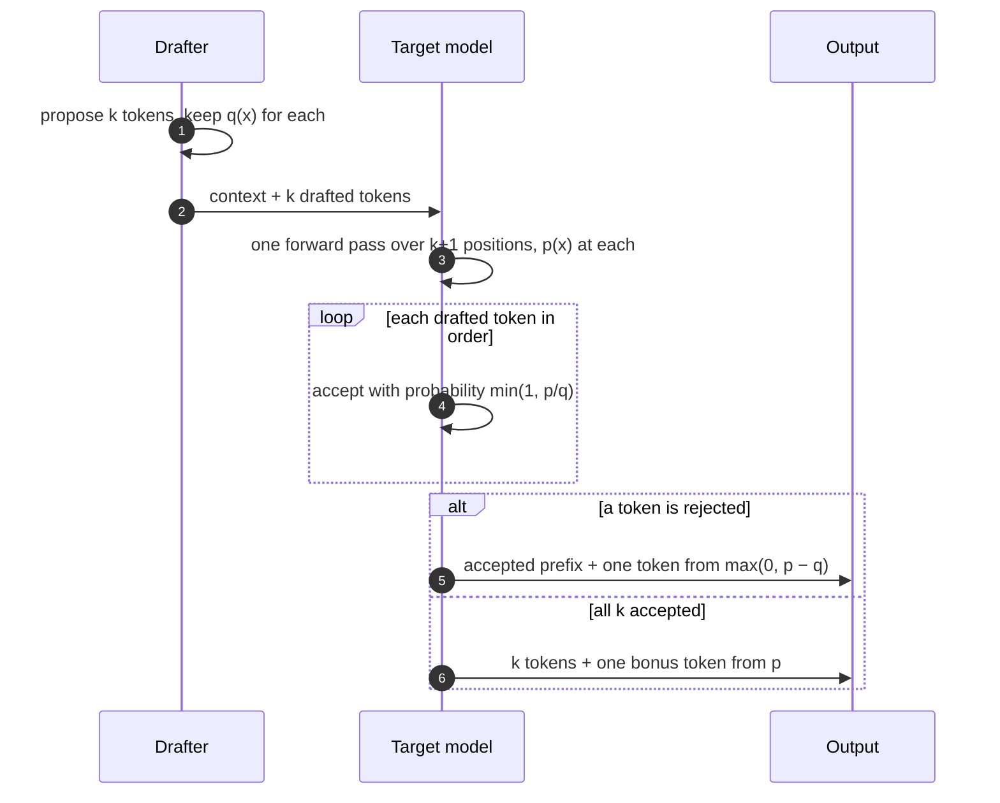

+++
title = 'Speculative decoding'
description = 'A cheap drafter proposes several tokens and the full model checks them all in one forward pass. A rejection-sampling rule makes the output distribution exactly the full model’s. The speedup depends on the acceptance rate, the draft cost, and how much spare compute the batch leaves.'
question = 'How can a model emit several tokens per forward pass without changing what it would have said, and when does that pay?'
weight = 2
difficulty = 4
prerequisites = ['/notes/inference-engineering/inference-mechanics/03-why-decode-is-memory-bound']
date = 2026-10-30T03:10:00Z
lastmod = 2026-10-30T03:10:00Z
verified = 2026-10-30
+++

## The idea in one minute

A decode step reads all the weights to produce one token per sequence, and the
tensor cores sit mostly idle. Running the same pass over `k + 1` positions
reads the same weights and costs almost the same time. **Speculative
decoding** exploits that. A cheap **drafter** (a small model, extra heads, or a
lookup in the prompt) proposes `k` tokens. The **target** model scores all of
them in one pass. A rejection-sampling rule keeps a prefix of the drafts and
always adds one token from the target, so each target pass yields between 1 and
`k + 1` tokens.

The rule, from Leviathan et al. and Chen et al. (both 2023), guarantees the
output has **exactly the target model's distribution**. It is not an
approximation, so quality is unchanged by construction.

With acceptance rate `α`, a target pass yields `(1 − α^(k+1)) / (1 − α)` tokens
on average. At `α = 0.8` and `k = 4` that is 3.4 tokens per pass. Draft passes
and verification cost something, and at large batch the "free" compute is
already used by other users, so the realized speedup is lower and can fall
below 1. The consequence to act on: **measure acceptance on your traffic and
enable speculation where batches are small or contexts are long, not
everywhere**.

## A picture



## How it really works

### The accept and resample rule

For a drafted token `x` with draft probability `q(x)` and target probability
`p(x)`:

1. Accept `x` with probability `min(1, p(x) / q(x))`.
2. If rejected, sample a replacement from the **residual** distribution
   `max(0, p − q)`, normalized, and stop this round.
3. If all `k` drafts are accepted, sample one more token from the target's
   distribution at the next position, which the verification pass already
   computed.

Why this is exact: the probability of emitting `x` is `q(x) · min(1, p/q)` from
acceptance plus the rejection mass times the residual's share for `x`. The two
terms add to `p(x)` for every `x`. The overall acceptance probability is
`Σ min(p(x), q(x))`, which is `1 −` the total variation distance between the two
distributions. So **acceptance is a direct measure of how well the drafter
imitates the target**. With greedy decoding the rule reduces to "accept while
the draft matches the target's argmax".

### How many tokens per target pass

If each draft is accepted independently with probability `α`, the number
accepted before the first rejection is truncated geometric, and with the extra
target token:

```text
E[tokens per target pass] = (1 − α^(k+1)) / (1 − α)
```

| α | k = 1 | k = 2 | k = 4 | k = 8 | limit as k grows |
| --- | --- | --- | --- | --- | --- |
| 0.6 | 1.60 | 1.96 | 2.31 | 2.47 | 2.5 |
| 0.8 | 1.80 | 2.44 | 3.36 | 4.33 | 5.0 |
| 0.9 | 1.90 | 2.71 | 4.10 | 6.13 | 10.0 |

The limit `1 / (1 − α)` caps the gain however long the draft. Larger `k` adds
draft cost for tokens that are rarely accepted.

### The cost side

Per round, the time is `k` draft steps plus one target pass over `k + 1`
tokens per sequence:

```text
speedup = E[tokens] × t_target(B, 1) / (k × t_draft(B) + t_target(B, k + 1))
```

At batch 1 the target pass over `k + 1` tokens costs about the same as over
one, because decode is memory-bound. A drafter with cost ratio `c = 0.05`
(Leviathan et al.'s framing) at `α = 0.8, k = 4` gives `3.36 / 1.2 = 2.8×`. At
`α = 0.4` and `c = 0.2` the same formula gives 0.92×: **speculation can lose**.

As the batch grows, `B × (k + 1)` tokens per verification pass push the
weight matmuls toward compute-bound, so the target pass is no longer free, and
the speedup falls. Long contexts push the other way: KV reads dominate, the
pass stays memory-bound, and verification of `k + 1` tokens still reads each
sequence's KV only once.

### Kinds of drafter

| Drafter | How it proposes | Notes |
| --- | --- | --- |
| Small model of the same family | runs `k` decode steps | needs the same tokenizer; uses memory for its weights and KV |
| Prompt lookup (n-gram) | copies the continuation of a matching n-gram from the prompt | no model, near-zero cost; high acceptance when output quotes input (edits, summaries, code, retrieval) |
| Medusa heads | extra heads predict tokens at `t+1 … t+k`, verified as a tree | trained heads, no separate model |
| EAGLE family | a small network predicts the target's next hidden features | trained per target model; among the highest reported acceptance |
| Multi-token prediction | the model is trained with extra prediction modules (DeepSeek-V3) | drafting is built into the model |

Tree-based drafters propose several branches and verify them in one pass with
an attention mask that lets each node see only its ancestors. Trees raise the
expected accepted length for the same number of target passes, at the cost of
more verification compute.

### Operating it

- **Measure acceptance per workload.** Engines expose acceptance counters (in
  vLLM, accepted versus drafted tokens). Code and structured output usually
  accept far more than open-ended prose.
- **Gate by load.** Speculation is most valuable at low batch, which is often
  exactly when latency matters. Some deployments disable it above a batch or
  queue threshold.
- **Count the memory.** A draft model needs weights and its own KV cache,
  taken from the target's KV budget.
- **Test equivalence.** A bug in the residual sampling silently changes model
  behavior. Compare output distributions against plain decoding in tests.

## Code

Part 1 implements the accept and resample rule on toy distributions and checks
the output against the target over 200,000 trials, then checks the
expected-tokens formula by simulation. Part 2 costs draft and verify for a
Llama-3-8B target with a Llama-3.2-1B drafter on one H100 at 2k context, using
the roofline from module 1.

```python {title="specdec.py"}
"""specdec.py: speculative decoding, checked for exactness and costed with a roofline.

Part 1 runs the accept/reject rule of Leviathan et al. and Chen et al. on toy
distributions and checks that the output follows the target exactly.
Part 2 prices draft-then-verify for a Llama-3-8B target and a Llama-3.2-1B
draft on one H100 at several batch sizes. Standard library only; runs offline.
"""

from __future__ import annotations

import random

PEAK, BW = 989e12, 3.35e12


def sample(rng: random.Random, probs: list[float]) -> int:
    r, acc = rng.random() * sum(probs), 0.0
    for i, p in enumerate(probs):
        acc += p
        if r < acc:
            return i
    return len(probs) - 1


def speculative_token(rng: random.Random, p: list[float], q: list[float]) -> tuple[int, bool]:
    """One drafted position: draft from q, keep with prob min(1, p/q), else resample."""
    x = sample(rng, q)
    if rng.random() < min(1.0, p[x] / q[x]):
        return x, True
    residual = [max(0.0, pi - qi) for pi, qi in zip(p, q)]
    return sample(rng, residual), False


def expected_tokens(alpha: float, k: int) -> float:
    """Tokens per target pass with k drafts, i.i.d. acceptance alpha (incl. the bonus token)."""
    return (1 - alpha ** (k + 1)) / (1 - alpha)


def step_time(matmul_params: float, kv_per_token: int, batch: int, tokens_per_seq: int,
              ctx: int = 2048) -> float:
    """Roofline time for one forward pass over batch x tokens_per_seq new tokens."""
    flops = 2 * matmul_params * batch * tokens_per_seq
    nbytes = 2 * matmul_params + kv_per_token * ctx * batch
    return max(flops / PEAK, nbytes / BW)


def main() -> None:
    rng = random.Random(5)
    p = [0.40, 0.25, 0.15, 0.10, 0.06, 0.04]   # target
    q = [0.30, 0.35, 0.05, 0.20, 0.05, 0.05]   # draft: close, not equal
    n, counts, accepted = 200_000, [0] * len(p), 0
    for _ in range(n):
        x, ok = speculative_token(rng, p, q)
        counts[x] += 1
        accepted += ok
    emp = [c / n for c in counts]
    tv = 0.5 * sum(abs(a - b) for a, b in zip(emp, p))
    print("Part 1: one drafted position, 200,000 trials")
    print("  target p   " + " ".join(f"{x:.3f}" for x in p))
    print("  output     " + " ".join(f"{x:.3f}" for x in emp))
    print(f"  distance from target (TV) {tv:.4f}; acceptance {accepted / n:.3f},"
          f" theory sum(min(p,q)) = {sum(min(a, b) for a, b in zip(p, q)):.3f}")

    print("\n  tokens per target pass, formula vs simulation (alpha = 0.7)")
    for k in (1, 2, 4, 8):
        sim, trials = 0, 50_000
        for _ in range(trials):
            j = 0
            while j < k and rng.random() < 0.7:
                j += 1
            sim += j + 1                           # accepted drafts plus one target token
        print(f"    k={k}: formula {expected_tokens(0.7, k):.3f}, simulated {sim / trials:.3f}")

    target = (7.50e9, 131072)   # Llama-3-8B matmul weights, KV bytes per token
    draft = (1.24e9, 32768)     # Llama-3.2-1B
    print("\nPart 2: speedup in tokens per second per sequence vs plain decoding")
    print(f"{'batch':>6}{'alpha':>7}" + "".join(f"{f'k={k}':>8}" for k in (1, 2, 4, 6, 8)))
    for batch in (1, 16, 64, 256):
        base = step_time(*target, batch, 1)
        for alpha in (0.6, 0.8):
            cells = []
            for k in (1, 2, 4, 6, 8):
                t = k * step_time(*draft, batch, 1) + step_time(*target, batch, k + 1)
                cells.append(expected_tokens(alpha, k) * base / t)
            print(f"{batch:>6}{alpha:>7.1f}" + "".join(f"{x:>7.2f}x" for x in cells))
    c = step_time(*draft, 1, 1) / step_time(*target, 1, 1)
    print(f"\ndraft/target cost ratio at batch 1: {c:.2f}")


if __name__ == "__main__":
    main()
```

Run it with `python3 specdec.py`:

```text
Part 1: one drafted position, 200,000 trials
  target p   0.400 0.250 0.150 0.100 0.060 0.040
  output     0.398 0.251 0.150 0.100 0.060 0.041
  distance from target (TV) 0.0025; acceptance 0.791, theory sum(min(p,q)) = 0.790

  tokens per target pass, formula vs simulation (alpha = 0.7)
    k=1: formula 1.700, simulated 1.701
    k=2: formula 2.190, simulated 2.188
    k=4: formula 2.773, simulated 2.775
    k=8: formula 3.199, simulated 3.198

Part 2: speedup in tokens per second per sequence vs plain decoding
 batch  alpha     k=1     k=2     k=4     k=6     k=8
     1    0.6   1.37x   1.47x   1.38x   1.21x   1.06x
     1    0.8   1.54x   1.83x   2.02x   1.97x   1.85x
    16    0.6   1.35x   1.43x   1.33x   1.15x   1.00x
    16    0.8   1.52x   1.78x   1.94x   1.88x   1.75x
    64    0.6   1.32x   1.38x   1.25x   1.07x   0.92x
    64    0.8   1.49x   1.72x   1.82x   1.75x   1.61x
   256    0.6   1.30x   1.33x   1.19x   0.97x   0.76x
   256    0.8   1.46x   1.66x   1.73x   1.58x   1.32x

draft/target cost ratio at batch 1: 0.17
```

Part 1 shows the output distribution matching the target to within sampling
noise even though the drafter is visibly different, and measured acceptance
matching `Σ min(p, q)`. Part 2 shows the shape that matters in production: the
best `k` is around 2 for `α = 0.6` and 4 for `α = 0.8`; long drafts lose at
low acceptance; and every column shrinks as the batch grows, falling below 1×
at batch 256 with `α = 0.6, k = 6`. This 1B drafter costs 17% of a target step,
which is why its gains stay near 2×; prompt lookup or EAGLE-style heads cost
much less.

```mermaid {title="Speedup at k = 4 by batch size, α = 0.8 (roofline model)"}
xychart-beta
  x-axis "Batch size" ["1", "16", "64", "256"]
  y-axis "Speedup vs plain decoding" 0 --> 2.5
  bar [2.02, 1.94, 1.82, 1.73]
```

## Where it breaks

- **Acceptance is not independent.** Real acceptance varies by position and
  content; easy spans accept long runs and hard spans reject immediately. The
  formula is a planning estimate, so measure.
- **The roofline flatters speculation.** Real engines pay for extra kernel
  launches, sampling, scheduling of variable-length accepts, and CUDA graph
  constraints. Reported production speedups are usually lower than the model's.
- **Batch interference.** In a batch, sequences accept different numbers of
  tokens per round. The engine must handle ragged progress and KV slots
  reserved for drafts that are then rejected.
- **Sampling settings matter.** The exactness guarantee holds for the
  distribution after temperature, top-p, and penalties only if the engine
  applies the same transformations to both `p` and `q`.
- **Memory pressure.** A draft model's weights and KV reduce how many target
  sequences fit, which can cost more throughput than speculation saves.

## Remember this

- Draft `k` tokens cheaply, verify in one target pass, keep a prefix plus one.
- Accept with `min(1, p/q)`, resample from `max(0, p − q)`: output is exactly
  the target's distribution.
- Acceptance = `Σ min(p, q)`; tokens per pass = `(1 − α^(k+1)) / (1 − α)`, at
  most `1 / (1 − α)`.
- It pays when compute is spare: small batches, long contexts, cheap drafters.
- Measure acceptance per workload and gate speculation by load.

## Try it

1. Change `q` to equal `p` in Part 1. What acceptance do you get, and what is
   the expected number of tokens at `k = 4`?
2. Replace the drafter with a prompt-lookup cost of zero (`k × 0` draft time)
   and `α = 0.5`. At what batch size does the speedup fall to 1×?
3. Find the `k` that maximizes speedup for `α` from 0.5 to 0.95 at batch 1.
   Fit a rule of thumb.
4. Enable n-gram speculation on a vLLM server for a summarization workload and
   a creative-writing workload. Compare the acceptance metrics.

## Check yourself

1. Why does speculative decoding not change the output distribution?

   
   Each drafted token is accepted with probability min(1, p/q), and on
   rejection a token is drawn from the normalized residual max(0, p − q). The
   accepted mass plus the residual mass sum to exactly p(x) for every token x.
   

2. With α = 0.7 and k = 4, how many tokens does one target pass yield on
   average?

   
   (1 − 0.7^5) / (1 − 0.7) = (1 − 0.168) / 0.3 ≈ 2.77 tokens.
   

3. Why does the benefit shrink as the batch size grows?

   
   At small batch, verifying k + 1 tokens per sequence uses spare compute in a
   memory-bound step. At large batch, the weight matmuls approach
   compute-bound, so the extra verification tokens add real time, while each
   round still pays for the draft steps.
   

4. When is prompt lookup a good drafter?

   
   When outputs copy spans of the input: editing, summarization with quotes,
   code changes, retrieval answers. It costs almost nothing to propose, so even
   moderate acceptance gives a net gain.
   

## Sources

- Y. Leviathan, M. Kalman, Y. Matias, [Fast Inference from Transformers via Speculative Decoding](https://arxiv.org/abs/2211.17192), ICML 2023.
- C. Chen, S. Borgeaud, G. Irving, J.-B. Lespiau, L. Sifre, J. Jumper, [Accelerating Large Language Model Decoding with Speculative Sampling](https://arxiv.org/abs/2302.01318), DeepMind, February 2023.
- T. Cai, Y. Li, Z. Geng, H. Peng, J. D. Lee, D. Chen, T. Dao, [Medusa: Simple LLM Inference Acceleration Framework with Multiple Decoding Heads](https://arxiv.org/abs/2401.10774), ICML 2024.
- Y. Li, F. Wei, C. Zhang, H. Zhang, [EAGLE: Speculative Sampling Requires Rethinking Feature Uncertainty](https://arxiv.org/abs/2401.15077), ICML 2024.
- DeepSeek-AI, [DeepSeek-V3 Technical Report](https://arxiv.org/abs/2412.19437), December 2024 (multi-token prediction).
- vLLM project, [Speculative decoding](https://docs.vllm.ai/en/latest/features/spec_decode.html), vLLM documentation, accessed October 2026.
