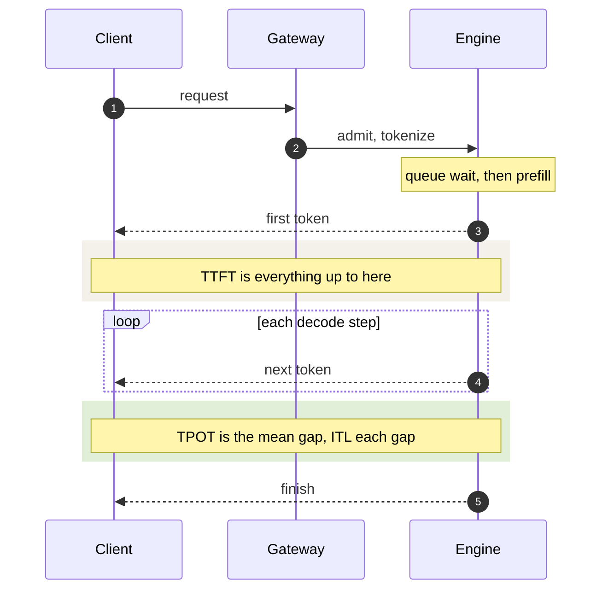
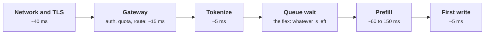

+++
title = 'Latency SLOs and goodput'
description = 'A streamed generation has two latencies users feel: time to the first token and the pace of the tokens after it. Write objectives for both, judge each request against both, and count only the requests that meet them; that count, goodput, is the capacity number that matters.'
question = 'What latency objectives fit a model service, and how do you measure whether the service meets them?'
weight = 1
difficulty = 3
prerequisites = ['/notes/systems-design/reliability-in-production/01-slos-and-error-budgets', '/notes/systems-design/failure-modes/04-overload-and-backpressure']
date = 2026-10-30T07:05:00Z
lastmod = 2026-10-30T07:05:00Z
verified = 2026-10-30
+++

## The idea in one minute

A request to a model service that streams its answer has no single latency.
The user waits for the **time to first token (TTFT)**, then watches tokens
arrive at a pace measured by **time per output token (TPOT)**, the mean gap
over the response, or **inter-token latency (ITL)**, each individual gap. The
end-to-end time is `TTFT + TPOT × (output tokens − 1)` and depends mostly on
how long the answer is, so it says little about service health.

A useful objective therefore names TTFT and TPOT separately, sets TTFT by
prompt length, and judges **each request against both**. **Goodput** is the
rate of requests that met all their objectives. As load rises, throughput
keeps climbing well past the point where goodput peaks and falls, so a server
that looks fastest on a throughput benchmark can be failing most of its
users. The consequence to act on: report attainment and goodput per request,
not separate percentiles of separate metrics, and size capacity by the load at
which goodput still meets the target.

## A picture



## How it really works

### The indicators

| Indicator | Definition | What moves it |
| --- | --- | --- |
| TTFT | Arrival to first streamed token | Queue wait, prefill length, prefix-cache hits, other prefills sharing the step |
| TPOT | `(end − first token) / (output tokens − 1)`, per request | Decode step time: batch size, KV read, prefill chunks in the step |
| ITL | Each gap between consecutive streamed tokens | Same as TPOT, plus stalls: preemption, a long prefill chunk, a GC pause |
| End-to-end | Arrival to last token | Output length, mostly |
| Availability | Share of valid requests that finish without a server error | Crashes, OOM, timeouts |

vLLM exports most of these as Prometheus histograms
(`vllm:time_to_first_token_seconds`, `vllm:inter_token_latency_seconds`,
`vllm:request_time_per_output_token_seconds`, `vllm:request_queue_time_seconds`),
measured inside the server. Users experience them from the client side, after
gateways, proxies, and the network, and through output buffering that can
batch several tokens into one network write. Measure at the client or the
edge for the SLO; use the server histograms to locate the cause.

### Writing the objective

A single "p99 latency under 2 seconds" fails both ways: every long answer
violates it and every short one passes. A workable objective for an
interactive chat tier looks like this:

| Indicator | Objective | Window |
| --- | --- | --- |
| TTFT, prompts up to 4k tokens | 95% under 1 s | 5 minutes, rolling |
| TTFT, prompts 4k to 32k tokens | 95% under 4 s | 5 minutes, rolling |
| TPOT | 95% of requests under 40 ms | 5 minutes, rolling |
| Attainment | 97% of requests meet both their TTFT and TPOT objectives | 30 days |
| Availability | 99.9% of valid requests finish without a 5xx | 30 days |

Four rules sit behind it:

1. **Bucket TTFT by prompt length.** [Prefill](/notes/inference-engineering/inference-mechanics/01-prefill-and-decode/) time grows with the prompt, so
   one objective for all prompts lets one user pasting a long document consume
   the error budget.
2. **Judge per request.** A request is good only if it met both objectives.
   Two marginal p95s can each pass while the joint share of good requests is
   below 95%, because the requests that miss TTFT and the ones that miss TPOT
   are different requests.
3. **Exclude what you refuse.** Requests over published limits, and `429`
   responses for tenants over quota, are not service failures; count them
   separately so they are visible but do not mask overload.
4. **Match the number to the use.** Reading speed is a few words per second,
   so a TPOT of 40 to 50 ms already outpaces a reader; agents and voice
   pipelines that consume tokens as they arrive care much more about TPOT,
   and batch jobs care only about completion time.

Pick thresholds from measurement as well as from users: benchmark the
service at expected load, see what it achieves, and set objectives where what
users need meets what the system can deliver with headroom.

### Goodput

Zhong and colleagues defined goodput for model serving in the DistServe paper
(OSDI 2024): the **maximum request rate a system can sustain while a target
share of requests (for example 90%) meets both its TTFT and TPOT
objectives**. Operationally, two related numbers are worth tracking:

- **Attainment**, the share of requests in a window that met all their
  objectives. This is the SLI.
- **Goodput rate**, attained requests per second. Plotted against offered
  load it rises, flattens, and falls; the load where attainment crosses the
  target is the capacity of the deployment for that objective.

Throughput counts work completed regardless of whether it was useful.
Overload makes them diverge, as the program shows: the server keeps finishing
tokens at an increasing rate while every request finishes too late.

### Where the latency budget goes

TTFT decomposes into lines that different components own:



Most lines are roughly fixed. Queue wait is the one that grows with load, and
it is what capacity planning sizes: the objective holds as long as the queue
wait at peak fits in what the other lines leave. TPOT has a simpler budget:
the decode step time at the batch size the server runs at peak, plus any
prefill work the step carries.

### Error budgets on attainment

With a 97% attainment objective over 30 days, 3% of requests may miss. That
budget is spent by overload at peaks, by deploys that briefly drop capacity,
and by incidents. Track burn rate the usual way (a fast-burn alert over an
hour, a slow-burn alert over days), and gate risky changes on the remaining
budget. Quality regressions deserve their own budget: a [quantization](/notes/inference-engineering/making-it-cheaper/01-quantization/) or
speculative-decoding change that keeps latency but changes answers needs an
evaluation gate, not a latency one.

## Code

The program simulates one 8-GPU replica of a 70B model with continuous
batching and a 512-token prefill budget per step, using an idealized step
model (memory time versus compute time). It sweeps the arrival rate and
reports throughput, both p95s, whether both p95s pass, per-request
attainment, and goodput, for an objective of TTFT under 1 s and TPOT under
15 ms.

```python {title="goodput.py"}
"""goodput.py: throughput versus goodput for one continuous-batching replica
of a 70B model on 8 GPUs, swept over arrival rate.

Step-level model: a step costs the larger of its memory time (weights plus the
KV of running sequences) and compute time (tokens in the step), plus overhead.
Prefill is chunked under a token budget; decodes go first. Standard library
only; offline. Constants are idealized H100 figures, not measurements.
"""

from __future__ import annotations

import heapq
import math
import random
from dataclasses import dataclass

WEIGHT_READ = 141e9 / 8 / 3.35e12
KV_READ_PER_TOKEN = 2 * 80 * 8 * 128 * 2 / 8 / 3.35e12
FLOP_TIME_PER_TOKEN = 2 * 70.6e9 / 8 / 600e12
OVERHEAD = 0.0008
BUDGET, MAX_SEQS = 512, 256
TTFT_SLO, TPOT_SLO = 1.0, 0.015
SIM_SECONDS, WARMUP = 300.0, 30.0


@dataclass
class Req:
    arrival: float
    prompt: int
    output: int
    left: int = 0
    first: float = math.inf
    done: float = math.inf


def workload(rate: float, seed: int = 3) -> list[Req]:
    rng = random.Random(seed)
    t, out = 0.0, []
    while t < SIM_SECONDS:
        t += rng.expovariate(rate)
        p = min(16000, int(rng.lognormvariate(math.log(2000), 0.8)))
        o = max(2, min(1500, int(rng.lognormvariate(math.log(200), 0.7))))
        out.append(Req(t, p, o, p))
    return out


def serve(reqs: list[Req]) -> None:
    i, now, step, ctx = 0, 0.0, 0, 0
    waiting: list[Req] = []
    running: list[tuple[int, int, Req]] = []
    while i < len(reqs) or waiting or running:
        if not waiting and not running:
            now = max(now, reqs[i].arrival)
        while i < len(reqs) and reqs[i].arrival <= now:
            waiting.append(reqs[i])
            i += 1
        tokens, left, finished = len(running), BUDGET - len(running), []
        for r in waiting:
            if left <= 0 or len(running) + len(finished) >= MAX_SEQS:
                break
            take = min(left, r.left)
            r.left -= take
            left -= take
            tokens += take
            if r.left == 0:
                finished.append(r)
        partial = sum(r.prompt - r.left for r in waiting if r.left)
        memory = WEIGHT_READ + (ctx + partial) * KV_READ_PER_TOKEN
        now += max(memory, tokens * FLOP_TIME_PER_TOKEN) + OVERHEAD
        step += 1
        ctx += len(running)
        while running and running[0][0] <= step:
            _, _, r = heapq.heappop(running)
            r.done = now
            ctx -= r.prompt + r.output
        for r in finished:
            waiting.remove(r)
            r.first = now
            heapq.heappush(running, (step + r.output - 1, id(r), r))
            ctx += r.prompt


def pct(xs: list[float], q: float) -> float:
    xs = sorted(xs)
    return xs[min(len(xs) - 1, int(q * len(xs)))]


def main() -> None:
    print(f"SLO per request: TTFT <= {TTFT_SLO:.1f} s and TPOT <= {TPOT_SLO * 1e3:.0f} ms\n")
    print(f"{'offered':>8}{'out tok/s':>10}{'TTFT p95':>10}{'TPOT p95':>10}"
          f"{'p95s pass':>11}{'attained':>10}{'goodput':>9}")
    for rate in (4, 6, 7, 7.5, 8, 9, 10, 11, 12, 13):
        reqs = workload(rate)
        serve(reqs)
        m = [r for r in reqs if WARMUP < r.arrival < SIM_SECONDS - WARMUP]
        span = (SIM_SECONDS - 2 * WARMUP)
        ttft = [r.first - r.arrival for r in m]
        tpot = [(r.done - r.first) / (r.output - 1) for r in m]
        good = [r for r, a, b in zip(m, ttft, tpot) if a <= TTFT_SLO and b <= TPOT_SLO]
        both = pct(ttft, 0.95) <= TTFT_SLO and pct(tpot, 0.95) <= TPOT_SLO
        out_tps = sum(r.output for r in m) / span
        print(f"{rate:>6g} /s{out_tps:>10,.0f}{pct(ttft, 0.95):>9.2f}s{pct(tpot, 0.95) * 1e3:>8.1f}ms"
              f"{'yes' if both else 'no':>11}{len(good) / len(m):>10.1%}{len(good) / span:>7.1f}/s")


if __name__ == "__main__":
    main()
```

Run it with `python3 goodput.py`:

```text
SLO per request: TTFT <= 1.0 s and TPOT <= 15 ms

 offered out tok/s  TTFT p95  TPOT p95  p95s pass  attained  goodput
     4 /s       939     0.32s     9.6ms        yes    100.0%    3.8/s
     6 /s     1,415     0.46s    12.2ms        yes     99.8%    5.7/s
     7 /s     1,675     0.52s    13.5ms        yes     98.5%    6.6/s
   7.5 /s     1,830     0.58s    14.7ms        yes     95.6%    7.0/s
     8 /s     1,949     0.65s    15.8ms         no     91.2%    7.1/s
     9 /s     2,203     1.00s    15.9ms         no     78.5%    6.9/s
    10 /s     2,471     1.85s    15.9ms         no     57.5%    5.6/s
    11 /s     2,698     4.21s    15.9ms         no     16.1%    1.7/s
    12 /s     2,971    16.13s    15.9ms         no      0.0%    0.0/s
    13 /s     3,190    38.01s    15.9ms         no      0.0%    0.0/s
```

Throughput rises across the whole sweep, from 939 to 3,190 output tokens per
second. Goodput peaks near 8 requests per second and then collapses; at 12
and 13 requests per second the server is busiest and serves nobody in time,
because the prefill queue grows without bound. TPOT saturates at about 16 ms
because every step now carries a full 512-token prefill chunk.

With a 95% attainment target, this replica's capacity is about 7.5 requests
per second, not the 13 a throughput benchmark would report. At 7.5, both p95s
pass and attainment is 95.6%; at 8, attainment has already fallen to 91%.
Planning with the throughput number would put the service on the wrong side
of the cliff at every peak.

## Where it breaks

- **Server-side numbers miss the user's view.** The simulation measures
  inside the engine. Gateways, retries, connection setup, and buffered
  streaming add latency the engine never sees.
- **Mean TPOT hides stalls.** A request whose tokens arrive smoothly at 10 ms
  and one with a 600 ms stall in the middle can have similar TPOT. Add an ITL
  percentile or a maximum-gap objective if stalls matter to the use.
- **Percentile objectives over short windows are noisy.** At low traffic a
  5-minute window may hold too few requests for a stable p95; use longer
  windows or count-based thresholds for low-volume tenants.
- **Goodput is specific to a traffic mix.** The 7.5 above holds for this
  prompt and output distribution. Longer prompts, a different prefix-cache
  hit rate, or a new model change it.
- **Latency objectives do not measure quality.** A service can meet every
  latency objective while returning worse answers after a model or
  configuration change.

## Remember this

- TTFT and TPOT are separate experiences; objectives need both.
- Bucket TTFT by prompt length; exclude refused requests from the SLI.
- Judge each request against all its objectives; two passing p95s do not make
  95% good requests.
- Goodput is attained requests per second; capacity is the load at which
  attainment still meets the target.
- Throughput keeps rising past the goodput cliff, so never size from it.

## Try it

1. Change `BUDGET` to 256 and to 2,048. How do the TPOT ceiling and the
   capacity at 95% attainment move?
2. Tighten TPOT to 12 ms. What is the replica's capacity now, and which
   objective binds first?
3. Add a p99 ITL column by recording each step's duration weighted by the
   number of decoding sequences.
4. Split TTFT by prompt length (under and over 4,000 tokens) and report
   attainment per bucket. Which bucket fails first as load rises?
5. For a service you run, compute attainment from per-request logs for one
   week, and compare it with the dashboard's separate p95s.

## Check yourself

1. Why is end-to-end latency a poor SLO for a streaming chat service?

   
   It is dominated by output length, which the user chose and the service does
   not control. Long answers violate any fixed threshold and short ones pass
   it, so the number moves with the traffic mix rather than with service
   health. TTFT and TPOT measure what the service controls.
   

2. Both p95 TTFT and p95 TPOT meet their objectives. Can fewer than 95% of
   requests be good?

   
   Yes. Up to 5% of requests can miss TTFT and a different up to 5% can miss
   TPOT, so up to 10% can miss at least one. Only a per-request judgment
   against both objectives gives the share of good requests.
   

3. In the simulation, why does throughput keep rising at 12 and 13 requests
   per second while goodput is zero?

   
   The server is saturated and every step does useful-looking work, so tokens
   per second keep rising with batch size. But the prefill queue grows without
   bound, so every request waits far longer than the TTFT objective before its
   first token. The work is completed too late to count.
   

4. Why should 429 responses for over-quota tenants be excluded from the
   attainment SLI but still be tracked?

   
   A 429 is the service enforcing a published limit, not failing; counting it
   as a miss would let one abusive tenant burn the error budget. But a rising
   429 rate can also be a symptom of capacity problems or misconfigured
   quotas, so it needs its own metric and alert.
   

## Sources

- Y. Zhong et al., [DistServe: Disaggregating Prefill and Decoding for Goodput-optimized Large Language Model Serving](https://arxiv.org/abs/2401.09670), OSDI 2024 (goodput definition).
- A. Agrawal et al., [Taming Throughput-Latency Tradeoff in LLM Inference with Sarathi-Serve](https://arxiv.org/abs/2403.02310), OSDI 2024.
- B. Beyer, C. Jones, J. Petoff, N. R. Murphy (eds.), *Site Reliability Engineering*, O'Reilly, 2016: [Service Level Objectives](https://sre.google/sre-book/service-level-objectives/).
- B. Beyer et al. (eds.), *The Site Reliability Workbook*, O'Reilly, 2018: [Alerting on SLOs](https://sre.google/workbook/alerting-on-slos/).
- J. Dean, L. A. Barroso, [The Tail at Scale](https://research.google/pubs/the-tail-at-scale/), *Communications of the ACM* 56(2), 2013.
- vLLM project, [Production metrics](https://docs.vllm.ai/en/latest/usage/metrics.html), as of October 2026.
