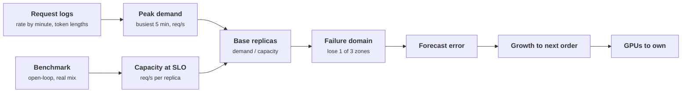

+++
title = 'Capacity planning'
description = 'A capacity plan divides peak demand, measured in the busiest minutes and in mean token lengths, by per-replica capacity measured at the SLO, then adds explicit factors for failure domains, forecast error, and growth until the next order arrives. Each factor appears once, with a reason.'
question = 'How many GPUs does a model service need, and how do you show the number is right?'
weight = 2
difficulty = 4
prerequisites = ['/notes/inference-engineering/production-inference/01-latency-slos-and-goodput', '/notes/systems-design/thinking-in-invariants/03-back-of-the-envelope-capacity']
date = 2026-10-30T07:10:00Z
lastmod = 2026-10-30T07:10:00Z
verified = 2026-10-30
+++

## The idea in one minute

The number of GPUs a model service needs is a division and a few
multiplications. Divide **peak demand** (requests per second in the busiest
few minutes, with the request mix from real logs) by **per-replica capacity
at the SLO** (the arrival rate at which a replica still meets the attainment
target, measured with that same mix). Round up. Then multiply by factors you
can defend one at a time: survive the loss of a failure domain, absorb the
error in the forecast, and cover growth until more hardware can arrive.

Most bad plans fail in one of three ways. They use **median** token lengths
when the mean sets the work. They use **peak throughput** instead of capacity
at the SLO, which puts the service past the goodput cliff at every peak. Or
they **count queueing twice**, dividing a number measured at the SLO by a
utilization target as well. The consequence to act on: measure capacity at
the SLO with your traffic, apply each factor once with its reason written
down, and say which measurement would invalidate the plan.

## A picture



## How it really works

### Demand: busiest minutes and mean lengths

Start from per-request logs, not from a product forecast alone. You need:

- **Arrival rate by minute**, over several weeks, to find the busiest hour
  and the busiest five minutes inside it. A 5-minute peak is typically well
  above the hourly average; measure the ratio rather than assuming one.
- **Prompt and output length distributions**. Token lengths are heavy-tailed,
  so the **mean** is well above the median, and the mean is what determines
  total work. In the program below the output mean is 28% above the median.
- **Prefix-cache hit rate**, because cached prompt tokens skip [prefill](/notes/inference-engineering/inference-mechanics/01-prefill-and-decode/). A
  change that adds retrieved context to every request, or one that breaks
  prefix reuse, changes prefill demand without changing the request rate.

Convert to the units the hardware cares about: prompt tokens per second
(prefill compute) and output tokens per second (decode bandwidth), alongside
requests per second.

### Supply: capacity at the SLO, measured

Per-replica capacity is a measurement, not a spec-sheet derivation. Run an
**open-loop** load generator (arrivals at a fixed rate, independent of
completions) with a replay or a faithful synthetic sample of your request mix,
at increasing rates, and find the rate at which attainment falls below the
target. The previous lesson's simulation found about 7.5 requests per second
for one 8-GPU 70B replica at 95% attainment, while peak throughput kept
rising to 13. A closed-loop benchmark (a fixed number of clients, each sending
its next request when the last finishes) hides the cliff entirely, because
offered load drops as latency rises.

That measured number **already contains queueing**: it is the rate at which
the queue wait still fits the TTFT budget. Do not divide it by a utilization
target afterwards. A utilization target is the right tool only when your
capacity number is raw throughput, and then queueing theory sets the target.
Use one or the other.

### Memory check

Capacity at the SLO usually binds on compute or bandwidth. Long contexts can
make **KV memory** bind first. Check it with [Little's law](/notes/systems-design/scale-and-performance/01-queueing-and-littles-law/): concurrent
sequences equal arrival rate times time in system, and each holds roughly its
prompt plus output in KV.

```text
concurrent = rate x (TTFT + output tokens x TPOT)
KV tokens  = concurrent x (mean prompt + mean output)
compare with (GPU memory x utilization - weights) / KV bytes per token
```

For the chat workload below, 27 sequences hold about 79 thousand tokens of a
1.3-million-token pool, 6%. An agent workload with 60,000-token contexts and
the same request rate would need about 20 times as much, and the replica
would be [memory-bound](/notes/inference-engineering/inference-mechanics/03-why-decode-is-memory-bound/) before it was compute-bound.

### The factors, once each

| Factor | Why | How to set it |
| --- | --- | --- |
| Failure domain | Lose a zone (or a rack, or a cell) and still meet the SLO | With `z` zones, multiply by `z / (z − 1)` |
| Forecast error | Next quarter's peak is an estimate | From your forecast's historical error |
| Growth to next order | Hardware arrives weeks to months after the order | Growth rate over lead time plus a margin |
| Deploy surge | Rolling updates take replicas out of service | Usually covered by the failure-domain factor; check it is |

GPU lead times and cloud capacity reservations make the last two factors
real: an order placed when the dashboard turns red arrives after the peak it
was for. The plan's output should include an **order date**, computed as the
date demand crosses current capacity minus the lead time.

### Pooling lowers headroom at scale

Random fluctuation around the mean shrinks relative to the mean as a pool
grows: for Poisson arrivals the standard deviation is the square root of the
mean. Queueing models make the same point; the M/M/c (Erlang C) table in the
program shows that keeping the waiting probability at 20% needs 57%
utilization with 4 servers and 93% with 274. Two consequences follow. A large
shared pool needs less headroom per GPU than many small dedicated ones, which
is the economic case for multi-tenant platforms. And per-replica capacity
measured on one replica is a conservative number for a large pool only if the
router is load-aware; a random router does not pool.

### The artifact

A plan that is a single number is fragile. Write it down with: the traffic
model and its sources; the benchmark method and the capacity it found; each
factor with its reason; the result in replicas, GPUs, and cost; a
**sensitivity table** (what if peak is 30% higher, prompts twice as long, the
cache hit rate halves); the **triggers** that invalidate it (for example, mean
prompt length above 4,000 tokens); and a review date. Compare plan with actual
every month.

## Code

The program builds a plan for a chat service on 8-GPU replicas of a 70B model:
a traffic model from synthetic logs, demand at the busiest five minutes,
capacity at the SLO from the previous lesson, the factors, a KV check, an
indicative cost at an assumed GPU price, and an M/M/c table showing pooling.

```python {title="capacity.py"}
"""capacity.py: a worked capacity plan for a chat service on 8-GPU replicas
of a 70B model. Traffic model from (synthetic) logs, per-replica capacity
measured at the SLO, then explicit factors for failures, forecast error, and
growth. Standard library only; offline. Every input is an assumption to be
replaced with your own measurements.
"""

from __future__ import annotations

import math
import random
import statistics


def traffic_model(rng: random.Random) -> tuple[float, float, float, float]:
    """Synthetic request log: log-normal prompt and output lengths."""
    prompts = [min(16000, int(rng.lognormvariate(math.log(2000), 0.8))) for _ in range(100_000)]
    outputs = [max(2, min(1500, int(rng.lognormvariate(math.log(200), 0.7)))) for _ in range(100_000)]
    return (statistics.median(prompts), statistics.fmean(prompts),
            statistics.median(outputs), statistics.fmean(outputs))


def erlang_c(servers: int, load: float) -> float:
    """Probability an arrival waits in an M/M/c queue with offered load in server units."""
    if load >= servers:
        return 1.0
    term, total = 1.0, 1.0
    for k in range(1, servers):
        term *= load / k
        total += term
    term *= load / servers
    top = term * servers / (servers - load)
    return top / (total + top)


def servers_needed(load: float, max_wait_prob: float) -> int:
    c = max(1, math.ceil(load))
    while erlang_c(c, load) > max_wait_prob:
        c += 1
    return c


def main() -> None:
    rng = random.Random(5)
    p50_in, mean_in, p50_out, mean_out = traffic_model(rng)
    print(f"prompt tokens: median {p50_in:,.0f}, mean {mean_in:,.0f}; "
          f"output tokens: median {p50_out:,.0f}, mean {mean_out:,.0f}")

    # Demand: the busiest 5 minutes, from request counts.
    daily_requests = 3_000_000
    peak_hour_share = 0.11           # measured share of daily volume in the busiest hour
    burst = 1.3                      # busiest 5 minutes vs the busiest hour's average
    peak_hour = daily_requests * peak_hour_share / 3600
    peak = peak_hour * burst
    print(f"\ndemand: {daily_requests:,} requests/day, busiest hour {peak_hour:.1f} req/s, "
          f"busiest 5 minutes {peak:.1f} req/s")
    print(f"  = {peak * mean_in:,.0f} prompt tok/s and {peak * mean_out:,.0f} output tok/s "
          f"(median lengths would say {peak * p50_out:,.0f}, {1 - p50_out / mean_out:.0%} low)")

    # Supply: capacity per replica measured at the SLO (goodput.py: 95% attainment).
    per_replica = 7.5
    peak_throughput = 13.0           # what a closed-loop throughput benchmark would report
    base = math.ceil(peak / per_replica)
    print(f"\nreplicas at the busiest 5 minutes: {peak:.1f} / {per_replica} = {base}")
    print(f"  sized from peak throughput instead: {math.ceil(peak / peak_throughput)} "
          f"(misses the SLO at peak)")

    # Explicit factors, each with its own reason.
    zones = 3
    after_zone_loss = math.ceil(base * zones / (zones - 1))       # survive one zone
    forecast_error = 1.15                                          # model of demand is off by this
    growth = 1.04 ** 4                                             # 4 months to the next order
    planned = math.ceil(after_zone_loss * forecast_error * growth)
    print(f"  survive the loss of 1 of {zones} zones:      {after_zone_loss}")
    print(f"  x {forecast_error} forecast error, x {growth:.2f} growth: {planned} replicas "
          f"= {planned * 8} GPUs")

    # The same plan with an extra "70% utilization" divisor: the per-replica
    # number was measured at the SLO, so queueing is already in it.
    naive = math.ceil(math.ceil(math.ceil(base / 0.70) * zones / (zones - 1))
                      * forecast_error * growth)
    print(f"  (dividing again by a 70% utilization target: {naive} replicas, "
          f"{(naive - planned) * 8} GPUs for queueing already counted)")

    # Memory check with Little's law: concurrency = rate x time in system.
    per_request_s = 0.5 + mean_out * 0.012                         # TTFT + decode at ~12 ms/token
    concurrent = per_replica * per_request_s
    kv_tokens_live = concurrent * (mean_in + mean_out)
    kv_capacity = (8 * 80e9 * 0.90 - 141e9) / (2 * 80 * 8 * 128 * 2)
    print(f"\nKV check per replica: {concurrent:.0f} sequences in flight hold "
          f"{kv_tokens_live:,.0f} tokens of {kv_capacity:,.0f} available "
          f"({kv_tokens_live / kv_capacity:.0%}); memory is not the binding limit here")

    gpu_hour = 3.00                                                # assumed price, USD
    tokens_per_day = daily_requests * mean_out
    cost_day = planned * 8 * 24 * gpu_hour
    print(f"\ncost at an assumed ${gpu_hour:.2f}/GPU-hour: ${cost_day:,.0f}/day, "
          f"${cost_day / tokens_per_day * 1e6:.2f} per million output tokens "
          f"(average utilization {daily_requests / 86400 / (planned * per_replica):.0%})")

    print("\npooling: servers needed so that at most 20% of arrivals wait (M/M/c)")
    for load in (4, 16, 64, 256):
        c = servers_needed(load, 0.20)
        print(f"  offered load {load:>3} servers' worth -> {c:>3} servers, utilization {load / c:.0%}")


if __name__ == "__main__":
    main()
```

Run it with `python3 capacity.py`:

```text
prompt tokens: median 1,992, mean 2,722; output tokens: median 199, mean 254

demand: 3,000,000 requests/day, busiest hour 91.7 req/s, busiest 5 minutes 119.2 req/s
  = 324,337 prompt tok/s and 30,291 output tok/s (median lengths would say 23,714, 22% low)

replicas at the busiest 5 minutes: 119.2 / 7.5 = 16
  sized from peak throughput instead: 10 (misses the SLO at peak)
  survive the loss of 1 of 3 zones:      24
  x 1.15 forecast error, x 1.17 growth: 33 replicas = 264 GPUs
  (dividing again by a 70% utilization target: 48 replicas, 120 GPUs for queueing already counted)

KV check per replica: 27 sequences in flight hold 79,241 tokens of 1,327,515 available (6%); memory is not the binding limit here

cost at an assumed $3.00/GPU-hour: $19,008/day, $24.93 per million output tokens (average utilization 14%)

pooling: servers needed so that at most 20% of arrivals wait (M/M/c)
  offered load   4 servers' worth ->   7 servers, utilization 57%
  offered load  16 servers' worth ->  21 servers, utilization 76%
  offered load  64 servers' worth ->  73 servers, utilization 88%
  offered load 256 servers' worth -> 274 servers, utilization 93%
```

Sixteen replicas carry the busiest five minutes. Surviving the loss of one of
three zones takes 24, and forecast error and four months of 4% monthly growth
take 33, or 264 GPUs. Sizing from peak throughput would have given 10
replicas, a service that misses its objective every evening. Adding a 70%
utilization divisor to a capacity already measured at the SLO gives 48
replicas: 120 GPUs bought to absorb queueing that was already counted.

The cost line is the uncomfortable part. Averaged over the day, the fleet runs
at 14% of its SLO capacity, because it is sized for the busiest five minutes
of the busiest day plus a zone failure plus growth. That idle capacity is what
the next lesson (autoscaling) and batch work in the troughs try to reclaim.

## Where it breaks

- **Capacity at the SLO is specific to the mix.** A new feature that doubles
  prompt length, a new model, or a different [quantization](/notes/inference-engineering/making-it-cheaper/01-quantization/) invalidates the
  per-replica number. Re-benchmark rather than scale it.
- **Peaks are correlated.** Zone failures, retry storms, and launches happen
  on busy days. The factors multiply because they can coincide.
- **Cloud capacity may not exist.** Reserved instances and committed capacity
  are often the only way to be sure the GPUs in the plan are obtainable at
  all; on-demand GPU capacity can be unavailable in a region.
- **Heterogeneous fleets complicate the division.** Different GPU types have
  different capacities at the SLO for the same model, and some models only
  fit some types. Plan per pool.
- **The M/M/c model is a guide, not a fit.** Continuous-batching replicas are
  not single-server queues; the table illustrates pooling, it does not size
  the fleet.

## Remember this

- Peak demand from the busiest minutes; work from mean, not median, lengths.
- Per-replica capacity is measured open-loop at the SLO with your mix.
- Queueing is already in that number; never also divide by a utilization
  target.
- Apply failure-domain, forecast-error, and growth factors once each, with
  reasons, and compute an order date.
- Check KV memory with Little's law; long contexts bind on memory first.
- Large pools need less headroom per GPU than many small ones.

## Try it

1. Change the zones to 2. How many replicas does the plan need, and what does
   that do to average utilization?
2. Double the median prompt length in `traffic_model` and rerun `goodput.py`
   with the same change to get a new capacity at the SLO. How many replicas
   does the plan need now?
3. Set the mean prompt to 60,000 tokens in the KV check. At what request rate
   per replica does KV memory bind?
4. Add a sensitivity table: vary peak demand, capacity, and growth by ±30%
   each and print the replica count. Which input matters most?
5. Compute the order date for a 12-week lead time, starting capacity of 33
   replicas, and 4% monthly growth from today's demand.

## Check yourself

1. Why does a plan built from median token lengths under-provision?

   
   Token lengths are heavy-tailed, so the mean is well above the median, and
   total work is the request rate times the mean. Using the median
   underestimates prefill and decode demand by the gap between them.
   

2. Why is dividing capacity at the SLO by a 70% utilization target a mistake?

   
   Capacity at the SLO is the arrival rate at which the queue wait still fits
   the latency budget, so the queueing headroom is already inside it. Dividing
   again buys capacity a second time for the same queueing.
   

3. Why does a closed-loop benchmark overstate capacity?

   
   Each client waits for its response before sending the next request, so as
   the server slows, the offered load drops with it and the queue never grows.
   Real users arrive independently of the server's latency, which an open-loop
   generator reproduces.
   

4. A shared pool of 256 replicas runs at higher utilization than 64 separate
   pools of 4 for the same latency. Why?

   
   Random fluctuation grows only with the square root of load, so a larger pool
   needs proportionally less spare capacity to absorb it, provided the router
   sends requests to replicas with free capacity rather than at random.
   

## Sources

- J. D. C. Little, "A Proof for the Queuing Formula: L = λW", *Operations Research* 9(3), 1961.
- L. Kleinrock, *Queueing Systems, Volume 1: Theory*, Wiley, 1975 (M/M/c and the Erlang C formula).
- B. Beyer, C. Jones, J. Petoff, N. R. Murphy (eds.), *Site Reliability Engineering*, O'Reilly, 2016: [Software Engineering in SRE (Auxon, intent-based capacity planning)](https://sre.google/sre-book/software-engineering-in-sre/).
- B. Schroeder, A. Wierman, M. Harchol-Balter, "Open Versus Closed: A Cautionary Tale", USENIX NSDI 2006.
- Y. Zhong et al., [DistServe](https://arxiv.org/abs/2401.09670), OSDI 2024 (goodput as the capacity measure).
- vLLM project, [Benchmark suites](https://docs.vllm.ai/en/latest/contributing/benchmarks.html) (`vllm bench serve` with a request rate), as of October 2026.
