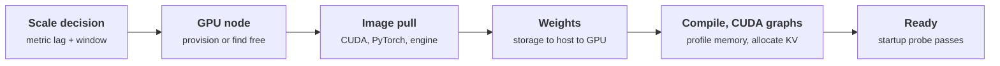

+++
title = 'Autoscaling and model loading'
description = 'A new replica of a large model needs minutes to become ready: a node, an image, tens or hundreds of gigabytes of weights, compilation, and graph capture. Autoscaling can only follow demand that changes slower than that, so cut start-up time, scale ahead of predictable ramps, and keep headroom for the rest.'
question = 'How do you autoscale a model service when each new replica takes minutes to load?'
weight = 3
difficulty = 4
prerequisites = ['/notes/inference-engineering/production-inference/02-capacity-planning']
date = 2026-10-30T07:15:00Z
lastmod = 2026-10-30T07:15:00Z
verified = 2026-10-30
+++

## The idea in one minute

An autoscaler sees demand rise, asks for replicas, and waits. For a web
service the wait is seconds. For a 70B model it is the time to get a GPU
node, pull a multi-gigabyte image, move 141 GB of weights from storage into
GPU memory, compile, capture CUDA graphs, and pass a readiness check:
minutes, sometimes ten or more. During that time the existing replicas carry
the new load alone.

So the useful question is not "which metric" but "how fast can demand grow
compared with how fast capacity can arrive". **The headroom you must already
be running is roughly the demand growth during one start-up time.**
Everything that shortens start-up (weights on local disk, streaming loaders,
persisted compile caches, sleeping replicas) reduces that headroom.
Predictable ramps can be met by scaling ahead of them. The unpredictable
remainder is met by headroom, and beyond that by shedding load deliberately.
The consequence to act on: measure every phase of your start-up, scale on
queue time and KV usage, never on GPU utilization, and decide in advance what
happens when demand outruns capacity.

## A picture



## How it really works

### Start-up, phase by phase

| Phase | What sets it | What shortens it |
| --- | --- | --- |
| Decision | Metric scrape interval, query window, autoscaler stabilization | Shorter windows on scale-up only |
| Node | Cloud provisioning of a GPU instance, or a free node in the cluster | Warm node pools, reserved capacity |
| Image | Image size, registry bandwidth, layer caching | Pre-pulled images on GPU nodes, lazy-loading snapshotters |
| Weights | Bytes / slowest of storage, network, PCIe | Node-local NVMe or a shared cache, streaming loaders, FP8 weights |
| Engine init | Memory profiling, KV allocation, `torch.compile`, CUDA graph capture | Persisted compile cache, fewer captured sizes |

The weights line is arithmetic you can do now. 141 GB at 1 GB/s from object
storage is about 2.5 minutes; from node-local NVMe at several GB/s, well
under one; FP8 weights halve both. vLLM supports streaming loaders that read
safetensors directly from object storage into GPU memory (the Run:ai Model
Streamer, Tensorizer, fastsafetensors), overlapping download and copy.
ServerlessLLM (Fu and colleagues, OSDI 2024) showed that a loading-optimized
checkpoint format and a multi-tier local cache load models several times
faster than standard loaders.

The engine phase is often the surprise. vLLM does not listen on its port until
weights are loaded, memory is profiled, the KV cache is allocated, and graphs
are captured. Mount a volume for its compile cache (`~/.cache/vllm`) so a new
pod does not repeat compilation, and size the Kubernetes **startup probe** to
two or three times measured start-up, or the kubelet will kill a healthy pod
that is still loading and restart it forever.

**Sleep mode** removes most of the start-up for a model that was already
loaded once. With `--enable-sleep-mode`, level 1 offloads weights to CPU
memory and discards the KV cache, freeing GPU memory for another model;
waking copies the weights back over PCIe, typically seconds. That makes it a
tool for **swapping models on shared GPUs** (several rarely used models
taking turns), not for adding GPUs: the sleeping process still owns its GPU.

### The signal

Scale on what predicts SLO violation:

| Signal | Use |
| --- | --- |
| Queue time (`vllm:request_queue_time_seconds`, p90 over 1 to 3 minutes) | Primary: queue wait is the line of the TTFT budget that grows with load |
| KV cache usage (`vllm:kv_cache_usage_perc`) and waiting requests | Secondary: memory exhaustion leads to preemption and stalls |
| Prompt and output tokens per second against measured capacity | Good for predictive and capacity-based targets |
| GPU utilization | Not useful: a serving engine keeps the GPU busy at almost any load |
| Requests in flight | Weak: requests differ in cost by orders of magnitude |

### The policy

Kubernetes' Horizontal Pod Autoscaler supports asymmetric behavior: by
default it scales up with no stabilization window and scales down only after
a 300-second window. For model replicas, keep scale-up fast and make
scale-down slower still (10 to 15 minutes), removing one replica at a time
and **draining** it: stop routing new requests, let streams finish, then
terminate. A scale-down that is cheap to delay and expensive to undo should
be conservative; a replica kept 15 minutes too long costs a few GPU-hours,
one removed too early costs a cold start under load. KEDA can drive the HPA
from Prometheus queries; note that its `cooldownPeriod` applies only to
scaling to and from zero, not to ordinary scale-down.

**Predictive scaling** is the cheapest win for traffic with daily and weekly
shape. Build the expected curve from several weeks of logs and set the
minimum replica count to what that curve needs one start-up time from now.
Keep the reactive trigger on top for what the curve does not know.

### The headroom equation

```text
required spare capacity  >=  demand growth rate  x  (decision delay + start-up time)
```

If demand can grow by 40 requests per second within five minutes and start-up
is twelve minutes, no reactive policy keeps up; the 40 requests per second of
capacity must already be running, or predicted. With a 20-second wake,
almost any ramp is followable. This is why start-up time is a capacity
parameter, not an operational detail.

### When demand outruns capacity

Decide in advance, in order:

1. **Shed early and cheaply** with `429` or `503` and `Retry-After`, lowest
   priority tier first, at the [gateway](/notes/systems-design/building-blocks/01-gateways-and-routers/), before [prefill](/notes/inference-engineering/inference-mechanics/01-prefill-and-decode/) work is spent.
2. **Cap output length** for low-priority tiers during overload.
3. **Overflow** to a smaller model or another region, if the product allows.
4. **Queue with a deadline** only for batch work that tolerates it.

Without this ladder, an overloaded replica fills its queue with requests
whose clients will have given up, and goodput falls toward zero (see
[overload and backpressure](/notes/systems-design/failure-modes/04-overload-and-backpressure/)).

## Code

The program simulates one weekday at 10-second resolution: a consumer curve,
business traffic that arrives in the five minutes after 09:00, and an
unannounced 35% surge at 15:00. Each 8-GPU replica serves 7.5 requests per
second at the SLO. It compares fixed provisioning with reactive autoscaling
(90% target utilization, one minute of metric lag, slow scale-down) at three
start-up times, and with predictive scaling that knows the weekday curve but
not the surge.

```python {title="autoscale.py"}
"""autoscale.py: one day of diurnal traffic plus an unplanned surge, served by
replicas that take minutes to become ready. Compares fixed provisioning with
reactive and predictive autoscaling at three start-up times.
Standard library only; offline. Traffic, capacity, and timings are assumptions.
"""

from __future__ import annotations

import math
from dataclasses import dataclass

DT = 10.0                       # seconds per simulation tick
DAY = 86_400
PER_REPLICA = 7.5               # req/s at the SLO (goodput.py)
PEAK = 120.0                    # req/s at the evening peak


def baseline(t: float) -> float:
    """Repeats every weekday: a consumer curve (trough at 04:00 at 20% of PEAK,
    peak at 16:00) plus 40 req/s of business traffic that arrives in the five
    minutes after 09:00 and leaves after 18:00."""
    hour = t / 3600
    consumer = PEAK * (0.6 - 0.4 * math.cos(2 * math.pi * (hour - 4) / 24))
    business = 40.0 * min(1.0, max(0.0, (hour - 9) * 12)) if 9 <= hour < 18 else 0.0
    return consumer + business


def demand(t: float) -> float:
    """The baseline plus a surge that ramps to +35% over 5 minutes at 15:00
    and lasts an hour. Predictive scaling knows only the baseline."""
    hour = t / 3600
    base = baseline(t)
    if 15 <= hour < 16:
        base *= 1 + 0.35 * min(1.0, (hour - 15) * 12)
    return base


@dataclass
class Policy:
    name: str
    startup: float              # seconds from decision to serving
    target: float = 0.90        # desired utilization of ready replicas
    predictive: bool = False    # also follow yesterday's curve, one start-up ahead
    fixed: int = 0              # if set, never scale


def simulate(p: Policy) -> tuple[float, float, float]:
    ready = p.fixed or math.ceil(demand(0) / (PER_REPLICA * p.target))
    starting: list[float] = []  # times at which starting replicas become ready
    low_since = None
    shed = gpu_s = over_s = 0.0
    lag = int(60 / DT)          # metrics pipeline delay
    history: list[float] = []
    for i in range(int(DAY / DT)):
        t = i * DT
        ready += sum(1 for s in starting if s <= t)
        starting = [s for s in starting if s > t]
        d = demand(t)
        history.append(d)
        cap = ready * PER_REPLICA
        shed += max(0.0, d - cap) * DT
        over_s += DT if d > cap else 0.0
        gpu_s += (ready + len(starting)) * 8 * DT
        if p.fixed:
            continue
        seen = history[max(0, i - lag)]
        want = math.ceil(seen / (PER_REPLICA * p.target))
        if p.predictive:        # yesterday's curve, looked up one start-up ahead
            ahead = baseline((t + p.startup + 120) % DAY)
            want = max(want, math.ceil(ahead / (PER_REPLICA * p.target)))
        have = ready + len(starting)
        if want > have:
            starting += [t + p.startup] * (want - have)
            low_since = None
        elif want < ready:
            low_since = low_since if low_since is not None else t
            if t - low_since >= 600:            # 10 minutes low before removing
                ready -= 1                      # drain one replica per tick at most
                low_since = t - 600 + 120       # then wait 2 more minutes
        else:
            low_since = None
    return over_s / 60, shed, gpu_s / 3600


def main() -> None:
    peak_needed = math.ceil(max(demand(t) for t in range(0, DAY, 10)) / PER_REPLICA)
    policies = [
        Policy("fixed at surge peak", 0, fixed=peak_needed),
        Policy("fixed at the usual peak", 0,
               fixed=math.ceil(max(baseline(t) for t in range(0, DAY, 10)) / PER_REPLICA)),
        Policy("reactive, cold 12 min", 720),
        Policy("reactive, warm 3 min", 180),
        Policy("reactive, wake 20 s", 20),
        Policy("predictive + cold 12 min", 720, predictive=True),
        Policy("predictive + warm 3 min", 180, predictive=True),
        Policy("predictive + warm, 75% target", 180, target=0.75, predictive=True),
    ]
    print(f"peak demand {max(demand(t) for t in range(0, DAY, 10)):.0f} req/s during the surge; "
          f"{PER_REPLICA} req/s per 8-GPU replica\n")
    print(f"{'policy':<32}{'minutes over':>13}{'requests over':>15}{'GPU-hours':>11}")
    for p in policies:
        minutes, shed, gpu_h = simulate(p)
        print(f"{p.name:<32}{minutes:>13.0f}{shed:>15,.0f}{gpu_h:>11,.0f}")


if __name__ == "__main__":
    main()
```

Run it with `python3 autoscale.py`:

```text
peak demand 216 req/s during the surge; 7.5 req/s per 8-GPU replica

policy                           minutes over  requests over  GPU-hours
fixed at surge peak                         0              0      5,568
fixed at the usual peak                    59        172,491      4,224
reactive, cold 12 min                      29         46,321      2,675
reactive, warm 3 min                       11          9,040      2,675
reactive, wake 20 s                         2            116      2,675
predictive + cold 12 min                   14         22,600      2,715
predictive + warm 3 min                     5          3,951      2,691
predictive + warm, 75% target               0              0      3,225
```

Fixed provisioning for the surge peak never overloads but uses more than
twice the GPU-hours of the autoscaled fleets; fixed provisioning for the usual
peak spends the whole surge hour over capacity. Among reactive policies with
the same target, start-up time alone decides the outcome: 29 minutes over
capacity with a 12-minute cold start, 11 with a 3-minute warm start, 2 with a
20-second wake. Predictive scaling halves the over-capacity time by meeting
the 09:00 ramp in advance, but it cannot see the surge. Only headroom covers
that: a 75% target with predictive scaling and warm starts had no minutes over
capacity, for about 20% more GPU-hours than the 90% target.

## Where it breaks

- **The model assumes capacity exists.** Scaling up requires free GPU nodes
  in the cluster or obtainable from the provider. During regional shortages
  the autoscaler's request simply pends. Know your quota and reserved
  capacity, and set `maxReplicas` no higher than what can be scheduled.
- **Cold starts compound under load.** Many replicas starting at once pull
  the same image and weights at the same moment, saturating the registry or
  storage and making every start-up slower. Pre-stage weights on nodes, and
  stagger.
- **Scale-down cuts streams.** A pod terminated mid-stream truncates
  responses. Use a `preStop` hook and a termination grace period long enough
  to drain the longest generation you allow.
- **Thrash wastes start-ups.** Symmetric or short scale-down windows with
  noisy traffic cycle replicas up and down, paying a cold start each time.
  Alert on more than a few scaling events per hour.
- **Multi-GPU replicas scale in large steps.** One more 8-GPU replica is a
  12% step for a fleet of 8; granularity forces either more headroom or more
  overload. Smaller replicas (FP8 to halve TP, for example) scale more
  smoothly.

## Remember this

- Headroom must cover demand growth during one decision delay plus start-up.
- Measure each start-up phase; weights and engine initialization usually
  dominate.
- Local or streamed weights, persisted compile caches, and sleep mode each
  remove part of start-up.
- Scale on queue time and KV usage; never on GPU utilization.
- Fast up, slow and draining down; predictive for known ramps.
- Decide the shedding ladder before the surge.

## Try it

1. Make the surge ramp over 30 seconds instead of 5 minutes. Which policies
   still have zero minutes over capacity?
2. Add a policy with a 6-minute start-up and an 85% target. Is it better or
   worse than warm starts at 90%?
3. Change the metric lag from 60 to 180 seconds. How much does decision delay
   matter compared with start-up time?
4. Make the replica granularity 2 GPUs with a quarter of the capacity each.
   How do GPU-hours change at the same target?
5. For a deployment you run, time each phase of start-up from pod creation to
   ready. Which phase would you attack first?

## Check yourself

1. Why does autoscaling on GPU utilization not work for a model server?

   
   A continuous-batching engine keeps the GPU busy at almost any load, so
   utilization is near its maximum both when the server is comfortable and
   when it is overloaded. Queue time and KV usage change with load and
   predict latency violations.
   

2. Demand can rise by 30 requests per second within four minutes. Start-up is
   ten minutes. What must be true of the fleet?

   
   It must already run at least 30 requests per second of spare capacity at the
   SLO (plus whatever the decision delay adds), or predict the rise ten
   minutes ahead, because no replica started after the rise begins can be
   ready before it ends.
   

3. What does vLLM's sleep mode save, and what does it not?

   
   It keeps a loaded model's weights in CPU memory (level 1) so waking it
   skips download, load from storage, and engine initialization, taking
   seconds. It frees GPU memory for another model on the same GPU. It does not
   add GPUs: the sleeping process still holds its device, so it helps model
   swapping, not scaling out.
   

4. Why should scale-down be slower than scale-up?

   
   Keeping an extra replica a few minutes costs a little GPU time; removing one
   too early costs a full cold start, during which the remaining replicas may
   violate the SLO. The asymmetric cost justifies asymmetric windows, plus
   draining so in-flight streams finish.
   

## Sources

- Kubernetes documentation, [Horizontal Pod Autoscaling](https://kubernetes.io/docs/tasks/run-application/horizontal-pod-autoscale/) (scaling behavior and default stabilization windows), and [Configure liveness, readiness and startup probes](https://kubernetes.io/docs/tasks/configure-pod-container/configure-liveness-readiness-startup-probes/).
- KEDA documentation, [ScaledObject specification](https://keda.sh/docs/latest/reference/scaledobject-spec/) (`cooldownPeriod`).
- Y. Fu, L. Xue, Y. Huang, A.-O. Brabete, D. Ustiugov, Y. Patel, L. Mai, [ServerlessLLM: Low-Latency Serverless Inference for Large Language Models](https://arxiv.org/abs/2401.14351), OSDI 2024.
- vLLM project, [Sleep mode](https://docs.vllm.ai/en/latest/features/sleep_mode.html), [Loading models with Run:ai Model Streamer](https://docs.vllm.ai/en/latest/models/extensions/runai_model_streamer.html), and [Production metrics](https://docs.vllm.ai/en/latest/usage/metrics.html), as of October 2026.
- B. Beyer, C. Jones, J. Petoff, N. R. Murphy (eds.), *Site Reliability Engineering*, O'Reilly, 2016: [Handling Overload](https://sre.google/sre-book/handling-overload/).
