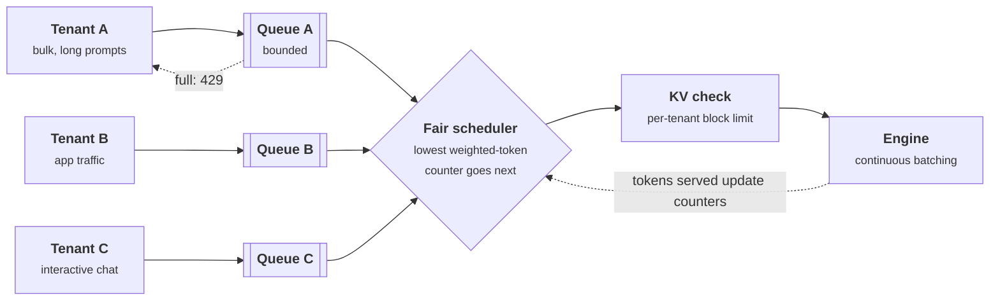

+++
title = 'Multi-tenancy and fairness'
description = "Tenants sharing a replica compete for prefill compute, decode slots, and KV memory. First-come-first-served lets the heaviest sender take everything; request-rate limits punish the wrong tenant and leave capacity idle. Fair scheduling on weighted tokens, per-tenant memory limits, and isolated caches keep one flood from becoming everyone's outage."
question = 'How do you share one model deployment among tenants so that a heavy tenant cannot starve the others, and none can observe another?'
weight = 4
difficulty = 4
prerequisites = ['/notes/inference-engineering/production-inference/01-latency-slos-and-goodput', '/notes/systems-design/worked-designs/04-a-multi-tenant-inference-gateway']
date = 2026-10-30T07:20:00Z
lastmod = 2026-10-30T07:20:00Z
verified = 2026-10-30
+++

## The idea in one minute

Sharing a model deployment among tenants is worth doing: peaks rarely
coincide, larger batches use the GPUs better, and one large pool needs less
headroom than many small ones. The cost is contention. All tenants draw on
the same [prefill](/notes/inference-engineering/inference-mechanics/01-prefill-and-decode/) compute, the same decode slots, and the same KV memory, and
the engine's default scheduler serves requests in arrival order. Under
overload, the tenant that sends the most work gets most of the service, and a
light interactive tenant waits behind a bulk job's queue.

Two common fixes do not work well. **Request-rate limits** ignore that one
request can be a hundred times another, so they reject a moderate tenant's
small requests while a heavy tenant's few large ones still fill the server,
and they reject work even when capacity is idle. **Fair scheduling in
weighted tokens** does work: track each tenant's service in input and output
tokens, always admit next from the tenant that has received the least, and do
not let idle tenants bank credit. Add per-tenant limits on concurrent KV
memory, per-tenant prefix-cache isolation, and bounded per-tenant queues. The
consequence to act on: meter and schedule in tokens and memory, not requests,
and treat every shared cache as a path between tenants.

## A picture



## How it really works

### What tenants contend for

| Resource | How one tenant takes it | Limit it with |
| --- | --- | --- |
| Prefill compute | Long prompts at a high rate | Fair scheduling on weighted input tokens |
| Decode slots and step time | Many concurrent long generations | Per-tenant concurrency limits; output tokens in the fair counter |
| KV memory | Long contexts held for long generations, forcing preemption of others | Per-tenant KV block limits, admission against them |
| Prefix cache | Many unique prompts that evict everyone else's cached prefixes | Per-tenant cache namespaces and quotas |
| Queue position | Submitting continuously and winning arrival order | Per-tenant queues, bounded |

The [multi-tenant inference gateway](/notes/systems-design/worked-designs/04-a-multi-tenant-inference-gateway/)
design covers the edge: authentication, token budgets per minute, and
logging. This lesson is about what happens after admission, at the replica,
where the scheduler decides whose tokens go into the next step.

### Fair queueing, adapted to tokens

Weighted fair queueing (Demers, Keshav, and Shenker, 1989) and deficit round
robin (Shreedhar and Varghese, 1995) give each flow a share of a link in
proportion to its weight, regardless of how fast it sends. Model serving
needs two adjustments. The cost of a request is not known on arrival (output
length is decided by the model), and input and output tokens cost different
amounts.

Sheng and colleagues' **Virtual Token Counter (VTC)** (OSDI 2024) handles
both. Each tenant has a counter of service received, charged as
`w_in × input tokens + w_out × output tokens` as the work is actually done,
with output weighted higher because decode tokens are more expensive per
token at the margin. When there is room in the batch, the scheduler admits
the next request from the backlogged tenant with the **smallest counter**.
When a tenant that was idle becomes backlogged, its counter is raised to the
minimum among backlogged tenants, so idleness does not turn into a burst that
starves the others. The paper proves a bound on the service difference
between any two backlogged tenants.

Two properties make this better than rate limits:

- **It is work-conserving.** If only one tenant has work, it gets the whole
  replica. Rate limits reject work even when the GPUs are idle.
- **It charges by cost.** A tenant sending a few huge requests and one sending
  many small ones are compared by tokens served, not by request count.

Weights give tiers: a tenant with weight 2 gets twice the share under
contention. Reserved capacity for a contract is a weight plus an admission
guarantee, and the sum of reservations should stay well below capacity so
there is room for burst and failures.

### Memory is the other half

Fair admission order is not enough if one tenant's admitted requests can hold
most of the KV cache. Long-context requests occupy memory for their whole
generation; when the pool fills, the engine preempts running sequences,
which stalls them and wastes their computed KV. Cap each tenant's
concurrently held KV blocks (or tokens) and admit only within the cap.
Together with a bounded per-tenant queue that returns `429` when full, this
pushes a flood's delay back onto the tenant that caused it.

### Isolation between tenants

Fairness is about performance; isolation is about information.

- **Prefix caching is a side channel.** If two tenants share a [prefix cache](/notes/inference-engineering/making-it-cheaper/03-prefix-caching/),
  a request that hits another tenant's cached prefix gets a measurably faster
  first token, which lets an attacker test guesses about other tenants'
  prompts. Researchers have demonstrated such timing attacks against serving
  systems. Separate the cache per tenant: vLLM accepts a per-request
  `cache_salt` that is mixed into the block hashes, so only requests with the
  same salt can share blocks. The cost is duplicate copies of common system
  prompts, one per tenant.
- **Adapters and models.** Per-tenant LoRA adapters on a shared base model
  keep weights separate while sharing the batch; access to each adapter must
  be authorized per tenant.
- **Stronger boundaries.** For tenants that must not share a process or a
  GPU, use separate replicas, separate nodes, or hardware partitions such as
  NVIDIA [MIG](/notes/infrastructure-security/securing-gpu-clusters/01-multi-tenant-gpu-isolation/) (up to seven instances on an H100), which split memory and
  compute at the cost of the sharing benefit.
- **Logs and traces** that contain prompts are tenant data and need the same
  separation as the cache.

## Code

The program puts three tenants on one 8-GPU replica of a 70B model with a
step-level model of [continuous batching](/notes/inference-engineering/batching-and-scheduling/01-continuous-batching/): a bulk tenant sending 6 requests per
second with 8,000-token prompts, an application sending 3 per second with
1,500-token prompts, and an interactive chat tenant sending 0.5 per second
with 500-token prompts. Together they offer more prefill than the replica can
do. It compares first-come-first-served, a uniform rate limit of 2 requests
per second per tenant, and VTC with output tokens weighted twice input.

```python {title="fairness.py"}
"""fairness.py: three tenants share one 8-GPU replica of a 70B model. One of
them floods it with long prompts. Compares first-come-first-served admission,
a per-tenant request-rate limit, and a virtual token counter (VTC) fair
scheduler. Standard library only; offline. Step-cost constants are idealized
H100 figures; tenant traffic is synthetic.
"""

from __future__ import annotations

import heapq
import math
import random
from collections import deque
from dataclasses import dataclass

WEIGHT_READ = 141e9 / 8 / 3.35e12
KV_READ_PER_TOKEN = 2 * 80 * 8 * 128 * 2 / 8 / 3.35e12
FLOP_TIME_PER_TOKEN = 2 * 70.6e9 / 8 / 600e12
OVERHEAD = 0.0008
BUDGET, MAX_SEQS, KV_CAP = 512, 256, 1_300_000
W_IN, W_OUT = 1.0, 2.0           # service weights per input and output token
SIM = 300.0

TENANTS = {                       # rate (req/s), prompt tokens, output tokens
    "A (bulk)": (6.0, 8000, 500),
    "B (app)": (3.0, 1500, 300),
    "C (chat)": (0.5, 500, 150),
}


@dataclass
class Req:
    tenant: str
    arrival: float
    prompt: int
    output: int
    left: int = 0
    first: float = math.inf
    done: float = math.inf


def arrivals(seed: int = 9) -> list[Req]:
    rng = random.Random(seed)
    out = []
    for name, (rate, p, o) in TENANTS.items():
        t = 0.0
        while True:
            t += rng.expovariate(rate)
            if t > SIM:
                break
            prompt = max(16, int(rng.gauss(p, p * 0.2)))
            out.append(Req(name, t, prompt, max(2, int(rng.gauss(o, o * 0.2))), prompt))
    return sorted(out, key=lambda r: r.arrival)


def serve(reqs: list[Req], policy: str) -> int:
    """Returns the number of requests rejected at admission (429)."""
    queues = {n: deque() for n in TENANTS}
    counter = {n: 0.0 for n in TENANTS}
    bucket = {n: (2.0, 4.0) for n in TENANTS}          # (rate, burst) token bucket
    tokens_left = {n: 4.0 for n in TENANTS}
    last = 0.0
    rejected = 0
    i, now, step, ctx, reserved = 0, 0.0, 0, 0, 0
    prefilling: list[Req] = []
    running: list[tuple[int, int, Req]] = []
    while i < len(reqs) or prefilling or running or any(queues.values()):
        if not prefilling and not running and not any(queues.values()):
            now = max(now, reqs[i].arrival)
        while i < len(reqs) and reqs[i].arrival <= now:
            r = reqs[i]
            i += 1
            if policy == "rate limit":
                for n in tokens_left:
                    rate, burst = bucket[n]
                    tokens_left[n] = min(burst, tokens_left[n] + rate * (now - last))
                last = now
                if tokens_left[r.tenant] < 1.0:
                    rejected += 1
                    r.first = r.done = -1.0
                    continue
                tokens_left[r.tenant] -= 1.0
            if policy == "VTC" and not queues[r.tenant]:
                active = [counter[n] for n in TENANTS if queues[n]]
                if active:                                  # no banked credit while idle
                    counter[r.tenant] = max(counter[r.tenant], min(active))
            queues[r.tenant].append(r)
        # Admit new requests while slots, budget, and KV reservations allow.
        while len(running) + len(prefilling) < MAX_SEQS:
            backlog = [n for n in TENANTS if queues[n]]
            if not backlog:
                break
            if policy == "VTC":
                n = min(backlog, key=lambda n: counter[n])
            else:
                n = min(backlog, key=lambda n: queues[n][0].arrival)
            r = queues[n][0]
            if reserved + r.prompt + r.output > KV_CAP or len(prefilling) >= 4:
                break
            queues[n].popleft()
            reserved += r.prompt + r.output
            counter[n] += W_IN * r.prompt
            prefilling.append(r)
        tokens, left, finished = len(running), BUDGET - len(running), []
        for _, _, r in running:
            counter[r.tenant] += W_OUT
        for r in prefilling:
            if left <= 0:
                break
            take = min(left, r.left)
            r.left -= take
            left -= take
            tokens += take
            if r.left == 0:
                finished.append(r)
        partial = sum(r.prompt - r.left for r in prefilling if r.left)
        memory = WEIGHT_READ + (ctx + partial) * KV_READ_PER_TOKEN
        now += max(memory, tokens * FLOP_TIME_PER_TOKEN) + OVERHEAD
        step += 1
        ctx += len(running)
        while running and running[0][0] <= step:
            _, _, r = heapq.heappop(running)
            r.done = now
            ctx -= r.prompt + r.output
            reserved -= r.prompt + r.output
        for r in finished:
            prefilling.remove(r)
            r.first = now
            heapq.heappush(running, (step + r.output - 1, id(r), r))
            ctx += r.prompt
        if now > 3 * SIM:                                   # stop an unbounded backlog
            break
    return rejected


def main() -> None:
    demand = sum(rate * p for rate, p, _ in TENANTS.values())
    print(f"offered prompt load {demand:,.0f} tok/s; the replica prefills about "
          f"{1 / FLOP_TIME_PER_TOKEN:,.0f} tok/s\n")
    print(f"{'policy':<12}{'tenant':<10}{'sent':>6}{'429':>6}{'done by 300s':>14}"
          f"{'TTFT p50':>10}{'TTFT p95':>10}{'weighted tok/s':>16}")
    for policy in ("FCFS", "rate limit", "VTC"):
        reqs = arrivals()
        rejected = serve(reqs, policy)
        for n in TENANTS:
            mine = [r for r in reqs if r.tenant == n]
            ok = [r for r in mine if r.first >= 0]
            done = [r for r in ok if r.done <= SIM]
            ttft = sorted(r.first - r.arrival for r in ok if r.first < math.inf)
            ttft += [math.inf] * (len(ok) - len(ttft))
            p = lambda q: ttft[min(len(ttft) - 1, int(q * len(ttft)))]
            fmt = lambda x: f"{x:>9.1f}s" if x < math.inf else f"{'never':>10}"
            work = sum(W_IN * r.prompt + W_OUT * r.output for r in done) / SIM
            print(f"{policy:<12}{n:<10}{len(mine):>6}{len(mine) - len(ok):>6}"
                  f"{len(done) / len(mine):>14.0%}{fmt(p(0.5))}{fmt(p(0.95))}{work:>16,.0f}")
        print()


if __name__ == "__main__":
    main()
```

Run it with `python3 fairness.py`:

```text
offered prompt load 52,750 tok/s; the replica prefills about 33,994 tok/s

policy      tenant      sent   429  done by 300s  TTFT p50  TTFT p95  weighted tok/s
FCFS        A (bulk)    1772     0           56%    106.8s    208.6s          29,640
FCFS        B (app)      907     0           59%    100.8s    205.1s           3,815
FCFS        C (chat)     148     0           58%    109.7s    209.4s             233

rate limit  A (bulk)    1772  1169           33%      0.3s      0.5s          18,053
rate limit  B (app)      907   316           65%      0.1s      0.3s           4,123
rate limit  C (chat)     148     0           99%      0.1s      0.4s             395

VTC         A (bulk)    1772     0           51%    129.1s    210.4s          27,302
VTC         B (app)      907     0           99%      0.8s      1.3s           6,308
VTC         C (chat)     148     0           99%      0.6s      1.1s             395
```

Under first-come-first-served every tenant waits over 100 seconds for a first
token: the bulk tenant's backlog is everyone's backlog, and the chat tenant,
which asked for almost nothing, finished 58% of its requests within the run.
The uniform rate limit protects the chat tenant, but it rejects 316 of the
application's requests, which were modest, and it leaves the replica
underused: total weighted throughput drops from about 33,700 to 22,600 tokens
per second because it turned work away while capacity was free. VTC serves
the application and the chat tenant in about a second at p95 and gives the
bulk tenant everything left, with total throughput as high as
first-come-first-served. The bulk tenant's own queue grows without bound,
which is where its bounded queue and `429` belong.

## Where it breaks

- **Counters need the right weights.** `w_in` and `w_out` should reflect what
  each token costs on your hardware and model; prefix-cache hits make some
  input tokens nearly free. Wrong weights shift shares, not correctness.
- **Fairness within one replica is not fairness across a fleet.** A router
  that sends a tenant's traffic to a subset of replicas, for cache locality,
  needs fleet-level accounting or per-replica fairness will be uneven.
- **Fair is not fast.** Under sustained overload, fair scheduling decides who
  waits; it does not create capacity. The heaviest tenant still needs a
  bounded queue, and the fleet still needs capacity planning.
- **Isolation costs efficiency.** Per-tenant caches duplicate shared
  prefixes; separate replicas lose the pooling benefit. Choose the boundary
  per tenant by trust and contract, not one for all.
- **The simulation is simplified.** It reserves each request's full KV at
  admission, routes nothing, and uses idealized step costs; real engines
  preempt instead of reserving and have per-step scheduling overheads.

## Remember this

- Shared pools are cheaper because peaks do not coincide and batches are
  larger; the cost is contention.
- Request-rate limits punish small requests and waste idle capacity.
- Schedule by weighted tokens served, lowest counter next, with no banked
  credit for idle tenants.
- Limit each tenant's concurrent KV memory and queue length, not just its
  rate.
- Per-tenant cache salts close the prefix-cache timing channel.

## Try it

1. Give the chat tenant weight 2 (halve its charged tokens). How does its
   TTFT change, and what does the application lose?
2. Add a per-tenant queue bound of 50 requests for VTC. How many of the bulk
   tenant's requests are rejected, and what happens to its TTFT?
3. Set `W_OUT` to 1. Does the share between the bulk and application tenants
   change?
4. Replace the request-rate limit with a token-rate limit of 20,000 weighted
   tokens per second per tenant. Compare with the results above.
5. Make the chat tenant idle for the first 150 seconds, then active. Remove the
   counter lift in `serve` and observe what happens to the other tenants.

## Check yourself

1. Why does first-come-first-served scheduling fail the light tenant under
   overload, even though the light tenant asks for very little?

   
   Requests are served in arrival order across all tenants, so the light
   tenant's requests join the back of a queue dominated by the heavy tenant's
   backlog. Its wait is set by everyone else's load, not its own.
   

2. Why is a uniform request-per-second limit a poor fairness control for a
   model service?

   
   Requests differ in cost by orders of magnitude, so a request limit lets a
   tenant with few large requests consume most of the capacity while rejecting
   a tenant with many small ones. It also rejects work when capacity is idle,
   because it is not work-conserving.
   

3. In VTC, why is an idle tenant's counter raised when it becomes active?

   
   Otherwise its counter would be far below the others' after a long idle
   period, and it would be scheduled exclusively until it caught up, starving
   everyone else. Raising it to the minimum among backlogged tenants gives it
   priority from now on without credit for the past.
   

4. How can a shared prefix cache leak information between tenants, and what
   closes the leak?

   
   A request whose prefix is already cached gets a faster first token. An
   attacker can time guesses and learn whether another tenant recently sent a
   prompt with that prefix. Mixing a per-tenant salt into the cache keys (in
   vLLM, `cache_salt`) prevents cross-tenant hits, at the cost of duplicating
   shared prefixes.
   

## Sources

- Y. Sheng, S. Cao, D. Li, B. Zhu, Z. Li, D. Zhuo, J. E. Gonzalez, I. Stoica, [Fairness in Serving Large Language Models](https://arxiv.org/abs/2401.00588), OSDI 2024 (Virtual Token Counter).
- A. Demers, S. Keshav, S. Shenker, "Analysis and Simulation of a Fair Queueing Algorithm", ACM SIGCOMM 1989.
- M. Shreedhar, G. Varghese, "Efficient Fair Queuing Using Deficit Round Robin", ACM SIGCOMM 1995.
- [The Early Bird Catches the Leak: Unveiling Timing Side Channels in LLM Serving Systems](https://arxiv.org/abs/2409.20002), arXiv:2409.20002, 2024.
- vLLM project, [Automatic prefix caching](https://docs.vllm.ai/en/latest/design/prefix_caching.html) (cache salting), as of October 2026.
- Y. Sheng et al., [S-LoRA: Serving Thousands of Concurrent LoRA Adapters](https://arxiv.org/abs/2311.03285), MLSys 2024.
- NVIDIA, [Multi-Instance GPU user guide](https://docs.nvidia.com/datacenter/tesla/mig-user-guide/).
