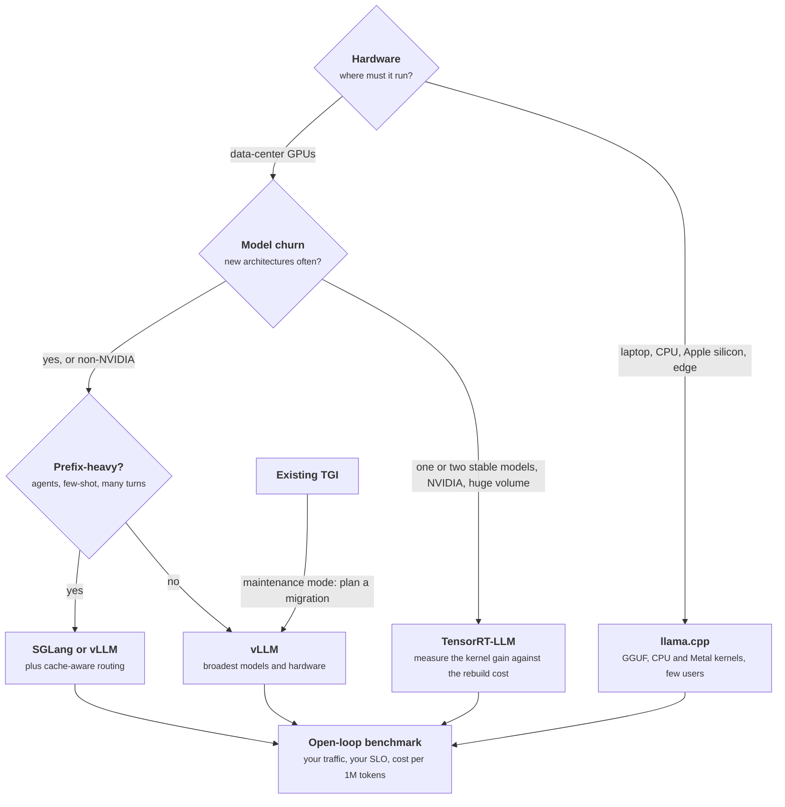
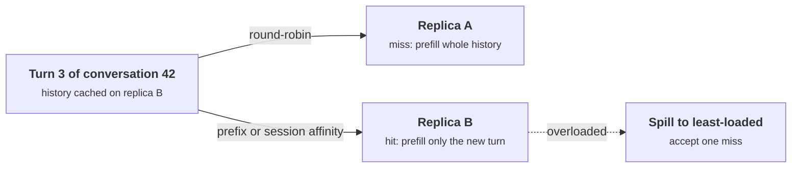

+++
title = 'Choosing a stack'
description = 'vLLM, SGLang, TensorRT-LLM, TGI, and llama.cpp all run continuous batching over a paged or slotted KV cache. They differ in how they reuse prefixes, compile models, split processes, and target hardware, and those mechanisms predict which workload each one wins.'
question = 'How do the main serving engines differ in mechanism, and how do you choose one with evidence instead of vendor benchmarks?'
weight = 2
difficulty = 3
prerequisites = ['/notes/inference-engineering/serving-systems/01-anatomy-of-a-serving-engine']
date = 2026-10-30T04:10:00Z
lastmod = 2026-10-30T04:10:00Z
verified = 2026-10-30
+++

## The idea in one minute

The main open engines have converged on the same core: iteration-level
batching, KV memory in fixed-size pieces, chunked [prefill](/notes/inference-engineering/inference-mechanics/01-prefill-and-decode/), prefix reuse,
CUDA graphs, and an OpenAI-compatible HTTP API. Where they still differ is in
**mechanisms**: how the [prefix cache](/notes/inference-engineering/making-it-cheaper/03-prefix-caching/) is indexed and how routing exploits it,
whether the model is compiled ahead of time for one GPU, where the CPU-bound
front end runs, and which hardware the kernels target.

Those mechanisms predict behavior better than any published benchmark. A
radix tree and a hash chain find almost the same prefix hits; a router that
sends a conversation back to the replica holding its cache can double them.
Ahead-of-time compilation buys kernel performance and costs a rebuild per
model, GPU type, and shape limit. The consequence to act on: **pick by
mechanism and model support, then decide with your own open-loop benchmark,
comparing cost per million tokens at your latency SLO**.

## A picture



## How it really works

### What is the same everywhere

Before comparing, remove what does not differ. As of October 2026, vLLM,
SGLang, TensorRT-LLM, and TGI all implement:

- **Continuous (in-flight) batching**: requests join and leave the batch every
  step.
- **Paged KV memory**: the cache is a pool of fixed-size pages addressed
  through per-request tables, so memory is allocated as sequences grow.
- **Chunked prefill**: long prompts are split across steps and mixed with
  decodes.
- **Prefix reuse**: KV for a prompt prefix already computed is reused.
- **Quantized weights and FP8 KV cache** on recent NVIDIA GPUs.
- **An OpenAI-compatible HTTP API** with server-sent-event streaming.

llama.cpp's server also batches continuously across a fixed number of
parallel slots, with a different memory design described below.

Any comparison that rests on "engine X has [paged attention](/notes/inference-engineering/batching-and-scheduling/02-paged-kv-memory/)" is out of date.

### Where they differ: the mechanisms

| | vLLM | SGLang | TensorRT-LLM | TGI | llama.cpp |
| --- | --- | --- | --- | --- | --- |
| KV layout | Block pool, 16-token blocks by default | Token-granular pool by default (page size 1), paging configurable | Paged blocks, sized at engine build or load | Paged blocks | One KV buffer of fixed context, cells tagged by sequence, split across `-np` slots |
| Prefix index | Chained hash per full block | Radix tree over token sequences | Block reuse keyed by content | Prefix cache (added in v3, December 2024) | Per-slot reuse of the previous prompt's prefix |
| Prefix-aware scheduling | Prefix hit lookup at admission; FCFS or priority order | Can reorder the waiting queue by longest cached prefix | Reuse at admission | Reuse at admission | Picks the slot whose cached prompt matches best |
| Model preparation | Loads Hugging Face checkpoints; `torch.compile` and CUDA graphs at startup | Loads checkpoints; CUDA graphs, optional `torch.compile` | PyTorch runtime by default since 2025; older path compiles a TensorRT engine per GPU type and shape limits | Loads checkpoints | Converts to GGUF ahead of time, often quantized |
| Front end | Python API server processes, engine core over ZeroMQ | Python server and tokenizer processes; Rust router for multi-replica | `trtllm-serve`, or Triton with the TensorRT-LLM backend | Rust router (HTTP, tokenize, batch) over gRPC to Python shards | C++ HTTP server in-process |
| Hardware | NVIDIA, AMD, TPU, Intel, others through plugins | NVIDIA, AMD, and others | NVIDIA only | NVIDIA, AMD, Gaudi, Neuron (as of its last releases) | CPU, Apple Metal, CUDA, Vulkan, HIP, SYCL |
| Structured output | Grammar backends (xgrammar and others) | xgrammar and others; jump-forward over forced tokens | xgrammar-based guided decoding | Outlines-based grammars | GBNF grammars, JSON schema |

Read the table as hypotheses about your workload, not scores.

### Prefix reuse: the index matters less than the routing

SGLang's RadixAttention (Zheng et al., NeurIPS 2024) stores cached KV in a
radix tree keyed by token sequences. Matching a new prompt is a walk from the
root; eviction removes least-recently-used leaves, so a shared prefix is never
evicted while a longer sequence that depends on it remains. vLLM's design
hashes each full 16-token block together with the hash of the block before
it, so a block's hash identifies the whole prefix up to that block. Lookup
walks the chain until the first miss; eviction is LRU over free blocks, with a
finished request's tail blocks queued for eviction before its head.

The two structures find nearly the same hits. The hash chain misses at most
one partial block (up to 15 tokens) at the end of each match, which matters
for very short prompts and not for long ones. What changes the hit rate
substantially is **which replica a request lands on**. Each replica has its
own cache; round-robin over R replicas returns a conversation to its cache
with probability 1/R. SGLang ships a router that tracks an approximate prefix
tree per worker; for vLLM the equivalent is a layer above the engine, such as
llm-d or the vLLM production stack, using the engine's KV events or
prompt hashes.



The program below measures both effects on the same traffic.

### Compilation: speed bought with a rebuild

TensorRT-LLM's original workflow builds an engine: the model is compiled by
TensorRT into kernels specialized for one GPU architecture, one [quantization](/notes/inference-engineering/making-it-cheaper/01-quantization/)
recipe, and maximum batch size, input length, and sequence length chosen at
build time. Specialization is where its kernel performance comes from, and it
has costs: a new model architecture needs support in the library first, every
change of GPU type or shape limits is a rebuild, and the engine file is not
portable. Since 2025 NVIDIA has made a PyTorch-based runtime the default
TensorRT-LLM workflow, which loads checkpoints directly and narrows the gap in
flexibility; the specialized kernels (FP8 and FP4 GEMMs, attention, fused MoE)
remain the reason to choose it.

vLLM and SGLang compile at startup instead: `torch.compile` (on by default in
vLLM) fuses operations, and CUDA graphs are captured for a ladder of batch
sizes. The cost is startup time, which is why persisting the compile cache
matters in production.

### Front end: where the CPU path runs

TGI's design choice was to keep the CPU-bound path out of Python: a Rust
router does HTTP, validation, tokenization, queueing, and batching decisions,
and talks gRPC to model shards. vLLM keeps Python but splits the API server
from the engine core and can run several API server processes per engine.
llama.cpp is one C++ process. These choices show up at high request rates
with short requests, where front-end CPU is the bottleneck, and are invisible
with long generations.

### Memory: pages versus slots

llama.cpp's server allocates one KV buffer for the configured context `-c`
and divides it among `-np` parallel slots. Each slot can hold up to `c / np`
tokens. That is simple and fast on a laptop or a single-user workstation, but
it reserves context per slot rather than per token, so many short requests
waste memory that a paged pool would share. Its strengths are elsewhere: GGUF
quantization formats from 2 to 8 bits, CPU and Apple Metal kernels, and a
single binary with no Python.

### TGI's status

As of October 2026 Hugging Face has put TGI into maintenance mode and points
new deployments to vLLM or SGLang. Its design (a compiled router in front of
Python model workers) remains instructive, and existing deployments still run
it. Treat it as a migration target, not a choice. The general lesson is a
selection criterion: **maintenance trajectory** (release cadence, who funds
it, how fast new architectures land) matters as much as a benchmark.

### The layer above the engine

Engines serve one model replica each. Routing across replicas, prefix-aware
placement, autoscaling, and [prefill/decode disaggregation](/notes/inference-engineering/distributed-inference/02-disaggregated-prefill-and-decode/) belong to a layer
above: NVIDIA Dynamo (open-sourced in 2025, works with vLLM, SGLang, and
TensorRT-LLM), llm-d (Kubernetes-native, built around vLLM, launched in 2025),
the vLLM production stack, KServe, and Ray Serve. Choose the engine first; add
one of these when routing and scaling become the problem.

### An evaluation that means something

Published benchmarks are run by someone, on a workload, with a tuning effort
you cannot see. Run your own:

1. **Workload.** Prompt and output length distributions (p50, p95, p99) from
   real logs, arrival pattern, prefix-sharing rate, required features
   (structured output, LoRA, long context).
2. **SLO.** For example p95 time to first token under 1 s and p99
   inter-token latency under 60 ms.
3. **One harness** that replays that traffic **open loop** (arrivals at a set
   rate, independent of server speed) against any OpenAI-compatible endpoint.
   Closed-loop load hides overload; [operating vLLM](/notes/inference-engineering/vllm-internals/05-operating-vllm/)
   shows why.
4. **Tune each candidate** with the same effort. The tuning delta is often
   larger than the engine delta.
5. **Compare cost per million output tokens at the SLO**, not peak throughput:

```text
cost per 1M tokens = GPU cost per hour / (tokens per second at SLO × 3,600) × 10^6

engine A: $3.00 / (2,500 × 3,600) × 10^6 = $0.33
engine B: $3.00 / (3,000 × 3,600) × 10^6 = $0.28    (hypothetical prices and rates)
```

A 17% cost difference is real money at volume. It is not worth much if
engine B lacks the next model you need, or takes three engineer-weeks a
quarter to operate.

### Keep the choice reversible

Migration is cheap when clients speak the OpenAI API to an internal [gateway](/notes/systems-design/building-blocks/01-gateways-and-routers/),
model artifacts stay in standard formats (safetensors plus `config.json`),
and dashboards normalize metric names at collection. It is expensive when the
product depends on engine-specific request fields, compiled engine files, or
engine-specific quantization formats. Before switching, re-validate chat
templates, stop sequences, sampling defaults, and output quality: two engines
serving the same weights can produce different text.

## Code

The program replays 1,440 turns of 240 multi-turn conversations that share one
of three 1,200-token system prompts. Each replica has a 120,000-token LRU
prefix cache. Block size 1 behaves like a token-granular radix tree; 16 is
vLLM's default. Token IDs are random, so only reuse is modeled, not cost.

```python {title="prefix_reuse.py"}
"""prefix_reuse.py: how much prompt work a prefix cache saves, and what decides it.

Multi-turn chats share one of three system prompts. Each turn's prompt is the
whole conversation so far. Every replica has an LRU prefix cache of fixed
token capacity, keyed by chained block hashes (block_size=1 behaves like a
token-granular radix tree). Compares block size, and routing across replicas.
Standard library only; runs offline. Token IDs are random integers.
"""

from __future__ import annotations

import random
from collections import OrderedDict

SYSTEM_PROMPTS = 3
SYSTEM_LEN = 1_200
CONVERSATIONS = 240
TURNS = 6
REPLICA_CACHE_TOKENS = 120_000


class PrefixCache:
    """Chained-hash block cache with LRU eviction of whole blocks."""

    def __init__(self, block_size: int, capacity_tokens: int) -> None:
        self.bs = block_size
        self.max_blocks = capacity_tokens // block_size
        self.blocks: OrderedDict[int, None] = OrderedDict()

    def _hashes(self, tokens: list[int]) -> list[int]:
        out, parent = [], 0
        for i in range(0, len(tokens) - self.bs + 1, self.bs):  # full blocks only
            parent = hash((parent, tuple(tokens[i:i + self.bs])))
            out.append(parent)
        return out

    def serve(self, prompt: list[int], output: list[int]) -> int:
        """Return prompt tokens found in cache, then cache prompt + output."""
        hashes = self._hashes(prompt)
        hit = 0
        for h in hashes:
            if h not in self.blocks:
                break
            hit += 1
        # Like vLLM, a full hit still recomputes the last token to get logits.
        hit_tokens = min(hit * self.bs, len(prompt) - 1)
        # Insert or refresh. Tail first, so the shared head is most recent and
        # is evicted last (vLLM frees a request's blocks in reverse order).
        for h in reversed(self._hashes(prompt + output)):
            self.blocks[h] = None
            self.blocks.move_to_end(h)
        while len(self.blocks) > self.max_blocks:
            self.blocks.popitem(last=False)
        return hit_tokens


def workload(seed: int = 3) -> list[tuple[int, list[int], list[int]]]:
    """Interleaved (conversation id, prompt, output) turns in arrival order."""
    rng = random.Random(seed)
    systems = [[rng.randrange(1, 50_000) for _ in range(SYSTEM_LEN)] for _ in range(SYSTEM_PROMPTS)]
    history = {c: list(systems[c % SYSTEM_PROMPTS]) for c in range(CONVERSATIONS)}
    turn = {c: 0 for c in range(CONVERSATIONS)}
    events = []
    active = list(range(CONVERSATIONS))
    while active:
        c = rng.choice(active)
        user = [rng.randrange(1, 50_000) for _ in range(rng.randint(30, 300))]
        prompt = history[c] + user
        output = [rng.randrange(1, 50_000) for _ in range(rng.randint(80, 400))]
        events.append((c, prompt, output))
        history[c] = prompt + output
        turn[c] += 1
        if turn[c] == TURNS:
            active.remove(c)
    return events


def run(events, block_size: int, replicas: int, routing: str) -> float:
    caches = [PrefixCache(block_size, REPLICA_CACHE_TOKENS) for _ in range(replicas)]
    total = hit = 0
    for i, (conv, prompt, output) in enumerate(events):
        r = i % replicas if routing == "round-robin" else conv % replicas
        hit += caches[r].serve(prompt, output)
        total += len(prompt)
    return hit / total


def main() -> None:
    events = workload()
    tokens = sum(len(p) for _, p, _ in events)
    print(f"{len(events)} turns, {tokens:,} prompt tokens, "
          f"cache {REPLICA_CACHE_TOKENS:,} tokens per replica\n")
    print(f"{'setup':<44}{'prompt tokens from cache':>26}")
    for label, bs, reps, routing in [
        ("1 replica,  block 16 (hash chain)", 16, 1, "-"),
        ("1 replica,  block 1  (token-granular tree)", 1, 1, "-"),
        ("1 replica,  block 64", 64, 1, "-"),
        ("4 replicas, block 16, round-robin", 16, 4, "round-robin"),
        ("4 replicas, block 16, session affinity", 16, 4, "affinity"),
    ]:
        print(f"{label:<44}{run(events, bs, reps, routing):>25.1%}")


if __name__ == "__main__":
    main()
```

Run it with `python3 prefix_reuse.py`:

```text
1440 turns, 3,406,330 prompt tokens, cache 120,000 tokens per replica

setup                                         prompt tokens from cache
1 replica,  block 16 (hash chain)                               71.3%
1 replica,  block 1  (token-granular tree)                      71.4%
1 replica,  block 64                                            69.5%
4 replicas, block 16, round-robin                               64.2%
4 replicas, block 16, session affinity                          92.1%
```

Token granularity gains 0.1 percentage points over 16-token blocks. Four
replicas with four times the total cache do worse than one replica under
round-robin, because each conversation's history is scattered across caches.
The same four replicas with session affinity serve 92% of prompt tokens from
cache: less than a tenth of the prefill compute.

## Where it breaks

- **Affinity fights load balance.** Sending every turn of a conversation to
  one replica can overload it while others idle. Real routers combine a
  prefix score with queue depth and KV usage and spill to another replica
  under load.
- **The workload decides.** The program assumes long multi-turn histories.
  Single-turn traffic with unique prompts gets almost no reuse in any engine,
  and the radix tree's advantages for branching programs (many samples or
  tree search from one prompt) are not modeled.
- **Cached KV competes with live requests.** Cached blocks live in the same
  pool as running requests. Under memory pressure they are evicted first, so
  hit rates fall exactly when load is highest.
- **Shared caches are shared state.** Prefix reuse across tenants is a
  timing side channel: a fast first token reveals that someone else sent the
  same prefix. Engines offer a per-request cache salt or per-tenant isolation
  for this; use it for untrusted tenants.
- **Benchmarks age fast.** Engines release every few weeks. A comparison from
  six months ago describes different software.

## Remember this

- The core mechanisms ([continuous batching](/notes/inference-engineering/batching-and-scheduling/01-continuous-batching/), paged KV, [chunked prefill](/notes/inference-engineering/batching-and-scheduling/03-chunked-prefill-and-priority/), prefix reuse) are common to all the major GPU engines.
- Differences that matter: prefix index and routing, ahead-of-time compilation, where the front end runs, hardware targets, model onboarding speed.
- Routing requests to the replica that holds their prefix matters far more than radix tree versus hash chain.
- Compare cost per million tokens at your SLO, measured open loop on your own traffic.
- Maintenance trajectory is a selection criterion; TGI is in maintenance mode.
- Keep the choice reversible: OpenAI API internally, standard model formats, normalized metrics.

## Try it

1. Run `prefix_reuse.py`. Halve `REPLICA_CACHE_TOKENS`. Which setup loses the
   most hit rate, and why?
2. Set `TURNS = 1` (single-turn traffic). How much reuse is left, and where
   does it come from?
3. Add a "least loaded" router that picks the replica with the fewest
   requests served so far. Then add a hybrid: affinity unless the home
   replica has served 20% more than the average. Compare hit rates.
4. Write the selection document for a workload you know: requirements,
   candidates, the benchmark you would run, and the result that would make
   you revisit the decision.

## Check yourself

1. Why does a token-granular radix tree barely beat 16-token hash-chained blocks on prefix hits?

   
   Both find the longest cached prefix. The block design only loses the
   partial block at the end of each match, at most 15 tokens, which is small
   compared with prefixes of thousands of tokens. The radix tree's advantages
   are in branching workloads and eviction order, not raw match length.
   

2. Four replicas with round-robin routing have four times the cache of one replica, yet a lower hit rate. Why?

   
   Each replica has its own cache. Round-robin sends each turn of a
   conversation to a replica chosen without regard to where its history is
   cached, so most turns miss and the same prefixes are stored on several
   replicas, wasting capacity. Affinity routing sends each conversation back
   to its cache.
   

3. What does TensorRT-LLM's ahead-of-time engine build buy, and what does it cost?

   
   Kernels specialized for one GPU architecture, quantization recipe, and
   shape limits, which can give higher throughput. The cost is a rebuild for
   every change of GPU type, maximum lengths or batch size, or model, a
   non-portable artifact, and dependence on the library supporting each new
   architecture.
   

4. Why is peak throughput the wrong number for choosing an engine?

   
   You operate at a latency SLO, not at peak. Peak throughput is reached with
   batches so large that time to first token and inter-token latency violate
   the SLO. The relevant figure is throughput, or cost per million tokens,
   at the highest load that still meets the SLO.
   

5. When is llama.cpp the right engine, and why not for a busy multi-tenant service?

   
   On CPUs, Apple silicon, edge devices, or single-user workstations, where
   GGUF quantization and its CPU and Metal kernels matter and there is no
   Python stack. For a busy service, its fixed slots reserve context per slot
   instead of sharing a paged pool, and data-center GPU engines get far more
   throughput at high concurrency.
   

## Sources

- L. Zheng, L. Yin, Z. Xie, C. Sun, J. Huang, C. H. Yu, S. Cao, C. Kozyrakis, I. Stoica, J. E. Gonzalez, C. Barrett, Y. Sheng, [SGLang: Efficient Execution of Structured Language Model Programs](https://arxiv.org/abs/2312.07104), NeurIPS, 2024.
- W. Kwon et al., [Efficient Memory Management for Large Language Model Serving with PagedAttention](https://arxiv.org/abs/2309.06180), ACM SOSP, 2023.
- vLLM documentation, [Automatic prefix caching](https://docs.vllm.ai/en/latest/design/prefix_caching.html), accessed October 2026.
- NVIDIA, [TensorRT-LLM documentation](https://nvidia.github.io/TensorRT-LLM/), accessed October 2026.
- Hugging Face, [Text Generation Inference documentation](https://huggingface.co/docs/text-generation-inference/en/index) and [repository](https://github.com/huggingface/text-generation-inference), accessed October 2026.
- ggml-org, [llama.cpp HTTP server](https://github.com/ggml-org/llama.cpp/tree/master/tools/server), accessed October 2026.
- Y. Dong, C. F. Ruan, Y. Cai, R. Lai, Z. Xu, Y. Zhao, T. Chen, [XGrammar: Flexible and Efficient Structured Generation Engine for Large Language Models](https://arxiv.org/abs/2411.15100), 2024.
- NVIDIA, [Dynamo](https://github.com/ai-dynamo/dynamo) and the llm-d project, [llm-d](https://llm-d.ai/), accessed October 2026.
- B. Schroeder, A. Wierman, M. Harchol-Balter, [Open Versus Closed: A Cautionary Tale](https://www.usenix.org/conference/nsdi-06/open-versus-closed-cautionary-tale), USENIX NSDI, 2006.
