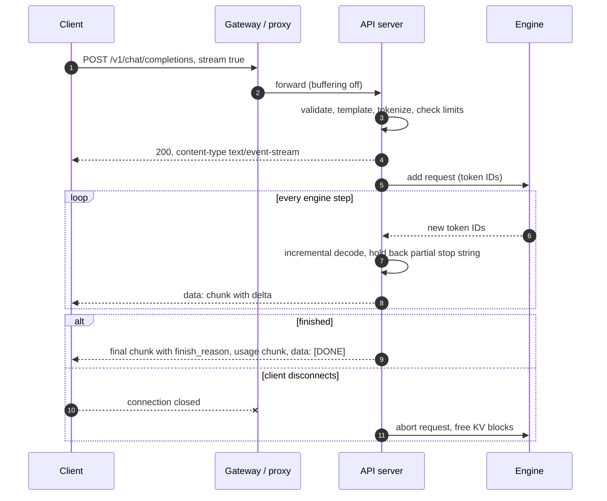
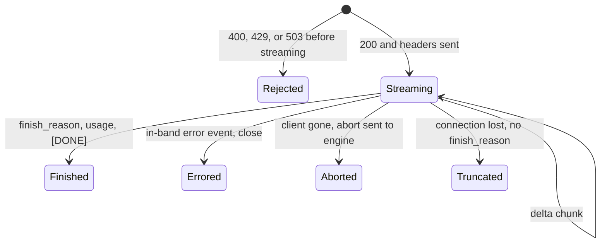

+++
title = 'Streaming APIs'
description = 'Token streaming looks like printing text as it arrives. Doing it correctly means incremental detokenization, holding back possible stop strings, framing events safely, propagating cancellation to the engine, and reporting errors and usage after the status code is already sent.'
question = 'How do sampled token IDs become a correct, cancellable stream of server-sent events?'
weight = 3
difficulty = 3
prerequisites = ['/notes/inference-engineering/serving-systems/01-anatomy-of-a-serving-engine']
date = 2026-10-30T04:15:00Z
lastmod = 2026-10-30T04:15:00Z
verified = 2026-10-30
+++

## The idea in one minute

The OpenAI-compatible streaming API has become the common contract for
model servers: `POST /v1/chat/completions` with `"stream": true`, answered by
a `text/event-stream` of JSON chunks, each carrying a small `delta`, ending
with `data: [DONE]`. Clients, SDKs, gateways, and evaluation tools all speak
it.

The hard parts are on the server. Tokens are not characters: a token can be
half of a UTF-8 character, and a stop string can span several tokens, so the
server must **hold back text** until it is safe to send. The HTTP status code
goes out before the first token, so later failures must be reported **in
band**. And a client that goes away must **abort the request in the engine**,
or the GPU keeps generating, and holding memory, for nobody. The consequence
to act on: treat the stream as a stateful protocol with explicit end states,
and test disconnects, stop strings, multi-byte text, and mid-stream errors as
deliberately as the happy path.

## A picture



## How it really works

### The wire format

Server-sent events are defined in the WHATWG HTML standard. The response has
`Content-Type: text/event-stream`. Each event is one or more `field: value`
lines followed by a blank line. Model APIs use only the `data` field, and put
one JSON object in it:

```text
data: {"id":"chatcmpl-1","object":"chat.completion.chunk","choices":[{"index":0,"delta":{"role":"assistant"},"finish_reason":null}]}

data: {"id":"chatcmpl-1","object":"chat.completion.chunk","choices":[{"index":0,"delta":{"content":"Café"},"finish_reason":null}]}

data: {"id":"chatcmpl-1","object":"chat.completion.chunk","choices":[{"index":0,"delta":{},"finish_reason":"stop"}]}

data: {"id":"chatcmpl-1","object":"chat.completion.chunk","choices":[],"usage":{"prompt_tokens":9,"completion_tokens":11,"total_tokens":20}}

data: [DONE]
```

Conventions in the OpenAI API reference that compatible servers follow:

- The first chunk carries the `role`; later chunks carry `content` deltas (or
  `tool_calls` deltas, which arrive as fragments of a JSON arguments string).
- The last content chunk has `finish_reason`: `stop` (end-of-sequence token or
  a stop string), `length` (hit `max_tokens` or the context limit), or
  `tool_calls`.
- With `"stream_options": {"include_usage": true}`, an extra chunk with empty
  `choices` and a `usage` object comes just before `[DONE]`. Without it a
  streaming client gets no token counts; meter on the server anyway.
- `[DONE]` is a sentinel string, not JSON.

Lines starting with `:` are comments. They are useful as **heartbeats**:
a 100,000-token prompt can take several seconds to [prefill](/notes/inference-engineering/inference-mechanics/01-prefill-and-decode/), and a proxy or
load balancer with a 60-second idle timeout will cut a connection that sends
nothing for too long.

Because each event's payload is JSON, model output containing newlines,
quotes, or a literal `data:` is escaped by the encoder and cannot break the
framing. A server that writes raw model text into `data:` lines lets the
model, or whoever controls its input, inject fake events into the stream.

### Tokens are not text

Modern tokenizers work on bytes. A character like `é` (two UTF-8 bytes) or
`€` (three) can be split across tokens, and decoding each token on its own
produces replacement characters. Some tokenizers also merge or drop spaces
depending on neighboring tokens, so decoding token by token is not equal to
decoding the whole sequence.

The standard fix is an **incremental detokenizer** per request: decode a
small window of recent tokens, compare with what was already sent, and emit
only the new, complete suffix. vLLM keeps this state in its output processor
in the API server process; Hugging Face's `tokenizers` library exposes a
streaming decoder for the same purpose. The detokenizer must live with the
request for its whole life, which is one reason detokenizing is a per-request,
per-token CPU cost on the front end.

### Stop strings need a holdback

A stop string like `###END` is matched on text, not tokens. When the output
so far ends in `##`, the server cannot know whether the next token completes
the stop string. If it sends `##` and the stop string then completes, the
client has received text that should have been cut. So the server keeps back
the longest suffix of pending text that is a prefix of any stop string, at
most `len(stop) − 1` characters, and releases it when the next token rules
the stop string out.

When the stop string completes, the server truncates the text before it
(OpenAI semantics exclude the stop string), sends `finish_reason: "stop"`,
and tells the engine to finish the request. The engine may already have
generated a token or two beyond the stop point by then; those are discarded.

### Status codes come first, errors come later

Everything that can be decided before the first token should be: validation
(`400` with the limit and the observed value), authentication (`401`/`403`),
quota (`429` with `Retry-After`), and overload (`503` with `Retry-After`).
`429` tells a client it is over its own limit; `503` tells it the service is
over capacity. Clients should back off differently, and returning `500` for
overload makes them retry immediately.

Once the `200` and the first byte are sent, the status cannot change. An
engine crash, a timeout, or a content policy decision mid-stream must be
reported as an in-band event, typically a JSON object with an `error` field,
followed by closing the stream. Clients must treat a stream that ends without
a `finish_reason` as truncated, not as complete.

### Cancellation is a capacity feature

A client that closes the connection should stop the work. The front end
notices the closed connection (a failed write, or the server framework's
disconnect event), and sends an abort to the engine. The engine removes the
request at the next step and frees its KV blocks.

The arithmetic makes this a capacity issue, not a nicety. If 10% of chat
requests are abandoned halfway through 1,000-token answers, and aborts do not
propagate, the engine generates 50 tokens of waste for every 1,000 requested
tokens, and those abandoned requests hold KV memory that could admit waiting
requests. Non-streaming requests are worse: a client that times out after 30
seconds leaves the server generating the full answer unless the server checks
for disconnects while waiting.

Every hop must propagate it. A [gateway](/notes/systems-design/building-blocks/01-gateways-and-routers/) that keeps the upstream connection
open after its client leaves defeats the engine's abort logic.



### Slow consumers and proxies

The engine produces tokens at its own pace. A client on a slow network, or
one that stops reading, fills the TCP send buffer. The front end must not
block the engine waiting for it: keep a bounded per-stream buffer, coalesce
several tokens into one event when the buffer is behind, and abort a stream
that stays stuck past a limit.

Intermediaries break streaming in quiet ways:

- **Response buffering.** Reverse proxies often buffer upstream responses.
  Nginx needs `proxy_buffering off` or the upstream header
  `X-Accel-Buffering: no`; other proxies have equivalents.
- **Compression.** Gzip in a proxy can hold bytes until a block fills.
  Disable compression for `text/event-stream`, or flush per event.
- **Timeouts.** Separate the time-to-first-byte timeout from the total
  timeout. A long answer at 30 tokens per second can run for minutes.

### Inside the platform

SSE over HTTP/1.1 or HTTP/2 is the right public interface: browsers and every
SDK support it, and its per-event overhead is small. At 5,000 output tokens
per second, 150 bytes of JSON and framing per token is 750 KB/s. Between a
gateway and engines, gRPC server streaming is common because HTTP/2
multiplexes many streams on one connection and has flow control per stream.
Either way, keep the OpenAI request and response schema as the internal
contract, so clients and engines can change independently.

## Code

The program streams eleven generated token IDs from a toy byte-level
vocabulary in which `é` and `€` are split across tokens, with a stop string
`###END`. It compares naive per-token decoding with an incremental decoder
plus a stop-string holdback, then prints the SSE frames a client would
receive.

```python {title="sse_stream.py"}
"""sse_stream.py: incremental detokenization, stop strings, and SSE framing.

A toy byte-level vocabulary: some tokens are fragments of multi-byte UTF-8
characters, as in real byte-level BPE vocabularies. Compares a naive
per-token decode with an incremental decoder that holds back incomplete
characters and possible stop-string prefixes. Standard library only; offline.
"""

from __future__ import annotations

import codecs
import json

# Token ID -> bytes. "é" is C3 A9 and "€" is E2 82 AC, split across tokens on purpose.
VOCAB = {
    1: b"Caf", 2: b"\xc3", 3: b"\xa9", 4: b" costs", 5: b" 5", 6: b"\xe2\x82",
    7: b"\xac", 8: b".\n", 9: b"##", 10: b"#", 11: b"END", 12: b" more",
}
GENERATED = [1, 2, 3, 4, 5, 6, 7, 8, 9, 10, 11, 12]   # the model's raw output
STOP = "###END"


def naive(tokens: list[int]) -> list[str]:
    """Decode each token on its own: breaks characters and leaks the stop string."""
    return [VOCAB[t].decode("utf-8", errors="replace") for t in tokens]


class Detokenizer:
    """Per-request state: an incremental UTF-8 decoder plus a stop-string holdback."""

    def __init__(self, stop: str) -> None:
        self.decoder = codecs.getincrementaldecoder("utf-8")()
        self.stop = stop
        self.pending = ""        # decoded text not yet sent
        self.finished = False

    def push(self, token: int) -> str:
        if self.finished:
            return ""
        self.pending += self.decoder.decode(VOCAB[token])   # holds partial chars
        if self.stop in self.pending:
            self.finished = True
            text, self.pending = self.pending.split(self.stop, 1)[0], ""
            return text
        # Keep back the longest suffix that could still become the stop string.
        keep = 0
        for k in range(min(len(self.stop) - 1, len(self.pending)), 0, -1):
            if self.stop.startswith(self.pending[-k:]):
                keep = k
                break
        text = self.pending[:len(self.pending) - keep]
        self.pending = self.pending[len(self.pending) - keep:]
        return text


def sse(obj: dict | str) -> str:
    body = obj if isinstance(obj, str) else json.dumps(obj, ensure_ascii=False, separators=(",", ":"))
    return f"data: {body}\n\n"


def chunk(delta: dict, finish: str | None = None) -> dict:
    return {"id": "chatcmpl-1", "object": "chat.completion.chunk",
            "choices": [{"index": 0, "delta": delta, "finish_reason": finish}]}


def main() -> None:
    print("naive per-token decode:", repr("".join(naive(GENERATED))))
    d = Detokenizer(STOP)
    frames = [sse(chunk({"role": "assistant"}))]
    sent = 0
    for n, tok in enumerate(GENERATED, start=1):
        text = d.push(tok)
        if text:
            frames.append(sse(chunk({"content": text})))
            sent += 1
        print(f"token {tok:>2} {VOCAB[tok]!r:<12} -> emit {text!r:<12} held {d.pending!r}")
        if d.finished:
            break
    frames.append(sse(chunk({}, finish="stop")))
    final = {"id": "chatcmpl-1", "object": "chat.completion.chunk", "choices": [],
             "usage": {"prompt_tokens": 9, "completion_tokens": n, "total_tokens": 9 + n}}
    frames += [sse(final), sse("[DONE]")]
    print(f"\n{n} tokens consumed, {sent} content events, stopped={d.finished}\n")
    print("".join(frames), end="")


if __name__ == "__main__":
    main()
```

Run it with `python3 sse_stream.py`:

```text
naive per-token decode: 'Caf�� costs 5��.\n###END more'
token  1 b'Caf'       -> emit 'Caf'        held ''
token  2 b'\xc3'      -> emit ''           held ''
token  3 b'\xa9'      -> emit 'é'          held ''
token  4 b' costs'    -> emit ' costs'     held ''
token  5 b' 5'        -> emit ' 5'         held ''
token  6 b'\xe2\x82'  -> emit ''           held ''
token  7 b'\xac'      -> emit '€'          held ''
token  8 b'.\n'       -> emit '.\n'        held ''
token  9 b'##'        -> emit ''           held '##'
token 10 b'#'         -> emit ''           held '###'
token 11 b'END'       -> emit ''           held ''

11 tokens consumed, 6 content events, stopped=True

data: {"id":"chatcmpl-1","object":"chat.completion.chunk","choices":[{"index":0,"delta":{"role":"assistant"},"finish_reason":null}]}

data: {"id":"chatcmpl-1","object":"chat.completion.chunk","choices":[{"index":0,"delta":{"content":"Caf"},"finish_reason":null}]}

data: {"id":"chatcmpl-1","object":"chat.completion.chunk","choices":[{"index":0,"delta":{"content":"é"},"finish_reason":null}]}

data: {"id":"chatcmpl-1","object":"chat.completion.chunk","choices":[{"index":0,"delta":{"content":" costs"},"finish_reason":null}]}

data: {"id":"chatcmpl-1","object":"chat.completion.chunk","choices":[{"index":0,"delta":{"content":" 5"},"finish_reason":null}]}

data: {"id":"chatcmpl-1","object":"chat.completion.chunk","choices":[{"index":0,"delta":{"content":"€"},"finish_reason":null}]}

data: {"id":"chatcmpl-1","object":"chat.completion.chunk","choices":[{"index":0,"delta":{"content":".\n"},"finish_reason":null}]}

data: {"id":"chatcmpl-1","object":"chat.completion.chunk","choices":[{"index":0,"delta":{},"finish_reason":"stop"}]}

data: {"id":"chatcmpl-1","object":"chat.completion.chunk","choices":[],"usage":{"prompt_tokens":9,"completion_tokens":11,"total_tokens":20}}

data: [DONE]
```

The naive decode shows four replacement characters and leaks `###END more`
to the client. The incremental version emits nothing for half a character,
holds `##` and `###` while the stop string is still possible, and ends the
stream cleanly. The token after the stop string (12) is never consumed. The
`.\n` inside the JSON is escaped, so it cannot end the event early.

## Where it breaks

- **Real tokenizers are messier.** Byte-fallback tokens, merged spaces, and
  special tokens mean you should use the tokenizer's own streaming decoder or
  a windowed re-decode, not a plain UTF-8 decoder. The program shows the
  principle, not a drop-in implementation.
- **Holdback adds latency.** Long or many stop strings delay text at the end
  of every partial match. Keep stop lists short.
- **Usage under cancellation.** A client that disconnects never receives the
  usage chunk. Bill from server-side counts, including tokens generated
  before the abort reached the engine.
- **Tool-call streams are fragments.** Arguments arrive as pieces of a JSON
  string. A client that parses each delta as JSON fails; one that acts on a
  partial tool call can execute the wrong thing. Act only on complete calls.
- **Reconnection is not resumption.** The SSE standard's `Last-Event-ID`
  reconnection does not make a generation resumable: the engine state is gone
  when the connection drops. Resumable answers need a server-side buffer keyed
  by a request ID, which is a design decision with memory and privacy costs.

## Remember this

- The OpenAI-compatible SSE format is the common contract: `chat.completion.chunk` deltas, a `finish_reason`, optional usage, then `[DONE]`.
- Detokenize incrementally per request; a token can be part of a character.
- Hold back text that could be the start of a stop string.
- Decide `400`, `429`, and `503` before streaming; after the first byte, errors go in band.
- A disconnect must abort the request in the engine, through every hop.
- Turn off proxy buffering and compression for event streams, and send heartbeats during long prefills.

## Try it

1. Run `sse_stream.py`. Add a second stop string `"\n\n"` and generate a
   sequence that contains it. Does the holdback still work with two strings?
2. Change the detokenizer to emit at most one event per 20 ms of simulated
   time, coalescing tokens. How many events does a 300-token answer at 50
   tokens per second produce?
3. Write a tiny client loop that parses the frames above and reports whether
   the stream finished, was truncated, or carried an error.
4. Behind a proxy you operate, stream a response that pauses 90 seconds
   before the first token. Find the timeout that cuts it, then fix it with
   heartbeats or configuration.

## Check yourself

1. Why can't a server decode and send each token as soon as it is sampled?

   
   A token can contain only part of a multi-byte UTF-8 character, and some
   tokenizers' text for a token depends on its neighbors. Decoding tokens
   independently produces replacement characters and wrong spacing. The
   server must keep per-request decoder state and send only complete text.
   

2. The output ends with `##` and the stop string is `###END`. What should the server send?

   
   Nothing for those two characters yet. `##` is a prefix of the stop string,
   so it is held back until the next token either completes the stop string
   (then it is dropped and the stream ends with `finish_reason: "stop"`) or
   rules it out (then it is sent).
   

3. The engine crashes after 200 tokens have streamed. How does the client find out?

   
   The `200` status is already sent, so the server sends an in-band error
   event and closes the stream. A client must also treat a stream that ends
   without a `finish_reason` and `[DONE]` as truncated, since the server may
   not get the chance to send the error.
   

4. Why is propagating client disconnects a capacity issue?

   
   Without it, the engine keeps generating abandoned answers. The tokens are
   wasted compute, and the requests keep [KV cache memory](/notes/inference-engineering/inference-mechanics/02-kv-cache-math/) that could have
   admitted waiting requests, which raises everyone's queueing delay.
   

5. Why must each SSE payload be JSON-encoded rather than raw model text?

   
   SSE events are separated by blank lines and fields by line prefixes. Raw
   text containing newlines or `data:` would split or forge events. JSON
   encoding escapes newlines and quotes, so model output, including output an
   attacker steered, cannot alter the framing.
   

## Sources

- WHATWG, [HTML Living Standard: Server-sent events](https://html.spec.whatwg.org/multipage/server-sent-events.html), accessed October 2026.
- OpenAI, [API reference: chat completions streaming](https://platform.openai.com/docs/api-reference/chat-streaming), accessed October 2026.
- R. Fielding, M. Nottingham, J. Reschke (eds.), [RFC 9110: HTTP Semantics](https://www.rfc-editor.org/rfc/rfc9110), IETF, June 2022 (status codes, `Retry-After`).
- M. Nottingham, R. Fielding, [RFC 6585: Additional HTTP Status Codes](https://www.rfc-editor.org/rfc/rfc6585), IETF, April 2012 (`429 Too Many Requests`).
- M. Thomson, C. Benfield (eds.), [RFC 9113: HTTP/2](https://www.rfc-editor.org/rfc/rfc9113), IETF, June 2022 (streams and flow control).
- F5 NGINX, [ngx_http_proxy_module: proxy_buffering](https://nginx.org/en/docs/http/ngx_http_proxy_module.html#proxy_buffering), accessed October 2026.
- Hugging Face, [tokenizers decoders](https://huggingface.co/docs/tokenizers/api/decoders), accessed October 2026.
- vLLM documentation, [OpenAI-compatible server](https://docs.vllm.ai/en/latest/serving/openai_compatible_server.html), accessed October 2026.
