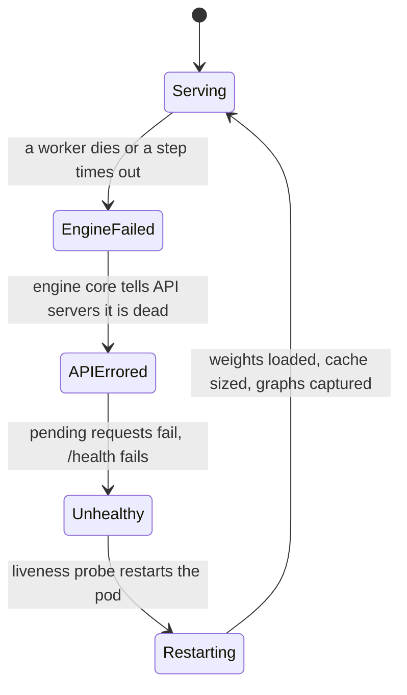

+++
title = 'The request path'
description = 'A vLLM request crosses three kinds of process: an API server that turns text into token IDs, an engine core that schedules every step, and one worker per GPU. Each boundary is designed so that the GPU never waits on Python, sockets, or serialization.'
question = 'What happens to one request in vLLM between the HTTP call and the last streamed token?'
weight = 1
difficulty = 3
prerequisites = ['/notes/inference-engineering/serving-systems/01-anatomy-of-a-serving-engine']
date = 2026-10-30T05:05:00Z
lastmod = 2026-10-30T05:05:00Z
verified = 2026-10-30
+++

## The idea in one minute

This lesson describes vLLM's V1 engine as of October 2026 (the v0.30
release line). A chat request enters an **API server** process, which applies
the chat template, tokenizes, validates, and hands token IDs to its
**`AsyncLLM`** client. The request crosses a ZeroMQ socket, encoded with
msgpack, to the **engine core** process. There a busy loop runs the
**scheduler** once per step, and the **executor** broadcasts the step's plan
to one **worker** process per GPU, which builds tensors, runs the model, and
samples. New token IDs flow back the same way; the API server detokenizes
them and streams text.

Steps 1 to 6 of that path happen once per request. The inner loop (schedule,
run, sample, update, return) happens once per output token. Every design
choice on the path, from separate processes to sending only deltas to the
workers, exists to keep that inner loop short. The consequence to act on:
**give each vLLM process its own CPU core, and read latency problems by
asking which process is waiting for which**.

## A picture

```mermaid {title="Processes and wires in vLLM V1 (one engine, tensor parallel size 2)"}
flowchart LR
  C["<b>Client</b>"] -->|"HTTP"| H
  subgraph API["API server process"]
    H["<b>OpenAI routes</b><br/><small>FastAPI</small>"] --> R["<b>Template + tokenize</b><br/><small>validate, sampling params</small>"]
    R --> AL["<b>AsyncLLM</b><br/><small>per-request output queue</small>"]
    OP["<b>Output processor</b><br/><small>detokenize, stop strings</small>"]
  end
  subgraph CORE["Engine core process"]
    IN["<b>Input thread</b><br/><small>decode, hash prompt blocks</small>"] --> L["<b>Busy loop</b><br/><small>schedule, execute, update</small>"]
    L --> OUT["<b>Output thread</b><br/><small>encode, send</small>"]
    L --- KV[("<b>KV cache manager</b>")]
  end
  subgraph W["Worker processes"]
    W0["<b>Worker, rank 0</b><br/><small>model runner, GPU 0</small>"]
    W1["<b>Worker, rank 1</b><br/><small>model runner, GPU 1</small>"]
  end
  AL -->|"ZeroMQ + msgpack<br/>token IDs"| IN
  L -->|"shared-memory broadcast<br/>step plan"| W0
  L --> W1
  W0 -->|"sampled token IDs"| L
  OUT -->|"ZeroMQ<br/>new token IDs"| OP
  OP -->|"SSE"| C
  class C neutral
  class H,R,OP io
  class AL,IN,OUT,L queue
  class KV memory
  class W0,W1 compute
```

## How it really works

### The route, once per request

| # | Process | What happens |
| --- | --- | --- |
| 1 | API server | The OpenAI-compatible route parses and validates the JSON body. |
| 2 | API server | The model's chat template renders the messages; the tokenizer turns the text into token IDs. Images and audio are loaded and preprocessed here. |
| 3 | API server | The prompt length is checked against `max_model_len`, sampling defaults are filled in, and an engine request is built. |
| 4 | API server | `AsyncLLM` registers the request with its output processor (which will detokenize) and sends it to the engine core. |
| 5 | Socket | The request is serialized with msgpack and sent over ZeroMQ: an IPC socket on one machine, TCP across machines. |
| 6 | Engine core | A background input thread decodes it, builds the scheduler's request object, computes the prompt's block hashes for prefix caching, and queues it. |

The engine core never sees text. Its input is token IDs, sampling
parameters, an arrival time, an optional LoRA adapter, an optional priority,
and an optional **cache salt** that isolates the request's [prefix cache](/notes/inference-engineering/making-it-cheaper/03-prefix-caching/)
entries from other tenants. Its output is token IDs. Everything that touches
strings stays in the API server.

### The loop, once per token

| # | Where | What happens |
| --- | --- | --- |
| 7 | Engine core | `Scheduler.schedule()` decides how many tokens of each request run this step and asks the KV cache manager for blocks. The result is a `SchedulerOutput`. |
| 8 | Engine core to workers | The executor broadcasts the plan to every worker of this engine. |
| 9 | Workers | The model runner turns the plan into flat tensors, runs the forward pass, and samples one token for each request that has finished its prompt. |
| 10 | Engine core | `update_from_output()` appends the new tokens, checks stop conditions (end-of-sequence, stop token IDs, `max_tokens`, context length), and frees the blocks of finished requests. |
| 11 | Socket | New token IDs for every request that made progress go back to the API server that owns each request. |
| 12 | API server | The output processor detokenizes incrementally, checks stop strings, and puts output on the request's queue; the HTTP handler turns it into a server-sent event. |

A 500-token answer goes around steps 7 to 11 five hundred times, sharing each
trip with every other running request.

### Why three kinds of process

CPython's global interpreter lock lets one thread run Python at a time. If
the HTTP server, tokenizer, and scheduler shared an interpreter, tokenizing a
long document would stop scheduling, and the GPU would wait. V1 separates
them:

- **API server**: thousands of connections, chat templates, tokenizing,
  media loading, detokenizing, streaming. It must never wait for the GPU.
- **Engine core**: scheduling and KV block accounting. It must never wait for
  tokenizing or slow clients.
- **Workers**: one per GPU, each with its own CUDA context, its shard of the
  weights, and its share of the KV cache. They must never wait for anything.

The engine core's socket I/O runs on two background threads: an input thread
that receives and decodes requests and does per-request preparation such as
block hashing, and an output thread that encodes and sends results. Socket
operations and msgpack encoding release the interpreter lock, so this work
overlaps with the forward pass. The main loop only touches in-memory queues.

The loop is a **busy loop**: when there are requests it never sleeps, so a
loaded engine core shows one core at 100%. With no requests it blocks on its
input queue and uses no CPU. Both are correct. A container with fewer cores
than vLLM has processes lets the operating system deschedule the engine core
mid-step, which appears as low GPU utilization and high inter-token latency.

### One step in detail

The step function, simplified:

```text
plan    = scheduler.schedule()
future  = executor.execute_model(plan, non_block=True)   # forward pass starts
mask    = scheduler.grammar_bitmask(plan)                # CPU, while the GPU runs
tokens  = executor.sample_tokens(mask)                   # sample with the grammar mask
process pending aborts
outputs = scheduler.update_from_output(plan, tokens)
```

Two details are worth knowing. The forward pass and sampling are separate
calls so that the CPU can compute structured-output masks while the GPU runs
the model. And aborts that arrived during the forward pass are applied
before `update_from_output`, so a disconnected request gets no more tokens
or blocks.

By default in recent releases, the engine keeps a small queue of in-flight
batches: it schedules step N+1 and sends it to the workers while step N is
still on the GPU, so the GPU does not idle while Python runs
`update_from_output` and `schedule`. This is **async scheduling**, and it
forces the scheduler to plan a decode step before it knows the previous
token. [The scheduler](/notes/inference-engineering/vllm-internals/02-the-scheduler/) explains how. Pipeline parallelism uses the same
queue to keep every pipeline stage busy with a different batch.

### Workers receive deltas

With tensor parallelism every worker must receive the same plan at the same
moment. The executor writes it once into a shared-memory ring buffer that
every worker reads, with no locks; only one rank sends results back, since
all ranks sample the same tokens.

The plan itself is incremental. The first time a request is scheduled, the
workers receive its full data: prompt token IDs, sampling parameters, block
IDs. On later steps they receive only what changed: the number of tokens to
compute and any newly allocated block IDs. Each worker keeps a **persistent
batch** of request state and updates it in place. The program below shows
why: resending everything each step would move hundreds of megabytes per
second for a busy server.

### The way back

Each step produces one output message per API server, listing every request
that made progress. In the API server, the output processor:

- appends the new token IDs and decodes them incrementally into text;
- checks stop strings, holding back text that could be the start of one;
- computes per-request metrics from timestamps the engine core recorded
  (queued, scheduled, first token);
- puts a result on the request's own queue, which the HTTP handler awaits.

If a stop string matches, the API server tells the engine core to abort the
request: the engine checks stop token IDs, but stop strings live with the
detokenizer. A client disconnect takes the same abort path.

### Failure is all or nothing



If a worker dies, the engine core cannot complete a step, so it raises and
shuts down. When the engine core dies, the API server marks itself dead,
fails every pending request, and its `/health` endpoint starts failing. The
intended recovery is to restart the whole server, which is what a liveness
probe on `/health` does. Plan for that: in-flight requests on a failed
replica are lost, and clients or the [gateway](/notes/systems-design/building-blocks/01-gateways-and-routers/) must retry them elsewhere.

### Scaling the path

- **More front-end processes.** `--api-server-count` runs several API server
  processes for one engine when tokenizing, media loading, or streaming is
  the bottleneck.
- **Data parallelism.** `--data-parallel-size` runs several engine cores, each
  with its own workers and scheduler, behind the same API servers, with a
  coordinator process to balance load. It is mostly used for [mixture-of-experts](/notes/inference-engineering/distributed-inference/03-serving-mixture-of-experts/)
  models, where expert parallelism spans the data-parallel ranks (see
  [tensor, pipeline, and expert parallelism](/notes/inference-engineering/distributed-inference/01-tensor-pipeline-and-expert-parallelism/)).
- **Process count.** API servers, plus one engine core per data-parallel rank,
  plus one worker per GPU, plus a coordinator when DP > 1. Budget a CPU core
  for each, and pin nothing else onto them.

When you embed vLLM in a Python program (the offline `LLM` class), workers
may be started with `spawn`, which re-imports your script in the child. Put
your code under `if __name__ == "__main__":` or the child starts a second
engine.

## Code

The program builds the per-step message the engine core would broadcast for
256 running requests with prompts of 500 to 8,000 tokens, in two styles:
resend everything, or send deltas. JSON stands in for msgpack, so absolute
sizes are rough; the ratio is the point.

```python {title="wire_bytes.py"}
"""wire_bytes.py: why the engine sends workers deltas, not whole requests.

Builds the per-step message an engine core would broadcast to its workers in
two styles: resend every running request in full, or send full data once and
then only what changed (new block IDs, token counts). JSON stands in for
msgpack, so absolute sizes are rough; the ratio is the point. Also prints the
process count for a few layouts. Standard library only; runs offline.
"""

from __future__ import annotations

import json
import random

BLOCK = 16
RUNNING = 256
STEPS = 64                    # decode steps to simulate
STEPS_PER_SECOND = 50


def make_requests(rng: random.Random) -> list[dict]:
    reqs = []
    next_block = 1
    for i in range(RUNNING):
        prompt = [rng.randrange(150_000) for _ in range(rng.randint(500, 8_000))]
        n_blocks = -(-len(prompt) // BLOCK)
        reqs.append({"id": f"req-{i}", "prompt": prompt, "out": [],
                     "blocks": list(range(next_block, next_block + n_blocks)),
                     "params": {"temperature": 0.7, "top_p": 0.95, "max_tokens": 512}})
        next_block += n_blocks
    return reqs


def main() -> None:
    rng = random.Random(1)
    reqs = make_requests(rng)
    next_block = max(r["blocks"][-1] for r in reqs) + 1
    full_bytes = delta_bytes = 0
    for _ in range(STEPS):
        full_msg, delta_msg = [], []
        for r in reqs:
            r["out"].append(rng.randrange(150_000))
            new_blocks = []
            if (len(r["prompt"]) + len(r["out"])) % BLOCK == 1:   # crossed a block edge
                new_blocks = [next_block]
                r["blocks"].append(next_block)
                next_block += 1
            full_msg.append({"id": r["id"], "tokens": r["prompt"] + r["out"],
                             "blocks": r["blocks"], "params": r["params"]})
            delta_msg.append([r["id"], 1, new_blocks])   # id, tokens this step, new blocks
        full_bytes += len(json.dumps(full_msg))
        delta_bytes += len(json.dumps(delta_msg))
    f, d = full_bytes / STEPS, delta_bytes / STEPS
    print(f"{RUNNING} running requests, mean prompt "
          f"{sum(len(r['prompt']) for r in reqs) // RUNNING:,} tokens")
    print(f"resend everything : {f / 1e6:7.2f} MB per step, "
          f"{f * STEPS_PER_SECOND / 1e9:5.2f} GB/s at {STEPS_PER_SECOND} steps/s")
    print(f"deltas only       : {d / 1e3:7.1f} KB per step, "
          f"{d * STEPS_PER_SECOND / 1e6:5.2f} MB/s  ({f / d:,.0f}x smaller)")

    print("\nprocesses = API servers + engine cores + workers (+1 DP coordinator)")
    for label, a, tp, pp, dp in [("1 GPU", 1, 1, 1, 1), ("TP=4", 1, 4, 1, 1),
                                 ("TP=2, DP=4, 4 API servers", 4, 2, 1, 4)]:
        total = a + dp + dp * pp * tp + (1 if dp > 1 else 0)
        print(f"  {label:<26} {a} + {dp} + {dp * pp * tp} {'+ 1' if dp > 1 else '   '} = {total:>2}")


if __name__ == "__main__":
    main()
```

Run it with `python3 wire_bytes.py`:

```text
256 running requests, mean prompt 4,213 tokens
resend everything :    8.38 MB per step,  0.42 GB/s at 50 steps/s
deltas only       :     5.1 KB per step,  0.25 MB/s  (1,647x smaller)

processes = API servers + engine cores + workers (+1 DP coordinator)
  1 GPU                      1 + 1 + 1     =  3
  TP=4                       1 + 1 + 4     =  6
  TP=2, DP=4, 4 API servers  4 + 4 + 8 + 1 = 17
```

Resending every request costs 0.42 GB/s of serialization in the engine
core, far more than its whole step budget. Deltas cost 5 KB per step. The
same reasoning explains why the engine core returns only new token IDs, not
whole sequences.

## Where it breaks

- **Version drift.** Names in this lesson (`AsyncLLM`, `SchedulerOutput`,
  `update_from_output`) are stable V1 concepts as of October 2026, but vLLM
  releases about every two weeks and refactors freely. A newer model-runner
  implementation also exists alongside the original. Read the code of the
  version you run.
- **A single API server can bottleneck.** Multimodal inputs and very high
  request rates saturate one front-end process long before the GPU. Watch
  its CPU and time-to-first-token, and add API servers.
- **All-or-nothing failure.** A GPU fault in one rank takes the whole engine
  down. There is no partial degradation inside one replica; resilience comes
  from replicas and retries above it.
- **Utility calls run on the loop.** Operations such as loading a LoRA
  adapter or resetting the prefix cache run between steps on the engine
  core's main thread. A slow one stalls generation for everyone.
- **The program measures payload size, not encoding cost.** msgpack is more
  compact than JSON and vLLM sends large tensors as separate zero-copy
  frames; the order of magnitude is what carries over.

## Remember this

- Three kinds of process: API server (text), engine core (schedule), one worker per GPU (compute).
- The engine core is tokens in, tokens out; templates, tokenizing, and detokenizing stay in the API server.
- The per-token loop is schedule, execute, sample, update; aborts are applied before update.
- Workers get full request data once and deltas after; they keep a persistent batch.
- Async scheduling plans step N+1 while step N runs.
- If any worker dies, the whole server must restart; give each process a core.

## Try it

1. Run `wire_bytes.py` with `RUNNING = 1024` and prompts up to 32,000 tokens.
   What would resending everything cost per second?
2. Start a vLLM server with `--tensor-parallel-size 2` on a machine with two
   GPUs and list its processes. Match each to a row of the process formula.
3. Send a long streaming request and kill the client after a few tokens.
   Find the abort in the server logs and confirm that running requests drop
   by one in `/metrics`.
4. Limit the container to two CPUs and benchmark inter-token latency against
   an unlimited run at the same load.

## Check yourself

1. Why does the engine core never see text?

   
   Templates, tokenizing, and detokenizing are CPU-heavy, per-request work
   that would stall the scheduling loop. Keeping them in the API server
   process means the engine core handles only token IDs, and the expensive
   string work runs in parallel with scheduling.
   

2. What does the engine core do between starting the forward pass and sampling, and why are they separate calls?

   
   It computes the grammar bitmask for requests with structured output. The
   forward pass does not need the mask, only sampling does, so splitting the
   calls lets the CPU compute masks while the GPU runs the model.
   

3. Why do workers receive only deltas after the first step of a request?

   
   Each worker keeps a persistent copy of every running request's state.
   After the first step only the token count and any new block IDs change, so
   sending the full prompt and block table every step would waste
   serialization time and memory bandwidth in the engine core on every token.
   

4. A worker process crashes. What happens to the server, and how is it meant to recover?

   
   The engine core cannot complete steps, so it shuts down; the API server
   marks itself dead, fails pending requests, and `/health` fails. The
   intended recovery is a full restart, typically by an orchestrator's
   liveness probe, with clients retrying lost requests on other replicas.
   

5. Where are stop strings checked, and how does a match stop generation?

   
   In the API server's output processor, during incremental detokenization,
   because stop strings are text. On a match it truncates the output and
   sends an abort to the engine core, which removes the request at the next
   step. Stop token IDs, by contrast, are checked in the engine core.
   

## Sources

- vLLM team, [vLLM V1: A Major Upgrade to vLLM's Core Architecture](https://blog.vllm.ai/2025/01/27/v1-alpha-release.html), January 2025.
- vLLM documentation, [Architecture overview](https://docs.vllm.ai/en/latest/design/arch_overview.html), accessed October 2026.
- vLLM documentation, [Python multiprocessing](https://docs.vllm.ai/en/latest/design/multiprocessing.html), accessed October 2026.
- vLLM source, [vllm/v1/engine](https://github.com/vllm-project/vllm/tree/main/vllm/v1/engine) and [vllm/v1/core/sched](https://github.com/vllm-project/vllm/tree/main/vllm/v1/core/sched), main branch, accessed October 2026.
- W. Kwon et al., [Efficient Memory Management for Large Language Model Serving with PagedAttention](https://arxiv.org/abs/2309.06180), ACM SOSP, 2023.
- ZeroMQ, [ZeroMQ guide](https://zguide.zeromq.org/), accessed October 2026.
