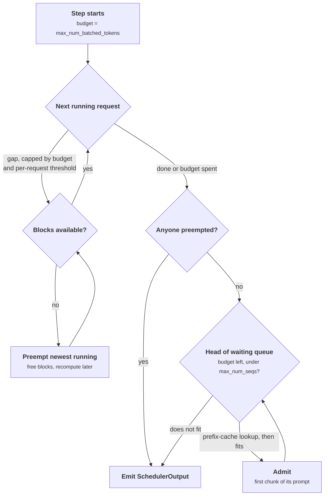
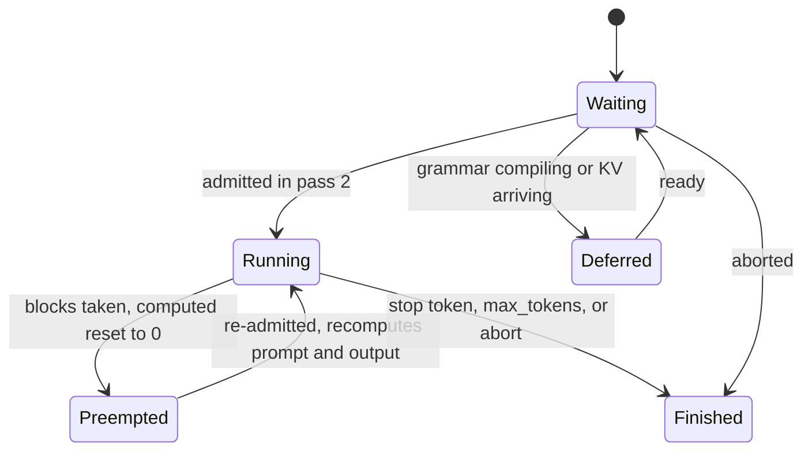

+++
title = 'The scheduler'
description = 'The vLLM V1 scheduler has no prefill or decode phase. Each step it closes the gap between the tokens each request has and the tokens the GPU has computed, under a token budget, a sequence cap, and the KV block pool, preempting by recomputation when memory runs out.'
question = 'How does vLLM decide, every step, which tokens of which requests the GPU processes?'
weight = 2
difficulty = 4
prerequisites = ['/notes/inference-engineering/vllm-internals/01-the-request-path']
date = 2026-10-30T05:10:00Z
lastmod = 2026-10-30T05:10:00Z
verified = 2026-10-30
+++

## The idea in one minute

Every request carries two counters: how many tokens it has (prompt plus
output so far) and how many of those have had their KV computed. The
scheduler's only job is to close that gap, for as many requests as fit, once
per step. A fresh 3,000-token prompt has a gap of 3,000; a generating request
has a gap of 1. Chunked [prefill](/notes/inference-engineering/inference-mechanics/01-prefill-and-decode/), prefix-cache hits, and [speculative decoding](/notes/inference-engineering/making-it-cheaper/02-speculative-decoding/)
are the same operation with different gap sizes. A comment at the top of
vLLM's `schedule()` says this directly: there is no prefill phase and no
decode phase.

Three limits bound a step: `max_num_batched_tokens` (the token budget),
`max_num_seqs` (running requests), and free KV blocks. Running requests are
served first, in admission order; waiting requests are admitted only with what
is left. When a running request cannot get a block, the most recently
admitted request is preempted and later recomputed from scratch. The
consequence to act on: **the token budget trades smooth streaming for
prefill speed, and steady preemption means you are admitting more than your
memory can carry**.

## A picture



## How it really works

As of October 2026 (vLLM v0.30 line). Flag names below are stable; defaults
shift between releases, so confirm them with `vllm serve --help`.

### The gap

```text
gap = num_tokens_with_spec + num_output_placeholders − num_computed_tokens
```

`num_tokens_with_spec` is prompt plus output plus any speculative draft
tokens. `num_output_placeholders` is zero unless async scheduling is on
(below). Each step, a request is given `min(gap, remaining budget)` tokens,
and possibly less if a per-request cap applies. When `num_computed_tokens`
catches up with the tokens the request has, the step samples a new token for
it, which reopens a gap of one.

`num_computed_tokens` advances **when the work is scheduled**, not when it
finishes. That is what lets the next `schedule()` call run before the GPU
returns.

### Pass 1: running requests

The scheduler walks `running` in admission order, giving each its gap capped
by the budget. Decoders need one token each, so even hundreds of them take a
small share of the budget, and a prefilling request receives what remains.
That is what "decode is prioritized" means in vLLM: not a rule about phases,
but arithmetic plus ordering. A newly arrived 50,000-token prompt cannot
stall anyone's generation, because everyone already running takes their share
first.

For each request the scheduler asks the KV cache manager for blocks to hold
the new tokens. A decoding request needs a new 16-token block once every 16
steps, so most calls cost nothing. If the pool is empty, the scheduler
**preempts**: it removes the most recently admitted running request (under the
default FCFS policy), frees all of its blocks, resets its computed count to
zero, and puts it at the front of the waiting queue. It repeats until the
allocation succeeds or the request it is serving is itself the victim.

### Preemption is recomputation

V1 has no swap to CPU memory. A preempted request loses all its KV and, when
re-admitted, must prefill its prompt **and every token it already
generated**. The output is kept, so nothing is sampled twice; the client sees
a pause, then the stream continues.

The [prefix cache](/notes/inference-engineering/making-it-cheaper/03-prefix-caching/) softens this. Freed full blocks keep their hashes and sit at
the back of the free queue, so a request re-admitted soon may find most of
its blocks still cached. Under the sustained pressure that caused the
preemption, though, other requests are usually consuming exactly those blocks.

If anything was preempted in pass 1, pass 2 is skipped: the scheduler does not
evict one request and admit another in the same step.

### Pass 2: waiting requests

With budget left and fewer than `max_num_seqs` running, the scheduler looks at
the head of the waiting queue:

1. Requests that are not ready (grammar still compiling, KV still arriving
   from another machine, adapter slots full) are **skipped** and put back in
   order, so they do not block the requests behind them.
2. A request that has computed nothing yet gets one **prefix-cache lookup**.
   If 2,048 tokens of a 2,100-token prompt are cached, it starts with 2,048
   computed and only 52 are charged to this step.
3. If its next chunk does not fit in free blocks, **admission stops**. The
   scheduler does not search further down the queue for a smaller request.
   That head-of-line blocking is deliberate: letting small requests overtake
   a large one would starve the large one as long as small ones keep coming.

A prompt larger than the remaining budget gets what is left and continues in
later steps from pass 1. That is [chunked prefill](/notes/inference-engineering/batching-and-scheduling/03-chunked-prefill-and-priority/), and it needs no code of its
own.

### The token budget: smoothness against prefill speed

A step's duration grows with the prefill tokens it carries. Model it as
`step ≈ d + p × c`, with `d` the decode-only step time, `p` the cost per
prefill token, and `c` the prefill tokens in the step. With `d ≈ 11 ms` and
`p = 20 ms` per 1,000 tokens, a 32,000-token prompt arriving while 48 chats
generate gives:

| Budget | Longest step while it prefills | Its time to first token |
| --- | --- | --- |
| 2,048 | about 51 ms | 0.82 s |
| 8,192 | about 174 ms | 0.71 s |
| 32,768 | about 665 ms | 0.67 s |

The long prompt's time to first token barely improves, because its total
prefill work is fixed. Every other stream's inter-token latency scales with
the budget. vLLM's documentation states the same tradeoff: smaller budgets
give better inter-token latency, larger ones better time to first token and
throughput.

To size it, work back from the step time you can tolerate:

```text
budget ≈ (T − d) / p = (80 ms − 11 ms) / (0.02 ms per token) ≈ 3,450 tokens
```

The server default depends on the GPU: as of late 2025, `vllm serve` used
8,192 on GPUs with 70 GiB or more other than the A100, and 2,048 elsewhere,
with larger values for the offline `LLM` class. Benchmarking with the `LLM`
class and deploying with `vllm serve` therefore measures two configurations.

### A cap per request

The budget is shared by every prefilling request in the step, so one huge
prompt arriving first takes nearly all of it for many steps, and short
prompts behind it wait. `--long-prefill-token-threshold N` caps any one
request's share of a step at N tokens (it is not applied when only one
request is eligible). With a budget of 8,192 and a threshold of 2,048, the
short prompts in the program below get their first token in 133 ms instead of
776 ms, at the cost of the long prompt finishing its prefill later.

### Priority

`--scheduling-policy priority` replaces the waiting deque with a heap ordered
by `(priority, arrival time)`; a **lower value runs first**. Priority affects
two decisions only: which waiting request is admitted next, and which running
request is preempted (the one with the largest priority value, latest
arrival first). It does not let a waiting request evict a running one on
arrival, and it does not reorder the budget among running requests. vLLM does
not authenticate who may claim which priority; a [gateway](/notes/systems-design/building-blocks/01-gateways-and-routers/) must set it.

### Async scheduling: planning before the token exists

With async scheduling (on by default for common configurations in recent
releases), step N+1 is scheduled while step N runs. A generating request then
has a gap of zero: its last token has not been sampled yet. The scheduler
adds a **placeholder** for each token a scheduled step will produce, so the
gap formula sees one token to schedule. The worker, which holds the sampled
token on the GPU, writes it into the next step's input itself; the token ID
never makes the round trip through the scheduler first.

The costs are small and specific. A request that hits end-of-sequence has
already been scheduled for one more step, which computes a wasted token.
Blocks of finished requests must not be reused until in-flight steps that
might write them complete. And structured output cannot sample ahead, because
the grammar needs the previous token: the forward pass still overlaps, but
sampling waits.



## Code

The program implements the rules above with a 16-token block pool and an
assumed step-time model (8 ms fixed, 0.06 ms per sequence, 20 ms per 1,000
prefill tokens). Experiment A sends a long prompt into 48 generating chats;
experiment B squeezes 32 growing requests into a small KV pool.

```python {title="scheduler_sim.py"}
"""scheduler_sim.py: a V1-style token-budget scheduler, reduced to its rules.

Rules modeled on vLLM's V1 scheduler: every request has a gap between tokens
it has and tokens computed; running requests are served first in admission
order, then waiting requests FCFS; a per-step token budget and a sequence cap
bound the step; KV memory comes in 16-token blocks; when a running request
cannot get a block, the most recently admitted request is preempted and later
recomputed from scratch. The step-time model is an assumption (fixed cost plus
per-sequence plus per-prefill-token cost), not a measurement.
Standard library only; runs offline.
"""

from __future__ import annotations

from dataclasses import dataclass, field

BLOCK = 16


@dataclass
class Req:
    rid: str
    prompt: int
    max_out: int
    arrival: float
    out: int = 0
    computed: int = 0
    blocks: int = 0
    times: list[float] = field(default_factory=list)   # wall time of each output token

    @property
    def total(self) -> int:
        return self.prompt + self.out


@dataclass
class Config:
    budget: int = 2048            # max_num_batched_tokens
    max_seqs: int = 256           # max_num_seqs
    threshold: int = 0            # long_prefill_token_threshold (0 = off)
    kv_blocks: int = 100_000


def step_ms(n_seqs: int, prefill_tokens: int) -> float:
    return 8.0 + 0.06 * n_seqs + 0.020 * prefill_tokens   # 20 ms per 1,000 prefill tokens


def run(cfg: Config, arrivals: list[Req], until_done: bool = True):
    waiting: list[Req] = []
    running: list[Req] = []
    free = cfg.kv_blocks
    now, pending = 0.0, sorted(arrivals, key=lambda r: r.arrival)
    preemptions = recomputed = 0
    done: list[Req] = []
    while pending or waiting or running:
        while pending and pending[0].arrival <= now:
            waiting.append(pending.pop(0))
        if not waiting and not running:
            now = pending[0].arrival
            continue
        budget, plan, preempted = cfg.budget, [], False
        eligible = len(running) + len(waiting)
        thr = cfg.threshold if eligible > 1 else 0

        def size(r: Req) -> int:
            n = r.total - r.computed
            if 0 < thr < n:
                n = thr
            return min(n, budget)

        i = 0
        while i < len(running) and budget > 0:            # pass 1: running
            r = running[i]
            n = size(r)
            need = -(-(r.computed + n) // BLOCK) - r.blocks
            while need > free:                              # preempt newest
                victim = running.pop()
                free += victim.blocks
                recomputed += victim.computed
                victim.blocks = victim.computed = 0
                waiting.insert(0, victim)
                preemptions += 1
                preempted = True
                if victim is r:
                    break
            if r not in running:
                break
            free -= need
            r.blocks += need
            plan.append((r, n))
            budget -= n
            i += 1
        while not preempted and waiting and budget > 0 and len(running) < cfg.max_seqs:
            r = waiting[0]                                   # pass 2: waiting, FCFS
            n = size(r)
            need = -(-(r.computed + n) // BLOCK) - r.blocks
            if need > free:
                break                                        # head-of-line: stop admitting
            waiting.pop(0)
            running.append(r)
            free -= need
            r.blocks += need
            plan.append((r, n))
            budget -= n
        decode = sum(1 for r, n in plan if r.computed + n == r.total and n == 1)
        now += step_ms(len(plan), sum(n for _, n in plan) - decode)
        for r, n in plan:
            r.computed += n
            if r.computed == r.total:                        # caught up: sample a token
                r.out += 1
                r.times.append(now)
                if r.out == r.max_out:
                    running.remove(r)
                    free += r.blocks
                    done.append(r)
    return done, preemptions, recomputed, now


def itl(reqs: list[Req]) -> list[float]:
    return sorted(b - a for r in reqs for a, b in zip(r.times, r.times[1:]))


def pct(xs: list[float], p: float) -> float:
    return xs[min(len(xs) - 1, int(p * len(xs)))]


def long_prompt_experiment() -> None:
    print("A. 48 chats decoding; at t=3 s a 32,000-token prompt, then 6 short prompts, arrive")
    print(f"{'budget':>7} {'threshold':>9} {'long TTFT':>10} {'short TTFT':>11} "
          f"{'decode ITL p50':>15} {'p99':>6} {'max':>6}")
    for budget, thr in [(2048, 0), (8192, 0), (32768, 0), (8192, 2048)]:
        reqs = [Req(f"c{i}", 1000, 250, 0.0) for i in range(48)]
        long = Req("long", 32_000, 20, 3000.0)
        shorts = [Req(f"s{i}", 600, 20, 3001.0) for i in range(6)]
        done, *_ = run(Config(budget=budget, threshold=thr), reqs + [long] + shorts)
        chats = [r for r in done if r.rid.startswith("c")]
        lat = itl(chats)  # all decode gaps of the 48 chats
        short_ttft = sum(s.times[0] - s.arrival for s in shorts) / len(shorts)
        print(f"{budget:>7} {thr:>9} {long.times[0] - long.arrival:>8.0f}ms "
              f"{short_ttft:>9.0f}ms {pct(lat, .5):>13.1f}ms {pct(lat, .99):>5.0f} {lat[-1]:>6.0f}")


def preemption_experiment() -> None:
    print("\nB. KV pool of 1,200 blocks (19,200 tokens); 32 requests, 400-token prompt, 600 out")
    print(f"{'max_num_seqs':>12} {'preemptions':>12} {'tokens recomputed':>18} "
          f"{'worst stall':>12} {'makespan':>9}")
    for seqs in (32, 24, 16):
        reqs = [Req(f"r{i}", 400, 600, 0.0) for i in range(32)]
        done, pre, recomputed, end = run(Config(budget=8192, max_seqs=seqs, kv_blocks=1200), reqs)
        print(f"{seqs:>12} {pre:>12} {recomputed:>18,} {itl(done)[-1]:>10.0f}ms {end / 1000:>8.1f}s")


if __name__ == "__main__":
    long_prompt_experiment()
    preemption_experiment()
```

Run it with `python3 scheduler_sim.py`:

```text
A. 48 chats decoding; at t=3 s a 32,000-token prompt, then 6 short prompts, arrive
 budget threshold  long TTFT  short TTFT  decode ITL p50    p99    max
   2048         0      821ms       893ms          10.9ms    51     51
   8192         0      705ms       776ms          10.9ms   174    174
  32768         0      670ms       726ms          10.9ms    69    665
   8192      2048      902ms       133ms          10.9ms   153    174

B. KV pool of 1,200 blocks (19,200 tokens); 32 requests, 400-token prompt, 600 out
max_num_seqs  preemptions  tokens recomputed  worst stall  makespan
          32           13              9,734       4055ms      9.7s
          24            5              4,364       2001ms     11.1s
          16            0                  0          9ms     11.0s
```

In A, the budget sets the freeze every chat sees (51, 174, 665 ms) while the
long prompt's own time to first token moves by 150 ms. Without a threshold,
the short prompts wait behind the long one; with a 2,048-token threshold they
start in 133 ms. In B, 32 concurrent requests finish soonest overall but one
of them stalls for 4 seconds while it is recomputed; capping concurrency at 16
removes preemption at the cost of 13% more total time.

## Where it breaks

- **The step model is linear.** Real attention cost grows with context
  length, and the GPU's efficiency changes with batch shape. Measure `d` and
  `p` on your hardware before trusting any budget calculation.
- **FCFS admission is head-of-line blocking.** One huge waiting request that
  does not fit stops all admission behind it until memory frees. That
  protects it from starvation and costs everyone else latency.
- **Priority is not preemption on arrival.** A burst of high-priority
  requests still waits for memory to free naturally.
- **Recompute grows with output length.** A request preempted after 4,000
  generated tokens recomputes 4,000 tokens plus its prompt. Long-output
  workloads near memory limits suffer most.
- **Newer releases add admission controls** (for example reserving blocks
  for a request's whole prompt before admitting it, or a free-block
  watermark). They reduce thrashing; they cannot know output lengths in
  advance.

## Remember this

- No phases: each request has a gap between tokens it has and tokens computed, and the scheduler closes gaps under a budget.
- Running requests first, in admission order; waiting requests get what is left.
- The token budget trades inter-token latency against time to first token; size it from a tolerable step time.
- `--long-prefill-token-threshold` stops one long prompt from monopolizing the budget.
- Preemption frees everything and recomputes later; a steady rate means over-admission.
- Async scheduling uses placeholders so step N+1 can be planned before step N's tokens exist.

## Try it

1. Run `scheduler_sim.py`. Add a row with budget 4,096 and threshold 1,024.
   Where does it fall between the others?
2. In experiment B, change preemption to evict the request with the fewest
   computed tokens instead of the newest. Do recomputed tokens go down?
3. Add priority: give the short prompts in A priority 0 and everything else
   priority 1, and order the waiting queue by it. Compare with the threshold.
4. On a real vLLM server, send a 30,000-token prompt during a steady chat
   load at two `--max-num-batched-tokens` values and plot p99 inter-token
   latency of the chats.

## Check yourself

1. What does it mean that the scheduler has no prefill or decode phase?

   
   Each request is described only by the gap between its tokens and its
   computed tokens. A new prompt has a large gap, a generating request a gap
   of one, and a cache hit or speculative draft just changes the gap. The
   same per-step rule handles all of them.
   

2. Why do decoding requests rarely starve even though prefill and decode share the budget?

   
   Running requests are served first, and each decoding request needs only
   one token. Hundreds of them use a small part of the budget, and prefilling
   requests get what remains. `max_num_seqs` is also kept at or below the
   budget so that decoders always fit.
   

3. A running request needs a block and none is free. What happens under the default policy?

   
   The most recently admitted running request is preempted: its blocks are
   freed, its computed count is reset to zero, and it goes to the front of
   the waiting queue. This repeats until the allocation succeeds. Admission of
   new requests is skipped for that step.
   

4. Raising the token budget from 2,048 to 32,768 barely improves the long prompt's time to first token. Why?

   
   The total prefill work for the prompt is the same; a larger budget only
   saves the fixed per-step overhead across fewer chunks. Meanwhile every
   step that carries a large chunk is longer, so every other stream's
   inter-token latency rises in proportion.
   

5. Why does async scheduling need placeholders?

   
   Step N+1 is scheduled before step N has sampled its token, so a
   generating request appears to have nothing left to compute. A placeholder
   counts the token step N will produce, so the scheduler reserves its
   position and KV slot; the worker fills in the real token ID on the GPU.
   

## Sources

- vLLM source, [vllm/v1/core/sched/scheduler.py](https://github.com/vllm-project/vllm/blob/main/vllm/v1/core/sched/scheduler.py), main branch, accessed October 2026.
- vLLM documentation, [Optimization and tuning](https://docs.vllm.ai/en/latest/configuration/optimization.html) (chunked prefill and preemption), accessed October 2026.
- A. Agrawal et al., [Taming Throughput-Latency Tradeoff in LLM Inference with Sarathi-Serve](https://arxiv.org/abs/2403.02310), USENIX OSDI, 2024.
- G.-I. Yu et al., [Orca: A Distributed Serving System for Transformer-Based Generative Models](https://www.usenix.org/conference/osdi22/presentation/yu), USENIX OSDI, 2022.
- W. Kwon et al., [Efficient Memory Management for Large Language Model Serving with PagedAttention](https://arxiv.org/abs/2309.06180), ACM SOSP, 2023 (section 4.5, recomputation and swapping).
