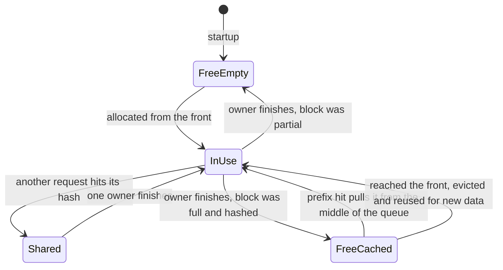

+++
title = 'The KV cache manager'
description = 'vLLM allocates all KV memory once at startup and cuts it into fixed blocks. Serving is then bookkeeping on block IDs: a free queue whose order is the eviction policy, reference counts for shared prefixes, and chained hashes that make prefix caching a dictionary lookup.'
question = 'How does vLLM hand out KV cache memory, share it between requests, and decide what to evict?'
weight = 3
difficulty = 4
prerequisites = ['/notes/inference-engineering/vllm-internals/02-the-scheduler']
date = 2026-10-30T05:15:00Z
lastmod = 2026-10-30T05:15:00Z
verified = 2026-10-30
+++

## The idea in one minute

At startup each vLLM worker measures how much GPU memory is left after the
weights, peak activations, and CUDA graphs, allocates that as one KV tensor
per layer, and cuts it into **blocks** of 16 tokens. From then on no KV memory
is allocated or freed while serving. The engine core's KV cache manager only
moves block IDs between three places: a **free queue**, the **block tables**
of running requests, and a **hash map** of full blocks whose contents are
worth keeping.

Every full block gets a hash that covers its tokens and the hash of the block
before it, so one hash identifies an entire prefix. A new request's prompt is
hashed block by block and looked up; every hit is a block of [prefill](/notes/inference-engineering/inference-mechanics/01-prefill-and-decode/) that
does not run. Freed blocks keep their hash until the moment they are reused,
and the free queue's order decides which goes first. The consequence to act
on: **the cache's capacity line at startup is the server's capacity, prefix
caching is nearly free and on by default, and cache sharing across tenants is
a side channel you must close with a cache salt**.

## A picture

```mermaid {title="Chained block hashes, shared blocks, and the free queue"}
flowchart LR
  subgraph A["Request A block table"]
    A1["<b>block 1</b><br/><small>system 0-15, h1</small>"] --> A2["<b>block 2</b><br/><small>system 16-31, h2</small>"] --> A3["<b>block 4</b><br/><small>A's question, h3a</small>"]
  end
  subgraph B["Request B block table"]
    B1["<b>block 1</b><br/><small>ref 2, hit</small>"] --> B2["<b>block 2</b><br/><small>ref 2, hit</small>"] --> B3["<b>block 6</b><br/><small>B's question</small>"]
  end
  H[("<b>Hash map</b><br/><small>h1 to 1, h2 to 2, h3a to 4</small>")]
  F[["<b>Free queue</b><br/><small>front reused first: uncached, then oldest cached</small>"]]
  H -.->|"lookup on admission"| B1
  F -->|"allocate from front"| B3
  class A1,A2,A3,B1,B2,B3,H memory
  class F queue
```

## How it really works

As of October 2026 (vLLM v0.30 line).

### Blocks and the pool

A block holds the keys and values of `block_size` consecutive tokens, 16 by
default, for every layer. Physically it is a slice of the per-layer KV
tensors on the GPU; in the engine core it is a small Python object with an
ID, a reference count, an optional hash, and links for the free queue. The
engine core never touches GPU memory. It does arithmetic on IDs and sends
block tables to the workers, which is why the scheduler can run in a
different process from the GPU code.

All block objects are created once, so a block ID is also a list index. One
block is reserved as a **null block**, a placeholder for positions that need
no memory (for example tokens that have slid out of a sliding-window layer's
view).

### Reference counts

| Reference count | Where the block is | Meaning |
| --- | --- | --- |
| 0 | In the free queue | Available, possibly still holding valid hashed data |
| 1 | In one block table | Owned by one request |
| 2 or more | In several block tables | A shared prefix: read by all, written by none |

A shared block is never written. It became shareable only because it was full
and its contents final; each request writes its own new tokens into blocks it
owns alone. That is why vLLM V1 does not need copy-on-write for prefix
sharing.

### The free queue is the eviction policy

The free queue must support taking from the front, adding at either end, and
**removing from the middle** when a cached free block gets a hit. A Python
`deque` cannot remove from the middle in constant time, so vLLM threads a
doubly linked list through the block objects themselves.

When a request finishes, its blocks are released **tail first**:

- Blocks with no hash (partial blocks, or caching disabled) go to the
  **front**: nothing is lost by reusing them immediately.
- Hashed blocks go to the **back**, in reverse order, so a request's last
  blocks are evicted before its first ones. The first blocks are the shared
  system prompt that the next request most likely wants.

Allocation takes from the front. If the block taken still has a hash, this
is the moment it is evicted: its hash is removed from the map. Eviction is
**lazy**; nothing is discarded ahead of time.



### Chained hashes

A block's hash is computed from the hash of the previous block, the block's
token IDs, and **extra keys** that change what the KV means: the LoRA adapter,
hashes of multimodal inputs whose placeholder tokens fall in the block, and
the request's **cache salt** if it has one. Because each hash includes its
parent, equal hashes mean equal prefixes from the first token. Lookup walks
the prompt's hashes from the start and stops at the first miss; a later block
cannot hit if an earlier one missed.

Only full blocks are hashed and cached. A 1,000-token prompt has 62 full
blocks; its last 8 tokens are always computed. And if a whole prompt hits,
the last block is recomputed anyway, because the model must run on at least
the final prompt token to produce logits for the first output token.

The prompt's hashes are computed once, by the engine core's input thread when
the request arrives, overlapping with the forward pass in progress.

### Allocating slots

Each step the scheduler asks the manager for room for a request's new tokens.
The manager:

1. frees blocks the request no longer needs (sliding-window layers),
2. computes how many new blocks the new tokens require,
3. returns `None` if the free queue cannot supply them (the scheduler then
   preempts or stops admitting),
4. otherwise takes blocks from the front of the free queue and appends them
   to the request's block table,
5. hashes any block that became full and records it in the map.

A decoding request crosses a block boundary once every 16 steps, so most
calls allocate nothing.

### Sizing the pool

At startup each worker loads the weights, runs one forward pass with dummy
inputs of the largest batch the scheduler will send (`max_num_batched_tokens`
tokens), and measures peak memory. The KV budget is:

```text
KV budget = total GPU memory × gpu_memory_utilization
          − weights − peak activations − non-PyTorch memory (CUDA context, NCCL buffers)
          − estimated CUDA graph memory
```

`--gpu-memory-utilization` (about 0.9 by default) is a fraction of total memory
for this vLLM instance. Two instances on one GPU must split it. A larger
`max_num_batched_tokens` raises peak activations and so shrinks the cache.

The block size in bytes, for Llama 3.1 8B (32 layers, 8 KV heads, head
dimension 128, BF16):

```text
per layer per block = 8 heads × 16 tokens × (128 + 128) × 2 bytes = 65,536 B
per block           = 32 layers × 65,536 B                         = 2 MiB
per token           = 2 MiB / 16                                    = 128 KiB
```

With 40 GiB of budget that is 20,480 blocks, or 327,680 tokens. vLLM logs
the result as the [KV cache size](/notes/inference-engineering/inference-mechanics/02-kv-cache-math/) in tokens and a "maximum concurrency" for
requests of `max_model_len` tokens. The token figure is the real capacity;
the concurrency figure assumes every request uses the whole context window.
Use `num_key_value_heads` from the model config, not the attention head
count: grouped-query attention makes the cache four to eight times smaller
than the head count suggests. [Tensor parallelism](/notes/inference-engineering/distributed-inference/01-tensor-pipeline-and-expert-parallelism/) splits KV heads across GPUs,
so per-GPU bytes per token divide by the TP size. `--kv-cache-dtype fp8`
halves bytes per token on hardware and attention backends that support it.

### More than one kind of layer

Models that mix full attention with sliding-window attention, or attention
with state-space (Mamba-style) layers, do not need the same memory per token
in every layer. V1's KV cache manager groups layers by their cache
requirements and manages each group with its own rules, sharing one pool.
Sliding-window groups free blocks that fall out of the window; full-attention
groups keep everything. [Prefix caching](/notes/inference-engineering/making-it-cheaper/03-prefix-caching/) then needs a hit in every group, which
is why hit rates on hybrid models can be lower than on pure attention models.

### Prefix caching across tenants

Automatic prefix caching is on by default in V1, and its cost is small: a
few hashes per request and dictionary lookups. Its risk is that the cache is
shared by every request on the replica. A request whose prefix hits returns
its first token faster, and that timing difference reveals that someone else
recently sent the same prefix. With a guessed document or system prompt, an
attacker can test guesses. Setting a per-tenant `cache_salt` on requests
puts the salt into the first block's hash, so tenants never share entries.
Earlier versions also used a non-cryptographic hash for block keys; a 2025
advisory (CVE-2025-25183) showed crafted prompts could collide, and vLLM
added SHA-256 hashing options. Use a cryptographic hash and salts wherever
tenants do not trust each other.

## Code

The program implements the pool with 4-token blocks so traces stay short: the
linked free queue, reference counts, tail-first release, lazy eviction,
chained SHA-256 hashes with an extra key, and the rule that a full hit
recomputes its last block.

```python {title="block_pool.py"}
"""block_pool.py: a KV block pool with prefix caching, in the style of vLLM V1.

Fixed blocks allocated once; a doubly linked free queue whose order is the
eviction order; reference counts; chained block hashes that include extra
keys (an adapter ID or a per-tenant cache salt); lazy eviction at reuse.
Block contents are not modeled, only bookkeeping. Standard library only.
"""

from __future__ import annotations

import hashlib
from dataclasses import dataclass

BLOCK = 4   # tokens per block; vLLM's default is 16, small here so traces stay short


@dataclass(eq=False)
class Block:
    bid: int
    ref: int = 0
    hash: bytes | None = None
    prev: "Block | None" = None
    next: "Block | None" = None


class FreeQueue:
    """Doubly linked list through the blocks themselves: O(1) remove from middle."""

    def __init__(self, blocks: list[Block]) -> None:
        self.head, self.tail = Block(-1), Block(-1)
        self.head.next, self.tail.prev = self.tail, self.head
        self.n = 0
        for b in blocks:
            self.append(b)

    def _link(self, b: Block, before: Block) -> None:
        b.prev, b.next = before.prev, before
        before.prev.next = b
        before.prev = b
        self.n += 1

    def append(self, b: Block) -> None:
        self._link(b, self.tail)

    def prepend(self, b: Block) -> None:
        self._link(b, self.head.next)

    def remove(self, b: Block) -> None:
        b.prev.next, b.next.prev = b.next, b.prev
        b.prev = b.next = None
        self.n -= 1

    def popleft(self) -> Block:
        b = self.head.next
        self.remove(b)
        return b

    def ids(self) -> list[int]:
        out, b = [], self.head.next
        while b is not self.tail:
            out.append(b.bid)
            b = b.next
        return out


class BlockPool:
    def __init__(self, n: int) -> None:
        self.blocks = [Block(i) for i in range(n)]
        self.free = FreeQueue(self.blocks[1:])    # block 0 is the reserved null block
        self.cached: dict[bytes, Block] = {}

    def allocate(self, k: int) -> list[Block]:
        if k > self.free.n:
            raise MemoryError("no free blocks")
        out = []
        for _ in range(k):
            b = self.free.popleft()
            if b.hash is not None:                # lazy eviction happens only here
                print(f"    evict block {b.bid} (was cached)")
                del self.cached[b.hash]
                b.hash = None
            b.ref = 1
            out.append(b)
        return out

    def touch(self, blocks: list[Block]) -> None:
        for b in blocks:
            if b.ref == 0:
                self.free.remove(b)               # a hit pulls it out of the middle
            b.ref += 1

    def release(self, table: list[Block]) -> None:
        for b in reversed(table):                 # tail first: evicted before the head
            b.ref -= 1
            if b.ref == 0:
                if b.hash is None:
                    self.free.prepend(b)          # nothing worth keeping: reuse first
                else:
                    self.free.append(b)           # cached: reuse last (LRU)


def block_hashes(tokens: list[int], extra: str = "") -> list[bytes]:
    out, parent = [], b"seed"
    for i in range(0, len(tokens) - BLOCK + 1, BLOCK):
        h = hashlib.sha256(parent + repr((tokens[i:i + BLOCK], extra)).encode()).digest()
        out.append(h)
        parent = h
    return out


class Manager:
    def __init__(self, pool: BlockPool) -> None:
        self.pool = pool
        self.tables: dict[str, list[Block]] = {}

    def admit(self, rid: str, tokens: list[int], extra: str = "") -> None:
        hashes = block_hashes(tokens, extra)
        hits: list[Block] = []
        for h in hashes:
            b = self.pool.cached.get(h)
            if b is None:
                break
            hits.append(b)
        # Need logits for the last prompt token, so a full hit recomputes one block.
        if hits and len(hits) * BLOCK == len(tokens):
            hits.pop()
        self.pool.touch(hits)
        need = -(-len(tokens) // BLOCK) - len(hits)
        new = self.pool.allocate(need)
        table = hits + new
        for b, h in zip(table, hashes):           # cache every full block
            if b.hash is None and h not in self.pool.cached:
                b.hash = h
                self.pool.cached[h] = b
        self.tables[rid] = table
        print(f"  {rid}: {len(tokens)} tokens, hit {len(hits) * BLOCK}, "
              f"computed {len(tokens) - len(hits) * BLOCK}, table {[b.bid for b in table]}")

    def finish(self, rid: str) -> None:
        self.pool.release(self.tables.pop(rid))


def main() -> None:
    pool = BlockPool(12)                          # 11 usable blocks of 4 tokens
    m = Manager(pool)
    system = list(range(100, 112))                # 12-token shared system prompt
    print("1. A arrives; B shares the system prompt while A is still running")
    m.admit("A", system + [1, 2, 3, 4, 5])
    m.admit("B", system + [7, 8, 9, 10])
    print("   ref counts:", {b.bid: b.ref for b in pool.blocks[1:7]})
    print("2. both finish; free queue order (front is reused first):")
    m.finish("A")
    m.finish("B")
    print("  ", pool.free.ids())
    print("3. tenant T2 sends the same prompt with a different cache salt")
    m.admit("C", system + [7, 8, 9, 10], extra="salt:T2")
    print("4. D repeats B's exact prompt with B's salt")
    m.admit("D", system + [7, 8, 9, 10])
    print("   free queue:", pool.free.ids())
    print("5. E needs 3 new blocks while C and D run: cached blocks go oldest-first")
    m.admit("E", list(range(500, 512)))


if __name__ == "__main__":
    main()
```

Run it with `python3 block_pool.py`:

```text
1. A arrives; B shares the system prompt while A is still running
  A: 17 tokens, hit 0, computed 17, table [1, 2, 3, 4, 5]
  B: 16 tokens, hit 12, computed 4, table [1, 2, 3, 6]
   ref counts: {1: 2, 2: 2, 3: 2, 4: 1, 5: 1, 6: 1}
2. both finish; free queue order (front is reused first):
   [5, 7, 8, 9, 10, 11, 4, 6, 3, 2, 1]
3. tenant T2 sends the same prompt with a different cache salt
  C: 16 tokens, hit 0, computed 16, table [5, 7, 8, 9]
4. D repeats B's exact prompt with B's salt
  D: 16 tokens, hit 12, computed 4, table [1, 2, 3, 10]
   free queue: [11, 4, 6]
5. E needs 3 new blocks while C and D run: cached blocks go oldest-first
    evict block 4 (was cached)
    evict block 6 (was cached)
  E: 12 tokens, hit 0, computed 12, table [11, 4, 6]
```

Step 2 shows the policy: A's partial block 5 goes to the front, cached blocks
to the back with each request's tail ahead of its head, so the shared system
prompt (blocks 3, 2, 1) is evicted last. Step 3 shows the salt: identical
tokens, no hit. Step 4 shows the full-hit rule: all 16 tokens are cached but
the last block is recomputed. Step 5 evicts the oldest cached blocks only when
it needs their memory.

## Where it breaks

- **Cached blocks are not reserved capacity.** They live in the same pool as
  running requests and are the first thing consumed under load, so hit rates
  fall exactly when the server is busiest.
- **Partial blocks never hit.** Prompts that differ in the first few tokens,
  such as a timestamp at the top of a system prompt, miss everything. Put
  stable content first and variable content last.
- **The budget is fixed at startup.** Another process growing on the GPU
  later, or a workspace reaching a new peak, causes out-of-memory errors the
  manager did not plan for.
- **Isolation needs configuration.** Without cache salts, prefix caching is a
  cross-tenant timing channel. Salting per tenant removes cross-tenant reuse
  and its savings.
- **The program models bookkeeping only.** It does not model block contents,
  hybrid layer groups, or offloading to CPU memory through KV connectors.

## Remember this

- KV memory is allocated once at startup and cut into 16-token blocks; serving moves block IDs.
- The free queue's order is the eviction policy: uncached first, then oldest cached, tails before heads.
- Shared blocks are full and read-only; reference counts track owners.
- Chained hashes make one hash identify a whole prefix; LoRA, media, and cache salt are part of the key.
- Capacity in tokens is the startup log's number; size it with KV heads, not attention heads.
- Prefix caching across tenants is a timing side channel; salt it.

## Try it

1. Run `block_pool.py`. Change `release` to free blocks head first. Rerun
   step 5: which blocks are evicted now, and why is that worse?
2. Add a timestamp token at the start of the system prompt for each request.
   How many hits remain?
3. Compute the KV capacity in tokens for a model with 64 layers, 8 KV heads,
   head dimension 128, on one 80 GB GPU with 20 GB of weights, FP8 KV cache,
   and `gpu_memory_utilization` 0.9 (assume 4 GB of other overhead).
4. Start vLLM with a small model, read the KV cache size line, then restart
   with double `--max-num-batched-tokens`. How much did the cache shrink?

## Check yourself

1. Why does vLLM link the free queue through the block objects instead of using a deque?

   
   A prefix hit on a free cached block must remove it from the middle of the
   queue. A deque cannot do that in constant time; a doubly linked list
   threaded through the blocks can, without allocating Python objects.
   

2. Why are a finished request's blocks released tail first?

   
   Released cached blocks go to the back of the queue in that order, so the
   request's last blocks sit ahead of its first ones and are evicted earlier.
   The first blocks hold the shared prefix, which later requests are most
   likely to reuse.
   

3. A prompt is entirely in the cache. How many tokens are computed?

   
   At least one block's worth. The model must process at least the last
   prompt token to produce logits for the first output token, so the last
   block is treated as a miss and recomputed.
   

4. What goes into a block's hash, and why the previous block's hash?

   
   The previous block's hash, the block's token IDs, and extra keys such as
   the LoRA adapter, multimodal input hashes, and the cache salt. Including
   the parent makes the hash identify the entire prefix, so equal hashes mean
   equal KV, and lookup can stop at the first miss.
   

5. Why can prefix caching leak information between tenants, and how is it closed?

   
   A cache hit makes the first token arrive faster, which tells the sender
   that someone recently sent the same prefix. An attacker can test guesses
   about other tenants' prompts. A per-tenant cache salt in the hash prevents
   cross-tenant hits; a cryptographic hash prevents crafted collisions.
   

## Sources

- W. Kwon et al., [Efficient Memory Management for Large Language Model Serving with PagedAttention](https://arxiv.org/abs/2309.06180), ACM SOSP, 2023.
- vLLM documentation, [Automatic prefix caching](https://docs.vllm.ai/en/latest/design/prefix_caching.html), accessed October 2026.
- vLLM source, [vllm/v1/core](https://github.com/vllm-project/vllm/tree/main/vllm/v1/core) (KV cache manager, block pool, block hashing), main branch, accessed October 2026.
- NIST NVD, [CVE-2025-25183](https://nvd.nist.gov/vuln/detail/CVE-2025-25183), February 2025.
- A. Grattafiori et al., [The Llama 3 Herd of Models](https://arxiv.org/abs/2407.21783), July 2024 (model dimensions).
- J. Ainslie, J. Lee-Thorp, M. de Jong, Y. Zemlyanskiy, F. Lebrón, S. Sanghai, [GQA: Training Generalized Multi-Query Transformer Models from Multi-Head Checkpoints](https://arxiv.org/abs/2305.13245), EMNLP, 2023.
