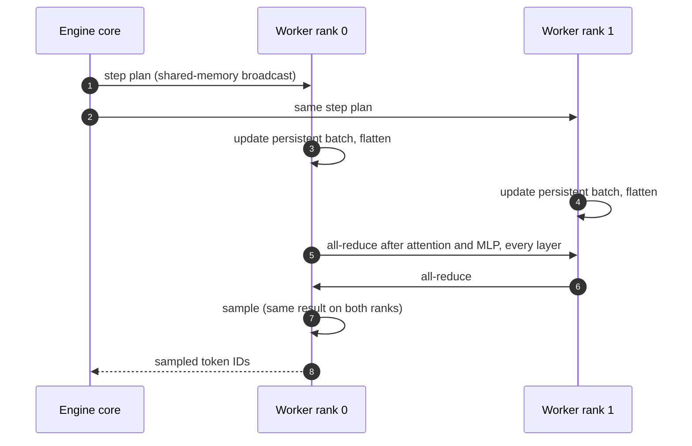

+++
title = 'Model execution'
description = 'The executor fans one step plan out to every GPU, each worker keeps a persistent batch, and the model runner flattens all scheduled tokens into one sequence with offsets and slot mappings that paged-attention kernels understand. CUDA graphs and torch.compile remove the per-launch overhead that would otherwise dominate decode.'
question = 'How does a vLLM worker turn a step plan into one forward pass and one sampled token per request?'
weight = 4
difficulty = 4
prerequisites = ['/notes/inference-engineering/vllm-internals/03-the-kv-cache-manager']
date = 2026-10-30T05:20:00Z
lastmod = 2026-10-30T05:20:00Z
verified = 2026-10-30
+++

## The idea in one minute

Three layers turn the scheduler's plan into arithmetic. The **executor**
delivers the plan to every GPU that holds part of the model. The **worker**
is the process that owns one GPU: it loaded its shard of the weights and
allocated its share of the KV cache. The **model runner** inside it does the
per-step work: update a persistent batch, build flat input tensors, run the
model, and sample.

The central trick is the **flat batch**. Instead of padding every request to
the longest, the runner concatenates all scheduled tokens (a [prefill](/notes/inference-engineering/inference-mechanics/01-prefill-and-decode/) chunk of
500, a decode of 1, a cache-hit tail of 3) into one sequence, and gives the
attention kernel offsets, sequence lengths, block tables, and a slot mapping
that says where each new token's keys and values go. Everything except
attention treats the batch as one long sequence of tokens. The consequence to
act on: **the shape of a step is just its token count, which is what makes
CUDA graphs practical, and why padding, graph capture sizes, and attention
backend choice show up in latency at small batch sizes**.

## A picture

```mermaid {title="From step plan to sampled tokens inside one worker"}
flowchart LR
  P["<b>Step plan</b><br/><small>new requests in full, others as deltas</small>"] --> PB["<b>Persistent batch</b><br/><small>per-request rows, updated in place</small>"]
  PB --> FL["<b>Flatten</b><br/><small>input IDs, positions, offsets, slot mapping</small>"]
  FL --> G{"<b>Graph for this size?</b>"}
  G -->|"yes, pad to capture size"| CG["<b>Replay CUDA graph</b>"]
  G -->|"no, large prefill"| EG["<b>Run compiled code</b>"]
  CG --> AT["<b>Attention backend</b><br/><small>reads KV through block tables</small>"]
  EG --> AT
  AT --> LG["<b>Logits</b><br/><small>last token of each request only</small>"]
  LG --> SM["<b>Sampler</b><br/><small>penalties, temperature, top-k/p, grammar mask</small>"]
  SM --> OUT["<b>Token IDs</b><br/><small>to the engine core</small>"]
  class P,OUT neutral
  class PB,FL queue
  class G neutral
  class CG,EG,AT,SM compute
  class LG memory
```



## How it really works

As of October 2026 (vLLM v0.30 line). vLLM ships two model-runner
implementations side by side, the original GPU model runner and a newer
rewrite; the concepts below apply to both.

### Executor and workers

On one machine, the multiprocess executor starts one worker process per GPU
and broadcasts each step through a shared-memory queue. Across machines, a
Ray-based executor (or an external launcher) plays the same role. With tensor
parallelism every rank receives the same plan, computes its shard, joins
all-reduces inside each layer, and samples the same tokens; one rank returns
them. With pipeline parallelism, ranks hold different layers and pass
activations forward, and the engine keeps several batches in flight to fill
the pipeline.

Weights are sharded as they load: each rank reads only its slice of every
tensor from the checkpoint, so a model too large for one GPU never has to fit
on one.

### The persistent batch

Each worker keeps request state across steps in preallocated arrays: token
IDs, computed counts, block tables, and sampling parameters, one row per
running request. Each step's plan carries full data for new requests and only
changes for the rest, so the runner adds rows, removes finished ones, appends
new block IDs, and leaves everything else in place. Rebuilding the batch from
scratch every step would cost CPU time proportional to all context, not to
what changed.

### Flattening a step

For a step with three requests, the runner builds:

| Tensor | Meaning |
| --- | --- |
| `input_ids` | All scheduled tokens, concatenated |
| `positions` | Each token's position in its own sequence (for rotary embeddings) |
| `query_start_loc` | Cumulative offsets: where each request's tokens start in the flat batch |
| `seq_lens` | Each request's total context after this step |
| `block_table` | Per request, the physical block IDs of its context |
| `slot_mapping` | Per new token, the physical slot where its K and V are written: `block_id × block_size + offset` |
| `logits_indices` | The last token of each request, the only rows projected to the vocabulary |

The MLP and projection layers see a matrix with one row per token and do not
care which request a row belongs to. Attention uses `query_start_loc` and
`seq_lens` to know each request's boundaries and `block_table` to read its
cached context from scattered blocks. The KV write uses `slot_mapping`.

Only the last token of each request reaches the vocabulary projection. For a
128,000-entry vocabulary that is the difference between a 500 × 128,000 and a
1 × 128,000 matrix multiply for a 500-token prefill chunk.

### Attention backends

[Paged attention](/notes/inference-engineering/batching-and-scheduling/02-paged-kv-memory/) needs a kernel that reads keys and values through a block
table rather than from one contiguous tensor. vLLM selects a backend at
startup from the GPU, the model's attention type, the KV cache dtype, and
user settings: FlashAttention and FlashInfer on most NVIDIA GPUs, Triton-based
kernels as a portable option, dedicated kernels for multi-head latent
attention (DeepSeek-style models, whose KV cache is a compressed latent
rather than per-head keys and values), and ROCm-specific kernels on AMD. The
backends differ in which batch shapes they can run inside a CUDA graph, which
affects the graph modes available.

### torch.compile and CUDA graphs

A decode step for a large model is well over a thousand kernel launches. At
5 to 20 µs of Python and launch overhead each, that is several to tens of
milliseconds, comparable to the arithmetic for small models or small batches.
vLLM removes most of it in two layers:

- **`torch.compile`**, on by default, compiles the model's forward function
  with a dynamic token dimension before serving begins, and applies fusions
  (for example a normalization fused with the [quantization](/notes/inference-engineering/making-it-cheaper/01-quantization/) after it). The
  graph is split at attention calls into pieces. Results are cached on disk
  (under `~/.cache/vllm` by default), keyed by a hash of the model and
  configuration, so later starts skip compilation.
- **CUDA graphs** record the GPU work of a forward pass for a fixed token
  count and replay it with one launch. vLLM captures a ladder of sizes and
  pads each step up to the next one. The default mode in recent releases
  captures full graphs (attention included) for pure-decode batches and
  piecewise graphs (attention run outside the graph) for mixed batches.
  Steps above the largest capture size, such as big prefill chunks, run the
  compiled code without a graph; their launch overhead is a small share.

Both cost startup time and memory. Capture takes seconds to minutes and the
graphs keep their buffers; recent releases estimate graph memory before
sizing the KV cache. `--enforce-eager` disables graphs, which is useful for
debugging and costly in production.

### Sampling

Sampling runs on the GPU for the whole batch, with per-row parameters:
penalties (which need each request's output history), temperature, top-k,
top-p, min-p, and seeds. Requesting log probabilities adds a sort or top-k per
row and data to copy back. For structured output, the engine core computes a
bitmask of allowed tokens for each constrained request from its grammar
(backends such as xgrammar), overlapping the forward pass, and the sampler
applies it before choosing.

### The runner must not synchronize

Every place the CPU waits for the GPU (copying a tensor back, reading a
value) stalls the pipeline the engine built to overlap scheduling with
execution. The runner copies inputs to the GPU asynchronously from pinned
memory and returns sampled tokens with one copy at the end. With async
scheduling, the sampled tokens of step N stay on the GPU and feed step N+1
directly.



## Code

The program builds the flat tensors for a step with three requests: a
5-token prefill chunk, a decode at position 37, and a cache-hit request
computing positions 32 to 34. Blocks hold 16 tokens. It then shows the
padding a capture ladder of 1, 2, 4, steps of 8 to 248, and steps of 16 from
256 to 512 imposes on various step sizes.

```python {title="flatten_batch.py"}
"""flatten_batch.py: turn one schedule into the flat tensors a paged-attention step needs.

Three requests in one step: a prefill chunk, a decode, and a prefix-cache hit
that computes only its tail. Builds input positions, query_start_loc,
seq_lens, logits indices and slot_mapping (where each new token's K and V
are written) from per-request block tables. Then shows the padding cost of a
CUDA-graph capture ladder. Plain lists stand in for GPU tensors.
Standard library only; runs offline.
"""

from __future__ import annotations

from bisect import bisect_left
from itertools import accumulate

BLOCK = 16

# (request, tokens already computed, tokens scheduled this step, block table)
SCHEDULE = [
    ("A prefill chunk", 0, 5, [7]),
    ("B decode", 37, 1, [2, 9, 4]),
    ("C cache hit", 32, 3, [11, 12, 3]),
]


def flatten() -> None:
    positions, slots, req_index = [], [], []
    for i, (_, done, n, table) in enumerate(SCHEDULE):
        for pos in range(done, done + n):
            positions.append(pos)
            slots.append(table[pos // BLOCK] * BLOCK + pos % BLOCK)
            req_index.append(i)
    counts = [n for _, _, n, _ in SCHEDULE]
    query_start_loc = [0] + list(accumulate(counts))
    seq_lens = [done + n for _, done, n, _ in SCHEDULE]
    logits_indices = [q - 1 for q in query_start_loc[1:]]   # last token of each request
    print("request index  ", req_index)
    print("positions      ", positions)
    print("query_start_loc", query_start_loc)
    print("seq_lens       ", seq_lens)
    print("slot_mapping   ", slots)
    print("logits_indices ", logits_indices,
          "(only these rows reach the vocabulary projection)")


def capture_sizes(top: int = 512) -> list[int]:
    sizes = [1, 2, 4] + list(range(8, 256, 8)) + list(range(256, top + 1, 16))
    return sizes


def padding() -> None:
    sizes = capture_sizes()
    print(f"\n{len(sizes)} capture sizes: {sizes[:6]} ... {sizes[-3:]}")
    print(f"{'tokens in step':>15} {'graph used':>11} {'padded rows':>12} {'waste':>7}")
    for n in (1, 3, 5, 13, 100, 257, 500, 513, 2048):
        k = bisect_left(sizes, n)
        if k == len(sizes):
            print(f"{n:>15} {'none':>11} {'-':>12} {'no graph':>9}")
            continue
        g = sizes[k]
        print(f"{n:>15} {g:>11} {g - n:>12} {(g - n) / g:>7.0%}")


if __name__ == "__main__":
    flatten()
    padding()
```

Run it with `python3 flatten_batch.py`:

```text
request index   [0, 0, 0, 0, 0, 1, 2, 2, 2]
positions       [0, 1, 2, 3, 4, 37, 32, 33, 34]
query_start_loc [0, 5, 6, 9]
seq_lens        [5, 38, 35]
slot_mapping    [112, 113, 114, 115, 116, 69, 48, 49, 50]
logits_indices  [4, 5, 8] (only these rows reach the vocabulary projection)

51 capture sizes: [1, 2, 4, 8, 16, 24] ... [480, 496, 512]
 tokens in step  graph used  padded rows   waste
              1           1            0      0%
              3           4            1     25%
              5           8            3     38%
             13          16            3     19%
            100         104            4      4%
            257         272           15      6%
            500         512           12      2%
            513        none            -  no graph
           2048        none            -  no graph
```

Request B's position 37 lives in its third block (index 2, physical block 4)
at offset 5, so its K and V go to slot 4 × 16 + 5 = 69. Request C's cached
prefix (positions 0 to 31) is never touched; only its three new tokens get
slots. Request A's logits row is computed even though a mid-prompt chunk
samples nothing; the engine discards it. Padding is large in relative terms
only for tiny batches, where it also costs least in absolute terms.

## Where it breaks

- **Capture sizes cost memory and startup time.** More sizes remove padding
  at low concurrency and add graph memory taken from the KV cache. Check the
  capture time and memory in the startup log.
- **Graphs are rigid.** Anything that changes the operations (a LoRA
  adapter active in the batch, a different attention path) needs its own
  recordings or falls back to piecewise or no graph.
- **Compilation can fail or be slow.** A new model or PyTorch version may
  trigger long compiles or errors. An empty compile cache in every new
  container means every pod pays the full compile time; persist it.
- **Backend choice changes numerics and features.** Two backends can produce
  slightly different outputs, and not all support FP8 KV cache, sliding
  windows, or every graph mode. Pin the backend when you need reproducibility.
- **The program shows bookkeeping, not kernels.** Real slot mappings and
  block tables live on the GPU, and attention kernels split work between
  prefill and decode tokens differently.

## Remember this

- Executor broadcasts the plan; one worker per GPU; the model runner does the step.
- Workers keep a persistent batch and apply deltas.
- A step is one flat sequence of tokens, with offsets, block tables, and a slot mapping for KV writes.
- Only each request's last token is projected to the vocabulary.
- `torch.compile` and CUDA graphs remove launch overhead; steps are padded to capture sizes.
- Persist the compile cache, and avoid CPU-GPU synchronization in the step.

## Try it

1. Run `flatten_batch.py`. Add a request with 2 tokens computed and 30
   scheduled, using blocks `[5, 6]`. Check its slot mapping crosses from block
   5 to block 6 at the right position.
2. Compute the average padding waste for decode batches uniformly distributed
   between 1 and 64 with this ladder, then with every size from 1 to 32 plus
   steps of 8 above.
3. Start vLLM with and without `--enforce-eager` on a small model and compare
   inter-token latency at concurrency 1 and 64.
4. Read the startup log of a vLLM server and find: the attention backend, the
   compile cache directory, and the CUDA graph capture time and memory.

## Check yourself

1. Why does vLLM flatten all scheduled tokens into one sequence instead of padding a batch?

   
   Requests in one step contribute very different token counts (a prefill
   chunk of hundreds, decodes of one). Padding to the longest would waste most
   of the compute. A flat sequence lets every non-attention layer run on
   exactly the scheduled tokens, and attention uses offsets and block tables
   to respect request boundaries.
   

2. What is the slot mapping for?

   
   It tells the KV write where each new token's keys and values go in the
   paged cache: the physical block for that position times the block size,
   plus the offset within the block.
   

3. Why is only one row per request projected to the vocabulary?

   
   Only the last token's logits are needed to sample the next token. The
   vocabulary projection is large, so computing it for every prompt token in
   a prefill chunk would waste a lot of compute and memory.
   

4. Why do CUDA graphs work well for vLLM decode steps but not for large prefill chunks?

   
   A flat batch's shape is just its token count, so graphs captured for a
   ladder of counts cover every decode step with a little padding, removing
   launch overhead that dominates small steps. A step of thousands of tokens
   spends far longer in arithmetic than in launches, so it runs without a
   graph above the largest capture size.
   

5. Why must the model runner avoid synchronizing with the GPU?

   
   Every synchronization makes the CPU wait for the GPU to finish, which
   breaks the overlap between scheduling step N+1 and running step N. Inputs
   are copied asynchronously and outputs read back once, and with async
   scheduling sampled tokens stay on the GPU for the next step.
   

## Sources

- vLLM documentation, [torch.compile integration](https://docs.vllm.ai/en/latest/design/torch_compile.html) and [CUDA graphs](https://docs.vllm.ai/en/latest/design/cuda_graphs.html), accessed October 2026.
- vLLM source, [vllm/v1/worker](https://github.com/vllm-project/vllm/tree/main/vllm/v1/worker) and [vllm/v1/attention](https://github.com/vllm-project/vllm/tree/main/vllm/v1/attention), main branch, accessed October 2026.
- T. Dao, [FlashAttention-2: Faster Attention with Better Parallelism and Work Partitioning](https://arxiv.org/abs/2307.08691), ICLR, 2024.
- Z. Ye et al., [FlashInfer: Efficient and Customizable Attention Engine for LLM Inference Serving](https://arxiv.org/abs/2501.01005), MLSys, 2025.
- NVIDIA, [CUDA C++ Programming Guide: CUDA Graphs](https://docs.nvidia.com/cuda/cuda-c-programming-guide/index.html#cuda-graphs), accessed October 2026.
- M. Shoeybi, M. Patwary, R. Puri, P. LeGresley, J. Casper, B. Catanzaro, [Megatron-LM: Training Multi-Billion Parameter Language Models Using Model Parallelism](https://arxiv.org/abs/1909.08053), 2019 (tensor-parallel layer sharding).
- Y. Dong et al., [XGrammar: Flexible and Efficient Structured Generation Engine for Large Language Models](https://arxiv.org/abs/2411.15100), 2024.
