+++
title = 'Operating vLLM'
description = 'Running vLLM well comes down to a few numbers: the KV capacity line at startup, the knee of the latency curve under open-loop load, and a handful of metrics that say which limit binds. Most tuning is moving the binding limit with one flag at a time.'
question = 'How do you size, benchmark, tune, deploy, and upgrade a vLLM server with evidence?'
weight = 5
difficulty = 4
prerequisites = ['/notes/inference-engineering/vllm-internals/04-model-execution', '/notes/systems-design/failure-modes/04-overload-and-backpressure']
date = 2026-10-30T05:25:00Z
lastmod = 2026-10-30T05:25:00Z
verified = 2026-10-30
+++

## The idea in one minute

A vLLM server has three limits: [KV cache memory](/notes/inference-engineering/inference-mechanics/02-kv-cache-math/) (tokens of context it can
hold), the scheduler's caps (`max_num_seqs` sequences and
`max_num_batched_tokens` per step), and GPU compute. The startup log tells you
the first. An **open-loop** benchmark, with requests arriving at a fixed rate
like real users, tells you the load at which latency bends upward: the
**knee**. The metrics at the knee tell you which limit binds.

Tuning is then a loop: change one flag that moves the binding limit, rerun
the rate sweep, repeat until the GPU's compute is the limit or the next change
trades one SLO for another. In production the same metrics drive routing and
autoscaling, and the same discipline applies to upgrades, because vLLM
releases about every two weeks. The consequence to act on: **never benchmark
with a closed loop alone, set admission limits just above the knee, and scale
on queue signals, not GPU utilization**.

## A picture

```mermaid {title="From symptom to the limit that binds to the flag that moves it"}
flowchart LR
  S1["<b>TTFT high, queue time high</b>"] --> M1{"<b>KV usage near 1?</b>"}
  M1 -->|"yes"| K1["<b>Memory</b><br/><small>FP8 KV, quantize, lower max-model-len, more GPUs</small>"]
  M1 -->|"no, running = max_num_seqs"| K2["<b>Sequence cap</b><br/><small>raise --max-num-seqs</small>"]
  S2["<b>p99 ITL far above p50</b>"] --> K3["<b>Prefill in decode steps</b><br/><small>lower budget, long-prefill threshold</small>"]
  S3["<b>Preemptions rising</b>"] --> K4["<b>Over-admission</b><br/><small>lower --max-num-seqs</small>"]
  S4["<b>Latency grows without bound</b>"] --> K5["<b>No admission control</b><br/><small>bound the queue, return 503</small>"]
  class S1,S2,S3,S4 io
  class M1 neutral
  class K1,K2,K3,K4 compute
  class K5 good
```

## How it really works

As of October 2026 (vLLM v0.30 line). Flag and metric names below are
long-standing; defaults change between releases.

### Fit: read the capacity line

Start the server with the `max_model_len` your traffic needs. At startup
vLLM profiles memory and logs the KV cache size in tokens and a maximum
concurrency for `max_model_len`-sized requests. If even one maximum-length
request does not fit, startup fails with a message that includes the largest
context that would fit; lower `--max-model-len` to it or give the cache more
memory.

Then check the planning rule:

```text
KV capacity (tokens) / p95 tokens per request (prompt + output)  ≥  max_num_seqs, with margin
```

With 327,680 tokens of cache and a p95 of 6,000 tokens per request, about 54
requests fit at the tail. A `max_num_seqs` of 256 would admit far more than
memory can carry once outputs grow, and the scheduler would preempt.

### The flags that matter

| Flag | Mechanism | Raising it | Cost |
| --- | --- | --- | --- |
| `--max-num-batched-tokens` | Tokens per step | Faster prefill, more throughput | Longer steps (worse ITL), more activation memory, smaller KV cache |
| `--max-num-seqs` | Running requests | More concurrency | More preemption risk, more graph memory |
| `--long-prefill-token-threshold` | Per-request share of a step | (Lower it) to protect short prompts | Long prompts take more steps |
| `--gpu-memory-utilization` | Size of the engine's memory share | More KV cache | Less headroom against out-of-memory |
| `--max-model-len` | Longest request | Longer requests accepted | May not start; lowers worst-case concurrency |
| `--kv-cache-dtype fp8` | Bytes per cached token | (Set it) to roughly double capacity | Small quality risk; backend support varies |
| `--enable-prefix-caching` | Reuse of shared prefixes | On by default in V1 | Cached blocks compete with live ones |
| `--tensor-parallel-size`, `--data-parallel-size` | GPU layout | Fit larger models, more replicas | Communication; process count |
| `--api-server-count` | Front-end processes | Remove a tokenizing or streaming bottleneck | CPU cores |

### Measure: open loop, then find the knee

`vllm bench serve` (formerly the `benchmark_serving.py` script) loads a
running server and reports throughput and percentiles of time to first token,
time per output token, and inter-token latency. Two of its options decide
whether the numbers mean anything:

- `--request-rate R` sends requests at R per second (Poisson by default)
  regardless of how the server is doing. This is **open loop**, like real
  users.
- `--max-concurrency C` caps requests in flight; a new one starts only when
  one finishes. Used alone, this is **closed loop**: the arrival rate adapts
  to the server, so a queue can never build beyond C and latency looks stable
  at any load.

Schroeder, Wierman, and Harchol-Balter showed in 2006 that open and closed
models of the same system can give very different response times, and that
closed-loop testing understates queueing when real arrivals are open. The
program below shows it for a [serving engine](/notes/inference-engineering/serving-systems/01-anatomy-of-a-serving-engine/): 128 closed-loop clients report
0.09 s time to first token at 20 requests per second, while open-loop arrivals
at 20 per second see 3.15 s at p95.

Other ways to fool yourself:

- **Warm prefix caches.** Repeating a benchmark against the same server
  reuses cached prompts and inflates throughput. Vary the seed or restart.
- **Fixed lengths.** 1,024 in and 256 out has no long prompts to disturb
  decoders and no variance to cause preemption. Replay lengths sampled from
  your logs.
- **Offline numbers for an online service.** The `LLM` class uses larger
  default budgets and has no HTTP, tokenizing under load, or streaming.
- **A saturated client.** A load generator on one core can saturate before a
  fast server does.
- **Short runs and means.** Run to steady state and report p50, p95, p99.

### Read the metrics

`/metrics` exposes Prometheus metrics with a `vllm:` prefix. The ones that
diagnose most problems:

| Metric | Type | Use |
| --- | --- | --- |
| `vllm:num_requests_running`, `vllm:num_requests_waiting` | Gauges | Is the server queueing? Waiting rising with running at `max_num_seqs` means the sequence cap binds |
| `vllm:kv_cache_usage_perc` | Gauge, 0 to 1 | Share of blocks held by live requests; near 1 means memory binds |
| `vllm:num_preemptions` | Counter | Over-admission; a steady rate is a tuning problem |
| `vllm:prefix_cache_queries`, `vllm:prefix_cache_hits` | Counters, in tokens | Hit rate = rate of hits / rate of queries |
| `vllm:time_to_first_token_seconds`, `vllm:inter_token_latency_seconds`, `vllm:e2e_request_latency_seconds` | Histograms | Server-side latency |
| `vllm:request_queue_time_seconds` | Histogram | Time waiting before first scheduled; separates queueing from slow prefill |
| `vllm:prompt_tokens`, `vllm:generation_tokens` | Counters | Throughput as rates |
| `vllm:request_prompt_tokens`, `vllm:request_generation_tokens` | Histograms | Your traffic's shape, the input to capacity arithmetic |
| `vllm:request_success` | Counter by finish reason | A rising share of `length` means answers are being cut off |

Some metric names changed during 2025 (the KV usage gauge and the inter-token
latency histogram were renamed). Normalize names at collection so dashboards
survive upgrades.

### A tuning session

1. **Fit.** Model starts with the context you need; check the capacity rule.
2. **Baseline.** Default flags, your length distribution, open-loop load at
   a low rate. Record p50, p95, and p99 of TTFT and ITL.
3. **Find the knee.** Raise the rate in steps until p95 TTFT or p99 ITL breaks
   the SLO. Note which metric is pinned there.
4. **Move the binding limit**, one flag at a time, from the table above; rerun
   step 3.
5. **Stop** when compute binds (throughput no longer rises with concurrency,
   KV and queue have headroom) or when the next change trades one SLO for
   another.
6. **Protect it.** Bound the queue just above the knee, at the [gateway](/notes/systems-design/building-blocks/01-gateways-and-routers/) or with
   the engine's own queue limits where your version has them, so overload
   produces fast `503` responses with `Retry-After` instead of slow timeouts.

### Deploy: probes, drains, routing

```mermaid {title="A vLLM pod from start to drain"}
stateDiagram-v2
  [*] --> Loading: container starts
  Loading --> Ready: weights, cache, compile, graphs done; port open
  Loading --> Restarted: liveness probe fired too early
  Restarted --> Loading
  Ready --> Draining: SIGTERM, removed from routing
  Draining --> [*]: in-flight streams finished or grace period over
  Ready --> Dead: engine core died, /health fails
  Dead --> Loading: liveness restart
```



- **Startup is slow.** Loading, profiling, compiling, and capturing can take
  minutes; the server does not listen until it is done. Use a Kubernetes
  startup probe with a threshold of two to three times your measured startup
  time, so liveness checks do not kill a pod that is still loading.
- **`/health` means "engine alive"**, not "has capacity". A saturated server
  is healthy. Do not shed load with liveness.
- **Persist the compile cache** (`~/.cache/vllm`) on a volume or in the image,
  and cache model weights near the node. Both dominate cold-start time, which
  is what limits how fast you can scale up.
- **Drain before stopping.** Remove the pod from routing first, then let
  in-flight streams finish within a `terminationGracePeriodSeconds` long
  enough for your longest responses. Use `maxUnavailable: 0` for rolling
  updates.
- **Route by load and prefix, not round-robin.** Each replica has its own
  [prefix cache](/notes/inference-engineering/making-it-cheaper/03-prefix-caching/), and requests differ in cost by orders of magnitude. Route on
  waiting requests and KV usage, with prefix affinity; projects such as llm-d,
  the vLLM production stack, and the Gateway API Inference Extension do this.
- **Autoscale on queue signals** (`num_requests_waiting`, queue time), not GPU
  utilization, which is high whenever the server has any load. See
  [autoscaling and model loading](/notes/inference-engineering/production-inference/03-autoscaling-and-model-loading/)
  and [capacity planning](/notes/inference-engineering/production-inference/02-capacity-planning/).

### Upgrade like a dependency that changes every two weeks

Pin the vLLM version and the container image. For each upgrade: read the
release notes for changed defaults and renamed flags or metrics, rerun the
open-loop sweep on your traffic, compare outputs on a fixed evaluation set
(sampling defaults, chat templates, and kernels can change), and roll out to a
canary replica first. A release that is faster on average can still move your
p99 or change generated text.

## Code

The program simulates one engine (assumed costs: 7 ms per step, 0.1 ms per
running sequence, 0.018 ms per [prefill](/notes/inference-engineering/inference-mechanics/01-prefill-and-decode/) token; prompts of 1,000 tokens and 200
output tokens; `max_num_seqs` 128) under open-loop Poisson arrivals at several
rates and under closed-loop load from several client counts.

```python {title="openloop.py"}
"""openloop.py: why closed-loop benchmarks hide overload.

One simulated serving engine with continuous batching: each step costs a fixed
amount plus a per-sequence amount plus a per-prefill-token amount (assumed
numbers, not measurements). Load is either open loop (Poisson arrivals at a
fixed rate, like real users) or closed loop (C clients that each wait for a
reply before sending again, like a --max-concurrency benchmark).
Standard library only; runs offline.
"""

from __future__ import annotations

import random
from dataclasses import dataclass

PROMPT, OUTPUT = 1_000, 200
MAX_SEQS, BUDGET = 128, 4_096
DURATION_MS = 240_000


@dataclass
class Req:
    arrival: float
    computed: int = 0
    out: int = 0
    first: float | None = None


def step_ms(n_seqs: int, prefill: int) -> float:
    return 7.0 + 0.10 * n_seqs + 0.018 * prefill


def simulate(rate_per_s: float | None = None, clients: int | None = None, seed: int = 5):
    rng = random.Random(seed)
    now, waiting, running, done = 0.0, [], [], []
    next_arrival = rng.expovariate(rate_per_s / 1000) if rate_per_s else None
    if clients:
        waiting = [Req(0.0) for _ in range(clients)]
    while now < DURATION_MS:
        while next_arrival is not None and next_arrival <= now:
            waiting.append(Req(next_arrival))
            next_arrival += rng.expovariate(rate_per_s / 1000)
        while waiting and len(running) < MAX_SEQS:
            running.append(waiting.pop(0))
        if not running:
            now = next_arrival if next_arrival is not None else now + 1
            continue
        budget, prefill, plan = BUDGET, 0, []
        for r in running:                          # decodes first, then prefill chunks
            need = 1 if r.computed >= PROMPT else min(PROMPT - r.computed, budget)
            if need == 0:
                continue
            plan.append((r, need))
            budget -= need
            if r.computed < PROMPT:
                prefill += need
        now += step_ms(len(plan), prefill)
        for r, n in plan:
            if r.computed < PROMPT:
                r.computed += n
                if r.computed < PROMPT:
                    continue
            r.out += 1
            if r.first is None:
                r.first = now
            if r.out == OUTPUT:
                running.remove(r)
                done.append((r, now))
                if clients:
                    waiting.append(Req(now))     # the client sends its next request
    warm = [(r, t) for r, t in done if r.arrival > 30_000]
    ttft = sorted(r.first - r.arrival for r, _ in warm)
    p = lambda q: ttft[min(len(ttft) - 1, int(q * len(ttft)))] / 1000
    rps = len(warm) / ((DURATION_MS - 30_000) / 1000)
    return rps, p(0.5), p(0.95), len(waiting)


def main() -> None:
    print(f"prompt {PROMPT}, output {OUTPUT}, max_num_seqs {MAX_SEQS}, budget {BUDGET}\n")
    print("open loop (arrivals do not wait for the server)")
    print(f"{'offered req/s':>14} {'served req/s':>13} {'TTFT p50':>9} {'TTFT p95':>9} {'queue at end':>13}")
    for rate in (10, 15, 18, 19, 20, 21, 24):
        rps, p50, p95, q = simulate(rate_per_s=rate)
        print(f"{rate:>14} {rps:>13.2f} {p50:>8.2f}s {p95:>8.2f}s {q:>13}")
    print("\nclosed loop (each client waits for its reply)")
    print(f"{'clients':>14} {'served req/s':>13} {'TTFT p50':>9} {'TTFT p95':>9} {'queue at end':>13}")
    for c in (32, 64, 128, 256, 512):
        rps, p50, p95, q = simulate(clients=c)
        print(f"{c:>14} {rps:>13.2f} {p50:>8.2f}s {p95:>8.2f}s {q:>13}")


if __name__ == "__main__":
    main()
```

Run it with `python3 openloop.py`:

```text
prompt 1000, output 200, max_num_seqs 128, budget 4096

open loop (arrivals do not wait for the server)
 offered req/s  served req/s  TTFT p50  TTFT p95  queue at end
            10         10.16     0.03s     0.06s             0
            15         14.91     0.04s     0.08s             0
            18         17.50     0.05s     0.14s             0
            19         18.25     0.06s     0.80s             0
            20         19.19     0.94s     3.15s             0
            21         19.61     5.62s     7.18s           117
            24         19.27    22.08s    31.63s           800

closed loop (each client waits for its reply)
       clients  served req/s  TTFT p50  TTFT p95  queue at end
            32         12.04     0.08s     0.08s             0
            64         16.46     0.09s     0.09s             0
           128         19.95     0.09s     0.18s             3
           256         19.34     6.34s     6.43s           131
           512         18.12    18.92s    18.92s           387
```

The server's capacity is about 20 requests per second. Open loop, p95 time to
first token is fine at 18, bends at 19, reaches 3 s at 20, and grows without
bound above it: the queue at the end of the run is 117 and then 800. Closed
loop with 128 clients reports the same throughput with a 0.18 s p95, because
the clients slow down with the server. The knee for a 1 s p95 SLO is about
19 requests per second; set admission limits there, not at the closed-loop
number. (The program's output is one run; the two blocks are split only for
width.)

## Where it breaks

- **The step model is a stand-in.** Real step times depend on context length,
  attention backend, and batch shape. The shape of the curves carries over;
  the numbers must come from your server.
- **Poisson is not your traffic.** Real arrivals are burstier, which moves the
  knee lower. Replay timestamps from logs when you can.
- **One replica is not a fleet.** Routing quality changes per-replica load and
  prefix hit rates; benchmark through the router you will run.
- **Admission limits shift the failure, not the deficit.** Fast `503`s keep
  latency bounded for admitted requests; only more capacity or less demand
  serves the rest.
- **Tuning is version-specific.** Defaults for budgets, graph modes, and
  memory accounting change between releases; a tuned flag set can become
  wrong after an upgrade.

## Remember this

- Read the KV capacity line; capacity ÷ p95 request tokens should exceed `max_num_seqs`.
- Benchmark open loop with `--request-rate` sweeps; closed loop alone hides overload.
- The knee of the latency curve, not peak throughput, is your capacity.
- Diagnose with running, waiting, KV usage, preemptions, and queue time; move one flag at a time.
- Use startup probes, drains, prefix- and load-aware routing, and queue-based autoscaling.
- Pin versions and re-benchmark every upgrade.

## Try it

1. Run `openloop.py`. Set `MAX_SEQS = 64`. How do the knee and the closed-loop
   numbers change?
2. Make arrivals burstier: every 10 seconds, send a burst of 50 requests on
   top of the Poisson stream. Where is the knee now?
3. Add a bounded queue of 100 to the open-loop case and count rejected
   requests at rates 21 and 24. What happens to p95 time to first token for
   the admitted ones?
4. On a real server, run `vllm bench serve` at four request rates with your
   traffic's length distribution, and plot p95 TTFT against rate. Mark the
   knee and record `kv_cache_usage_perc` and `num_requests_waiting` at it.

## Check yourself

1. Why does a closed-loop benchmark at 128 concurrency report good latency at the same throughput where open-loop users see seconds of delay?

   
   Closed-loop clients wait for each reply before sending the next request,
   so the arrival rate falls when the server slows and no queue builds beyond
   the client count. Real users arrive independently; random bursts above
   capacity build a queue, and near capacity the queueing delay grows sharply.
   

2. TTFT is high and queue time is high. `kv_cache_usage_perc` is 0.6 and running equals `max_num_seqs`. What binds, and what do you change?

   
   The sequence cap: memory has room but the scheduler will not admit more
   requests. Raise `--max-num-seqs`, then rerun the rate sweep and watch for
   preemptions as KV usage climbs.
   

3. Why should autoscaling not use GPU utilization?

   
   A serving engine keeps the GPU busy whenever it has any running requests,
   so utilization is high at moderate and at excessive load alike. Waiting
   requests and queue time rise only when demand exceeds capacity, which is
   the signal to scale on.
   

4. Why does a vLLM pod need a startup probe separate from liveness?

   
   The server does not listen until weights are loaded, the cache is sized,
   and the model is compiled and graphs captured, which can take minutes. A
   liveness probe with a short delay would kill and restart the pod forever.
   The startup probe holds liveness off until the first success.
   

5. What should you check before rolling out a new vLLM release?

   
   Release notes for changed defaults and renamed flags or metrics; an
   open-loop benchmark on your traffic to confirm the knee and tail latency;
   output comparison on a fixed evaluation set, since templates, sampling
   defaults, and kernels can change text; then a canary rollout.
   

## Sources

- vLLM documentation, [Optimization and tuning](https://docs.vllm.ai/en/latest/configuration/optimization.html), accessed October 2026.
- vLLM documentation, [Metrics](https://docs.vllm.ai/en/latest/design/metrics.html) and [Production metrics](https://docs.vllm.ai/en/latest/usage/metrics.html), accessed October 2026.
- vLLM documentation, [Benchmark CLI](https://docs.vllm.ai/en/latest/contributing/benchmarks.html), accessed October 2026.
- vLLM documentation, [Using Kubernetes](https://docs.vllm.ai/en/latest/deployment/k8s.html), accessed October 2026.
- B. Schroeder, A. Wierman, M. Harchol-Balter, [Open Versus Closed: A Cautionary Tale](https://www.usenix.org/conference/nsdi-06/open-versus-closed-cautionary-tale), USENIX NSDI, 2006.
- Kubernetes documentation, [Liveness, readiness, and startup probes](https://kubernetes.io/docs/concepts/configuration/liveness-readiness-startup-probes/), accessed October 2026.
- Kubernetes SIGs, [Gateway API Inference Extension](https://gateway-api-inference-extension.sigs.k8s.io/), accessed October 2026.
