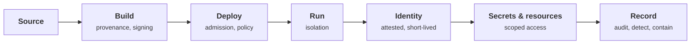

+++
title = 'Infrastructure security'
description = 'Workload identity, secrets, isolation, and the trust decisions underneath a running service.'
weight = 3
tone = 'sage'
status = 'Course'
course = true
+++

Underneath every application is a chain of trust decisions nobody sees: which
build produced this image, which machine is allowed to run it, how the running
process proves who it is, which secrets it can read, and what it can reach on
the network. **An attacker who lands inside one workload inherits every one of
those decisions.** Infrastructure security is the work of making each decision
explicit, narrow, short-lived, and recorded.

The course follows a workload from source code to a running process: identity,
secrets, isolation, and the delivery pipeline, then detection and containment
when a boundary fails anyway. It assumes you have deployed a service to a cloud
or a container platform. It does **not** assume a security background.

## The path

## How each lesson works

1. **The idea in one minute.** The claim, before the detail.
2. **A picture** of the trust boundary.
3. **How it really works**, with the real tools and specifications named.
4. **Code**: a small Python simulation using only the standard library. Control
   planes, tokens, and policies are modeled inside the program.
5. **Where it breaks.** What the control does not stop.
6. **Remember this**, **Try it**, and **Check yourself**.

## What you need

- Python 3.10 or newer and a terminal. Every program runs offline.
- Familiarity with containers and at least one cloud provider's IAM helps.
