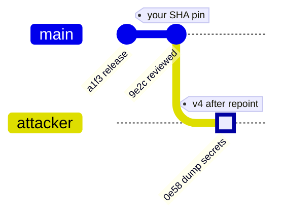
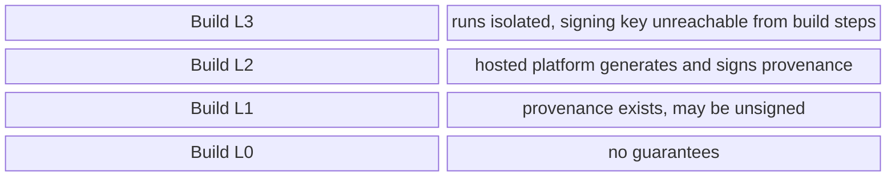

+++
title = 'CI/CD and build provenance'
description = 'A CI system is a privileged production system that runs code from strangers. Provenance is the build platform signing what it built, from what, so a deployer can check it before trusting the artifact.'
question = 'How do you keep a build pipeline from being the easiest way in, and prove where an artifact came from?'
weight = 1
difficulty = 3
prerequisites = ['/notes/infrastructure-security/foundations/02-threat-modeling-infrastructure', '/notes/infrastructure-security/workload-identity/03-federated-workload-identity']
date = 2026-07-26
lastmod = 2026-07-26
verified = 2026-07-26
+++

## The idea in one minute

A CI/CD system can push to your registry, deploy to production, publish
packages under your name, and often sign releases. Every job also runs code
you did not write: build scripts from pull requests, install hooks from
dependencies, and third-party actions or plugins. **Anyone who can run code in
a job can use the job's credentials.** That makes CI a privileged production
system, and it should be threat-modeled like one.

The second half of the problem is downstream. Once an artifact leaves CI,
nothing about the bytes says where they came from. **Build provenance** fixes
that: the build platform signs a statement naming the artifact's digest, the
source commit, the build instructions, and the platform itself. SLSA defines
how much that statement can be trusted, in levels; in-toto defines its format.
The consequence to act on: **keep untrusted code away from secrets in CI, and
verify provenance against an explicit policy before anything is deployed**.

## A picture

```mermaid {title="Where a build can be subverted, and where provenance is checked"}
flowchart LR
  PR["<b>Fork pull request</b><br/><small>untrusted code</small>"] --> CI
  SRC["<b>Source</b><br/><small>reviewed commit</small>"] --> CI["<b>Build platform</b><br/><small>isolated, ephemeral run</small>"]
  DEP["<b>Dependencies</b><br/><small>actions, packages</small>"] --> CI
  CI --> ART["<b>Artifact</b><br/><small>sha256 digest</small>"]
  CI --> PROV["<b>Provenance</b><br/><small>signed by the platform</small>"]
  ART --> VER["<b>Verifier</b><br/><small>builder, source, digest</small>"]
  PROV --> VER
  VER --> DEPLOY["<b>Deploy</b>"]
  class PR,DEP warn
  class SRC neutral
  class CI compute
  class ART,PROV memory
  class VER good
  class DEPLOY io
```

Provenance is produced by the platform, not by the build steps, so a
compromised step cannot write a convincing one. The verifier decides whether
the facts it attests are the ones this deployment expects.

## How it really works

### CI is a privileged system

List what a typical release pipeline can reach and the picture is uncomfortable:

| CI holds | What an attacker does with it |
| --- | --- |
| Cloud deploy role | Deploys their own image, or reads production data directly |
| Registry push credential | Overwrites a tag that production pulls |
| Package publishing token | Publishes a malicious version to every downstream user |
| Signing key or signing identity | Makes malicious artifacts verify as yours |
| Repository write token | Pushes commits, edits workflows, approves its own changes |

Then list who can run code in a job: maintainers, anyone who can open a pull
request (if the pipeline builds pull requests with credentials), the authors
of every build plugin and third-party action, and the maintainers of every
package installed during the build. The attack surface is the union.

Read the picture left to right: everyone on the left can run code in the job,
so everyone on the left can use everything on the right.

```mermaid {title="Anyone who runs code in the job holds every credential it can reach"}
flowchart LR
  subgraph WHO["Who can run code in a job"]
    MT("Maintainers")
    PRA("Pull request authors")
    ACT("Third-party actions")
    PKG("Build dependencies")
  end
  JOB(["CI job"])
  subgraph CREDS["What the job can reach"]
    IAM("Cloud deploy role")
    REG("Registry push")
    PUB("Publishing token")
    KEY("Signing identity")
  end
  WHO --> JOB
  JOB --> CREDS
```

The defenses follow the usual pattern for privileged systems. Give each job
the narrowest credential it needs and nothing else. Replace stored secrets with
short-lived federated credentials: a CI job presents an OIDC token whose claims
name the repository, branch, and environment, and the cloud issues a role
session scoped to those claims (see
[federated workload identity](/notes/infrastructure-security/workload-identity/03-federated-workload-identity/)).
Put production deploys behind protected environments that require approval
and only run from protected branches. Use ephemeral runners, created for one
job and destroyed afterwards, so one job cannot leave a backdoor for the next.

### Untrusted pull requests and `pull_request_target`

GitHub Actions makes the trust boundary concrete with two triggers that look
alike and behave very differently:

| | `pull_request` | `pull_request_target` |
| --- | --- | --- |
| Workflow file used | The one in the pull request | The one on the base branch |
| Code checked out by default | The pull request's merge commit | The base branch |
| Secrets for fork PRs | Not available | Available |
| `GITHUB_TOKEN` for fork PRs | Read-only | Can be granted write access |
| Intended for | Building and testing contributed code | Labeling, commenting, triage on PR metadata |

`pull_request_target` is safe as long as it never executes the contributor's
code. The common failure, which GitHub Security Lab named a **"pwn request"**,
is a workflow that uses it and then checks out the pull request head and
builds it:

```yaml {title="dangerous: privileged trigger, untrusted code"}
on: pull_request_target
jobs:
  test:
    runs-on: ubuntu-latest
    steps:
      - uses: actions/checkout@v4
        with:
          ref: ${{ github.event.pull_request.head.sha }}   # attacker's commit
      - run: npm ci && npm test                            # runs attacker's scripts
        env:
          NPM_TOKEN: ${{ secrets.NPM_TOKEN }}              # with your secret
```

The attacker does not need to touch the workflow file. A `postinstall` script
in their `package.json`, or a modified test, runs with the token in its
environment. A related bug is **expression injection**: interpolating
`${{ github.event.pull_request.title }}` or a branch name into a `run:` step
turns attacker-chosen text into shell code before the step starts.

Follow the numbered steps: the workflow file never changes, yet the
attacker's code ends up running next to the secret.

```mermaid {title="A pwn request: privileged trigger, contributor's code, your token"}
sequenceDiagram
  autonumber
  actor M as Attacker (fork)
  participant GH as GitHub
  participant W as pull_request_target job
  participant R as Package registry
  M->>GH: open PR adding a postinstall script
  GH->>W: run the base-branch workflow with secrets loaded
  W->>W: checkout the PR head sha
  rect rgb(249, 226, 233)
  W->>W: npm ci runs the attacker's postinstall
  W->>M: NPM_TOKEN sent out
  end
  M->>R: publish a malicious version under your name
  Note over GH,W: trusted workflow file, untrusted code
```

The fix is structural. Build untrusted code in an unprivileged workflow
(`pull_request`, no secrets, read-only token). If something privileged must
happen afterwards, such as posting results, a second workflow consumes the
first one's output **as data**, never executing it. Set an explicit
`permissions:` block on every workflow so the token starts with nothing.
Pass untrusted strings to scripts through environment variables, not through
`${{ }}` interpolation.

Third-party actions deserve the same suspicion. A reference such as
`uses: some-org/some-action@v4` follows a mutable Git tag. In March 2025 the
widely used `tj-actions/changed-files` action was compromised and its version
tags were repointed to a malicious commit that dumped runner secrets into
workflow logs, which are public for public repositories (tracked as
CVE-2025-30066). Pinning to a full commit SHA, and reviewing updates to that
pin, takes the action author's tag out of your trust base.

The tag is a pointer the action's owner (or whoever steals their access) can
move; a SHA pin keeps pointing at the commit you reviewed.



### Secret exposure in CI

Secrets leave CI by more routes than an attacker's `curl`:

- **Logs.** Platforms mask known secret values in logs, but masking matches
  exact strings. A base64-encoded, reversed, or split secret passes through.
- **Artifacts and caches.** A `.npmrc`, a cloud credentials file, or a
  `.env` written during the build ends up in an uploaded artifact, a shared
  cache, or an image layer.
- **Persistent runners.** On a self-hosted runner reused between jobs, files,
  processes, and Docker credentials can survive into the next job, including
  jobs from other repositories that share the runner. GitHub recommends
  against self-hosted runners for public repositories for this reason.
- **Scope creep.** A secret defined at organization level is available to
  every workflow that can reference it, not only the one that needed it.

The best secret in CI is the one that is not there: federated credentials that
live minutes, scoped by claims to one repository, one branch, and one
environment. What remains should be scoped to a single job and a protected
environment. The secret detection lesson covers finding the ones already
leaked: [secret sprawl and detection](/notes/infrastructure-security/secrets/04-secret-sprawl-and-detection/).

### Hermetic and reproducible builds

Two properties make a build verifiable rather than merely trusted.

A **hermetic** build declares all of its inputs up front, fetches them by
digest, and runs without network access, so the output depends only on those
inputs. Build systems such as Bazel are designed for this. A hermetic build
cannot quietly pull a different dependency version on Tuesday.

A **reproducible** build goes further: the Reproducible Builds project defines
it as one where anyone can recreate bit-for-bit identical copies of the
artifact from the same source, build environment, and instructions. The
obstacles are mundane: embedded timestamps, file-system ordering, absolute
build paths, locale, and randomness. Conventions such as the
`SOURCE_DATE_EPOCH` environment variable exist to remove them.

Reproducibility matters because it is the only control in this lesson that
can catch a compromised builder. If two independent builders, run by
different people on different infrastructure, produce the same digest from the
same commit, an attacker has to compromise both.

The check is a comparison of two digests produced on infrastructure that does
not share an operator.

```mermaid {title="Independent rebuilds turn a compromised builder into a digest mismatch"}
flowchart LR
  C["<b>Commit f2ca9e1</b><br/><small>same source, environment, instructions</small>"]
  C --> B1("Builder A, release CI")
  C --> B2("Builder B, independent")
  B1 --> D1["sha256 5b2e..."]
  B2 --> D2["sha256 5b2e..."]
  D1 --> X@{ shape: diam, label: "Digests equal?" }
  D2 --> X
  X -->|yes| OK["<b>Publish</b>"]
  X -->|no| BAD["<b>Stop</b><br/><small>one builder is lying or broken</small>"]
  class D1,D2 memory
  class OK good
  class BAD warn
```

### SLSA build levels

SLSA (Supply-chain Levels for Software Artifacts) is an OpenSSF specification.
Version 1.0, released in April 2023, defines a **Build track** with four
levels. Each level says what the provenance can be trusted for:

| Level | Requirement | What it protects against |
| --- | --- | --- |
| **Build L0** | Nothing | Nothing |
| **Build L1** | Provenance exists, describing how the artifact was built; it may be unsigned | Mistakes, and gives an inventory of what was built from what |
| **Build L2** | A hosted build platform generates and signs the provenance | Tampering after the build; forging provenance without the platform's key |
| **Build L3** | A hardened platform: runs are isolated from one another, and the signing material is not reachable from user-defined build steps | Tampering during the build by a malicious step, another tenant, or a stolen credential |

Each level is built on the one below it; read the stack from the bottom up.



Two details are easy to miss. First, the levels describe the **build platform**,
not your code; adopting a hosted generator that meets L3 is how most projects
get there. Second, v1.0 deliberately left out source review and hermeticity,
which earlier drafts had bundled into the top level. Later work in the
project adds further tracks; check the current specification at slsa.dev for
the version you target.

SLSA also specifies the consumer's side. To verify an artifact, check that the
provenance signature comes from a builder you trust, that the artifact's
digest is among the provenance subjects, that `builder.id` is one you accept
for this package, that the `buildType` is expected, and that the external
parameters (repository, ref, workflow) match what you expect, **rejecting any
external parameter you do not recognize**. That last rule matters: an
unexpected input such as a free-form "extra build flags" parameter can change
what was built without changing the source.

### In-toto attestations

Provenance is carried in the in-toto attestation format, which has three
layers:

1. **Envelope**: a DSSE (Dead Simple Signing Envelope) containing a payload
   type, the base64 payload, and one or more signatures. DSSE signs a
   pre-authentication encoding of the type and the bytes, so no JSON
   canonicalization is needed and a signature over one payload type cannot be
   replayed as another.
2. **Statement**: `_type`, a list of `subject`s (name plus digests), and a
   `predicateType` URI.
3. **Predicate**: for SLSA provenance v1, a `buildDefinition`
   (`buildType`, `externalParameters`, `internalParameters`,
   `resolvedDependencies`) and `runDetails` (`builder.id`, metadata,
   byproducts).

The three layers nest: the signature covers the statement, and the statement
carries the predicate.

```mermaid {title="An in-toto attestation nests predicate inside statement inside envelope"}
flowchart TB
  subgraph ENV["DSSE envelope"]
    PT["payloadType"]
    SIG["<b>signatures</b><br/><small>over PAE of type and payload</small>"]
    subgraph ST["Statement (base64 payload)"]
      SUB["<b>subject</b><br/><small>name + sha256 digest</small>"]
      PTYPE["predicateType<br/><small>slsa.dev/provenance/v1</small>"]
      subgraph PR["Predicate"]
        BD["<b>buildDefinition</b><br/><small>buildType, externalParameters, resolvedDependencies</small>"]
        RD["<b>runDetails</b><br/><small>builder.id, metadata</small>"]
      end
    end
  end
  class SIG good
  class SUB memory
  class BD,RD compute
```

```json {title="an abridged SLSA v1 provenance statement"}
{
  "_type": "https://in-toto.io/Statement/v1",
  "subject": [{ "name": "payments.tar.gz", "digest": { "sha256": "5b2e…" } }],
  "predicateType": "https://slsa.dev/provenance/v1",
  "predicate": {
    "buildDefinition": {
      "buildType": "https://ci.example.com/buildtypes/workflow/v1",
      "externalParameters": {
        "repository": "git+https://git.example.com/acme/payments",
        "ref": "refs/heads/main",
        "workflow": ".ci/release.yml"
      },
      "resolvedDependencies": [
        { "uri": "git+https://git.example.com/acme/payments@refs/heads/main",
          "digest": { "gitCommit": "f2ca9e10b603…" } }
      ]
    },
    "runDetails": { "builder": { "id": "https://ci.example.com/builders/hosted-isolated@v2" } }
  }
}
```

Real generators and verifiers exist for this: the SLSA project's GitHub
generator and `slsa-verifier`, GitHub's artifact attestations (`gh attestation
verify`), and `cosign attest` / `cosign verify-attestation` from Sigstore,
which the [next lesson](/notes/infrastructure-security/delivery-and-operations/02-signing-and-admission/)
covers.

### SolarWinds: a compromised builder

The SolarWinds Orion compromise is the best-documented build attack. According
to CrowdStrike's analysis, attackers placed an implant called **SUNSPOT** on
the build server. It watched for the build process compiling Orion and, during
the build, replaced one source file with a backdoored version, restoring the
original afterwards. The source repository stayed clean. The compiled output,
carrying the backdoor known as SUNBURST, was signed with SolarWinds' legitimate
code-signing certificate and shipped as ordinary updates. CISA's Emergency
Directive 21-01 (December 2020) ordered US federal agencies to disconnect
affected Orion versions, and SolarWinds told the SEC that fewer than 18,000
customers may have installed them.

The shaded steps happened inside the build; nothing before or after them
looked wrong.

```mermaid {title="SUNSPOT swapped source during the build, then let signing proceed"}
sequenceDiagram
  autonumber
  participant Src as Source repository
  participant B as Build server
  participant S as SUNSPOT implant
  participant Sign as Code signing
  participant C as Customers
  Src->>B: clean Orion source checked out
  S->>B: watch for the Orion build process
  rect rgb(249, 226, 233)
  S->>B: replace one source file with a backdoored version
  B->>B: compile, SUNBURST included
  S->>B: restore the original file
  end
  B->>Sign: compiled update
  Sign-->>C: update with a valid SolarWinds signature
  Note over Src,C: repository clean, every signature valid
```

Every signature in that chain was valid. The lesson is precise: **a signature
or a provenance statement attests to what the builder did, not to whether the
builder was honest**. Defenses against this class are SLSA L3 isolation (a
build step cannot reach another run or the signing key), ephemeral build
machines that leave nothing for an implant to persist on, and reproducible
builds checked by an independent rebuilder.

## Code

A deployer's provenance check. The program builds a DSSE-wrapped in-toto
statement for an artifact and verifies it against a policy: trusted builder,
expected build type, expected repository and ref, no unknown external
parameters, the approved commit, and the artifact's SHA-256 among the subjects.
The last case is the SolarWinds pattern.

```python {title="provenance.py"}
"""provenance.py: verify a simulated SLSA provenance attestation against a policy.

The attestation is an in-toto Statement (SLSA provenance v1 predicate) inside a
DSSE envelope. Standard library only; offline. TOY: HMAC stands in for the
builder's real asymmetric signature, so here the verifier holds the same key.
"""

from __future__ import annotations

import base64
import copy
import hashlib
import hmac
import json

BUILDER_KEY = b"toy-key; a real builder signs with a key user build steps cannot read"
PAYLOAD_TYPE = "application/vnd.in-toto+json"

POLICY = {
    "builder_id": "https://ci.example.com/builders/hosted-isolated@v2",
    "build_type": "https://ci.example.com/buildtypes/workflow/v1",
    "repository": "git+https://git.example.com/acme/payments",
    "ref": "refs/heads/main",
    "allowed_external": {"repository", "ref", "workflow"},
}


def pae(payload_type: str, body: bytes) -> bytes:
    """DSSE pre-authentication encoding: the exact bytes that get signed."""
    t = payload_type.encode()
    return b"DSSEv1 %d %s %d %s" % (len(t), t, len(body), body)


def sign(statement: dict) -> dict:
    body = json.dumps(statement, sort_keys=True).encode()
    sig = hmac.new(BUILDER_KEY, pae(PAYLOAD_TYPE, body), hashlib.sha256).digest()
    return {"payloadType": PAYLOAD_TYPE,
            "payload": base64.b64encode(body).decode(),
            "signatures": [{"keyid": "builder-2026", "sig": base64.b64encode(sig).decode()}]}


def build(artifact: bytes, commit: str, builder: str = POLICY["builder_id"],
          repo: str = POLICY["repository"], extra: dict | None = None) -> dict:
    """What the build platform emits: a statement about the artifact it produced."""
    external = {"repository": repo, "ref": "refs/heads/main", "workflow": ".ci/release.yml"}
    external.update(extra or {})
    return {
        "_type": "https://in-toto.io/Statement/v1",
        "subject": [{"name": "payments.tar.gz",
                     "digest": {"sha256": hashlib.sha256(artifact).hexdigest()}}],
        "predicateType": "https://slsa.dev/provenance/v1",
        "predicate": {
            "buildDefinition": {
                "buildType": POLICY["build_type"],
                "externalParameters": external,
                "resolvedDependencies": [{"uri": f"{repo}@refs/heads/main",
                                          "digest": {"gitCommit": commit}}],
            },
            "runDetails": {"builder": {"id": builder},
                           "metadata": {"invocationId": "run-7741"}},
        },
    }


def verify(envelope: dict, artifact: bytes, expected_commit: str) -> str:
    """Return 'PASS' or the first reason to reject. Order matters: signature first,
    so no field is trusted before we know who wrote it."""
    if envelope["payloadType"] != PAYLOAD_TYPE:
        return "wrong payload type"
    body = base64.b64decode(envelope["payload"])
    good = hmac.new(BUILDER_KEY, pae(PAYLOAD_TYPE, body), hashlib.sha256).digest()
    if not any(hmac.compare_digest(base64.b64decode(s["sig"]), good)
               for s in envelope["signatures"]):
        return "signature does not verify with the trusted builder key"
    st = json.loads(body)
    pred = st["predicate"]
    bdef, builder = pred["buildDefinition"], pred["runDetails"]["builder"]["id"]
    if st["predicateType"] != "https://slsa.dev/provenance/v1":
        return "not SLSA provenance v1"
    if builder != POLICY["builder_id"]:
        return f"untrusted builder {builder}"
    if bdef["buildType"] != POLICY["build_type"]:
        return f"unexpected buildType {bdef['buildType']}"
    ext = bdef["externalParameters"]
    if unknown := set(ext) - POLICY["allowed_external"]:
        return f"unexpected external parameters {sorted(unknown)}"
    if ext["repository"] != POLICY["repository"] or ext["ref"] != POLICY["ref"]:
        return f"built from {ext['repository']} {ext['ref']}"
    commits = [d["digest"].get("gitCommit") for d in bdef["resolvedDependencies"]
               if d["uri"].startswith(POLICY["repository"] + "@")]
    if commits != [expected_commit]:
        got = ", ".join(c[:12] for c in commits if c) or "none"
        return f"source commit {got} is not the approved {expected_commit[:12]}"
    want = hashlib.sha256(artifact).hexdigest()
    if want not in [s["digest"].get("sha256") for s in st["subject"]]:
        return f"artifact sha256 {want[:12]}... is not a subject"
    return "PASS"


if __name__ == "__main__":
    commit = hashlib.sha1(b"commit: release 4.2.0").hexdigest()
    art = b"payments service 4.2.0 release bundle"
    cases: list[tuple[str, dict, bytes]] = []

    cases.append(("release built by hosted builder", sign(build(art, commit)), art))
    cases.append(("artifact swapped after build", sign(build(art, commit)),
                  art + b" + backdoor"))
    cases.append(("built on a developer laptop",
                  sign(build(art, commit, builder="https://laptop.local/dev")), art))
    cases.append(("built from an attacker fork", sign(build(
        art, commit, repo="git+https://git.example.com/mallory/payments")), art))
    cases.append(("extra workflow input injected",
                  sign(build(art, commit, extra={"pre_build_script": "curl x|sh"})), art))
    cases.append(("built from an unreviewed commit",
                  sign(build(art, hashlib.sha1(b"commit: wip").hexdigest())), art))

    forged = sign(build(art, commit))
    st = json.loads(base64.b64decode(forged["payload"]))
    evil = art + b" + backdoor"
    st["subject"][0]["digest"]["sha256"] = hashlib.sha256(evil).hexdigest()
    forged = copy.deepcopy(forged)
    forged["payload"] = base64.b64encode(json.dumps(st, sort_keys=True).encode()).decode()
    cases.append(("payload edited to match backdoor", forged, evil))

    # The builder itself is compromised: it injects code while compiling, then
    # honestly attests to the bytes it produced. Every check passes.
    cases.append(("compromised builder (SUNSPOT-style)", sign(build(evil, commit)), evil))

    print(f"policy: builder={POLICY['builder_id'].rsplit('/', 1)[1]} "
          f"source={POLICY['repository'].rsplit('/', 2)[1]}/payments@{commit[:12]}")
    for label, env, artifact in cases:
        print(f"{label:<38} {verify(env, artifact, commit)}")
```

Run it with `python3 provenance.py`:

```text
policy: builder=hosted-isolated@v2 source=acme/payments@f2ca9e10b603
release built by hosted builder        PASS
artifact swapped after build           artifact sha256 9acbb46f1d0a... is not a subject
built on a developer laptop            untrusted builder https://laptop.local/dev
built from an attacker fork            built from git+https://git.example.com/mallory/payments refs/heads/main
extra workflow input injected          unexpected external parameters ['pre_build_script']
built from an unreviewed commit        source commit 895b7378f6d1 is not the approved f2ca9e10b603
payload edited to match backdoor       signature does not verify with the trusted builder key
compromised builder (SUNSPOT-style)    PASS
```

Six bad cases fail for six different reasons, and the last one passes. That
last line is the point of the lesson: a builder that tampers with the build
and then attests honestly to its own output defeats provenance completely.

## Where it breaks

- **Provenance trusts the builder.** It moves trust from "whoever uploaded
  this file" to "the build platform", which is a large improvement. It does
  not remove trust. Only isolation and independent reproduction address a
  compromised platform.
- **The policy is the control.** Verifying a signature without checking
  `builder.id`, the source repository, and the external parameters proves only
  that *some* build on that platform produced it, possibly from a fork or a
  scratch branch.
- **Where the expected commit comes from.** The program is handed the approved
  commit. In practice that comes from a release record or a rule such as
  "any commit on the protected `main` branch", and branch protection then
  becomes part of the control.
- **Dependencies are inputs, not verified ones.** Provenance records what the
  build resolved. It does not say those dependencies were safe. That is the
  subject of [dependencies and supply chain](/notes/application-security/building-it-secure/03-dependencies-and-supply-chain/).
- **The toy signature.** HMAC means the verifier holds the signing key and
  could forge provenance. Real builders sign with an asymmetric key, or a
  short-lived Sigstore certificate, that verifiers cannot use to sign.
- **Verification has to happen.** Provenance nobody checks is decoration.
  Wire the check into the deploy path, where a failure blocks the release.

## Remember this

- CI holds production credentials and runs strangers' code; model it as a
  privileged system.
- Never build untrusted pull request code in a job that has secrets;
  `pull_request_target` plus a checkout of the PR head is the classic mistake.
- Pin third-party actions by commit SHA and prefer federated, minutes-long
  credentials over stored secrets.
- SLSA Build L2 means the platform signs provenance; L3 means build steps can
  reach neither other runs nor the signing key.
- Verify builder, source, ref, external parameters, and subject digest;
  reject parameters you do not recognize.
- A compromised builder signs malicious output correctly; reproducible builds
  are the check that catches it.

## Try it

1. Run `provenance.py`. Add a second subject to the statement (a source
   tarball) and confirm verification still passes for the main artifact.
   Should the policy require a specific subject name too?
2. Change the policy to accept any commit whose dependency URI is on
   `refs/heads/main`, instead of one approved commit. Which case changes
   result, and what control must now hold elsewhere?
3. Find a workflow in a repository you work on that uses `pull_request_target`
   or `workflow_run`. Trace whether any step executes code or reads files that
   a contributor controls.
4. List every credential your release pipeline can reach. For each, write the
   job that needs it and whether it could be a federated credential instead.

## Check yourself

1. Why is `pull_request_target` dangerous when combined with checking out the
   pull request's head commit?

   
   The trigger runs with the base repository's secrets and a token that can
   have write access, because it is meant for trusted automation. Checking out
   and building the contributor's commit executes code the contributor wrote,
   such as install scripts or tests, inside that privileged job. The
   contributor never has to edit the workflow file itself.
   

2. What does SLSA Build L3 add over L2?

   
   L2 requires that a hosted platform generates and signs the provenance, which
   stops tampering after the build. L3 hardens the platform: runs are isolated
   from each other and the signing material is inaccessible to user-defined
   build steps, so a malicious step cannot alter another build or forge
   provenance.
   

3. A verifier checks the provenance signature and the subject digest, and
   nothing else. What attack still works?

   
   Any build on the trusted platform passes, including one run from an
   attacker's fork, an unreviewed branch, or with extra build parameters. The
   verifier must also check the builder identity, the source repository and
   ref, and that the external parameters match expectations.
   

4. Why did code signing not help in the SolarWinds compromise?

   
   The backdoor was inserted during compilation on the build server, before
   signing. The signing step signed what the build produced, so the malicious
   update carried a valid SolarWinds signature. Signing proves origin from the
   signer, not the integrity of the process that produced the bytes.
   

5. How does a reproducible build help against a compromised builder?

   
   If anyone can rebuild bit-for-bit identical output from the same source, an
   independent rebuilder on separate infrastructure can compare digests. A
   tampered build produces a different digest, so the attacker would have to
   compromise every independent builder, not just one.
   

## Sources

- OpenSSF SLSA, [SLSA specification v1.0: Security levels](https://slsa.dev/spec/v1.0/levels), [Provenance](https://slsa.dev/spec/v1.0/provenance), and [Verifying artifacts](https://slsa.dev/spec/v1.0/verifying-artifacts), April 2023.
- in-toto project, [in-toto Attestation Framework](https://github.com/in-toto/attestation).
- Secure Systems Lab, [DSSE: Dead Simple Signing Envelope](https://github.com/secure-systems-lab/dsse).
- GitHub Security Lab, [Keeping your GitHub Actions and workflows secure Part 1: Preventing pwn requests](https://securitylab.github.com/resources/github-actions-preventing-pwn-requests/), 2021.
- GitHub Docs, [Security hardening for GitHub Actions](https://docs.github.com/en/actions/security-for-github-actions/security-guides/security-hardening-for-github-actions).
- CISA, [Supply chain compromise of third-party tj-actions/changed-files (CVE-2025-30066)](https://www.cisa.gov/news-events/alerts/2025/03/18/supply-chain-compromise-third-party-tj-actionschanged-files-cve-2025-30066-and-reviewdogaction), March 2025.
- CrowdStrike Intelligence Team, [SUNSPOT: An Implant in the Build Process](https://www.crowdstrike.com/blog/sunspot-malware-technical-analysis/), January 2021.
- CISA, [Emergency Directive 21-01: Mitigate SolarWinds Orion Code Compromise](https://www.cisa.gov/news-events/directives/ed-21-01-mitigate-solarwinds-orion-code-compromise), December 2020.
- Reproducible Builds project, [Definitions](https://reproducible-builds.org/docs/definition/).
