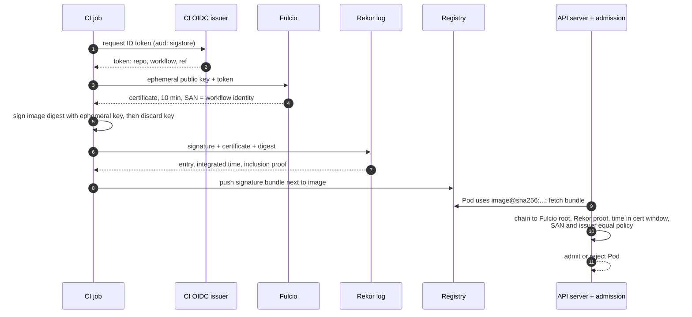
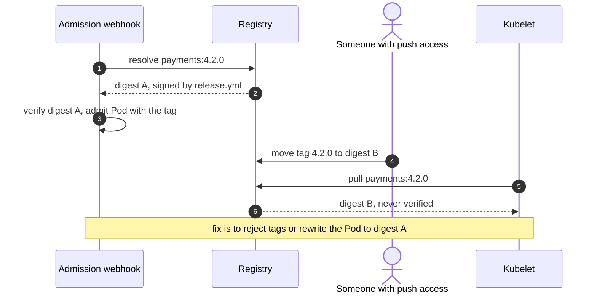
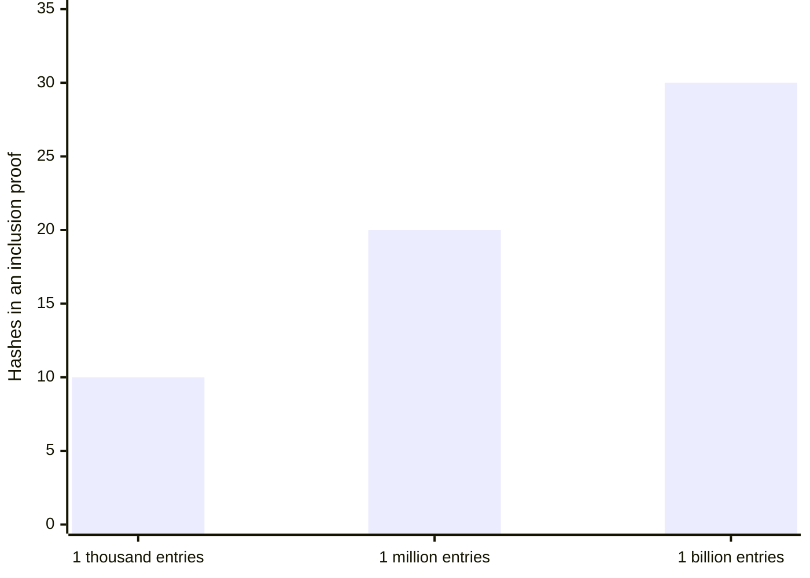

+++
title = 'Signing and admission'
description = 'A valid signature only proves that some key signed some bytes. Admission control is useful when it checks that a specific identity signed the exact digest about to run.'
question = 'How do you make a cluster run only images that your release pipeline signed?'
weight = 2
difficulty = 3
prerequisites = ['/notes/infrastructure-security/delivery-and-operations/01-ci-cd-and-build-provenance', '/notes/infrastructure-security/isolation/02-the-kubernetes-security-model']
date = 2026-07-28
lastmod = 2026-10-30
verified = 2026-07-28
+++

## The idea in one minute

Signing an image answers one narrow question: did the holder of this key sign
these bytes? The question a cluster needs answered is different: **did the
identity I trust sign the exact image digest that is about to run?** Getting
from one to the other takes three things: a way to bind keys to identities, a
public record of when each signature was made, and an enforcement point that
checks both before a pod starts.

Sigstore provides the first two without long-lived keys. Cosign signs, Fulcio
issues a ten-minute certificate binding an OIDC identity (a person's email or a
CI workflow) to a throwaway key, and Rekor records the signature in an
append-only transparency log. An admission controller such as Kyverno,
Gatekeeper with an external data provider, or the Sigstore policy-controller
provides the third. The consequence to act on: **write policies that name the
signer identity and issuer exactly, and refer to images by digest, never by
tag alone**.

## A picture



The private key exists for one signing operation. What survives is a
certificate that names an identity and a log entry that proves when the
signature was made.

## How it really works

### What a signature does and does not prove

A digital signature (see
[digital signatures](/notes/cryptography/public-key-cryptography/02-digital-signatures/))
proves that whoever held a private key produced it over exactly these bytes.
It says nothing about who holds the key today, whether it was stolen, or
whether the bytes are any good. Traditional image signing with a long-lived key
pair turns those gaps into an operations problem: the key must be generated,
protected, distributed to verifiers, rotated, and revoked, and a stolen key
signs malware as convincingly as releases.

What gets signed matters too. Container signing tools sign the image
**manifest digest**, the SHA-256 of the manifest that lists every layer by its
own digest. One digest therefore pins every byte of the image. A tag such as
`:4.2.0` is a mutable pointer in the registry and is never what is signed.

The dashed arrow is the part anyone with push access can change; everything
below the manifest is fixed by hashes.

```mermaid {title="One manifest digest pins every layer, a tag only points at it"}
flowchart TB
  TAG["<b>Tag :4.2.0</b><br/><small>mutable registry pointer</small>"] -.->|currently points to| MAN
  SIG["<b>Signature</b>"] -->|covers| MAN["<b>Manifest</b><br/><small>sha256:5b2e...</small>"]
  MAN --> CFG["<b>Config</b><br/><small>sha256 digest</small>"]
  MAN --> L1["<b>Layer 1</b><br/><small>sha256 digest</small>"]
  MAN --> L2["<b>Layer 2</b><br/><small>sha256 digest</small>"]
  class TAG warn
  class SIG good
  class MAN memory
  class CFG,L1,L2 neutral
```

### Cosign and keyless signing

Cosign can sign with a stored key, a KMS key, or a hardware token. Its
**keyless** mode removes the stored key:

```bash {title="keyless sign and verify with cosign"}
# In CI: the job's OIDC token is used automatically where supported.
cosign sign registry.example.com/acme/payments@sha256:5b2e...

# At verification time: the identity flags are required for keyless verification.
cosign verify \
  --certificate-identity 'https://github.com/acme/payments/.github/workflows/release.yml@refs/heads/main' \
  --certificate-oidc-issuer 'https://token.actions.githubusercontent.com' \
  registry.example.com/acme/payments@sha256:5b2e...
```

The signature and its supporting material are stored in the registry beside
the image. Older releases used a tag derived from the image digest; newer ones
can use the Sigstore bundle format and OCI referrers. Either way, the registry
holds signatures, not trust; trust comes from what the verifier checks.

### Fulcio: identities, not keys

Fulcio is a certificate authority that issues **short-lived code-signing
certificates**. The client generates an ephemeral key pair, obtains an OIDC ID
token from a supported issuer, and sends the public key with proof that it
holds the private key. Fulcio validates the token and issues an X.509
certificate valid for ten minutes. The certificate's subject alternative name
(SAN) carries the identity: an email address for a person, or for CI a URI
naming the workflow and ref. Custom extensions under the OID arc
`1.3.6.1.4.1.57264.1` record the OIDC issuer and, for CI tokens, details such
as the source repository, the commit, and the trigger.

| Signer | Certificate identity (SAN) | OIDC issuer |
| --- | --- | --- |
| GitHub Actions workflow | `https://github.com/acme/payments/.github/workflows/release.yml@refs/heads/main` | `https://token.actions.githubusercontent.com` |
| A person with a Google account | `alice@example.com` | `https://accounts.google.com` |
| A Kubernetes service account (private Sigstore) | `https://kubernetes.io/namespaces/ci/serviceaccounts/builder` | the cluster's issuer URL |

Because the key is discarded, there is nothing to steal after the signing
step, and nothing to rotate. The expired certificate remains verifiable later
because the log proves the signature happened while it was valid.

The key and the certificate have different lifetimes, and only the log entry
links them after the fact.

```mermaid {title="The signing key lives for one operation, the evidence lives forever"}
stateDiagram-v2
  direction LR
  [*] --> Generated: client makes ephemeral key pair
  Generated --> Certified: Fulcio checks OIDC token, issues 10 min cert
  Certified --> Signed: sign the image digest
  Signed --> Logged: Rekor records entry and integrated time
  Logged --> Discarded: private key deleted
  Discarded --> Verifiable: cert expired, log proves time inside window
  Verifiable --> [*]
```

### Rekor: a public record with a clock

Rekor is a transparency log: an append-only Merkle tree in the same family as
Certificate Transparency (RFC 6962, updated as RFC 9162). Each entry records
the artifact digest, the signature, and the certificate. Rekor returns the
entry's **integrated time** with a signed promise, and an **inclusion proof**
against a signed checkpoint of the tree.

The log does three jobs:

1. **Time.** Verifiers check that the integrated time falls inside the
   certificate's ten-minute window. A signature made later with a leaked
   ephemeral key fails.
2. **Discoverability.** Every signature made with your identity is public.
   Monitoring the log for entries with your workflow identity that you did not
   make turns a silent forgery into a visible one.
3. **Honesty of the log.** Clients and witnesses check **consistency proofs**
   between checkpoints, which show that a later tree contains an earlier one
   unchanged. A log that rewrote history would be caught.

An inclusion proof is short: for a log of a billion entries it is about thirty
hashes, and checking it needs only the entry, its index, the tree size, and a
checkpoint you trust. The first program below implements it.

Here is the seven-entry log from that program. To prove entry 5, the log hands
over only the three hashes marked "proof hash"; the verifier recomputes every
other box on the way up to the root.

```mermaid {title="An inclusion proof for entry 5 of 7 is three sibling hashes"}
flowchart TB
  ROOT["<b>Root</b><br/><small>signed checkpoint</small>"]
  ROOT --- A["<b>hash of entries 0-3</b><br/><small>proof hash 3</small>"]
  ROOT --- B["hash of entries 4-6"]
  B --- C["hash of entries 4-5"]
  B --- L6["<b>leaf 6</b><br/><small>proof hash 2</small>"]
  C --- L4["<b>leaf 4</b><br/><small>proof hash 1</small>"]
  C --- L5["<b>leaf 5</b><br/><small>the entry being proven</small>"]
  class A,L6,L4 good
  class ROOT,B,C,L5 compute
```

### Verify the identity, not just the signature

Sigstore's public instance issues certificates to anyone who can sign in to a
supported OIDC provider. An attacker can sign their own malicious image with a
perfectly valid certificate for `https://github.com/mallory/payments/...`.
**"Has a valid Sigstore signature" therefore means nothing on its own.** The
policy must name the identity:

- **Pin both subject and issuer.** The same-looking subject from a different
  issuer is a different identity.
- **Match exactly, or anchor regular expressions at both ends.** A prefix
  match on `https://github.com/acme/payments` also admits `acme/payments-test`
  and `acme/payments-fork`.
- **Pin the ref.** A release workflow on `main` and the same workflow run on a
  feature branch produce different SANs. Allow only the one that went through
  review.
- **Know what the SAN names.** With GitHub reusable workflows, the SAN
  identifies the reusable workflow that ran, while the calling repository
  appears in a separate certificate extension. Policies for shared build
  workflows must check both.

Every signer on the left holds a valid Sigstore certificate. Only the exact
match lets just one of them through.

```mermaid {title="A prefix match on the identity admits look-alike repositories"}
flowchart LR
  R1["<b>acme/payments</b><br/><small>release.yml on main</small>"]
  R2["<b>acme/payments-test</b><br/><small>release.yml on main</small>"]
  R3["<b>acme/payments-fork</b><br/><small>release.yml on main</small>"]
  R4["<b>acme/payments</b><br/><small>release.yml on a feature branch</small>"]
  EX@{ shape: hex, label: "Exact SAN + issuer" }
  PF@{ shape: hex, label: "Prefix acme/payments" }
  R1 --> EX
  R1 --> PF
  R2 --> PF
  R3 --> PF
  R4 --> PF
  class R1 good
  class R2,R3,R4 warn
  class EX good
  class PF warn
```

### Digests, not tags

A tag can be moved at any time by anyone with push access to the registry. If
admission resolves `payments:4.2.0` to digest A, verifies A, and admits the
pod, the kubelet may later pull the tag and receive digest B. That is a
time-of-check to time-of-use gap.

The gap sits between step 3 and step 5: the check and the pull look at the same
name but not the same bytes.



Close it one of two ways:

- **Reject tag-only references.** Require `image@sha256:...` in every pod
  spec; deploy tooling resolves and pins digests at release time.
- **Mutate to the digest.** Let the admission controller resolve the tag,
  verify the digest, and rewrite the pod spec to that digest so the node pulls
  exactly what was checked. Kyverno's image verification does this by default.

### Admission controllers

Kubernetes runs **mutating** admission webhooks, then **validating** ones, on
every create and update request before the object is stored. Signature
verification needs network calls to the registry, so it runs in a webhook.

The webhook sits on the path of every Pod create, so its failure policy decides
what happens when it is slow or down.

```mermaid {title="Where image verification sits in the API server's admission chain"}
flowchart LR
  U("kubectl or deploy tool")
  API("API server authn and authz")
  MUT["<b>Mutating webhooks</b><br/><small>tag rewritten to digest</small>"]
  VAL["<b>Validating webhooks</b><br/><small>signature, SAN, issuer, Rekor</small>"]
  DOWN@{ shape: diam, label: "Webhook answers in time?" }
  ST@{ shape: cyl, label: "etcd" }
  REJ["<b>Rejected</b>"]
  U --> API --> MUT --> DOWN
  DOWN -->|yes| VAL
  DOWN -->|"no, failurePolicy Fail"| REJ
  DOWN -.->|"no, failurePolicy Ignore"| ST
  VAL -->|pass| ST
  VAL -->|fail| REJ
  class MUT,VAL good
  class REJ io
  class DOWN warn
```

| Tool | How signatures are checked | Notes |
| --- | --- | --- |
| **Kyverno** | `verifyImages` rules with keyless attestors (subject, issuer, Rekor) or keys; can also verify attestations such as SLSA provenance | Mutates tags to digests by default; policies are YAML |
| **OPA Gatekeeper** | Not built in; an External Data provider, such as Ratify, performs verification and Rego policies use the result | Strong general policy engine; signature checking is an add-on |
| **Sigstore policy-controller** | `ClusterImagePolicy` resources listing keyless identities or keys | Enforced in namespaces that opt in with a label |
| **ValidatingAdmissionPolicy** (built in) | Cannot fetch signatures; CEL expressions can require digest references and registries | No webhook to run; pairs well with one of the above |

```yaml {title="a Kyverno policy requiring the release workflow's signature"}
apiVersion: kyverno.io/v1
kind: ClusterPolicy
metadata:
  name: require-release-signature
spec:
  validationFailureAction: Enforce   # field names vary between Kyverno releases
  webhookTimeoutSeconds: 30
  rules:
    - name: payments-signed-by-release
      match:
        any:
          - resources:
              kinds: [Pod]
      verifyImages:
        - imageReferences: ["registry.example.com/acme/payments*"]
          mutateDigest: true
          verifyDigest: true
          required: true
          attestors:
            - entries:
                - keyless:
                    subject: "https://github.com/acme/payments/.github/workflows/release.yml@refs/heads/main"
                    issuer: "https://token.actions.githubusercontent.com"
                    rekor:
                      url: https://rekor.sigstore.dev
```

Three deployment details decide whether the policy means anything:

- **Failure mode.** A webhook with `failurePolicy: Ignore` admits everything
  when it is down or slow. That is fail-open. Enforcement needs `Fail`, with
  enough replicas that the webhook is not an outage risk.
- **Coverage.** Exempted namespaces, unmatched image patterns, and
  opt-in labels are all ways around the policy. Images that match no rule
  should be denied, not ignored.
- **Other paths.** Static pods defined on a node, and anyone with direct access
  to a node's container runtime, bypass admission entirely. Admission is one
  enforcement point among several, alongside registry permissions and deploy
  pipeline checks.

## Code

Two programs. The first is the log: a Merkle tree with RFC 9162 inclusion
proofs, showing why a verifier needs only a few hashes to know an entry is
in the log.

```python {title="translog.py"}
"""translog.py: a transparency log in miniature, with RFC 9162 inclusion proofs.

Leaves and interior nodes are hashed with distinct prefixes (0x00, 0x01) as in
Certificate Transparency, so a leaf can never be passed off as a node. The
verifier needs only the entry, its index, the tree size, the proof, and a root
it trusts. Standard library only; offline.
"""

from __future__ import annotations

import hashlib


def h(data: bytes) -> bytes:
    return hashlib.sha256(data).digest()


def leaf_hash(entry: bytes) -> bytes:
    return h(b"\x00" + entry)


def node_hash(left: bytes, right: bytes) -> bytes:
    return h(b"\x01" + left + right)


def split(n: int) -> int:
    """Largest power of two strictly less than n."""
    k = 1
    while k * 2 < n:
        k *= 2
    return k


def root(leaves: list[bytes]) -> bytes:
    if len(leaves) == 1:
        return leaves[0]
    k = split(len(leaves))
    return node_hash(root(leaves[:k]), root(leaves[k:]))


def prove(m: int, leaves: list[bytes]) -> list[bytes]:
    """The log operator computes the audit path for leaf m."""
    if len(leaves) == 1:
        return []
    k = split(len(leaves))
    if m < k:
        return prove(m, leaves[:k]) + [root(leaves[k:])]
    return prove(m - k, leaves[k:]) + [root(leaves[:k])]


def verify_inclusion(entry: bytes, index: int, size: int,
                     proof: list[bytes], trusted_root: bytes) -> bool:
    """The client side, following RFC 9162 section 2.1.3.2."""
    if index >= size:
        return False
    fn, sn, r = index, size - 1, leaf_hash(entry)
    for p in proof:
        if sn == 0:
            return False
        if fn & 1 or fn == sn:
            r = node_hash(p, r)
            if not fn & 1:
                while fn and not fn & 1:
                    fn, sn = fn >> 1, sn >> 1
        else:
            r = node_hash(r, p)
        fn, sn = fn >> 1, sn >> 1
    return sn == 0 and r == trusted_root


if __name__ == "__main__":
    entries = [f"sig over sha256:{i:04x}... by build-{i}".encode() for i in range(7)]
    entries[5] = b"sig over sha256:9f2c... by release.yml@refs/heads/main"
    leaves = [leaf_hash(e) for e in entries]
    tree_root = root(leaves)
    proof = prove(5, leaves)

    print(f"log size 7, root {tree_root.hex()[:16]}...")
    print(f"proof for entry 5 has {len(proof)} hashes")
    checks = [
        ("entry 5 as logged", entries[5], 5, proof, tree_root),
        ("entry 5 with one byte changed", entries[5].replace(b"9f2c", b"9f2d"), 5, proof, tree_root),
        ("entry 5 claimed at index 4", entries[5], 4, proof, tree_root),
        ("entry 5 against a forked root", entries[5], 5, proof, root(leaves[:6] + [leaf_hash(b"x")])),
        ("an entry that was never logged", b"sig over sha256:dead... by laptop", 5, proof, tree_root),
    ]
    for label, entry, index, path, r in checks:
        ok = verify_inclusion(entry, index, 7, path, r)
        print(f"  {label:<34} {'included' if ok else 'NOT PROVEN'}")

    for size in (1_000, 1_000_000, 1_000_000_000):
        print(f"a log of {size:>13,} entries needs about {(size - 1).bit_length()} proof hashes")
```

Run it with `python3 translog.py`:

```text
log size 7, root 8207a291c6af582c...
proof for entry 5 has 3 hashes
  entry 5 as logged                  included
  entry 5 with one byte changed      NOT PROVEN
  entry 5 claimed at index 4         NOT PROVEN
  entry 5 against a forked root      NOT PROVEN
  an entry that was never logged     NOT PROVEN
a log of         1,000 entries needs about 10 proof hashes
a log of     1,000,000 entries needs about 20 proof hashes
a log of 1,000,000,000 entries needs about 30 proof hashes
```

The last three lines, drawn: each thousandfold growth of the log adds only
about ten hashes to the proof.



The second is the admission decision. A toy CA binds identities to keys for
ten minutes, a toy log countersigns each entry with its integrated time, and
the admission check requires a digest reference, a signature over that digest,
a log entry inside the certificate window, and the policy's exact signer. The
HMAC stand-in is labeled in the code: it is not how real signatures work.

```python {title="admit.py"}
"""admit.py: toy keyless signing and an admission policy that checks identity.

A CA (standing in for Fulcio) binds an OIDC identity to a signing key for ten
minutes. A log (standing in for Rekor) countersigns each entry with the time it
was integrated. The admission check requires a digest reference, a valid
signature over that digest, a log entry made while the certificate was valid,
and the exact signer identity the policy names.

TOY, NOT CRYPTOGRAPHY: HMAC stands in for every signature. HMAC is symmetric,
so the certificate here carries the very key that signs; anyone holding the
certificate could forge. Real Sigstore uses ECDSA keys and X.509 certificates.
"""

from __future__ import annotations

import hashlib
import hmac
import json

CA_KEY = b"toy fulcio key"
LOG_KEY = b"toy rekor key"
ISSUER = "https://token.ci.example.com"
RELEASE = "https://git.example.com/acme/payments/.ci/release.yml@refs/heads/main"


def mac(key: bytes, obj) -> str:
    return hmac.new(key, json.dumps(obj, sort_keys=True).encode(), hashlib.sha256).hexdigest()


def issue_cert(identity: str, now: int) -> dict:
    key = hashlib.sha256(f"ephemeral:{identity}:{now}".encode()).hexdigest()
    body = {"san": identity, "iss": ISSUER, "key": key, "nb": now, "na": now + 600}
    return {**body, "ca_sig": mac(CA_KEY, body)}


def sign_and_log(digest: str, identity: str, issued: int, logged: int, log: list) -> dict:
    cert = issue_cert(identity, issued)
    sig = mac(cert["key"].encode(), digest)
    entry = {"digest": digest, "sig": sig, "cert": cert["ca_sig"], "index": len(log),
             "time": logged}
    log.append(entry)
    return {"cert": cert, "sig": sig, "log": {**entry, "set": mac(LOG_KEY, entry)}}


def check_bundle(b: dict, digest: str, want_san, want_iss: str) -> str | None:
    """Return None if the bundle satisfies the policy, else the reason it fails."""
    cert = b["cert"]
    body = {k: v for k, v in cert.items() if k != "ca_sig"}
    if not hmac.compare_digest(mac(CA_KEY, body), cert["ca_sig"]):
        return "certificate not issued by the trusted CA"
    if not hmac.compare_digest(mac(cert["key"].encode(), digest), b["sig"]):
        return "signature does not cover this digest"
    entry = {k: v for k, v in b["log"].items() if k != "set"}
    if not hmac.compare_digest(mac(LOG_KEY, entry), b["log"]["set"]) \
            or entry["digest"] != digest or entry["sig"] != b["sig"]:
        return "no valid transparency-log entry"
    if not cert["nb"] <= entry["time"] <= cert["na"]:
        return "signed outside the certificate's validity window"
    if cert["iss"] != want_iss or not want_san(cert["san"]):
        who = cert["san"].removeprefix("https://git.example.com/").split("/.ci/")[0]
        return f"signer {who} not allowed"
    return None


def admit(ref: str, sigs: dict, want_san, want_iss: str = ISSUER) -> str:
    if "@sha256:" not in ref:
        return "REJECT tag-only reference; pin by digest"
    digest = ref.split("@", 1)[1]
    bundles = sigs.get(digest, [])
    if not bundles:
        return "REJECT no signatures"
    reasons = [check_bundle(b, digest, want_san, want_iss) for b in bundles]
    if None in reasons:
        return "ADMIT"
    return "REJECT " + "; ".join(sorted(set(r for r in reasons if r)))


if __name__ == "__main__":
    log: list = []
    good = "sha256:" + hashlib.sha256(b"payments 4.2.0").hexdigest()
    evil = "sha256:" + hashlib.sha256(b"payments 4.2.0 + miner").hexdigest()
    other = "sha256:" + hashlib.sha256(b"payments 4.3.0-rc1").hexdigest()
    now = 1_790_000_000

    release = sign_and_log(good, RELEASE, now, now + 3, log)
    attacker = sign_and_log(evil, "https://git.example.com/mallory/payments/.ci/"
                            "release.yml@refs/heads/main", now, now + 4, log)
    late = sign_and_log(other, RELEASE, now, now + 900, log)  # stolen key, used later
    experimental = sign_and_log(other, "https://git.example.com/acme/payments-experimental/"
                                ".ci/build.yml@refs/heads/dev", now, now + 5, log)
    edited = dict(release, log={**release["log"], "time": now + 1})  # edited timestamp
    sigs = {good: [release], evil: [attacker, dict(release)],
            other: [late, experimental]}

    def exact(san: str) -> bool:
        return san == RELEASE

    def loose(san: str) -> bool:
        return san.startswith("https://git.example.com/acme/payments")

    repo = "registry.example.com/acme/payments"
    cases = [
        ("pinned digest, release signer", f"{repo}@{good}", sigs, exact),
        ("same image by tag", f"{repo}:4.2.0", sigs, exact),
        ("attacker image, own valid cert", f"{repo}@{evil}", sigs, exact),
        ("unsigned image", f"{repo}@sha256:{'0' * 64}", sigs, exact),
        ("log timestamp edited", f"{repo}@{good}", {good: [edited]}, exact),
        ("rc image, exact policy", f"{repo}@{other}", sigs, exact),
        ("rc image, prefix policy", f"{repo}@{other}", sigs, loose),
    ]
    print(f"log holds {len(log)} entries; policy signer = acme/payments release.yml on main")
    for label, ref, s, policy in cases:
        print(f"{label:<32} {admit(ref, s, policy)}")
```

Run it with `python3 admit.py`:

```text
log holds 4 entries; policy signer = acme/payments release.yml on main
pinned digest, release signer    ADMIT
same image by tag                REJECT tag-only reference; pin by digest
attacker image, own valid cert   REJECT signature does not cover this digest; signer mallory/payments not allowed
unsigned image                   REJECT no signatures
log timestamp edited             REJECT no valid transparency-log entry
rc image, exact policy           REJECT signed outside the certificate's validity window; signer acme/payments-experimental not allowed
rc image, prefix policy          ADMIT
```

Read the attacker row carefully. The attacker's own bundle verifies as a
signature; it fails only on identity. The copied release bundle fails because
it signs a different digest. And the last row shows how a loose prefix policy
quietly admits an image signed by a different repository's workflow, made with
a valid certificate and a valid log entry.

## Where it breaks

- **Signing comes after building.** If the build is compromised, the release
  workflow signs the malicious image with the right identity. Signing proves
  who released the image, not what is inside. Pair it with provenance from
  [the previous lesson](/notes/infrastructure-security/delivery-and-operations/01-ci-cd-and-build-provenance/)
  and verify both.
- **The identity is only as strong as its guard.** A workflow identity on
  `main` is everyone who can merge to `main` or edit that workflow. Branch
  protection and review are part of the signing control.
- **The issuer is a root of trust.** A compromised OIDC provider, or a
  misconfigured CI trust that issues tokens too freely, mints valid identities.
- **Signatures say nothing about vulnerabilities.** A correctly signed image
  can still contain a known-vulnerable library. Signed vulnerability scan
  attestations can be required separately.
- **Public logs are public.** Signing with a personal email on the public
  Sigstore instance publishes that email permanently. Organizations with
  privacy requirements run a private instance or sign only with workload
  identities.
- **Fail-open and exemptions.** An unenforced or bypassable admission policy
  produces a feeling of safety and no safety.
- **The toy.** HMAC is symmetric, so in `admit.py` the certificate carries the
  signing key itself. The log here is a countersigned list; `translog.py`
  shows the inclusion proof that a real verifier also checks.

## Remember this

- A signature proves a key signed bytes; a policy must prove a trusted
  identity signed this digest.
- Fulcio binds an OIDC identity to a ten-minute key; Rekor proves when the
  signature was made.
- Anyone can get a valid Sigstore certificate, so pin subject and issuer
  exactly.
- Refer to images by digest; tags move between admission and pull.
- Admission webhooks must fail closed, cover every namespace that matters, and
  deny unmatched images.

## Try it

1. Run `admit.py`. Change the `loose` policy to a regular expression anchored
   with `^` and `$` that allows exactly the release workflow on `main` and on
   tags `refs/tags/v*`. Test it against the experimental signer.
2. In `translog.py`, print the proof length for every index in logs of 8 and
   of 7 entries. In the 7-entry log, which index has the shortest proof, and
   why?
3. Add a check to `admit.py` that the registry in the reference is
   `registry.example.com`. Why does this belong in policy even when signatures
   are verified?
4. For a cluster you use, list every path by which a container can start
   without passing your admission webhook.

## Check yourself

1. Why is "the image has a valid Sigstore signature" an insufficient policy?

   
   Fulcio on the public instance issues certificates to anyone who can sign in
   to a supported OIDC provider. An attacker can sign their own image with a
   valid certificate for their own identity. The policy must require the
   specific certificate identity and issuer of your release process.
   

2. What does the Rekor integrated time let a verifier check?

   
   That the signature was made while the ten-minute Fulcio certificate was
   valid. This lets old signatures verify after the certificate expires, and
   rejects signatures made later with a leaked ephemeral key.
   

3. Admission verifies `payments:4.2.0` and admits the pod. How can a different
   image still run?

   
   The tag is resolved at admission, but the kubelet resolves it again when it
   pulls. If the tag was moved in between, the node runs a digest that was
   never verified. Requiring digest references, or mutating the pod spec to
   the verified digest, closes the gap.
   

4. What is the risk of `failurePolicy: Ignore` on an image verification webhook?

   
   When the webhook is unavailable or times out, the API server admits the
   request without verification. An attacker who can slow or crash the
   webhook, or simply waits for an outage, deploys unsigned images.
   

5. Why does a valid signature from the right identity not prove the image is
   safe?

   
   The signature is made after the build. A compromised build step, dependency,
   or build platform produces a malicious image that the release workflow then
   signs correctly. Signing establishes who released it; provenance,
   isolation, and reproducible builds address how it was built.
   

## Sources

- Z. Newman, J. S. Meyers, S. Torres-Arias, [Sigstore: Software Signing for Everybody](https://doi.org/10.1145/3548606.3560596), ACM CCS, November 2022.
- Sigstore, [Documentation: Cosign, Fulcio, and Rekor](https://docs.sigstore.dev/), and [Verifying signatures with Cosign](https://docs.sigstore.dev/cosign/verifying/verify/).
- Sigstore, [Fulcio certificate extensions (OID information)](https://github.com/sigstore/fulcio/blob/main/docs/oid-info.md).
- B. Laurie, E. Messeri, R. Stradling, [RFC 9162: Certificate Transparency Version 2.0](https://www.rfc-editor.org/rfc/rfc9162), IETF, December 2021.
- B. Laurie, A. Langley, E. Kasper, [RFC 6962: Certificate Transparency](https://www.rfc-editor.org/rfc/rfc6962), IETF, June 2013.
- Kubernetes, [Admission control](https://kubernetes.io/docs/reference/access-authn-authz/admission-controllers/) and [Validating Admission Policy](https://kubernetes.io/docs/reference/access-authn-authz/validating-admission-policy/).
- Kyverno, [Verify images: Sigstore](https://kyverno.io/docs/writing-policies/verify-images/sigstore/).
- Open Policy Agent, [Gatekeeper external data](https://open-policy-agent.github.io/gatekeeper/website/docs/externaldata/).
- Sigstore, [Policy controller overview](https://docs.sigstore.dev/policy-controller/overview/).
