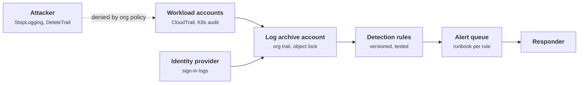
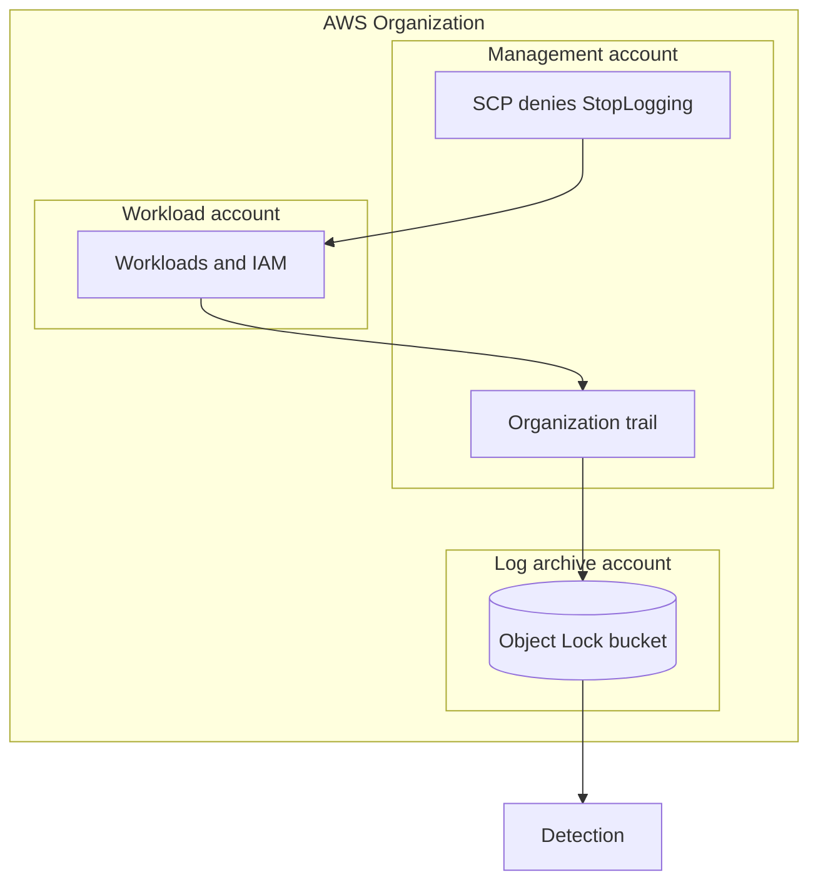
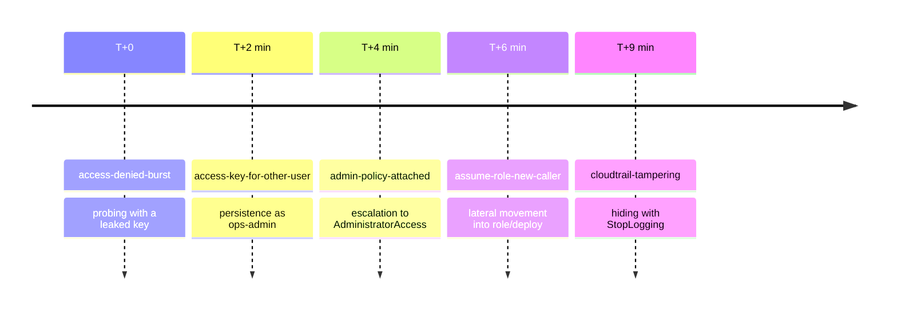
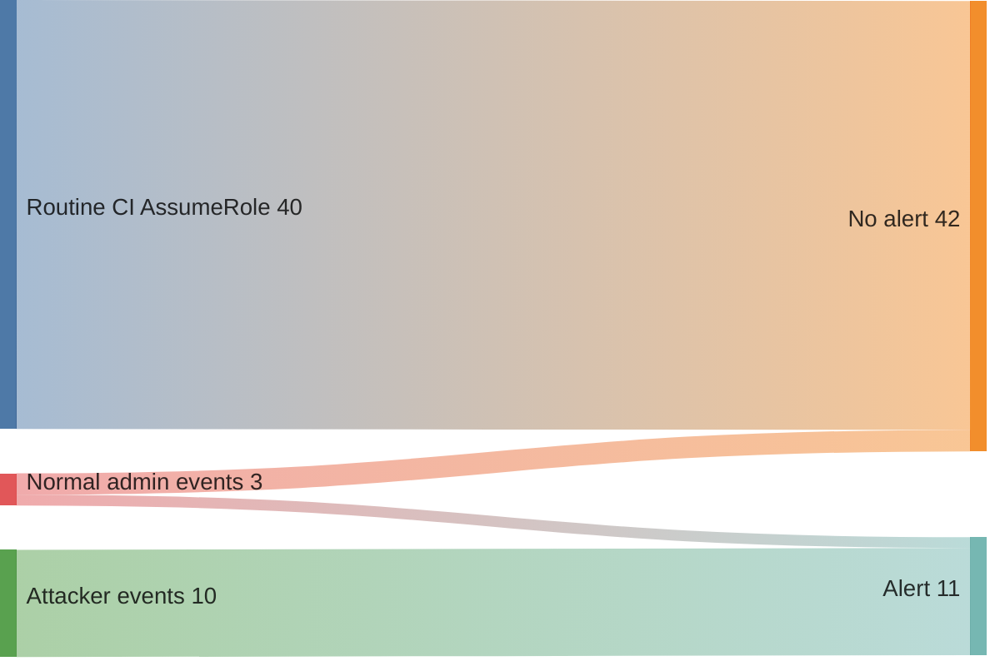

+++
title = 'Audit logs and detection'
description = 'Audit logs record what every identity did to the control plane. Detection turns that record into a small number of alerts on actions attackers need and normal operations rarely take.'
question = 'What should you log, how do you keep it trustworthy, and which detections are worth waking someone for?'
weight = 3
difficulty = 2
prerequisites = ['/notes/infrastructure-security/foundations/03-cloud-iam-fundamentals']
date = 2026-07-30
lastmod = 2026-07-30
verified = 2026-07-30
+++

## The idea in one minute

Every change to cloud infrastructure is an API call made by an identity. Cloud
audit logs, such as AWS CloudTrail, Google Cloud Audit Logs, and the Kubernetes
API server's audit log, record those calls: who, what, when, from where, and
whether it worked. After an incident they are the only reliable account of what
happened. Before one, they are the raw material for detection.

Two things make the difference between having logs and being able to use them.
**Integrity**: an attacker with administrative access will try to stop or
alter logging, so logs must be delivered somewhere the account they describe
cannot change. **Signal**: a detection that fires forty times a day is muted
within a week. The consequence to act on: **centralize logs into a separate,
immutable store, and write a small set of tested detections for the actions an
attacker must take: disabling logging, minting credentials, granting
privilege, and assuming roles from somewhere new**.

## A picture



The logs leave the account they describe. An attacker who becomes
administrator of a workload account can stop new events from being written
there, but cannot erase what has already been delivered, and the attempt is
itself an alert.

## How it really works

### What to log

| Source | What it records | Default and gotchas |
| --- | --- | --- |
| **AWS CloudTrail management events** | Control-plane calls: IAM, STS, EC2, KMS, CloudTrail itself | Visible for 90 days in Event history without setup; a **trail** is needed to keep them longer and deliver them to S3 |
| **CloudTrail data events** | Object-level calls such as S3 `GetObject`, Lambda invocations | Off by default and billed per event; without them you cannot say which objects were read |
| **Google Cloud Audit Logs** | Admin Activity (configuration changes) and Data Access | Admin Activity is always on; most Data Access logs are off by default |
| **Kubernetes audit log** | Every request to the API server: user, verb, resource, response | Only written if the API server is given an audit policy and a backend; managed services expose it as an opt-in or always-on control-plane log |
| **Identity provider** | Sign-ins, MFA events, token issuance | Often the first sign of a stolen human session |
| **Network and DNS logs** | Flows and queries | Fills the gap for activity that never touches a cloud API |

A CloudTrail record is a JSON object. The fields that detections and
investigations use most are these:

```json {title="an abridged CloudTrail record"}
{
  "eventTime": "2026-10-20T11:04:00Z",
  "eventSource": "iam.amazonaws.com",
  "eventName": "CreateAccessKey",
  "awsRegion": "us-east-1",
  "sourceIPAddress": "203.0.113.50",
  "userIdentity": {
    "type": "IAMUser",
    "arn": "arn:aws:iam::111122223333:user/build-bot",
    "accessKeyId": "AKIA...EXAMPLE"
  },
  "requestParameters": { "userName": "ops-admin" },
  "responseElements": { "accessKey": { "accessKeyId": "AKIA...NEW", "status": "Active" } }
}
```

`userIdentity` says who acted. For a role session it includes the role and the
session name, and the session's own temporary access key ID, which is how you
follow a credential across events. `requestParameters` and `responseElements`
say what was asked for and what came back; a newly minted credential's key ID
appears in the response.

Kubernetes audit logging is controlled by a policy that sets a **level** per
rule: `None`, `Metadata` (who, what, when), `Request` (plus the request body),
or `RequestResponse`. Logging request bodies for Secrets would write secret
values into the audit log, so Secrets are logged at `Metadata`:

```yaml {title="a minimal Kubernetes audit policy"}
apiVersion: audit.k8s.io/v1
kind: Policy
omitStages: ["RequestReceived"]
rules:
  - level: Metadata               # never log secret contents
    resources:
      - group: ""
        resources: ["secrets", "configmaps"]
  - level: RequestResponse        # who changed RBAC, and to what
    resources:
      - group: "rbac.authorization.k8s.io"
  - level: Request
    verbs: ["create", "update", "patch", "delete"]
  - level: Metadata               # everything else: who touched what
```

Each level records everything the one to its left does, plus more. The bottom
row shows which rule in the policy above lands at each level.

```mermaid {title="Kubernetes audit levels, and where this policy puts each resource"}
block-beta
  columns 4
  N["None"] M["Metadata"] R["Request"] RR["RequestResponse"]
  N2["nothing recorded"] M2["who, verb, resource, when"] R2["metadata + request body"] RR2["request + response body"]
  N3["not used here"] M3["secrets, configmaps, everything else"] R3["create, update, patch, delete"] RR3["RBAC changes"]
```

### Integrity and centralization

An attacker who gains administrative rights in an account has obvious moves:
call `StopLogging`, `DeleteTrail`, or `PutEventSelectors` to exclude events,
change the destination bucket's lifecycle, or delete log objects. MITRE ATT&CK
tracks this as T1562.008, Impair Defenses: Disable or Modify Cloud Logs. The
controls stack:

1. **Organization trail.** In AWS Organizations, a trail created in the
   management account records every member account, and member accounts
   cannot modify or delete it.
2. **Separate log archive account.** Logs are delivered to a bucket in an
   account that workload administrators cannot access.
3. **Preventive policy.** A service control policy denies
   `cloudtrail:StopLogging`, `cloudtrail:DeleteTrail`, and related actions to
   everyone except a break-glass role.
4. **Immutable storage.** S3 Object Lock in compliance mode prevents deletion
   for the retention period, even by the bucket owner.
5. **Tamper evidence.** CloudTrail **log file integrity validation** writes an
   hourly digest file listing the SHA-256 hash of each log file delivered,
   signed with a private key held by CloudTrail, and each digest references the
   previous one. `aws cloudtrail validate-logs` then shows whether any log file
   was modified or removed. The same idea, a hash chain with signed heads, is
   the basis of a [tamper-evident audit log](/notes/systems-design/worked-designs/03-a-tamper-evident-audit-log/).

Also enable trails in **all regions**. An attacker who launches instances in a
region you never use relies on nobody recording it.

Put together, the layout looks like this: events flow out of the workload
account into an account its administrators cannot reach, and the SCP from the
management account stops the obvious attempt to switch logging off.



Integrity validation is a hash chain: each hourly digest lists the log files it
covers and points at the digest before it, so a removed or edited file breaks
the chain where it happened.

```mermaid {title="CloudTrail digest files chain each hour to the one before"}
flowchart LR
  F1["log files<br/><small>hour 1</small>"] --> D1["<b>Digest 1</b><br/><small>SHA-256 per file, signed</small>"]
  F2["log files<br/><small>hour 2</small>"] --> D2["<b>Digest 2</b><br/><small>SHA-256 per file, signed</small>"]
  F3["log files<br/><small>hour 3</small>"] --> D3["<b>Digest 3</b><br/><small>SHA-256 per file, signed</small>"]
  D2 -->|previous digest| D1
  D3 -->|previous digest| D2
  ATK(["deletes one file"])
  ATK -.-> F2
  V("validate-logs reports the gap")
  D3 --> V
  class D1,D2,D3 good
  class F1,F2,F3 memory
```

Logs are not instant. AWS documents that CloudTrail typically delivers events
within about five minutes of the API call, without a guarantee. Detection
latency starts there.

### Detection engineering

A detection is code: it has an owner, a version, tests, and a runbook. Treat it
that way:

- **Write the hypothesis first.** "An attacker who obtains IAM write access
  will create an access key for a more privileged user." Then find the events
  that prove or disprove it.
- **Test with real samples.** Every rule needs at least one event that should
  fire and one benign event that looks similar and should not.
- **Attach a runbook.** Each alert says what to check first and who to call.
  An alert without a next step is noise.
- **Map coverage.** Tagging rules with ATT&CK techniques shows which attacker
  behaviors have no detection at all.

A rule has a lifecycle like any other code, and the loop at the bottom is
where most of the work happens.

```mermaid {title="A detection rule's lifecycle, from hypothesis to retirement"}
stateDiagram-v2
  [*] --> Hypothesis
  Hypothesis --> Written: find events that prove or disprove it
  Written --> Tested: one sample that fires, one benign look-alike
  Tested --> Enabled: owner and runbook attached
  Enabled --> Measured: count alerts that led to action
  Measured --> Enabled: precision holds
  Measured --> Rewritten: too noisy
  Rewritten --> Tested
  Measured --> Retired: never actionable
  Retired --> [*]
```

**Sigma** is a vendor-neutral YAML format for writing such rules once and
converting them, with the pySigma tooling, into the query language of a
specific SIEM. A rule names the log source, one or more selections of field
conditions, and a condition that combines them:

```yaml {title="a Sigma-style rule for CloudTrail tampering"}
title: CloudTrail logging stopped or modified
id: 3f0e6c2a-8d9b-4b51-9a57-2b7f0c1d4e10
status: experimental
logsource:
  product: aws
  service: cloudtrail
detection:
  selection:
    eventSource: cloudtrail.amazonaws.com
    eventName:
      - StopLogging
      - DeleteTrail
      - UpdateTrail
      - PutEventSelectors
  condition: selection
falsepositives:
  - Planned changes by the security team's automation
level: critical
tags:
  - attack.defense-evasion
  - attack.t1562.008
```

Field modifiers such as `|endswith`, `|contains`, and `|startswith` refine
matches. Plain Sigma selections cannot compare two fields of the same event or
count events over time. Sigma's newer correlation rules cover counts and
sequences; field-to-field comparisons, such as "the key was created for a
different user than the caller", usually end up in the SIEM's own language or
in code, as the program below shows.

### High-signal detections

Good first detections share two properties: an attacker almost has to do the
thing, and normal operations almost never do.

| Detection | Events | Why attackers do it | Common benign cause |
| --- | --- | --- | --- |
| Logging disabled or narrowed | `StopLogging`, `DeleteTrail`, `UpdateTrail`, `PutEventSelectors`; GuardDuty `DeleteDetector` | Hide what comes next | Planned changes; should be rare and ticketed |
| Access key created for another user | `CreateAccessKey` where the target user differs from the caller | Persistence as a more privileged user (ATT&CK T1098.001) | Admins provisioning keys, which SSO should have replaced |
| Admin policy attached | `AttachUserPolicy` / `AttachRolePolicy` with `AdministratorAccess` | Privilege escalation | Almost none in a well-run account |
| Console password added | `CreateLoginProfile`, `UpdateLoginProfile` | Turn a key into console access | User onboarding, if not using SSO |
| Role assumed by a new caller | `AssumeRole` where the caller and role pair is not in the baseline | Lateral movement | New pipelines, reorganized roles |
| Instance credentials used outside the cloud | GuardDuty `InstanceCredentialExfiltration` findings | Stolen role credentials, often via SSRF to the metadata service | Rare |
| Root user activity | `userIdentity.type` is `Root` | Root bypasses most guardrails | Specific billing and account tasks |
| Kubernetes RBAC escalation | create or patch a `ClusterRoleBinding` to `cluster-admin`; `exec` into pods in `kube-system` | Cluster takeover | Cluster bootstrapping |

Placed roughly by those two properties, the table's rules cluster in the top
left. "Any AssumeRole" is the counter-example: attackers use it, but so does
every pipeline.

```mermaid {title="Good first detections: attackers need them, normal operations rarely do them"}
quadrantChart
  x-axis "Rare in normal operations" --> "Common in normal operations"
  y-axis "Attacker can avoid it" --> "Attacker almost must do it"
  quadrant-1 "Needs a baseline or context"
  quadrant-2 "Alert on these first"
  quadrant-3 "Low value"
  quadrant-4 "Noise"
  Logging disabled: [0.08, 0.9]
  Admin policy attached: [0.12, 0.78]
  Key for another user: [0.2, 0.72]
  Root activity: [0.15, 0.55]
  New role caller: [0.38, 0.66]
  Console password added: [0.28, 0.5]
  Any AssumeRole: [0.92, 0.6]
```

### Alert fatigue

Responders who see mostly false positives learn to dismiss alerts, including
the true one. The fixes are disciplined rather than clever:

- **Measure precision per rule.** Track how many alerts led to action. Rules
  that never do are rewritten or deleted.
- **Prefer specific over broad.** "Any `AssumeRole`" fires constantly; "a
  caller that has never assumed this role" fires rarely and means something.
- **Be careful with allowlists.** Suppressing alerts for a principal, such as
  the security team's automation role, creates a blind spot exactly where a
  compromise would be most damaging. Correlate with change tickets instead, or
  lower the severity rather than suppressing.
- **Deduplicate and group.** One incident should be one alert with context,
  not twenty.
- **Know the cost of baselines.** Anomaly rules need a learning period, drift
  as systems change, and can be taught bad behavior if an attacker is present
  while the baseline is built.

## Code

A detection engine with Sigma-like selections for stateless rules, plus two
stateful rules: a baseline of which callers assume which roles, and a sliding
window of AccessDenied errors per principal. The simulated stream mixes forty
routine CI role assumptions and a few normal administrative events with an
attack using a leaked key for `user/build-bot`. ARNs and role names are
shortened for readability.

```python {title="detect.py"}
"""detect.py: a small detection engine over simulated CloudTrail-style events.

Stateless rules use Sigma-like selections ("field|modifier": value). Two rules
need state: a baseline of who normally assumes which role, and a count of
AccessDenied errors per principal in a sliding window. Standard library only;
offline; the event stream is generated from a fixed seed.
"""

from __future__ import annotations

import random
from collections import defaultdict, deque
from datetime import datetime, timedelta

ACCT = "111122223333"
BASE = datetime(2026, 10, 20, 9, 0, 0)

RULES = [
    {"id": "cloudtrail-tampering", "level": "critical",
     "selection": {"eventSource": "cloudtrail.amazonaws.com",
                   "eventName|in": ["StopLogging", "DeleteTrail", "UpdateTrail",
                                    "PutEventSelectors"]}},
    {"id": "admin-policy-attached", "level": "high",
     "selection": {"eventName|in": ["AttachUserPolicy", "AttachRolePolicy"],
                   "requestParameters.policyArn|endswith": "/AdministratorAccess"}},
    {"id": "access-key-for-other-user", "level": "high",
     "selection": {"eventName": "CreateAccessKey"},
     # Sigma selections cannot compare two fields; this check needs code.
     "where": lambda e: get(e, "requestParameters.userName") not in
                        (None, get(e, "userIdentity.userName"))},
    {"id": "console-login-without-mfa", "level": "medium",
     "selection": {"eventName": "ConsoleLogin", "additionalEventData.MFAUsed": "No",
                   "responseElements.ConsoleLogin": "Success"}},
]


def get(event: dict, path: str):
    for part in path.split("."):
        if not isinstance(event, dict):
            return None
        event = event.get(part)
    return event


def matches(event: dict, selection: dict) -> bool:
    for key, want in selection.items():
        field, _, mod = key.partition("|")
        have = get(event, field)
        if mod == "in":
            ok = have in want
        elif mod == "endswith":
            ok = isinstance(have, str) and have.endswith(want)
        else:
            ok = have == want
        if not ok:
            return False
    return True


def event(minute: float, name: str, who: str, source: str = "iam.amazonaws.com",
          ip: str = "10.0.4.12", **extra) -> dict:
    kind = "AssumedRole" if ":assumed-role/" in who else "IAMUser"
    ident = {"type": kind, "arn": f"arn:aws:{'sts' if kind == 'AssumedRole' else 'iam'}"
             f"::{ACCT}:{who}", "userName": who.split("/")[-1]}
    return {"eventTime": (BASE + timedelta(minutes=minute)).isoformat() + "Z",
            "eventSource": source, "eventName": name, "sourceIPAddress": ip,
            "userIdentity": ident, **extra}


def stream() -> list[dict]:
    rng = random.Random(7)
    evs = [event(rng.uniform(0, 240), "AssumeRole", "assumed-role/ci-runner/job",
                 "sts.amazonaws.com", requestParameters={"roleArn": "role/deploy"})
           for _ in range(40)]
    evs.append(event(30, "UpdateTrail", "assumed-role/security-automation/rotate",
                     "cloudtrail.amazonaws.com"))
    evs.append(event(45, "ConsoleLogin", "user/dana", "signin.amazonaws.com",
                     additionalEventData={"MFAUsed": "Yes"},
                     responseElements={"ConsoleLogin": "Success"}))
    evs.append(event(50, "CreateAccessKey", "user/dana", requestParameters={"userName": "dana"}))
    atk = "203.0.113.50"  # leaked key for user/build-bot used from outside
    for i in range(6):
        evs.append(event(120 + i * 0.5, "ListUsers" if i % 2 else "GetSecretValue",
                         "user/build-bot", ip=atk, errorCode="AccessDenied"))
    evs.append(event(124, "CreateAccessKey", "user/build-bot", ip=atk,
                     requestParameters={"userName": "ops-admin"}))
    evs.append(event(126, "AttachUserPolicy", "user/build-bot", ip=atk, requestParameters={
        "userName": "build-bot", "policyArn": "arn:aws:iam::aws:policy/AdministratorAccess"}))
    evs.append(event(128, "AssumeRole", "user/build-bot", "sts.amazonaws.com", ip=atk,
                     requestParameters={"roleArn": "role/deploy"}))
    evs.append(event(131, "StopLogging", "user/build-bot", "cloudtrail.amazonaws.com", ip=atk))
    return sorted(evs, key=lambda e: e["eventTime"])


def caller(arn: str) -> str:
    """A role caller is the role, not the per-run session name; a user is the user."""
    res = arn.split(":", 5)[-1]
    return res.rsplit("/", 1)[0] if res.startswith("assumed-role/") else res


def run(events: list[dict], baseline: set[tuple[str, str]]) -> list[tuple]:
    alerts = []
    denied: dict[str, deque] = defaultdict(deque)
    for e in events:
        who, t = get(e, "userIdentity.arn"), datetime.fromisoformat(e["eventTime"][:-1])
        for r in RULES:
            if matches(e, r["selection"]) and r.get("where", lambda _: True)(e):
                alerts.append((e["eventTime"], r["level"], r["id"], who, e["eventName"]))
        if e["eventName"] == "AssumeRole":
            pair = (caller(who), get(e, "requestParameters.roleArn"))
            if pair not in baseline:
                alerts.append((e["eventTime"], "medium", "assume-role-new-caller", who,
                               f"{pair[0]} -> {pair[1]}"))
        if e.get("errorCode") == "AccessDenied":
            q = denied[who]
            q.append(t)
            while t - q[0] > timedelta(minutes=5):
                q.popleft()
            if len(q) == 5:  # fire once when the threshold is crossed
                alerts.append((e["eventTime"], "medium", "access-denied-burst", who,
                               "5 denials in 5 min"))
    return alerts


if __name__ == "__main__":
    events = stream()
    baseline = {("assumed-role/ci-runner", "role/deploy")}  # learned from 30 days
    alerts = run(events, baseline)
    print(f"{len(events)} events, {len(alerts)} alerts")
    for when, level, rule, who, what in alerts:
        print(f"{when[11:16]} {level:<8} {rule:<26} {who.split(':')[-1]:<40} {what}")
    naive = sum(e["eventName"] == "AssumeRole" for e in events)
    print(f"a rule on every AssumeRole would have fired {naive} times")
```

Run it with `python3 detect.py`:

```text
53 events, 6 alerts
09:30 critical cloudtrail-tampering       assumed-role/security-automation/rotate  UpdateTrail
11:02 medium   access-denied-burst        user/build-bot                           5 denials in 5 min
11:04 high     access-key-for-other-user  user/build-bot                           CreateAccessKey
11:06 high     admin-policy-attached      user/build-bot                           AttachUserPolicy
11:08 medium   assume-role-new-caller     user/build-bot                           user/build-bot -> role/deploy
11:11 critical cloudtrail-tampering       user/build-bot                           StopLogging
a rule on every AssumeRole would have fired 41 times
```

The five attack alerts, laid out from the first one, read as the attacker's
plan in order.



And the volume: of 53 events, the 40 routine role assumptions and nearly all
normal admin work produce nothing, while the ten attacker events surface as
five alerts.



The attack produces five alerts that tell its story in order: probing,
persistence, escalation, lateral movement, and hiding. The first alert is
the security team's own change. It is a true detection of a benign event, which
is exactly the case to route through change correlation rather than suppress.
The last line is alert fatigue in one number: a naive rule on every role
assumption would have buried the one that mattered among 41.

## Where it breaks

- **Control plane only.** CloudTrail sees API calls. A process running on a
  compromised instance, reading files or connecting to a database, makes no
  cloud API call. Host and network telemetry fill that gap.
- **Data events cost money.** Without S3 data events the investigation cannot
  say which objects were read, only that the identity could read them.
- **Delay.** Minutes of delivery delay plus rule scheduling means detection is
  measured in minutes at best. Preventive controls, such as the SCP on
  `StopLogging`, matter more than the alert for the fastest attacks.
- **Living off the land.** An attacker who uses a stolen CI role to do exactly
  what CI does generates no anomaly. Detections that key on new callers, new
  source networks, and new regions help; perfect coverage does not exist.
- **Baselines can be poisoned.** If the attacker is present while the baseline
  is learned, their behavior becomes normal.
- **The simulation is small.** Real streams have millions of events, delivery
  out of order, and many more benign variants. Rules need testing against a
  sample of real logs before they are enabled.

## Remember this

- Logs must leave the account they describe: org trail, archive account,
  object lock, integrity validation.
- Turn on all regions; decide deliberately which data events you pay for.
- Never log Kubernetes Secret bodies; audit them at `Metadata`.
- Start with detections for disabling logs, minting credentials, granting
  admin, and new role callers.
- Every rule has a test, an owner, and a runbook; measure how often it leads
  to action.
- Allowlisting a principal creates a blind spot for that principal.

## Try it

1. Run `detect.py`. Add a rule for `CreateLoginProfile` and an event that
   triggers it. Write one benign event that should not trigger it.
2. Add an `ip` dimension to the new-caller rule so a known pair from a new
   source network also alerts. How much noise would this add for CI runners
   with changing addresses?
3. Change the AccessDenied rule so it fires once per principal per hour rather
   than every time the count reaches five. What could an attacker do with
   that knowledge?
4. Check one of your accounts or clusters: is there a trail or audit policy,
   where does it deliver, and who could stop it?

## Check yourself

1. Why should audit logs be delivered to a separate account?

   
   An attacker who becomes administrator of a workload account could delete or
   alter logs stored in that account. Delivery to an archive account they
   cannot access, with object lock, means already-delivered events survive and
   attempts to stop logging are themselves recorded.
   

2. What does CloudTrail log file integrity validation provide?

   
   Hourly signed digest files containing the SHA-256 hash of each delivered log
   file, chained to the previous digest. Validation shows whether any log file
   was modified or deleted after delivery. It is tamper evidence, not
   prevention.
   

3. Why is "access key created for a different user" a stronger signal than
   "access key created"?

   
   Users creating their own keys is routine in some organizations. Creating a
   key for another, often more privileged, user is a classic persistence and
   escalation step, and rarely happens in normal operations where provisioning
   goes through SSO or automation.
   

4. What is the risk of allowlisting your security automation role in the
   logging-tampering rule?

   
   If that role is compromised, the attacker can disable logging with no alert.
   The most privileged principals are the worst place for a blind spot.
   Correlating with change tickets keeps the signal without paging on every
   planned change.
   

5. Why should Kubernetes Secrets be audited at the `Metadata` level?

   
   At `Request` or `RequestResponse`, the audit log would contain the secret
   values in request or response bodies, turning the audit log into a second
   secret store with weaker protection. `Metadata` still records who read or
   changed which secret.
   

## Sources

- AWS, [AWS CloudTrail User Guide](https://docs.aws.amazon.com/awscloudtrail/latest/userguide/cloudtrail-user-guide.html), including [Validating CloudTrail log file integrity](https://docs.aws.amazon.com/awscloudtrail/latest/userguide/cloudtrail-log-file-validation-intro.html) and [Creating a trail for an organization](https://docs.aws.amazon.com/awscloudtrail/latest/userguide/creating-trail-organization.html).
- AWS, [Amazon GuardDuty finding types](https://docs.aws.amazon.com/guardduty/latest/ug/guardduty_finding-types-active.html).
- Google Cloud, [Cloud Audit Logs overview](https://cloud.google.com/logging/docs/audit).
- Kubernetes, [Auditing](https://kubernetes.io/docs/tasks/debug/debug-cluster/audit/).
- SigmaHQ, [Sigma specification](https://github.com/SigmaHQ/sigma-specification) and [Sigma rule repository](https://github.com/SigmaHQ/sigma).
- MITRE ATT&CK, [T1562.008 Impair Defenses: Disable or Modify Cloud Logs](https://attack.mitre.org/techniques/T1562/008/) and [T1098.001 Account Manipulation: Additional Cloud Credentials](https://attack.mitre.org/techniques/T1098/001/).
- K. Kent, M. Souppaya, [NIST SP 800-92: Guide to Computer Security Log Management](https://csrc.nist.gov/pubs/sp/800/92/final), September 2006.
