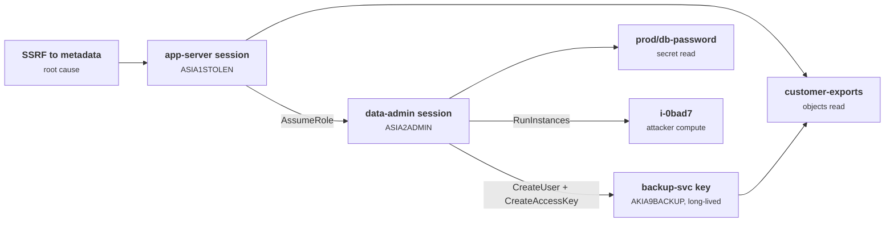
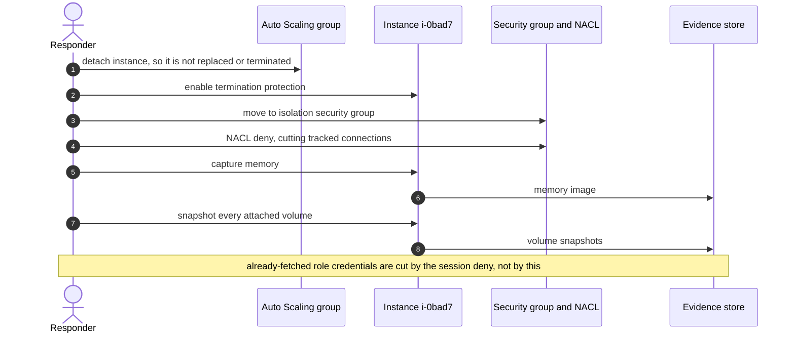

+++
title = 'Containing an incident'
description = 'Containing a cloud incident means following the stolen credential through everything it minted and touched, cutting all of it off faster than the attacker can make more, and keeping the evidence while you do.'
question = 'When a cloud identity is compromised, how do you find everything it reached and shut it down without destroying the evidence?'
weight = 4
difficulty = 3
prerequisites = ['/notes/infrastructure-security/delivery-and-operations/03-audit-logs-and-detection', '/notes/infrastructure-security/foundations/03-cloud-iam-fundamentals']
date = 2026-08-01
lastmod = 2026-08-01
verified = 2026-08-01
+++

## The idea in one minute

In the cloud, the attacker's foothold is usually an identity, not a machine. A
stolen role session can assume other roles, create users and access keys,
launch instances that carry their own credentials, and read secrets that work
outside the cloud entirely. **Revoking the credential you found does nothing
about the ones it created.** Containment therefore starts with scoping: walk
the audit log from the stolen credential to every credential it minted and
every resource any of them touched.

Then act in an order that holds: cut access first, because the attacker is
still working; preserve evidence before anything is destroyed; rotate what was
exposed once the attacker can no longer read the new values; and only then
eradicate the root cause and recover. NIST SP 800-61 frames all of this inside
an organization's wider risk management. The consequence to act on: **scope by
credential lineage, revoke by issue time rather than by key, and isolate rather
than delete**.

## A picture



Revoking only the first session would leave a long-lived access key, an
instance, and a database password in the attacker's hands.

## How it really works

### NIST SP 800-61 Rev. 3

NIST published SP 800-61 Revision 3, *Incident Response Recommendations and
Considerations for Cybersecurity Risk Management: A CSF 2.0 Community
Profile*, in April 2025, replacing Revision 2 from 2012. The change is
structural. Rev. 2 described a four-phase lifecycle that most runbooks still
follow. Rev. 3 places incident response inside the six functions of the NIST
Cybersecurity Framework 2.0, so preparation and improvement become part of
ordinary risk management rather than a separate phase.

| Rev. 2 lifecycle (2012) | Where it sits in Rev. 3 (CSF 2.0 functions) |
| --- | --- |
| Preparation | Govern, Identify, Protect: policies, roles, asset inventory, logging, hardening |
| Detection and analysis | Detect, and the analysis activities of Respond |
| Containment, eradication, and recovery | Respond (incident management, mitigation, reporting) and Recover |
| Post-incident activity | Improvement, which feeds back into every function |

Seen as a map rather than a cycle, Rev. 3 hangs each part of incident response
off one of the six CSF functions.

```mermaid {title="SP 800-61 Rev. 3 places incident response across the CSF 2.0 functions"}
mindmap
  root((Incident response in CSF 2.0))
    Govern
      Policies and roles
    Identify
      Asset inventory
    Protect
      Logging and hardening
    Detect
      Detection
    Respond
      Analysis
      Incident management
      Mitigation and reporting
    Recover
      Recovery
```

Rev. 2's practical guidance on choosing a containment strategy is still
useful. It lists criteria to weigh: potential damage and theft of resources,
the need to preserve evidence, service availability, the time and resources
needed, how effective the strategy is, and how long the solution lasts. Cloud
containment is mostly a negotiation between the first three.

### Scope by following the credential

The questions, in order:

1. **Which credential, and since when?** From the alert: the access key ID,
   the principal, the first suspicious use. In CloudTrail, temporary
   credentials start with `ASIA` and long-term IAM user keys with `AKIA`.
2. **What did it mint?** Any event by a tainted credential that creates a
   credential taints the result. In AWS: `AssumeRole` (the new key ID is in
   `responseElements.credentials`), `GetSessionToken`, `GetFederationToken`,
   `CreateAccessKey`, and `CreateLoginProfile` (a console password).
3. **What else can mint credentials later?** Compute and configuration that
   carry authority: instances launched with an instance profile, Lambda
   functions created with a role, role trust policies edited with
   `UpdateAssumeRolePolicy` to trust an outside account, and resource policies
   on buckets, keys, or queues opened to an outside principal. These survive
   every credential revocation.
4. **What did each tainted credential touch?** Objects read, secrets read,
   resources created or changed, source addresses used.
5. **Repeat to a fixed point.** Each new credential can mint more. Logs also
   arrive out of order, so iterate until nothing new is found.

The walk is a loop, not a single pass: it stops only when a full sweep of the
log finds no new credential.

```mermaid {title="Scoping is a loop that runs until no new credential appears"}
flowchart TB
  S["<b>Seed credential</b><br/><small>from the alert</small>"] --> W["<b>Sweep the log</b><br/><small>events by any tainted key</small>"]
  W --> M@{ shape: diam, label: "Minted a new credential?" }
  M -->|yes| T["<b>Taint it</b><br/><small>AssumeRole, CreateAccessKey, GetSessionToken</small>"]
  T --> W
  M -->|no| P["<b>Persistent footholds</b><br/><small>instances, functions, trust and resource policies</small>"]
  P --> B["<b>Blast radius</b><br/><small>objects, secrets, resources, source IPs</small>"]
  class S,T warn
  class W compute
  class B memory
```

Where the log is silent, assume the worst the permissions allow. Without S3
data events you cannot list objects read; the scope becomes everything the
tainted roles could read.

### Revocation and how it propagates

Different credentials die in different ways, and some cannot be killed
directly at all:

| Credential | How to cut it off | Caveat |
| --- | --- | --- |
| IAM user access key (`AKIA…`) | Deactivate it, then delete after the investigation | Takes effect after IAM's eventual consistency delay, usually short |
| Role session (`ASIA…`) | Cannot be revoked individually; deny sessions issued before a time with `aws:TokenIssueTime` | Valid until expiry otherwise: up to the role's maximum session duration (as much as 12 hours), one hour for chained roles |
| `GetSessionToken` credentials of an IAM user | Deny on the user with `aws:TokenIssueTime`, and deactivate the user's keys | Can last up to 36 hours |
| Console session | Revoke the user's sessions in the identity provider; for IAM users, remove the login profile | Existing browser sessions persist until their own expiry |
| OIDC or JWT bearer tokens | Usually valid until `exp` unless the resource checks revocation | Keep lifetimes short so this matters less |
| Kubernetes service account tokens | Bound tokens die with their pod; delete the pod or the service account | Legacy secret-based tokens last until the secret is deleted |

Those caveats are mostly about lifetime. The longest-lived of them are the
ones a "wait for expiry" plan cannot afford.

```mermaid {title="How long an unrevoked temporary AWS credential can stay valid"}
xychart-beta
  x-axis ["Chained role session", "Role session, maximum", "GetSessionToken, maximum"]
  y-axis "Hours" 0 --> 40
  bar [1, 12, 36]
```

The AWS console's "Revoke active sessions" button on a role attaches an inline
policy that denies everything to sessions issued before the moment you click:

```json {title="the deny-older-sessions policy"}
{
  "Version": "2012-10-17",
  "Statement": [{
    "Effect": "Deny",
    "Action": ["*"],
    "Resource": ["*"],
    "Condition": { "DateLessThan": { "aws:TokenIssueTime": "2026-10-20T10:45:00Z" } }
  }]
}
```

Three consequences follow. **Use the time of containment, not the time of the
first suspicious event**: the attacker may have minted fresh sessions since
then. **Legitimate holders recover on their own**: an instance refreshes its
instance profile credentials and gets a session issued after the cutoff.
**So does the attacker, if the root cause is still open**: an SSRF that read
the metadata service once will read it again, so close that path, or stop the
instance, at the same time. And if the tainted identities can edit IAM
policies, they can delete the deny; a service control policy applied from the
management account cannot be removed by the member account.

This chart uses the scenario from the code below. The deny at 10:45 kills
both attacker sessions, whatever key they use.
A cutoff at the first suspicious event, 10:14, would have missed the
data-admin session issued two minutes later, and an SSRF left open hands the
attacker a fresh session after the cutoff.

```mermaid {title="Revoking by issue time kills every older session, not just the one you found"}
gantt
  dateFormat HH:mm
  axisFormat %H:%M
  section Attacker
  app-server session ASIA1STOLEN :crit, a1, 10:14, 31m
  data-admin session ASIA2ADMIN :crit, a2, 10:16, 29m
  New session via open SSRF :crit, a3, 10:55, 30m
  section Containment
  Deny sessions issued before cutoff :milestone, m1, 10:45, 0m
  section Legitimate
  Instance refreshes its credentials :active, l1, 10:47, 38m
```

### Quarantine compute without destroying it

Terminating an attacker's instance feels decisive and destroys the memory,
the disk, and the evidence of what it was doing. Isolate instead:

- **Move it to an isolation security group** with no inbound or outbound
  rules. Security group changes do not necessarily cut connections that are
  already tracked; AWS documents that tracked connections can continue. A
  network ACL deny, which is stateless, cuts them immediately.
- **Take it out of automation.** Detach it from its Auto Scaling group, which
  would otherwise replace or terminate it, and enable termination protection.
- **Capture before stopping.** Memory is lost when an instance stops. Capture
  it if the investigation needs it, then snapshot every attached volume.
- **Remember its credentials.** Detaching the instance profile stops new
  credentials, but the ones already fetched stay valid until they expire. The
  session revocation above covers them.

The order matters: take the instance away from automation before touching the
network, and capture memory before anything stops it.



In Kubernetes the same idea applies: remove the pod's labels from the
service selector, apply a deny-all network policy, cordon the node, and keep
the pod rather than deleting it.

### Preserve evidence

Copy the relevant audit logs to the immutable archive if they are not already
there, export them beyond the default retention window, and snapshot volumes.
Record every responder action with a timestamp: your containment steps appear
in CloudTrail too, and the timeline must distinguish them from the attacker's.
Keep track of who handled each piece of evidence if legal action or
regulatory reporting is possible.

### Rotate what was exposed

Rotation comes after access is cut, not before. Rotating a database password
while the attacker still holds a role that can read the secret just hands
them the new value. After rotating, verify that the old value is rejected, and
look for the systems where it was copied: configuration files, CI variables,
developer machines. The secret lifecycle lesson covers rotation mechanics:
[the secret lifecycle](/notes/infrastructure-security/secrets/01-the-secret-lifecycle/).

The whole response has an order, and rotation sits after the step that removes
the attacker's ability to read the new value.

```mermaid {title="Containment order: cut, keep, rotate, then fix"}
stateDiagram-v2
  direction LR
  [*] --> Scoped: lineage walked to a fixed point
  Scoped --> AccessCut: sessions denied, keys off, root cause closed
  AccessCut --> EvidenceKept: logs exported, volumes snapshotted
  EvidenceKept --> Rotated: exposed secrets replaced, old value rejected
  Rotated --> Eradicated: root cause fixed
  Eradicated --> Recovered
  Recovered --> Postmortem
  Postmortem --> [*]
```



### Postmortems

A postmortem reconstructs the timeline from logs, identifies contributing
factors, and assigns follow-up actions with owners and dates. The blameless
form, described in Google's SRE book, asks how the system allowed the failure
rather than who to blame, because people who fear blame hide the details that
fix the system. For security incidents the questions worth answering are
specific: how did the credential leave its workload, how long between first
malicious use and detection, which detections fired and which should have,
which logs were missing, and how long each containment step took. Each answer
becomes a change to detection, logging, or architecture, which is the feedback
loop Rev. 3 builds into every CSF function.

## Code

A scoping walk over simulated CloudTrail events. Starting from one stolen
app-server session, it follows minted credentials to a fixed point, collects
what each tainted credential touched, and prints an ordered containment plan.
The instance's own legitimate session and an unrelated developer session stay
out of scope. Event shapes are simplified from real CloudTrail records.

```python {title="scope.py"}
"""scope.py: scope a compromised role from its audit trail, then plan containment.

Starting from one stolen session credential, walk CloudTrail-style events to a
fixed point: every credential minted by a tainted credential is tainted too.
Collect what each tainted credential touched and turn that into an ordered
containment plan. Standard library only; offline; all events are simulated.
"""

from __future__ import annotations

from collections import defaultdict

OUT = "198.51.100.7"  # attacker address seen in the original alert


def ev(t: str, key: str, who: str, name: str, ip: str = OUT, req=None, resp=None) -> dict:
    return {"eventTime": f"2026-10-20T{t}Z", "eventName": name, "sourceIPAddress": ip,
            "userIdentity": {"arn": who, "accessKeyId": key},
            "requestParameters": req or {}, "responseElements": resp or {}}


APP = "assumed-role/app-server/i-0a11"
EVENTS = [
    ev("10:00:05", "ASIA0APP", APP, "GetObject", "10.0.3.8", {"bucketName": "app-config"}),
    ev("10:14:10", "ASIA1STOLEN", APP, "ListBuckets"),
    ev("10:15:02", "ASIA1STOLEN", APP, "GetObject",
       req={"bucketName": "customer-exports", "key": "2026-10/export.csv"}),
    ev("10:16:40", "ASIA1STOLEN", APP, "AssumeRole", req={"roleArn": "role/data-admin"},
       resp={"credentials": {"accessKeyId": "ASIA2ADMIN"}}),
    ev("10:18:00", "ASIA2ADMIN", "assumed-role/data-admin/x", "GetSecretValue",
       req={"secretId": "prod/db-password"}),
    ev("10:19:30", "ASIA2ADMIN", "assumed-role/data-admin/x", "CreateUser",
       req={"userName": "backup-svc"}),
    ev("10:19:55", "ASIA2ADMIN", "assumed-role/data-admin/x", "CreateAccessKey",
       req={"userName": "backup-svc"}, resp={"accessKey": {"accessKeyId": "AKIA9BACKUP"}}),
    ev("10:21:00", "ASIA2ADMIN", "assumed-role/data-admin/x", "RunInstances",
       req={"instanceType": "g5.12xlarge"}, resp={"instancesSet": ["i-0bad7"]}),
    ev("10:25:12", "ASIA0APP", APP, "GetObject", "10.0.3.8", {"bucketName": "app-config"}),
    ev("10:40:44", "AKIA9BACKUP", "user/backup-svc", "GetObject", "192.0.2.99",
       {"bucketName": "customer-exports", "key": "2026-09/export.csv"}),
    ev("10:41:03", "ASIA7DEV", "assumed-role/dev/sam", "DescribeInstances", "10.0.9.2"),
]

MINTS = {"AssumeRole": "credentials", "GetSessionToken": "credentials",
         "GetFederationToken": "credentials", "CreateAccessKey": "accessKey"}


def scope(events: list[dict], seed: str):
    tainted = {seed: "seed (from alert)"}
    changed = True
    while changed:  # logs can arrive out of order, so iterate to a fixed point
        changed = False
        for e in events:
            key, name = e["userIdentity"]["accessKeyId"], e["eventName"]
            if key in tainted and name in MINTS:
                new = e["responseElements"][MINTS[name]]["accessKeyId"]
                if new not in tainted:
                    tainted[new] = f"minted by {key} via {name}"
                    changed = True
    touched = defaultdict(set)
    first: dict[str, str] = {}
    for e in events:
        key, rq, rs = e["userIdentity"]["accessKeyId"], e["requestParameters"], e["responseElements"]
        if key not in tainted:
            continue
        first.setdefault(e["userIdentity"]["arn"].split("/")[1], e["eventTime"])
        touched["source IPs"].add(e["sourceIPAddress"])
        if e["userIdentity"]["arn"].startswith("assumed-role/"):
            touched["roles used"].add(e["userIdentity"]["arn"].split("/")[1])
        if "bucketName" in rq:
            touched["objects read"].add(f"s3://{rq['bucketName']}/{rq.get('key', '')}")
        if "secretId" in rq:
            touched["secrets read"].add(rq["secretId"])
        if e["eventName"] in ("CreateUser", "CreateLoginProfile"):
            touched["principals created"].add(rq["userName"])
        for inst in rs.get("instancesSet", []):
            touched["instances launched"].add(inst)
    return tainted, touched, first


def plan(tainted: dict, touched: dict, first: dict, now: str) -> list[str]:
    """Order: cut access first (minutes matter), keep evidence before destroying
    anything, then rotate what was read, then find the root cause."""
    steps = [f"Revoke: deny {role} sessions issued before {now} (aws:TokenIssueTime)"
             for role in sorted(touched["roles used"])]
    steps += [f"Revoke: deactivate long-term key {k} (keep it for evidence)"
              for k in tainted if k.startswith("AKIA")]
    steps += [f"Contain: attach deny-all to user {p}; delete after review"
              for p in sorted(touched["principals created"])]
    for i in sorted(touched["instances launched"]):
        steps.append(f"Contain: move {i} to an isolation security group; do not terminate")
        steps.append(f"Preserve: snapshot volumes and capture memory of {i}")
    start = min(first.values())[11:19]
    steps.append(f"Preserve: export all-region CloudTrail from 24h before {start}Z "
                 "to the locked log archive")
    steps += [f"Rotate: {s}, then confirm the old value is rejected"
              for s in sorted(touched["secrets read"])]
    steps.append("Assess: data exposure for " + ", ".join(sorted(touched["objects read"])))
    steps.append("Eradicate: find how app-server credentials left the instance")
    return steps


if __name__ == "__main__":
    tainted, touched, first = scope(EVENTS, "ASIA1STOLEN")
    print("credential lineage:")
    for key, why in tainted.items():
        print(f"  {key:<12} {why}")
    print("first seen: " + ", ".join(f"{p} {t[11:19]}" for p, t in first.items()))
    print("blast radius:")
    for kind in ("roles used", "source IPs", "objects read", "secrets read", "principals created",
                 "instances launched"):
        print(f"  {kind:<19} {', '.join(sorted(touched[kind]))}")
    untouched = {e["userIdentity"]["accessKeyId"] for e in EVENTS} - set(tainted)
    print(f"not tainted: {', '.join(sorted(untouched))}")
    print("containment plan:")
    for n, step in enumerate(plan(tainted, touched, first, "10:45:00Z"), 1):
        print(f"  {n:>2}. {step}")
```

Run it with `python3 scope.py`:

```text
credential lineage:
  ASIA1STOLEN  seed (from alert)
  ASIA2ADMIN   minted by ASIA1STOLEN via AssumeRole
  AKIA9BACKUP  minted by ASIA2ADMIN via CreateAccessKey
first seen: app-server 10:14:10, data-admin 10:18:00, backup-svc 10:40:44
blast radius:
  roles used          app-server, data-admin
  source IPs          192.0.2.99, 198.51.100.7
  objects read        s3://customer-exports/2026-09/export.csv, s3://customer-exports/2026-10/export.csv
  secrets read        prod/db-password
  principals created  backup-svc
  instances launched  i-0bad7
not tainted: ASIA0APP, ASIA7DEV
containment plan:
   1. Revoke: deny app-server sessions issued before 10:45:00Z (aws:TokenIssueTime)
   2. Revoke: deny data-admin sessions issued before 10:45:00Z (aws:TokenIssueTime)
   3. Revoke: deactivate long-term key AKIA9BACKUP (keep it for evidence)
   4. Contain: attach deny-all to user backup-svc; delete after review
   5. Contain: move i-0bad7 to an isolation security group; do not terminate
   6. Preserve: snapshot volumes and capture memory of i-0bad7
   7. Preserve: export all-region CloudTrail from 24h before 10:14:10Z to the locked log archive
   8. Rotate: prod/db-password, then confirm the old value is rejected
   9. Assess: data exposure for s3://customer-exports/2026-09/export.csv, s3://customer-exports/2026-10/export.csv
  10. Eradicate: find how app-server credentials left the instance
```

The walk found two credentials beyond the one in the alert, one of them a
long-term key used 20 minutes later from a different address. Revoking only
`ASIA1STOLEN` would have left the attacker with persistent access, a GPU
instance, and the production database password.

## Where it breaks

- **Credentials are not the only persistence.** The walk follows credential
  mints. An attacker can also edit a role's trust policy, open a bucket policy
  to their own account, add a KMS grant, or deploy a function with a role.
  None of these mint a credential that appears in this log, and all survive
  revocation. A real scoping pass lists every write action by every tainted
  credential and reviews it.
- **Logs have gaps.** Data events may be off, a region may not be logged, and
  logging may have been stopped. Missing events widen scope to everything the
  permissions allowed.
- **Secrets leave the cloud.** A database password read through
  `GetSecretValue` is used directly against the database. CloudTrail will
  never show that use; the database's own logs might.

  Only the first hop below is a cloud API call; the second is a database
  login that CloudTrail never sees.

  ```mermaid {title="A stolen secret's use happens outside the audit log"}
  flowchart LR
    A(["Attacker, data-admin session"])
    SM("prod/db-password")
    DB[("Production database")]
    CT("CloudTrail")
    DL("Database logs")
    A -->|GetSecretValue| SM
    SM -.->|recorded| CT
    A -->|direct login with the password| DB
    DB -.->|maybe recorded| DL
  ```
- **Revocation is not instant.** IAM changes propagate with a short delay,
  and some credentials, such as bearer tokens without revocation checks,
  cannot be cut off before expiry.
- **The attacker reacts.** Containment that happens in visible stages warns
  the attacker, who may use remaining access destructively. Plan the steps,
  then execute the revocations together.
- **The plan is a draft.** Business impact decides some steps: isolating a
  production instance may be an outage. A human with authority makes those
  calls; the script only makes sure nothing is forgotten.

## Remember this

- Scope by credential lineage: everything a stolen credential minted is
  stolen too.
- Revoke role sessions by issue time at the moment of containment; you cannot
  revoke one session by key.
- Close the root cause at the same time, or the attacker gets fresh
  credentials the same way.
- Isolate and snapshot compute; never terminate evidence.
- Rotate exposed secrets only after access is cut, and verify the old value
  fails.
- NIST SP 800-61 Rev. 3 (April 2025) maps response onto the CSF 2.0
  functions; feed every lesson back into them.

## Try it

1. Run `scope.py`. Add an `UpdateAssumeRolePolicy` event by `ASIA2ADMIN` that
   lets an outside account assume `data-admin`. Extend the walk to record it
   and the plan to revert it.
2. Shuffle `EVENTS` with a seeded random generator and confirm the lineage is
   unchanged. Which part of the code makes that true, and which line of the
   output can still change?
3. Add a `CreateFunction` event with a role and decide how the plan should
   treat it: as a resource to isolate, a credential to revoke, or both.
4. Write the containment runbook for your most privileged CI role: who can
   attach the deny policy, how long existing sessions can live, and what else
   that role can mint.

## Check yourself

1. Why does deactivating the stolen credential not contain the incident?

   
   Any credentials it minted, such as sessions from `AssumeRole` or access keys
   for new users, are independent and keep working. Compute it launched may
   carry its own role credentials. Containment has to cover the whole lineage
   found by walking the logs.
   

2. Why use the time of containment, rather than the first malicious event, in
   the `aws:TokenIssueTime` condition?

   
   The attacker may have obtained new sessions for the same role after the
   first malicious event. A cutoff at the first event would let those later
   sessions keep working. Denying everything issued before now kills all
   existing sessions, and legitimate users simply obtain new ones.
   

3. Why isolate an attacker's instance instead of terminating it?

   
   Termination destroys memory, disk contents, and the evidence of what the
   attacker did and took. Isolation through network controls stops the harm
   while snapshots and memory capture preserve evidence for analysis.
   

4. Why must secret rotation wait until access has been cut?

   
   If the attacker still holds a credential that can read the secret, they can
   read the rotated value as easily as the old one. Rotation only helps once
   their path to the secret store is closed.
   

5. What structural change did SP 800-61 Rev. 3 make compared with Rev. 2?

   
   Rev. 2 described a standalone four-phase incident response lifecycle. Rev. 3
   organizes incident response recommendations around the six CSF 2.0
   functions, Govern, Identify, Protect, Detect, Respond, and Recover, making
   preparation and improvement part of ongoing cybersecurity risk management.
   

## Sources

- A. Nelson, S. Rekhi, M. Souppaya, K. Scarfone, [NIST SP 800-61 Rev. 3: Incident Response Recommendations and Considerations for Cybersecurity Risk Management: A CSF 2.0 Community Profile](https://csrc.nist.gov/pubs/sp/800/61/r3/final), April 2025.
- P. Cichonski, T. Millar, T. Grance, K. Scarfone, [NIST SP 800-61 Rev. 2: Computer Security Incident Handling Guide](https://csrc.nist.gov/pubs/sp/800/61/r2/final), August 2012 (withdrawn).
- NIST, [The NIST Cybersecurity Framework (CSF) 2.0](https://doi.org/10.6028/NIST.CSWP.29), February 2024.
- AWS, [Revoking IAM role temporary security credentials](https://docs.aws.amazon.com/IAM/latest/UserGuide/id_roles_use_revoke-sessions.html).
- AWS, [AWS Security Incident Response Guide](https://docs.aws.amazon.com/whitepapers/latest/aws-security-incident-response-guide/welcome.html).
- AWS, [Amazon EC2 security group connection tracking](https://docs.aws.amazon.com/AWSEC2/latest/UserGuide/security-group-connection-tracking.html).
- Google, [Site Reliability Engineering, chapter 15: Postmortem Culture: Learning from Failure](https://sre.google/sre-book/postmortem-culture/), 2016.
