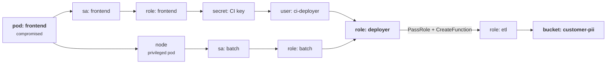
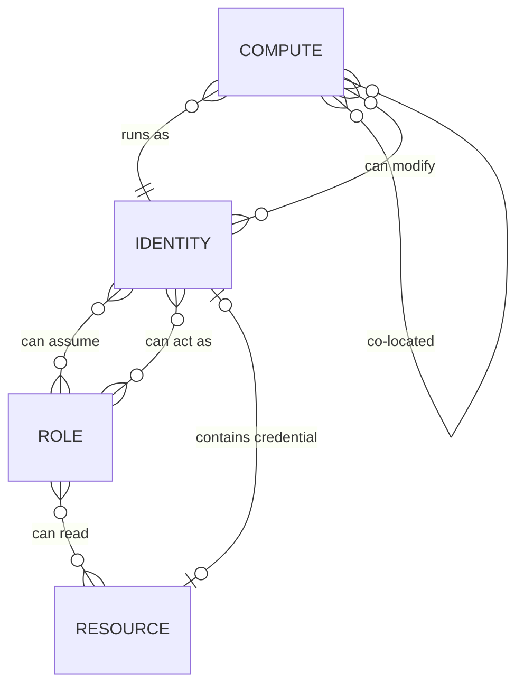
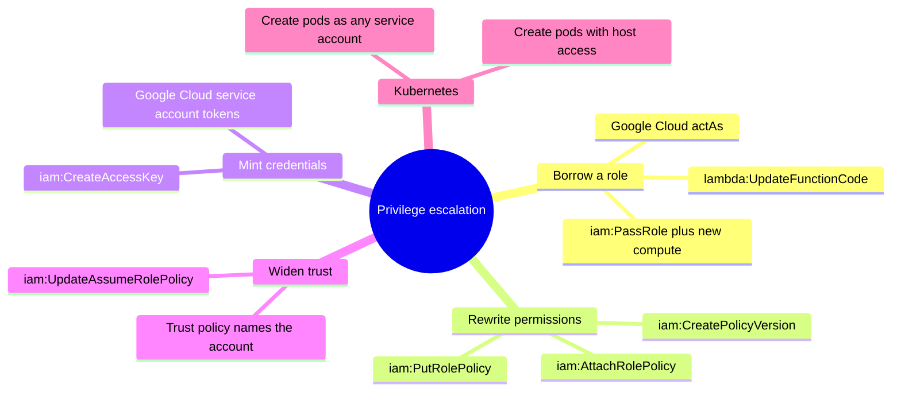
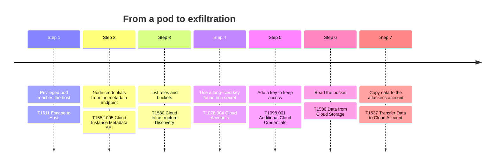
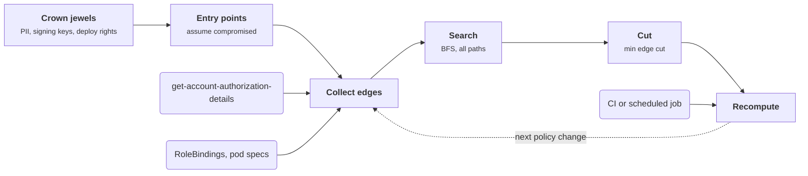

+++
title = 'Threat modeling infrastructure'
description = 'Infrastructure is a graph of identities, roles, and resources joined by permissions. Attack paths, lateral movement, and privilege escalation are all reachability in that graph, and the cheapest fix is often one edge that every path shares.'
question = 'How do attackers move through cloud infrastructure, and how do you find the edge to cut?'
weight = 2
difficulty = 2
prerequisites = ['/notes/infrastructure-security/foundations/01-following-a-workload']
date = 2026-06-28
lastmod = 2026-06-28
verified = 2026-06-28
+++

## The idea in one minute

Defenders tend to keep **lists**: the accounts, the roles, the buckets, the
findings from last quarter's scan, each with an owner and a severity. Attackers
see a **graph**: this pod runs as that service account, which can assume that
role, which can read that secret, which is a key for that user, which can
assume another role. No single item on the list looks critical. The path
through them is.

Threat modeling infrastructure means drawing that graph on purpose. Nodes are
workloads, identities, roles, and resources. Edges are anything that lets one
node act as, or read, another: a permission, a trust policy, a credential stored
in a resource, two pods sharing a node. Once the graph exists, "can a
compromised frontend pod read customer data?" is a breadth-first search, and
"what is the smallest change that stops it?" is a minimum cut. The consequence
to act on: **prioritize by paths to what matters, not by the severity of
individual findings.**

## A picture



Two unrelated-looking weaknesses (a privileged pod and an over-broad secret
read) both funnel through one role. The edge leaving it is where one change
breaks both paths.

## How it really works

### Lists versus graphs

In April 2015 John Lambert of Microsoft published a short essay titled
*"Defenders think in lists. Attackers think in graphs. As long as this is true,
attackers win."* It was written about Windows networks: an attacker who
compromises one workstation harvests credentials cached there, uses them to
reach another machine where an administrator has logged in, and so on, hopping
along a graph of logon sessions that no inventory spreadsheet shows. The
essay's argument is that defenders who manage assets one row at a time cannot
see these paths, so they protect the wrong things.

Each machine below is one row in an inventory; the arrows, which no row
records, are the attack.

```mermaid {title="The graph a list hides: cached logons chain ordinary machines to the domain"}
flowchart LR
  ATK(["Attacker"])
  W1("Workstation")
  S1("File server")
  DC("Domain controller")
  ATK -->|"phishing"| W1
  W1 -->|"helpdesk credential cached here"| S1
  S1 -->|"an administrator logged in here"| DC
```

The idea became practical tooling. BloodHound, presented at DEF CON 24 in 2016,
loads Active Directory relationships into a graph database and asks for the
shortest path to Domain Admins. The same thinking applies to cloud and
Kubernetes, where the graph is, if anything, more explicit: every edge is a
policy document you can download.

### What the nodes and edges are

| Node type | Examples |
| --- | --- |
| **Compute** | Pods, VMs, functions, CI runners |
| **Identities** | Kubernetes service accounts, IAM users, cloud service accounts, human SSO users |
| **Roles** | IAM roles, Kubernetes Roles and ClusterRoles, cloud custom roles |
| **Resources** | Buckets, databases, secrets, keys, queues, images |

| Edge type | What it means | Example |
| --- | --- | --- |
| **Runs as** | Code on the compute node holds this identity's credentials | A pod with a mounted service account token |
| **Can assume** | This identity can obtain that role's credentials | An `sts:AssumeRole` permission plus a trust policy that allows it |
| **Can act as** | This identity can make a service run under that role | `iam:PassRole` to a new Lambda function; `iam.serviceAccounts.actAs` in Google Cloud |
| **Can modify** | This identity can change another node's permissions or code | `iam:PutRolePolicy`, `lambda:UpdateFunctionCode`, editing a CI workflow |
| **Can read** | This identity can read a resource | `s3:GetObject`, `secretsmanager:GetSecretValue` |
| **Contains credential** | Reading the resource yields another identity | An access key in a secret, a kubeconfig in a bucket |
| **Co-located** | Escaping one node exposes the other | Two pods on one node; a container with the host file system mounted |

The last two rows are what turn a set of individually reasonable permissions
into an attack path. A resource that contains a credential is a **node that
looks like data but behaves like an identity**.

As a data model, the two tables collapse into four entity types; look for the
one relationship that points from a resource back to an identity.



### Lateral movement and privilege escalation are the same search

Traditional terminology distinguishes **lateral movement** (reaching another
system at a similar privilege level) from **privilege escalation** (gaining
more rights on the same system). In cloud infrastructure the distinction blurs,
because both are edge traversals in the same graph. Assuming a role in another
account is lateral; passing an admin role to a function you create is
escalation; the search does not care.

What matters is which edges exist. A small set of IAM permissions show up again
and again in escalation paths, because they let an identity grant itself, or
borrow, more authority:

| Permission (AWS) | Why it escalates |
| --- | --- |
| `iam:PassRole` with `lambda:CreateFunction`, `ec2:RunInstances`, or similar | Create compute that runs as a more privileged role, then use it |
| `iam:CreatePolicyVersion`, `iam:PutRolePolicy`, `iam:AttachRolePolicy` | Rewrite your own permissions |
| `iam:CreateAccessKey` on another user | Mint a credential for someone with more rights |
| `iam:UpdateAssumeRolePolicy` | Edit a role's trust policy so you can assume it |
| `lambda:UpdateFunctionCode` on a function with a strong role | Borrow the function's role by replacing its code |
| `sts:AssumeRole` against a role whose trust policy names the whole account | Any identity with the permission can become that role |

The first row is the edge in this lesson's picture. Watch which identity
actually touches the bucket.

```mermaid {title="PassRole plus CreateFunction: borrowing a stronger role by writing code"}
sequenceDiagram
  autonumber
  actor A as Attacker holding role deployer
  participant L as Lambda
  participant I as IAM
  participant S as Bucket customer-pii
  A->>L: CreateFunction with execution role etl
  L->>I: May deployer call iam:PassRole on role etl?
  I-->>L: Yes, PassRole is granted on *
  A->>L: Invoke the function
  L->>S: GetObject, signed as role etl
  S-->>L: Customer records
  L-->>A: Function output with the records
  Note over A,S: deployer never held s3:GetObject. It borrowed etl's
```

Spencer Gietzen's 2018 catalog of AWS IAM privilege escalation methods is the
best-known enumeration of these; Google Cloud has equivalents built around
`iam.serviceAccounts.actAs` and the ability to mint tokens for a service
account. Kubernetes has its own: permission to create pods in a namespace lets
you run a pod as any service account in that namespace, and permission to
create pods with host access lets you take the node. The module on isolation
covers the Kubernetes side in
[the Kubernetes security model](/notes/infrastructure-security/isolation/02-the-kubernetes-security-model/).

Grouped by what they let an attacker do, the escalation edges across AWS,
Google Cloud, and Kubernetes fall into a few families.



> [!WARNING]
> `iam:PassRole` with `Resource: "*"` is one of the most common escalation edges
> in AWS. It means "may hand any role in the account to a service", and the
> most privileged role in the account is one of them.

### MITRE ATT&CK for cloud

MITRE ATT&CK is a public knowledge base of adversary tactics and techniques
drawn from observed intrusions. Its Enterprise matrix has a **cloud** view that
filters techniques to cloud platforms (infrastructure as a service, SaaS,
identity providers, and office suites). It is useful in threat modeling as a
vocabulary and a checklist: label each edge type in your graph with the
technique an attacker would use to traverse it, then check whether you would
detect that technique.

| Path step | ATT&CK technique |
| --- | --- |
| Pod reads node credentials from the metadata endpoint | T1552.005 Unsecured Credentials: Cloud Instance Metadata API |
| Privileged pod reaches the host | T1611 Escape to Host |
| Long-lived key found in a secret is used | T1078.004 Valid Accounts: Cloud Accounts |
| Attacker adds a key or role to keep access | T1098.001 Additional Cloud Credentials; T1098.003 Additional Cloud Roles |
| Attacker lists roles and buckets | T1580 Cloud Infrastructure Discovery |
| Data read from the bucket | T1530 Data from Cloud Storage |
| Data copied to the attacker's account | T1537 Transfer Data to Cloud Account |

Read in order, the table is one intrusion; each step is a technique you can ask
"would we detect this?" about.



ATT&CK describes techniques, not your environment. It will not tell you that
*your* batch role can assume *your* deployer role. Only your graph does.

### Building the graph in practice

1. **Name the crown jewels.** The handful of resources whose loss would matter:
   customer data stores, signing keys, production deploy rights, the audit log
   account. Paths are measured to these.
2. **Name the entry points.** Internet-facing workloads, CI runners that build
   pull requests, developer laptops with cloud credentials, third-party
   integrations with roles in your account. Assume each one is compromised.
3. **Collect edges from the source of truth.** In AWS, `aws iam
   get-account-authorization-details` returns every user, role, group, and
   policy in one call; resource policies come from each service. In Kubernetes,
   RoleBindings and pod specs. Open-source tools such as NCC Group's Principal
   Mapper (PMapper) and Cartography build these graphs automatically.
4. **Search.** Breadth-first search from each entry point gives the shortest
   path to each crown jewel. Enumerating all simple paths shows how many
   independent routes exist.
5. **Cut.** Find the smallest set of edges whose removal disconnects entry from
   target. Remove or constrain those first.
6. **Repeat on change.** IAM changes daily. A path that did not exist last week
   can appear with one new policy attachment, so this belongs in CI or a
   scheduled job, not a yearly workshop.

The six steps form a loop, fed from the sources of truth; the dashed arrow is
the part that keeps the model honest.



### Choke points and the minimum cut

The **max-flow min-cut theorem** (Ford and Fulkerson, 1956) says that in a
network the maximum flow from source to sink equals the capacity of the
smallest cut separating them. Give every edge a capacity of one and the max flow
is the number of **edge-disjoint paths**, and the min cut is the fewest edges
whose removal disconnects the target. Edmonds and Karp (1972) showed that
augmenting along shortest paths found by breadth-first search gives a
polynomial-time algorithm, which is the one in the code below.

This turns a vague instinct ("fix the important stuff") into a calculation. If
twenty findings lie on paths to the PII bucket but every path crosses one
`iam:PassRole` grant, removing that grant is worth more than fixing the other
nineteen. And if the min cut is large, many independent paths exist, which
says the problem is structural: a role that is too broad, or an account
boundary that is missing.

## Code

The program encodes the graph from the picture, finds the shortest path and all
paths from the compromised pod to the PII bucket, computes the minimum edge cut
with Edmonds-Karp, and shows what the attacker can still reach afterwards.

```python {title="attack_paths.py"}
"""attack_paths.py: attackers think in graphs.

A simulated cloud account as a directed graph of identities, roles and
resources. Find every path from a compromised pod to the crown-jewel bucket,
then compute the smallest set of edges whose removal cuts all of them
(max-flow / min-cut with unit capacities). Standard library only; offline.
"""

from __future__ import annotations

from collections import defaultdict, deque

Edge = tuple[str, str]

# (from, to, why the edge exists). Every edge is a permission or a fact of placement.
GRAPH: list[tuple[str, str, str]] = [
    ("pod:frontend", "sa:frontend", "runs as"),
    ("pod:frontend", "node:10.0.1.7", "privileged pod, host filesystem"),
    ("sa:frontend", "role:frontend", "IRSA trust policy"),
    ("node:10.0.1.7", "role:node", "instance metadata service"),
    ("node:10.0.1.7", "sa:batch", "reads token of co-located pod"),
    ("sa:batch", "role:batch", "IRSA trust policy"),
    ("role:frontend", "bucket:static-assets", "s3:GetObject"),
    ("role:frontend", "secret:ci-deploy-key", "secretsmanager:GetSecretValue *"),
    ("secret:ci-deploy-key", "user:ci-deployer", "long-lived access key"),
    ("user:ci-deployer", "role:deployer", "sts:AssumeRole"),
    ("role:node", "registry:images", "ecr:BatchGetImage"),
    ("role:batch", "bucket:logs", "s3:ListBucket"),
    ("role:batch", "role:deployer", "sts:AssumeRole (trust policy too broad)"),
    ("role:deployer", "role:etl", "iam:PassRole + lambda:CreateFunction"),
    ("role:etl", "bucket:customer-pii", "s3:GetObject"),
    ("role:etl", "kms:pii-key", "kms:Decrypt"),
]
WHY = {(a, b): why for a, b, why in GRAPH}


def adjacency(edges: list[Edge]) -> dict[str, list[str]]:
    adj: dict[str, list[str]] = defaultdict(list)
    for a, b in edges:
        adj[a].append(b)
    return adj


def shortest_path(edges: list[Edge], src: str, dst: str) -> list[str] | None:
    """Breadth-first search: the fewest hops an attacker needs."""
    adj, parent, queue = adjacency(edges), {src: ""}, deque([src])
    while queue:
        node = queue.popleft()
        if node == dst:
            path = [node]
            while parent[path[-1]]:
                path.append(parent[path[-1]])
            return path[::-1]
        for nxt in adj[node]:
            if nxt not in parent:
                parent[nxt] = node
                queue.append(nxt)
    return None


def all_paths(edges: list[Edge], src: str, dst: str) -> list[list[str]]:
    adj, out = adjacency(edges), []

    def walk(path: list[str]) -> None:
        if path[-1] == dst:
            out.append(path)
            return
        for nxt in adj[path[-1]]:
            if nxt not in path:
                walk(path + [nxt])

    walk([src])
    return sorted(out, key=len)


def reachable(edges: list[Edge], src: str) -> set[str]:
    adj, seen, queue = adjacency(edges), {src}, deque([src])
    while queue:
        for nxt in adj[queue.popleft()]:
            if nxt not in seen:
                seen.add(nxt)
                queue.append(nxt)
    return seen


def min_cut(edges: list[Edge], src: str, dst: str) -> list[Edge]:
    """Edmonds-Karp with capacity 1 per edge. Max flow = min number of edges to cut."""
    cap: dict[Edge, int] = defaultdict(int)
    for a, b in edges:
        cap[(a, b)] += 1
    residual = adjacency(edges + [(b, a) for a, b in edges])
    while True:
        parent, queue = {src: ""}, deque([src])
        while queue and dst not in parent:
            node = queue.popleft()
            for nxt in residual[node]:
                if nxt not in parent and cap[(node, nxt)] > 0:
                    parent[nxt] = node
                    queue.append(nxt)
        if dst not in parent:
            break
        node = dst
        while parent[node]:  # push one unit of flow back along the path
            cap[(parent[node], node)] -= 1
            cap[(node, parent[node])] += 1
            node = parent[node]
    side = {src}  # what the source still reaches in the residual graph
    queue = deque([src])
    while queue:
        node = queue.popleft()
        for nxt in residual[node]:
            if nxt not in side and cap[(node, nxt)] > 0:
                side.add(nxt)
                queue.append(nxt)
    return [(a, b) for a, b in edges if a in side and b not in side]


if __name__ == "__main__":
    start, target = "pod:frontend", "bucket:customer-pii"
    edges = [(a, b) for a, b, _ in GRAPH]

    print(f"shortest path: {' -> '.join(shortest_path(edges, start, target) or [])}")
    paths = all_paths(edges, start, target)
    print(f"distinct paths to {target}: {len(paths)}")
    for i, path in enumerate(paths, 1):
        print(f"  path {i} ({len(path) - 1} hops)")
        for a, b in zip(path, path[1:]):
            print(f"    {a:<22} -> {b:<22} {WHY[(a, b)]}")

    cut = min_cut(edges, start, target)
    print(f"minimum cut: {len(cut)} edge(s)")
    for a, b in cut:
        print(f"  remove {a} -> {b} ({WHY[(a, b)]})")

    remaining = [e for e in edges if e not in cut]
    print(f"path after cut: {shortest_path(remaining, start, target)}")
    still = sorted(reachable(remaining, start) - {start})
    print(f"still reachable from {start} ({len(still)}):")
    for node in still:
        print(f"  {node}")
```

Run it with `python3 attack_paths.py`:

```text
shortest path: pod:frontend -> node:10.0.1.7 -> sa:batch -> role:batch -> role:deployer -> role:etl -> bucket:customer-pii
distinct paths to bucket:customer-pii: 2
  path 1 (6 hops)
    pod:frontend           -> node:10.0.1.7          privileged pod, host filesystem
    node:10.0.1.7          -> sa:batch               reads token of co-located pod
    sa:batch               -> role:batch             IRSA trust policy
    role:batch             -> role:deployer          sts:AssumeRole (trust policy too broad)
    role:deployer          -> role:etl               iam:PassRole + lambda:CreateFunction
    role:etl               -> bucket:customer-pii    s3:GetObject
  path 2 (7 hops)
    pod:frontend           -> sa:frontend            runs as
    sa:frontend            -> role:frontend          IRSA trust policy
    role:frontend          -> secret:ci-deploy-key   secretsmanager:GetSecretValue *
    secret:ci-deploy-key   -> user:ci-deployer       long-lived access key
    user:ci-deployer       -> role:deployer          sts:AssumeRole
    role:deployer          -> role:etl               iam:PassRole + lambda:CreateFunction
    role:etl               -> bucket:customer-pii    s3:GetObject
minimum cut: 1 edge(s)
  remove role:deployer -> role:etl (iam:PassRole + lambda:CreateFunction)
path after cut: None
still reachable from pod:frontend (12):
  bucket:logs
  bucket:static-assets
  node:10.0.1.7
  registry:images
  role:batch
  role:deployer
  role:frontend
  role:node
  sa:batch
  sa:frontend
  secret:ci-deploy-key
  user:ci-deployer
```

The two paths share no weakness until `role:deployer`. A list-based review
would file "privileged pod" and "broad secret read" as separate medium
findings. The graph shows that both lead to the same place, and that removing
one `iam:PassRole` grant on `role:etl` disconnects the PII bucket entirely.
The edge `role:etl -> bucket:customer-pii` is also a one-edge cut; Edmonds-Karp
reports the cut nearest the attacker. Choosing among equal cuts is a judgment
about which edge is cheapest to remove and least likely to come back.

The last block is the honest part. After the cut the attacker still holds a
long-lived CI key, the deployer role, and a node. The cut protects **this**
target. Run the search again with a different crown jewel, such as production
deploy rights, and `role:deployer` is the target, already reached.

## Where it breaks

- **Unknown edges defeat the search.** The program finds paths through edges
  you modeled. Credentials in environment variables, keys in old container
  image layers, and shared developer accounts are edges too, and they are
  rarely in any policy document. The graph is a lower bound on reachability.
- **Conditions are not modeled.** Real IAM edges carry conditions: source IP,
  MFA, tags, organization ID. An edge that exists only with MFA is not the same
  as an unconditional one. Tools that ignore conditions report false paths;
  tools that trust conditions they cannot evaluate miss real ones.
- **All edges are not equally cheap.** Unit capacities treat "assume a role" and
  "escape a container" as equal effort. Weighting edges by attacker cost, or by
  how expensive they are for you to remove, gives a more useful cut. Some edges,
  such as "runs as", cannot be removed at all and should get infinite capacity.

  Placing this lesson's edges by both costs shows which to cut first.

  ```mermaid {title="Weighting edges: attacker effort against the cost of removing them"}
  quadrantChart
    title Which edge to cut
    x-axis Cheap to remove --> Expensive to remove
    y-axis Easy for the attacker --> Hard for the attacker
    quadrant-1 Leave and monitor
    quadrant-2 Cheap hardening
    quadrant-3 Cut first
    quadrant-4 Structural, redesign
    PassRole on etl: [0.2, 0.3]
    Secret read on star: [0.3, 0.2]
    Broad batch trust: [0.35, 0.4]
    Privileged pod escape: [0.6, 0.7]
    Runs as: [0.95, 0.1]
  ```
- **A cut is not a fix for the cause.** Cutting `PassRole` stops this path. The
  causes are a frontend role that can read every secret, a privileged pod, and a
  trust policy that admits the batch role. Cut first, then fix the causes,
  because the next policy change can reconnect the graph.
- **Graphs go stale.** A threat model computed once describes last month's
  account. The value comes from recomputing on every IAM change and alerting
  when a new path to a crown jewel appears.

## Remember this

- Attackers think in graphs: identities, roles, and resources joined by
  permissions, trust, stored credentials, and co-location.
- Lateral movement and privilege escalation are both edge traversal.
- `iam:PassRole`, policy-editing permissions, and broad trust policies are the
  classic escalation edges.
- Prioritize by paths to crown jewels, not by the severity of single findings.
- The minimum cut finds the fewest edges that disconnect an entry point from a
  target.
- Recompute the graph on every change; IAM drifts daily.

## Try it

1. Run `attack_paths.py`. Delete the `role:batch -> role:deployer` edge instead
   of the cut edge. How many paths remain, and what is the new minimum cut?
2. Add an edge `role:frontend -> role:etl` labeled `lambda:UpdateFunctionCode on
   the etl function`. What is the minimum cut now, and which edges are in it?
3. Change `min_cut` so that edges labeled `runs as` have a very large capacity.
   Does the cut change for the original graph? Construct a graph where it would.
4. Pick a real AWS account you can read (or a test account). Run `aws iam
   get-account-authorization-details`, list every role with `iam:PassRole` on
   `*`, and for each one write down which services it could pass roles to.

## Check yourself

1. What did John Lambert mean by "defenders think in lists"?

   
   Defenders manage assets and findings one row at a time, each with an owner
   and a severity, and protect items according to their individual importance.
   Attackers instead follow relationships: credentials on one machine that
   unlock another, permissions that chain. Paths through individually
   unimportant items are invisible in a list, so defenders protect the wrong
   things.
   

2. Why is a secret that contains an access key an edge, not just a resource?

   
   Reading it yields the credentials of another identity, so anyone who can read
   the secret can act as that identity. In the graph it behaves like a "can
   assume" edge from every reader of the secret to the identity whose key it
   holds.
   

3. Why does `iam:PassRole` with `lambda:CreateFunction` amount to privilege
   escalation?

   
   The identity can create a function that runs under a role it passes, and the
   function's code runs with that role's permissions. If the role is more
   privileged than the identity, the identity has borrowed that privilege by
   writing code. Scoping `iam:PassRole` to specific role ARNs, and to a specific
   service with the `iam:PassedToService` condition, limits this.
   

4. What does the minimum cut tell you that a list of findings does not?

   
   It tells you the fewest edges whose removal disconnects an entry point from a
   target, which ranks fixes by how many paths they break. A single edge shared
   by every path is worth more than many findings on one path. A large minimum
   cut indicates many independent paths, which points to a structural problem
   rather than one bad permission.
   

5. How is MITRE ATT&CK useful in an infrastructure threat model, and what can
   it not do?

   
   It gives a shared vocabulary for each kind of edge traversal (metadata
   credential theft, escape to host, additional cloud roles, data from cloud
   storage) and a checklist for whether you would detect each one. It cannot
   tell you which paths exist in your environment; that requires your own graph
   of identities, roles, and resources.
   

## Sources

- J. Lambert, [Defenders think in lists. Attackers think in graphs. As long as this is true, attackers win.](https://github.com/JohnLaTwC/Shared/blob/master/Defenders%20think%20in%20lists.%20Attackers%20think%20in%20graphs.%20As%20long%20as%20this%20is%20true%2C%20attackers%20win.md), originally a Microsoft TechNet blog post, April 2015.
- MITRE, [ATT&CK Cloud Matrix](https://attack.mitre.org/matrices/enterprise/cloud/).
- MITRE ATT&CK, [T1552.005 Unsecured Credentials: Cloud Instance Metadata API](https://attack.mitre.org/techniques/T1552/005/) and [T1530 Data from Cloud Storage](https://attack.mitre.org/techniques/T1530/).
- Amazon Web Services, [Grant a user permissions to pass a role to an AWS service](https://docs.aws.amazon.com/IAM/latest/UserGuide/id_roles_use_passrole.html), IAM User Guide.
- Amazon Web Services, [GetAccountAuthorizationDetails](https://docs.aws.amazon.com/IAM/latest/APIReference/API_GetAccountAuthorizationDetails.html), IAM API Reference.
- S. Gietzen, [AWS IAM Privilege Escalation: Methods and Mitigation](https://rhinosecuritylabs.com/aws/aws-privilege-escalation-methods-mitigation/), Rhino Security Labs, 2018.
- NCC Group, [Principal Mapper (PMapper)](https://github.com/nccgroup/PMapper).
- A. Robbins, R. Vazarkar, W. Schroeder, "Six Degrees of Domain Admin: Using Graph Theory to Accelerate Red Team Operations", DEF CON 24, 2016.
- L. R. Ford Jr., D. R. Fulkerson, "Maximal flow through a network", *Canadian Journal of Mathematics* 8, 1956.
- J. Edmonds, R. M. Karp, "Theoretical improvements in algorithmic efficiency for network flow problems", *Journal of the ACM* 19(2), 1972.
