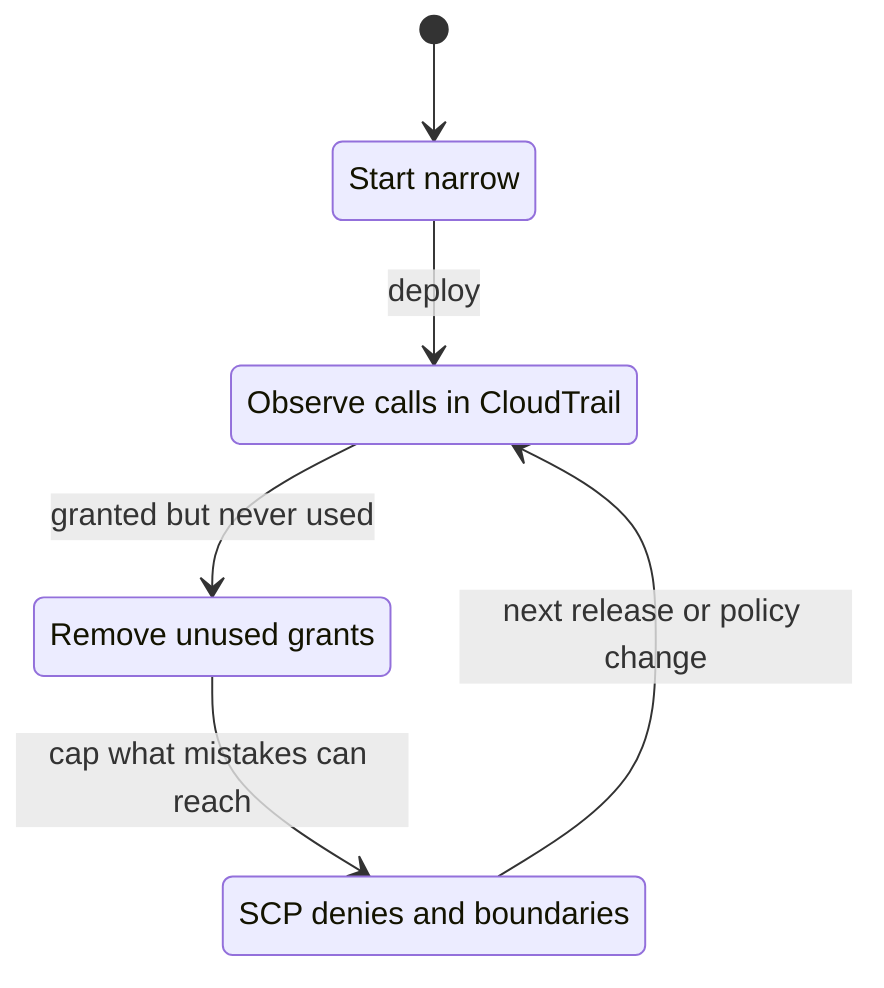

+++
title = 'Cloud IAM fundamentals'
description = 'Cloud IAM answers one question per request: may this principal take this action on this resource? The answer comes from several policy types evaluated in a fixed order, where an explicit deny always wins and silence means no.'
question = 'How does cloud IAM decide whether a request is allowed, and where does least privilege go wrong?'
weight = 3
difficulty = 2
prerequisites = ['/notes/infrastructure-security/foundations/02-threat-modeling-infrastructure']
date = 2026-06-30
lastmod = 2026-06-30
verified = 2026-06-30
+++

## The idea in one minute

Every call to a cloud API carries three things: a **principal** (who is
calling), an **action** (`s3:GetObject`, `iam:PassRole`), and a **resource**
(an ARN). The IAM system collects every policy that applies to that request and
decides allow or deny. In AWS the rules are short: **everything starts denied,
an allow is needed from somewhere, an explicit deny anywhere overrides every
allow, and guardrail policies such as SCPs and permissions boundaries can only
take away, never grant.**

These rules are simple; the inputs are not. A role has two policies that answer
different questions. A bucket has its own policy. The organization adds
guardrails above the account. Wildcards in any of them can match far more than
the author meant. The consequence to act on: **reason about the effective
permission, not any single policy document**, and treat every `*` as a claim
you must be able to defend.

## A picture

```mermaid {title="Simplified AWS policy evaluation for a same-account request"}
flowchart TD
  R["<b>Request</b><br/><small>principal, action, resource</small>"] --> D{"Explicit deny<br/>in any policy?"}
  D -->|yes| DENY1["<b>Deny</b>"]
  D -->|no| O{"SCPs and RCPs<br/>allow?"}
  O -->|no| DENY2["<b>Deny</b>"]
  O -->|yes| A{"Identity or resource<br/>policy allows?"}
  A -->|no| DENY3["<b>Implicit deny</b>"]
  A -->|yes| B{"Boundary and session<br/>policy allow?"}
  B -->|no| DENY4["<b>Deny</b>"]
  B -->|yes| ALLOW["<b>Allow</b>"]
  class R io
  class D,O,A,B neutral
  class DENY1,DENY2,DENY3,DENY4 warn
  class ALLOW good
```

The real flowchart in the AWS documentation has more branches, notably for
resource policies that name an IAM user or a role session directly. This shape
is the one to carry in your head.

## How it really works

### Principals

A principal is anything that can make an authenticated request.

| Principal (AWS) | What it is | Credential |
| --- | --- | --- |
| **Root user** | The account owner; IAM policies in the account cannot restrict it, though SCPs can in member accounts | Password and MFA; should be locked away |
| **IAM user** | A long-lived identity, historically for people and scripts | Password, long-lived access keys |
| **IAM role** | An identity with no credentials of its own, assumed by someone else | Temporary credentials from STS, typically valid for an hour by default |
| **Role session** | One assumption of a role, named by the caller | The temporary credentials themselves |
| **Federated principal** | An identity from an external provider: SSO, OIDC (GitHub Actions, Kubernetes) | A token exchanged for role credentials |
| **Service principal** | An AWS service acting on your behalf, such as `lambda.amazonaws.com` | Managed by AWS |

The direction of modern practice is clear: **people and workloads should use
roles, not users.** People sign in through SSO and receive role sessions;
workloads receive roles through federation or the platform. IAM users with
access keys are the static credentials that the
[workload identity](/notes/infrastructure-security/workload-identity/01-why-static-credentials-fail/)
module argues against.

Every modern path below goes through STS and comes out as a temporary role
session; only the dashed one skips it.

```mermaid {title="People and workloads should arrive as role sessions, not as users"}
flowchart LR
  P(["Engineer"])
  SSO("SSO provider")
  GH("GitHub Actions job")
  K8("Kubernetes pod")
  LAM("lambda.amazonaws.com")
  STS@{ shape: hex, label: "AWS STS" }
  SES["<b>Role session</b><br/><small>temporary credentials</small>"]
  KEY["<b>IAM user access key</b><br/><small>long-lived</small>"]
  API["<b>AWS API</b>"]
  P --> SSO -->|"federation"| STS
  GH -->|"OIDC token"| STS
  K8 -->|"OIDC token"| STS
  LAM -->|"execution role"| STS
  STS --> SES --> API
  KEY -.->|"no expiry"| API
  class STS compute
  class SES good
  class KEY warn
  class API io
```

Other clouds use different names for the same ideas. Google Cloud has user
accounts, groups, and service accounts, and attaches allow policies to
resources in a hierarchy (organization, folder, project, resource), with
separate deny policies. Azure assigns roles to users, groups, service
principals, and managed identities at a scope (management group, subscription,
resource group, resource). The evaluation details differ; the questions you ask
are the same.

### The anatomy of a policy

An AWS policy is a JSON document with one or more statements. Each statement
says **Effect** (`Allow` or `Deny`), **Action**, **Resource**, and optionally
**Principal** (only in resource-based policies) and **Condition**.

```json {title="an identity-based permission policy"}
{
  "Version": "2012-10-17",
  "Statement": [
    {
      "Sid": "ReadOrdersExports",
      "Effect": "Allow",
      "Action": ["s3:GetObject"],
      "Resource": "arn:aws:s3:::orders-exports/*",
      "Condition": { "StringEquals": { "aws:ResourceAccount": "111122223333" } }
    }
  ]
}
```

`Version` is the policy language version, and `2012-10-17` is the one to use;
it is not a date you should update. `NotAction` and `NotResource` invert the
match, which is useful in a `Deny` ("deny everything except these") and
dangerous in an `Allow` ("allow everything except these", including services
that did not exist when you wrote it).

The structure, stripped of JSON: a policy holds statements, and each statement
matches one slice of requests.

```mermaid {title="A policy is a list of statements, each matching a slice of requests"}
erDiagram
  POLICY ||--|{ STATEMENT : contains
  POLICY {
    string Version "always 2012-10-17"
  }
  STATEMENT {
    string Sid "optional label"
    string Effect "Allow or Deny"
    list Action "or NotAction"
    list Resource "or NotResource"
    list Principal "resource-based policies only"
    map Condition "optional, where precision lives"
  }
```

### Roles have two policies

A role answers two separate questions with two separate documents:

- The **trust policy** says **who may become this role**. It is a resource-based
  policy attached to the role, and its action is `sts:AssumeRole` (or
  `sts:AssumeRoleWithWebIdentity` for OIDC federation).
- The **permission policies** say **what the role may do** once assumed.

```json {title="trust policy: only this repository's main branch may assume the role"}
{
  "Version": "2012-10-17",
  "Statement": [
    {
      "Effect": "Allow",
      "Principal": { "Federated": "arn:aws:iam::111122223333:oidc-provider/token.actions.githubusercontent.com" },
      "Action": "sts:AssumeRoleWithWebIdentity",
      "Condition": {
        "StringEquals": {
          "token.actions.githubusercontent.com:aud": "sts.amazonaws.com",
          "token.actions.githubusercontent.com:sub": "repo:acme/orders:ref:refs/heads/main"
        }
      }
    }
  ]
}
```

Follow one GitHub job through both doors: the trust policy is checked once, at
assume time, and the permission policy on every call after that.

```mermaid {title="Two doors: the trust policy decides who enters, the permission policy decides what they do"}
sequenceDiagram
  autonumber
  participant J as GitHub job
  participant S as AWS STS
  participant T as Trust policy
  participant P as Permission policy
  participant B as S3 orders-exports
  J->>S: AssumeRoleWithWebIdentity with the OIDC token
  S->>T: Do aud and sub match the conditions?
  alt sub is repo:acme/orders:ref:refs/heads/main
    T-->>S: Allow
    S-->>J: Role session credentials
    J->>B: GetObject on an export
    B->>P: Does the role allow s3:GetObject on this object?
    P-->>B: Allow
    B-->>J: The object
  else any other repository or branch
    T-->>S: No statement matches
    S-->>J: AccessDenied
  end
```

Most role mistakes are trust policy mistakes. A trust policy whose principal is
`arn:aws:iam::111122223333:root` does not mean "the root user". It means **"this
account decides"**: any principal in the account whose own identity policy
allows `sts:AssumeRole` on this role may assume it. That is the broad trust edge
from the previous lesson. A trust policy for GitHub's OIDC provider without a
`sub` condition lets any repository on GitHub that can request a token for your
audience assume the role. When a third party assumes a role in your account,
the trust policy should require an `sts:ExternalId` that the third party issues
per customer, which prevents a **confused deputy**: another customer of the
same vendor tricking the vendor into using your role.

Here is the trick, and the one condition that defeats it.

```mermaid {title="Confused deputy: the external ID stops one vendor customer from borrowing your role"}
sequenceDiagram
  autonumber
  actor M as Another customer
  participant V as Vendor
  participant S as AWS STS
  participant Y as Your role's trust policy
  M->>V: Set my integration's role ARN to your role
  V->>S: AssumeRole on your role, with the external ID issued to that customer
  S->>Y: Evaluate the trust policy
  alt no sts:ExternalId condition
    Y-->>S: Vendor account is trusted, allow
    S-->>V: Credentials in your account
    V-->>M: Your data in their dashboard
  else sts:ExternalId must equal the ID issued to you
    Y-->>S: External ID does not match, deny
    S-->>V: AccessDenied
  end
```

### The policy types and what each can do

| Policy type | Attached to | Can grant? | Notes |
| --- | --- | --- | --- |
| **Identity-based** | A user, group, or role | Yes | Managed (reusable) or inline |
| **Resource-based** | A resource: bucket, key, queue, role trust | Yes | Names a `Principal`; the only way to grant cross-account without assuming a role |
| **Permissions boundary** | A user or role | No | A ceiling on what identity policies can grant |
| **Service control policy (SCP)** | An organization, OU, or account | No | A ceiling on every principal in member accounts; does not apply to the management account |
| **Resource control policy (RCP)** | An organization, OU, or account | No | A ceiling on resources in member accounts, for supported services; added to AWS Organizations in November 2024 |
| **Session policy** | One role session, passed at assume time | No | Narrows a single session |

Read the third column carefully. Only two policy types **grant**. Everything
else is a filter that can turn an allow into a deny. A common mistake is to
attach a permissions boundary that allows `s3:*` and expect the role to be able
to use S3; it cannot until an identity policy grants it.

Stacked, the six types look like this: an allow must start in the bottom row
and survive every ceiling above it.

```mermaid {title="Only two policy types grant, the four above them are ceilings"}
block-beta
  columns 2
  scp["SCP<br/>ceiling on principals"] rcp["RCP<br/>ceiling on resources"]
  pb["Permissions boundary<br/>ceiling on one user or role"]:2
  sp["Session policy<br/>ceiling on one session"]:2
  idp["Identity-based policy<br/>grants"] rp["Resource-based policy<br/>grants"]
```

### The evaluation order

For a request within one account, AWS evaluates roughly in this order:

1. **Explicit deny.** If any applicable policy (identity, resource, boundary,
   SCP, RCP, session) has a matching `Deny`, the answer is deny. Nothing
   overrides it.
2. **Organization guardrails.** If the account is in an organization, some SCP
   at every level must allow the action for the principal, and RCPs must allow
   it for the resource. Otherwise, deny.
3. **Resource-based policy.** A matching allow can grant access. For grants to
   an IAM user ARN or a role session ARN, this allow is enough on its own; for
   grants to a role ARN, the boundary and session policy still apply.
4. **Identity-based policy.** Otherwise, some identity policy must allow it.
5. **Permissions boundary and session policy.** If present, each must also allow.
6. Anything not explicitly allowed is an **implicit deny**.

**Cross-account** requests add one rule: both sides must agree. The caller's
account must allow the action through its identity policies, and the target
account must allow it through a resource-based policy, or the caller must
assume a role in the target account whose trust policy admits it.

> [!IMPORTANT]
> Explicit deny is the only lever that cannot be overridden. Put the rules that
> must never be broken, such as "nobody disables CloudTrail" or "nobody deletes
> KMS keys", in SCP denies, where no account administrator can grant past them.

### Wildcards

AWS policies support two wildcards in actions and resource ARNs: `*` (any run of
characters, including `/` and `:`) and `?` (one character). Action names are
case-insensitive; resource ARNs are generally case-sensitive. Wildcards are where
policies grant more than intended:

| Pattern | What the author meant | What it also matches |
| --- | --- | --- |
| `s3:Get*` | Read objects | `s3:GetObjectAcl`, `s3:GetBucketPolicy`, and every future `Get` action |
| `arn:aws:s3:::data*` | Objects in bucket `data` | Bucket `data-exports-public` and all its objects |
| `iam:PassRole` on `*` | Pass the app's role to Lambda | Pass any role, including admin, to any service |
| `"Principal": "*"` in a bucket policy | Our accounts | Everyone on the internet, unless a condition narrows it |
| `ec2:*` | Manage instances | Also security groups, snapshots, and key pairs |

The fix is to name exact actions and exact ARNs, using `bucket/*` for objects
in a bucket and the bucket ARN alone for bucket-level actions such as
`s3:ListBucket`. Where a wildcard is genuinely needed, add a condition, such as
`aws:ResourceAccount`, `aws:PrincipalOrgID`, or `iam:PassedToService`.

The second row of the table, drawn: the same policy with and without one slash.

```mermaid {title="One missing slash: what data* matches that data/* does not"}
flowchart LR
  W@{ shape: doc, label: "arn:aws:s3:::data*" }
  N@{ shape: doc, label: "arn:aws:s3:::data/*" }
  O["data/report.csv<br/><small>intended</small>"]
  E["data-exports-public/dump.csv<br/><small>another bucket</small>"]
  B["bucket data itself<br/><small>bucket-level actions</small>"]
  W --> O
  W --> E
  W --> B
  N --> O
  class W warn
  class N good
  class O compute
  class E warn
  class B neutral
```

### Least privilege and access analyzers

Least privilege, stated by Saltzer and Schroeder in 1975, means every program
and user should operate with the least set of privileges necessary for the job.
In cloud IAM it is easy to state and hard to reach, because nobody knows the
exact set of actions an application needs until it runs. The workable loop is:

1. Start narrow, with the actions the code obviously calls.
2. Observe. AWS CloudTrail records the API calls a role actually makes.
3. Tighten. Remove what was granted and never used.
4. Guard. Use SCP denies and permissions boundaries so that mistakes in step 1
   cannot exceed a ceiling.

The four steps are a cycle, not a checklist: every release returns to
observation.



**AWS IAM Access Analyzer** automates parts of this. Its external access
findings report resources (buckets, keys, roles, queues and others) shared
outside a zone of trust you define, such as your organization. Its unused
access findings report roles, access keys, and permissions that have not been
used for a period you set. It can generate a policy from a role's CloudTrail
history, validate policies against best-practice checks, and run custom checks
in CI, such as "this policy change grants no new access" or "this policy never
grants `iam:PassRole`". Google Cloud offers role recommendations from observed
usage and a Policy Analyzer; Azure has its own access reviews. Use whichever
exists, and run the checks on every policy change, not once.

> [!TIP]
> The highest-value IAM review question is not "is this policy too broad?" but
> "who can change this policy?" Anyone with `iam:PutRolePolicy` on a role
> effectively has that role's permissions, now or later.

## Code

A simplified AWS-style evaluator: explicit deny first, then SCPs, then an allow
from an identity or same-account resource policy, then the permissions
boundary. Matching uses `fnmatch`, with `[` escaped because AWS has no
character classes. The test cases encode what the policies **do**, which is not
always what their author intended.

```python {title="policy_eval.py"}
"""policy_eval.py: a simplified AWS-style policy evaluator.

Explicit deny beats any allow. An SCP that does not allow is a deny. Then an
allow is needed from an identity policy or a same-account resource policy, and
a permissions boundary must also allow. Anything else is the implicit deny.
Standard library only; no real AWS calls.
"""

from __future__ import annotations

from dataclasses import dataclass, field
from fnmatch import fnmatchcase


@dataclass(frozen=True)
class Statement:
    effect: str  # "Allow" or "Deny"
    actions: tuple[str, ...]
    resources: tuple[str, ...]
    principals: tuple[str, ...] = ("*",)  # only meaningful in resource policies


@dataclass
class Policies:
    identity: list[Statement]
    resource: list[Statement] = field(default_factory=list)
    scp: list[Statement] | None = None  # None: account not in an organization
    boundary: list[Statement] | None = None  # None: no permissions boundary set


def wildcard(pattern: str, value: str, ignore_case: bool = False) -> bool:
    """AWS supports only * and ?. fnmatch also treats [...] as a class: escape it."""
    pattern = pattern.replace("[", "[[]")
    if ignore_case:  # action names are case-insensitive, ARNs are not
        pattern, value = pattern.lower(), value.lower()
    return fnmatchcase(value, pattern)


def matches(s: Statement, principal: str, action: str, resource: str) -> bool:
    return (any(wildcard(p, action, ignore_case=True) for p in s.actions)
            and any(wildcard(p, resource) for p in s.resources)
            and any(wildcard(p, principal) for p in s.principals))


def has(stmts: list[Statement], effect: str, *request: str) -> bool:
    return any(s.effect == effect and matches(s, *request) for s in stmts)


def evaluate(p: Policies, principal: str, action: str, resource: str) -> tuple[str, str]:
    req = (principal, action, resource)
    every = p.identity + p.resource + (p.scp or []) + (p.boundary or [])
    if has(every, "Deny", *req):
        return "Deny", "explicit deny"
    if p.scp is not None and not has(p.scp, "Allow", *req):
        return "Deny", "no SCP allows it"
    by_resource = has(p.resource, "Allow", *req)
    if not by_resource and not has(p.identity, "Allow", *req):
        return "Deny", "implicit deny"
    # The principal is a role ARN, so the boundary caps resource-policy grants too.
    if p.boundary is not None and not has(p.boundary, "Allow", *req):
        return "Deny", "outside permissions boundary"
    return "Allow", "resource policy allows" if by_resource else "identity policy allows"


ROLE = "arn:aws:iam::111122223333:role/app"
DATA = "arn:aws:s3:::data"

POLICIES = Policies(
    identity=[
        Statement("Allow", ("s3:Get*", "s3:ListBucket"), (DATA, f"{DATA}/*")),
        Statement("Allow", ("s3:PutObject",), (f"{DATA}*",)),  # missing slash
        Statement("Deny", ("s3:*",), (f"{DATA}/secrets/*",)),
        Statement("Allow", ("iam:PassRole", "kms:Decrypt"), ("*",)),
    ],
    resource=[  # a bucket policy on "reports"
        Statement("Allow", ("s3:GetObject",), ("arn:aws:s3:::reports/*",), (ROLE,)),
    ],
    scp=[
        Statement("Allow", ("*",), ("*",)),
        Statement("Deny", ("kms:ScheduleKeyDeletion",), ("*",)),
    ],
    boundary=[
        Statement("Allow", ("s3:*", "kms:Decrypt"), ("*",)),
    ],
)

CASES = [  # (action, resource, expected decision)
    ("s3:GetObject", f"{DATA}/report.csv", "Allow"),
    ("S3:getobject", f"{DATA}/report.csv", "Allow"),
    ("s3:GetObjectAcl", f"{DATA}/report.csv", "Allow"),
    ("s3:GetObject", f"{DATA}/secrets/db.env", "Deny"),
    ("s3:DeleteObject", f"{DATA}/report.csv", "Deny"),
    ("s3:PutObject", "arn:aws:s3:::data-exports-public/dump.csv", "Allow"),
    ("s3:GetObject", "arn:aws:s3:::reports/q3.pdf", "Allow"),
    ("iam:PassRole", "arn:aws:iam::111122223333:role/admin", "Deny"),
    ("kms:ScheduleKeyDeletion", "arn:aws:kms:us-east-1:111122223333:key/k1", "Deny"),
    ("s3:GetObject", "arn:aws:s3:::DATA/report.csv", "Deny"),
]


if __name__ == "__main__":
    failures = 0
    for action, resource, expected in CASES:
        decision, why = evaluate(POLICIES, ROLE, action, resource)
        ok = decision == expected
        failures += not ok
        short = resource.split(":::")[-1] if ":::" in resource else resource.split(":")[-1]
        print(f"{'ok  ' if ok else 'FAIL'} {decision:<5} {action:<24} {short:<32} {why}")
    print(f"{len(CASES) - failures}/{len(CASES)} cases as expected")
    print("raw fnmatch, 'data[1]' matches 'data1':", fnmatchcase("data1", "data[1]"))
    print("wildcard(), 'data[1]' matches 'data1':", wildcard("data[1]", "data1"))
```

Run it with `python3 policy_eval.py`:

```text
ok   Allow s3:GetObject             data/report.csv                  identity policy allows
ok   Allow S3:getobject             data/report.csv                  identity policy allows
ok   Allow s3:GetObjectAcl          data/report.csv                  identity policy allows
ok   Deny  s3:GetObject             data/secrets/db.env              explicit deny
ok   Deny  s3:DeleteObject          data/report.csv                  implicit deny
ok   Allow s3:PutObject             data-exports-public/dump.csv     identity policy allows
ok   Allow s3:GetObject             reports/q3.pdf                   resource policy allows
ok   Deny  iam:PassRole             role/admin                       outside permissions boundary
ok   Deny  kms:ScheduleKeyDeletion  key/k1                           explicit deny
ok   Deny  s3:GetObject             DATA/report.csv                  implicit deny
10/10 cases as expected
raw fnmatch, 'data[1]' matches 'data1': True
wildcard(), 'data[1]' matches 'data1': False
```

Every case passes, and three of them are findings. `s3:Get*` also allows
`s3:GetObjectAcl`. The missing slash in `data*` lets the role write into a
bucket called `data-exports-public`. And `iam:PassRole` on `*` would let the
role pass the admin role to a new function; only the permissions boundary
stops it, which is exactly what a boundary is for. A test suite for IAM is
most useful when it states the access you **do not** want and fails if a policy
change grants it.

## Where it breaks

- **Conditions are missing.** Real policies lean on conditions: `aws:SourceIp`,
  `aws:PrincipalOrgID`, tags, MFA, time. Most of the precision in a good policy
  lives there, and this evaluator ignores them.
- **The evaluator simplifies resource policies.** It applies the boundary to
  every resource-policy grant, which matches AWS behavior when the bucket policy
  names the role ARN. Grants to an IAM user ARN or a role session ARN are not
  capped by an implicit deny in the boundary. It also ignores RCPs, session
  policies, `NotAction`, `NotResource`, and cross-account rules.
- **Matching an ARN is not the same as matching a resource.** Some services
  accept resource-level permissions only for some actions; for the rest, the
  only valid `Resource` is `*`. A policy that names a specific ARN for such an
  action grants nothing, and authors respond by widening to `*`.
- **Correct evaluation of a bad policy is still bad.** The evaluator is right
  about every case, including the three that leak. Getting the logic right is
  the easy part; deciding what access should exist is the work.
- **Effective access is wider than any one principal's policies.** A role that
  cannot read the PII bucket but can assume a role that can, or pass one to a
  function, effectively can. Single-request evaluation answers "may this
  request succeed?", not "what can this principal eventually reach?". For the
  second question you need the graph from
  [threat modeling infrastructure](/notes/infrastructure-security/foundations/02-threat-modeling-infrastructure/).

## Remember this

- Every request is principal, action, resource; everything starts denied.
- An explicit deny anywhere wins; SCPs, RCPs, boundaries, and session policies
  only take away.
- Roles have a trust policy (who may become it) and permission policies (what
  it may do); most role mistakes are trust mistakes.
- A trust policy naming the account root means "any principal this account
  allows", not "the root user".
- Every `*` in an action, resource, or principal must be defensible; prefer
  exact ARNs and conditions.
- Least privilege is a loop: start narrow, observe, tighten, and guard with denies.

## Try it

1. Run `policy_eval.py`. Fix the missing slash so `data*` becomes `data/*`.
   Which case changes, and which expected value must you update?
2. Add a case asserting that the role can **not** call `s3:GetBucketPolicy` on
   `data`. Does it pass? Change `s3:Get*` to the exact actions the role needs
   until it does.
3. Add cross-account support: a request is allowed only if the caller's identity
   policy allows it **and** the target's resource policy allows it. Write a case
   that the same-account logic allows but the cross-account logic denies.
4. In an AWS account you can read, find every role whose trust policy uses an
   account root principal or `"*"`, and for each one list who could assume it.

## Check yourself

1. What is the difference between a trust policy and a permission policy?

   
   The trust policy is a resource-based policy on the role that says which
   principals may assume it (the `sts:AssumeRole` family of actions). Permission
   policies say what the role may do after it is assumed. A role with a narrow
   permission policy and a broad trust policy is a narrow capability available
   to too many callers.
   

2. A role has a permissions boundary that allows `s3:*` and no identity
   policies. Can it read from S3?

   
   No, unless a resource-based policy grants it access. A permissions boundary
   never grants; it only sets a ceiling on what identity policies grant. With no
   identity policy allowing the action, the result is an implicit deny.
   

3. Why does `arn:aws:s3:::data*` grant more than intended, and what should it be?

   
   `*` matches any characters, so the pattern matches every bucket whose name
   starts with `data`, such as `data-exports-public`, and all objects in them.
   For objects in bucket `data`, use `arn:aws:s3:::data/*`; for bucket-level
   actions such as `s3:ListBucket`, use `arn:aws:s3:::data`.
   

4. Why put "never disable CloudTrail" in an SCP deny rather than in each role's
   policy?

   
   An explicit deny cannot be overridden by any allow, and an SCP applies to
   every principal in the member accounts, including account administrators who
   could edit their own identity policies. Putting the rule in role policies
   relies on everyone who can edit IAM in every account leaving it alone.
   

5. What does the `sts:ExternalId` condition in a trust policy protect against?

   
   The confused deputy problem with third parties. A vendor that assumes roles
   in many customers' accounts could be tricked by one customer into using
   another customer's role ARN. Requiring an external ID that the vendor issues
   per customer means the vendor only presents the right ID for the account it
   is acting for.
   

## Sources

- Amazon Web Services, [Policy evaluation logic](https://docs.aws.amazon.com/IAM/latest/UserGuide/reference_policies_evaluation-logic.html) and [Cross-account policy evaluation logic](https://docs.aws.amazon.com/IAM/latest/UserGuide/reference_policies_evaluation-logic-cross-account.html), IAM User Guide.
- Amazon Web Services, [IAM JSON policy element reference](https://docs.aws.amazon.com/IAM/latest/UserGuide/reference_policies_elements.html), IAM User Guide.
- Amazon Web Services, [Permissions boundaries for IAM entities](https://docs.aws.amazon.com/IAM/latest/UserGuide/access_policies_boundaries.html), IAM User Guide.
- Amazon Web Services, [Service control policies](https://docs.aws.amazon.com/organizations/latest/userguide/orgs_manage_policies_scps.html) and [Resource control policies](https://docs.aws.amazon.com/organizations/latest/userguide/orgs_manage_policies_rcps.html), AWS Organizations User Guide.
- Amazon Web Services, [The confused deputy problem](https://docs.aws.amazon.com/IAM/latest/UserGuide/confused-deputy.html), IAM User Guide.
- Amazon Web Services, [Using AWS IAM Access Analyzer](https://docs.aws.amazon.com/IAM/latest/UserGuide/what-is-access-analyzer.html), IAM User Guide.
- Google Cloud, [IAM overview](https://cloud.google.com/iam/docs/overview).
- J. H. Saltzer, M. D. Schroeder, "The protection of information in computer systems", *Proceedings of the IEEE* 63(9), September 1975.
- Python documentation, [fnmatch: Unix filename pattern matching](https://docs.python.org/3/library/fnmatch.html).
