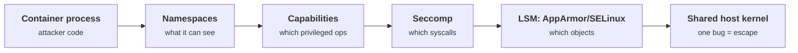
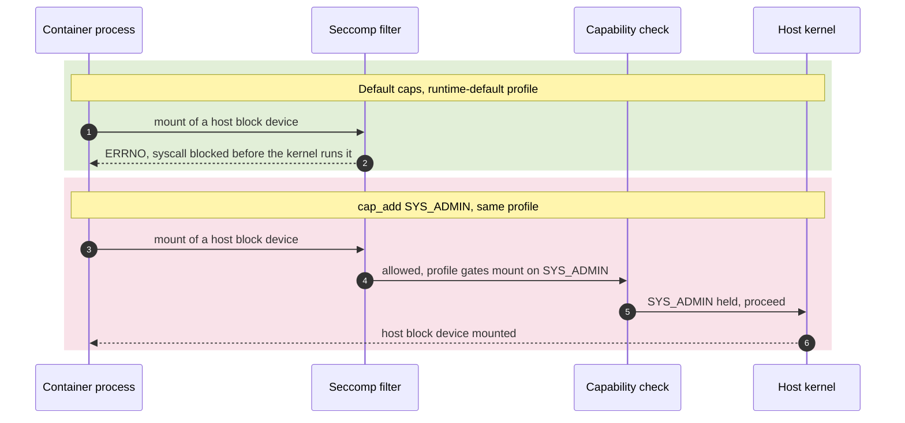
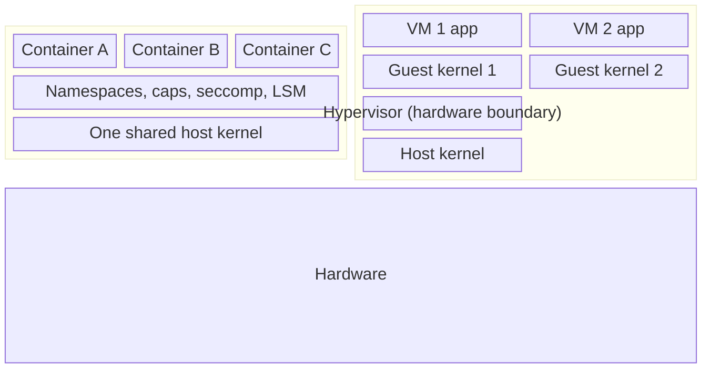
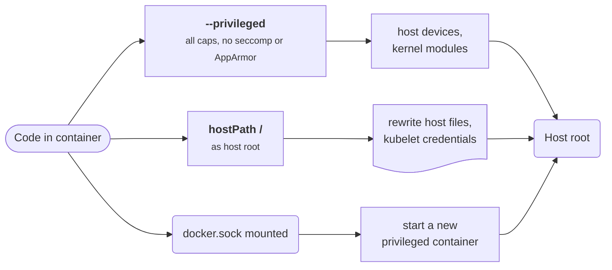
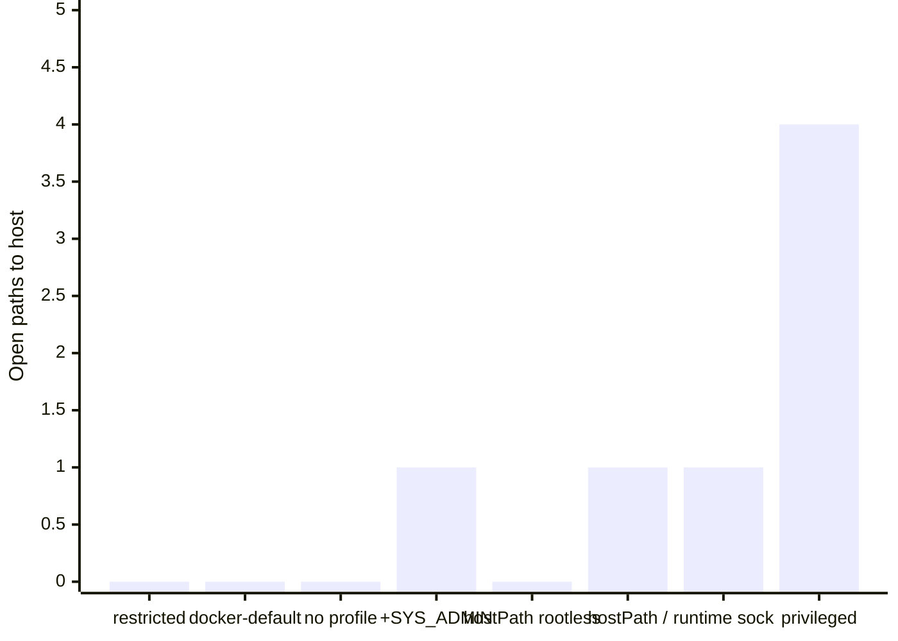

+++
title = 'Containers from the kernel up'
description = 'A container is a process with a restricted view of one shared kernel. The isolation is a set of kernel features you configure, and most escapes come from configuration, not kernel bugs.'
question = 'What actually isolates a container, and why is it not a security boundary by default?'
weight = 1
difficulty = 3
prerequisites = ['/notes/infrastructure-security/foundations/01-following-a-workload']
date = 2026-07-18
lastmod = 2026-07-18
verified = 2026-07-18
+++

## The idea in one minute

A container is not a small virtual machine. It is an ordinary process on the
host, running against the **same kernel** as every other process, that the
kernel has been told to show a narrowed view of the system. That view is built
from a handful of independent kernel features: **namespaces** limit what the
process can see, **cgroups** limit what it can use, and **capabilities**,
**seccomp**, and a **Linux Security Module** limit what it can do. Remove or
widen any one of them and the process sees more of the host.

The consequence to act on: **a container is a resource-management and
packaging boundary that can be configured into a security boundary, but is not
one by default.** Most escapes are not exotic kernel exploits. They are a
capability left on, a seccomp profile turned off, a host path mounted, or the
`privileged` flag set, each of which hands code a documented, intended path
back to the host.

## A picture



Every arrow is a layer you configure. The kernel at the end is shared with the
host and with every other container on the machine.

## How it really works

### Namespaces: what the process can see

A Linux namespace gives a process its own instance of a global resource. The
kernel maintains several kinds, and a container is a process placed in a fresh
set of them: a **mount** namespace (its own filesystem tree), a **PID**
namespace (its own process numbers, so its main process is PID 1), a
**network** namespace (its own interfaces and routing table), **UTS** (its own
hostname), **IPC**, **cgroup**, and the **user** namespace. Namespaces are what
make a container *look* like a separate machine. They do nothing to limit what
the process may *do* once it can reach a kernel interface.

Namespaces are also where sharing leaks isolation. A pod configured with
`hostPID: true` joins the host's PID namespace and can see and signal every
process on the node; `hostNetwork: true` puts it on the host's network stack,
past any per-pod network policy.

Compare the two pods below: the first gets fresh namespaces, the second shares
the host's and sees what the host sees.

```mermaid {title="Fresh namespaces narrow the view, host namespaces hand it back"}
flowchart LR
  subgraph NODE["Node: one kernel"]
    direction LR
    subgraph PA["Default pod"]
      A1("Container")
      A2["<b>own PID, mount, net, UTS</b><br/><small>sees only itself, PID 1</small>"]
    end
    subgraph PB["Pod with hostPID + hostNetwork"]
      B1("Container")
      B2["<b>host PID + net namespace</b><br/><small>sees every node process</small>"]
    end
    H("Host processes and NICs")
  end
  A1 --> A2
  B1 --> B2
  A2 -.->|cannot see| H
  B2 -->|"see, signal, sniff"| H
  class A2 good
  class B2 warn
```

### cgroups: what the process can use

Control groups (cgroups, v2 on current kernels) cap CPU, memory, process count
(pids), and I/O. They are the answer to a fork bomb or a crypto-miner: the
workload is throttled or killed rather than taking down the node. cgroups are
about availability and noisy-neighbor control, not confidentiality. A missing
memory limit is a denial-of-service risk, not an escape.

### Capabilities: splitting up root

The kernel splits the historical all-or-nothing power of UID 0 into about forty
**capabilities** (see `capabilities(7)`). `CAP_NET_BIND_SERVICE` allows binding
to a low port; `CAP_SYS_ADMIN` is a catch-all that allows mounting filesystems
and much more; `CAP_SYS_MODULE` loads kernel modules; `CAP_SYS_PTRACE` traces
other processes. Container runtimes drop most capabilities by default. Docker,
for example, keeps a set of 14 and drops the rest, so a process running as root
inside a default container is a much weaker root than root on the host.

The danger is `cap_add`. Granting `CAP_SYS_ADMIN` to make one mount work hands
back a capability from which many escapes are built. `CAP_SYS_MODULE` lets the
container load code into the host kernel directly. Treat added capabilities as
removing a wall, not loosening a setting.

The map splits root's power into what a default container keeps and the grants
that turn container root back into host root.

```mermaid {title="Root split into capabilities: kept by default versus dangerous to add"}
mindmap
  root((UID 0 power))
    Kept by default
      NET_BIND_SERVICE
        bind a low port
      CHOWN and FOWNER
        file ownership
      SETUID and SETGID
        switch users
      KILL
        signal own processes
    Dangerous to add
      SYS_ADMIN
        mount and much more
      SYS_MODULE
        load kernel code
      SYS_PTRACE
        trace other processes
      DAC_READ_SEARCH
        open files by handle
```

### Seccomp: which syscalls at all

A capability says you may perform a class of privileged operation; **seccomp**
(secure computing mode) filters the system-call interface itself. A seccomp-BPF
profile lists syscalls and an action: allow, or return an error (`ERRNO`), or
kill the process. The runtime-default profile shipped by Docker and containerd
blocks on the order of 40 to 60 syscalls that a normal workload never needs,
among them `init_module`, `finit_module`, `mount`, `open_by_handle_at`, and
`kexec_load`. Several of those are the same syscalls that a held capability
would otherwise permit, so capabilities and seccomp are **two independent locks
on the same doors**.

Follow one `mount` call through both locks, first with the default capability
set and then after `cap_add SYS_ADMIN`.



Kubernetes historically ran pods with seccomp **unconfined** unless you asked
otherwise. Since v1.27 the `RuntimeDefault` profile can be enabled for a whole
node via `--seccomp-default`, and Pod Security Admission's `restricted` level
requires a profile. A pod with no seccomp profile is a pod with the syscall
interface wide open.

### LSMs: which objects, by policy

A Linux Security Module adds a mandatory-access-control layer the kernel
consults after the standard checks. **AppArmor** confines a process by a
path-based profile; **SELinux** labels every process and object and allows only
matching labels. Container runtimes apply a default AppArmor profile (`docker-default`)
or an SELinux type (`container_t`) that stops a container process from writing
most of the host's files even if the Unix permissions would allow it. This is
the layer that most often turns "root in the container reached a host file"
into "permission denied".

### User namespaces and rootless

A **user namespace** maps user IDs inside the container to different IDs on the
host. With it, UID 0 inside the container can be an unprivileged UID (say,
100000) on the host, so even if code breaks out of the filesystem view, it acts
as nobody on the node. **Rootless** containers run the whole runtime as an
unprivileged user on top of this. User namespaces are the single most effective
change for turning a container into something closer to a boundary, and they
are off by default in many Kubernetes setups as of 2026. When root in the
container is root on the host, a host-path mount or a runtime-socket mount is
game over.

The same write to a root-owned host file, with and without a user namespace
remapping UID 0.

```mermaid {title="A user namespace turns container root into nobody on the host"}
flowchart LR
  R("uid 0 in container")
  R --> M{"User namespace<br/>remap?"}
  M -->|no| H0["<b>host uid 0</b><br/><small>real root</small>"]
  M -->|yes| H1["<b>host uid 100000</b><br/><small>unprivileged</small>"]
  H0 -->|"write root-owned host file"| W["<b>write succeeds</b><br/><small>host takeover</small>"]
  H1 -->|"same write"| D["<b>permission denied</b>"]
  class H0,W warn
  class H1,D good
```

### Why this is not a boundary by default

Every layer above sits in front of **one shared kernel**. A virtual machine
gives each guest its own kernel behind a hardware boundary; a container does
not.

The stack shows why: every container's controls sit above the same kernel,
while each VM brings its own.



So a single kernel vulnerability reachable through the allowed syscalls can
escape any container on the host, and a single misconfiguration can open a
documented path with no exploit at all:

- **`--privileged`** disables seccomp and AppArmor, grants all capabilities, and
  exposes host devices. It is root on the host with extra steps.
- **A host-path mount of `/`** (or of a sensitive directory) lets a container
  that runs as host-root rewrite host files, including things like the kubelet's
  credentials.
- **A mounted container-runtime socket** (`/var/run/docker.sock`,
  `containerd.sock`) lets the container ask the runtime to start a new, fully
  privileged container. It is an escape by design.

Each of the three misconfigurations is its own documented road to host root;
none of them needs a kernel bug.



## Code

The program models the three *do* layers (capabilities, a seccomp-style filter,
and host-sharing settings) and reports which escape paths each configuration
leaves open. It is a teaching model, not a real policy evaluator: the syscall
lists and capability set follow the shape of Docker's defaults but are trimmed.

```python {title="container_audit.py"}
"""container_audit.py: audit container settings the way the kernel enforces them.

Models capability sets, a seccomp-style syscall filter, and host-sharing
settings, then reports which paths to the host each configuration leaves open.
Standard library only; nothing here touches a real kernel or runtime.
"""

from __future__ import annotations

from dataclasses import dataclass, field

# The 14 capabilities Docker grants by default (Docker run reference).
DEFAULT_CAPS = frozenset({
    "CHOWN", "DAC_OVERRIDE", "FSETID", "FOWNER", "MKNOD", "NET_RAW", "SETGID",
    "SETUID", "SETFCAP", "SETPCAP", "NET_BIND_SERVICE", "SYS_CHROOT", "KILL",
    "AUDIT_WRITE",
})
ALL_CAPS = DEFAULT_CAPS | {"SYS_ADMIN", "SYS_MODULE", "SYS_PTRACE", "DAC_READ_SEARCH",
                           "NET_ADMIN", "SYS_RAWIO", "BPF"}

# Syscalls a runtime-default style profile allows only when a capability is held,
# in the spirit of Docker's default profile.
CAP_GATED = {"mount": "SYS_ADMIN", "init_module": "SYS_MODULE",
             "finit_module": "SYS_MODULE", "open_by_handle_at": "DAC_READ_SEARCH",
             "bpf": "BPF"}
BASE_ALLOW = {"read", "write", "openat", "close", "mmap", "execve", "clone",
              "futex", "socket", "connect", "ptrace"}


@dataclass(frozen=True)
class Filter:
    name: str
    default: str  # action for a syscall no rule matches: "ALLOW" or "ERRNO"
    allow: frozenset[str] = frozenset()

    def decide(self, syscall: str, caps: frozenset[str]) -> str:
        if self.default == "ALLOW":
            return "ALLOW"
        if syscall in self.allow:
            return "ALLOW"
        if CAP_GATED.get(syscall) in caps:
            return "ALLOW"
        return "ERRNO"


UNCONFINED = Filter("unconfined", "ALLOW")
RUNTIME_DEFAULT = Filter("runtime-default", "ERRNO", frozenset(BASE_ALLOW))


@dataclass
class Config:
    name: str
    caps: frozenset[str]
    seccomp: Filter
    root_maps_to_host_root: bool = True  # False when a user namespace remaps uid 0
    host_mounts: list[str] = field(default_factory=list)
    host_pid: bool = False


# (path to the host, capability needed, syscall needed, extra condition)
PATHS = [
    ("mount host block devices", "SYS_ADMIN", "mount", None),
    ("load a kernel module", "SYS_MODULE", "finit_module", None),
    ("open host files by handle", "DAC_READ_SEARCH", "open_by_handle_at", None),
    ("trace host processes", "SYS_PTRACE", "ptrace", "host_pid"),
    ("write host files as root", None, "openat", "host_root_mount"),
    ("drive the container runtime", None, "connect", "runtime_socket"),
]


def open_paths(c: Config) -> list[str]:
    found = []
    for label, cap, syscall, cond in PATHS:
        if cap and cap not in c.caps:
            continue
        if c.seccomp.decide(syscall, c.caps) != "ALLOW":
            continue
        if cond == "host_pid" and not c.host_pid:
            continue
        if cond == "host_root_mount" and not ("/" in c.host_mounts and c.root_maps_to_host_root):
            continue
        if cond == "runtime_socket" and "/run/containerd/containerd.sock" not in c.host_mounts:
            continue
        found.append(label)
    return found


def main() -> None:
    calls = ["read", "openat", "mount", "finit_module", "open_by_handle_at", "bpf"]
    print(f"{'syscall':<18}{'unconfined':<12}{'default':<10}{'default+SYS_ADMIN'}")
    for s in calls:
        print(f"{s:<18}{UNCONFINED.decide(s, DEFAULT_CAPS):<12}"
              f"{RUNTIME_DEFAULT.decide(s, DEFAULT_CAPS):<10}"
              f"{RUNTIME_DEFAULT.decide(s, DEFAULT_CAPS | {'SYS_ADMIN'})}")
    print()

    configs = [
        Config("restricted", frozenset(), RUNTIME_DEFAULT, root_maps_to_host_root=False),
        Config("docker-default", DEFAULT_CAPS, RUNTIME_DEFAULT),
        Config("k8s pod, no profile", DEFAULT_CAPS, UNCONFINED),
        Config("cap_add SYS_ADMIN", DEFAULT_CAPS | {"SYS_ADMIN"}, RUNTIME_DEFAULT),
        Config("hostPath / (rootless)", DEFAULT_CAPS, RUNTIME_DEFAULT,
               root_maps_to_host_root=False, host_mounts=["/"]),
        Config("hostPath /", DEFAULT_CAPS, RUNTIME_DEFAULT, host_mounts=["/"]),
        Config("runtime socket", DEFAULT_CAPS, RUNTIME_DEFAULT,
               host_mounts=["/run/containerd/containerd.sock"]),
        Config("privileged + hostPID", ALL_CAPS, UNCONFINED, host_pid=True),
    ]
    for c in configs:
        paths = open_paths(c)
        print(f"{c.name:<23}{len(c.caps):>2} caps  {c.seccomp.name:<16}"
              f"{len(paths)} open path(s)")
        for p in paths:
            print(f"    - {p}")


if __name__ == "__main__":
    main()
```

Run it with `python3 container_audit.py`:

```text
syscall           unconfined  default   default+SYS_ADMIN
read              ALLOW       ALLOW     ALLOW
openat            ALLOW       ALLOW     ALLOW
mount             ALLOW       ERRNO     ALLOW
finit_module      ALLOW       ERRNO     ERRNO
open_by_handle_at ALLOW       ERRNO     ERRNO
bpf               ALLOW       ERRNO     ERRNO

restricted              0 caps  runtime-default 0 open path(s)
docker-default         14 caps  runtime-default 0 open path(s)
k8s pod, no profile    14 caps  unconfined      0 open path(s)
cap_add SYS_ADMIN      15 caps  runtime-default 1 open path(s)
    - mount host block devices
hostPath / (rootless)  14 caps  runtime-default 0 open path(s)
hostPath /             14 caps  runtime-default 1 open path(s)
    - write host files as root
runtime socket         14 caps  runtime-default 1 open path(s)
    - drive the container runtime
privileged + hostPID   21 caps  unconfined      4 open path(s)
    - mount host block devices
    - load a kernel module
    - open host files by handle
    - trace host processes
```

Two things stand out. The syscall table shows that the default seccomp profile
blocks `mount` on its own, and adding `CAP_SYS_ADMIN` re-enables it: the two
locks are independent, and widening either one is enough to reach the door.
Below, `docker-default` leaves no path open, while the same capabilities with a
host-path mount, a runtime socket, or no user-namespace remap each open exactly
one. The `rootless` row shows a host-path mount of `/` neutralized purely
because UID 0 no longer maps to host root.

The program's second table as a chart: one widened setting opens one path, and
`privileged` plus `hostPID` opens four at once.



## Where it breaks

- **This model counts configuration paths, not kernel bugs.** Its "0 open paths"
  for `docker-default` means no *misconfiguration* path, not that the
  configuration is unescapable. A kernel vulnerability reachable through an
  allowed syscall bypasses the whole table. That is the point of the next lesson
  on stronger isolation.
- **Capability interactions are simplified.** Real escapes chain capabilities,
  writable kernel interfaces (`/sys`, `/proc`), and specific kernel versions in
  ways this does not model. `CAP_SYS_ADMIN` in particular enables far more than
  one mount.
- **Namespaces and cgroups are only sketched.** A real audit also checks for
  `hostNetwork`, writable `/proc` and `/sys` mounts, exposed devices, and the
  absence of resource limits.
- **Defaults drift.** The default capability set, the seccomp profile contents,
  and whether Kubernetes applies `RuntimeDefault` all change across versions.
  Check the versions you actually run; treat the numbers here as illustrative,
  current as of 2026.

## Remember this

- A container is a process on a shared kernel with a narrowed view, not a VM.
- Namespaces control what it sees; cgroups what it uses; capabilities, seccomp,
  and an LSM what it may do.
- Capabilities and seccomp are independent locks; widening either can reopen a
  syscall.
- Most escapes are configuration, not exploits: `privileged`, host-path mounts,
  a mounted runtime socket, `hostPID`/`hostNetwork`.
- User namespaces and rootless mode mean container root is not host root, which
  defuses many of those paths.
- Because the kernel is shared, one kernel bug escapes any container; defense in
  depth buys you the layers, not a wall.

## Try it

1. Run `container_audit.py`. Add a config for a pod with `hostPID: true` but the
   runtime-default seccomp profile and default caps. Does the "trace host
   processes" path open? Explain why, using the capability column.
2. Add `CAP_SYS_MODULE` to `cap_add` and confirm the module-load path opens.
   Then set the seccomp profile to one that blocks `finit_module` anyway and show
   the path closes again, demonstrating the second lock.
3. On a machine with Docker, run `docker run --rm alpine grep Cap /proc/self/status`
   and decode `CapEff` with `capsh --decode=<hex>`. Compare the set to
   `DEFAULT_CAPS`.
4. Write the YAML for a Kubernetes `securityContext` that sets
   `runAsNonRoot`, drops all capabilities, and requires the `RuntimeDefault`
   seccomp profile. Which escape rows would that close?

## Check yourself

1. Why is a default container not a security boundary, even though it has its own
   PID, mount, and network view?

   
   Those are namespaces, which only change what the process *sees*. The process
   still calls the one shared host kernel directly through the syscall interface.
   A kernel bug reachable through an allowed syscall, or a misconfiguration that
   grants a path to the host, escapes the namespaces entirely. Isolation of the
   view is not isolation of privilege.
   

2. Capabilities and seccomp both restrict privileged actions. Why keep both?

   
   They are independent locks on overlapping doors. A capability authorizes a
   class of operation; seccomp controls whether the syscall can be issued at all.
   A workload that holds `CAP_SYS_ADMIN` but whose seccomp profile blocks `mount`
   still cannot mount. Keeping both means a mistake in one (an accidental
   `cap_add`, a profile set to unconfined) does not immediately open the door.
   

3. Why does mounting the container runtime's socket into a container defeat all
   the other controls?

   
   The socket is the control plane of the runtime. A process that can write to it
   can ask the runtime to launch a new container that is privileged, mounts the
   host filesystem, and runs as host root. No kernel exploit is involved; you have
   handed the workload the ability to create a maximally privileged sibling.
   

4. What does running with a user namespace (rootless) change about a host-path
   mount of `/`?

   
   UID 0 inside the container maps to an unprivileged UID on the host. So even
   though the host filesystem is mounted, the process acts as that unprivileged
   user against it and cannot rewrite root-owned host files. Without the user
   namespace, container root is host root and the mount is a direct takeover.
   

## Sources

- The Linux man-pages project, [`namespaces(7)`](https://man7.org/linux/man-pages/man7/namespaces.7.html), [`capabilities(7)`](https://man7.org/linux/man-pages/man7/capabilities.7.html), [`seccomp(2)`](https://man7.org/linux/man-pages/man2/seccomp.2.html), [`user_namespaces(7)`](https://man7.org/linux/man-pages/man7/user_namespaces.7.html), [`cgroups(7)`](https://man7.org/linux/man-pages/man7/cgroups.7.html).
- Docker, [Runtime privilege and Linux capabilities](https://docs.docker.com/reference/cli/docker/container/run/#privileged) and [Seccomp security profiles](https://docs.docker.com/engine/security/seccomp/).
- Kubernetes, [Configure a Security Context for a Pod or Container](https://kubernetes.io/docs/tasks/configure-pod-container/security-context/) and [Seccomp default (`--seccomp-default`)](https://kubernetes.io/docs/tutorials/security/seccomp/).
- Kubernetes, [User namespaces](https://kubernetes.io/docs/concepts/workloads/pods/user-namespaces/).
- AppArmor project, [AppArmor wiki](https://gitlab.com/apparmor/apparmor/-/wikis/home); SELinux, [SELinux Project wiki](https://github.com/SELinuxProject/selinux/wiki).
