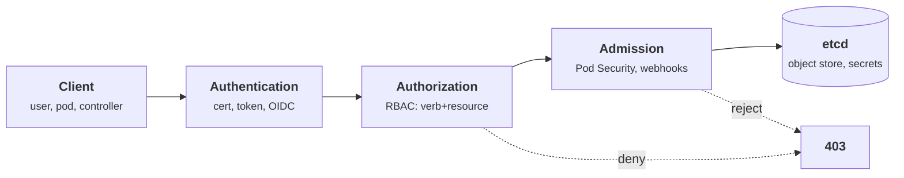
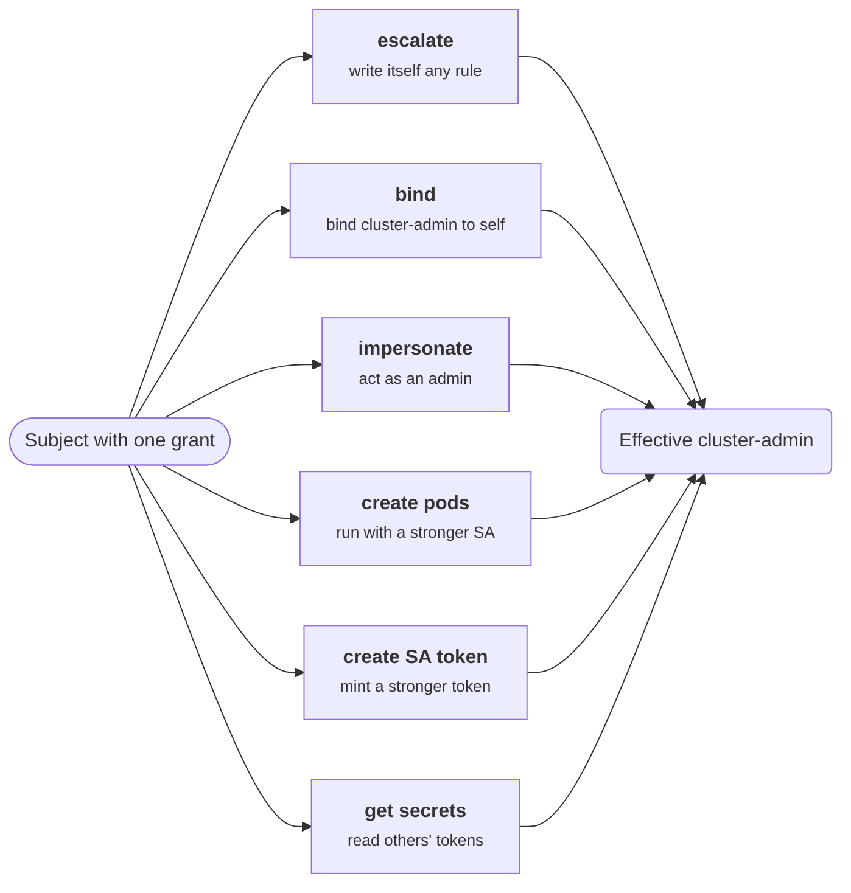
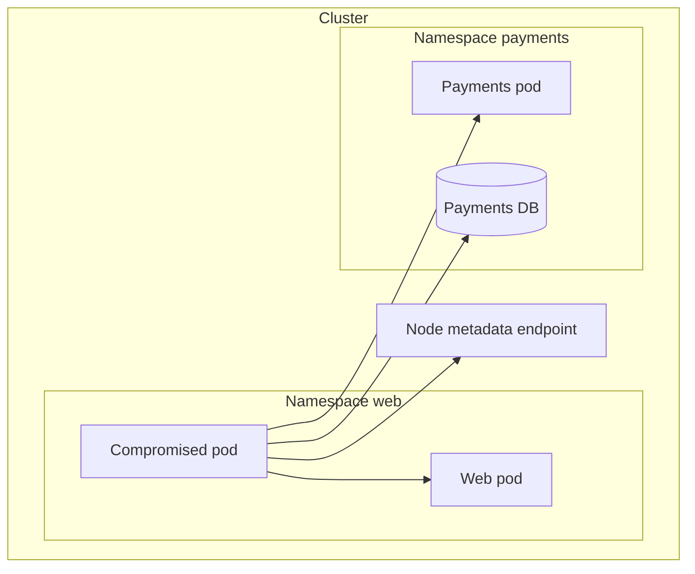
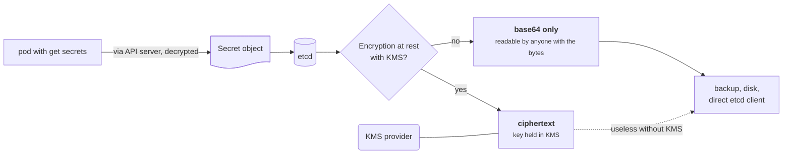
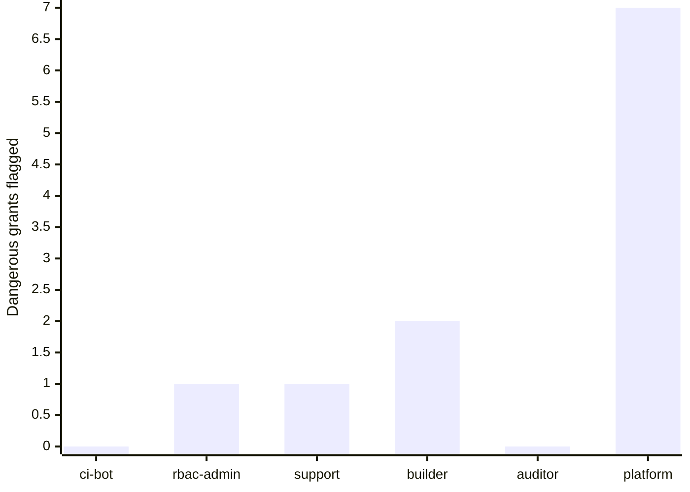

+++
title = 'The Kubernetes security model'
description = 'Kubernetes authorizes every request through the API server. Its security rests on RBAC, admission control, and Pod Security Standards, and a handful of verbs quietly grant cluster-admin.'
question = 'How does Kubernetes decide who may do what, and which grants quietly mean cluster-admin?'
weight = 2
difficulty = 3
prerequisites = ['/notes/infrastructure-security/isolation/01-containers-from-the-kernel-up', '/notes/infrastructure-security/foundations/03-cloud-iam-fundamentals']
date = 2026-07-20
lastmod = 2026-10-30
verified = 2026-07-20
+++

## The idea in one minute

Almost everything in Kubernetes happens by talking to one component: the
**API server**. Pods, nodes, controllers, and people all read and write the same
object store through it. So the cluster's security is mostly the API server's
answer to three questions on every request: **who are you** (authentication),
**may you do this** (authorization, in practice RBAC), and **is this object
allowed** (admission control, including Pod Security Admission).

The trap is that RBAC permissions are not equal. A few verbs on a few
resources, which read like ordinary grants, let their holder become
cluster-admin: `escalate` and `bind` on roles, `impersonate`, `create` on
pods, and `create` on service-account tokens, and plain read access to
`secrets`. The consequence to act on: **review RBAC for effective
cluster-admin, not just for literal `cluster-admin` bindings**, because the
dangerous grants rarely say "admin" anywhere.

## A picture



Every arrow before etcd is a check the API server runs in order. Skip or
misconfigure one and the store behind it is exposed.

## How it really works

### Authentication: who is calling

Kubernetes does not have its own user database. The API server authenticates a
request from client certificates, bearer tokens, or an external OpenID Connect
provider, and derives a username and group list. **Pods** authenticate with a
**service-account token**: a projected, time-bound, audience-scoped JWT the
kubelet mounts into the pod. Every pod gets one by default (you can turn this
off with `automountServiceAccountToken: false`), which means every workload
starts life holding a credential to the API server. What that token can do is
entirely a matter of the next step.

Here is the life of that default credential, from the kubelet mounting it to
RBAC deciding what it is worth.

```mermaid {title="A pod's service-account token: mounted by default, judged by RBAC"}
sequenceDiagram
  autonumber
  participant KL as kubelet
  participant P as Pod
  participant API as API server
  participant R as RBAC authorizer
  KL->>P: mount projected SA token (JWT, time-bound, audience-scoped)
  Note over P: every pod gets one unless automountServiceAccountToken is false
  P->>API: request with Authorization Bearer token
  API->>API: verify signature, audience, expiry
  API->>R: user system:serviceaccount:ns:name, groups
  alt a bound role allows verb on resource
    R-->>API: allow
    API-->>P: 200
  else no rule matches
    R-->>API: no opinion, deny
    API-->>P: 403 Forbidden
  end
```

### Authorization: RBAC

The default authorizer is **RBAC**. Its model is deliberately small:

- A **Role** (namespaced) or **ClusterRole** (cluster-wide) is a list of rules.
  Each rule is a set of **verbs** (`get`, `list`, `watch`, `create`, `update`,
  `patch`, `delete`, and a few special ones), over **apiGroups** and
  **resources**.
- A **RoleBinding** or **ClusterRoleBinding** ties a role to **subjects**: users,
  groups, or service accounts.

The whole model fits in four entities; note that nothing in it can say "deny".

```mermaid {title="RBAC data model: bindings join subjects to allow-only rules"}
erDiagram
  SUBJECT ||--o{ BINDING : "named in"
  BINDING }o--|| ROLE : "references"
  ROLE ||--|{ RULE : "contains"
  SUBJECT {
    string kind "User, Group, ServiceAccount"
    string name
  }
  BINDING {
    string kind "RoleBinding or ClusterRoleBinding"
    string namespace "empty when cluster-wide"
  }
  ROLE {
    string kind "Role or ClusterRole"
    string name
  }
  RULE {
    string verbs "get list create bind escalate or *"
    string apiGroups "core, apps, rbac or *"
    string resources "pods secrets roles or *"
  }
```

RBAC is **purely additive and allow-only**: there are no deny rules, so the
effective permission of a subject is the union of every rule in every role bound
to it. A `*` in verbs, groups, or resources is a wildcard. This simplicity is a
strength for reasoning, and a weakness: the model will not warn you that a
particular combination of innocuous-looking rules adds up to full control.

### Admission control and Pod Security

After authorization, **admission controllers** inspect and may mutate or reject
the object. This is where cluster-wide policy lives. The built-in **Pod
Security Admission** enforces the **Pod Security Standards**, three profiles
applied per namespace by label:

| Profile | Allows | Blocks |
| --- | --- | --- |
| **privileged** | everything | nothing; for trusted system workloads only |
| **baseline** | most pods | known privilege escalations: `privileged`, host namespaces, most `hostPath`, adding dangerous capabilities |
| **restricted** | hardened pods | also requires `runAsNonRoot`, a seccomp profile, dropping `ALL` capabilities, no privilege escalation |

Admission reads the namespace's label first, then checks the pod against that
profile; RBAC has already said yes by this point.

```mermaid {title="Pod Security Admission: the namespace label picks the bar a pod must clear"}
flowchart TB
  P("Pod create, RBAC allowed")
  P --> L{"Namespace<br/>enforce label?"}
  L -->|privileged| OK1["<b>admitted</b><br/><small>no checks</small>"]
  L -->|baseline| B{"privileged, host namespaces,<br/>hostPath, dangerous caps?"}
  L -->|restricted| R{"also runAsNonRoot, seccomp,<br/>drop ALL, no escalation?"}
  B -->|none| OK2["<b>admitted</b>"]
  B -->|any| REJ["<b>rejected</b>"]
  R -->|all set| OK3["<b>admitted</b>"]
  R -->|missing| REJ
  class OK1 warn
  class OK2,OK3 good
  class REJ neutral
```

Pod Security Admission replaced the removed PodSecurityPolicy. It cannot express
everything (it is per-namespace and has fixed profiles), so clusters often add a
general policy engine as a **validating admission webhook**, such as OPA
Gatekeeper or Kyverno, for rules like "images must come from our registry" or
"every pod has resource limits". These lessons connect to admission for signed
images in the delivery module.

### The dangerous verbs

A handful of RBAC grants confer far more authority than they name. These are the
ones to hunt for:

| Grant | Why it is effectively cluster-admin |
| --- | --- |
| **`escalate` on roles/clusterroles** | Normally you cannot grant a permission you do not hold; `escalate` removes that check, so the holder can write themselves any permission. |
| **`bind` on roles/clusterroles** | Lets the holder create a binding to any role, including `cluster-admin`, for themselves. |
| **`impersonate` (users/groups/serviceaccounts)** | The holder can send requests *as* any other subject, including an admin. |
| **`create` on pods** | A pod can mount a more privileged service-account token, or a host path, or run privileged (subject to Pod Security). Scheduling a pod is scheduling code with another identity. |
| **`create` on serviceaccounts/token** (TokenRequest) | Mint a token for any service account the holder can name, inheriting its permissions. |
| **`get`/`list` on secrets** | Secrets hold service-account tokens and other credentials; reading them clusterwide is reading the keys to other identities. |

None of these contain the word "admin". A reviewer scanning only for
`cluster-admin` bindings misses all of them.

Drawn as attack paths, each grant is a different side door into the same room.



### NetworkPolicy defaults to allow

One more default worth calling out: with no NetworkPolicy selecting a pod, **all
ingress and egress is allowed**. The cluster network is flat. A compromised pod
can reach every other pod and the node's metadata endpoint until a policy says
otherwise. NetworkPolicy is namespaced and additive like RBAC; the common first
move is a default-deny policy per namespace, then allow what is needed. Network
segmentation gets its own lesson later in this module.

With no policy selecting it, a compromised pod's reach is the whole cluster
network plus the node's metadata endpoint.



### etcd holds the secrets

All cluster state, including **Secret** objects, lives in **etcd**. By default
Secrets are stored base64-encoded, not encrypted, so anyone who can read etcd
(a backup, a disk, a direct etcd client, or a pod with `get secrets`) reads the
secrets. Enabling **encryption at rest** with a KMS provider, and locking down
etcd access, is a baseline hardening step.

Four different readers reach the same Secret, and only encryption at rest
changes what three of them see.



## Code

The program is a miniature RBAC evaluator. It models ClusterRoles as rules,
answers allow/deny for requests, and then scans each subject's roles for the
dangerous grants above, reporting which subjects have an effective path to
cluster-admin even though none is bound to the literal `cluster-admin` role
except the one that is.

```python {title="rbac_eval.py"}
"""rbac_eval.py: a small Kubernetes-style RBAC evaluator and privilege-escalation detector.

Models Roles/ClusterRoles as rules over (verbs, apiGroups, resources), binds
subjects to them, answers allow/deny for a request, and flags grants that confer
effective cluster-admin even without the literal "*/*/*" rule. Standard library
only; no cluster is contacted.
"""

from __future__ import annotations

from dataclasses import dataclass

STAR = "*"


@dataclass(frozen=True)
class Rule:
    verbs: frozenset[str]
    groups: frozenset[str]        # apiGroups; "" is the core group
    resources: frozenset[str]

    def matches(self, verb: str, group: str, resource: str) -> bool:
        return (self._in(self.verbs, verb)
                and self._in(self.groups, group)
                and self._in(self.resources, resource))

    @staticmethod
    def _in(allowed: frozenset[str], want: str) -> bool:
        return STAR in allowed or want in allowed


def rule(verbs: str, groups: str, resources: str) -> Rule:
    return Rule(frozenset(verbs.split()), frozenset(groups.split()),
                frozenset(resources.split()))


# A library of named roles (ClusterRoles).
ROLES: dict[str, list[Rule]] = {
    "view": [rule("get list watch", "\"\" apps", "pods services deployments configmaps")],
    "pod-reader": [rule("get list watch", "\"\"", "pods")],
    "deploy-manager": [rule("get list watch create update patch delete", "apps", "deployments")],
    "secret-reader": [rule("get list", "\"\"", "secrets")],
    "role-author": [rule("create update patch", "rbac.authorization.k8s.io", "roles rolebindings")],
    "binder": [rule("bind", "rbac.authorization.k8s.io", "clusterroles roles")],
    "impersonator": [rule("impersonate", "\"\"", "users groups serviceaccounts")],
    "pod-creator": [rule("create", "\"\"", "pods")],
    "token-maker": [rule("create", "\"\"", "serviceaccounts/token")],
    "cluster-admin": [rule("*", "*", "*")],
}
# "" in a role string is written as the two-character token below; normalize it.
for _name, _rules in ROLES.items():
    ROLES[_name] = [
        Rule(r.verbs,
             frozenset("" if g == '""' else g for g in r.groups),
             frozenset(res for res in r.resources))
        for r in _rules
    ]


@dataclass(frozen=True)
class Request:
    verb: str
    group: str
    resource: str


def allowed(role_names: list[str], req: Request) -> bool:
    for name in role_names:
        for r in ROLES[name]:
            if r.matches(req.verb, req.group, req.resource):
                return True
    return False


# Dangerous grants: each is a (predicate, why) pair describing a path to more
# authority than the grant literally names.
DANGEROUS = [
    (Request("escalate", "rbac.authorization.k8s.io", "clusterroles"),
     "escalate on roles: can grant itself any permission, bypassing the privilege-escalation check"),
    (Request("bind", "rbac.authorization.k8s.io", "clusterroles"),
     "bind on clusterroles: can bind any role (e.g. cluster-admin) to itself"),
    (Request("impersonate", "", "users"),
     "impersonate users: can act as any user, including cluster-admins"),
    (Request("create", "", "pods"),
     "create pods: can schedule a pod that mounts a privileged service account or the host"),
    (Request("create", "", "serviceaccounts/token"),
     "create SA tokens: can mint tokens for more privileged service accounts"),
    (Request("get", "", "secrets"),
     "read secrets: can read service account tokens and other credentials clusterwide"),
    (Request("*", "*", "*"),
     "wildcard everything: literal cluster-admin"),
]


def escalation_report(role_names: list[str]) -> list[str]:
    hits = []
    for req, why in DANGEROUS:
        if allowed(role_names, req):
            hits.append(why)
    return hits


def main() -> None:
    checks = [
        (["pod-reader"], Request("get", "", "pods")),
        (["pod-reader"], Request("delete", "", "pods")),
        (["deploy-manager"], Request("update", "apps", "deployments")),
        (["view"], Request("get", "", "secrets")),
        (["view"], Request("get", "", "pods")),
        (["secret-reader"], Request("get", "", "secrets")),
    ]
    print("access checks")
    for roles, req in checks:
        verdict = "ALLOW" if allowed(roles, req) else "DENY "
        print(f"  {verdict} {'+'.join(roles):<16} {req.verb} {req.resource or '(core)'}"
              f" [{req.group or 'core'}]")

    print("\nprivilege-escalation scan")
    subjects = {
        "ci-bot": ["deploy-manager", "pod-reader"],
        "rbac-admin": ["role-author", "binder"],
        "support": ["impersonator"],
        "builder": ["pod-creator", "token-maker"],
        "auditor": ["view"],
        "platform": ["cluster-admin"],
    }
    for subj, roles in subjects.items():
        hits = escalation_report(roles)
        if hits:
            print(f"  {subj} ({'+'.join(roles)}): EFFECTIVE CLUSTER-ADMIN RISK")
            for h in hits:
                print(f"      - {h}")
        else:
            print(f"  {subj} ({'+'.join(roles)}): no escalation path found")


if __name__ == "__main__":
    main()
```

Run it with `python3 rbac_eval.py`:

```text
access checks
  ALLOW pod-reader       get pods [core]
  DENY  pod-reader       delete pods [core]
  ALLOW deploy-manager   update deployments [apps]
  DENY  view             get secrets [core]
  ALLOW view             get pods [core]
  ALLOW secret-reader    get secrets [core]

privilege-escalation scan
  ci-bot (deploy-manager+pod-reader): no escalation path found
  rbac-admin (role-author+binder): EFFECTIVE CLUSTER-ADMIN RISK
      - bind on clusterroles: can bind any role (e.g. cluster-admin) to itself
  support (impersonator): EFFECTIVE CLUSTER-ADMIN RISK
      - impersonate users: can act as any user, including cluster-admins
  builder (pod-creator+token-maker): EFFECTIVE CLUSTER-ADMIN RISK
      - create pods: can schedule a pod that mounts a privileged service account or the host
      - create SA tokens: can mint tokens for more privileged service accounts
  auditor (view): no escalation path found
  platform (cluster-admin): EFFECTIVE CLUSTER-ADMIN RISK
      - escalate on roles: can grant itself any permission, bypassing the privilege-escalation check
      - bind on clusterroles: can bind any role (e.g. cluster-admin) to itself
      - impersonate users: can act as any user, including cluster-admins
      - create pods: can schedule a pod that mounts a privileged service account or the host
      - create SA tokens: can mint tokens for more privileged service accounts
      - read secrets: can read service account tokens and other credentials clusterwide
      - wildcard everything: literal cluster-admin
```

Notice that `ci-bot` and `auditor` hold real power (deploy apps, read most
objects) yet have no escalation path, while `rbac-admin`, `support`, and
`builder` are each effectively cluster-admin through a single verb that never
says "admin". That gap between literal and effective privilege is exactly what
an RBAC review has to close.

Counting the flagged grants per subject from the scan makes the gap visible:
only `platform` is literally admin, yet three others score above zero.



## Where it breaks

- **The model ignores namespaces and resource names.** Real RBAC scopes rules to
  namespaces and can restrict verbs to named objects (`resourceNames`). A grant
  that is cluster-admin cluster-wide may be harmless in one namespace, and this
  model does not distinguish them.
- **`create pods` is conditional.** Whether creating a pod yields escalation
  depends on Pod Security Admission, available service accounts, and node
  configuration. With a `restricted` profile and `automountServiceAccountToken:
  false`, the path narrows. The model flags it as a risk to investigate, not a
  proven exploit.
- **Admission is not modeled.** A webhook that rejects privileged pods changes
  the real picture; RBAC alone does not tell you what admission will allow.
- **Defaults and APIs change.** Pod Security Standard contents, which verbs exist,
  and TokenRequest behavior evolve across versions. Verify against the version
  you run; this is current as of 2026.

## Remember this

- Everything goes through the API server: authenticate, authorize (RBAC), admit,
  then persist to etcd.
- RBAC is additive and allow-only; a subject's power is the union of all bound
  roles, and there are no deny rules.
- `escalate`, `bind`, `impersonate`, `create pods`, `create` SA tokens, and
  reading `secrets` are effectively cluster-admin; none say "admin".
- Pod Security Admission applies privileged/baseline/restricted per namespace;
  use restricted for untrusted workloads and a webhook engine for the rest.
- NetworkPolicy defaults to allow; the cluster network is flat until you deny.
- etcd stores Secrets unencrypted by default; enable encryption at rest and lock
  down etcd.

## Try it

1. Run `rbac_eval.py`. Add a subject bound only to `secret-reader` and confirm it
   is flagged. Then change the grant to `resourceNames: ["my-config"]` in your
   mental model: why would the real risk drop, and what would you need to add to
   the evaluator to express it?
2. Add a `node-proxy` role with `get` on `nodes/proxy` and decide whether it
   belongs in `DANGEROUS`. (Research what the kubelet API exposes.)
3. On a cluster you control, run
   `kubectl auth can-i --list --as=system:serviceaccount:default:default` and
   compare the output to what this model would say.
4. Write a `restricted` Pod Security label for a namespace and list which fields
   of a pod spec it would force.

## Check yourself

1. Why does scanning for `cluster-admin` role bindings miss most privilege
   escalation in a cluster?

   
   The grants that confer effective cluster-admin do not name it. `bind`,
   `escalate`, `impersonate`, `create pods`, minting service-account tokens, and
   reading secrets each let a subject reach admin-level power through a side door.
   A review has to evaluate what a set of verbs and resources *adds up to*, not
   just look for the literal admin binding.
   

2. Why is reading `secrets` across the cluster close to cluster-admin?

   
   Secret objects include service-account tokens and other credentials. Reading
   them lets the holder authenticate as other, more privileged identities, so a
   broad `get secrets` grant is an indirect grant of whatever those identities can
   do. It is also why etcd encryption at rest and tight Secret RBAC matter.
   

3. What does Pod Security Admission do that RBAC does not?

   
   RBAC decides whether you may create a pod object at all. Pod Security
   Admission inspects the pod's *contents* at admission time and rejects or
   warns if it violates the namespace's profile (privileged, baseline, or
   restricted), blocking things like `privileged: true`, host namespaces, and
   running as root. Authorization and admission are separate gates.
   

4. A new pod with no NetworkPolicy is scheduled. What can it reach on the
   network, and why?

   
   Everything its node can route to: all other pods and, commonly, the node's
   metadata endpoint. NetworkPolicy is additive and does nothing until a policy
   selects the pod, so the default is allow-all. Lateral movement from a
   compromised pod is unrestricted until a default-deny policy is in place.
   

## Sources

- Kubernetes, [Using RBAC Authorization](https://kubernetes.io/docs/reference/access-authn-authz/rbac/) (including "Privilege escalation prevention and bootstrapping").
- Kubernetes, [Pod Security Standards](https://kubernetes.io/docs/concepts/security/pod-security-standards/) and [Pod Security Admission](https://kubernetes.io/docs/concepts/security/pod-security-admission/).
- Kubernetes, [Controlling Access to the Kubernetes API](https://kubernetes.io/docs/concepts/security/controlling-access/) and [Managing Service Accounts](https://kubernetes.io/docs/reference/access-authn-authz/service-accounts-admin/).
- Kubernetes, [Network Policies](https://kubernetes.io/docs/concepts/services-networking/network-policies/).
- Kubernetes, [Encrypting Confidential Data at Rest](https://kubernetes.io/docs/tasks/administer-cluster/encrypt-data/).
