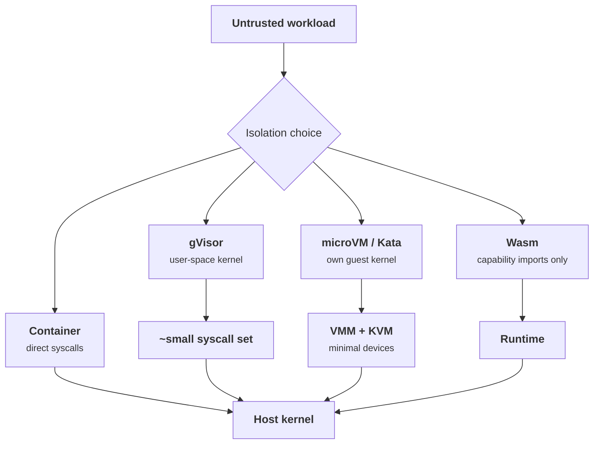
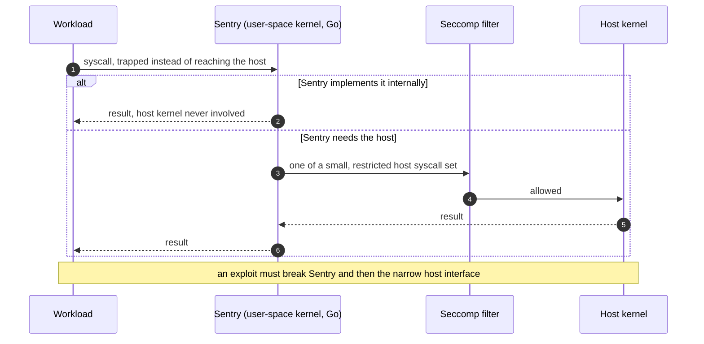
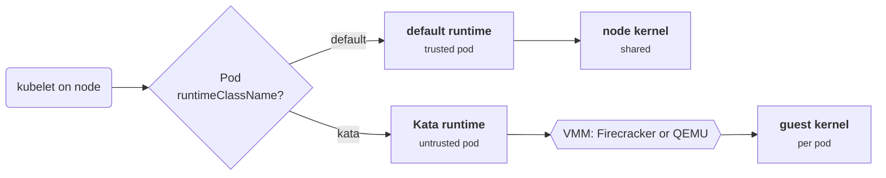
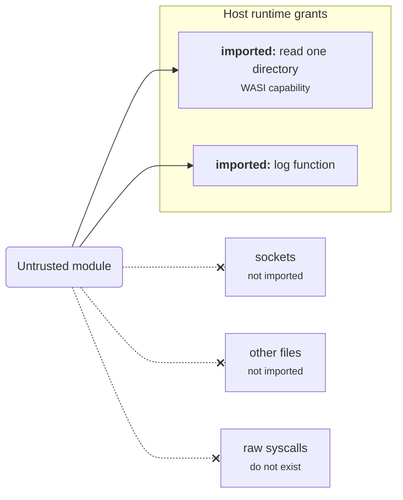
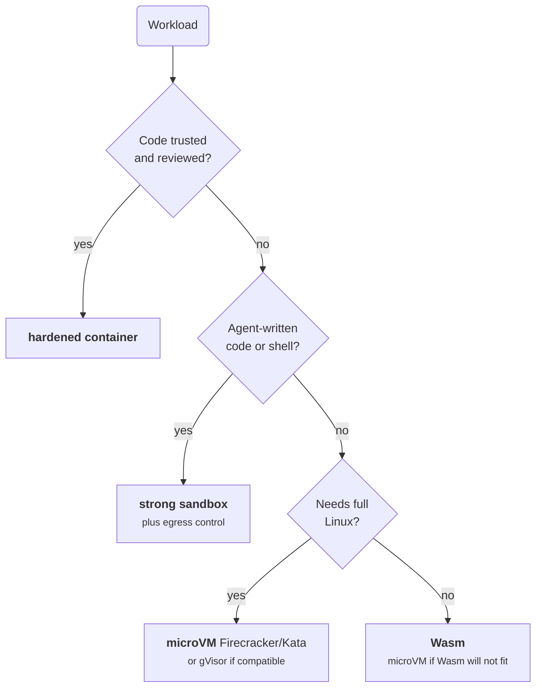

+++
title = 'Sandboxes and microVMs'
description = 'When a container is not enough, give the workload its own kernel. gVisor, microVMs, Kata, and Wasm trade compatibility and speed for a smaller attack surface; the threat picks the tool.'
question = 'When is a container not enough, and how do you choose a stronger sandbox?'
weight = 3
difficulty = 3
prerequisites = ['/notes/infrastructure-security/isolation/01-containers-from-the-kernel-up']
date = 2026-07-22
lastmod = 2026-07-22
verified = 2026-07-22
+++

## The idea in one minute

The previous lessons left us with a hard fact: a container shares the host
kernel, so one kernel bug reachable through an allowed syscall escapes any
container on the machine. When you must run code you do not trust, from many
tenants or written by a model under the influence of untrusted input, that
shared kernel is too large a target. The fix is to **stop sharing the kernel**,
or to shrink the interface the workload is allowed to touch.

Four families do this, trading away compatibility and speed for a smaller
attack surface: **gVisor** runs a kernel in user space and intercepts the
workload's syscalls; **Firecracker** and other **microVMs** give each workload
its own guest kernel behind hardware virtualization; **Kata Containers** wraps a
microVM in a container interface; and **WebAssembly** sandboxes run modules
against a capability-based interface with no ambient OS at all. The consequence
to act on: **the threat model, not fashion, chooses the sandbox.** Trusted
internal services do not need a microVM; untrusted multi-tenant code should not
run in a plain container.

## A picture



Every path ends at the host kernel. The difference is how much of it the
workload can reach directly.

## How it really works

### gVisor: a kernel in user space

gVisor runs the workload against **Sentry**, a kernel implemented in Go that
runs as an ordinary (unprivileged) user-space process. When the workload makes a
syscall, it is trapped and handled by Sentry rather than the host kernel. Sentry
implements a large part of the Linux syscall surface itself, and only makes a
small, tightly restricted set of host syscalls on the workload's behalf, filtered
further by seccomp. The result is that a workload exploit now has to get through
Sentry *and* the narrow host interface, instead of the full host syscall table.
The cost is compatibility (some syscalls are unimplemented or behave slightly
differently) and per-syscall overhead. gVisor is the sandbox behind several
serverless and container-runtime offerings.

Follow one syscall: the workload never talks to the host kernel itself, and
Sentry's own requests are filtered again.



### Firecracker: microVMs

Firecracker is a **virtual machine monitor** (VMM) built for serverless
workloads, described in the NSDI 2020 paper "Firecracker: Lightweight
Virtualization for Serverless Applications". Each workload runs in its own
lightweight VM with its own guest kernel, on top of KVM. The security argument is
twofold: the hardware virtualization boundary is far stronger than process
isolation, and Firecracker deliberately offers a **minimal device model** (a
handful of emulated devices rather than a full machine), so the host-facing
attack surface the guest can poke at is small. The paper reports boot times and
memory overhead low enough to pack thousands of microVMs onto a host, which is
what makes per-tenant or per-function VMs practical. Firecracker itself also runs
behind a seccomp filter and an optional jailer.

Read the stack bottom-up: an escape has to break the guest kernel, then the
minimal device model, then the jailed VMM, before it touches the host.

```mermaid {title="A Firecracker microVM: layers between tenant code and the host"}
block-beta
  columns 2
  t1["Tenant A function"] t2["Tenant B function"]
  k1["Guest kernel A"] k2["Guest kernel B"]
  d1["Minimal device model"] d2["Minimal device model"]
  v1["Firecracker VMM, seccomp + jailer"] v2["Firecracker VMM, seccomp + jailer"]
  kvm["KVM hardware virtualization boundary"]:2
  host["Host kernel"]:2
```

### Kata Containers: microVMs with a container interface

Kata Containers runs each pod or container inside a lightweight VM (it can use
Firecracker or QEMU as the VMM) while presenting the standard container runtime
interface. You get the VM boundary without rewriting how you deploy: Kata plugs
in as an OCI-compatible runtime, so a Kubernetes `RuntimeClass` can send
untrusted pods to Kata and trusted ones to the default runtime on the same
cluster.

One cluster, two runtimes: the pod's `RuntimeClass` decides whether it shares
the node kernel or gets its own.



### WebAssembly: capabilities, not an OS

A WebAssembly sandbox is different in kind. A Wasm module runs against a virtual
machine with linear memory and **no ambient authority**: it can only call the
functions the host explicitly imports into it. There is no filesystem, no
sockets, and no syscalls unless the host grants them, and the WebAssembly System
Interface (WASI) defines these as explicit, capability-style imports. That makes
the default attack surface tiny and cold starts very fast. The price is
compatibility: the code must be compiled to Wasm, and arbitrary Linux binaries,
`ptrace`, nested containers, and much of POSIX are simply not available. Wasm
suits untrusted *logic* (plugins, user-supplied functions), not arbitrary Linux
workloads.

A module's reach is exactly its import list; anything the host did not import
does not exist for it.



### Choosing by threat

The decision is a short series of questions:

| Question | If yes |
| --- | --- |
| Is the code trusted (your own, reviewed)? | A hardened container is usually enough; spend the isolation budget elsewhere. |
| Is it untrusted or multi-tenant, needing full Linux? | microVM (Firecracker/Kata) for the strongest boundary; gVisor if you accept its compatibility limits for lower overhead. |
| Untrusted, no need for full Linux, many fast invocations? | Wasm for the smallest surface and fastest cold start; a microVM if Wasm compatibility does not fit. |
| Running agent-written code or shell? | Stronger-than-container isolation plus egress control. See the AI security lesson on [sandboxing and egress](/notes/ai-security-engineering/securing-agents/04-sandboxing-and-egress/). |

The same questions as a decision path, asked in order:



Two forces trade off in every row. **Attack surface** is how much host code the
guest can reach: largest for a plain container (the whole kernel), smaller for
gVisor (Sentry plus a narrow host set), small for a microVM (a minimal device
model plus the VMM), smallest for Wasm (only imported functions). **Cost** is
overhead and compatibility: lowest for a container, highest for a full VM, with
gVisor paying per-syscall and Wasm paying in what it cannot run. A stronger
boundary you cannot afford to run, or that cannot run your workload, is not a
control.

Plotting the program's ordinal scores on those two axes shows the trade: the
bottom-left is cheap and small, and Wasm only sits there because it pays in
compatibility, which this chart does not show.

```mermaid {title="Host attack surface versus overhead (ordinal, from the model)"}
quadrantChart
  title Attack surface versus overhead
  x-axis Small host surface --> Large host surface
  y-axis Low overhead --> High overhead
  quadrant-1 Costly and exposed
  quadrant-2 Strong but costly
  quadrant-3 Strong and cheap
  quadrant-4 Cheap but exposed
  container: [0.9, 0.1]
  gVisor: [0.35, 0.35]
  Kata: [0.4, 0.62]
  Firecracker: [0.12, 0.38]
  Wasm: [0.1, 0.12]
```

## Code

The program models the options on three axes (isolation strength, host attack
surface, and overhead) plus a compatibility gate, then scores each against a
workload's requirements and recommends one. The weights encode the judgments
above: isolation only earns points when the code is untrusted, a smaller
surface always helps, overhead is penalized hard for latency-sensitive work, and
needing full Linux disqualifies Wasm.

```python {title="isolation_choice.py"}
"""isolation_choice.py: score isolation options against workload requirements.

Models container, gVisor, Kata/microVM, Firecracker microVM, and a Wasm sandbox
by their isolation strength, attack surface, and overhead, then scores each
against a workload's requirements and recommends one. A deterministic teaching
model; the numbers are ordinal judgments, not benchmarks.
"""

from __future__ import annotations

from dataclasses import dataclass

# Higher isolation = stronger boundary. Higher surface = more host code exposed
# to the guest (worse). Overhead is relative startup+runtime cost (worse higher).
# Compat = how transparently it runs an arbitrary Linux container (higher better).
@dataclass(frozen=True)
class Option:
    name: str
    boundary: str          # what separates guest from host
    isolation: int         # 1..5
    attack_surface: int    # 1..5 (host surface reachable; lower is better)
    overhead: int          # 1..5 (lower is better)
    compat: int            # 1..5 (runs arbitrary Linux workloads)


OPTIONS = [
    Option("container", "shared host kernel", 1, 5, 1, 5),
    Option("gvisor", "user-space kernel intercepts syscalls", 3, 2, 2, 4),
    Option("kata", "guest kernel in a VM, container interface", 4, 2, 3, 5),
    Option("firecracker", "minimal-device microVM", 5, 1, 2, 4),
    Option("wasm", "capability-based module sandbox", 4, 1, 1, 1),
]


@dataclass(frozen=True)
class Workload:
    name: str
    runs_untrusted_code: bool   # multi-tenant / attacker-supplied code
    needs_full_linux: bool      # arbitrary syscalls, ptrace, nested containers
    latency_sensitive: bool     # many short-lived invocations


def score(opt: Option, w: Workload) -> int:
    s = 0
    # Extra isolation is only valuable when the code is untrusted.
    s += opt.isolation * (3 if w.runs_untrusted_code else 0)
    # Smaller host attack surface is always good; weight up for untrusted code.
    s += (6 - opt.attack_surface) * (2 if w.runs_untrusted_code else 1)
    # Penalize overhead, heavily when latency-sensitive.
    s -= opt.overhead * (4 if w.latency_sensitive else 1)
    # Compatibility is a hard-ish gate when full Linux is required.
    if w.needs_full_linux:
        s += opt.compat * 2
        if opt.compat <= 1:
            s -= 100  # disqualify: cannot run the workload at all
    return s


def recommend(w: Workload) -> list[tuple[str, int]]:
    ranked = sorted(((o.name, score(o, w)) for o in OPTIONS),
                    key=lambda t: (-t[1], t[0]))
    return ranked


def main() -> None:
    print("isolation options")
    print(f"  {'option':<13}{'boundary':<42}{'iso':>4}{'surf':>5}{'over':>5}")
    for o in OPTIONS:
        print(f"  {o.name:<13}{o.boundary:<42}{o.isolation:>4}{o.attack_surface:>5}{o.overhead:>5}")

    workloads = [
        Workload("internal API (trusted)", False, True, True),
        Workload("multi-tenant code runner", True, True, False),
        Workload("untrusted FaaS, fast cold start", True, False, True),
        Workload("plugin: untrusted, sandboxed logic", True, False, True),
    ]
    for w in workloads:
        print(f"\nworkload: {w.name}")
        tags = []
        if w.runs_untrusted_code:
            tags.append("untrusted")
        if w.needs_full_linux:
            tags.append("needs-full-linux")
        if w.latency_sensitive:
            tags.append("latency-sensitive")
        print(f"  requirements: {', '.join(tags)}")
        ranked = recommend(w)
        for name, pts in ranked:
            flag = "  <- recommended" if (name, pts) == ranked[0] else ""
            disq = "  (cannot run)" if pts < -50 else ""
            print(f"    {name:<13}{pts:>5}{flag}{disq}")


if __name__ == "__main__":
    main()
```

Run it with `python3 isolation_choice.py`:

```text
isolation options
  option       boundary                                   iso surf over
  container    shared host kernel                           1    5    1
  gvisor       user-space kernel intercepts syscalls        3    2    2
  kata         guest kernel in a VM, container interface    4    2    3
  firecracker  minimal-device microVM                       5    1    2
  wasm         capability-based module sandbox              4    1    1

workload: internal API (trusted)
  requirements: needs-full-linux, latency-sensitive
    container        7  <- recommended
    firecracker      5
    gvisor           4
    kata             2
    wasm           -97  (cannot run)

workload: multi-tenant code runner
  requirements: untrusted, needs-full-linux
    firecracker     31  <- recommended
    kata            27
    gvisor          23
    container       14
    wasm           -77  (cannot run)

workload: untrusted FaaS, fast cold start
  requirements: untrusted, latency-sensitive
    wasm            18  <- recommended
    firecracker     17
    gvisor           9
    kata             8
    container        1

workload: plugin: untrusted, sandboxed logic
  requirements: untrusted, latency-sensitive
    wasm            18  <- recommended
    firecracker     17
    gvisor           9
    kata             8
    container        1
```

The model reproduces the rules of thumb: a trusted internal service stays in a
container, an untrusted multi-tenant runner that needs real Linux goes to a
microVM, and untrusted sandboxed logic with fast cold starts goes to Wasm (with
a microVM a close second). The numbers are judgments, not measurements; the
value is forcing the requirements to be explicit before the choice is made.

The untrusted FaaS scores as bars: Wasm and Firecracker nearly tie, and the
plain container falls to the bottom once the code is untrusted.

```mermaid {title="Scores for the untrusted, latency-sensitive FaaS workload"}
xychart-beta
  x-axis ["wasm", "firecracker", "gvisor", "kata", "container"]
  y-axis "Model score" 0 --> 20
  bar [18, 17, 9, 8, 1]
```

## Where it breaks

- **The scores are ordinal opinions.** Real decisions need measured cold-start
  times, syscall-compatibility testing against your actual workload, and
  operational cost. Treat the output as a conversation starter, not a verdict.
- **Stronger isolation is not total isolation.** Hypervisors and VMMs have had
  escape vulnerabilities, and gVisor has had Sentry bugs. A microVM shrinks the
  surface by a lot; it does not make escape impossible. Side channels across VMs
  on shared hardware are a separate concern this model ignores.
- **Isolation is one boundary of several.** A perfect sandbox with an open
  network still exfiltrates data; a sandbox holding a cloud credential still
  leaks it. Pair isolation with the egress and credential controls in the AI
  security sandboxing lesson and the next lesson on segmentation.
- **The landscape moves.** Which runtimes back which serverless platforms, and
  their performance, change over time. The architecture here is stable as of
  2026; the product details are not.

## Remember this

- A container shares the host kernel; stronger sandboxes stop sharing it or
  shrink the interface to it.
- gVisor intercepts syscalls in a user-space kernel; microVMs (Firecracker,
  Kata) give each workload its own guest kernel behind hardware virtualization.
- Wasm grants no ambient authority: a module reaches only the functions the host
  imports, so its default surface is the smallest, but it cannot run arbitrary
  Linux.
- Choose by threat: trusted code stays in a container; untrusted or multi-tenant
  code earns a microVM or gVisor; untrusted sandboxed logic suits Wasm.
- The axes are attack surface versus cost (overhead and compatibility); a
  boundary you cannot afford or cannot run is not a control.
- Isolation is necessary, not sufficient: combine it with egress and credential
  boundaries.

## Try it

1. Run `isolation_choice.py`. Add a workload that is untrusted, latency-tolerant,
   and needs full Linux (a long-running build job). Which option wins, and does
   it match your intuition?
2. Change the overhead values to reflect a measurement you trust (for example,
   make gVisor cheaper). How does the FaaS recommendation move?
3. Write a Kubernetes `RuntimeClass` manifest that routes a namespace's pods to a
   Kata runtime. What else must be true on the node for it to work?
4. For a workload you run, fill in the four requirement booleans and the three
   axes from your own knowledge, and defend the recommendation to a colleague.

## Check yourself

1. Why does giving a workload its own guest kernel defend against a class of bug
   that seccomp and capabilities cannot?

   
   Seccomp and capabilities narrow what a workload can ask of the *shared* host
   kernel, but a vulnerability in the host kernel code that still runs is
   reachable. A microVM runs the workload against its own guest kernel; a bug in
   the guest kernel compromises only that VM, and reaching the host additionally
   requires breaking the hypervisor and the VMM's minimal device model, a far
   smaller and more scrutinized surface.
   

2. What makes a WebAssembly sandbox's default attack surface so small, and what
   does that cost?

   
   A Wasm module has no ambient authority: no filesystem, sockets, or syscalls
   unless the host explicitly imports a function for it (the WASI capability
   model). So by default it can do almost nothing dangerous. The cost is
   compatibility: the code must compile to Wasm, and arbitrary Linux binaries and
   most of POSIX are unavailable, so it fits untrusted logic rather than general
   workloads.
   

3. Your own, reviewed microservice needs a plain container, but a competitor
   suggests microVMs everywhere for security. What is the argument against?

   
   Extra isolation only pays off against untrusted code. Trusted, reviewed
   services do not gain much from a microVM, and the overhead and operational
   complexity are real. The isolation budget is better spent isolating the
   workloads that actually run untrusted input. Match the boundary to the threat.
   

4. gVisor and a microVM both strengthen isolation. When would you pick gVisor
   despite the microVM's stronger boundary?

   
   When the lower overhead matters and gVisor's compatibility limits are
   acceptable for the workload. gVisor avoids a full guest kernel and VM, so it
   can be lighter, at the cost of implementing only part of the syscall surface.
   If the workload uses syscalls gVisor supports and you want to pack more
   workloads per host, gVisor can be the right trade.
   

## Sources

- A. Agache et al., [Firecracker: Lightweight Virtualization for Serverless Applications](https://www.usenix.org/conference/nsdi20/presentation/agache), NSDI 2020.
- gVisor project, [What is gVisor?](https://gvisor.dev/docs/) and [Security Model](https://gvisor.dev/docs/architecture_guide/security/).
- Kata Containers project, [Kata Containers documentation](https://katacontainers.io/).
- WebAssembly, [WASI: The WebAssembly System Interface](https://wasi.dev/); W3C, [WebAssembly Core Specification](https://www.w3.org/TR/wasm-core-2/).
- Kubernetes, [Runtime Class](https://kubernetes.io/docs/concepts/containers/runtime-class/).
