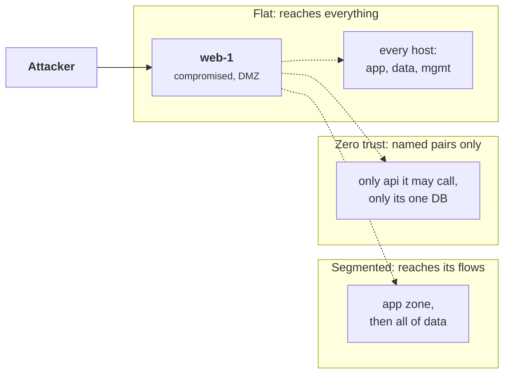
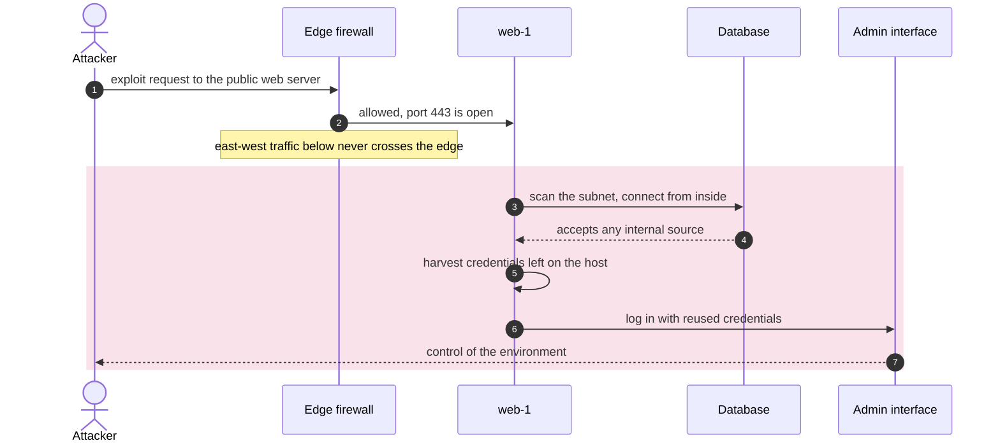
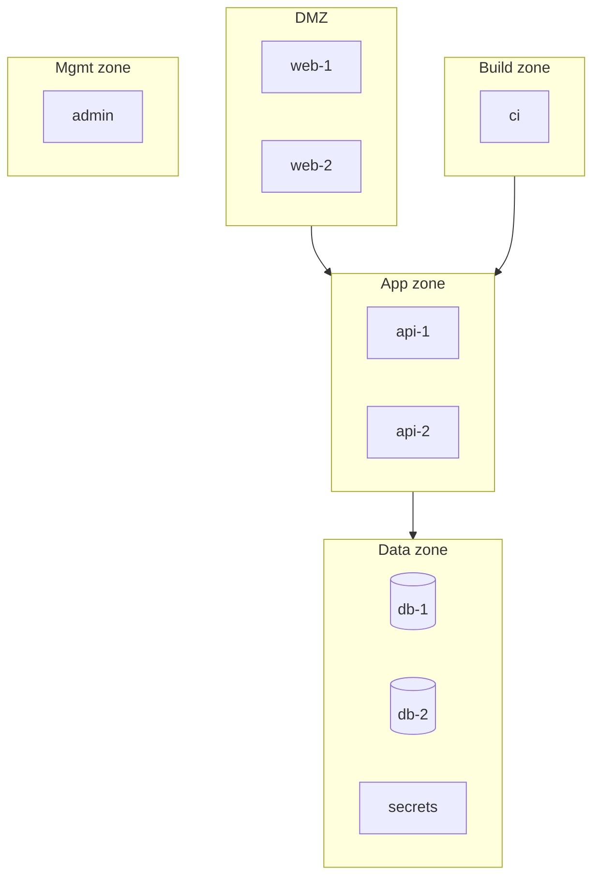
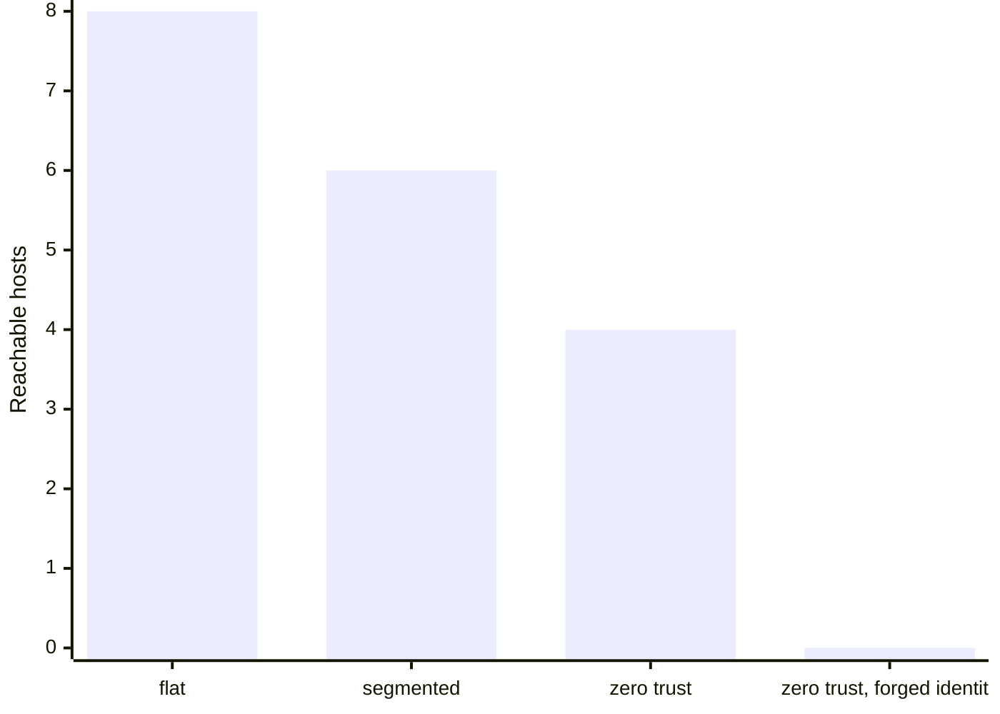

+++
title = 'Network segmentation and zero trust'
description = 'A flat network turns one compromised host into access to all of them. Segmentation, microsegmentation, and zero trust shrink the blast radius by making the network stop trusting location.'
question = 'Why does a flat network amplify a breach, and how do segmentation and zero trust contain it?'
weight = 4
difficulty = 2
prerequisites = ['/notes/infrastructure-security/isolation/02-the-kubernetes-security-model']
date = 2026-07-24
lastmod = 2026-07-24
verified = 2026-07-24
+++

## The idea in one minute

On a **flat network**, every host can open a connection to every other host.
That is convenient and it is why one compromised machine so often becomes a
whole-network incident: the attacker lands on an exposed web server and then
moves **laterally**, host to host, reaching databases and admin interfaces that
were never meant to be internet-facing but were always reachable from inside.
The network trusted location, and the attacker borrowed a trusted location.

The fix is to stop trusting the network's inside. **Segmentation** splits the
network into zones with firewall rules between them. **Microsegmentation**
pushes the policy down to individual workloads. **Zero trust**, as set out in
NIST SP 800-207 and Google's BeyondCorp, goes further: there is no trusted
interior at all, every connection is authenticated and authorized by identity on
its own merits, and an identity-aware proxy stands in front of each resource.
The consequence to act on: **design so that a single compromised host reaches
as few others as possible**, and measure that blast radius rather than assuming
the firewall at the edge is enough.

## A picture



The same breach, the same first host; the reachable set shrinks as the network
stops trusting location.

## How it really works

### Flat networks and lateral movement

Most internal networks began flat because it was easy: put everything on one
subnet and let it route. The security problem is that the edge firewall only
controls traffic crossing the perimeter. Once an attacker is inside, through a
vulnerable service, a phished laptop, or a compromised pod, **east-west** traffic
between internal hosts is unrestricted. Lateral movement is the attacker reusing
that internal reachability: from the first foothold, scan the subnet, find a
database that accepts connections from anywhere inside, reuse credentials found
on the host, and repeat. The famous large breaches almost all include a lateral
movement phase; the initial foothold was rarely the valuable system.

Here is that loop over time on a flat network. Note that the edge firewall
appears once, at the start, and never again.



### Segmentation

Segmentation divides the network into zones, typically by trust level or
function: a DMZ for internet-facing services, an application tier, a data tier,
a management network. Firewalls or routing rules allow only declared flows
between zones, for example "DMZ may reach the app tier on port 443; nothing may
reach the data tier except the app tier". Now a DMZ breach cannot connect
directly to the database. This is a large improvement over flat, and it has a
clear limit: inside a zone, traffic is usually still open, and the zones are
coarse, so compromising the app tier still reaches the entire data tier.

The program's zones and declared flows, drawn as a deployment. Every arrow is a
zone-to-zone rule; inside each box, everything is open.



### Microsegmentation

Microsegmentation shrinks the zone to a single workload. Instead of "the app
tier may reach the data tier", the policy is "the orders service may reach the
orders database on port 5432, and nothing else may reach that database". In
Kubernetes this is a **NetworkPolicy** (recall from the Kubernetes lesson that
the default is allow-all until a policy selects a pod); with a CNI such as
Cilium the policy can be identity-aware and DNS-aware rather than IP-based. The
effect is that a compromised workload can reach only the specific peers its job
requires, so lateral movement has almost nowhere to go.

The rule names one source, one destination, and one port; every other pod is
refused, including its neighbors in the same namespace.

```mermaid {title="Microsegmentation: one named flow into the orders database"}
flowchart LR
  subgraph NS["Namespace shop, default-deny"]
    O("orders service")
    C("cart service")
    X(["compromised pod"])
    NP@{ shape: doc, label: "NetworkPolicy:<br/>orders to DB on 5432" }
    DB[("orders DB")]
  end
  O -->|"5432 allowed"| DB
  C -.-x|denied| DB
  X -.-x|denied| DB
  NP -.- DB
```

### Zero trust

Zero trust is the principle behind microsegmentation taken to its conclusion.
**BeyondCorp**, described by Ward and Beyer in 2014, was Google's move to a model
with no privileged corporate network: access decisions are made per request based
on the authenticated user and the device's state, not on being "inside". **NIST
SP 800-207** (2020) gives the vendor-neutral definition. Its tenets, in essence:

- No implicit trust is granted by network location. Being on the LAN, the VPN,
  or inside the cluster grants nothing.
- Every resource access is authenticated and authorized **per session**, by
  identity and policy, with least privilege.
- Access decisions use dynamic signals: device posture, user identity, time,
  and observed behavior, and are continually re-evaluated.
- All traffic is encrypted and logged; the policy decision point and enforcement
  point are explicit components.

In practice an **identity-aware proxy** sits in front of each resource. The
client authenticates to the proxy; the proxy checks policy for *this* identity,
*this* resource, *this* device state, and only then forwards the connection. The
resource itself is not reachable directly. This is the same shape as the agent
tool gateway in the AI security course: authenticate the caller, authorize per
call, never trust the transport.

One request through an identity-aware proxy, with the enforcement point and
decision point split as NIST SP 800-207 describes.

```mermaid {title="Zero trust: every request is decided on identity, device, and resource"}
sequenceDiagram
  autonumber
  actor U as User on laptop
  participant PEP as Identity-aware proxy (PEP)
  participant PDP as Policy decision point
  participant R as Resource
  U->>PEP: request, TLS, with identity credential
  PEP->>PDP: this identity, this device posture, this resource?
  PDP->>PDP: evaluate policy and dynamic signals
  alt policy allows
    PDP-->>PEP: allow for this session
    PEP->>R: forward connection
    R-->>U: response, logged
  else policy denies
    PDP-->>PEP: deny
    PEP-->>U: 403, resource never reached
  end
  Note over U,R: being on the LAN or VPN adds nothing to the decision
```

### Egress control

Segmentation is usually discussed for inbound and east-west traffic, but
**egress** (outbound) control is where a breach becomes a data breach. A
compromised host with unrestricted outbound access can send stolen data anywhere
and pull down more tooling. Default-deny egress with an allowlist of
destinations, enforced at a proxy, closes that path. The AI security lesson on
[sandboxing and egress](/notes/ai-security-engineering/securing-agents/04-sandboxing-and-egress/)
covers the mechanics (allowlists by host name, blocking the metadata endpoint,
DNS exfiltration, domain fronting) in depth; they apply to any workload, not just
agent-run code.

With default-deny egress, the stolen data's way out depends on one allowlist
at the proxy.

```mermaid {title="Default-deny egress turns a breach back into a contained host"}
flowchart LR
  H(["Compromised host"])
  H --> PX@{ shape: hex, label: "Egress proxy" }
  PX --> Q{"Destination on<br/>allowlist?"}
  Q -->|yes| OK("Approved API")
  Q -->|no| X1["<b>blocked</b><br/><small>attacker server, tooling download</small>"]
  Q -->|no| X2["<b>blocked</b><br/><small>metadata endpoint</small>"]
  class X1,X2 good
```

> [!NOTE]
> Zero trust is an architecture, not a product. No single appliance delivers it;
> it is the discipline of authenticating and authorizing every connection by
> identity and removing trust from the network path.

## Code

The program builds a small network of hosts in zones and measures the **blast
radius** from a single compromised node under three policies: flat, zone-based
segmentation, and identity-based zero trust. Reachability is a breadth-first
search over the connections each policy permits; the attacker pivots through
every host they can reach.

```python {title="network_reach.py"}
"""network_reach.py: measure blast radius under flat vs segmented network policy.

Builds a network of hosts, computes which hosts a compromised node can reach
under three policies (flat, segmented, zero-trust per-connection), and reports
the reachable set. Reachability is BFS over allowed edges. Standard library only.
"""

from __future__ import annotations

from collections import deque
from dataclasses import dataclass

# Each host: name, segment (zone), and sensitivity.
HOSTS = {
    "web-1": "dmz", "web-2": "dmz",
    "api-1": "app", "api-2": "app",
    "db-1": "data", "db-2": "data",
    "secrets": "data", "ci": "build", "admin": "mgmt",
}


@dataclass(frozen=True)
class Policy:
    name: str

    def allows(self, src: str, dst: str, identity_ok: bool) -> bool:
        raise NotImplementedError


class Flat(Policy):
    """No segmentation: every host can reach every other host."""
    def allows(self, src: str, dst: str, identity_ok: bool) -> bool:
        return src != dst


# Segmented: only these directed zone-to-zone flows are permitted.
ZONE_FLOWS = {
    ("dmz", "app"), ("app", "data"), ("build", "app"), ("mgmt", "mgmt"),
}


class Segmented(Policy):
    """Zone-based firewall rules: traffic allowed only along declared flows."""
    def allows(self, src: str, dst: str, identity_ok: bool) -> bool:
        if src == dst:
            return False
        sz, dz = HOSTS[src], HOSTS[dst]
        if sz == dz:
            return True  # east-west within a zone is open
        return (sz, dz) in ZONE_FLOWS


# Zero-trust: every connection needs an explicit identity-based allow, and
# even intra-zone traffic is denied unless named. "secrets" accepts only from api.
ALLOWED_PAIRS = {
    ("web-1", "api-1"), ("web-2", "api-1"), ("web-1", "api-2"),
    ("api-1", "db-1"), ("api-2", "db-1"), ("api-1", "secrets"),
    ("ci", "api-1"),
}


class ZeroTrust(Policy):
    """Microsegmentation: per-pair, identity-authenticated allow-list."""
    def allows(self, src: str, dst: str, identity_ok: bool) -> bool:
        return identity_ok and (src, dst) in ALLOWED_PAIRS


def reachable(start: str, policy: Policy, identity_ok: bool = True) -> set[str]:
    """Hosts reachable from a compromised `start` node under `policy`."""
    seen = {start}
    q = deque([start])
    while q:
        node = q.popleft()
        for dst in HOSTS:
            if dst not in seen and policy.allows(node, dst, identity_ok):
                seen.add(dst)
                q.append(dst)
    return seen - {start}


def main() -> None:
    total = len(HOSTS)
    policies = [Flat("flat"), Segmented("segmented"), ZeroTrust("zero-trust")]
    print(f"network: {total} hosts across zones "
          f"{sorted(set(HOSTS.values()))}\n")
    compromised = "web-1"
    print(f"compromised node: {compromised} (zone {HOSTS[compromised]})\n")
    print(f"{'policy':<14}{'reachable':>10}{'  blast radius':<16} hosts")
    for p in policies:
        r = reachable(compromised, p)
        pct = 100 * len(r) // (total - 1)
        print(f"{p.name:<14}{len(r):>6}/{total - 1:<4}{pct:>6}% of others   "
              f"{', '.join(sorted(r)) if r else '(none)'}")

    # Zero-trust with a stolen but unauthenticated connection: identity fails.
    r0 = reachable(compromised, ZeroTrust("zero-trust"), identity_ok=False)
    print(f"\nzero-trust, forged identity rejected: reaches {len(r0)} host(s)")

    # Where the data lives, and who can still touch it from the DMZ breach.
    sensitive = {h for h, z in HOSTS.items() if z == "data"}
    for p in policies:
        hit = reachable(compromised, p) & sensitive
        print(f"  {p.name:<12} reaches data-zone hosts: "
              f"{', '.join(sorted(hit)) if hit else '(none)'}")


if __name__ == "__main__":
    main()
```

Run it with `python3 network_reach.py`:

```text
network: 9 hosts across zones ['app', 'build', 'data', 'dmz', 'mgmt']

compromised node: web-1 (zone dmz)

policy         reachable  blast radius   hosts
flat               8/8      100% of others   admin, api-1, api-2, ci, db-1, db-2, secrets, web-2
segmented          6/8       75% of others   api-1, api-2, db-1, db-2, secrets, web-2
zero-trust         4/8       50% of others   api-1, api-2, db-1, secrets

zero-trust, forged identity rejected: reaches 0 host(s)
  flat         reaches data-zone hosts: db-1, db-2, secrets
  segmented    reaches data-zone hosts: db-1, db-2, secrets
  zero-trust   reaches data-zone hosts: db-1, secrets
```

The flat network turns one web-server breach into reach over every other host,
including `admin` and `secrets`. Zone segmentation blocks the direct jump from
DMZ to the data zone, but notice it still reaches all three data-zone hosts:
once the attacker pivots into the app tier, the coarse "app may reach data" rule
opens the whole data zone. Only the identity-based policy narrows it to the two
data hosts the compromised path actually has a named flow to, and a connection
without a valid identity reaches nothing at all.

The same blast radius as bars, with the forged-identity run added:



## Where it breaks

- **The model counts reachability, not exploitability.** Being able to open a
  connection is not the same as compromising the target; a reachable host with
  no vulnerability and strong authentication may still hold. The point is to
  reduce *opportunity*, which is necessary but not sufficient.
- **Policy correctness is assumed.** Real segmentation fails through
  overly-broad rules, forgotten allow-alls, and rules that drift as the system
  changes. A microsegmentation policy is only as good as its upkeep, and "temporary"
  broad rules have a way of becoming permanent.

  How a temporary rule becomes a permanent hole, and the review that closes it:

  ```mermaid {title="Lifecycle of a temporary allow-all rule"}
  stateDiagram-v2
    [*] --> Tight: named flows only
    Tight --> Temporary: broad rule added to unblock a release
    Temporary --> Tight: removed on schedule
    Temporary --> Forgotten: owner moves on
    Forgotten --> Permanent: other services start depending on it
    Permanent --> Tight: review finds it, flows re-declared
    Permanent --> Exploited: attacker pivots through it
    Exploited --> [*]
  ```
- **Identity can be stolen.** Zero trust rejects unauthenticated connections, as
  the forged-identity line shows, but a stolen, valid credential still passes.
  Short-lived, bound credentials (earlier modules) and anomaly detection are the
  complements.
- **Egress is not modeled here.** This program measures internal reach;
  controlling the way out is a separate control covered in the AI security
  sandboxing lesson. Both are needed.

## Remember this

- A flat network lets one compromised host reach all the others; lateral
  movement is how a foothold becomes a breach.
- Segmentation restricts traffic between zones; it helps a lot but leaves
  intra-zone and coarse zone-to-zone reach open.
- Microsegmentation pushes policy to the individual workload, so a compromised
  workload reaches only its named peers.
- Zero trust (NIST SP 800-207, BeyondCorp) grants no trust by network location;
  every connection is authenticated and authorized per session by identity.
- An identity-aware proxy fronts each resource; the resource is not directly
  reachable.
- Pair inbound segmentation with default-deny egress; measure blast radius, do
  not assume the edge firewall is enough.

## Try it

1. Run `network_reach.py`. Change the compromised node to `api-1` and compare the
   blast radius across policies. Why does an app-tier breach reach more under
   segmentation than a DMZ breach does?
2. Tighten `ZONE_FLOWS` so the app zone may reach only `db-1`, not the whole data
   zone, and show the segmented data-zone reach shrink. This is segmentation
   moving toward microsegmentation.
3. Add a NetworkPolicy-style rule to `ALLOWED_PAIRS` that a real review would
   reject as too broad (say, `("web-1", "secrets")`), and watch the blast radius
   grow. This is how policy drift erodes zero trust.
4. For a system you know, draw its zones and the allowed flows, then mark which
   single host compromise would reach the most sensitive data.

## Check yourself

1. Why does a flat network amplify the impact of a single compromised host?

   
   Because every internal host can connect to every other, the edge firewall is
   the only control, and it does not see east-west traffic. Once inside, the
   attacker reuses that unrestricted internal reachability to move laterally from
   the first foothold to the systems that actually hold value, which are rarely
   the system first breached.
   

2. Zone segmentation blocked the direct DMZ-to-data jump, yet the breach still
   reached every data-zone host. Why?

   
   The attacker pivoted through the app tier, which the policy allows to reach the
   data tier. Because the rule is coarse ("app may reach data"), reaching any
   app-tier host opens the entire data zone. Segmentation limits zone-to-zone
   flows but does not restrict which specific workloads inside a zone may be
   reached; that is what microsegmentation adds.
   

3. What does "no implicit trust by network location" mean in practice?

   
   Being on the corporate LAN, connected to the VPN, or running inside the
   cluster grants no access by itself. Every request to a resource is
   authenticated and authorized by identity and policy on its own merits, as if
   it came from the open internet. BeyondCorp and NIST SP 800-207 formalize this;
   an identity-aware proxy in front of each resource enforces it.
   

4. Zero trust rejected the connection with a forged identity but not one with a
   stolen valid credential. What additional controls close that gap?

   
   Short-lived and bound credentials (so a stolen token expires quickly and is
   useless without the holder's key), device posture and behavioral signals in
   the access decision, and continuous re-evaluation and logging so anomalous use
   of a valid credential is detected and the session can be cut.
   

## Sources

- S. Rose, O. Borchert, S. Mitchell, S. Connelly, [NIST SP 800-207: Zero Trust Architecture](https://doi.org/10.6028/NIST.SP.800-207), NIST, August 2020.
- R. Ward, B. Beyer, [BeyondCorp: A New Approach to Enterprise Security](https://research.google/pubs/pub43231/), ;login:, December 2014.
- Kubernetes, [Network Policies](https://kubernetes.io/docs/concepts/services-networking/network-policies/).
- Cilium project, [Network Policy](https://docs.cilium.io/en/stable/security/policy/).
