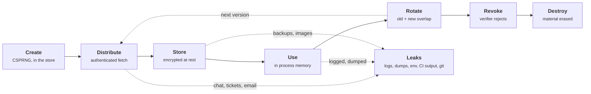
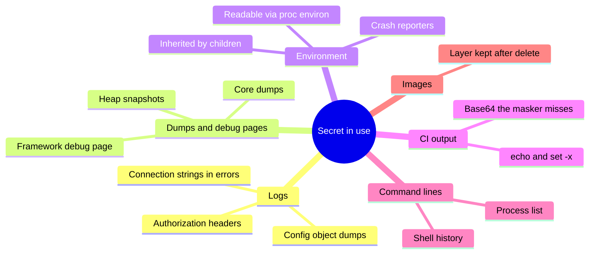

+++
title = 'The secret lifecycle'
description = 'A secret is not a value but a process: created, distributed, stored, used, rotated, revoked, and destroyed. Every stage leaks somewhere, and rotation only works if old and new overlap.'
question = 'What happens to a secret from creation to destruction, and where does it escape along the way?'
weight = 1
difficulty = 1
prerequisites = ['/notes/infrastructure-security/workload-identity/01-why-static-credentials-fail']
date = 2026-07-10
lastmod = 2026-07-10
verified = 2026-07-10
+++

## The idea in one minute

A **secret** is any value whose possession grants access: a database password,
an API key, a TLS private key, a signing key, a webhook token. Teams tend to
think of it as a string in a configuration file. It is better thought of as a
**process with seven stages**: it is created, distributed, stored, used,
rotated, revoked, and destroyed. Each stage has its own failure mode, and most
real incidents happen in the stages nobody designed: the copy in a log line,
the crash dump, the CI output, the old version nobody revoked.

Two ideas carry most of the weight. First, **every secret delivery starts with
another secret** (the "secret zero" problem), so the goal is to anchor that
first credential in something the platform can attest rather than a file
someone copied. Second, **rotation without an overlap window is an outage**:
clients cache credentials, so the verifier must accept the old and new
versions together until every cache has turned over. Design rotation as a
state machine with a dual-active phase, and rotation becomes routine instead
of an event that is postponed until after the breach.

## A picture



The solid path is the one you design. The dotted edges into "Leaks" are the
ones that happen anyway unless each stage is built to prevent them.

## How it really works

### The seven stages

| Stage | What good looks like | Typical failure |
| --- | --- | --- |
| **Create** | Generated by a CSPRNG inside the secret store or by the system that will verify it; nobody types it | A human picks it, or it is generated on a laptop and pasted into a store |
| **Distribute** | The workload fetches it over an authenticated, encrypted channel using its own identity | Sent over chat or email, baked into an image, committed to a repository |
| **Store** | Kept in one system of record, encrypted at rest under a key with its own access control, every read logged | Copies in config files, CI variables, wikis, and backups, each with different access rules |
| **Use** | Held in process memory for as short a time as practical, never written out | Logged in a debug line, included in an error message, captured in a core dump |
| **Rotate** | A new version is introduced, both versions work during an overlap window, then the old one is retired | Never done, because the last attempt caused an outage |
| **Revoke** | The verifier rejects the old version; revocation is fast and can be triggered by incident response | Only the stored copy is changed, so the old value still works at the verifier |
| **Destroy** | Material erased from the store and its replicas once nothing encrypted or signed under it is still needed | Lingers in snapshots, or is destroyed while data still depends on it |

NIST SP 800-57 Part 1 describes the same idea for cryptographic keys, with
states named pre-activation, active, suspended, deactivated, compromised, and
destroyed. The mapping is close: "pending" in this lesson is pre-activation,
"retiring" is deactivated (still usable to verify or decrypt, no longer used to
create new things), and "revoked" corresponds to a key that must no longer be
trusted. The cryptographic treatment, including cryptoperiods, is in
[the key lifecycle](/notes/cryptography/key-management/01-the-key-lifecycle/);
this lesson is about the operational secrets that infrastructure handles every
day.

Each version of a secret moves through these states in one direction only;
look for the two exits from active and the one-way door into destroyed.

```mermaid {title="A secret version can only move forward through its states"}
stateDiagram-v2
  direction LR
  [*] --> Pending: create, install at verifier
  Pending --> Active: promote, hand out
  Pending --> Destroyed: abandoned
  Active --> Retiring: next version promoted
  Active --> Revoked: emergency, after exposure
  Retiring --> Revoked: overlap window ends
  Revoked --> Destroyed: nothing depends on it
  Destroyed --> [*]
  note right of Retiring
    still accepted by the verifier,
    no longer handed out
  end note
```

### Create: let the verifier or the store generate it

A secret's strength is set at birth. A database password generated by
`secrets.token_urlsafe(32)` has 256 bits of entropy; one chosen by an engineer
has far less, and the engineer now knows it. Better still, let the system that
creates the secret be the one that holds it: a secret manager's rotation
function sets a new password on the database and stores it in one step, or a
dynamic secrets engine creates a database user on demand (the next lesson).
Either way, no human sees the value, which removes an entire stage of leaks.

### Distribute: the secret zero problem

To fetch a secret from a vault, a workload must authenticate to the vault. If
it authenticates with a password or token, that credential is itself a secret,
and it had to be delivered somehow. This regress is called **secret zero**.
There are three honest ways to end it:

1. **Platform attestation.** The workload proves who it is with something the
   platform asserts rather than a stored value: a cloud instance identity
   document, a Kubernetes projected service account token, a SPIFFE SVID issued
   after node and workload attestation. These are covered in
   [attestation and SPIFFE](/notes/infrastructure-security/workload-identity/02-attestation-and-spiffe/)
   and
   [federated workload identity](/notes/infrastructure-security/workload-identity/03-federated-workload-identity/).
   The vault trusts the platform's signature, so nothing long-lived is copied.
2. **Single-use, short-lived delivery.** When a bootstrap credential cannot be
   avoided, deliver it wrapped: a token that can be unwrapped exactly once and
   expires within minutes. If an attacker unwraps it first, the legitimate
   workload's unwrap fails, which is a detectable alarm rather than a silent
   compromise. Vault's response wrapping (next lesson) works this way.
3. **A human ceremony.** For the root of a hierarchy, such as unsealing a vault
   or activating an HSM, the bootstrap secret is split among several people and
   used in a recorded procedure. This is acceptable for a handful of roots, not
   for every service.

What does not end the regress is moving the bootstrap secret somewhere less
visible: an environment variable set by a deploy script, a file in the image, a
CI variable. That relocates secret zero; it does not remove it.

The chart shows the workload's first credential coming from three places that
end the regress, and one dead end that only moves it.

```mermaid {title="Secret zero ends in attestation, wrapping, or a ceremony, not a hidden file"}
flowchart LR
  W("Workload")
  V("Vault")
  PA["<b>Platform attestation</b><br/><small>instance identity, SA token, SVID</small>"]
  WR["<b>Wrapped token</b><br/><small>single use, minutes</small>"]
  HC["<b>Human ceremony</b><br/><small>split shares, roots only</small>"]
  HID["<b>Hidden bootstrap secret</b><br/><small>env var, image file, CI variable</small>"]
  PA -->|"platform signs"| W
  WR -->|"unwrap once"| W
  HC -->|"unseal, activate"| V
  HID -.->|"relocated, not removed"| W
  W -->|"authenticate"| V
  class PA,WR,HC good
  class HID warn
```

### Store: one system of record

A secret should have exactly one authoritative home, with encryption at rest,
access control per secret, and an audit record of every read. Everything else
is a cache with a lifetime. In practice secrets sprawl: the same database
password sits in a secret manager, a Kubernetes Secret, a CI variable, a
developer's `.env` file, and last year's backup. Each copy has different access
rules, and rotating the "real" one leaves the others working until someone
notices. Sprawl and how to find it are the subject of
[secret sprawl and detection](/notes/infrastructure-security/secrets/04-secret-sprawl-and-detection/).

### Use: where secrets actually leak

Most leaks are not breaches of the vault. They are a correct program writing a
secret somewhere it should not be.

The map groups the leak paths in the table below by where the copy lands.



| Leak path | How it happens | Mitigation |
| --- | --- | --- |
| **Logs** | A request logger records headers including `Authorization`; an exception message includes a connection string; a debug line prints the config object | Redact at the logging layer with an allowlist of fields; wrap secrets in a type whose string form is `***` (CWE-532 names this class) |
| **Crash dumps and debug pages** | A core dump or heap snapshot contains process memory; a framework's debug page shows environment and settings | Disable core dumps in production or restrict their storage; never enable debug pages outside development |
| **Environment variables** | Inherited by every child process; readable through `/proc/<pid>/environ` by the same user and by root; printed by diagnostics and error reporters | Prefer files on a memory-backed volume or a fetch at startup; if env vars are used, scrub them after reading and do not pass them to subprocesses |
| **CI output** | A build step echoes a token, runs with shell tracing (`set -x`), or prints a transformed value such as base64 that the log masker does not recognize | Register every secret with the CI masker, avoid printing derived values, use short-lived federated credentials so a leaked value expires |
| **Command lines** | A password passed as an argument is visible in the process list and shell history | Read from a file descriptor, a file, or standard input |
| **Images and artifacts** | A secret copied into a container layer persists even if a later layer deletes it | Use build-time secret mounts; scan images before publishing |

Environment variables deserve a specific note. The Twelve-Factor App
popularized storing configuration in the environment, and for non-secret
settings that advice holds. For secrets it is a compromise: an environment is
easy to read from inside the process, it is copied to every child, and many
crash reporters attach it by default. GitHub's documentation for Actions warns
that masking works on exact registered values, so a secret that is encoded or
reformatted before printing may appear in the log unmasked.

### Rotate: why dual-active matters

Rotation replaces a secret with a new version on a schedule or after suspected
exposure. Done naively, it is three steps: generate a new value, store it,
change the verifier. The problem is that clients do not read the store on every
request; they read it at startup or on a refresh interval and cache it. Between
the moment the verifier switches and the moment the last client refreshes,
requests fail.

The fix is an **overlap window** in which the verifier accepts both versions:

1. **Create** the new version and install it at the verifier, so it is accepted
   before anyone presents it.
2. **Promote** it: the store now hands the new version to anyone who asks; the
   old one becomes "retiring" but still works.
3. **Wait** at least as long as the slowest client's refresh interval, plus
   margin. Watch the verifier's metrics until the old version is no longer used.
4. **Revoke** the old version at the verifier.
5. **Destroy** it once nothing depends on it.

Laid out on the simulation's clock (in ticks), the overlap window is the
stretch where both versions are accepted; it has to cover client C's slow
refresh.

```mermaid {title="The overlap window covers the slowest client's refresh"}
gantt
  dateFormat X
  axisFormat %S
  section Versions
    v1 active                   :done, v1a, 0, 3
    v1 retiring, still accepted :active, v1r, 3, 8
    v2 pending at verifier      :v2p, 2, 3
    v2 active                   :v2a, 3, 10
  section Clients
    A refreshes to v2           :milestone, ca, 4, 0
    B refreshes to v2           :milestone, cb, 3, 0
    C refreshes to v2           :milestone, cc, 5, 0
  section Verifier
    v1 revoked                  :crit, rv, 8, 10
```

AWS Secrets Manager's rotation functions follow this shape with four steps
(`createSecret`, `setSecret`, `testSecret`, `finishSecret`) and staging labels
`AWSPENDING`, `AWSCURRENT`, and `AWSPREVIOUS`. For databases that allow only
one password per user, its "alternating users" strategy keeps two database
users and rotates them in turn, which gives the overlap that a single user
cannot. Cloud providers that issue API keys usually allow two active keys per
account or service for the same reason.

Follow the staging labels: the new value is installed and tested at the
database before `AWSCURRENT` moves to it.

```mermaid {title="Secrets Manager rotation moves labels only after the new value works"}
sequenceDiagram
  autonumber
  participant SM as Secrets Manager
  participant L as Rotation Lambda
  participant DB as Database
  participant C as Clients
  SM->>L: createSecret
  L->>SM: store new value as AWSPENDING
  SM->>L: setSecret
  L->>DB: set the AWSPENDING password
  SM->>L: testSecret
  L->>DB: log in with AWSPENDING
  DB-->>L: ok
  SM->>L: finishSecret
  L->>SM: AWSCURRENT to new, AWSPREVIOUS to old
  rect rgb(243, 241, 234)
    Note over C,DB: with alternating users, clients holding AWSPREVIOUS still log in until they refresh
    C->>SM: GetSecretValue on refresh
    SM-->>C: AWSCURRENT
  end
```

> [!IMPORTANT]
> The overlap window must be longer than the longest client cache lifetime. If
> you do not know the longest cache lifetime, you do not yet know how to rotate
> safely, and the usage metrics at the verifier are how you find out.

### Revoke and destroy are different

Revocation is a property of the **verifier**: it stops accepting the value.
Destruction is a property of the **store**: the material is gone. Revoking
without destroying leaves a copy that could be restored by mistake. Destroying
without revoking is worse: the stored value is gone but the old password still
works at the database, and only the attacker has it. For encryption keys there
is a further trap: destroying a key destroys every piece of data encrypted
under it, which is why KMS products impose a deletion waiting period
([KMS and key hierarchies](/notes/infrastructure-security/secrets/03-kms-and-key-hierarchies/)).

### Rotation after exposure is not routine rotation

Scheduled rotation can take its time and honor the overlap window. Rotation
after a suspected leak has the opposite priority: the old value must stop
working now, and some failed requests are the acceptable price. This is why
the state machine allows a direct `active -> revoked` transition. Plan both
paths in advance; the emergency path is the one that is never tested.

## Code

The program models a secret as versions moving through a state machine with
only legal transitions. A verifier accepts any version that is pending, active,
or retiring. Three clients refresh their cached copy every 2, 3, and 5 ticks.
The same rotation is run twice: once revoking the old version at the moment the
new one is promoted, once with a five-tick overlap.

```python {title="rotate.py"}
"""rotate.py: a secret's lifecycle as a state machine, and why rotation needs
an overlap window. Standard library only; the verifier and clients are simulated."""

from __future__ import annotations

import hashlib
import hmac
from dataclasses import dataclass
from enum import Enum


class State(Enum):
    PENDING = "pending"      # created and installed at the verifier, not handed out
    ACTIVE = "active"        # handed out to clients; the current version
    RETIRING = "retiring"    # still accepted, no longer handed out
    REVOKED = "revoked"      # rejected everywhere
    DESTROYED = "destroyed"  # material erased; only the audit record remains


ALLOWED = {
    State.PENDING: {State.ACTIVE, State.DESTROYED},
    State.ACTIVE: {State.RETIRING, State.REVOKED},
    State.RETIRING: {State.REVOKED},
    State.REVOKED: {State.DESTROYED},
    State.DESTROYED: set(),
}
ACCEPTED = {State.PENDING, State.ACTIVE, State.RETIRING}


@dataclass
class Version:
    vid: int
    value: str
    state: State = State.PENDING


class SecretStore:
    def __init__(self) -> None:
        self.versions: dict[int, Version] = {}
        self.log: list[str] = []

    def create(self, tick: int) -> int:
        vid = len(self.versions) + 1
        value = hashlib.sha256(f"demo-seed-{vid}".encode()).hexdigest()[:16]
        self.versions[vid] = Version(vid, value)
        self.log.append(f"t={tick} v{vid} created as pending")
        return vid

    def move(self, vid: int, new: State, tick: int) -> None:
        v = self.versions[vid]
        if new not in ALLOWED[v.state]:
            raise ValueError(f"v{vid}: {v.state.value} -> {new.value} is not a legal transition")
        self.log.append(f"t={tick} v{vid} {v.state.value} -> {new.value}")
        v.state = new
        if new is State.DESTROYED:
            v.value = ""

    def current(self) -> Version:
        return next(v for v in self.versions.values() if v.state is State.ACTIVE)

    def verify(self, presented: str) -> bool:
        """What the database or API does with a presented credential."""
        return any(v.state in ACCEPTED and hmac.compare_digest(v.value, presented)
                   for v in self.versions.values())


@dataclass
class Client:
    name: str
    refresh_every: int  # how often it re-reads the secret from the store
    cached: Version | None = None


def simulate(overlap: int, ticks: int = 10) -> tuple[int, SecretStore]:
    store = SecretStore()
    store.move(store.create(0), State.ACTIVE, 0)
    clients = [Client("A", 2), Client("B", 3), Client("C", 5)]
    failures = 0
    print(f"overlap window = {overlap} ticks")
    for t in range(ticks):
        if t == 2:
            store.create(t)                        # 1. create v2, install at the verifier
        if t == 3:
            store.move(1, State.RETIRING, t)       # 2. stop handing out v1
            store.move(2, State.ACTIVE, t)         # 3. hand out v2
        if overlap == 0 and t == 3:
            store.move(1, State.REVOKED, t)        # no overlap: revoke at once
        if overlap and t == 3 + overlap:
            store.move(1, State.REVOKED, t)        # overlap: revoke once every cache has turned over
        for c in clients:
            if t % c.refresh_every == 0:
                c.cached = store.current()
        cells = []
        for c in clients:
            assert c.cached is not None
            ok = store.verify(c.cached.value) if c.cached.value else False
            failures += not ok
            cells.append(f"{c.name}:v{c.cached.vid} {'ok  ' if ok else 'FAIL'}")
        states = " ".join(f"v{v.vid}={v.state.value:<8}" for v in store.versions.values())
        print(f"  t={t}  {states:<30} {'  '.join(cells)}".rstrip())
    print(f"  failed requests: {failures}\n")
    return failures, store


if __name__ == "__main__":
    simulate(overlap=0)
    _, store = simulate(overlap=5)
    store.move(1, State.DESTROYED, 10)
    try:
        store.move(1, State.ACTIVE, 11)  # "just un-revoke the old one"
    except ValueError as e:
        print("refused:", e)
    print("audit trail:")
    for line in store.log:
        print("  " + line)
```

Run it with `python3 rotate.py`:

```text
overlap window = 0 ticks
  t=0  v1=active                      A:v1 ok    B:v1 ok    C:v1 ok
  t=1  v1=active                      A:v1 ok    B:v1 ok    C:v1 ok
  t=2  v1=active   v2=pending         A:v1 ok    B:v1 ok    C:v1 ok
  t=3  v1=revoked  v2=active          A:v1 FAIL  B:v2 ok    C:v1 FAIL
  t=4  v1=revoked  v2=active          A:v2 ok    B:v2 ok    C:v1 FAIL
  t=5  v1=revoked  v2=active          A:v2 ok    B:v2 ok    C:v2 ok
  t=6  v1=revoked  v2=active          A:v2 ok    B:v2 ok    C:v2 ok
  t=7  v1=revoked  v2=active          A:v2 ok    B:v2 ok    C:v2 ok
  t=8  v1=revoked  v2=active          A:v2 ok    B:v2 ok    C:v2 ok
  t=9  v1=revoked  v2=active          A:v2 ok    B:v2 ok    C:v2 ok
  failed requests: 3

overlap window = 5 ticks
  t=0  v1=active                      A:v1 ok    B:v1 ok    C:v1 ok
  t=1  v1=active                      A:v1 ok    B:v1 ok    C:v1 ok
  t=2  v1=active   v2=pending         A:v1 ok    B:v1 ok    C:v1 ok
  t=3  v1=retiring v2=active          A:v1 ok    B:v2 ok    C:v1 ok
  t=4  v1=retiring v2=active          A:v2 ok    B:v2 ok    C:v1 ok
  t=5  v1=retiring v2=active          A:v2 ok    B:v2 ok    C:v2 ok
  t=6  v1=retiring v2=active          A:v2 ok    B:v2 ok    C:v2 ok
  t=7  v1=retiring v2=active          A:v2 ok    B:v2 ok    C:v2 ok
  t=8  v1=revoked  v2=active          A:v2 ok    B:v2 ok    C:v2 ok
  t=9  v1=revoked  v2=active          A:v2 ok    B:v2 ok    C:v2 ok
  failed requests: 0

refused: v1: destroyed -> active is not a legal transition
audit trail:
  t=0 v1 created as pending
  t=0 v1 pending -> active
  t=2 v2 created as pending
  t=3 v1 active -> retiring
  t=3 v2 pending -> active
  t=8 v1 retiring -> revoked
  t=10 v1 revoked -> destroyed
```

Without the overlap, client A fails for one tick and client C for two: they
were still holding v1 when it was revoked. With a window as long as the
slowest refresh interval, every request succeeds, and v1 is revoked only after
the last client has moved to v2. The refused transition at the end is the state
machine doing its job: a destroyed version cannot be "un-revoked" back into
service, and the audit trail records every legal move.

Counted per tick, the bars are the no-overlap run, whose three failures all
land in the two ticks after promotion; the flat line is the five-tick overlap.

```mermaid {title="Failed requests per tick: no overlap versus a five-tick window"}
xychart-beta
  title "Failed requests per tick"
  x-axis "Tick" [0, 1, 2, 3, 4, 5, 6, 7, 8, 9]
  y-axis "Failed requests" 0 --> 3
  bar [0, 0, 0, 2, 1, 0, 0, 0, 0, 0]
  line [0, 0, 0, 0, 0, 0, 0, 0, 0, 0]
```

## Where it breaks

- **Unknown cache lifetimes.** The simulation knows each client's refresh
  interval. Real fleets include a batch job that reads the secret once at
  startup and runs for three days, a connection pool that authenticated an hour
  ago, and a forgotten service with the value hard-coded. Measure use at the
  verifier before revoking; do not trust the configured interval.
- **Authenticated sessions outlive the credential.** Changing a database
  password usually does not terminate connections already authenticated with
  the old one. Revocation after exposure must also kill existing sessions and
  invalidate tokens issued under the old credential.
- **The overlap is also an exposure window.** During the dual-active phase a
  leaked old version still works. For routine rotation that is acceptable; for
  rotation after a leak, skip the window and accept the failures.
- **Rotation of the root is different.** Rotating a vault's own unseal or
  master key, or a CA key, has dependents that cannot simply refresh. Those
  rotations need re-encryption or re-issuance plans, not just an overlap.
- **The state machine is only as good as its enforcement.** Nothing here
  prevents an operator from copying v1's value somewhere before it is
  destroyed. Destruction in the store says nothing about copies outside it.
- **Memory is not a vault.** Python strings cannot be reliably wiped, and most
  managed runtimes copy values freely. Reducing time-in-memory helps; it does
  not make a process dump safe.

## Remember this

- A secret is a process with seven stages; design all seven, not just storage.
- Secret zero ends in platform attestation or single-use wrapped delivery, not
  in a better-hidden file.
- Most leaks are correct programs writing secrets to logs, dumps,
  environments, and CI output.
- Rotation needs a dual-active overlap longer than the slowest client's cache.
- Revocation happens at the verifier; destruction happens in the store; you
  need both.
- Emergency rotation trades availability for speed: revoke first, fix clients
  after.

## Try it

1. Run `rotate.py`. Change client C's refresh interval to 7 and find the
   smallest overlap that gives zero failures. What does that tell you about
   choosing the window?
2. Add a `last_used` tick to each version, updated in `verify`. Change the
   simulation to revoke v1 automatically once it has not been used for two
   ticks, instead of after a fixed window.
3. Add an `emergency_revoke(vid)` that moves any active or retiring version
   straight to revoked and promotes the pending one. Run it at tick 3 and count
   the failures.
4. Pick one credential in a system you work on and fill in the seven-stage
   table for it. Which stage is undesigned?

## Check yourself

1. What is the secret zero problem, and what actually solves it?

   
   To fetch a secret, a workload must authenticate, and if that authentication
   uses a stored credential, the credential is itself a secret that had to be
   delivered. Hiding the bootstrap credential in an environment variable or an
   image only moves it. The regress ends when the first credential is something
   the platform attests (an instance identity document, a projected service
   account token, a SPIFFE SVID) or a single-use, short-lived wrapped token
   whose theft is detectable.
   

2. Why does rotating a secret with no overlap window cause failures, even when
   every step succeeds?

   
   Clients cache the secret and refresh it on their own schedules. If the
   verifier stops accepting the old value at the moment the new one is
   published, every client still holding the old value fails until its next
   refresh. The verifier must accept both versions for at least the longest
   cache lifetime.
   

3. A team "rotated" a leaked API key by updating the value in their secret
   manager. Why might the attacker still have access?

   
   Updating the stored value is not revocation. Unless the issuing service was
   told to invalidate the old key, the verifier still accepts it, and the
   attacker holds a copy. Revocation must happen at the verifier, and any
   sessions or tokens obtained with the old key must also be invalidated.
   

4. Name three places a correct program can leak a secret without any attacker
   involvement.

   
   Any three of: log lines (headers, connection strings, config dumps), crash
   dumps and heap snapshots, framework debug pages, environment variables
   inherited by subprocesses or attached by error reporters, CI output
   including transformed values the masker misses, command-line arguments
   visible in the process list, and image layers.
   

5. Why are scheduled rotation and rotation after exposure handled differently?

   
   Scheduled rotation optimizes for zero downtime, so it keeps the old version
   valid during an overlap window. After exposure, the old version is in an
   attacker's hands, so every minute of overlap is a minute of access. The
   right move is to revoke immediately and accept some failed requests.
   

## Sources

- E. Barker, [NIST SP 800-57 Part 1 Rev. 5: Recommendation for Key Management, Part 1: General](https://csrc.nist.gov/pubs/sp/800/57/pt1/r5/final), NIST, May 2020.
- OWASP, [Secrets Management Cheat Sheet](https://cheatsheetseries.owasp.org/cheatsheets/Secrets_Management_Cheat_Sheet.html).
- AWS, [Rotate AWS Secrets Manager secrets](https://docs.aws.amazon.com/secretsmanager/latest/userguide/rotating-secrets.html) and [Rotation by Lambda function](https://docs.aws.amazon.com/secretsmanager/latest/userguide/rotate-secrets_lambda.html), AWS Secrets Manager User Guide.
- GitHub, [Using secrets in GitHub Actions](https://docs.github.com/en/actions/security-for-github-actions/security-guides/using-secrets-in-github-actions), GitHub Docs.
- MITRE, [CWE-532: Insertion of Sensitive Information into Log File](https://cwe.mitre.org/data/definitions/532.html).
- Linux man-pages project, [proc(5)](https://man7.org/linux/man-pages/man5/proc.5.html).
- A. Wiggins, [The Twelve-Factor App: III. Config](https://12factor.net/config).
