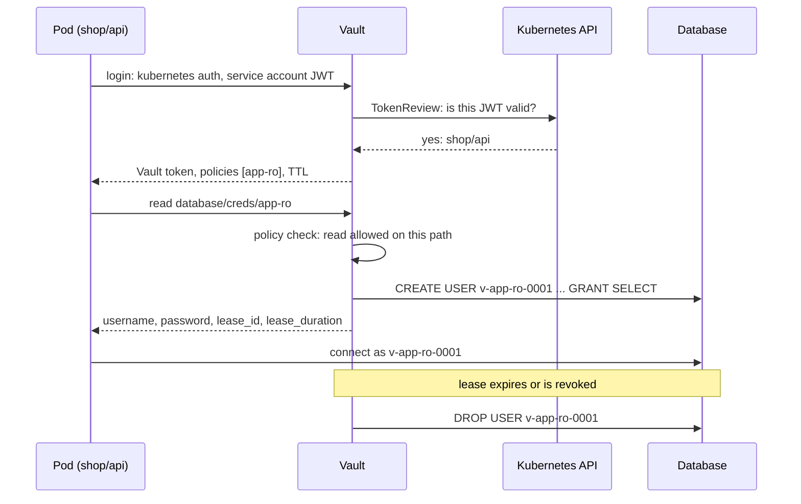
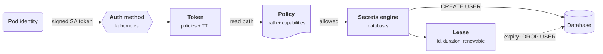
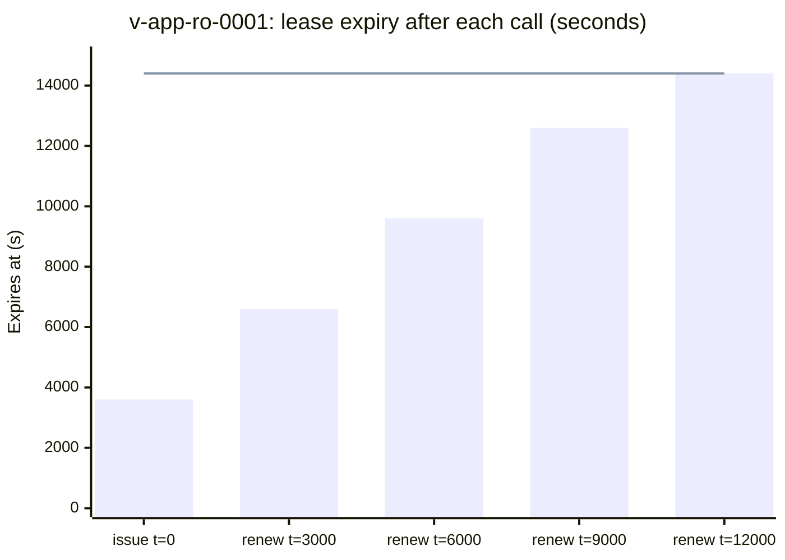
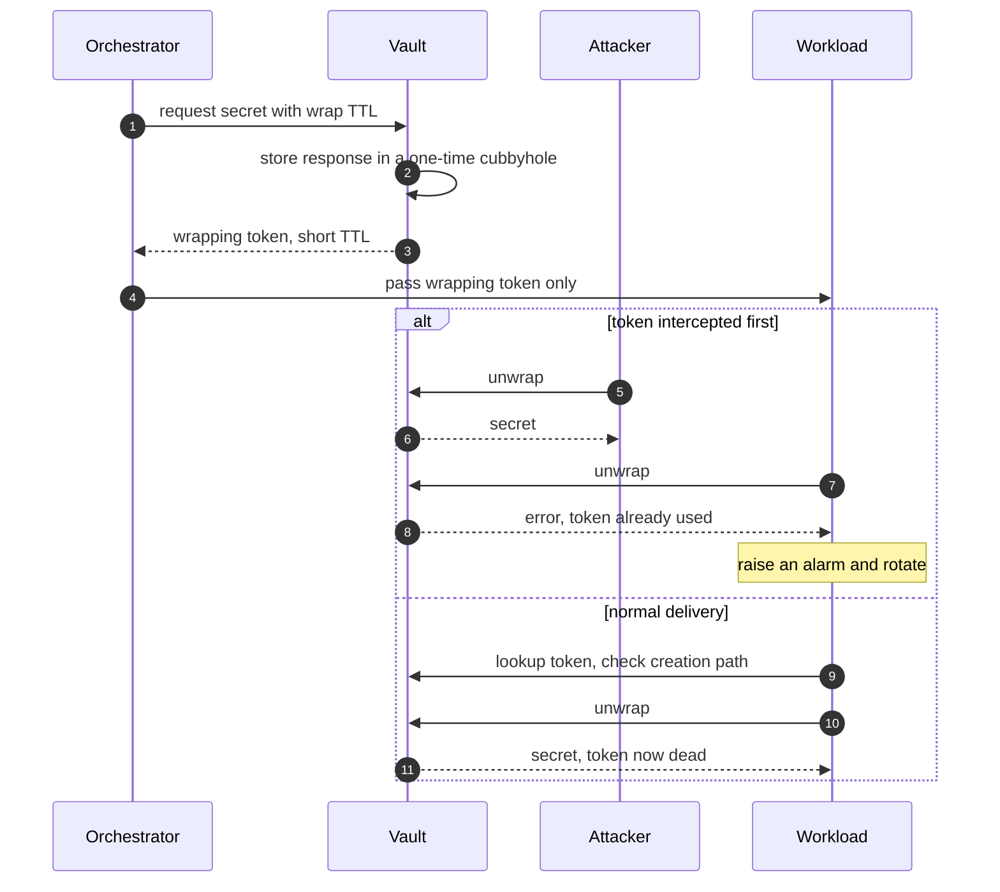
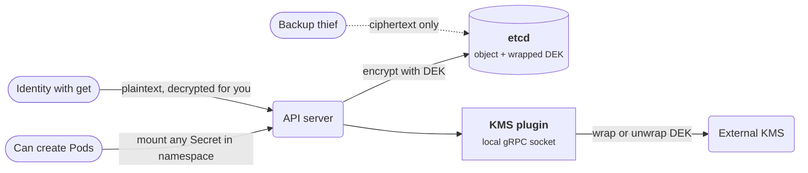

+++
title = 'Vaults and dynamic secrets'
description = 'A vault authenticates workloads by platform identity, authorizes every read with a policy, and can mint a fresh database credential per request that dies with its lease.'
question = 'How does a vault turn a long-lived shared password into short-lived, per-workload credentials that revoke themselves?'
weight = 2
difficulty = 3
prerequisites = ['/notes/infrastructure-security/secrets/01-the-secret-lifecycle', '/notes/infrastructure-security/workload-identity/03-federated-workload-identity']
date = 2026-07-12
lastmod = 2026-07-12
verified = 2026-07-12
+++

## The idea in one minute

A **static secret** is a value someone created once and everyone shares: the
`app` database password that twelve services and three engineers know. A
**dynamic secret** is created on demand for one requester, with a lease, and
destroyed when the lease ends. The vault does not store the database password
at all; it holds an administrative credential for the database and uses it to
run `CREATE USER` when a workload asks and `DROP USER` when the lease expires.

That changes three things at once. **Attribution**: every database session maps
to one workload and one lease. **Blast radius**: a leaked credential works for
minutes or hours, not years. **Revocation**: an incident responder can revoke
every credential issued under a role with one command, without coordinating a
password change across a fleet. HashiCorp Vault and its open-source fork
OpenBao are the common implementations; cloud secret managers store and rotate
static secrets, and cloud IAM issues its own short-lived credentials. The
consequence to act on: where the target system supports it, **issue credentials
per workload with a lease, rather than distributing a shared one**.

## A picture



The pod never sees a long-lived secret. Its first credential is a token the
platform signed; everything after that is issued, scoped, and timed by the
vault.

## How it really works

### The building blocks

| Concept | What it is | Why it matters |
| --- | --- | --- |
| **Auth method** | A way to prove identity to the vault: Kubernetes service account tokens, cloud IAM identities, OIDC or JWT, TLS client certificates, AppRole | Solves secret zero by trusting a platform-signed identity instead of a stored password |
| **Token** | What a successful login returns; carries a set of policies and a TTL | Every later request is made with it; revoking it revokes what it created |
| **Policy** | Path-based rules granting capabilities such as `read`, `create`, `update`, `delete`, `list`, `deny` | Deny by default; a workload reads only the paths its policy names |
| **Secrets engine** | A backend mounted at a path: key-value storage, database, cloud credentials, PKI, transit encryption | Dynamic engines generate credentials instead of storing them |
| **Lease** | Metadata attached to a dynamic secret: an ID, a duration, whether it is renewable | The vault revokes the credential at the target when the lease ends |
| **Response wrapping** | The response is stored in a single-use location and the caller gets a short-lived token to fetch it | Delivers a secret through an untrusted intermediary with tamper evidence |

Read the chain left to right: identity becomes a token, the token's policies
gate the path, and the engine mints a credential whose lease the vault tracks.



### Auth methods: identity in, token out

The Kubernetes auth method is a good example. The pod presents its projected
service account token. Vault checks it, either by calling the cluster's
TokenReview API or by validating the JWT signature against the cluster's
published keys, and then matches the service account's name and namespace
against a configured role. That role names the policies the resulting Vault
token carries. Cloud auth methods do the same with signed instance identity
or IAM request signatures. In every case the vault is trusting a signature
from the platform, so nothing long-lived was copied to the pod.

AppRole is the exception that proves the rule. It authenticates with a role ID
and a secret ID, and the secret ID is a secret zero. Vault's guidance is to
deliver it with response wrapping from a trusted orchestrator, and the method
can limit a secret ID's uses and TTL and bind it to CIDR ranges. When a
platform identity is available, use it instead.

### Policies: paths and capabilities

A policy is a list of path rules:

```hcl {title="app-ro.hcl"}
path "database/creds/app-ro" {
  capabilities = ["read"]
}
```

Anything not granted is denied, and an explicit `deny` overrides any grant. A
token's effective permission is the union of its policies' grants minus any
denies. Two operational habits matter more than syntax. Keep one policy per
workload role, so a review can answer "what can `shop/api` read?" by reading one
file. And treat broad globs such as `secret/*` as findings: they are how one
compromised service ends up reading every other team's secrets.

Every request is evaluated the same way; note that a `deny` is checked before
any grant can help.

```mermaid {title="A request is denied unless a policy grants it and nothing denies it"}
flowchart TB
  R["<b>Request</b><br/><small>token, path, operation</small>"] --> D1@{ shape: diam, label: "Explicit deny<br/>on this path?" }
  D1 -->|yes| NO["<b>Denied</b>"]
  D1 -->|no| D2@{ shape: diam, label: "Any policy grants<br/>this capability?" }
  D2 -->|no| NO
  D2 -->|yes| OK["<b>Allowed</b>"]
  class NO warn
  class OK good
```

### Leases, renewal, and the maximum TTL

Every dynamic secret comes with a lease: a `lease_id`, a `lease_duration`, and
a `renewable` flag. The client may renew the lease before it expires, asking
for an increment, but never past the role's `max_ttl`, which counts from issue
time. When a lease reaches its end, Vault's expiration manager runs the
engine's revocation: for the database engine, the role's revocation
statements, by default dropping the user. Leases are also tied to the token
that created them, so revoking a token revokes its leases, and
`vault lease revoke -prefix database/creds/app-ro` revokes every credential
ever issued under a role that has not yet expired.

A lease has one live state and three ways out; renewal loops back but can
never pass `max_ttl`.

```mermaid {title="A dynamic credential's lease ends in revocation, one way or another"}
stateDiagram-v2
  direction LR
  [*] --> Live: read creds, CREATE USER
  Live --> Live: renew, capped at max_ttl
  Live --> Revoked: lease_duration passes
  Live --> Revoked: max_ttl reached
  Live --> Revoked: token or prefix revoked
  Revoked --> [*]: revocation statements, DROP USER
```

Choose TTLs deliberately. Vault's system-wide default maximum lease TTL is 768
hours (32 days), which is far too long for a database credential. Set
`default_ttl` close to the typical job or connection lifetime and `max_ttl` to
the longest you can tolerate a leaked credential working. A long-running
service renews; a short job does not bother.

This is the program below, drawn: `v-app-ro-0001` renews four times, yet each
renewal's new expiry flattens against the four-hour `max_ttl`.



### Dynamic database credentials

A database role in the engine holds the SQL to run:

| Field | Example | Purpose |
| --- | --- | --- |
| `creation_statements` | `CREATE ROLE "{{name}}" WITH LOGIN PASSWORD '{{password}}' VALID UNTIL '{{expiration}}'; GRANT SELECT ON ALL TABLES IN SCHEMA public TO "{{name}}";` | What a new user may do |
| `revocation_statements` | `DROP ROLE "{{name}}";` (often preceded by terminating its sessions) | How to remove it |
| `default_ttl`, `max_ttl` | `1h`, `4h` | Lease bounds |

The database itself must allow the vault's admin connection to create and drop
users, which makes that admin credential the most sensitive secret in the
design. Vault can rotate it so that afterwards only Vault knows it
(`rotate-root`). Where creating users per request is impractical, for example
a database with a low user limit, **static roles** have Vault own an existing
user and rotate its password on a schedule; that is the lifecycle from the
previous lesson, automated, rather than a dynamic secret.

### Response wrapping

Suppose a deployment orchestrator must pass a secret to a new workload. If it
passes the secret itself, the orchestrator, its logs, and anything between are
exposed. With response wrapping, Vault stores the response in a single-use
location (the cubbyhole of a one-time token) and returns only a **wrapping
token** with a short TTL. The workload unwraps it once. Three properties
follow: the secret never transits the intermediary; the wrapping token expires
quickly; and if someone else unwraps it first, the legitimate unwrap fails,
which is an alarm. The receiver should also look up the wrapping token and
check its creation path matches what it expected, so an attacker cannot hand
over a wrapped secret of their own.

The `alt` branch is the point: interception does not stay silent, because the
real workload's unwrap fails.



### Sealing: how the vault protects itself

Vault's storage is encrypted with a data encryption key held in a keyring,
which is itself encrypted by a root key. At startup the server is **sealed**:
it cannot decrypt anything until it can decrypt the root key. By default the
unseal key that protects the root key is split with Shamir's secret sharing
(five shares, any three unseal), which makes unsealing a human ceremony;
**auto-unseal** delegates the protection of the root key to a cloud KMS or an
HSM, so restarts are unattended and the trust root moves into
the KMS policy. Either way, the vault's security rests on a key hierarchy of
the kind described in
[KMS and key hierarchies](/notes/infrastructure-security/secrets/03-kms-and-key-hierarchies/).

Each layer is encrypted by the one above it, so a sealed vault is stuck at the
top until the unseal key is available.

```mermaid {title="Vault's seal is a key hierarchy with the unseal key on top"}
block-beta
  columns 1
  U["Unseal key: Shamir shares (3 of 5) or auto-unseal via KMS or HSM"]
  space
  RK["Root key"]
  space
  KR["Keyring: data encryption keys"]
  space
  ST["Encrypted storage: secrets, tokens, leases"]
  U --> RK
  RK --> KR
  KR --> ST
```

### Vault and OpenBao

HashiCorp changed Vault's license from MPL 2.0 to the Business Source License
in August 2023. OpenBao is a community fork of the last MPL-licensed code,
hosted under the Linux Foundation, and it keeps the same concepts and largely
the same API. Everything in this lesson applies to both; check the
documentation of the one you run for feature differences, which have grown
since the fork.

### Cloud secret managers

| Service | Model | Rotation and access |
| --- | --- | --- |
| **AWS Secrets Manager** | Versioned secrets with staging labels, encrypted under a KMS key | Rotation by Lambda function; IAM and resource policies; managed rotation for some AWS databases |
| **Google Cloud Secret Manager** | Secrets with immutable numbered versions, replication policy per secret | IAM per secret; rotation schedules publish notifications that your code acts on; optional customer-managed encryption keys |
| **Azure Key Vault** | Vaults holding secrets, keys, and certificates | Azure RBAC; soft-delete and purge protection; rotation policies for keys and event-driven rotation for secrets |

These are excellent systems of record for static secrets and integrate with
their cloud's IAM and audit logs. They are not dynamic secrets engines: they
store a value and help you rotate it. The cloud's own equivalent of dynamic
secrets is its IAM: a workload that assumes a role or uses federated identity
gets credentials that expire in minutes, which is why the best secret for a
cloud API is usually no secret at all.

### Kubernetes Secrets are base64, not encryption

A Kubernetes Secret's `data` field is **base64-encoded**. Encoding is not
encryption; `base64 -d` reverses it. By default the API server stores Secrets
in etcd without encryption, so anyone with read access to etcd or its backups
reads them in plaintext. Access through the API is the other exposure: `get`,
`list`, and `watch` on Secrets all return the contents, and the Kubernetes
documentation warns that anyone who can create a Pod in a namespace can mount,
and therefore read, any Secret in that namespace.

Encryption at rest is configured on the API server with an
`EncryptionConfiguration` file. The providers are `identity` (no encryption),
`aescbc`, `aesgcm`, `secretbox`, and `kms`. The local providers keep the key in
the configuration file on the control-plane node, so they protect etcd backups
but not the node. The **KMS provider** uses envelope encryption: the API server
encrypts each object with a data key and asks an external KMS plugin, over a
local gRPC socket, to wrap that data key with a key that never leaves the KMS.
As of Kubernetes 1.29, KMS v2 is stable and KMS v1 is deprecated. Existing
Secrets are encrypted only when rewritten, so enabling encryption is followed
by a rewrite of every Secret.

> [!WARNING]
> Encryption at rest protects etcd and its backups. It does nothing against an
> identity that can `get` the Secret through the API server, which decrypts it
> on the way out. RBAC on Secrets, and on Pod creation, is the control that
> matters day to day.

Trace the three readers: the backup thief gets only ciphertext, while the
identity with `get` and the Pod creator both get plaintext from the API server.



### The Secrets Store CSI Driver

The Secrets Store CSI Driver, a Kubernetes SIG project, mounts secrets from an
external store directly into a pod as files on a memory-backed volume. A
`SecretProviderClass` names the store and the objects; providers exist for
Vault, AWS, Azure, and Google Cloud. The pod authenticates to the store with
its own workload identity, and the secret need never become a Kubernetes
Secret object. The driver can optionally sync the content into a Kubernetes
Secret for workloads that need environment variables, but that reintroduces
the etcd copy. Other patterns, such as a vault agent sidecar that renders
secrets to a shared volume or an operator that syncs external secrets into
Kubernetes Secrets, make the same trade between convenience and copies.

## Code

A miniature dynamic-secrets engine. Login maps a verified platform identity to
policies; reads are checked against path policies; each read creates a new
database user with a lease; the expiration manager drops users whose leases
end; renewals stop at the maximum TTL; and an incident responder can revoke by
prefix.

```python {title="dynamic.py"}
"""dynamic.py: a toy dynamic-secrets engine in the style of Vault's database
secrets engine. Every read creates a new database user with a lease; the user is
dropped when the lease expires or is revoked. Standard library only; the
database, auth method, and clock are simulated."""

from __future__ import annotations

import random
from dataclasses import dataclass


class Denied(Exception):
    pass


class FakeDatabase:
    def __init__(self) -> None:
        self.users: dict[str, tuple[str, str]] = {}  # name -> (password, grant)

    def create_user(self, name: str, password: str, grant: str) -> None:
        self.users[name] = (password, grant)

    def drop_user(self, name: str) -> None:
        self.users.pop(name, None)

    def login(self, name: str, password: str) -> str:
        if self.users.get(name, ("", ""))[0] != password:
            return "rejected"
        return f"ok ({self.users[name][1]})"


@dataclass
class Role:
    grant: str        # what the generated user may do; a real role holds SQL statements
    default_ttl: int  # seconds
    max_ttl: int      # hard ceiling from issue time, renewals included


@dataclass
class Lease:
    lease_id: str
    username: str
    expires: int
    hard_limit: int


class Engine:
    # Auth method: which platform identity maps to which policies.
    BINDINGS = {"k8s:shop/api": ["app-ro"], "k8s:ops/migrate": ["app-rw"]}
    # Policies: path -> capabilities, as in a Vault policy file.
    POLICIES = {"app-ro": {"database/creds/app-ro": {"read"}},
                "app-rw": {"database/creds/app-rw": {"read"}}}
    ROLES = {"app-ro": Role("SELECT", 3600, 4 * 3600),
             "app-rw": Role("SELECT, INSERT, UPDATE", 900, 3600)}

    def __init__(self, db: FakeDatabase, seed: int = 7) -> None:
        self.db, self.rng, self.now = db, random.Random(seed), 0
        self.leases: dict[str, Lease] = {}
        self.tokens: dict[str, list[str]] = {}
        self.serial = 0

    def login(self, verified_identity: str) -> str:
        """The platform's signed token has already been checked; map it to policies."""
        if verified_identity not in self.BINDINGS:
            raise Denied(f"no role bound to {verified_identity}")
        token = f"hvs.{self.rng.getrandbits(48):012x}"
        self.tokens[token] = self.BINDINGS[verified_identity]
        return token

    def read(self, token: str, path: str) -> tuple[str, str, Lease]:
        policies = self.tokens.get(token, [])
        if not any("read" in self.POLICIES[p].get(path, set()) for p in policies):
            raise Denied(f"policies {policies} grant no read on {path}")
        role_name = path.rsplit("/", 1)[1]
        role = self.ROLES[role_name]
        self.serial += 1
        username = f"v-{role_name}-{self.serial:04d}"
        password = f"{self.rng.getrandbits(128):032x}"
        self.db.create_user(username, password, role.grant)
        lease = Lease(f"{path}/{self.rng.getrandbits(32):08x}", username,
                      self.now + role.default_ttl, self.now + role.max_ttl)
        self.leases[lease.lease_id] = lease
        return username, password, lease

    def renew(self, lease_id: str, increment: int) -> int:
        if lease_id not in self.leases:
            raise Denied(f"lease {lease_id} not found (expired or revoked)")
        lease = self.leases[lease_id]
        lease.expires = min(self.now + increment, lease.hard_limit)
        return lease.expires

    def revoke(self, lease_id: str, why: str) -> None:
        lease = self.leases.pop(lease_id)
        self.db.drop_user(lease.username)
        print(f"t={self.now:<5}  revoke {lease.lease_id} ({why}): DROP USER {lease.username}")

    def revoke_prefix(self, prefix: str) -> None:
        for lease_id in sorted(self.leases):
            if lease_id.startswith(prefix):
                self.revoke(lease_id, "revoke-prefix")

    def advance(self, to: int) -> None:
        """The expiration manager: anything past its lease is revoked."""
        self.now = to
        for lease_id, lease in sorted(self.leases.items()):
            if lease.expires <= self.now:
                self.revoke(lease_id, "lease expired")


def say(engine: Engine, text: str) -> None:
    print(f"t={engine.now:<5}  {text}")


if __name__ == "__main__":
    db = FakeDatabase()
    vault = Engine(db)
    api = vault.login("k8s:shop/api")
    say(vault, "shop/api logged in via the kubernetes auth method")
    user1, pw1, lease1 = vault.read(api, "database/creds/app-ro")
    say(vault, f"issued {user1} lease {lease1.lease_id} until t={lease1.expires}")
    user2, pw2, lease2 = vault.read(api, "database/creds/app-ro")
    say(vault, f"issued {user2} lease {lease2.lease_id} until t={lease2.expires}")
    try:
        vault.read(api, "database/creds/app-rw")
    except Denied as e:
        say(vault, f"DENIED {e}")
    try:
        vault.login("k8s:shop/debug-pod")
    except Denied as e:
        say(vault, f"DENIED {e}")

    vault.advance(3000)
    say(vault, f"renew {user1} by 3600s -> until t={vault.renew(lease1.lease_id, 3600)}")
    vault.advance(3600)  # user2 was never renewed
    say(vault, f"db login {user1}: {db.login(user1, pw1)}")
    say(vault, f"db login {user2}: {db.login(user2, pw2)}")
    for t in (6000, 9000, 12000):
        vault.advance(t)
        say(vault, f"renew {user1} by 3600s -> until t={vault.renew(lease1.lease_id, 3600)}")
    vault.advance(14400)  # max_ttl reached: renewals cannot extend past it
    try:
        vault.renew(lease1.lease_id, 3600)
    except Denied as e:
        say(vault, f"DENIED {e}")
    user3, pw3, _ = vault.read(api, "database/creds/app-ro")
    say(vault, f"issued {user3} (the app simply asks again)")

    vault.advance(14500)
    say(vault, "incident: the app-ro role is suspected compromised")
    vault.revoke_prefix("database/creds/app-ro/")
    say(vault, f"db login {user3}: {db.login(user3, pw3)}")
    say(vault, f"database users left: {sorted(db.users) or 'none'}")
```

Run it with `python3 dynamic.py`:

```text
t=0      shop/api logged in via the kubernetes auth method
t=0      issued v-app-ro-0001 lease database/creds/app-ro/128b2f33 until t=3600
t=0      issued v-app-ro-0002 lease database/creds/app-ro/9531985d until t=3600
t=0      DENIED policies ['app-ro'] grant no read on database/creds/app-rw
t=0      DENIED no role bound to k8s:shop/debug-pod
t=3000   renew v-app-ro-0001 by 3600s -> until t=6600
t=3600   revoke database/creds/app-ro/9531985d (lease expired): DROP USER v-app-ro-0002
t=3600   db login v-app-ro-0001: ok (SELECT)
t=3600   db login v-app-ro-0002: rejected
t=6000   renew v-app-ro-0001 by 3600s -> until t=9600
t=9000   renew v-app-ro-0001 by 3600s -> until t=12600
t=12000  renew v-app-ro-0001 by 3600s -> until t=14400
t=14400  revoke database/creds/app-ro/128b2f33 (lease expired): DROP USER v-app-ro-0001
t=14400  DENIED lease database/creds/app-ro/128b2f33 not found (expired or revoked)
t=14400  issued v-app-ro-0003 (the app simply asks again)
t=14500  incident: the app-ro role is suspected compromised
t=14500  revoke database/creds/app-ro/099950d8 (revoke-prefix): DROP USER v-app-ro-0003
t=14500  db login v-app-ro-0003: rejected
t=14500  database users left: none
```

Read the output as an incident timeline. The batch credential `v-app-ro-0002`
was never renewed, so it stopped working at its TTL without anyone acting. The
long-running credential `v-app-ro-0001` was renewed four times and still died
at the four-hour `max_ttl`; the application handled that by asking for a new
one. A pod with no role binding got nothing, and the `app-ro` token could not
read the `app-rw` path. When the role was suspected compromised, one prefix
revocation removed every live credential at the database.

## Where it breaks

- **The vault's admin credential is the crown jewel.** The engine can create
  any user the database allows. A compromise of the vault, its storage key, or
  its unseal path compromises every target it manages. Rotate the root
  credential so only the vault knows it, and protect the unseal path as you
  would a CA key.
- **Revocation can fail.** If the database is unreachable when a lease expires,
  the user is not dropped. Vault retries, but until it succeeds a credential
  the vault believes is gone still works. Monitor revocation failures; the toy
  engine assumes they never happen.
- **Sessions outlive users.** Dropping a database user does not always
  terminate its open connections. Revocation statements should kill sessions
  first, or the "expired" credential keeps a live connection.
- **Policy breadth defeats the design.** A token with `read` on
  `database/creds/*` can mint credentials for every role. Dynamic secrets
  narrow time, not scope; scope comes from policies and role grants.
- **Availability becomes a dependency.** If workloads cannot reach the vault,
  they cannot get credentials. Caching agents, sensible TTLs, and a
  highly available vault are part of the design, not afterthoughts.
- **The login identity is only as good as the platform.** Anyone who can
  create a pod with the `shop/api` service account can log in as `shop/api`.
  The vault inherits the cluster's RBAC and admission controls.
- **Not every system supports it.** Third-party SaaS API keys usually cannot be
  minted per request. Those remain static secrets in a store, rotated on a
  schedule.

## Remember this

- Dynamic secrets are created per request with a lease and destroyed by the
  vault; nobody shares them.
- Auth methods end secret zero by trusting platform-signed identity.
- Policies are path-based and deny by default; leases bound time, policies
  bound scope.
- `max_ttl` caps renewals; `revoke -prefix` is the incident-response lever.
- Kubernetes Secrets are base64, stored in plaintext unless encryption at rest
  is configured; use the KMS provider and lock down `get`, `list`, and Pod
  creation.
- The CSI driver keeps secrets out of etcd, unless you turn on syncing.

## Try it

1. Run `dynamic.py`. Change `app-ro`'s `max_ttl` to two hours and predict when
   `v-app-ro-0001` dies before running it.
2. Add response wrapping: `wrap(data, ttl)` returns a token, `unwrap(token)`
   returns the data once and raises `Denied` on a second call or after the TTL.
   Simulate an attacker unwrapping first and show what the real workload sees.
3. Make `revoke` fail when a `db_down` flag is set, keep the lease in a retry
   queue, and print the window during which the credential still works.
4. For a Kubernetes cluster you can access, list which service accounts can
   `get` or `list` Secrets, and which can create Pods, in one namespace. Is that
   set smaller than you expected?

## Check yourself

1. What does a dynamic secret give you that a well-rotated static secret does
   not?

   
   Per-requester credentials. Each workload gets its own user, so every
   database session is attributable to one lease, a leak affects only that
   credential, and revocation can target one lease or a whole role without
   changing a shared password across the fleet. Lifetimes are minutes or
   hours, enforced by the vault rather than by a rotation schedule.
   

2. A lease's `default_ttl` is one hour and `max_ttl` is four hours. The client
   renews every 50 minutes. What happens at hour four?

   
   The lease expires and the vault revokes the credential, even though the
   client kept renewing. Renewals cannot extend past `max_ttl`, measured from
   issue time. The client must request a new credential, which is a new
   database user.
   

3. Why is base64 in a Kubernetes Secret not a security control, and what is?

   
   Base64 is a reversible encoding with no key. The controls are encryption at
   rest in etcd (ideally with the KMS provider, so the key never sits on the
   control-plane node), RBAC limiting who can `get`, `list`, and `watch`
   Secrets, and limiting who can create Pods in the namespace, since a Pod can
   mount any Secret there.
   

4. What problem does response wrapping solve, and how does it make theft
   detectable?

   
   It lets a secret pass through an intermediary, such as an orchestrator,
   without the intermediary seeing it. The intermediary carries only a
   short-lived, single-use wrapping token. If an attacker unwraps it first,
   the legitimate recipient's unwrap fails, which signals that the delivery was
   intercepted.
   

5. Why does enabling the Kubernetes KMS provider not stop a compromised
   service account from reading Secrets?

   
   Encryption at rest protects data stored in etcd. When an authorized client
   reads a Secret through the API server, the API server decrypts it and
   returns plaintext. A compromised identity with `get` on Secrets is an
   authorized client.
   

## Sources

- HashiCorp, [Database secrets engine](https://developer.hashicorp.com/vault/docs/secrets/databases), Vault documentation.
- HashiCorp, [Lease, renew, and revoke](https://developer.hashicorp.com/vault/docs/concepts/lease), Vault documentation.
- HashiCorp, [Response wrapping](https://developer.hashicorp.com/vault/docs/concepts/response-wrapping), Vault documentation.
- HashiCorp, [Policies](https://developer.hashicorp.com/vault/docs/concepts/policies) and [Kubernetes auth method](https://developer.hashicorp.com/vault/docs/auth/kubernetes), Vault documentation.
- HashiCorp, [Seal/Unseal](https://developer.hashicorp.com/vault/docs/concepts/seal), Vault documentation.
- OpenBao, [OpenBao documentation](https://openbao.org/docs/).
- Kubernetes, [Secrets](https://kubernetes.io/docs/concepts/configuration/secret/) and [Good practices for Kubernetes Secrets](https://kubernetes.io/docs/concepts/security/secrets-good-practices/).
- Kubernetes, [Encrypting confidential data at rest](https://kubernetes.io/docs/tasks/administer-cluster/encrypt-data/) and [Using a KMS provider for data encryption](https://kubernetes.io/docs/tasks/administer-cluster/kms-provider/).
- Kubernetes SIGs, [Secrets Store CSI Driver](https://secrets-store-csi-driver.sigs.k8s.io/).
- AWS, [What is AWS Secrets Manager?](https://docs.aws.amazon.com/secretsmanager/latest/userguide/intro.html); Google Cloud, [Secret Manager overview](https://cloud.google.com/secret-manager/docs/overview); Microsoft, [About Azure Key Vault secrets](https://learn.microsoft.com/en-us/azure/key-vault/secrets/about-secrets).
