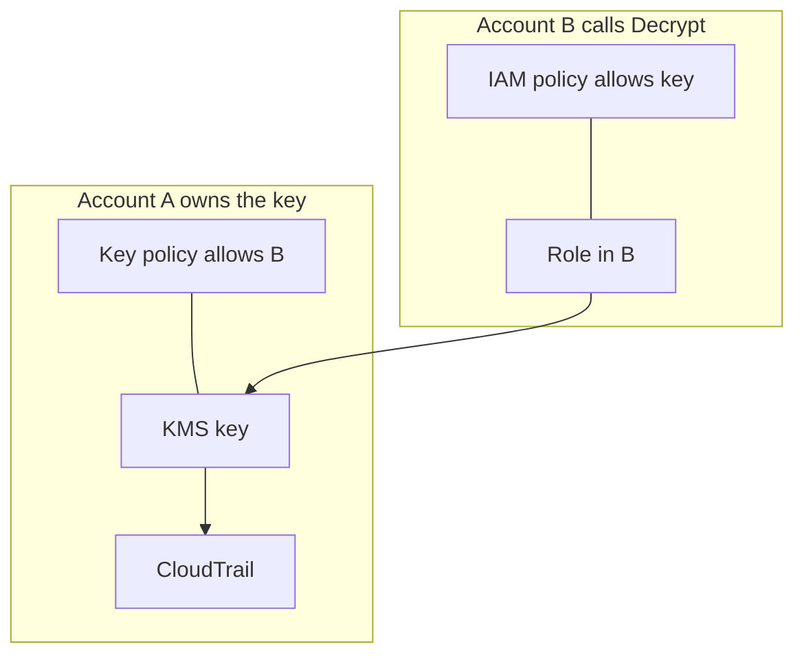

+++
title = 'KMS and key hierarchies'
description = 'A KMS is an access-control system that happens to do cryptography: key policies, grants, and encryption context decide who can use a key, and a hierarchy from HSM root to data key decides what a compromise costs.'
question = 'Who is allowed to use a KMS key, under what conditions, and what does the hierarchy of keys underneath it buy you?'
weight = 3
difficulty = 3
prerequisites = ['/notes/infrastructure-security/foundations/03-cloud-iam-fundamentals', '/notes/infrastructure-security/secrets/02-vaults-and-dynamic-secrets']
date = 2026-07-14
lastmod = 2026-10-30
verified = 2026-07-14
+++

## The idea in one minute

A key management service keeps keys inside hardware security modules and
exposes operations on them (encrypt, decrypt, generate a data key, sign) without
ever releasing the key itself. The cryptography is the easy part. **Operating a
KMS is mostly access control**: who may call `Decrypt` on which key, through
which mechanism (a key policy, an IAM policy, a grant), under which conditions,
and how every call is recorded.

Three ideas carry the operational weight. **Key policies are the root of
authority for a key**: in AWS KMS, an IAM policy alone grants nothing unless
the key policy delegates to IAM. **Encryption context** is non-secret
associated data bound to every ciphertext: decryption fails unless the same
context is supplied, policies can condition on it, and it appears in the audit
log, so it answers "whose data was decrypted?". And **key hierarchies**, from an
HSM root to key-encryption keys to per-object data keys, decide what one
compromise costs and make rotation and deletion cheap. The envelope encryption
mechanism itself is covered in
[envelope encryption and KMS](/notes/cryptography/key-management/02-envelope-encryption-and-kms/);
this lesson is about running the service around it.

## A picture

```mermaid {title="A key hierarchy and the gates on each KMS call"}
flowchart LR
  ROOT["<b>HSM root keys</b><br/><small>never exported</small>"] --> KEK1["<b>KMS key: billing</b><br/><small>KEK, key policy</small>"]
  ROOT --> KEK2["<b>KMS key: logs</b><br/><small>KEK, key policy</small>"]
  KEK1 --> DEK1["<b>DEK per object</b><br/><small>stored wrapped</small>"]
  KEK2 --> DEK2["<b>DEK per object</b><br/><small>stored wrapped</small>"]
  DEK1 --> DATA["<b>Data</b><br/><small>encrypted locally</small>"]
  CALLER["<b>Caller</b><br/><small>Decrypt + context</small>"] --> GATE{"<b>Authorize</b><br/><small>key policy, IAM, grants</small>"}
  GATE -->|allowed| KEK1
  GATE -.-> AUDIT["<b>Audit log</b><br/><small>principal, key, context</small>"]
  class ROOT good
  class KEK1,KEK2 memory
  class DEK1,DEK2 compute
  class DATA neutral
  class CALLER io
  class GATE good
  class AUDIT queue
```



Every unwrap of a data key is a KMS call that passes the authorization gate
and leaves an audit record. That is where most of the security value of a KMS
comes from.

## How it really works

### What a KMS does and does not do

A cloud KMS holds keys in HSMs that the provider operates. AWS states that its
KMS HSMs are validated under FIPS 140, and the other major providers make
similar claims for their HSM-backed tiers. Callers never receive the key
material of a KMS key; they send data to the service, which operates on it.
Direct encryption is limited to small payloads (4 KB for AWS KMS symmetric
`Encrypt`), so bulk data uses envelope encryption: the service generates a data
encryption key (DEK), returns it in plaintext and wrapped under the KMS key,
and the caller encrypts locally and stores only the wrapped copy.

Watch which calls cross into the KMS: only the small wrap and unwrap steps, and
each one is authorized and logged.

```mermaid {title="Envelope encryption: bulk work is local, every unwrap is a KMS call"}
sequenceDiagram
  autonumber
  participant A as Application
  participant K as KMS
  participant S as Storage
  A->>K: GenerateDataKey, key ID + context
  K->>K: authorize, write audit record
  K-->>A: plaintext DEK + DEK wrapped under the KMS key
  A->>A: encrypt data locally, discard plaintext DEK
  A->>S: store ciphertext + wrapped DEK
  Note over A,S: later, to read
  A->>S: fetch ciphertext + wrapped DEK
  A->>K: Decrypt wrapped DEK, same context
  K->>K: authorize, write audit record
  K-->>A: plaintext DEK
  A->>A: decrypt data locally
```

That design has one consequence that matters for operations: **every decrypt
of stored data requires a call to the KMS**, unless the caller caches
plaintext DEKs. The KMS therefore sees, authorizes, and logs each access. It
becomes a choke point you can use for access control, auditing, and emergency
shut-off, and also a dependency whose quotas and availability you must plan
for.

### Key policies versus IAM

AWS KMS is unusual among AWS services: **every KMS key has exactly one key
policy, and that policy is the primary authority.** IAM policies in the account
grant access to a key only if the key policy contains a statement that
delegates to the account, conventionally an `Allow` for the principal
`arn:aws:iam::<account>:root`. The default key policy includes that statement,
which is why IAM-based access works for most keys. Remove it, and IAM policies
granting `kms:Decrypt` on `*` have no effect on that key.

| Mechanism | Where it lives | Good for |
| --- | --- | --- |
| **Key policy** | On the key itself | The authoritative list of who administers and who uses this key; cross-account access |
| **IAM policy** | On the principal, only effective if the key policy delegates | Managing many keys for many roles with existing IAM tooling |
| **Grant** | Attached to the key, created programmatically | Temporary, narrowly scoped delegation, often to an AWS service acting for you |

The toy KMS in the Code section checks a call in this order; the
`AccessDenied` messages in its output name the exit taken.

```mermaid {title="How a KMS call is authorized: key policy first, IAM only if delegated"}
flowchart TB
  C["<b>Call</b><br/><small>principal, action, context</small>"] --> D0@{ shape: diam, label: "Explicit deny<br/>in key policy?" }
  D0 -->|yes| NO["<b>AccessDenied</b>"]
  D0 -->|no| D1@{ shape: diam, label: "Key policy allows<br/>this principal?" }
  D1 -->|yes| OK["<b>Allowed</b>"]
  D1 -->|no| D2@{ shape: diam, label: "Key policy delegates<br/>and IAM allows?" }
  D2 -->|yes| OK
  D2 -->|no| D3@{ shape: diam, label: "Grant matches<br/>op and context?" }
  D3 -->|yes| OK
  D3 -->|no| NO
  class OK,NO good
```

Cross-account use needs both sides: the key policy in the owning account must
allow the other account, and an IAM policy in the calling account must allow
its principal. An explicit `Deny` anywhere wins.

Both policies must say yes: the key policy in the owning account and the IAM
policy on the caller's role.



Other providers differ in shape but not in purpose. Google Cloud KMS uses IAM
bindings on the key ring or key, with separate roles for administration
(`roles/cloudkms.admin`) and use (`roles/cloudkms.cryptoKeyEncrypterDecrypter`).
Azure Key Vault uses Azure RBAC roles such as Key Vault Crypto Officer and
Crypto User, or its older access policies. In each case, the question to ask of
any key is the same: **list every principal that can cause plaintext to come
out of it**.

### Grants

A grant is a delegation attached to a key: a grantee principal, a list of
allowed operations, and optional constraints on the encryption context
(`EncryptionContextEquals` or `EncryptionContextSubset`). Grants are created
with `CreateGrant` by a principal permitted to do so, take effect without
editing the key policy, and are ended by retiring or revoking them. AWS
services that encrypt on your behalf, such as block storage volumes, use grants
to obtain just the operations they need on your key for as long as they need
them.

Grants are powerful and easy to forget. They do not appear in the key policy
document, so a review that reads only the policy misses them. List grants as
part of every key review, constrain them with encryption context, and treat a
long-lived grant to a human role as a finding.

### Encryption context: AAD, authorization input, audit record

An encryption context is a set of non-secret key-value pairs supplied with a
symmetric `Encrypt` or `GenerateDataKey` call, for example
`{"service": "billing", "tenant": "acme"}`. AWS KMS binds it to the ciphertext
as additional authenticated data (AAD): a decrypt with a different context
fails the integrity check, exactly as tampered ciphertext would. The pairs are
case-sensitive and must match exactly; order does not matter.

In the toy KMS's ciphertext for the 17-byte plaintext `data key for acme`, the
context is not stored anywhere; it is mixed only into the tag.

```mermaid {title="The toy ciphertext blob: context is authenticated, not stored"}
packet-beta
  title Toy KMS ciphertext layout in bytes
  0-11: "Nonce (12)"
  12-28: "Ciphertext (17)"
  29-44: "Tag: HMAC over nonce + context + ciphertext (16)"
```

The same pairs then serve two more purposes:

1. **Authorization.** Key policy conditions such as
   `kms:EncryptionContext:tenant` and grant constraints can require specific
   values, so a role can be allowed to decrypt only data labeled for its tenant
   or service.
2. **Audit.** AWS CloudTrail records the encryption context of each KMS call in
   plaintext. A log query for decrypts with `tenant=acme` answers who touched
   that tenant's data and when, without decrypting anything.

Because the context is logged in plaintext, it must never contain secrets or
personal data you would not put in a log. Choose context values that identify
the data's owner or purpose, such as a tenant ID, table name, or object key,
and make the application supply them from its own state, not from the request.

> [!IMPORTANT]
> Encryption context turns "this role can decrypt with this key" into "this
> role can decrypt this tenant's data with this key, and the log will say so".
> Without it, every ciphertext under a key is interchangeable.

### Key hierarchies

Keys are arranged in layers, each wrapping the one below:

| Layer | Where it lives | Lifetime | Typical count |
| --- | --- | --- | --- |
| **Root keys** | Inside the provider's HSMs, never exported | Years, managed by the provider | Few |
| **Key-encryption keys (KEKs)**: your KMS keys | Logically in the KMS, material protected by the roots | Months to years, rotated by the service | One per service, data class, or tenant |
| **Data encryption keys (DEKs)** | Wrapped next to the data; plaintext only in memory | Per object, file, or session | Millions |

The hierarchy buys four things. **Blast radius**: a leaked DEK exposes one
object, and a KMS key scoped to one tenant exposes one tenant. **Cheap
rotation**: rotating a KEK does not require re-encrypting the data, because
AWS KMS automatic rotation keeps old key material available for decryption and
uses new material for new encryptions; only the wrapped DEKs reference the
key. **Crypto-shredding**: destroying one tenant's KEK makes all of that
tenant's data unrecoverable, which is a deletion mechanism for data spread
across backups you cannot edit. **Throughput**: bulk encryption happens
locally with DEKs, and the KMS handles only small wrap and unwrap calls.

Granularity is the design decision. One KMS key for everything is simple but
makes every policy decision all-or-nothing. One key per tenant gives isolation
and per-tenant shredding, at the cost of more keys to govern and quotas to
watch. Encryption context gives much of the per-tenant audit and policy value
with a shared key; separate keys are needed when you want separate deletion or
separate administrators.

Place your design on this map: isolation rises with key count, and so does the
governance work.

```mermaid {title="Key granularity trades isolation against governance cost"}
quadrantChart
  title Choosing key granularity
  x-axis Low governance cost --> High governance cost
  y-axis Coarse isolation --> Fine isolation
  quadrant-1 Isolated but costly
  quadrant-2 Best value
  quadrant-3 Simple but all or nothing
  quadrant-4 Worst of both
  One key for everything: [0.12, 0.12]
  Shared key plus context: [0.3, 0.62]
  Key per service: [0.5, 0.45]
  Key per tenant: [0.85, 0.88]
```

### Multi-region keys

An AWS multi-Region key is a set of keys in different regions that share the
same key ID and key material, so data encrypted in one region can be decrypted
in another without a cross-region call. Each replica has its own key policy,
grants, and aliases, managed independently. They suit disaster recovery,
globally replicated tables, and signing keys verified worldwide. The trade-off
is that the key material now exists in several regions, so a data-residency or
blast-radius argument for regional keys no longer holds, and a policy mistake
on one replica exposes data from all of them. AWS does not convert an existing
single-region key into a multi-region key; the choice is made at creation.

### Separation of duties

A KMS key has two kinds of principals. **Key administrators** create, enable,
disable, tag, change policies, and schedule deletion. **Key users** encrypt and
decrypt. The default AWS key policy keeps these as separate statements, and the
first test of any key policy is that no single role can both administer and
use the key without a trace.

There is a catch. An administrator who can call `PutKeyPolicy` can rewrite the
policy to make themselves a user, and the default administrator statement uses
wildcards such as `kms:Put*` and `kms:Create*` that include `PutKeyPolicy` and
`CreateGrant`. True separation therefore needs controls outside the key: alarms
on `PutKeyPolicy` and `CreateGrant` events, organization-level policies that
restrict who may change key policies, and change review for key policy
documents kept in infrastructure code. The opposite failure also exists: a
policy that leaves nobody able to manage the key. AWS applies a lockout safety
check to `PutKeyPolicy` for that reason.

This is the escalation an alarm must catch: every step is a legal
administrator action, and only the audit trail shows the pattern.

```mermaid {title="An administrator turns into a key user, and the alarm is the only control"}
sequenceDiagram
  autonumber
  participant AD as Key administrator
  participant K as KMS key
  participant CT as CloudTrail
  participant SEC as Security team
  AD->>K: PutKeyPolicy, add self as key user
  K->>CT: PutKeyPolicy event
  CT->>SEC: alarm on key policy change
  AD->>K: CreateGrant, Decrypt for own role
  K->>CT: CreateGrant event
  AD->>K: Decrypt billing data
  K->>CT: Decrypt with principal and context
  Note over SEC,CT: without the alarm, the trail is only read after the fact
```

### Deletion waiting periods

Deleting a KEK destroys every piece of data it protects, including copies in
backups. KMS products make this deliberately slow:

| Provider | Mechanism |
| --- | --- |
| **AWS KMS** | `ScheduleKeyDeletion` with a waiting period of 7 to 30 days (30 by default). The key is unusable while pending; `CancelKeyDeletion` returns it in the disabled state |
| **Google Cloud KMS** | Destroying a key version schedules it for destruction after a configurable period (30 days by default), during which it can be restored |
| **Azure Key Vault** | Soft-delete keeps deleted keys recoverable for a retention period of 7 to 90 days; purge protection prevents permanent deletion before it ends |

In AWS terms, a key's states look like this; note that cancelling deletion
lands in Disabled, not Enabled, as the toy below also shows.

```mermaid {title="AWS KMS key states: deletion waits, and cancelling leaves the key disabled"}
stateDiagram-v2
  direction LR
  [*] --> Enabled: CreateKey
  Enabled --> Disabled: DisableKey
  Disabled --> Enabled: EnableKey
  Enabled --> PendingDeletion: ScheduleKeyDeletion, 7 to 30 days
  Disabled --> PendingDeletion: ScheduleKeyDeletion
  PendingDeletion --> Disabled: CancelKeyDeletion
  PendingDeletion --> Deleted: waiting period ends
  Deleted --> [*]
  note right of PendingDeletion
    every use attempt fails,
    alarm on it
  end note
```

Use the waiting period as a detection window: alert on any attempt to use a key
that is pending deletion, because that attempt names a workload that still
depends on it. Prefer **disabling** a key first, which is reversible and
produces the same signal, and delete only when the logs have been quiet for a
full cycle of your longest batch job. An attacker with administrator rights who
schedules deletion of your keys is running a ransomware play; the waiting
period plus an alarm is your chance to cancel it.

## Code

A toy KMS with one key. It evaluates the key policy (with optional delegation
to IAM), then grants; binds the encryption context as AAD using an HMAC-based
construction that is **a toy, not a real AEAD**; and prints one audit line per
call, including the context and the reason a call succeeded or failed.

```python {title="kms.py"}
"""kms.py: a toy KMS with key-policy evaluation, IAM delegation, grants,
encryption context bound as AAD, a printed audit trail, and a deletion waiting period.

TOY CIPHER: an HMAC-SHA256 keystream with an HMAC tag (encrypt-then-MAC). It
shows how associated data binds a ciphertext to its context; it is not a real
AEAD and must never protect real data. Standard library only; runs offline."""

import hashlib
import hmac
import json
from dataclasses import dataclass, field


class KMSError(Exception):
    """Any refusal: access denied, invalid state, or a failed integrity check."""


@dataclass
class Statement:
    effect: str                      # "Allow" or "Deny"
    principals: set[str]             # "account-root" delegates to IAM policies
    actions: set[str]
    context: dict[str, str] = field(default_factory=dict)  # required context pairs


@dataclass
class Grant:
    grantee: str
    operations: set[str]
    context_subset: dict[str, str]


@dataclass
class Key:
    key_id: str
    material: bytes
    policy: list[Statement]
    state: str = "Enabled"
    grants: dict[str, Grant] = field(default_factory=dict)


def matches(required: dict[str, str], context: dict[str, str]) -> bool:
    return all(context.get(k) == v for k, v in required.items())


def aad(context: dict[str, str]) -> bytes:
    return json.dumps(context, sort_keys=True, separators=(",", ":")).encode()


def subkeys(key: Key) -> tuple[bytes, bytes]:
    return (hmac.new(key.material, b"enc", hashlib.sha256).digest(),
            hmac.new(key.material, b"mac", hashlib.sha256).digest())


def stream(key: bytes, nonce: bytes, n: int) -> bytes:
    out = b"".join(hmac.new(key, nonce + i.to_bytes(4, "big"), hashlib.sha256).digest()
                   for i in range(n // 32 + 1))
    return out[:n]


class ToyKMS:
    def __init__(self, iam: dict[str, set[str]]) -> None:
        self.iam, self.keys, self.counter = iam, {}, 0

    def create_key(self, key_id: str, policy: list[Statement]) -> None:
        material = hashlib.sha256(b"toy-root/" + key_id.encode()).digest()  # a real KMS uses an HSM RNG
        self.keys[key_id] = Key(key_id, material, policy)

    def authorize(self, who: str, action: str, key: Key, ctx: dict[str, str]) -> str:
        hits = [s for s in key.policy if who in s.principals or "account-root" in s.principals]
        hits = [s for s in hits if action in s.actions and matches(s.context, ctx)]
        if any(s.effect == "Deny" and who in s.principals for s in hits):
            raise KMSError("AccessDenied: explicit deny in key policy")
        if any(s.effect == "Allow" and who in s.principals for s in hits):
            return "key policy"
        if any(s.effect == "Allow" and "account-root" in s.principals for s in hits) \
                and action in self.iam.get(who, set()):
            return "key policy -> IAM"
        for gid, g in key.grants.items():
            if g.grantee == who and action in g.operations and matches(g.context_subset, ctx):
                return f"grant {gid}"
        if action in self.iam.get(who, set()):
            raise KMSError("AccessDenied: IAM allows, key policy does not delegate")
        raise KMSError("AccessDenied: no statement or grant")

    def call(self, who: str, action: str, key_id: str, ctx: dict[str, str] | None = None, **kw):
        ctx = ctx or {}
        key = self.keys[key_id]
        try:
            if key.state != "Enabled" and action in {"Encrypt", "Decrypt"}:
                raise KMSError(f"KMSInvalidState: key is {key.state}")
            basis = self.authorize(who, action, key, ctx)
            out, line = getattr(self, "_" + action)(key, ctx, **kw), f"ok via {basis}"
        except KMSError as e:
            line, out = str(e), None
        shown = ",".join(f"{k}={v}" for k, v in ctx.items()) or "-"
        print(f"{who.removeprefix('role/'):<15}{action:<21}{shown:<30}{line}")
        return out

    def _Encrypt(self, key: Key, ctx: dict[str, str], plaintext: bytes) -> bytes:
        self.counter += 1
        nonce = hashlib.sha256(f"nonce-{self.counter}".encode()).digest()[:12]
        enc, mac = subkeys(key)
        ct = bytes(a ^ b for a, b in zip(plaintext, stream(enc, nonce, len(plaintext))))
        tag = hmac.new(mac, nonce + aad(ctx) + ct, hashlib.sha256).digest()[:16]
        return nonce + ct + tag

    def _Decrypt(self, key: Key, ctx: dict[str, str], blob: bytes) -> bytes:
        nonce, ct, tag = blob[:12], blob[12:-16], blob[-16:]
        enc, mac = subkeys(key)
        expected = hmac.new(mac, nonce + aad(ctx) + ct, hashlib.sha256).digest()[:16]
        if not hmac.compare_digest(tag, expected):
            raise KMSError("InvalidCiphertext: tag check failed")
        return bytes(a ^ b for a, b in zip(ct, stream(enc, nonce, len(ct))))

    def _CreateGrant(self, key: Key, ctx: dict[str, str], grant_id: str, grant: Grant) -> None:
        key.grants[grant_id] = grant

    def _RevokeGrant(self, key: Key, ctx: dict[str, str], grant_id: str) -> None:
        del key.grants[grant_id]

    def _ScheduleKeyDeletion(self, key: Key, ctx: dict[str, str], days: int) -> None:
        if not 7 <= days <= 30:
            raise KMSError("ValidationException: waiting period is 7-30 days")
        key.state = "PendingDeletion"

    def _CancelKeyDeletion(self, key: Key, ctx: dict[str, str]) -> None:
        key.state = "Disabled"  # cancelling leaves the key disabled, not enabled

    def _EnableKey(self, key: Key, ctx: dict[str, str]) -> None:
        key.state = "Enabled"


if __name__ == "__main__":
    kms = ToyKMS(iam={"role/analytics": {"Decrypt"}})
    kms.create_key("billing-key", [
        Statement("Allow", {"role/key-admin"}, {"ScheduleKeyDeletion", "CancelKeyDeletion", "EnableKey"}),
        Statement("Allow", {"role/billing-app"}, {"Encrypt", "Decrypt", "CreateGrant"}, {"service": "billing"}),
        Statement("Allow", {"role/billing-app"}, {"RevokeGrant"}),
    ])
    acme = {"service": "billing", "tenant": "acme"}
    globex = {"service": "billing", "tenant": "globex"}

    def run(who: str, action: str, ctx: dict[str, str] | None = None, **kw):
        return kms.call("role/" + who, action, "billing-key", ctx, **kw)

    blob = run("billing-app", "Encrypt", acme, plaintext=b"data key for acme")
    run("billing-app", "Decrypt", acme, blob=blob)
    run("billing-app", "Decrypt", globex, blob=blob)              # wrong context
    run("billing-app", "Decrypt", {"tenant": "acme"}, blob=blob)  # policy condition unmet
    run("billing-app", "Decrypt", acme, blob=blob[:-1] + b"\x00")  # tampered
    run("analytics", "Decrypt", acme, blob=blob)
    run("key-admin", "Decrypt", acme, blob=blob)

    run("billing-app", "CreateGrant", {"service": "billing"}, grant_id="g-1",
        grant=Grant("role/invoice-worker", {"Decrypt"}, {"tenant": "acme"}))
    run("invoice-worker", "Decrypt", acme, blob=blob)
    other = run("billing-app", "Encrypt", globex, plaintext=b"data key for globex")
    run("invoice-worker", "Decrypt", globex, blob=other)
    run("billing-app", "RevokeGrant", grant_id="g-1")
    run("invoice-worker", "Decrypt", acme, blob=blob)

    run("key-admin", "ScheduleKeyDeletion", days=3)
    run("key-admin", "ScheduleKeyDeletion", days=7)
    run("billing-app", "Decrypt", acme, blob=blob)
    run("key-admin", "CancelKeyDeletion")
    run("billing-app", "Decrypt", acme, blob=blob)
    run("key-admin", "EnableKey")
    run("billing-app", "Decrypt", acme, blob=blob)
```

Run it with `python3 kms.py`:

```text
billing-app    Encrypt              service=billing,tenant=acme   ok via key policy
billing-app    Decrypt              service=billing,tenant=acme   ok via key policy
billing-app    Decrypt              service=billing,tenant=globex InvalidCiphertext: tag check failed
billing-app    Decrypt              tenant=acme                   AccessDenied: no statement or grant
billing-app    Decrypt              service=billing,tenant=acme   InvalidCiphertext: tag check failed
analytics      Decrypt              service=billing,tenant=acme   AccessDenied: IAM allows, key policy does not delegate
key-admin      Decrypt              service=billing,tenant=acme   AccessDenied: no statement or grant
billing-app    CreateGrant          service=billing               ok via key policy
invoice-worker Decrypt              service=billing,tenant=acme   ok via grant g-1
billing-app    Encrypt              service=billing,tenant=globex ok via key policy
invoice-worker Decrypt              service=billing,tenant=globex AccessDenied: no statement or grant
billing-app    RevokeGrant          -                             ok via key policy
invoice-worker Decrypt              service=billing,tenant=acme   AccessDenied: no statement or grant
key-admin      ScheduleKeyDeletion  -                             ValidationException: waiting period is 7-30 days
key-admin      ScheduleKeyDeletion  -                             ok via key policy
billing-app    Decrypt              service=billing,tenant=acme   KMSInvalidState: key is PendingDeletion
key-admin      CancelKeyDeletion    -                             ok via key policy
billing-app    Decrypt              service=billing,tenant=acme   KMSInvalidState: key is Disabled
key-admin      EnableKey            -                             ok via key policy
billing-app    Decrypt              service=billing,tenant=acme   ok via key policy
```

Each line is the kind of record a real audit log keeps. The decrypt with
`tenant=globex` passed the policy (the service matched) but failed the
integrity check, because the ciphertext was bound to `tenant=acme`. The decrypt
with no `service` pair never reached the cryptography: the policy condition
was unmet. The `analytics` role holds an IAM allow for `Decrypt`, which does
nothing because this key's policy does not delegate to IAM. The key
administrator can schedule deletion but cannot decrypt. The grant let
`invoice-worker` decrypt only `acme` data and stopped working when revoked.
Cancelling deletion left the key disabled until someone enabled it.

## Where it breaks

- **Plaintext DEKs escape the KMS.** Once a DEK is unwrapped, it lives in
  application memory, and caches keep it there. The KMS sees the unwrap, not
  the thousands of decryptions done with the cached key afterwards. Short cache
  lifetimes trade KMS cost for audit fidelity.
- **Context that the caller controls.** If an attacker can choose the context
  value sent with a decrypt, a policy that conditions on it is only as strong
  as the code that picks it. Derive context from server-side state.
- **Administrators can become users.** As shown above, `PutKeyPolicy` and
  `CreateGrant` let an administrator widen access. The toy has no
  `PutKeyPolicy`; real separation of duties needs alarms and change control
  outside the key.
- **The toy cipher is not real cryptography.** It demonstrates AAD binding and
  nothing else: nonces come from a counter, the key material is derived from a
  name, and the construction has had no review. Real KMS services use AES-GCM
  inside HSMs.
- **Policy evaluation is simplified.** Real AWS evaluation also involves
  service control policies, permission boundaries, session policies, VPC
  endpoint policies, and condition operators. The toy covers the parts that
  differ most from ordinary IAM.
- **The KMS is not your backup.** Deleting a key makes data unrecoverable by
  design. If a key's deletion would be catastrophic, protect it with alarms,
  restricted administrators, and organization policies that deny
  `ScheduleKeyDeletion` outside a break-glass role.

## Remember this

- A KMS is an access-control and audit system; the key never leaves it.
- In AWS, the key policy is authoritative; IAM counts only if the key policy
  delegates to it.
- Grants are delegations outside the policy document; review them with the
  policy.
- Encryption context is AAD, a policy condition, and an audit field; never put
  secrets in it.
- Hierarchies (HSM root, KEK, DEK) bound blast radius and make rotation and
  crypto-shredding cheap.
- Deletion waits 7 to 30 days in AWS; disable first, alarm on use, then delete.

## Try it

1. Run `kms.py`. Add a statement `Statement("Allow", {"account-root"}, {"Decrypt"})`
   to the key policy and rerun. Which line changes, and what does the audit
   line now say about why?
2. Add an explicit `Deny` for `role/invoice-worker` on `Decrypt` with context
   `{"tenant": "acme"}`. Show that it overrides the grant.
3. Add `PutKeyPolicy` to the key administrator's actions and implement it.
   Write the three calls an administrator would make to read billing data, and
   decide which audit line an alarm should fire on.
4. For a real KMS key you use, list every principal that can cause `Decrypt`
   to succeed: key policy statements, IAM policies if delegated, and grants.

## Check yourself

1. A role has an IAM policy allowing `kms:Decrypt` on `*`, but decryption with a
   particular key fails with access denied. What is the most likely cause?

   
   The key's policy does not delegate to IAM: it lacks the statement that
   allows the account principal, so IAM policies have no effect for that key.
   Access must then be granted in the key policy itself or through a grant.
   

2. Why does decrypting with the wrong encryption context fail even when the
   caller is fully authorized?

   
   The context is bound to the ciphertext as additional authenticated data.
   The integrity check covers the ciphertext and the context together, so a
   different context produces a different expected tag and the decryption is
   rejected, exactly as for tampered ciphertext. Authorization and integrity
   are separate checks.
   

3. What does a key hierarchy let you do that a single key for all data does
   not?

   
   Limit blast radius (a leaked DEK exposes one object; a per-tenant KEK one
   tenant), rotate KEKs without re-encrypting bulk data, destroy one tenant's
   data by destroying its KEK even where backups cannot be edited, and keep
   bulk encryption local so the KMS handles only small wrap and unwrap calls.
   

4. Why are deletion waiting periods useful even if you are sure the key is no
   longer used?

   
   Because "sure" is a guess. While the key is pending deletion, any use attempt
   fails and can raise an alarm that names a dependent workload, and the
   deletion can be cancelled. The period also gives defenders time to notice and
   reverse a malicious deletion by a compromised administrator.
   

5. Why should encryption context never contain secrets?

   
   It is not encrypted. It is sent in the clear with each request and recorded
   in plaintext in the audit log, where many more people and systems can read
   it than can read the data.
   

## Sources

- AWS, [Key policies in AWS KMS](https://docs.aws.amazon.com/kms/latest/developerguide/key-policies.html), AWS Key Management Service Developer Guide.
- AWS, [Grants in AWS KMS](https://docs.aws.amazon.com/kms/latest/developerguide/grants.html), AWS KMS Developer Guide.
- AWS, [Encryption context](https://docs.aws.amazon.com/kms/latest/developerguide/encrypt_context.html), AWS KMS Developer Guide.
- AWS, [Multi-Region keys in AWS KMS](https://docs.aws.amazon.com/kms/latest/developerguide/multi-region-keys-overview.html), AWS KMS Developer Guide.
- AWS, [Delete an AWS KMS key](https://docs.aws.amazon.com/kms/latest/developerguide/deleting-keys.html) and [Rotate AWS KMS keys](https://docs.aws.amazon.com/kms/latest/developerguide/rotate-keys.html), AWS KMS Developer Guide.
- AWS, [AWS KMS cryptographic details](https://docs.aws.amazon.com/kms/latest/cryptographic-details/intro.html).
- Google Cloud, [Cloud KMS resource hierarchy](https://cloud.google.com/kms/docs/resource-hierarchy) and [Destroy and restore key versions](https://cloud.google.com/kms/docs/destroy-restore).
- Microsoft, [Azure Key Vault soft-delete overview](https://learn.microsoft.com/en-us/azure/key-vault/general/soft-delete-overview).
- E. Barker, [NIST SP 800-57 Part 1 Rev. 5: Recommendation for Key Management, Part 1: General](https://csrc.nist.gov/pubs/sp/800/57/pt1/r5/final), NIST, May 2020.
- E. Barker et al., [NIST SP 800-130: A Framework for Designing Cryptographic Key Management Systems](https://csrc.nist.gov/pubs/sp/800/130/final), NIST, August 2013.
