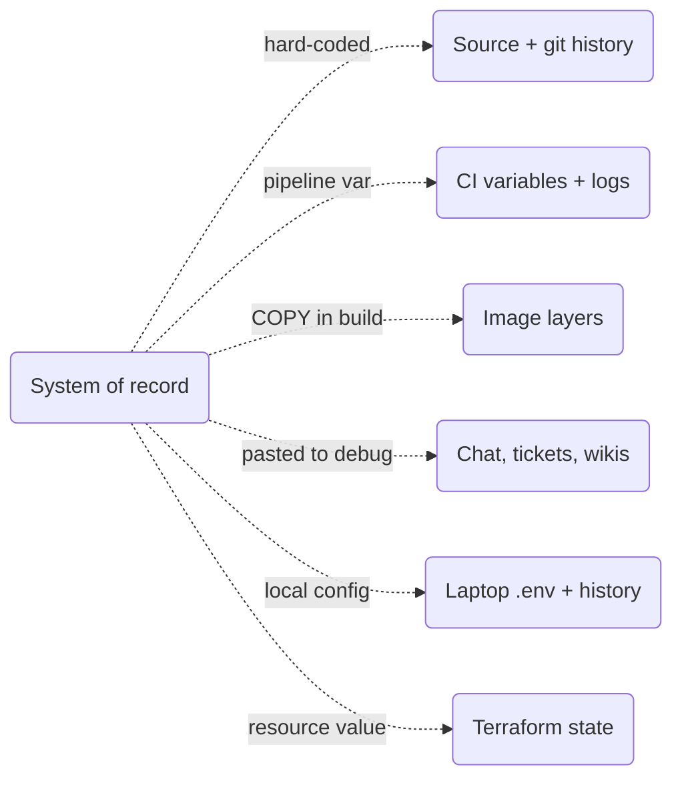
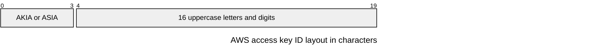
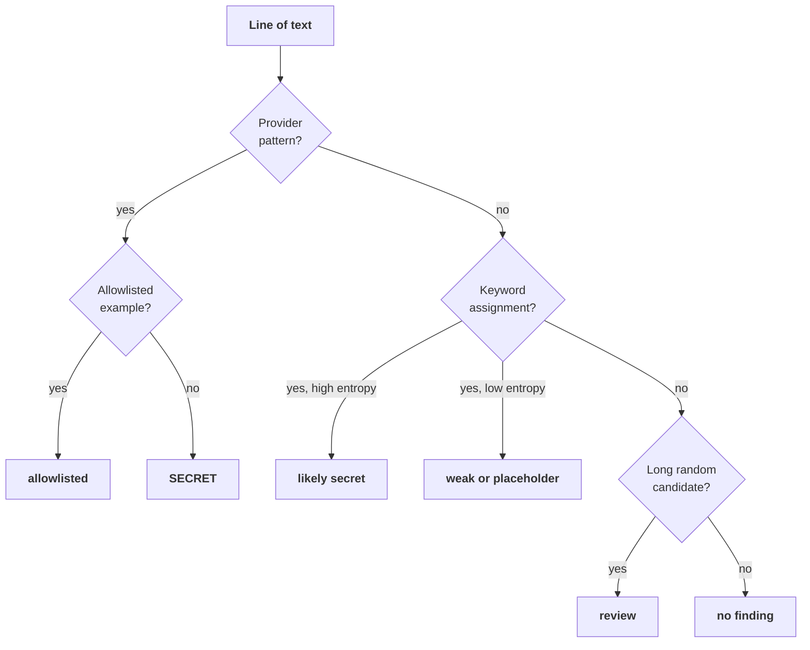
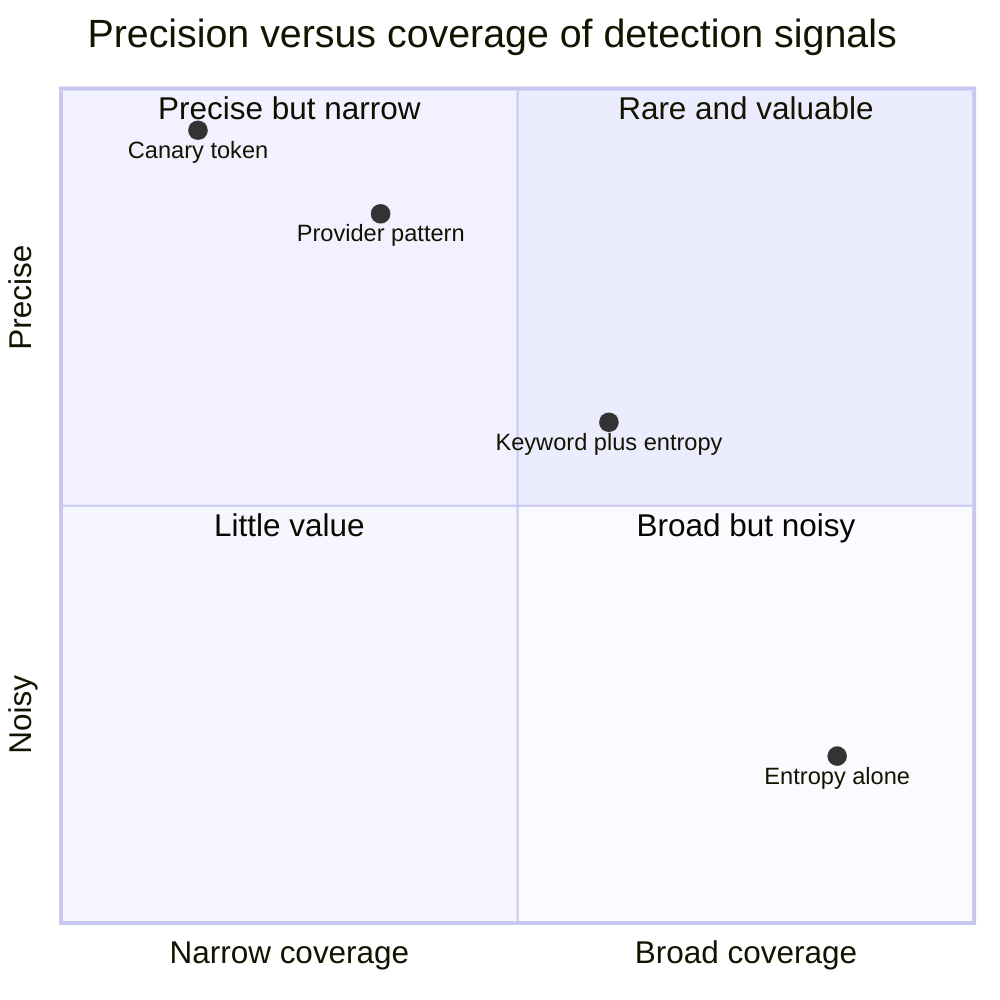
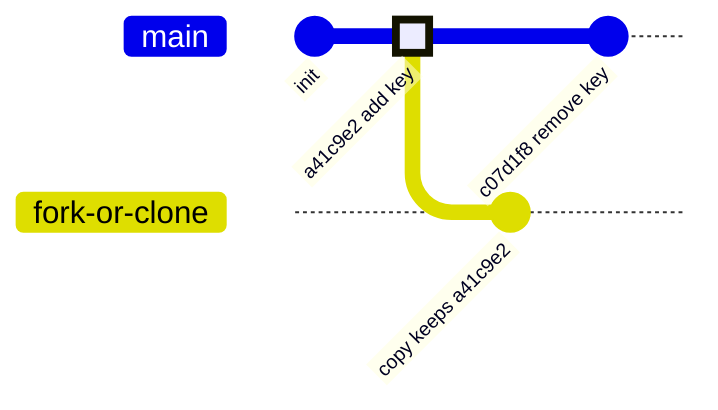

+++
title = 'Secret sprawl and detection'
description = 'Secrets escape into repositories, logs, tickets, and images faster than anyone can track them. Scanners combine provider patterns with entropy to find them, canary tokens catch their use, and the only real fix for an exposed secret is revocation.'
question = 'How do you find secrets that escaped, and what do you do once you find one?'
weight = 4
difficulty = 2
prerequisites = ['/notes/infrastructure-security/secrets/01-the-secret-lifecycle']
date = 2026-07-16
lastmod = 2026-07-16
verified = 2026-07-16
+++

## The idea in one minute

**Secret sprawl** is the gap between where a secret is supposed to live (one
vault, one system of record) and where copies actually are: source files, git
history, CI variables, container layers, chat messages, tickets, wikis, and
laptops. Every copy is a place it can leak from, and most copies are made by
people trying to get something working.

Detection has three layers. **Secret scanning** finds credentials in code and
text, using provider-specific patterns (high precision) and entropy heuristics
(high recall, many false positives). **Push protection** runs the same check
before a commit lands, which is the only point at which a leak can be stopped
rather than cleaned up. **Canary tokens** are fake credentials planted where an
attacker would look, so their use is an alert with almost no false positives.
And when a real secret is found, the rule is absolute: **deleting it is not
remediation; revoking and replacing it is.** Git history, forks, clones,
caches, and logs keep the old value long after the line is removed.

## A picture

```mermaid {title="Where detection sits, and what happens after a finding"}
flowchart LR
  DEV["<b>Developer</b><br/><small>commits a key</small>"] --> HOOK["<b>Pre-commit hook</b><br/><small>local, bypassable</small>"]
  HOOK --> PUSH["<b>Push protection</b><br/><small>server-side block</small>"]
  PUSH -->|bypassed or missed| REPO["<b>Repository</b><br/><small>history, forks, clones</small>"]
  REPO --> SCAN["<b>History scan</b><br/><small>patterns + entropy</small>"]
  SCAN --> FIND["<b>Finding</b>"]
  FIND --> REVOKE["<b>Revoke and rotate</b><br/><small>first, not last</small>"]
  REVOKE --> INVEST["<b>Investigate</b><br/><small>use during exposure</small>"]
  ATT["<b>Attacker</b><br/><small>finds a canary</small>"] --> CANARY["<b>Canary token</b><br/><small>use = alert</small>"]
  class DEV neutral
  class HOOK compute
  class PUSH,REVOKE good
  class REPO memory
  class SCAN,INVEST io
  class FIND queue
  class ATT warn
  class CANARY good
```

Only push protection prevents the leak. Everything to its right is about
limiting the damage of a leak that already happened.

## How it really works

### Where secrets sprawl to

| Location | How the copy gets there | Why it is hard to clean |
| --- | --- | --- |
| **Source files** | Hard-coded "temporarily" during development | Every clone has it |
| **Git history** | A later commit removes the line, but the blob remains | Rewriting history breaks every clone and does not reach forks |
| **CI systems** | Pipeline variables, build logs, cached artifacts | Logs are retained and widely readable |
| **Container images** | Copied into a layer, deleted in a later one | Layers are content-addressed and remain pullable |
| **Chat, tickets, wikis** | Pasted while debugging with a colleague | Search indexes, exports, and third-party integrations |
| **Laptops** | `.env` files, shell history, local config | Backed up, synced, rarely inventoried |
| **Infrastructure state** | Terraform state and plan output can hold secret values | State files are copied to buckets and shared for debugging |

One system of record on the left, and the copies that people make on the
right; each dotted edge is a copy that will outlive its purpose.



The common thread is that every copy outlives the moment it was needed. The
structural fix is the one from the earlier lessons: issue short-lived,
per-workload credentials so a copy found later has already expired. Detection
is for everything that is still static.

### Pattern detection

Many providers now issue credentials with a recognizable prefix and fixed
structure, partly so that scanners can find them. An AWS access key ID starts
with `AKIA` (long-term) or `ASIA` (temporary) followed by 16 uppercase
alphanumeric characters. GitHub tokens start with a type prefix such as `ghp_`,
`gho_`, or `ghs_`, and fine-grained personal access tokens with
`github_pat_`. Private keys announce themselves with a PEM header. A pattern for
a format like this has very high precision: a match is almost certainly a
credential of that type, and it often identifies the issuer, which tells you
who can revoke it.

The AWS access key ID format is rigid enough to match with one regular
expression: four fixed characters, then sixteen from a small alphabet.



GitHub's **secret scanning partner program** builds on this. When a supported
token format appears in a public repository, GitHub notifies the issuer, and
many issuers revoke the token or notify the customer automatically. AWS, for
example, can attach a quarantine policy that restricts what an exposed IAM
user's key can do. Some scanners go a step further and **verify** a candidate
by calling the issuer's API to see whether it is live. Verification sharply
reduces noise, but it means using a credential you found, so do it only for
your own organization's secrets with authorization to do so.

The race in this sequence is between the issuer's automatic response and the
scrapers that watch public pushes.

```mermaid {title="Partner program: a public leak reaches the issuer automatically"}
sequenceDiagram
  autonumber
  participant D as Developer
  participant G as GitHub
  participant S as Scraper
  participant I as Issuer, e.g. AWS
  D->>G: push commit with an access key to a public repo
  par scraper copies it
    S->>G: watch public events, copy key
  and GitHub reports it
    G->>G: match partner token format
    G->>I: report token and location
    I->>I: attach quarantine policy or revoke
    I-->>D: notify the customer
  end
  Note over D,I: the key is still exposed until the customer rotates it
```

### Entropy detection

Patterns only find formats someone wrote a rule for. Many secrets, such as
internal API keys, random passwords, and webhook tokens, have no prefix. The
fallback is **Shannon entropy**: for a string whose characters occur with
frequencies `p_i`, `H = -Σ p_i log2 p_i` bits per character. Random strings
score high; English words, identifiers, and repeated characters score low.

| String type | Maximum possible entropy per character |
| --- | --- |
| Hex (16 symbols) | 4.0 bits |
| Base64 (64 symbols) | 6.0 bits |
| Any string of length n | log2(n) bits, since at most n distinct symbols appear |

That last row matters: a short string cannot score high no matter how random it
is, because it cannot contain many distinct characters. Scanners therefore
consider only candidates above a minimum length and use different thresholds
by alphabet. The open-source detect-secrets tool, for example, defaults to 4.5
for base64-like strings and 3.0 for hex strings.

Entropy is a poor discriminator on its own. **Hashes, checksums, UUIDs, lockfile
integrity values, encoded images, and minified code** are all random-looking
and all harmless. A SHA-256 hex digest scores close to the 4.0 hex ceiling,
well above a 3.0 threshold. In the other direction, structured credentials can
score low: an AWS access key ID uses a restricted alphabet and a fixed prefix,
so its entropy sits below the base64 threshold, and only a pattern finds it.

These are the scores the scanner in the Code section reports: the first four
bars are real secrets, the next two harmless hashes; compare each with its
alphabet's threshold line (3.0 for hex, 4.5 otherwise).

```mermaid {title="Entropy flags harmless hashes and misses a structured key"}
xychart-beta
  title "Shannon entropy per character (bits)"
  x-axis ["AWS key ID", "GitHub token", "api_secret", "PEM body", "SHA-256 hex", "lockfile hash", "changeme"]
  y-axis "Bits per character" 0 --> 6
  bar [3.68, 4.83, 4.67, 5.30, 3.79, 5.34, 2.75]
  line [4.5, 4.5, 4.5, 4.5, 4.5, 4.5, 4.5]
  line [3.0, 3.0, 3.0, 3.0, 3.0, 3.0, 3.0]
```

### Combining signals

Good scanners layer the evidence:

1. **Provider pattern** match: report with high confidence, identify the
   issuer.
2. **Keyword context plus entropy**: a random-looking value assigned to a
   variable named `secret`, `token`, `password`, or `api_key` is likely a
   secret.
3. **Keyword with a low-entropy value**: often a placeholder (`changeme`), but
   occasionally a real weak default password, which is its own finding.
4. **Entropy alone**: a candidate for human review, with the highest
   false-positive rate.

The scanner in the Code section applies these layers to each line in order,
and stops at the first one that explains it.



Then suppress known noise with care. An **allowlist** of documented example
values (AWS's own documentation uses an example key ID ending in `EXAMPLE`)
is safe. Path-based exclusions such as `tests/` or `*.lock` are riskier: real
credentials end up in test fixtures more often than anyone would like. A
**baseline** file that records existing accepted findings lets a team adopt a
scanner without fixing years of history first, and makes new findings visible.

### Push protection

Scanning a repository finds secrets after they are already in history.
**Push protection** scans the commits in a push and rejects it if they contain
a supported secret. GitHub and GitLab both offer it; on GitHub, a developer can
bypass a block by giving a reason, and the bypass is recorded and can alert the
security team. Client-side pre-commit hooks (gitleaks, detect-secrets, and
similar) catch mistakes even earlier but run on the developer's machine and
can be skipped with `git commit --no-verify`. Use them for convenience; rely on
the server-side check.

> [!TIP]
> The lesson's own scanner assembles its fake tokens at runtime
> (`"gh" + "p_" + ...`) so that the source file does not trip push protection
> when this site is pushed. Test fixtures for real scanners need the same care.

### Canary tokens and honeytokens

A **honeytoken** is a credential or record that no legitimate process ever
uses, placed where an intruder would find it: an AWS key in a developer's
`~/.aws/credentials`, a database connection string in an old configuration
file, a fake admin account, a document with a tracking URL. Any use is, by
construction, unauthorized, so the alert has very high signal. Canarytokens, an
open-source project from Thinkst, generates many such tokens, including AWS
keys that have no permissions but whose use is logged and alerted.

Canaries complement scanning. A scanner tells you a secret is exposed; a canary
tells you someone is **using** what they found, which is the moment that
matters. Place them in the locations an attacker searches first: home
directories, CI variables, backups, internal wikis. Keep them separate from
real credentials so rotating real keys never retires the canary, and make sure
the alert reaches someone who will act.

Placed by how often an alert is real and how much they cover, the signals
explain why a program uses several of them.



### Deletion is not remediation

When a scanner finds a committed secret, the tempting fix is a commit that
deletes it. That changes nothing about the exposure:

- The **old commit** still contains it, and anyone who cloned or fetched the
  repository has it.
- **Forks** have their own copy of the history.
- **Hosting platforms** may keep cached views and references to old commits.
- **CI logs, artifacts, and mirrors** have copies of their own.
- Automated scrapers watch public repositories for credentials, so for a
  public push the realistic assumption is that it was copied within moments.

The scanner's two simulated commits, drawn: the "remove" commit fixes HEAD,
but every clone or fork made after `a41c9e2` still holds the key.



GitHub's own documentation on removing sensitive data says to revoke or rotate
the credential first, and treats history rewriting (with `git filter-repo` or
similar tools) as optional cleanup that cannot reach existing clones. The
remediation order is:

1. **Revoke** the credential at the issuer, and issue a replacement.
2. **Investigate** use during the exposure window: query the issuer's audit
   logs (for an AWS key, its access key ID in CloudTrail) from the first commit
   until revocation.
3. **Clean up** history, caches, and copies if the exposure was internal or the
   content is otherwise sensitive.
4. **Fix the cause**: why did a static credential exist, and why did no control
   stop the commit?

## Code

The scanner below runs over nine simulated files. Four contain live (fake)
secrets; five contain things that look suspicious and are not. It applies
provider patterns first, then keyword-plus-entropy, then entropy alone, with
the detect-secrets default thresholds. The last part simulates two commits: one
adding a key, one "removing" it.

```python {title="scan.py"}
"""scan.py: a secret scanner that combines provider patterns, keyword
assignments, and Shannon entropy, run over simulated files and git history.
Standard library only; every "secret" is fake and assembled at runtime so this
file does not trip real scanners."""

import math
import random
import re
import string
from collections import Counter

rng = random.Random(42)


def fake(alphabet: str, n: int) -> str:
    return "".join(rng.choice(alphabet) for _ in range(n))


B64 = string.ascii_letters + string.digits + "+/"
AWS_ID = "AK" + "IA" + fake(string.ascii_uppercase + "234567", 16)
GH_TOKEN = "gh" + "p_" + fake(string.ascii_letters + string.digits, 36)
PEM = "-----BEGIN " + "OPENSSH PRIVATE KEY-----"

# path -> (content, does it really contain a live secret?)
FILES = {
    "app/settings.py": (f'AWS_ACCESS_KEY_ID = "{AWS_ID}"\nDEBUG = False', True),
    "deploy/ci.env": (f"REGION=eu-west-1\nGITHUB_TOKEN={GH_TOKEN}", True),
    "app/client.py": (f'api_secret = "{fake(B64, 40)}"', True),
    "keys/deploy_key": (f"{PEM}\n{fake(B64, 64)}", True),
    "docs/setup.md": ("export AWS_ACCESS_KEY_ID=AKIA" + "IOSFODNN7EXAMPLE", False),
    "tests/fixtures.py": ('password = "changeme"', False),
    "app/ids.py": (f'REQUEST_ID = "{fake("0123456789abcdef", 8)}-{fake("0123456789abcdef", 4)}"', False),
    "app/verify.py": (f'EXPECTED_SHA256 = "{fake("0123456789abcdef", 64)}"', False),
    "package-lock.json": (f'"integrity": "sha512-{fake(B64, 86)}=="', False),
}

PATTERNS = {
    "aws-access-key-id": re.compile(r"\b(?:AKIA|ASIA)[A-Z0-9]{16}\b"),
    "github-token": re.compile(r"\bgh[pousr]_[A-Za-z0-9]{36}\b"),
    "private-key": re.compile(r"-----BEGIN [A-Z ]*PRIVATE KEY-----"),
}
KEYWORD = re.compile(r"""(?i)(secret|token|passw(?:or)?d|api_?key)\w*\s*[:=]\s*["']([^"']+)["']""")
CANDIDATE = re.compile(r"[A-Za-z0-9+/=_\-]{20,}")
ALLOWLIST = [re.compile(r"EXAMPLE$")]  # documented example values


def entropy(s: str) -> float:
    """Shannon entropy in bits per character of the string's own symbol frequencies."""
    counts = Counter(s)
    return -sum(c / len(s) * math.log2(c / len(s)) for c in counts.values())


def too_random(token: str) -> bool:
    is_hex = all(ch in string.hexdigits for ch in token)
    return entropy(token) > (3.0 if is_hex else 4.5)  # detect-secrets' default limits


def scan(path: str, text: str) -> list[tuple[str, str, str, str]]:
    found = []
    for n, line in enumerate(text.splitlines(), 1):
        where = f"{path}:{n}"
        for name, rx in PATTERNS.items():
            for m in rx.finditer(line):
                verdict = "allowlisted" if any(a.search(m.group()) for a in ALLOWLIST) else "SECRET"
                found.append((where, name, m.group(), verdict))
        if found and found[-1][0] == where:
            continue  # a provider pattern already explains this line
        if m := KEYWORD.search(line):
            value = m.group(2)
            verdict = "likely secret" if too_random(value) else "weak or placeholder"
            found.append((where, "keyword", value, verdict))
            continue
        for m in CANDIDATE.finditer(line):
            if too_random(m.group()):
                found.append((where, "entropy", m.group(), "review"))
    return found


def show(where: str, rule: str, value: str, verdict: str) -> None:
    print(f"  {where:<22} {rule:<18} {value[:6] + '...':<10} H={entropy(value):.2f}  {verdict}")


if __name__ == "__main__":
    print("working tree:")
    flagged: set[str] = set()
    for path, (text, _) in FILES.items():
        for hit in scan(path, text):
            show(*hit)
            if hit[3] in {"SECRET", "likely secret", "review"}:
                flagged.add(path)
    real = {p for p, (_, live) in FILES.items() if live}
    print(f"  live secrets caught: {len(real & flagged)}/{len(real)}; "
          f"false positives flagged: {sorted(flagged - real)}")

    history = [  # (commit, message, files changed)
        ("a41c9e2", "add payments client", {"app/pay.py": f'payments_api_key = "{fake(B64, 40)}"'}),
        ("c07d1f8", "remove hard-coded key", {"app/pay.py": 'payments_api_key = os.environ["PAYMENTS_KEY"]'}),
    ]
    head = {path: text for _, _, files in history for path, text in files.items()}
    print("HEAD only:", [h[3] for h in scan("app/pay.py", head["app/pay.py"])])
    print("every commit:")
    for commit, message, files in history:
        for path, text in files.items():
            for where, rule, value, verdict in scan(path, text):
                show(f"{commit}:{where}", rule, value, verdict)
```

Run it with `python3 scan.py`:

```text
working tree:
  app/settings.py:1      aws-access-key-id  AKIAHB...  H=3.68  SECRET
  deploy/ci.env:2        github-token       ghp_TP...  H=4.83  SECRET
  app/client.py:1        keyword            6pWkLU...  H=4.67  likely secret
  keys/deploy_key:1      private-key        -----B...  H=3.59  SECRET
  keys/deploy_key:2      entropy            OB/Y6s...  H=5.30  review
  docs/setup.md:1        aws-access-key-id  AKIAIO...  H=3.68  allowlisted
  tests/fixtures.py:1    keyword            change...  H=2.75  weak or placeholder
  app/verify.py:1        entropy            a07702...  H=3.79  review
  package-lock.json:1    entropy            sha512...  H=5.34  review
  live secrets caught: 4/4; false positives flagged: ['app/verify.py', 'package-lock.json']
HEAD only: []
every commit:
  a41c9e2:app/pay.py:1   keyword            eVs3qf...  H=4.70  likely secret
```

The four live secrets were all caught, by three different mechanisms: two
provider patterns, a private-key header, and a keyword with a high-entropy
value. Notice the AWS key ID's entropy of 3.68, below the 4.5 base64
threshold: entropy alone would have missed it. The documented example key was
allowlisted, and the `changeme` fixture was reported as a weak value rather
than a secret. The cost is two false positives: a SHA-256 digest that clears
the hex threshold and a lockfile integrity hash that clears the base64 one.
Finally, the scan of HEAD is clean while the scan of every commit finds the
key in `a41c9e2`. The "remove hard-coded key" commit hid it from the working
tree and from nobody else.

## Where it breaks

- **Unknown formats slip through.** Patterns cover only formats someone wrote
  rules for. A custom internal token with a short or low-entropy value, or a
  secret split across lines or concatenated at runtime (as this lesson's own
  program does on purpose), evades both patterns and entropy.
- **Encoding hides secrets.** A credential that is base64-encoded inside a
  Kubernetes manifest, URL-encoded in a connection string, or compressed in an
  artifact needs decoding before scanning. Good scanners decode common
  encodings; simple ones do not.
- **False positives erode attention.** A scanner that flags every lockfile
  hash trains people to dismiss findings. Tune allowlists and baselines, and
  measure how many findings lead to action.
- **Exclusions are where secrets hide.** Excluding `tests/` or `vendor/` to cut
  noise also stops scanning the places where real credentials are often pasted.
- **Scanning covers only what you point it at.** Repositories are the easy
  part. Chat, tickets, wikis, CI logs, images, and laptops need their own
  coverage, and some of it requires vendor APIs or endpoint agents.
- **Detection is not prevention.** By the time a history scan finds a key, it
  has been exposed for as long as it has been in history. Only push protection
  and, structurally, short-lived credentials shrink that window.

## Remember this

- Sprawl is every copy outside the system of record; each copy outlives its
  purpose.
- Provider patterns are precise; entropy is broad and noisy; combine them with
  keyword context.
- Push protection is the only control that stops a leak before it happens;
  pre-commit hooks can be skipped.
- Canary tokens alert on use, with almost no false positives.
- Deleting a committed secret is not remediation: revoke, investigate, then
  clean up.
- Short-lived credentials make every leaked copy expire on its own.

## Try it

1. Run `scan.py`. Lower the base64 threshold to 4.0 and the hex threshold to
   2.5. Which new findings appear, and how many are real?
2. Add a file containing the GitHub token base64-encoded (use `base64` from the
   standard library at runtime). Confirm the scanner misses it, then add a
   decoding pass that catches it.
3. Add a baseline: write the current findings' locations to a set, then report
   only findings not in the baseline. Add a new secret and confirm only it is
   reported.
4. Run gitleaks or a similar scanner over the full history of a repository you
   own, then over its CI logs if you can export them. Compare the counts.

## Check yourself

1. Why do scanners combine provider patterns with entropy instead of choosing
   one?

   
   Patterns are precise but only find known formats; entropy finds unknown
   formats but flags many harmless random-looking strings such as hashes and
   UUIDs, and misses structured credentials with low entropy, such as AWS key
   IDs. Together, with keyword context, they cover more secrets with fewer
   false positives than either alone.
   

2. A SHA-256 hex digest triggers an entropy finding. Why, and how would you
   handle it?

   
   A hex digest is close to uniformly random over 16 symbols, so its entropy
   is near the 4.0-bit maximum, above a typical 3.0 hex threshold. Handle it
   with a targeted allowlist (for example, values assigned to names like
   `sha256` or `checksum`, or known integrity fields) rather than excluding the
   whole file or directory.
   

3. A developer commits an API key, notices, and pushes a second commit that
   removes it. What else must happen?

   
   Revoke the key at the issuer and replace it, because the first commit still
   contains it and anyone with a clone, fork, cache, or CI log has a copy. Then
   check the issuer's logs for use between the first push and revocation.
   History rewriting is optional cleanup afterwards and cannot reach existing
   copies.
   

4. Why does a canary token produce fewer false positives than a scanner?

   
   No legitimate process ever uses it, so any use is unauthorized by
   construction. A scanner judges whether a string looks like a secret, which
   is inherently uncertain; a canary only reports an event that should never
   happen.
   

5. Why is server-side push protection more reliable than a pre-commit hook?

   
   A pre-commit hook runs on the developer's machine, must be installed, and can
   be skipped with `--no-verify`. Push protection runs on the server for every
   push, and bypasses require a recorded reason that can alert the security
   team.
   

## Sources

- GitHub, [About secret scanning](https://docs.github.com/en/code-security/secret-scanning/introduction/about-secret-scanning) and [About push protection](https://docs.github.com/en/code-security/secret-scanning/introduction/about-push-protection), GitHub Docs.
- GitHub, [Secret scanning partner program](https://docs.github.com/en/code-security/secret-scanning/secret-scanning-partnership-program/secret-scanning-partner-program), GitHub Docs.
- GitHub, [Removing sensitive data from a repository](https://docs.github.com/en/authentication/keeping-your-account-and-data-secure/removing-sensitive-data-from-a-repository), GitHub Docs.
- GitLab, [Secret detection](https://docs.gitlab.com/user/application_security/secret_detection/), GitLab Docs.
- AWS, [Manage access keys for IAM users](https://docs.aws.amazon.com/IAM/latest/UserGuide/id_credentials_access-keys.html), AWS IAM User Guide.
- Yelp, [detect-secrets](https://github.com/Yelp/detect-secrets); Gitleaks, [gitleaks](https://github.com/gitleaks/gitleaks); Truffle Security, [TruffleHog](https://github.com/trufflesecurity/trufflehog).
- Thinkst, [Canarytokens documentation](https://docs.canarytokens.org/guide/).
- C. E. Shannon, "A Mathematical Theory of Communication", *Bell System Technical Journal*, vol. 27, 1948.
- OWASP, [Secrets Management Cheat Sheet](https://cheatsheetseries.owasp.org/cheatsheets/Secrets_Management_Cheat_Sheet.html).
