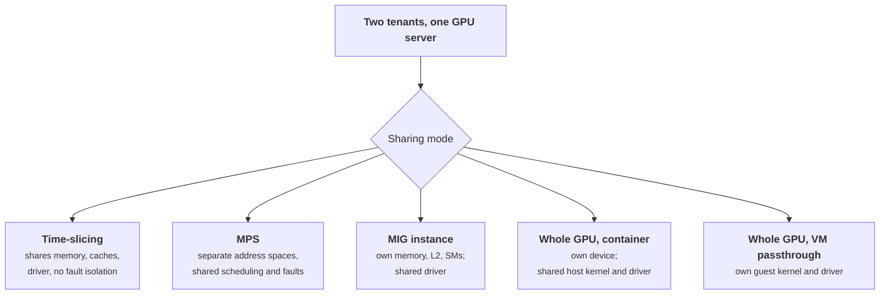

+++
title = 'Multi-tenant GPU isolation'
description = 'A GPU is a second computer with its own memory, scheduler, and firmware, driven by a large kernel driver. Only some ways of sharing it are security boundaries, and memory reuse between tenants has to be scrubbed and tested.'
question = 'Which ways of sharing a GPU actually isolate tenants, and how do you check for leftover data?'
weight = 1
difficulty = 3
prerequisites = ['/notes/infrastructure-security/isolation/01-containers-from-the-kernel-up', '/notes/infrastructure-security/isolation/03-sandboxes-and-microvms']
date = 2026-10-30T06:05:00Z
lastmod = 2026-10-30T06:05:00Z
verified = 2026-10-30
+++

## The idea in one minute

A container with a GPU is two isolation problems at once. The process still
shares the host kernel, now including the GPU kernel driver, one of the largest
and most privileged pieces of code on the machine. And the GPU itself is a
shared computer, with memory, caches, and compute units that several workloads
may use in turn or at once.

The sharing modes differ sharply in what they isolate. **Whole-GPU assignment to
a VM** shares the least. **Multi-Instance GPU (MIG)** partitions memory, cache,
and compute in hardware. **MPS** and **time-slicing** share the device among
processes that are meant to cooperate, and NVIDIA's own documentation says
time-sliced replicas have no memory or fault isolation. Choose by tenant trust,
not by utilization.

Separately, any memory handed from one tenant to another must be cleared, and
the only way to know it is cleared on your stack is to test: write a canary,
release it, allocate as the next tenant, and look.

## A picture



## How it really works

### What a tenant shares on a GPU server

| Layer | Shared under | Why it matters |
| --- | --- | --- |
| **Device memory (HBM)** | Time-slicing; MPS (separate address spaces); reuse across jobs in all modes | Residual data; out-of-bounds bugs |
| **L2 cache, memory bandwidth, SMs** | Time-slicing, MPS, whole-GPU reuse over time | Contention and timing side channels |
| **Kernel-mode driver** | Every mode except VM passthrough | A driver bug reachable from a container is a host compromise |
| **Container toolkit and hooks** | Every container mode | Runs with privilege when the container starts |
| **GPU firmware and state** | All modes, across reassignment | Must be reset between tenants |
| **PCIe and NVLink** | Multi-GPU servers | Peer-to-peer access between GPUs of different tenants |

### The sharing modes

**Time-slicing** lets several processes use the whole device in turn. In
Kubernetes, the NVIDIA device plugin can advertise one GPU as several
replicas. NVIDIA's GPU Operator documentation is explicit that, unlike MIG,
time-sliced replicas have no memory or fault isolation. Use it for one tenant's
cooperating workloads, never as a boundary.

**Multi-Process Service (MPS)** runs kernels from several processes
concurrently through one server process. Since the Volta generation, MPS
clients have separate GPU address spaces, but a fatal fault in one client can
affect the others, and the design target is cooperative processes of one user
or job. It is a throughput feature, not a tenant boundary.

**Multi-Instance GPU (MIG)**, on A100, H100, and later data-center GPUs,
partitions one GPU into up to seven instances. Each GPU instance has its own
streaming multiprocessors, its own slices of L2 cache, and its own memory
controllers and DRAM, so memory and bandwidth are isolated in hardware and a
fault in one instance does not take down the others. What MIG does not
partition is software: all instances are driven by the same kernel driver on
the same host.

**Whole-GPU assignment** gives a container exclusive use of a device. Memory is
exclusive while the job runs, but the container shares the host kernel and
driver with every other container on the machine.

**VM passthrough** (VFIO) assigns the device to a virtual machine, which runs
its own guest kernel and GPU driver. A driver exploit lands in the guest, not
the host. Kata Containers can use passthrough to give a pod this isolation with
a container interface;
[sandboxes and microVMs](/notes/infrastructure-security/isolation/03-sandboxes-and-microvms/)
covers the tradeoffs.

A reasonable policy: mutually untrusted tenants get whole GPUs in separate VMs,
or MIG instances in separate VMs where the platform supports it; MIG on a
shared host for tenants you trust not to attack the driver; time-slicing and
MPS only within one tenant.

### How GPUs reach a container, and how that goes wrong

In Kubernetes, the NVIDIA device plugin advertises `nvidia.com/gpu` resources
and tells the kubelet which devices to give a pod. The NVIDIA Container Toolkit
then injects the device nodes (`/dev/nvidia*`) and driver libraries into the
container, through an OCI hook or the Container Device Interface (CDI).
Kubernetes Dynamic Resource Allocation (DRA) generalizes this for devices
described in more detail than a count.

Three configuration mistakes recur:

- **Privileged pods see every GPU.** A privileged container gets all host
  devices, whatever the scheduler allocated. The Pod Security Standards'
  restricted profile forbids it
  ([the Kubernetes security model](/notes/infrastructure-security/isolation/02-the-kubernetes-security-model/)).
- **The environment variable shortcut.** The toolkit historically selected
  devices from the `NVIDIA_VISIBLE_DEVICES` environment variable. If an
  unprivileged pod can set `NVIDIA_VISIBLE_DEVICES=all` and the toolkit honors
  it, the pod gets every GPU on the node regardless of what it was allocated.
  NVIDIA's device plugin documents a configuration that ignores the variable
  for unprivileged containers and passes the allocation another way; use it.
- **Unpatched toolkit and driver.** The toolkit runs with privilege at container
  start. CVE-2024-0132 (a time-of-check to time-of-use flaw) and CVE-2025-23266
  (abuse of an environment variable in an OCI hook, reported by Wiz as
  "NVIDIAScape") both let a crafted image reach the host. NVIDIA publishes GPU
  driver security bulletins regularly. Treat both as internet-facing software
  when tenants supply their own images.

### Memory residue

GPU memory handed to a new owner may still hold the previous owner's data. Three
places matter:

- **Inside one process.** Frameworks keep freed GPU memory in a caching
  allocator and reuse it without clearing; `torch.empty` documents that it
  returns uninitialized memory. A [serving engine](/notes/inference-engineering/serving-systems/01-anatomy-of-a-serving-engine/) reuses KV-cache blocks across
  requests. Normally the new owner overwrites before reading. An engine bug
  that reads past what it wrote returns another request's tokens, which, in a
  multi-tenant engine, are another tenant's.
- **Between processes on one GPU.** The driver is responsible for not handing
  one process another's memory. Research has shown failures: Di Pietro et al.
  (2016) demonstrated leakage between processes on NVIDIA GPUs of the time, and
  LeftoverLocals (Trail of Bits, 2024, CVE-2023-4969) recovered data from GPU
  local memory across processes on some Apple, AMD, and Qualcomm GPUs.
- **Between tenants over time.** When a GPU moves from one job or VM to the
  next, its memory and state should be reset. In a VM, the hypervisor resets
  the device on reassignment; on bare metal and in containers, a job epilog
  should reset the GPU or clear its memory before the next tenant arrives.

The cost of clearing is small next to a job. An 80 GB H100 at its 3.35 TB/s
peak memory bandwidth takes at least 24 ms to overwrite once. Zeroing a 16-token
KV block for a 70B-class model (80 layers, 8 KV heads, head dimension 128, bf16)
moves 5.2 MB and takes microseconds.

> [!IMPORTANT]
> Do not rely on an unstated guarantee about memory clearing. Behavior differs
> by driver version, sharing mode, and framework. Make a canary test part of
> node qualification and of every driver upgrade.

### Side channels

Workloads that run on the same GPU at the same time can observe each other
through contention. Naghibijouybari et al. (2018) demonstrated practical GPU
side channels between co-located applications, including website
fingerprinting and inferring properties of a neural network being trained.
MIG reduces this by partitioning cache and memory bandwidth; time-slicing and
MPS do not.

## Code

The program runs a canary test on a simulated device under three policies, then
shows the in-process failure: a KV block pool that reuses blocks without
clearing them, combined with a read-past-length bug. It ends with the
scrubbing arithmetic.

```python {title="gpu_residue.py"}
"""gpu_residue.py: a canary test for leftover data in reused GPU memory.

A simulated device hands out fixed-size pages. Tenant A writes a canary and
frees its pages; tenant B then allocates and scans what it was given. The test
runs under three policies: reuse without scrubbing, scrub on free, and MIG-style
partitions where each tenant has its own memory slice. A second test shows the
same failure inside one serving process: a KV block pool that reuses blocks
without clearing them, plus a read-past-length bug. Nothing touches a real GPU.
"""
from __future__ import annotations

from dataclasses import dataclass, field

PAGE = 64           # bytes per simulated page
CANARY = b"CANARY:tenant-a:prompt=quarterly-forecast"


@dataclass
class Device:
    pages: int
    policy: str                                   # "reuse", "scrub-on-free", "mig"
    mem: list[bytearray] = field(init=False)
    owner: list[str | None] = field(init=False)
    slice_of: dict[str, range] = field(default_factory=dict)

    def __post_init__(self) -> None:
        self.mem = [bytearray(PAGE) for _ in range(self.pages)]
        self.owner = [None] * self.pages
        if self.policy == "mig":
            half = self.pages // 2
            self.slice_of = {"A": range(0, half), "B": range(half, self.pages)}

    def alloc(self, tenant: str, n: int) -> list[int]:
        pool = self.slice_of.get(tenant, range(self.pages))
        got = [i for i in pool if self.owner[i] is None][:n]
        for i in got:
            self.owner[i] = tenant
        return got

    def free(self, pages: list[int]) -> None:
        for i in pages:
            self.owner[i] = None
            if self.policy == "scrub-on-free":
                self.mem[i][:] = bytes(PAGE)


def canary_test(policy: str) -> str:
    dev = Device(pages=16, policy=policy)
    a = dev.alloc("A", 8)
    for i in a:
        dev.mem[i][: len(CANARY)] = CANARY
    dev.free(a)
    b = dev.alloc("B", 16)                        # take everything it can get
    hits = [i for i in b if CANARY[:12] in bytes(dev.mem[i])]
    return f"B got {len(b):>2} pages, canary found in {len(hits)}" + ("  LEAK" if hits else "  clean")


@dataclass
class KVPool:
    blocks: int
    block_tokens: int = 16
    zero_on_alloc: bool = False
    data: list[list[str]] = field(init=False)
    free_list: list[int] = field(init=False)

    def __post_init__(self) -> None:
        self.data = [[""] * self.block_tokens for _ in range(self.blocks)]
        self.free_list = list(range(self.blocks))

    def alloc(self) -> int:
        blk = self.free_list.pop()
        if self.zero_on_alloc:
            self.data[blk] = [""] * self.block_tokens
        return blk

    def release(self, blk: int) -> None:
        self.free_list.append(blk)


def kv_test(zero_on_alloc: bool) -> str:
    pool = KVPool(blocks=4, zero_on_alloc=zero_on_alloc)
    blk = pool.alloc()
    pool.data[blk] = [f"a{i}" for i in range(16)]          # tenant A fills a block
    pool.release(blk)
    blk = pool.alloc()                                      # tenant B gets the same block
    pool.data[blk][:5] = [f"b{i}" for i in range(5)]       # B writes 5 tokens
    buggy_read = pool.data[blk][:8]                         # bug: reads 8, not 5
    leaked = [t for t in buggy_read if t.startswith("a")]
    return f"B's buggy read: {buggy_read} -> {len(leaked)} of A's tokens"


if __name__ == "__main__":
    print("device-level canary test")
    for p in ("reuse", "scrub-on-free", "mig"):
        print(f"  {p:<14} {canary_test(p)}")
    print("in-process KV block reuse with a read-past-length bug")
    for z in (False, True):
        print(f"  zero_on_alloc={z!s:<5} {kv_test(z)}")
    hbm, bw = 80e9, 3.35e12           # H100 SXM: 80 GB HBM3, 3.35 TB/s peak
    print(f"\nscrubbing a whole {hbm / 1e9:.0f} GB device at peak bandwidth: >= {hbm / bw * 1e3:.0f} ms")
    kv_block = 16 * 2 * 80 * 8 * 128 * 2   # tokens * (K,V) * layers * kv_heads * head_dim * bf16 bytes
    print(f"zeroing one 16-token KV block of a 70B-class model ({kv_block / 1e6:.1f} MB): "
          f">= {kv_block / bw * 1e6:.2f} us")
```

Run it with `python3 gpu_residue.py`:

```text
device-level canary test
  reuse          B got 16 pages, canary found in 8  LEAK
  scrub-on-free  B got 16 pages, canary found in 0  clean
  mig            B got  8 pages, canary found in 0  clean
in-process KV block reuse with a read-past-length bug
  zero_on_alloc=False B's buggy read: ['b0', 'b1', 'b2', 'b3', 'b4', 'a5', 'a6', 'a7'] -> 3 of A's tokens
  zero_on_alloc=True  B's buggy read: ['b0', 'b1', 'b2', 'b3', 'b4', '', '', ''] -> 0 of A's tokens

scrubbing a whole 80 GB device at peak bandwidth: >= 24 ms
zeroing one 16-token KV block of a 70B-class model (5.2 MB): >= 1.57 us
```

With plain reuse, tenant B finds tenant A's canary in every page A used. Scrub
on free and MIG-style partitions both come back clean, for different reasons:
one clears the pages, the other never gives B those pages. The KV pool shows
why in-process reuse is the common case to worry about: the bug is ordinary,
and clearing on allocation turns it from a leak into a wrong answer.

## Where it breaks

- **A clean canary test is weak evidence.** It shows that the pattern you wrote
  was not in the memory you were given. It does not cover memory you were not
  given, other allocation paths, or a different driver version.
- **MIG does not isolate the driver.** Tenants on separate MIG instances on one
  host still share the kernel driver and container toolkit. For tenants who
  might attack the driver, add a VM boundary.
- **Partitions are reassigned.** MIG isolates concurrent tenants. When an
  instance moves to a new tenant, its memory needs clearing like a whole GPU.
- **Clearing does not stop concurrent side channels.** It addresses residue
  over time, not contention between workloads running at once.
- **The simulation is not a GPU.** Real allocators, the driver, and hardware
  resets behave in ways the program does not model. Run the canary on real
  hardware.

## Remember this

- Time-slicing and MPS are for one tenant's cooperating workloads.
- MIG isolates memory, cache, and compute in hardware, not the driver.
- VM passthrough is the boundary for tenants who might attack the driver.
- Privileged pods and `NVIDIA_VISIBLE_DEVICES` can expose every GPU on a node.
- Reused memory must be cleared; test it with a canary on every driver change.
- Patch the container toolkit and driver as if they faced the internet.

## Try it

1. Run `gpu_residue.py`. Add a `"mig"` case in which slice B was used by
   another tenant before and was not cleared. What does B find?
2. Change the KV test so that tenant B's buggy read covers the whole block.
   How many of A's tokens leak without zeroing?
3. On a Kubernetes cluster with GPUs, find the device plugin and toolkit
   configuration. Can an unprivileged pod select devices with an environment
   variable?
4. Write the epilog for a GPU node: what must happen between the last process
   of one job exiting and the first process of the next starting?

## Check yourself

1. Why is time-slicing not a tenant boundary?

   
   Time-sliced workloads share the whole device: memory, caches, and compute,
   in turn. NVIDIA documents that time-sliced replicas have no memory or fault
   isolation. A fault or a memory bug in one can affect the others, and
   contention is observable.
   

2. What does MIG isolate, and what does it not?

   
   It isolates compute (SMs), L2 cache slices, memory controllers, and DRAM
   between instances in hardware, and contains faults. It does not isolate the
   software stack: all instances on a host share the kernel driver and
   container toolkit, so a driver exploit from one tenant reaches the host.
   

3. Where is GPU memory most commonly reused between tenants without clearing?

   
   Inside one process: framework caching allocators and serving-engine KV block
   pools reuse memory across requests without clearing it. In a multi-tenant
   engine, a read-past-length or block accounting bug then returns another
   tenant's data.
   

4. Why does the `NVIDIA_VISIBLE_DEVICES` variable matter for isolation?

   
   If the container toolkit selects devices from that variable and an
   unprivileged pod can set it to `all`, the pod receives every GPU on the node
   regardless of the scheduler's allocation. The fix is a toolkit and device
   plugin configuration that ignores it for unprivileged containers.
   

## Sources

- NVIDIA, [Multi-Instance GPU user guide](https://docs.nvidia.com/datacenter/tesla/mig-user-guide/).
- NVIDIA, [GPU Operator: Time-slicing GPUs in Kubernetes](https://docs.nvidia.com/datacenter/cloud-native/gpu-operator/latest/gpu-sharing.html).
- NVIDIA, [Multi-Process Service](https://docs.nvidia.com/deploy/mps/index.html).
- NVIDIA, [k8s-device-plugin](https://github.com/NVIDIA/k8s-device-plugin) (device list strategies and the environment variable setting).
- NIST National Vulnerability Database, [CVE-2024-0132](https://nvd.nist.gov/vuln/detail/CVE-2024-0132) and [CVE-2025-23266](https://nvd.nist.gov/vuln/detail/CVE-2025-23266).
- Wiz Research, [NVIDIAScape: NVIDIA AI vulnerability (CVE-2025-23266)](https://www.wiz.io/blog/nvidia-ai-vulnerability-cve-2025-23266-nvidiascape), July 2025.
- Di Pietro, Lombardi, and Villani, [CUDA Leaks: A Detailed Hack for CUDA and a (Partial) Fix](https://dl.acm.org/doi/10.1145/2801153), *ACM Transactions on Embedded Computing Systems*, 2016.
- Trail of Bits, [LeftoverLocals: Listening to LLM responses through leaked GPU local memory](https://blog.trailofbits.com/2024/01/16/leftoverlocals-listening-to-llm-responses-through-leaked-gpu-local-memory/), January 2024.
- Naghibijouybari, Neupane, Qian, and Abu-Ghazaleh, [Rendered Insecure: GPU Side Channel Attacks are Practical](https://dl.acm.org/doi/10.1145/3243734.3243831), ACM CCS 2018.
- PyTorch, [torch.empty](https://pytorch.org/docs/stable/generated/torch.empty.html).
- NVIDIA, [H100 Tensor Core GPU](https://www.nvidia.com/en-us/data-center/h100/) (80 GB HBM3, 3.35 TB/s for SXM).
- Kubernetes, [Dynamic Resource Allocation](https://kubernetes.io/docs/concepts/scheduling-eviction/dynamic-resource-allocation/).
