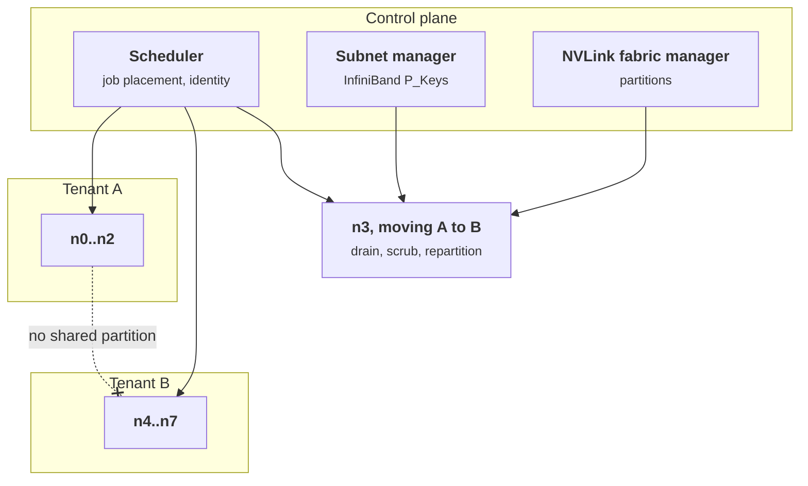
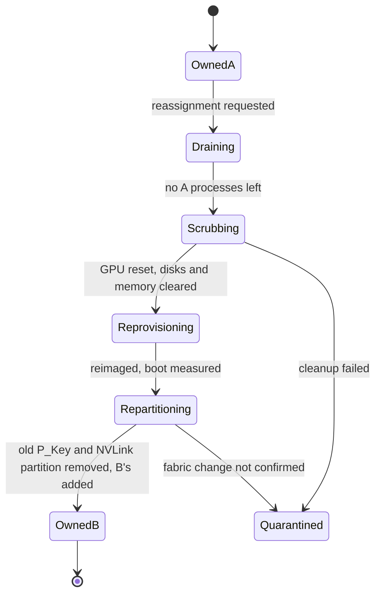

+++
title = 'Schedulers and fabrics'
description = 'Training clusters inherit trust assumptions from HPC: shared cluster keys, RDMA that bypasses host firewalls, and collective libraries that trust every peer. Tenant boundaries live in the scheduler, the fabric partitions, and the order of steps when a node changes hands.'
question = 'How are tenants separated on a shared training cluster, and what has to change when a node moves between them?'
weight = 2
difficulty = 4
prerequisites = ['/notes/infrastructure-security/securing-gpu-clusters/01-multi-tenant-gpu-isolation', '/notes/infrastructure-security/isolation/04-network-segmentation-and-zero-trust']
date = 2026-10-30T06:10:00Z
lastmod = 2026-10-30T06:10:00Z
verified = 2026-10-30
+++

## The idea in one minute

A training cluster is three systems that must agree about who owns each node:

- **The scheduler** (Slurm, Kubernetes with a batch scheduler, or Ray) decides
  which jobs run where and with whose identity.
- **The fabric** (InfiniBand or RDMA over Ethernet) carries GPU-to-GPU traffic
  directly between network adapters, bypassing the host kernel and therefore
  the host firewall and Kubernetes NetworkPolicy. Isolation on it comes from
  **partitions** programmed into adapters and switches.
- **The NVLink domain**, which on rack-scale systems spans many servers and has
  its own partitioning.

Collective libraries such as NCCL assume the fabric is trusted. So a tenant
boundary on a shared cluster is only as good as the weakest of the three, and
the dangerous moment is when a node changes hands: the scheduler updates
instantly, while the fabric and the cleanup steps lag. **Make reassignment an
ordered procedure whose last step is admitting the new tenant.**

## A picture



## How it really works

### Slurm: the cluster shares one secret

Slurm's controller (`slurmctld`) and node daemons (`slurmd`) authenticate
requests with MUNGE by default. MUNGE credentials are created and verified with
a single key shared by every host in the cluster. Anyone who can read that key,
which includes root on any node, can mint credentials for any user. Root on one
compute node is therefore close to control of the cluster. Keep the key off
login nodes where possible, and treat every node's root as cluster-critical.

Jobs run as the submitting Unix user. On shared nodes, isolation between jobs
is cgroups (`task/cgroup` constrains CPUs, memory, and GPUs to the job's
allocation) and file permissions. For tenants that must not share nodes:

- allocate whole nodes (`--exclusive`, or partitions configured without
  oversubscription);
- restrict interactive access with `pam_slurm_adopt`, which admits an SSH
  session to a compute node only if the user has a job there and places the
  session in that job's cgroup;
- use **prolog and epilog** scripts to prepare and clean nodes: reset GPUs,
  clear `/tmp`, `/dev/shm`, and local NVMe, and verify the node before it
  returns to service. A node whose epilog fails should be drained, not reused.

### Kubernetes and Ray

On Kubernetes, batch schedulers such as Kueue and Volcano manage quotas and
gang scheduling, but placement is enforced by the ordinary mechanisms: tenant
namespaces, node pools labeled and tainted per tenant, and admission policy that
forces each tenant's pods onto its pools. A `nodeSelector` written by the pod's
author is a request, not a boundary; the admission policy is what makes it one
([the Kubernetes security model](/notes/infrastructure-security/isolation/02-the-kubernetes-security-model/)).
The capacity side of the same decisions (quotas, gang scheduling, preemption)
is covered in [GPU scheduling](/notes/systems-design/ai-infrastructure/04-gpu-scheduling/).

Ray is a common layer on top of either. Its documentation states that Ray
assumes it runs in a trusted network and that anyone who can reach the cluster's
dashboard or job API can run code on it. The ShadowRay campaign (2024) found
exposed clusters doing exactly that. Bind Ray's ports to private addresses,
put an authenticating proxy in front of the dashboard, and give each tenant its
own Ray cluster.

### RDMA bypasses the host network stack

Distributed training moves gradients and activations with RDMA: the network
adapter reads and writes GPU or host memory directly, with GPUDirect RDMA
taking the CPU out of the path entirely. That traffic never passes through the
host kernel's network stack, so iptables rules, Kubernetes NetworkPolicy, and
service mesh sidecars do not see it. Segmentation that only exists in those
layers does not segment the training fabric.

On **InfiniBand**, the boundary is the **partition**. Each port carries a
table of 16-bit partition keys (P_Keys), programmed by the subnet manager
(OpenSM or a vendor manager such as NVIDIA UFM). Two ports can communicate only
if they share a P_Key. The high bit marks membership: **full** members can talk
to all members; **limited** members can talk only to full members, which suits
shared services such as storage. Adapters enforce partitions on every packet,
and switches can enforce them at their ports as well. The subnet manager's own
authority is protected with a management key (M_Key), so that a host cannot
reprogram the fabric by sending its own management packets. In Kubernetes, SR-IOV
virtual functions with an assigned P_Key give each pod its own partition
membership.

On **RoCE** (RDMA over Converged Ethernet), the boundary is Ethernet
segmentation in the switches: VLANs, VRFs, or VXLAN, with the same caveat that
the host firewall is not in the path.

### Collective libraries trust their peers

NCCL bootstraps a job by exchanging connection information over TCP and then
moves data over the fastest transport available. It does not authenticate peers
or encrypt traffic; it assumes every endpoint that joined the communicator
belongs to the job. A node that remains in another tenant's partition can
therefore see, and potentially inject into, that tenant's collective traffic.
Partitioning is not hygiene; it is the only isolation that path has.

### NVLink domains

Inside an 8-GPU HGX server, NVLink and NVSwitch connect the GPUs of one machine,
and the simplest policy is one tenant per server. Rack-scale systems such as
GB200 NVL72 extend one NVLink domain across 72 GPUs in 18 compute trays. That
domain can be divided into partitions managed by NVIDIA's fabric management
software, so that trays assigned to different tenants cannot reach each other's
GPUs over NVLink. Partition changes are a control-plane operation with the same
ordering requirements as InfiniBand P_Keys.

### Moving a node between tenants

The failure that matters is not a misconfigured cluster but a correct one in
the middle of a change. The scheduler can mark a node as tenant B's in
milliseconds. The fabric and the cleanup lag behind. The procedure, in order:



Each transition writes a record; the scheduler admits B's job only in state
`OwnedB`. Reimaging with measured boot also catches persistence that tenant A
might have left on the host. Management interfaces (BMC, IPMI, Redfish) belong
on a separate network, because a compromised BMC controls the host through any
reassignment.

## Code

The program models nodes in two rack-scale NVLink domains, their InfiniBand
partition keys, and tenant jobs, and audits four invariants: no node runs two
tenants' jobs, no NVLink partition spans tenants, every node's partition
membership matches its owner, and every node has a cleanup record. It then
reassigns one node the fast way, and finally does it properly.

```python {title="placement_check.py"}
"""placement_check.py: audit a GPU cluster's tenant boundaries across nodes, NVLink, and InfiniBand.

The model: nodes belong to NVLink domains and carry InfiniBand partition keys
(P_Keys) programmed by the subnet manager. Jobs are placed on nodes. The audit
checks four invariants after a node has moved from tenant A to tenant B:
no node runs two tenants' jobs, no NVLink partition spans tenants, every node's
partition membership matches its current owner, and every node returned to the
pool passed its cleanup step. The cluster is invented.
"""
from __future__ import annotations

from dataclasses import dataclass, field


@dataclass
class Node:
    name: str
    nvl_domain: str
    owner: str | None
    pkeys: set[str] = field(default_factory=set)        # full-membership partitions
    nvl_partition: str = "p0"                           # NVLink partition inside the domain
    scrubbed_after_last_job: bool = True


@dataclass(frozen=True)
class Job:
    tenant: str
    nodes: tuple[str, ...]


TENANT_PKEY = {"A": "0x8001", "B": "0x8002"}


def audit(nodes: dict[str, Node], jobs: list[Job]) -> list[str]:
    findings: list[str] = []
    tenants_on: dict[str, set[str]] = {}
    for j in jobs:
        for n in j.nodes:
            tenants_on.setdefault(n, set()).add(j.tenant)
    for n, ts in sorted(tenants_on.items()):
        if len(ts) > 1:
            findings.append(f"node {n}: jobs from {sorted(ts)} share one node")
        if nodes[n].owner not in ts:
            findings.append(f"node {n}: owned by {nodes[n].owner} but runs {sorted(ts)}")

    owners_in_partition: dict[str, set[str]] = {}
    for node in nodes.values():
        if node.owner:
            key = f"{node.nvl_domain}/{node.nvl_partition}"
            owners_in_partition.setdefault(key, set()).add(node.owner)
    for part, owners in sorted(owners_in_partition.items()):
        if len(owners) > 1:
            findings.append(f"NVLink partition {part}: spans tenants {sorted(owners)}")

    for node in sorted(nodes.values(), key=lambda n: n.name):
        expected = {TENANT_PKEY[node.owner]} if node.owner else set()
        stale = node.pkeys - expected
        missing = expected - node.pkeys
        if stale:
            findings.append(f"node {node.name}: still a member of {sorted(stale)} "
                            f"(owner now {node.owner or 'pool'})")
        if missing:
            findings.append(f"node {node.name}: not yet in {sorted(missing)}")
        if not node.scrubbed_after_last_job:
            findings.append(f"node {node.name}: no cleanup record after last job")
    return findings


def cluster() -> tuple[dict[str, Node], list[Job]]:
    nodes = {}
    for i in range(8):
        dom = "nvl-0" if i < 4 else "nvl-1"
        owner = "A" if i < 4 else "B"
        nodes[f"n{i}"] = Node(f"n{i}", dom, owner, {TENANT_PKEY[owner]})
    jobs = [Job("A", ("n0", "n1", "n2")), Job("B", ("n4", "n5", "n6", "n7"))]
    return nodes, jobs


if __name__ == "__main__":
    nodes, jobs = cluster()
    print("baseline:", audit(nodes, jobs) or "no findings")

    # n3 is reassigned from A to B. The scheduler updates ownership and starts
    # B's job, but the fabric step and the cleanup step did not run.
    nodes["n3"].owner = "B"
    nodes["n3"].scrubbed_after_last_job = False
    jobs.append(Job("B", ("n3",)))
    print("after reassigning n3 to B without the fabric and cleanup steps:")
    for f in audit(nodes, jobs):
        print("  -", f)

    # The fix, in order: drain, scrub, move the tray into its own NVLink
    # partition, swap its P_Key, then admit B's job.
    nodes["n3"].scrubbed_after_last_job = True
    nodes["n3"].nvl_partition = "p1"
    nodes["n3"].pkeys = {TENANT_PKEY["B"]}
    print("after cleanup, NVLink repartition, and P_Key swap:", audit(nodes, jobs) or "no findings")
```

Run it with `python3 placement_check.py`:

```text
baseline: no findings
after reassigning n3 to B without the fabric and cleanup steps:
  - NVLink partition nvl-0/p0: spans tenants ['A', 'B']
  - node n3: still a member of ['0x8001'] (owner now B)
  - node n3: not yet in ['0x8002']
  - node n3: no cleanup record after last job
after cleanup, NVLink repartition, and P_Key swap: no findings
```

After the fast reassignment, the scheduler sees nothing wrong: n3 is owned by B
and runs only B's job. The audit finds three problems the scheduler cannot see:
n3 is still a full member of A's InfiniBand partition, it shares an NVLink
partition with A's trays, and it never went through cleanup. Any one of them
lets data cross between tenants.

## Where it breaks

- **An audit is periodic.** It finds the gap after the window has opened. The
  state machine that blocks admission is the control; the audit checks that it
  worked.
- **Fabric state drifts.** Manual changes in the subnet manager or switches,
  firmware updates, and failover to a standby subnet manager can change
  partitions underneath the scheduler. Read partition state from the fabric,
  not from the scheduler's database.
- **Shared services cross partitions by design.** Storage, often a limited
  member of every partition, is reachable by all tenants. Its own access
  control carries the isolation
  ([storage and checkpoints](/notes/infrastructure-security/securing-gpu-clusters/03-storage-and-checkpoints/)).
- **IP over InfiniBand is still IP.** Hosts on a partition can usually reach
  each other over IPoIB as well as RDMA, with no firewall in between unless
  you add one.
- **Sometimes the right answer is one tenant per cluster.** For tenants whose
  models are worth protecting at the levels in
  [securing model weights](/notes/ai-security-engineering/frontier-model-security/01-securing-model-weights/),
  a dedicated cluster with its own subnet manager and scheduler removes the
  shared control plane entirely.
- **The model is small.** Real clusters have many partitions per tenant,
  limited memberships for storage, multiple subnet managers, and NVLink
  partition rules the program does not encode.

## Remember this

- Scheduler, fabric partitions, and NVLink partitions must agree on every node's owner.
- MUNGE uses one cluster-wide key; root on any node is near cluster control.
- RDMA bypasses host firewalls; InfiniBand P_Keys or switch segmentation are the boundary.
- NCCL trusts every peer; partitions are the only isolation its traffic has.
- Reassignment is ordered: drain, scrub, reimage, repartition, then admit.
- Ray and similar APIs on a reachable network mean remote code execution.

## Try it

1. Run `placement_check.py`. Give n3 a limited-membership storage key (for
   example `0x0010`) that every node should carry, and change the audit so
   limited storage membership is allowed while any other stale key is not.
2. Add a check that no job's nodes span two NVLink partitions of different
   owners, and construct a job that violates it.
3. Write the Slurm epilog for a GPU node in your environment. What must it
   verify before the node returns to service, and what happens if it fails?
4. For a cluster you use, find where the InfiniBand or RoCE segmentation is
   configured, and who can change it.

## Check yourself

1. Why does Kubernetes NetworkPolicy not isolate tenants' training traffic?

   
   Training traffic uses RDMA, which the network adapter performs directly
   against memory without passing through the host kernel's network stack.
   NetworkPolicy, iptables, and sidecars sit in that stack and never see it.
   The boundary has to be in the fabric: InfiniBand partitions or Ethernet
   segmentation in the switches.
   

2. What is the difference between full and limited membership of an InfiniBand
   partition?

   
   Full members of a partition can communicate with all members. Limited members
   can communicate only with full members, not with each other. That lets a
   shared service such as storage be a full member reachable by every tenant
   while the tenants, as limited members, cannot reach each other through it.
   

3. Why is root on a single Slurm compute node a cluster-wide risk with the
   default authentication?

   
   MUNGE uses one key shared by every node to create and verify credentials.
   Root on any node can read it and create valid credentials for any user,
   which the controller and other nodes will accept.
   

4. A node is moved from tenant A to tenant B. List the steps in order and say
   why the order matters.

   
   Drain A's jobs; scrub GPUs, memory, and local disks; reimage and verify the
   boot; remove A's partition keys and NVLink partition membership and add B's;
   only then admit B's jobs. Admitting B first would let B's code run while the
   node is still in A's fabric partition, or on a host with A's residue or with
   anything A left behind.
   

## Sources

- SchedMD, [Slurm authentication](https://slurm.schedmd.com/authentication.html), [pam_slurm_adopt](https://slurm.schedmd.com/pam_slurm_adopt.html), [Prolog and Epilog guide](https://slurm.schedmd.com/prolog_epilog.html), and [cgroups guide](https://slurm.schedmd.com/cgroups.html).
- [MUNGE](https://github.com/dun/munge) authentication service.
- InfiniBand Trade Association, [InfiniBand Architecture Specification](https://www.infinibandta.org/ibta-specification/), Volume 1 (partitions, P_Keys, M_Key).
- NVIDIA, [NCCL user guide](https://docs.nvidia.com/deeplearning/nccl/user-guide/docs/index.html).
- NVIDIA, [Fabric Manager user guide](https://docs.nvidia.com/datacenter/tesla/fabric-manager-user-guide/index.html), and [GB200 NVL72](https://www.nvidia.com/en-us/data-center/gb200-nvl72/).
- Ray documentation, [Security](https://docs.ray.io/en/latest/ray-security/index.html).
- Oligo Security, [ShadowRay](https://www.oligo.security/blog/shadowray-attack-ai-workloads-actively-exploited-in-the-wild), March 2024.
- Kubernetes, [Taints and tolerations](https://kubernetes.io/docs/concepts/scheduling-eviction/taint-and-toleration/); [Kueue](https://kueue.sigs.k8s.io/).
