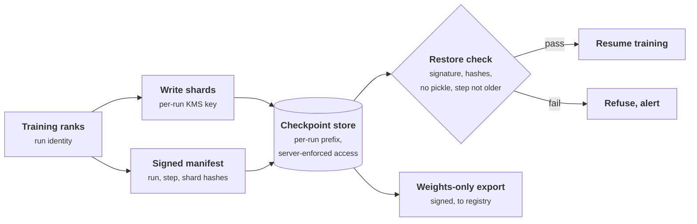

+++
title = 'Storage and checkpoints'
description = 'Checkpoints are terabyte-scale copies of the model plus optimizer state, written to file systems that often trust the client and restored by code that may execute what it loads. Isolate the store, encrypt per run, and verify a signed manifest before every restore.'
question = 'How do you store, protect, and safely restore training checkpoints?'
weight = 3
difficulty = 3
prerequisites = ['/notes/infrastructure-security/securing-gpu-clusters/02-schedulers-and-fabrics', '/notes/infrastructure-security/secrets/03-kms-and-key-hierarchies']
date = 2026-10-30T06:15:00Z
lastmod = 2026-10-30T06:15:00Z
verified = 2026-10-30
+++

## The idea in one minute

A training checkpoint holds the model's weights and the optimizer state needed
to resume: about 14 bytes per parameter with mixed-precision Adam, so roughly a
terabyte for a 70B model. Runs write one every few minutes to hours, to a
parallel file system or object store shared by the whole cluster. That store
holds the most valuable files the organization has, and it often has the
weakest isolation: file systems that trust the user ID a client asserts,
bucket policies and tokens scoped far too widely, and versions that outlive
deletion.

Restore is the second risk. Common checkpoint formats are pickle-based, so
whoever can write to the checkpoint store can run code on every training node
that restores from it.

Four controls: **a per-run namespace the server enforces**, **a per-run
encryption key**, **a signed manifest verified before every restore**
(including a rollback check), and **retention and deletion that reach every
copy**.

## A picture



## How it really works

### The numbers

With bf16 weights, an fp32 master copy, and Adam's two fp32 moment estimates,
a full checkpoint is 2 + 4 + 4 + 4 = 14 bytes per parameter. Gradients are not
usually saved.

| Model | Full checkpoint | Weights only (bf16) |
| --- | --- | --- |
| 8B | 112 GB | 16 GB |
| 70B | 980 GB | 140 GB |
| 405B | 5.67 TB | 810 GB |

Writing 5.67 TB in five minutes needs about 19 GB/s of sustained write
bandwidth, which is why checkpoints go to parallel file systems (Lustre, IBM
Storage Scale, WEKA, VAST, and others) or to object storage through a local
staging tier. Retention multiplies everything: keeping the last five plus a
milestone every 10,000 steps can mean dozens of copies of the model.
[Research and training infrastructure](/notes/ai-security-engineering/frontier-model-security/02-research-and-training-infrastructure/)
explains why each late checkpoint deserves the protection of the final model.

### Parallel file systems trust the client

Most HPC file systems inherited the NFS model: the client's kernel tells the
server which user ID is making a request (AUTH_SYS, in NFS terms), and the
server checks POSIX permissions against that ID. Root squash maps the client's
root to an unprivileged user, but root on a client can still become any other
user locally and present that user's ID. **Root on any client node can read any
user's files** unless the file system authenticates clients more strongly.

The mitigations exist and are often not turned on:

- **Strong client authentication.** NFSv4 with Kerberos (`sec=krb5p` adds
  encryption); Lustre supports Kerberos and a shared-secret-key mode.
- **Per-client mapping and restriction.** Lustre **nodemaps** map or squash
  user IDs per range of client addresses and can restrict a set of clients to
  one subdirectory of the file system, so tenant A's nodes cannot see tenant
  B's tree at all, whatever IDs they claim.
- **Separate file systems or filesets per tenant**, mounted only on that
  tenant's nodes, which follows naturally from the node ownership in the
  [previous lesson](/notes/infrastructure-security/securing-gpu-clusters/02-schedulers-and-fabrics/).

### Object storage: policies, tokens, and versions

Object stores authenticate every request, so the risks move to authorization:

- **Over-broad tokens.** In September 2023, Wiz reported an Azure storage shared
  access signature (SAS) token, published in a Microsoft AI research repository,
  that granted full control of a whole storage account with a far-future
  expiry and exposed 38 TB of data. Scope tokens to one prefix, one operation,
  and hours; prefer identity-based access over bearer tokens
  ([federated workload identity](/notes/infrastructure-security/workload-identity/03-federated-workload-identity/)).
- **Bucket policy and public access.** Turn on account-level public access
  blocks, and alert on policy changes for checkpoint buckets.
- **Replication and versions.** Cross-account replication and object
  versioning make copies that outlive the original. Count them as copies.

### Encrypt per run, and use the key as the off switch

Encrypt each run's checkpoints with its own KMS key, and give decrypt
permission only to that run's training identity and the export pipeline. Bind
the run identifier into the encryption context, so a ciphertext cannot be
decrypted under another run's context
([KMS and key hierarchies](/notes/infrastructure-security/secrets/03-kms-and-key-hierarchies/)).
Node-local NVMe staging should use ephemeral keys that are destroyed when the
node leaves the job.

Per-run keys also make deletion real. Destroying the key renders every copy
encrypted under it unreadable, including versions, replicas, and backups you
forgot. NIST's media sanitization guidance (SP 800-88) recognizes this
**cryptographic erase** as a sanitization method, provided the key really is
destroyed everywhere it existed.

### Restore is code execution

PyTorch's `torch.save` uses Python's pickle format, and many training
frameworks store optimizer state, data loader state, and RNG state that way,
even when the weights themselves are in safetensors. Loading a pickle can run
arbitrary code. `torch.load` defaults to a restricted unpickler since PyTorch
2.6, which narrows the risk without removing the parser
([models and supply chain](/notes/ai-security-engineering/securing-each-stage/03-models-and-supply-chain/)).

That makes write access to the checkpoint store equivalent to code execution on
every node that restores from it, with the run's identity and the run's
access to weights and data. The restore path therefore verifies before it
loads:

```text
before restoring, the trainer checks that
  1  the manifest's signature is from this run's training identity
  2  the manifest names this run
  3  its step is not older than the last step restored   (no rollback)
  4  every shard on disk is in the manifest, with a matching hash, and none is missing
  5  no shard is in a pickle-based format unless loaded with a restricted loader
```

The rollback check matters because an old checkpoint is validly signed. An
attacker who can make a run resume from a checkpoint before a data fix, or
before a safety-relevant change, does not need to forge anything.

### Availability: deletion is an attack too

Checkpoints are also what a ransomware operator or a careless script deletes.
Milestone checkpoints belong in write-once storage (S3 Object Lock or
equivalent), with deletion rights held by a separate administrative account
and a delay before deletion takes effect.

### Export to serving

Serving never mounts the training store. A pipeline exports weights only
(2 bytes per parameter), converts to safetensors, signs the result, and
promotes it to the model registry, where serving pulls by digest. That keeps
the training store's broad internal access from becoming serving's problem, and
the registry's admission policy from depending on training's storage
permissions.

## Code

Part 1 is the sizing table. Part 2 builds a signed manifest for a four-rank
checkpoint and runs the restore checks against six cases: a clean restore, an
edited shard, an added pickle file, an older checkpoint, an edited step number,
and a checkpoint from another run.

```python {title="checkpoint_guard.py"}
"""checkpoint_guard.py: size a training checkpoint, then verify one before restoring it.

Part 1 is arithmetic for mixed-precision Adam checkpoints. Part 2 verifies a
sharded checkpoint against a signed manifest that names the run and the step:
every shard present and matching, no pickle-based shard, the manifest signed by
the trainer identity, and the step not older than the last one restored, which
stops a rollback to an old (possibly poisoned) checkpoint. HMAC stands in for an
asymmetric signature; storage is a dict.
"""
from __future__ import annotations

import hashlib
import hmac
import json

TRAINER_KEY = b"trainer-run42-signing-key"


def part1() -> None:
    # bf16 weights (2) + fp32 master weights (4) + Adam first and second moments (4 + 4)
    per_param = 2 + 4 + 4 + 4
    print("checkpoint size, mixed-precision Adam (14 bytes/param) vs weights only (2 bytes/param)")
    for name, n in (("8B", 8e9), ("70B", 70e9), ("405B", 405e9)):
        full, weights = n * per_param, n * 2
        ranks = 1024
        print(f"  {name:>5}: full {full / 1e12:5.2f} TB, weights {weights / 1e9:6.0f} GB, "
              f"{full / ranks / 1e9:5.2f} GB per rank across {ranks} ranks")


def sha(b: bytes) -> str:
    return hashlib.sha256(b).hexdigest()


def manifest(run: str, step: int, shards: dict[str, bytes]) -> dict:
    body = {"run": run, "step": step, "shards": {k: sha(v) for k, v in sorted(shards.items())}}
    sig = hmac.new(TRAINER_KEY, json.dumps(body, sort_keys=True).encode(), "sha256").hexdigest()
    return {"body": body, "sig": sig}


def verify(m: dict, on_disk: dict[str, bytes], run: str, last_restored_step: int) -> list[str]:
    body = m["body"]
    good = hmac.new(TRAINER_KEY, json.dumps(body, sort_keys=True).encode(), "sha256").hexdigest()
    if not hmac.compare_digest(good, m["sig"]):
        return ["manifest signature invalid"]
    out = []
    if body["run"] != run:
        out.append(f"manifest is for run {body['run']}, not {run}")
    if body["step"] < last_restored_step:
        out.append(f"step {body['step']} is older than last restored step {last_restored_step} (rollback)")
    for name, data in sorted(on_disk.items()):
        if name.endswith((".pt", ".pkl", ".bin")):
            out.append(f"{name}: pickle-based format runs code on load")
        if name not in body["shards"]:
            out.append(f"{name}: not in manifest")
        elif sha(data) != body["shards"][name]:
            out.append(f"{name}: hash mismatch")
    out += [f"{n}: missing" for n in body["shards"] if n not in on_disk]
    return out


def part2() -> None:
    shards = {f"rank{r:02d}.safetensors": f"step-2000-rank-{r}".encode() for r in range(4)}
    old = {f"rank{r:02d}.safetensors": f"step-1000-rank-{r}".encode() for r in range(4)}
    m_new, m_old = manifest("run42", 2000, shards), manifest("run42", 1000, old)

    tampered = dict(shards)
    tampered["rank02.safetensors"] = b"edited"
    swapped = dict(shards)
    swapped["optimizer.pt"] = b"\x80\x04..."
    forged = {"body": {**m_new["body"], "step": 3000}, "sig": m_new["sig"]}

    cases = [
        ("clean restore", m_new, shards, 1500),
        ("one shard edited", m_new, tampered, 1500),
        ("pickle file added", m_new, swapped, 1500),
        ("old checkpoint offered", m_old, old, 1500),
        ("step number edited", forged, shards, 1500),
        ("checkpoint from another run", manifest("run17", 2000, shards), shards, 1500),
    ]
    print("\nrestore checks")
    for label, m, disk, last in cases:
        problems = verify(m, disk, "run42", last)
        print(f"  {label:<28} {'RESTORE' if not problems else 'REFUSE'}")
        for p in problems:
            print(f"    - {p}")


if __name__ == "__main__":
    part1()
    part2()
```

Run it with `python3 checkpoint_guard.py`:

```text
checkpoint size, mixed-precision Adam (14 bytes/param) vs weights only (2 bytes/param)
     8B: full  0.11 TB, weights     16 GB,  0.11 GB per rank across 1024 ranks
    70B: full  0.98 TB, weights    140 GB,  0.96 GB per rank across 1024 ranks
   405B: full  5.67 TB, weights    810 GB,  5.54 GB per rank across 1024 ranks

restore checks
  clean restore                RESTORE
  one shard edited             REFUSE
    - rank02.safetensors: hash mismatch
  pickle file added            REFUSE
    - optimizer.pt: pickle-based format runs code on load
    - optimizer.pt: not in manifest
  old checkpoint offered       REFUSE
    - step 1000 is older than last restored step 1500 (rollback)
  step number edited           REFUSE
    - manifest signature invalid
  checkpoint from another run  REFUSE
    - manifest is for run run17, not run42
```

Every refusal is a different rule. The old checkpoint is refused even though
its signature is valid: only the step comparison catches a rollback. Editing
the step number to make the old checkpoint look new breaks the signature, which
is why the step is inside the signed body.

## Where it breaks

- **HMAC is not a signature.** Anything that can verify here can also sign. Real
  pipelines sign with the run's workload identity through an asymmetric key or
  a keyless signing service, and verifiers hold only public material. The
  program uses one key for every run; the run-name check is what stops the
  cross-run case.
- **The trainer's identity signs whatever the trainer writes.** If an attacker
  controls the training job, its checkpoints carry valid signatures. Signing
  proves origin, not good training.
- **The last restored step must itself be protected.** If an attacker can reset
  the stored "last restored step", the rollback check is gone. Keep it with the
  run's control-plane state, not in the checkpoint store.
- **Sharded formats complicate manifests.** Distributed checkpoint formats write
  many files per rank and reshard on load. The manifest must cover every file,
  including metadata, and verification must finish before any rank loads.
- **Direct storage paths skip host controls.** GPUDirect Storage moves data
  between storage and GPU memory without the CPU copying it. Access control
  still has to be enforced by the storage system, not by the host.

## Remember this

- A full checkpoint is about 14 bytes per parameter: roughly 1 TB for 70B.
- Client-trusting file systems give root on any node every user's files; use
  Kerberos or nodemaps.
- Scope storage tokens narrowly and count versions and replicas as copies.
- Per-run keys make deletion real through cryptographic erase.
- Write access to the checkpoint store is code execution on restore.
- Verify a signed manifest, including run and step, before any rank loads.

## Try it

1. Run `checkpoint_guard.py`. Add a case where `rank03.safetensors` is deleted
   and the remaining shards are untouched. Which rule refuses it?
2. Change the program so each run has its own signing key, and confirm the
   cross-run case now fails on the signature.
3. Compute the sustained write bandwidth needed to checkpoint a 405B model
   every 30 minutes with no more than 5% of training time spent writing.
4. For a training run you know, list every place its checkpoints exist,
   including versions and replicas. Which identity could delete all of them?

## Check yourself

1. Why can root on one client node of a typical parallel file system read other
   users' checkpoints?

   
   With AUTH_SYS-style security, the server trusts the user ID the client
   asserts. Root on the client can act as any user locally and present that
   user's ID, so the server's permission checks pass. Strong client
   authentication (Kerberos) or per-client mapping and subdirectory
   restriction (Lustre nodemaps) are needed to stop it.
   

2. Why is write access to the checkpoint store equivalent to code execution?

   
   Many checkpoint files, including the default `torch.save` output for
   optimizer and training state, are pickle-based, and loading a pickle can
   execute code. Every rank that restores runs whatever was written, with the
   run's identity. Verifying a signed manifest before loading, and using
   non-executable formats, closes that path.
   

3. What does the rollback check stop that the signature check does not?

   
   Resuming from an old checkpoint that was legitimately signed. An attacker
   who can choose which checkpoint a run restores can roll it back to before a
   fix, without forging anything. Comparing the manifest's signed step with
   the last restored step refuses that.
   

4. How do per-run encryption keys help with deletion?

   
   Destroying the run's key makes every copy encrypted under it unreadable,
   including object versions, replicas, and backups that would otherwise
   survive deletion. This is cryptographic erase; it works only if the key is
   destroyed everywhere it existed.
   

## Sources

- PyTorch, [Serialization semantics](https://pytorch.org/docs/stable/notes/serialization.html) and [torch.load](https://pytorch.org/docs/stable/generated/torch.load.html) (`weights_only` default since 2.6).
- PyTorch, [Distributed Checkpoint](https://pytorch.org/docs/stable/distributed.checkpoint.html).
- Hugging Face, [safetensors](https://github.com/huggingface/safetensors).
- Lustre, [Lustre Operations Manual](https://doc.lustre.org/lustre_manual.xhtml) (nodemaps, Kerberos, shared-secret key).
- Haynes and Noveck, [RFC 7530: Network File System (NFS) Version 4 Protocol](https://www.rfc-editor.org/rfc/rfc7530), March 2015.
- Wiz Research, [38TB of data accidentally exposed by Microsoft AI researchers](https://www.wiz.io/blog/38-terabytes-of-private-data-accidentally-exposed-by-microsoft-ai-researchers), September 2023.
- Amazon Web Services, [S3 Object Lock](https://docs.aws.amazon.com/AmazonS3/latest/userguide/object-lock.html) and [Blocking public access to your Amazon S3 storage](https://docs.aws.amazon.com/AmazonS3/latest/userguide/access-control-block-public-access.html).
- NIST, [SP 800-88: Guidelines for Media Sanitization](https://csrc.nist.gov/pubs/sp/800/88/r1/final) (cryptographic erase).
- NVIDIA, [GPUDirect Storage](https://docs.nvidia.com/gpudirect-storage/index.html).
