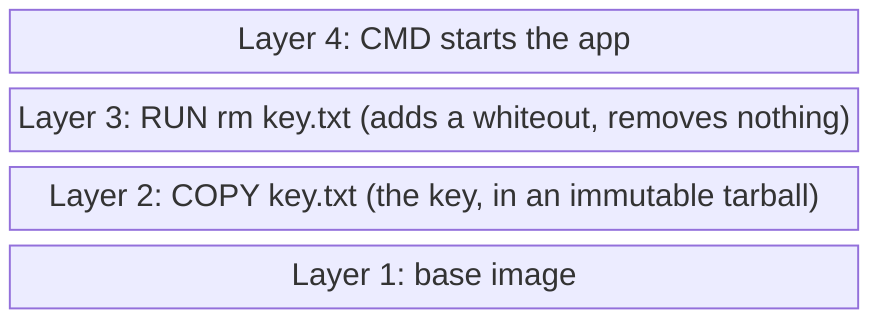
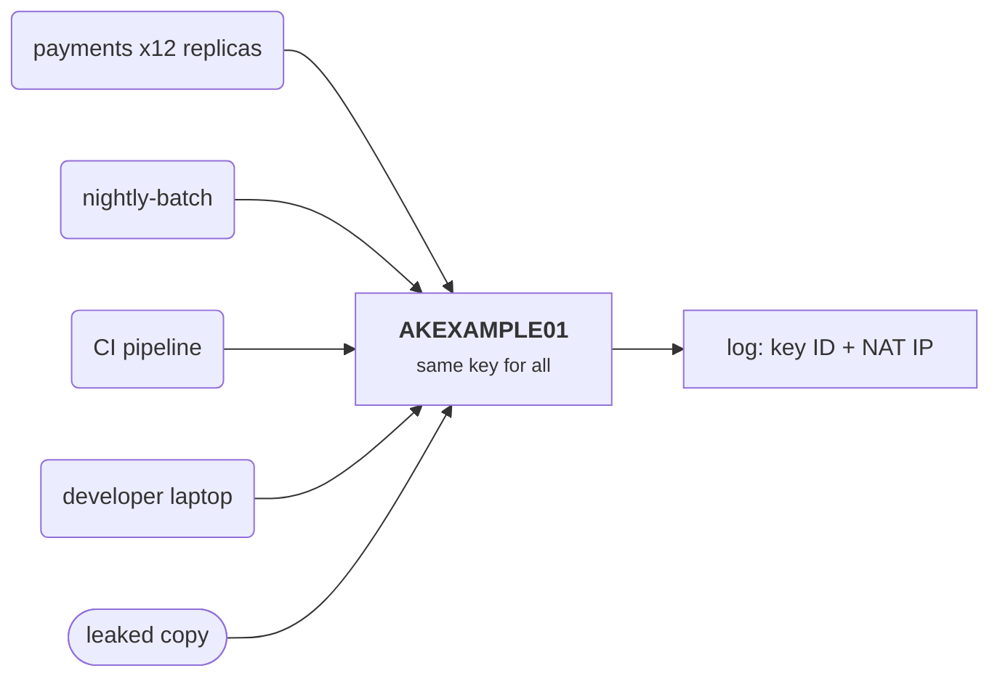

+++
title = 'Why static credentials fail'
description = 'A long-lived key is a password that anyone who copies it can use, from anywhere, until someone notices. Short-lived credentials issued to an attested workload bound that damage to minutes.'
question = 'What is actually wrong with putting an API key in an environment variable?'
weight = 1
difficulty = 1
prerequisites = ['/notes/infrastructure-security/foundations/03-cloud-iam-fundamentals']
date = 2026-07-02
lastmod = 2026-07-02
verified = 2026-07-02
+++

## The idea in one minute

A **static credential** is a secret string that grants access by itself: a
cloud access key, a database password, an API token with no expiry. Whoever
presents it is treated as the workload it was issued to. That makes it a
bearer instrument, like cash. Copying it is the same as stealing it, and
nothing in the credential records who copied it, where it went, or when it
should stop working.

Static credentials leak through ordinary engineering: a commit, a container
image layer, a debug log, a crash report, a CI variable printed by a script.
Once leaked, the key works until a human notices and rotates it, which can
take hours, months, or never. The audit log cannot help much, because every
holder of the key looks identical.

The fix is not a better hiding place for the key. It is a different kind of
credential: **short-lived, issued at run time to a workload the platform has
identified, and scoped to one job.** A copied token expires in minutes. The
consequence to act on: treat every long-lived secret in a running workload as
a liability with an unbounded exposure window, and plan to replace it with an
identity the platform issues.

## A picture

```mermaid {title="Where a static key travels, and where a short-lived token comes from"}
flowchart LR
  K["<b>Static key</b><br/><small>created once, never expires</small>"] --> R["<b>Repo / .env</b>"]
  K --> I["<b>Image layer</b>"]
  K --> V["<b>CI variable</b>"]
  K --> P["<b>Pod env</b>"]
  P --> L["<b>Logs, crash dumps</b>"]
  R --> A["<b>Attacker</b><br/><small>works from anywhere,<br/>until rotated</small>"]
  I --> A
  L --> A
  PL["<b>Platform</b><br/><small>knows which workload runs where</small>"] --> T["<b>15-minute token</b><br/><small>fetched at run time</small>"]
  T --> W["<b>Workload</b>"]
  class K,R,I,V,P,L warn
  class A warn
  class PL good
  class T good
  class W compute
```

The left side is a secret that spreads by copying. The right side is a
credential that is created where it is used and dies on its own.

## How it really works

### What a static credential is

A static credential has three properties that together cause the trouble:

1. **It authenticates by possession alone.** The server checks that the string
   is valid. It does not check which machine, process, or person sent it.
2. **It has no built-in expiry.** An AWS access key for an IAM user, a
   PostgreSQL password, or a legacy Kubernetes service account token stored in
   a Secret stays valid until someone deletes or changes it.
3. **It is shared.** The same value is used by every replica of a service, by
   the batch job that shares its role, by the developer who copied it to test
   locally, and by the CI system that deploys it.

Each property on its own is manageable. Together they mean that the number of
places the key exists only grows, each copy is as powerful as the original,
and nothing stops a copy from being used long after its legitimate purpose
ended.

### How keys leak in practice

None of these require an attacker to break anything. They are side effects of
normal work.

The map below groups the usual leak paths by where the copy lands.

```mermaid {title="Six places a static key ends up without anyone attacking"}
mindmap
  root((Static key))
    Source control
      .env or test fixture
      History keeps every version
    Container images
      ENV or build argument
      Deleted file still in a layer
    Environment variables
      Inherited by child processes
      Readable in proc environ
      Copied into crash reports
    Logs
      Config printed at debug
      HTTP headers logged
    CI and CD
      Any job or action can read it
      One echo prints it
    Laptops and chat
      Copied to test locally
```

| Where it ends up | How it gets there | Why it persists |
| --- | --- | --- |
| **Source control** | A `.env` file, a test fixture, a config default committed "temporarily" | Git history keeps every version. Deleting the file in a later commit leaves the key in the earlier one, in every clone, and in forks. |
| **Container images** | `ENV API_KEY=...` in a Dockerfile, a build argument, a file copied in and deleted later | Each layer is an immutable tarball. A file deleted in a later layer is still present in the earlier one, and build arguments can appear in the image history. Images are pushed to registries and cached on every node that pulls them. |
| **Environment variables** | Injected at deploy time, read by the app | They are inherited by every child process, readable at `/proc/<pid>/environ` by processes running as the same user, shown by orchestration tools that print the pod or task spec, and often included in crash reports and error-tracking payloads. |
| **Logs** | A debug line that prints the config, an HTTP client that logs headers, an exception that includes the connection string | Logs are shipped to systems with broad read access and long retention. |
| **CI/CD** | Secrets stored as pipeline variables and used by build scripts | Any job, script, or third-party action that runs in that pipeline can read them, and a single `echo` or `set -x` can print them. |
| **Laptops and chat** | Copied to test locally, pasted to a colleague | Outside every control the platform has. |

The image row deserves a picture: deleting a file in a later layer hides it
from the running container but not from anyone who unpacks the image.



Docker's own documentation warns against putting secrets in build arguments or
environment variables and provides secret mounts for builds instead. Source
control hosts scan pushes for known key formats, and that catches many
leaks, but it detects; it does not shorten the life of a key already copied.
Detection and scanning are covered in
[Secret sprawl and detection](/notes/infrastructure-security/secrets/04-secret-sprawl-and-detection/).

### No attribution

Suppose your cloud audit log shows a call to download a sensitive bucket, made
with the access key used by the payments service. Who made it?

With a static key, the honest answer is "one of the holders." That set
includes every replica of payments, any other workload that was given the
same key, every CI pipeline that deploys it, every developer who copied it, and
anyone who found a leaked copy. The log entry carries the key ID and a source
IP address. The IP address may be a NAT gateway shared by the whole cluster,
and an attacker can usually route through something that looks normal.

Every holder on the left produces the same audit log line on the right.



Compare a short-lived token issued to one pod. Its claims say which workload
it was issued to, when, and under which identity. A token ID (`jti`) or session
name identifies the issuance. If that token appears in an unexpected place,
you know which pod's credential leaked and the few minutes during which it was
taken. Incident response goes from "rotate everything and hope" to "look at
pod `payments-7f9c-x2` between 04:00 and 04:15."

### No expiry, and rotation that does not happen

The standard mitigation for static keys is rotation: generate a new key,
deploy it everywhere, delete the old one. In practice rotation is expensive
because the key is in many places, some of which nobody remembers. Every copy
has to be updated before the old key is deleted, or something breaks. So
rotation is postponed, done on a long schedule, or skipped for keys that
"nobody dares touch."

Even a disciplined 90-day rotation means a key leaked on day one is valid for
up to 89 more days. The window between a leak and revocation is set by your
**detection** speed, not by anything in the credential. For a key in an image
layer that nobody is scanning, that window has no upper bound.

Plotted against a calendar, a day-one leak under a 90-day schedule looks like
this; the red bars are the time the copy still works.

```mermaid {title="Rotation bounds the window at 89 days, detection may never bound it"}
gantt
  dateFormat YYYY-MM-DD
  axisFormat %b %d
  section 90-day rotation
  Key v1 valid             :k1, 2026-01-01, 90d
  Key v1 leaked            :milestone, m1, 2026-01-02, 0d
  Copy of v1 works         :crit, a1, 2026-01-02, 89d
  Key v2 valid             :k2, after k1, 90d
  section Image-layer key nobody scans
  Copy works, no end date  :crit, a2, 2026-01-02, 179d
```

> [!IMPORTANT]
> A static credential's exposure window is the time from the leak until someone
> notices and revokes it. A short-lived credential's window is at most its
> lifetime. The first depends on people; the second is a configuration value.

### Copying is theft

Physical keys can be counted. Digital secrets cannot: reading a file is
copying it, and the original stays in place. When an attacker reads a key from
an environment variable, nothing changes for the legitimate service, so no
alarm fires. The attacker can now use the key **from anywhere**: their own
machine, another cloud account, a different region. Unless the resource checks
something the attacker cannot reproduce (the source network, a client
certificate, a device), possession is the whole test.

That is why some cloud providers let you attach network conditions to
long-lived keys, and why proof-of-possession schemes bind a token to a private
key the attacker does not have. Both are useful. Neither fixes the root
problem that the secret was created once, for a long time, and handed to
software that copies data for a living.

### The shift to short-lived credentials

The alternative design inverts the flow. Instead of placing a secret in the
workload ahead of time, the workload **asks for a credential when it starts**,
and the platform decides whether to issue one based on facts it can check
itself:

- On a cloud VM, the instance metadata service hands the process temporary
  credentials for the role attached to the instance. On AWS these come from
  STS, carry a session token, and expire; the SDKs refresh them automatically.
- In Kubernetes, the kubelet mounts a **projected service account token**: a
  signed JWT that names the pod's service account, carries an audience, and
  expires (one hour by default when requested through a projected volume). The
  kubelet refreshes it before expiry. Since Kubernetes 1.24 the control plane
  no longer auto-creates the older non-expiring service account token Secrets.
- In a CI system such as GitHub Actions, a job can request an OIDC token that
  names the repository, branch, and environment, valid for minutes.
- With SPIFFE and SPIRE, an agent on each node identifies the calling process
  and issues it a short-lived certificate or JWT.

Each of these credentials is **derived** from something the platform already
knows: which machine this is, which pod, which job. The workload never holds a
long-lived secret. The next three lessons cover these mechanisms in depth:
[attestation and SPIFFE](/notes/infrastructure-security/workload-identity/02-attestation-and-spiffe/),
[federated workload identity](/notes/infrastructure-security/workload-identity/03-federated-workload-identity/),
and [mutual TLS between services](/notes/infrastructure-security/workload-identity/04-mutual-tls-between-services/).

| Property | Static key | Short-lived workload credential |
| --- | --- | --- |
| Created | Once, by a person or script | On demand, by the platform, at run time |
| Lifetime | Until revoked | Minutes to hours, set in configuration |
| Stored in | Repos, images, env vars, CI | Memory or a tmpfs mount on one workload |
| Shared by | Every holder | One workload instance |
| Attribution | Key ID only | Workload, instance, issuance time |
| Leak response | Find and replace every copy | Wait for expiry, or revoke one session |
| Rotation | Manual, often skipped | Automatic, continuous |

### What "short" should mean

Shorter is not free. Each refresh is a call to an issuer that must be
available, and a credential that expires mid-request causes errors. Common
choices are tens of minutes to a few hours for tokens, and hours to a day for
workload certificates. AWS STS lets you pick a role session duration from 15
minutes up to the role's configured maximum, with one hour as the default.

The rule that keeps short lifetimes safe in operation: **refresh well before
expiry**. The Kubernetes kubelet refreshes a projected token once 80 percent of
its lifetime has passed (or after 24 hours). SDKs refresh cloud credentials a
few minutes before they expire. If the issuer is down briefly, the workload is
still holding a valid credential.

Follow one projected token through a refresh: the new token arrives while the
old one still has a fifth of its life left.

```mermaid {title="The kubelet refreshes at 80 percent, so an issuer blip costs nothing"}
sequenceDiagram
  autonumber
  participant K as kubelet
  participant API as API server
  participant P as Pod
  K->>API: TokenRequest for the pod's service account, 1h
  API-->>K: signed JWT, exp T+60m
  K->>P: write token to the projected volume
  Note over K,P: 80 percent of the lifetime passes (T+48m)
  K->>API: TokenRequest again
  API-->>K: new JWT, exp T+108m
  K->>P: replace the file
  Note over P: if the API server had been down at T+48m, the old token still had 12 minutes
```

## Code

The program below runs a simulated timeline. A workload holds either one
static key or a series of 15-minute tokens refreshed every 10 minutes. Four
leaks happen. For each, the attacker obtains whatever credential was copied
and tries it at fixed offsets. The detection delays for the static key are
**assumptions** typed into the scenario, not measurements; change them and
watch the static key's exposure change while the token's does not.

```python {title="exposure.py"}
"""exposure.py: a leaked static key versus a leaked 15-minute token.

An attacker obtains whatever credential the workload holds at the moment of a
leak and tries it at fixed offsets afterward. Standard library only; offline.
All times are simulated minutes; nothing touches a real cloud.
"""

from __future__ import annotations

from dataclasses import dataclass

MIN, HOUR, DAY = 1, 60, 24 * 60
TOKEN_TTL = 15 * MIN       # lifetime of each workload token
REFRESH_EVERY = 10 * MIN   # the workload fetches a new token before the old one expires
ATTEMPTS = [1 * MIN, 10 * MIN, 1 * HOUR, 1 * DAY, 30 * DAY, 180 * DAY]


@dataclass
class Leak:
    vector: str
    copied: int              # minute the credential is written somewhere it should not be
    at: int                  # minute the attacker obtains that copy
    detected_after: int | None  # assumption: minutes from copy to revocation (None = never)
    foothold: int = 0        # how long the attacker keeps code execution in the workload


@dataclass
class Credential:
    kind: str
    issued: int
    expires: int | None      # None = valid until someone revokes it

    def valid_at(self, t: int, revoked_at: int | None) -> bool:
        if revoked_at is not None and t >= revoked_at:
            return False
        return self.expires is None or t < self.expires


def static_key() -> Credential:
    return Credential("static key", issued=-400 * DAY, expires=None)


def token_held_at(t: int) -> Credential:
    """The newest token the workload holds at minute t."""
    issued = (t // REFRESH_EVERY) * REFRESH_EVERY
    return Credential("token", issued=issued, expires=issued + TOKEN_TTL)


def exposure(leak: Leak, kind: str) -> int | None:
    """Minutes during which the attacker can act; None means unbounded."""
    if kind == "static key":
        if leak.detected_after is None:
            return None
        return max(0, leak.copied + leak.detected_after - leak.at)
    # A token: a copy dies at expiry, but a live foothold can keep fetching new ones.
    copy_left = max(0, token_held_at(leak.copied).expires - leak.at)
    return max(copy_left, leak.foothold)


def fmt(minutes: int | None) -> str:
    if minutes is None:
        return "unbounded"
    for unit, size in (("d", DAY), ("h", HOUR)):
        if minutes >= size and minutes % size == 0:
            return f"{minutes // size}{unit}"
    return f"{minutes}m"


def attempt_log(leak: Leak) -> None:
    key, tok = static_key(), token_held_at(leak.copied)
    revoked = None if leak.detected_after is None else leak.copied + leak.detected_after
    print(f"leak via {leak.vector} at minute {leak.at}; the copied token expires at minute {tok.expires}")
    print(f"  {'attacker tries at':<20}{'static key':<14}token copy")
    for offset in ATTEMPTS:
        t = leak.at + offset
        k = "works" if key.valid_at(t, revoked) else "rejected"
        c = "works" if tok.valid_at(t, None) else "rejected"
        print(f"  {'+' + fmt(offset):<20}{k:<14}{c}")


def attribution() -> None:
    print("\nwhat the audit log can say about a call made with each credential")
    shared_by = ["payments-7f9c (x12 replicas)", "nightly-batch", "a laptop .env", "CI secret"]
    print(f"  static key AKEXAMPLE01: one of {len(shared_by)} holders: {', '.join(shared_by)}")
    tok = token_held_at(4 * HOUR + 3)
    print(f"  token jti=tok-{tok.issued}: issued to pod payments-7f9c-x2 "
          f"at minute {tok.issued}, valid until minute {tok.expires}")


if __name__ == "__main__":
    leaks = [
        Leak("git commit", copied=3 * DAY + 7, at=3 * DAY + 9, detected_after=2 * HOUR),
        Leak("image layer", copied=2 * DAY, at=10 * DAY + 4, detected_after=None),
        Leak("debug log", copied=20 * DAY + 13, at=20 * DAY + 13, detected_after=14 * DAY),
        Leak("RCE in the pod", copied=30 * DAY + 1, at=30 * DAY + 1,
             detected_after=3 * DAY, foothold=3 * DAY),
    ]
    attempt_log(leaks[2])
    print(f"\n{'vector':<16}{'static key exposure':<22}token exposure")
    for leak in leaks:
        print(f"{leak.vector:<16}{fmt(exposure(leak, 'static key')):<22}"
              f"{fmt(exposure(leak, 'token'))}")
    attribution()
```

Run it with `python3 exposure.py`:

```text
leak via debug log at minute 28813; the copied token expires at minute 28825
  attacker tries at   static key    token copy
  +1m                 works         works
  +10m                works         works
  +1h                 works         rejected
  +1d                 works         rejected
  +30d                rejected      rejected
  +180d               rejected      rejected

vector          static key exposure   token exposure
git commit      118m                  6m
image layer     unbounded             0m
debug log       14d                   12m
RCE in the pod  3d                    3d

what the audit log can say about a call made with each credential
  static key AKEXAMPLE01: one of 4 holders: payments-7f9c (x12 replicas), nightly-batch, a laptop .env, CI secret
  token jti=tok-240: issued to pod payments-7f9c-x2 at minute 240, valid until minute 255
```

Read the table row by row:

- **Git commit.** The key is revoked two hours after the commit because secret
  scanning flagged it; the attacker found it two minutes in and had nearly two
  hours. A token in the same commit had six minutes left.
- **Image layer.** The image was built on day 2 and pulled by the attacker on
  day 10. A token baked in at build time was dead long before anyone pulled the
  image, which is the strongest argument for fetching credentials at run time.
  The static key in that layer has no expiry and nobody is looking for it.
- **Debug log.** A key printed to a log is valid until someone reads the log
  and acts, two weeks in this scenario. The token died in 12 minutes.
- **Remote code execution.** The last row is the honest one. An attacker
  running code inside the pod does not need to copy a token. They can ask for
  a fresh one every ten minutes, just like the workload does. Exposure equals
  the length of the foothold for **both** designs.

The same table as bars, in hours. The image-layer row is left out because the
static key's bar would have no top; the token bars are too short to see except
for RCE, where both designs tie.

```mermaid {title="Exposure in hours from exposure.py: tokens vanish, except under RCE"}
xychart-beta
  x-axis ["commit key", "commit token", "log key", "log token", "RCE key", "RCE token"]
  y-axis "Hours the attacker can act" 0 --> 340
  bar [1.97, 0.1, 336, 0.2, 72, 72]
```

The attribution lines show the second benefit. A call made with the static key
could have come from any of four places. A call made with the token traces to
one pod and one 15-minute window.

## Where it breaks

- **Short-lived does not stop a live attacker.** As the RCE row shows, code
  running in the workload can request new credentials as often as the workload
  can. Short lifetimes defeat copied credentials, not compromised processes.
  Containment of a compromised workload is about scope (what the identity is
  allowed to do), isolation, and detection, covered later in this course.
- **The refresh path becomes the target.** If any process on a VM can reach the
  metadata service, then an SSRF bug in a web app can make the app fetch its
  own role credentials and return them to the attacker. AWS's IMDSv2 requires
  a session token obtained with a PUT request and limits the response hop
  count, which blocks many of these request-forgery paths. The token is short
  lived, but the attacker can fetch it repeatedly while the bug is open.
- **Bootstrapping still needs a root of trust.** "The platform issues a
  credential" moves the question to how the platform knows which workload is
  asking. That is attestation, and if it is weak (for example, any pod can
  claim any identity), short-lived credentials are issued to the wrong party
  very efficiently.
- **Some systems only accept static secrets.** Third-party SaaS APIs, older
  databases, and appliances may support nothing but a fixed key or password.
  For those, the best available pattern is a broker that holds the secret and
  issues short-lived leases or proxies the call, as covered in
  [Vaults and dynamic secrets](/notes/infrastructure-security/secrets/02-vaults-and-dynamic-secrets/).
- **The simulation is generous to the static key.** It assumes revocation
  happens at detection. In real incidents, revocation waits for someone to
  find every legitimate user of the key so that rotating it does not cause an
  outage.

The refresh-path failure, drawn: the attacker never touches the metadata
service, the vulnerable app does it for them.

```mermaid {title="SSRF turns the app into a courier for its own role credentials"}
flowchart LR
  ATT(["Attacker"])
  APP("Web app with SSRF bug")
  X@{ shape: diam, label: "IMDS version?" }
  IMDS("Instance metadata")
  STOP["<b>Blocked</b><br/><small>no PUT session token, hop limit</small>"]
  ATT -- "fetch this URL for me" --> APP
  APP --> X
  X -- "v1: plain GET" --> IMDS
  X -- "v2" --> STOP
  IMDS -- "temporary role keys" --> APP
  APP -- "keys in the response" --> ATT
  class X neutral
  class STOP good
```

## Remember this

- A static credential authenticates by possession alone, never expires, and is
  shared by every holder.
- Copying is theft: reading a secret leaves the original in place and raises no
  alarm.
- A static key's exposure window is set by detection speed; a short-lived
  token's is set by its lifetime.
- Short-lived credentials should be fetched at run time from the platform,
  never baked into images or repositories.
- Short lifetimes defeat copied credentials, not an attacker with code
  execution inside the workload.
- Per-issuance credentials give attribution: which instance, which window.

## Try it

1. Run `exposure.py`. Change `TOKEN_TTL` to 12 hours and `REFRESH_EVERY` to 8
   hours. Which rows change, and what does that tell you about "short-lived"
   tokens with long lifetimes?
2. Add a leak vector "CI log" where the key is printed during a deploy and
   detected after 45 days. Add one for a token printed in the same log.
3. Give the static key a 90-day rotation schedule in the model: revocation
   happens at the earlier of detection and the next rotation. How much does it
   help the "image layer" row?
4. List every place a real static credential in a system you know is stored.
   Include laptops, CI variables, and image registries. Count the holders.
5. Read the environment of a running container you own
   (`cat /proc/1/environ | tr '\0' '\n'` from inside it). What credentials do
   you see?

## Check yourself

1. Name the three properties of a static credential that make leaks severe.

   
   It authenticates by possession alone, so the server does not check who
   presents it. It has no built-in expiry, so it works until revoked. It is
   shared, so every copy is as powerful as the original and the audit log
   cannot tell holders apart.
   

2. A developer deletes a committed `.env` file in the next commit. Is the key
   safe?

   
   No. Git history still contains the earlier commit, and so does every clone
   and fork made in between. The only fix is to revoke the key and issue a new
   one; rewriting history helps hygiene but does not recall copies that already
   exist.
   

3. Why does a token baked into a container image at build time do almost no
   harm, while a static key in the same image does?

   
   Images are pulled and inspected long after they are built. A token with a
   15-minute lifetime has expired by the time anyone reads the layer. A static
   key has no expiry, so it works whenever the layer is read, which may be
   months later.
   

4. An attacker has a reverse shell inside a pod that uses 15-minute tokens.
   How long can they use cloud credentials?

   
   For as long as they keep the shell. They can request fresh tokens the same
   way the workload does. Short lifetimes limit copied credentials; limiting a
   live attacker requires narrow permissions on the identity, isolation, and
   detection that ends the foothold.
   

5. Why does a short-lived credential improve incident response even before it
   expires?

   
   It is issued to one workload instance at a known time, so its appearance in
   logs or in an attacker's hands points to a specific pod and a narrow window.
   A static key shared by many holders gives only the key ID, so responders
   must treat every holder as a suspect and rotate everywhere.
   

## Sources

- NIST, [SP 800-207: Zero Trust Architecture](https://csrc.nist.gov/pubs/sp/800/207/final), August 2020.
- AWS, [Security best practices in IAM](https://docs.aws.amazon.com/IAM/latest/UserGuide/best-practices.html) ("Require workloads to use temporary credentials with IAM roles").
- AWS, [Use IMDSv2](https://docs.aws.amazon.com/AWSEC2/latest/UserGuide/configuring-IMDS-new-instances.html), Amazon EC2 User Guide.
- AWS, [AssumeRole API reference](https://docs.aws.amazon.com/STS/latest/APIReference/API_AssumeRole.html) (session duration limits).
- Kubernetes, [Service account token volume projection](https://kubernetes.io/docs/concepts/storage/projected-volumes/#serviceaccounttoken) and [Managing service accounts](https://kubernetes.io/docs/reference/access-authn-authz/service-accounts-admin/).
- Docker, [Build secrets](https://docs.docker.com/build/building/secrets/), Docker documentation.
- OWASP, [Secrets Management Cheat Sheet](https://cheatsheetseries.owasp.org/cheatsheets/Secrets_Management_Cheat_Sheet.html).
