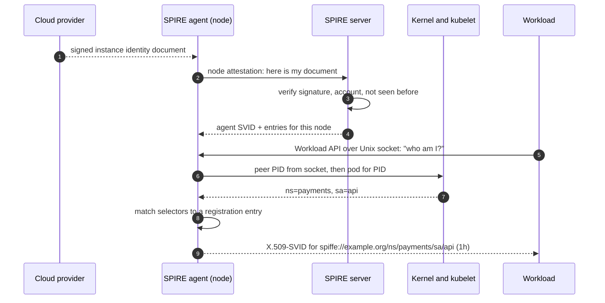
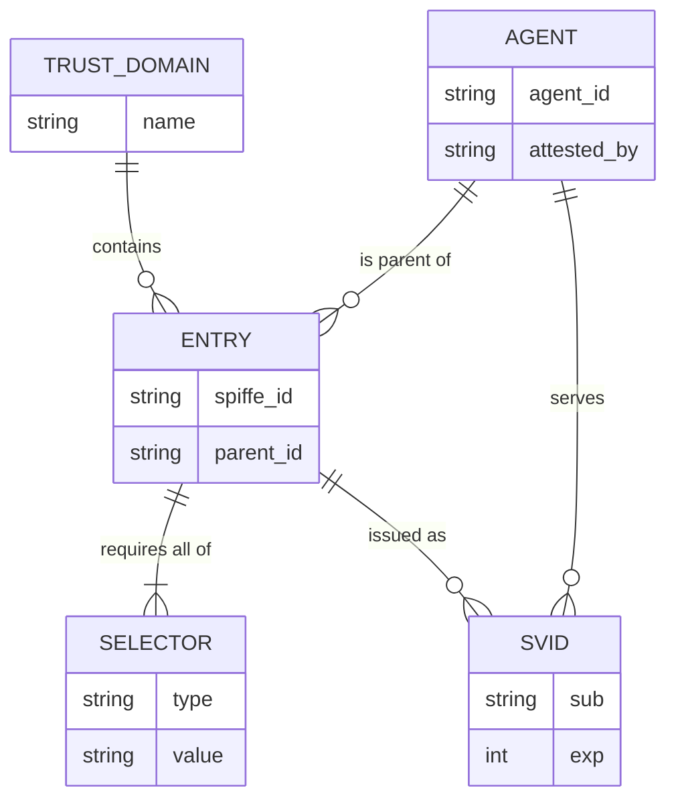
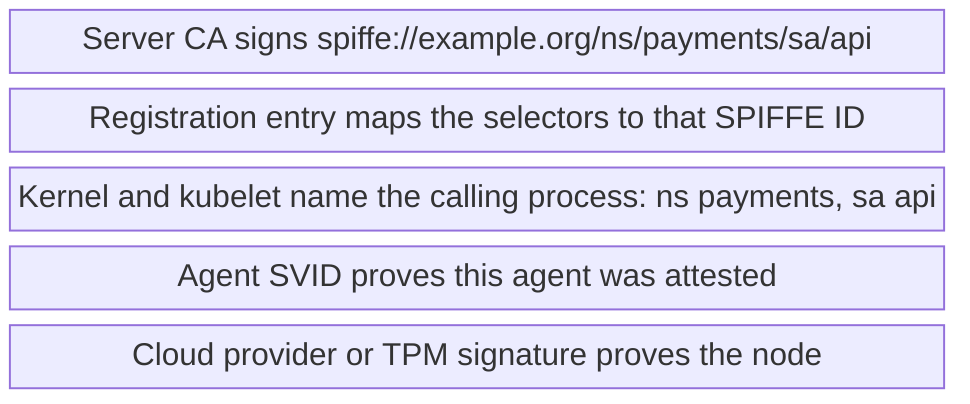

+++
title = 'Attestation and SPIFFE'
description = 'A workload identity is only as strong as the evidence behind it. SPIFFE standardizes the identity; attestation by the platform, not the workload, decides who gets it.'
question = 'How does a process prove which software it is when it holds no secret to begin with?'
weight = 2
difficulty = 3
prerequisites = ['/notes/infrastructure-security/workload-identity/01-why-static-credentials-fail']
date = 2026-07-04
lastmod = 2026-10-30
verified = 2026-07-04
+++

## The idea in one minute

If a workload starts with no secret, something else has to say who it is. The
answer is **attestation**: a trusted component that the workload does not
control gathers facts about it and vouches for them. On a VM that component is
the cloud provider, which signs a document naming the instance. In Kubernetes
it is the kubelet, which knows which pod owns a process. On bare metal it can
be a TPM, a chip whose keys never leave the hardware.

**SPIFFE** (Secure Production Identity Framework For Everyone) standardizes what
comes out of that process: a URI-shaped identity such as
`spiffe://example.org/ns/payments/sa/api`, carried in a short-lived, signed
document called an **SVID** (SPIFFE Verifiable Identity Document), either an
X.509 certificate or a JWT. **SPIRE** is the reference implementation: a server
that holds the signing keys and the registration rules, and an agent on every
node that attests the node to the server and the workloads to itself.

The consequence to act on: **an identity must come from evidence the workload
cannot forge.** Anything the workload says about itself is a claim, not
evidence. Every attestation design in this lesson is a way of asking someone
other than the caller.

## A picture



The workload sends no credentials and makes no claims. The agent asks the
kernel who is on the other end of the socket and asks the kubelet what that
process is.

## How it really works

### Claims versus evidence

Consider three ways a workload might "prove" it is the payments API:

| Approach | What the verifier sees | Who can produce it |
| --- | --- | --- |
| An environment variable `SERVICE=payments-api` | A claim | Any process |
| A shared secret given to payments at deploy time | Possession of a string | Anyone who copies the string |
| The kubelet's statement that PID 4101 belongs to a pod in namespace `payments` running as service account `api` | Evidence from a party the workload cannot impersonate | Only the kubelet, reached by the agent over its own channel |

Only the third is attestation. The pattern is always the same: identify the
caller through a channel the caller does not control (the kernel's record of a
socket peer, a cloud provider's signature, a hardware key), then look up facts
about it from an authority that is out of the caller's reach.

Here is that pattern for the Kubernetes case: the dashed line is the only thing
the caller contributes, and it goes nowhere.

```mermaid {title="The agent asks the kernel and the kubelet, never the caller"}
flowchart LR
  W("Calling process")
  CL["<b>Self-description</b><br/><small>SERVICE=payments-api</small>"]
  AG("SPIRE agent")
  KER["<b>Kernel</b><br/><small>SO_PEERCRED says PID 4101</small>"]
  KUB("kubelet")
  F["<b>Evidence</b><br/><small>ns payments, sa api</small>"]
  W --> CL
  CL -. "claim, ignored" .-> AG
  W -- "opens the Unix socket" --> AG
  AG -- "who is the peer?" --> KER
  AG -- "which pod owns PID 4101?" --> KUB
  KUB --> F
  class CL warn
  class KER memory
  class F good
```

### Node attestation

Before an agent can vouch for workloads, the server has to trust the agent.
**Node attestation** proves which machine the agent is running on. Common
sources of evidence:

- **Cloud instance identity.** AWS publishes a signed instance identity
  document through the instance metadata service, naming the account, region,
  and instance ID. Google Cloud issues a signed instance identity token, and
  Azure offers managed identity tokens and attested metadata. The provider
  signs; the server verifies with the provider's public key and can call the
  provider's API to confirm the instance exists and check its tags.
- **Kubernetes projected service account tokens.** The agent runs as a pod
  and presents a token bound to its own pod and node. The server validates it
  with the Kubernetes TokenReview API.
- **TPM.** A Trusted Platform Module holds an endorsement key burned in at
  manufacture and can sign statements (quotes) about the platform's boot
  measurements. The key cannot be extracted, so the evidence cannot be copied
  to another machine.
- **Join tokens.** A one-time secret generated on the server and given to a
  new node. Simple, but it is a bootstrap secret, with the problems of the
  previous lesson for the short time it exists.

SPIRE ships node attestor plugins for these and more. A successful attestation
gives the agent its own SVID, with an ID that records how it was attested, such
as `spiffe://example.org/spire/agent/aws_iid/111122223333/us-east-1/i-0abc`.

Cloud instance documents have a subtlety. Any process on the instance can fetch
the document, and the document does not change between requests. A signed
document proves "this came from instance i-0abc" but not "this is the first
time anyone presented it." SPIRE's AWS attestor can therefore enforce **trust
on first use**: once an instance ID has attested, the same document is refused
from anyone else. The code below does the same.

The shaded block is the replay that a signature alone would not stop.

```mermaid {title="Trust on first use: the second presentation of a genuine document fails"}
sequenceDiagram
  autonumber
  participant C as Cloud provider
  participant A as Agent on i-0abc
  participant X as Process that copied the document
  participant S as SPIRE server
  C-->>A: signed instance identity document
  A->>S: node attestation with the document
  S->>S: signature verifies, account trusted, i-0abc not seen before
  S-->>A: agent SVID for i-0abc
  rect rgb(226, 239, 216)
  X->>S: same document, byte for byte
  S->>S: signature still verifies
  S-->>X: refused, i-0abc already attested
  end
```

### Workload attestation and selectors

The agent exposes the **SPIFFE Workload API** on a Unix domain socket on the
node. A workload connects and asks for its identity. It sends no credentials.

The agent then works out who is calling:

1. **Find the process.** On Linux the kernel reports the peer's PID, UID, and
   GID for a Unix socket connection (`SO_PEERCRED`). The caller cannot lie
   about these; the kernel fills them in.
2. **Gather facts.** Workload attestor plugins turn the PID into
   **selectors**. The `unix` attestor yields facts such as `unix:uid:1001` or
   `unix:path:/usr/bin/payments`. The `k8s` attestor reads the process's cgroup
   to find its container, then asks the local kubelet which pod that is,
   yielding `k8s:ns:payments`, `k8s:sa:api`, `k8s:pod-label:app:payments`, or
   `k8s:container-image:...`. There are similar attestors for Docker and
   systemd.
3. **Match an entry.** The server holds **registration entries**, written by
   operators: "a workload with selectors `k8s:ns:payments` and `k8s:sa:api`,
   running under agent X (or any agent in a group of nodes), gets the SPIFFE
   ID `spiffe://example.org/ns/payments/sa/api`." An entry matches when all of
   its selectors are among the workload's discovered selectors.
4. **Issue.** The agent returns an SVID signed by the server's CA (agents
   pre-fetch and cache SVIDs for the entries they serve) and keeps it rotated.

Each entry has a **parent ID**: the agent, or a set of agents, allowed to issue
it. That is what stops a compromised agent on a dev node from minting the
payments identity. It can only hand out entries whose parent is itself.

As a data model, the server's registry is small; the relationships are what
carry the security.



> [!IMPORTANT]
> Choose selectors that the workload cannot influence. A pod label can be set
> by whoever can create pods in that namespace. A service account plus a
> namespace, combined with admission policy over who may use that service
> account, is stronger. A container image digest is stronger still.

### SPIFFE IDs

A SPIFFE ID is a URI: `spiffe://<trust domain>/<path>`. The **trust domain**
is the root of trust, usually one per organization or environment
(`prod.example.org`). The path is free-form, and the specification leaves its
structure to you. A convention that reflects how authorization will be written
pays off later: `/ns/<namespace>/sa/<service account>` matches Kubernetes and
is the form Istio uses, while `/region/us-east-1/service/payments` suits
other platforms.

The ID names **software**, not a machine or a person. All replicas of the
payments API share one SPIFFE ID; the individual SVIDs they hold differ.

### SVIDs: X.509 and JWT

An SVID is the signed document that carries the SPIFFE ID.

| | X.509-SVID | JWT-SVID |
| --- | --- | --- |
| Where the ID lives | Exactly one URI SAN in the certificate | The `sub` claim |
| Proves possession of | A private key held only by the workload | Nothing; it is a bearer token |
| Typical use | Mutual TLS between services | Calls through proxies or to APIs that cannot do mTLS |
| Replay risk | Low: the key never leaves the workload | Real: anyone holding it can use it until it expires |
| Required protections | Validate the chain against the trust bundle | Check `aud` strictly, keep lifetime short |
| SPIRE default lifetime | One hour (configurable) | Five minutes (configurable) |

Prefer X.509-SVIDs wherever mutual TLS is possible, because a stolen
certificate without its private key is useless. JWT-SVIDs exist because many
paths (load balancers that terminate TLS, message queues, cloud token
exchange) cannot carry a client certificate end to end. The audience claim is
what stops a service that receives your JWT-SVID from replaying it to another
service.

Relying parties validate SVIDs against a **trust bundle**: the set of CA
certificates (for X.509) or public keys (for JWT) for a trust domain. The
Workload API delivers the bundle alongside the SVID and pushes updates when the
CA rotates. Trust domains can **federate** by exchanging bundles, so a service
in `prod.example.org` can authenticate one in `partner.example.net` without a
shared CA.

### SPIRE server and agent

The **SPIRE server** is the CA and the registry. It holds the signing keys
(on disk, or in a KMS or HSM through a key manager plugin), stores registration
entries in a database, runs node attestation, and signs SVIDs. It can be its
own root or chain up to an existing PKI through an upstream authority plugin.

The deployment below shows one server and two attested nodes; each agent talks
only to its own node's workloads.

```mermaid {title="One server holds the key and the entries, one agent per node"}
flowchart TB
  subgraph g_cp["Control plane"]
    n_kms["Signing key"]
    n_server["SPIRE server"]
    n_db[("Entries")]
  end
  subgraph g_nodeA["Node i-0abc"]
    n_agentA["Agent"]
    n_pay["payments api"]
  end
  subgraph g_nodeB["Node i-0def"]
    n_agentB["Agent"]
    n_dev["dev pod"]
  end
  n_kms --- n_server
  n_server --- n_db
  n_server --> n_agentA
  n_server --> n_agentB
  n_agentA --> n_pay
  n_agentB --> n_dev
```

The **SPIRE agent** runs on every node. It attests itself, receives the entries
it is allowed to serve, attests local workloads, and serves the Workload API.
Because the agent caches SVIDs and refreshes them ahead of expiry, workloads
keep working through short server outages.

From a workload's point of view, an SVID moves through these states; the loop between
Served and Renewing is what keeps a short server outage invisible.

```mermaid {title="An SVID is renewed ahead of expiry, so outages shorter than the margin go unnoticed"}
stateDiagram-v2
  [*] --> Cached: agent pre-fetches for a matched entry
  Cached --> Served: workload calls the Workload API
  Served --> Renewing: well before expiry
  Renewing --> Served: new SVID and bundle pushed
  Renewing --> Expired: server unreachable past expiry
  Expired --> [*]: relying parties refuse it
```

The trust chain, from the bottom: the cloud provider's or TPM's signature
proves the node; the node's agent SVID proves the agent; the kernel and the
kubelet tell the agent which process is calling; the registration entry maps
those facts to a SPIFFE ID; the server's CA signs it. Break any link and the
wrong workload gets the identity.

Stacked, read from the bottom up; each layer is only as good as the one under
it.



## Code

A toy version of that chain. The "cloud" signs instance documents, the server
attests nodes and stores registration entries, and the agent derives selectors
from a simulated kubelet keyed by the PID the kernel reports. A second agent,
`TrustingAgent`, makes the classic mistake of believing the selectors the
caller sends.

```python {title="toy_spire.py"}
"""toy_spire.py: node attestation, workload attestation, and SVID issuance.

A miniature of the SPIRE flow. The "cloud" signs instance identity documents,
the server attests nodes and holds registration entries, and the agent learns a
caller's selectors from the (simulated) kernel and kubelet, never from the
caller. HMAC stands in for real signatures. Standard library only; offline.
"""

from __future__ import annotations

import hashlib
import hmac
import json
from dataclasses import dataclass, field

CLOUD_KEY = b"simulated cloud provider signing key"
SERVER_KEY = b"simulated SPIRE server CA key"
TRUST_DOMAIN = "example.org"
SVID_TTL = 3600  # seconds; SPIRE's default X.509-SVID lifetime is one hour


class Refused(Exception):
    pass


def sign(key: bytes, doc: dict) -> dict:
    body = json.dumps(doc, sort_keys=True).encode()
    return {"doc": doc, "sig": hmac.new(key, body, hashlib.sha256).hexdigest()}


def check(key: bytes, signed: dict) -> dict:
    body = json.dumps(signed["doc"], sort_keys=True).encode()
    if not hmac.compare_digest(signed["sig"], hmac.new(key, body, hashlib.sha256).hexdigest()):
        raise Refused("signature does not verify")
    return signed["doc"]


@dataclass
class Entry:
    spiffe_id: str
    parent_id: str          # which attested agent may hand out this identity
    selectors: frozenset[str]


@dataclass
class Server:
    allowed_accounts: set[str]
    entries: list[Entry] = field(default_factory=list)
    seen_instances: set[str] = field(default_factory=set)

    def attest_node(self, iid: dict) -> str:
        doc = check(CLOUD_KEY, iid)  # only the cloud can produce this document
        if doc["account"] not in self.allowed_accounts:
            raise Refused(f"account {doc['account']} is not trusted")
        if doc["instance"] in self.seen_instances:
            raise Refused(f"instance {doc['instance']} already attested")
        self.seen_instances.add(doc["instance"])
        return (f"spiffe://{TRUST_DOMAIN}/spire/agent/aws_iid/"
                f"{doc['account']}/{doc['region']}/{doc['instance']}")

    def mint(self, agent_id: str, selectors: frozenset[str], now: int) -> dict:
        for e in self.entries:
            if e.parent_id == agent_id and e.selectors <= selectors:
                return sign(SERVER_KEY, {"sub": e.spiffe_id, "exp": now + SVID_TTL})
        raise Refused(f"no entry for {sorted(selectors)} under this agent")


@dataclass
class Agent:
    agent_id: str
    server: Server
    kubelet: dict[int, dict[str, str]]  # pid -> pod facts, as the kubelet reports them
    uids: dict[int, int] = field(default_factory=dict)  # pid -> uid, as the kernel reports

    def selectors_for(self, pid: int) -> frozenset[str]:
        pod = self.kubelet.get(pid)
        if pod is None:
            return frozenset({f"unix:uid:{self.uids.get(pid, 0)}"})
        return frozenset({f"k8s:ns:{pod['ns']}", f"k8s:sa:{pod['sa']}"})

    def fetch_svid(self, peer_pid: int, claimed: set[str], now: int) -> dict:
        # peer_pid comes from the kernel (SO_PEERCRED on the Unix socket).
        # `claimed` is what the caller says about itself: ignored on purpose.
        return self.server.mint(self.agent_id, self.selectors_for(peer_pid), now)


class TrustingAgent(Agent):
    """The mistake: believe what the caller says about itself."""

    def fetch_svid(self, peer_pid: int, claimed: set[str], now: int) -> dict:
        return self.server.mint(self.agent_id, frozenset(claimed), now)


def validate(svid: dict, now: int) -> str:
    doc = check(SERVER_KEY, svid)
    if not doc["sub"].startswith(f"spiffe://{TRUST_DOMAIN}/"):
        raise Refused("foreign trust domain")
    if now >= doc["exp"]:
        raise Refused("SVID expired")
    return doc["sub"]


def step(label: str, action) -> None:
    try:
        print(f"{label:<38} ok      {action()}")
    except Refused as e:
        print(f"{label:<38} REFUSED {e}")


if __name__ == "__main__":
    now = 1_790_000_000
    server = Server(allowed_accounts={"111122223333"})
    iid = sign(CLOUD_KEY, {"account": "111122223333", "region": "us-east-1",
                           "instance": "i-0abc"})
    node_a = server.attest_node(iid)
    print(f"node attested as {node_a}")
    server.entries.append(Entry(f"spiffe://{TRUST_DOMAIN}/ns/payments/sa/api", node_a,
                                frozenset({"k8s:ns:payments", "k8s:sa:api"})))
    kubelet = {4101: {"ns": "payments", "sa": "api"}, 4202: {"ns": "dev", "sa": "default"}}
    agent = Agent(node_a, server, kubelet, uids={999: 1001})

    step("payments api asks for its SVID", lambda: validate(agent.fetch_svid(4101, set(), now), now))
    step("dev pod claims payments selectors",
         lambda: validate(agent.fetch_svid(4202, {"k8s:ns:payments", "k8s:sa:api"}, now), now))
    naive = TrustingAgent(node_a, server, kubelet)
    step("same claim, agent that trusts callers",
         lambda: validate(naive.fetch_svid(4202, {"k8s:ns:payments", "k8s:sa:api"}, now), now))
    step("host process outside any pod", lambda: validate(agent.fetch_svid(999, set(), now), now))
    step("replay the instance document", lambda: server.attest_node(iid))
    forged = {"doc": dict(iid["doc"], instance="i-0evil"), "sig": iid["sig"]}
    step("edited instance document", lambda: server.attest_node(forged))
    other = sign(CLOUD_KEY, {"account": "444455556666", "region": "us-east-1", "instance": "i-0zz"})
    step("instance in an untrusted account", lambda: server.attest_node(other))

    node_b = server.attest_node(sign(CLOUD_KEY, {"account": "111122223333",
                                                 "region": "us-east-1", "instance": "i-0def"}))
    agent_b = Agent(node_b, server, {7300: {"ns": "payments", "sa": "api"}})
    step("same selectors on an unlisted node", lambda: validate(agent_b.fetch_svid(7300, set(), now), now))

    svid = agent.fetch_svid(4101, set(), now)
    step("relying party, 59 minutes later", lambda: validate(svid, now + 59 * 60))
    step("relying party, 61 minutes later", lambda: validate(svid, now + 61 * 60))
```

Run it with `python3 toy_spire.py`:

```text
node attested as spiffe://example.org/spire/agent/aws_iid/111122223333/us-east-1/i-0abc
payments api asks for its SVID         ok      spiffe://example.org/ns/payments/sa/api
dev pod claims payments selectors      REFUSED no entry for ['k8s:ns:dev', 'k8s:sa:default'] under this agent
same claim, agent that trusts callers  ok      spiffe://example.org/ns/payments/sa/api
host process outside any pod           REFUSED no entry for ['unix:uid:1001'] under this agent
replay the instance document           REFUSED instance i-0abc already attested
edited instance document               REFUSED signature does not verify
instance in an untrusted account       REFUSED account 444455556666 is not trusted
same selectors on an unlisted node     REFUSED no entry for ['k8s:ns:payments', 'k8s:sa:api'] under this agent
relying party, 59 minutes later        ok      spiffe://example.org/ns/payments/sa/api
relying party, 61 minutes later        REFUSED SVID expired
```

What each line shows:

- **The payments pod** gets its SVID without sending anything. The agent found
  its namespace and service account through the kubelet.
- **The dev pod** sends the payments selectors in its request. The real agent
  ignores them and looks up the dev pod's actual facts, which match no entry.
  The `TrustingAgent` accepts the claim and issues the payments identity to the
  dev pod. That one-line difference is the whole security of the design.
- **Replay and forgery** of the instance document both fail: the first by the
  trust-on-first-use check, the second because changing any field breaks the
  provider's signature.
- **The second node** runs a pod with the same namespace and service account,
  but the entry's parent is node A. Identity is scoped by where the workload
  runs as well as what it is.
- **The relying party** accepts the SVID for one hour and then refuses it.

## Where it breaks

- **Attestation is only as good as its weakest selector.** If whoever can
  create pods in a namespace can also pick any service account there, then
  `k8s:ns` plus `k8s:sa` reduces to "can deploy to this namespace." Lock down
  who can use which service account and who can create pods, with RBAC and
  admission policy.
- **Root on the node owns every identity on the node.** An attacker with root
  can talk to the agent's socket while impersonating any process, read the
  memory of other workloads, or replace the kubelet's answers. Node attestation
  and parent IDs limit the damage to the identities that node is allowed to
  serve; they do not stop it. This is why workloads with different trust levels
  belong on different nodes.
- **The server is the crown jewel.** Whoever can write registration entries or
  read the signing key can mint any identity in the trust domain. Protect the
  server's datastore and API like a root CA, and keep its key in a KMS or HSM.
- **JWT-SVIDs are bearer tokens.** They can be replayed until expiry by anyone
  who intercepts them, and an audience check is the only thing preventing
  reuse at another service. Keep them short-lived and narrow.
- **Cloud documents prove the machine, not the boot.** An instance identity
  document says the provider launched this instance. It says nothing about
  whether the image on it was tampered with. TPM-based attestation with boot
  measurements can say more, at real operational cost.
- **The toy uses HMAC.** In the program the same key signs and verifies, so
  every verifier could also mint SVIDs. Real SVIDs are signed with an
  asymmetric key, and relying parties hold only the trust bundle of public
  keys. The HMAC construction itself is covered in
  [MACs and HMAC](/notes/cryptography/symmetric-cryptography/03-macs-and-hmac/).

The two worst failures side by side: root on a node is contained by parent
IDs, write access to the server is not contained by anything.

```mermaid {title="Root on a node loses that node's identities, the server loses all of them"}
flowchart LR
  R(["Attacker"])
  SOCK["<b>Root on dev node B</b><br/><small>talks to B's agent as any process</small>"]
  LOST["<b>Identities whose parent is B</b><br/><small>stolen</small>"]
  X@{ shape: diam, label: "payments parent is B?" }
  NO["<b>Refused</b><br/><small>parent is node A</small>"]
  SRV("SPIRE server datastore or key")
  ALL["<b>Every identity</b><br/><small>in the trust domain</small>"]
  R --> SOCK
  SOCK --> LOST
  SOCK -- "ask for payments" --> X
  X -- no --> NO
  R -- "write access" --> SRV
  SRV --> ALL
  class SOCK,LOST,ALL warn
  class X neutral
  class NO good
```

## Remember this

- Attestation means asking a party the workload cannot control: the kernel, the
  kubelet, the cloud provider, a TPM.
- A SPIFFE ID names software in a trust domain; an SVID is the short-lived
  signed document that carries it.
- Prefer X.509-SVIDs (proof of a private key) over JWT-SVIDs (bearer tokens)
  wherever mutual TLS is possible.
- SPIRE attests nodes to the server, then workloads to the agent, and maps
  selectors to IDs through registration entries scoped by parent ID.
- Never let a workload's own claims become selectors.
- Root on a node or write access to the server defeats the design; isolate
  both.

## Try it

1. Run `toy_spire.py`. Add a `k8s:pod-label:app:payments` selector to the dev
   pod's kubelet facts and to the entry instead of the service account. What
   does that say about labels as selectors?
2. Change the entry's `parent_id` to a group: a set of agent IDs. Show that
   node B can now issue the payments identity and node C (not in the set)
   cannot.
3. Add a `jwt_svid(audience)` method to the server and a relying-party check
   that refuses a JWT-SVID whose `aud` does not match. Replay one to a second
   service.
4. Draw the trust chain for a workload you run today, from the hardware or
   cloud up to the credential it presents. Mark each link that relies on a
   claim instead of evidence.

## Check yourself

1. Why does the SPIRE agent ignore any identity information the workload sends
   over the Workload API?

   
   Anything the workload sends is a claim it can make up. The agent identifies
   the caller through the kernel (the socket peer's PID and UID) and looks up
   facts from the kubelet or the OS, which the workload cannot alter. Using the
   caller's own claims would let any process request any identity.
   

2. A signed AWS instance identity document can be fetched by any process on the
   instance. Why is it still useful evidence, and what extra check does it need?

   
   Only AWS can sign it, so it proves the document came from a specific
   instance in a specific account. Because it can be read and replayed, the
   server should accept each instance ID only once (trust on first use) and can
   confirm with the provider's API that the instance exists and is running.
   

3. What does the parent ID on a registration entry protect against?

   
   A compromised or misconfigured agent issuing identities that belong on other
   nodes. An agent can only serve entries whose parent is itself or a node set
   it belongs to, so taking over a dev node does not yield the payments
   identity unless payments was allowed to run there.
   

4. When would you choose a JWT-SVID over an X.509-SVID, and what must the
   receiver check?

   
   When the path cannot carry a client certificate end to end, for example
   through a TLS-terminating proxy, over a message queue, or into a cloud token
   exchange. The receiver must verify the signature against the trust bundle,
   check that `aud` names itself, and check expiry. Lifetimes should be minutes,
   since the token is a bearer credential.
   

5. Why is the SPIFFE ID the same for every replica of a service?

   
   It names the software and its role, which is what authorization policies are
   written against. Individual replicas hold different SVIDs (different keys,
   serials, and expiry times), so a single instance's credential can still be
   distinguished and allowed to expire on its own.
   

## Sources

- SPIFFE project, [SPIFFE standards](https://github.com/spiffe/spiffe/tree/main/standards): SPIFFE ID, X.509-SVID, JWT-SVID, Workload API, and Trust Domain and Bundle specifications.
- SPIFFE project, [SPIFFE concepts](https://spiffe.io/docs/latest/spiffe-about/spiffe-concepts/) and [SPIRE concepts](https://spiffe.io/docs/latest/spire-about/spire-concepts/).
- SPIFFE project, [Configuring SPIRE](https://spiffe.io/docs/latest/deploying/configuring/) (node and workload attestors, selectors).
- D. Feldman et al., [Solving the Bottom Turtle: a SPIFFE Way to Establish Trust in Your Infrastructure via Universal Identity](https://spiffe.io/book/), 2020.
- AWS, [Instance identity documents](https://docs.aws.amazon.com/AWSEC2/latest/UserGuide/instance-identity-documents.html), Amazon EC2 User Guide.
- Kubernetes, [TokenReview API](https://kubernetes.io/docs/reference/kubernetes-api/authentication-resources/token-review-v1/).
- Trusted Computing Group, [TPM 2.0 Library specification](https://trustedcomputinggroup.org/resource/tpm-library-specification/).
