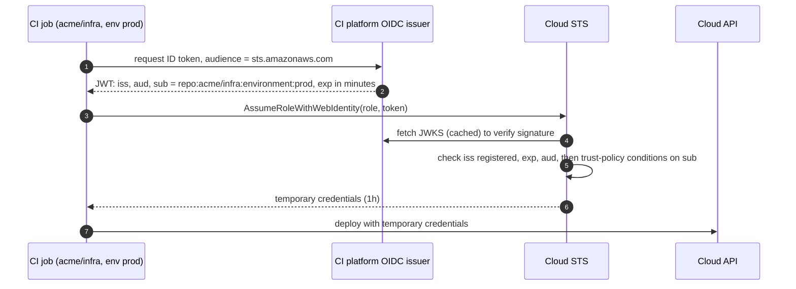

+++
title = 'Federated workload identity'
description = 'A platform-signed OIDC token can be exchanged for cloud credentials with no stored secret, and the trust policy that decides which tokens qualify is where most deployments go wrong.'
question = 'How does a Kubernetes pod or a CI job get cloud credentials without a stored key, and what can go wrong?'
weight = 3
difficulty = 3
prerequisites = ['/notes/infrastructure-security/workload-identity/01-why-static-credentials-fail', '/notes/infrastructure-security/workload-identity/02-attestation-and-spiffe']
date = 2026-07-06
lastmod = 2026-10-30
verified = 2026-07-06
+++

## The idea in one minute

Platforms that run code already know which code they are running. Kubernetes
knows which service account a pod uses. GitHub Actions knows which repository,
branch, and environment a job belongs to. Both can put that knowledge in a
signed **OIDC token**, a JWT whose issuer publishes its public keys at a
well-known URL. A cloud provider that has been told to trust that issuer will
**exchange** the token for its own short-lived credentials. No secret is stored
anywhere: not in the repository, not in CI settings, not in the pod.

The exchange is only as safe as its **trust conditions**. The issuer signs
tokens for every workload on the platform: every pod in the cluster, or every
repository on GitHub. The signature proves the token is genuine; it says
nothing about whether *this* workload should get *this* role. That decision
lives in the conditions on the token's audience and subject claims. Leave the
subject open, or match it with a careless wildcard, and a genuine token from
someone else's repository or branch assumes your role.

The consequence to act on: **every federated trust relationship must pin the
issuer, the audience, and an exact subject**, and should be reviewed as
carefully as a firewall rule that opens production to the internet.

## A picture



The job never sees a long-lived secret. Everything the cloud knows about the
job comes from claims the platform signed.

## How it really works

### The parts

Every federated workload identity setup has the same five parts, whatever the
vendors call them:

| Part | Role | Example |
| --- | --- | --- |
| **Issuer** | Signs tokens describing workloads; publishes an OIDC discovery document and JWKS | `https://token.actions.githubusercontent.com`, a cluster's service account issuer URL |
| **Token** | A short-lived JWT with `iss`, `aud`, `sub`, `exp`, and platform-specific claims | A GitHub Actions ID token; a Kubernetes projected service account token |
| **Identity provider registration** | Tells the cloud to trust that issuer | An IAM OIDC identity provider in AWS; a workload identity pool provider in Google Cloud; a federated identity credential in Microsoft Entra ID |
| **Trust conditions** | Decide which tokens from that issuer may get which role | IAM role trust policy conditions; a CEL attribute condition; an exact subject match |
| **Token exchange endpoint** | Verifies the token and returns cloud credentials | AWS STS `AssumeRoleWithWebIdentity`; Google STS (RFC 8693 token exchange); the Entra ID token endpoint with a client assertion |

Laid out as a deployment, the five parts sit on two sides of an organizational
boundary; nothing secret crosses it.

```mermaid {title="The platform signs, the cloud registers the issuer and decides"}
flowchart TB
  subgraph g_gh["CI platform"]
    n_iss["OIDC issuer and JWKS"]
    n_job["Workflow job"]
  end
  subgraph g_aws["Cloud account"]
    n_idp["OIDC provider"]
    n_sts["STS"]
    n_role["Role trust policy"]
    n_api["Cloud API"]
  end
  n_iss --> n_job
  n_job --> n_sts
  n_idp --- n_sts
  n_sts --- n_role
  n_sts --> n_api
  n_idp --> n_iss
```

The token format and the verification steps come from OpenID Connect and the
JWT specifications; JWT validation pitfalls in general are covered in
[Tokens and JWT pitfalls](/notes/application-security/authentication/04-tokens-and-jwt-pitfalls/).

### Kubernetes projected service account tokens

The kubelet can mount a token into a pod through a projected volume, with an
audience and a lifetime chosen in the pod spec. Its claims include:

```json {title="claims of a projected service account token (abridged)"}
{
  "iss": "https://oidc.eks.us-east-1.amazonaws.com/id/EXAMPLE",
  "aud": ["sts.amazonaws.com"],
  "sub": "system:serviceaccount:payments:api",
  "exp": 1790003600,
  "kubernetes.io": {
    "namespace": "payments",
    "serviceaccount": { "name": "api" },
    "pod": { "name": "api-7f9c-x2", "uid": "..." }
  }
}
```

The token is bound to the pod object: once the pod is deleted, the API server
treats the token as invalid. The cluster's issuer publishes its discovery
document and keys (service account issuer discovery), so an external party can
verify these tokens without talking to the cluster. That external party checks
only the signature and the claims, so it keeps accepting a deleted pod's token
until `exp`. Short lifetimes matter for that reason.

The token's life, with the gap between what the cluster and an outside
verifier believe:

```mermaid {title="A deleted pod's token stays usable outside the cluster until exp"}
stateDiagram-v2
  [*] --> Live: kubelet mounts the token
  Live --> Live: kubelet refreshes it
  Live --> Orphaned: pod deleted
  Orphaned --> Expired: exp passes
  Expired --> [*]
  note right of Orphaned
    API server says invalid, the bound pod is gone
    External STS says valid, it checks only signature and claims
  end note
  class Orphaned warn
```

On AWS, **IAM Roles for Service Accounts** (IRSA) registers the cluster's
issuer as an IAM OIDC provider, and the role's trust policy requires
`<issuer>:sub` to equal `system:serviceaccount:payments:api` and `<issuer>:aud`
to equal `sts.amazonaws.com`. The SDK in the pod reads the token file and calls
`AssumeRoleWithWebIdentity`. EKS Pod Identity is a newer AWS alternative that
uses an agent on the node instead of the OIDC provider setup. On Google Cloud,
Workload Identity Federation for GKE plays the same role, and Microsoft Entra
Workload ID does it for AKS.

### GitHub Actions OIDC

A workflow job granted `permissions: id-token: write` can request an ID token
from GitHub's issuer. The `sub` claim is built from the job's context:

| Job context | Default `sub` |
| --- | --- |
| Job that uses an environment | `repo:acme/infra:environment:prod` |
| Push to a branch | `repo:acme/infra:ref:refs/heads/main` |
| Tag | `repo:acme/infra:ref:refs/tags/v1.4.0` |
| Pull request event | `repo:acme/infra:pull_request` |

The token also carries separate claims such as `repository`,
`repository_owner`, `ref`, `environment`, `workflow`, `job_workflow_ref` (which
reusable workflow is running), `event_name`, and the numeric
`repository_id` and `repository_owner_id`. Organizations and repositories can
customize which claims make up `sub`.

The `aud` claim defaults to the URL of the repository owner and can be set
when the token is requested; the AWS credentials action requests
`sts.amazonaws.com`.

Notice what this issuer is: **one signing key for every repository on GitHub.**
A token for `mallory/anything` is exactly as genuine as one for `acme/infra`.

Drawn, the problem is that every arrow passes through the same key:

```mermaid {title="One issuer key signs for your repository and the attacker's"}
flowchart LR
  R1("acme/infra")
  R2("acme/intern-sandbox")
  R3(["mallory/anything"])
  ISS["<b>GitHub OIDC issuer</b><br/><small>one signing key</small>"]
  TOK["<b>Genuine tokens</b><br/><small>valid signature, aud sts.amazonaws.com</small>"]
  STS("Cloud STS")
  R1 --> ISS
  R2 --> ISS
  R3 --> ISS
  ISS --> TOK
  TOK -- "only sub tells them apart" --> STS
  class ISS memory
  class TOK neutral
```

### The cloud side

**AWS.** You create an IAM OIDC identity provider for the issuer URL and give
the role a trust policy whose principal is that provider and whose action is
`sts:AssumeRoleWithWebIdentity`. Conditions use keys named after the issuer:

```json {title="an IAM role trust policy that pins the subject"}
{
  "Effect": "Allow",
  "Principal": { "Federated": "arn:aws:iam::111122223333:oidc-provider/token.actions.githubusercontent.com" },
  "Action": "sts:AssumeRoleWithWebIdentity",
  "Condition": {
    "StringEquals": {
      "token.actions.githubusercontent.com:aud": "sts.amazonaws.com",
      "token.actions.githubusercontent.com:sub": "repo:acme/infra:environment:prod"
    }
  }
}
```

`StringLike` instead of `StringEquals` turns `*` and `?` into wildcards. `*`
matches any run of characters, including `/` and `:`, which is where the
trouble starts.

**Google Cloud.** A **workload identity pool** contains providers, one per
issuer. Each provider has an **attribute mapping** (for example
`google.subject = assertion.sub` and `attribute.repository =
assertion.repository`) and an **attribute condition**, a CEL expression that
every token must satisfy, such as
`assertion.repository_owner_id == '123456' && assertion.ref == 'refs/heads/main'`.
IAM bindings then grant roles to a `principal://` (one subject) or
`principalSet://` (all identities with an attribute value). Google's STS
implements RFC 8693 token exchange. Google's documentation recommends always
setting an attribute condition for multi-tenant issuers such as GitHub, since
otherwise the pool admits tokens from any repository.

**Azure.** A **federated identity credential** on an app registration or a
user-assigned managed identity names an issuer, a subject, and an audience
(by default `api://AzureADTokenExchange`). The subject is matched exactly, so
the wildcard mistakes below are not possible with that form. The workload
presents the platform token as a client assertion to the Entra ID token
endpoint and receives an access token. As of October 2026, check Microsoft's
documentation for the status of more flexible claim matching before relying on
exact-match behavior everywhere.

### Audience and subject: what each condition does

- **Issuer.** Fixed by the identity provider registration. It decides whose
  signatures are believed at all.
- **Audience.** Says which relying party the token was minted for. Checking it
  stops a token issued for some other service (say, a third-party deployment
  tool that also accepts GitHub tokens) from being replayed at your cloud. On
  its own, it does **nothing** to distinguish one repository from another,
  because every workflow can ask for the same audience.
- **Subject (and other claims).** Says which workload this is. This is the
  only condition that separates your repository from everyone else's and your
  protected production environment from a feature branch.

The checks in order, with the shortcut that the classic misconfiguration takes:

```mermaid {title="Each condition rejects a different impostor, and only sub rejects other repositories"}
flowchart TB
  T["<b>Token arrives at STS</b>"] --> I{"<b>iss</b> registered?"}
  I -- no --> D1["Denied<br/><small>unknown signer</small>"]
  I -- yes --> A{"<b>aud</b> = sts.amazonaws.com?"}
  A -- no --> D2["Denied<br/><small>minted for another service</small>"]
  A -- yes --> S{"<b>sub</b> equals the pinned subject?"}
  A -. "aud-only policy stops checking here" .-> BAD["<b>Any repository on GitHub</b>"]
  S -- no --> D3["Denied<br/><small>other repo, branch, or environment</small>"]
  S -- yes --> OK["<b>Temporary credentials</b>"]
  class D1,D2,D3 neutral
  class BAD warn
  class OK good
```

### The classic misconfiguration

| Trust condition on `sub` | Who can assume the role |
| --- | --- |
| Equals `repo:acme/infra:environment:prod` | Jobs in `acme/infra` that run in the `prod` environment, which can require reviewers and branch rules |
| Like `repo:acme/infra:*` | Any branch, tag, or pull request workflow in `acme/infra`: anyone who can push a branch there |
| Like `repo:acme/*` | Every repository in the `acme` organization, including sandboxes and experiments |
| Like `repo:acme/infra*` | Also `acme/infra-scratch`, `acme/infrastructure-old`, any repo whose name starts with `infra` |
| No `sub` condition (audience only) | **Any GitHub Actions workflow in any repository on GitHub** |

The last row is the classic. The trust policy checks that the token came from
GitHub and was meant for AWS STS, and both are true for every workflow anyone
writes. An attacker who learns the role ARN (they show up in public workflow
files and logs) creates a repository, requests a token with audience
`sts.amazonaws.com`, and calls `AssumeRoleWithWebIdentity`. Security
researchers have publicly reported finding roles configured this way. Some
cloud providers have since added checks or warnings for missing subject
conditions on well-known multi-tenant issuers; verify what yours does rather
than relying on it.

The middle rows are subtler. A wildcard over branches means branch protection,
required reviews, and environment approvals no longer guard the role: a
developer, or an attacker with a stolen developer token, pushes a branch whose
workflow deploys to production. A trailing `*` without a separator matches
repository names nobody intended.

Under a `repo:acme/infra:*` condition, the highlighted commit gets production
credentials although no reviewer or environment approval ever saw it.

```mermaid {title="A pushed branch deploys to production under a branch wildcard"}
gitGraph
  commit id: "deploy.yml uses env prod"
  commit id: "reviewed release"
  branch try-this
  checkout try-this
  commit id: "edit deploy.yml"
  commit id: "push runs workflow" type: HIGHLIGHT tag: "sub ends ref:refs/heads/try-this"
  checkout main
  commit id: "next reviewed release"
```

Two further hardening points:

- **Prefer immutable identifiers.** Repository and organization names can be
  renamed or, after deletion, registered by someone else. Conditions on
  `repository_id` and `repository_owner_id` (directly in Google Cloud, or via a
  customized `sub` template on GitHub) do not move with names.
- **Pin the workflow, not just the repository.** `job_workflow_ref` lets you
  require that a specific, reviewed reusable workflow is running, so an edited
  workflow file on some branch does not qualify.

## Code

The program models the exchange. One simulated issuer signs tokens for any
repository. The STS verifies signature, issuer, expiry, and audience, then
evaluates five roles whose trust policies differ only in their subject
condition. `StringLike` follows IAM's rules: `*` matches anything, including
`/`.

```python {title="trust_policy.py"}
"""trust_policy.py: exchanging a platform OIDC token for cloud credentials.

A simulated CI issuer signs tokens for every repository on the platform. A
simulated STS checks the signature, expiry, and audience, then evaluates each
role's trust-policy conditions in the style of AssumeRoleWithWebIdentity.
HMAC stands in for RS256 and a JWKS lookup. Standard library only; offline.
"""

from __future__ import annotations

import hashlib
import hmac
import json
import re
from dataclasses import dataclass

ISSUER = "https://token.actions.githubusercontent.com"
ISSUER_KEY = b"simulated CI platform signing key"  # one key signs for ALL repositories
NOW = 1_790_000_000


class Denied(Exception):
    pass


def issue(repo: str, ctx: str, aud: str = "sts.amazonaws.com") -> str:
    """What the CI platform hands any workflow that requests an ID token."""
    claims = {"iss": ISSUER, "aud": aud, "sub": f"repo:{repo}:{ctx}",
              "repository": repo, "iat": NOW, "exp": NOW + 300}
    body = json.dumps(claims, sort_keys=True)
    return body + "." + hmac.new(ISSUER_KEY, body.encode(), hashlib.sha256).hexdigest()


def string_like(pattern: str, value: str) -> bool:
    """IAM StringLike: '*' matches any run of characters, '?' exactly one."""
    rx = "".join(".*" if c == "*" else "." if c == "?" else re.escape(c) for c in pattern)
    return re.fullmatch(rx, value) is not None


@dataclass
class Role:
    name: str
    conditions: list[tuple[str, str, str]]  # (operator, claim, expected)

    def admits(self, claims: dict) -> bool:
        for op, claim, want in self.conditions:
            have = claims.get(claim, "")
            if op == "StringEquals" and have != want:
                return False
            if op == "StringLike" and not string_like(want, have):
                return False
        return True


def assume_role_with_web_identity(token: str, role: Role) -> str:
    body, _, sig = token.rpartition(".")
    expected = hmac.new(ISSUER_KEY, body.encode(), hashlib.sha256).hexdigest()
    if not hmac.compare_digest(sig, expected):
        raise Denied("bad signature")
    claims = json.loads(body)
    if claims["iss"] != ISSUER:
        raise Denied("issuer is not a registered identity provider")
    if NOW >= claims["exp"]:
        raise Denied("token expired")
    if not role.admits(claims):
        raise Denied("trust policy conditions not met")
    return f"temporary credentials for {role.name} (1h)"


AUD = ("StringEquals", "aud", "sts.amazonaws.com")
ROLES = [
    Role("exact", [AUD, ("StringEquals", "sub", "repo:acme/infra:environment:prod")]),
    Role("any-branch", [AUD, ("StringLike", "sub", "repo:acme/infra:*")]),
    Role("any-org-repo", [AUD, ("StringLike", "sub", "repo:acme/*")]),
    Role("prefix-typo", [AUD, ("StringLike", "sub", "repo:acme/infra*")]),
    Role("aud-only", [AUD]),
]

TOKENS = [
    ("acme/infra prod environment", issue("acme/infra", "environment:prod")),
    ("acme/infra feature branch", issue("acme/infra", "ref:refs/heads/try-this")),
    ("acme/intern-sandbox main", issue("acme/intern-sandbox", "ref:refs/heads/main")),
    ("acme/infra-scratch main", issue("acme/infra-scratch", "ref:refs/heads/main")),
    ("mallory/anything main", issue("mallory/anything", "ref:refs/heads/main")),
    ("acme/infra, wrong audience", issue("acme/infra", "environment:prod", aud="other")),
]


if __name__ == "__main__":
    print((f"{'token from':<29}" + "".join(f"{r.name:<14}" for r in ROLES)).rstrip())
    for label, token in TOKENS:
        row = []
        for role in ROLES:
            try:
                assume_role_with_web_identity(token, role)
                row.append("ASSUMED")
            except Denied:
                row.append("-")
        print((f"{label:<29}" + "".join(f"{cell:<14}" for cell in row)).rstrip())

    print()
    attacker = TOKENS[4][1]
    print("mallory's token is genuine:", json.loads(attacker.rpartition(".")[0])["sub"])
    for role in (ROLES[0], ROLES[4]):
        try:
            print(f"  {role.name}: {assume_role_with_web_identity(attacker, role)}")
        except Denied as e:
            print(f"  {role.name}: denied, {e}")
```

Run it with `python3 trust_policy.py`:

```text
token from                   exact         any-branch    any-org-repo  prefix-typo   aud-only
acme/infra prod environment  ASSUMED       ASSUMED       ASSUMED       ASSUMED       ASSUMED
acme/infra feature branch    -             ASSUMED       ASSUMED       ASSUMED       ASSUMED
acme/intern-sandbox main     -             -             ASSUMED       -             ASSUMED
acme/infra-scratch main      -             -             ASSUMED       ASSUMED       ASSUMED
mallory/anything main        -             -             -             -             ASSUMED
acme/infra, wrong audience   -             -             -             -             -

mallory's token is genuine: repo:mallory/anything:ref:refs/heads/main
  exact: denied, trust policy conditions not met
  aud-only: temporary credentials for aud-only (1h)
```

Read down the columns:

- **exact** admits one thing: the production environment of `acme/infra`.
- **any-branch** admits a feature branch, so whoever can push to the repository
  can deploy, skipping the environment's approval rules.
- **any-org-repo** admits a sandbox repository nobody reviews.
- **prefix-typo** was meant to be `repo:acme/infra:*` and admits
  `acme/infra-scratch`.
- **aud-only** admits Mallory, whose token is perfectly genuine. Signature,
  issuer, expiry, and audience all check out, because the issuer signs for
  everyone.

The wrong-audience row is rejected everywhere, which shows the audience check
working, and also shows how little it buys on its own.

Counting the `ASSUMED` cells per column turns the table into a measure of how
far each policy is open:

```mermaid {title="Token sources each role admits, out of the six in trust_policy.py"}
xychart-beta
  x-axis ["exact", "any-branch", "any-org-repo", "prefix-typo", "aud-only"]
  y-axis "Token sources admitted" 0 --> 6
  bar [1, 2, 4, 3, 5]
```

## Where it breaks

- **The platform is now your identity provider.** Anyone who can make the
  platform issue a token with the right claims gets the role. For CI that
  means anyone who can push a workflow that runs in the matching context, so
  repository permissions, branch protection, and environment protection rules
  are now cloud access controls. Review them as such.
- **Pull request workflows from forks.** Platforms restrict tokens and secrets
  for workflows triggered by pull requests from forks, but trigger types that
  run with the base repository's privileges (such as `pull_request_target` on
  GitHub) combined with checking out untrusted code have repeatedly led to
  compromises. A trust policy cannot tell a workflow running attacker code
  from one running yours if both run in the same context.
- **Cluster issuers are as sensitive as CAs.** Whoever holds a cluster's
  service account signing key can mint tokens for any service account, and
  every cloud role trusting that issuer follows. Self-managed clusters must
  protect that key and rotate it with care, since rotation invalidates tokens
  verified against the old key.
- **The credentials that come out are bearer credentials.** The exchange is
  keyless, but the temporary cloud credentials it returns can be copied and
  used elsewhere for their lifetime (one hour by default in this example).
  Scope the role narrowly and keep sessions short.
- **The simulation simplifies.** Real STS implementations fetch and cache the
  issuer's JWKS, verify RS256 or ES256 signatures, check `nbf` and clock skew,
  and support many more condition operators and claims. The decision logic
  that matters for this lesson, conditions on `aud` and `sub`, is the same.

## Remember this

- Federation exchanges a platform-signed OIDC token for short-lived cloud
  credentials; nothing long-lived is stored.
- The issuer signs for every workload on the platform; the signature alone
  never identifies your workload.
- Audience stops cross-service replay; only the subject (and other workload
  claims) separates your workload from everyone else's.
- Pin an exact subject; treat `*` in a subject condition as a finding.
- Prefer immutable IDs and a pinned workflow over names and branches.
- Repository and cluster permissions become cloud permissions once federation
  is set up.

## Try it

1. Run `trust_policy.py`. Add a role that pins `repository_id` instead of
   `sub`, and add a token from a repository that was deleted and re-created
   under the same name (same name, new ID). Which roles admit it?
2. Add a `job_workflow_ref` claim and a role that requires a specific reusable
   workflow at a specific ref. Show that a feature branch with an edited
   workflow file is refused.
3. Write the Google Cloud attribute condition (CEL) that matches the **exact**
   role, using `repository_owner_id` and `environment`.
4. Find every IAM role in an account you control that trusts an OIDC provider.
   For each, write down the `sub` condition, if any, and the set of workloads
   it really admits.

## Check yourself

1. A trust policy requires `aud = sts.amazonaws.com` for GitHub's issuer and
   nothing else. Who can assume the role?

   
   Any GitHub Actions workflow in any repository, because every workflow can
   request a token with that audience and GitHub signs them all with the same
   key. The attacker needs only to know the role ARN.
   

2. What is the audience check for, if it cannot distinguish repositories?

   
   It prevents a token minted for another relying party from being replayed at
   this one. If a workflow sends its token to a third-party service that
   accepts GitHub tokens, that service cannot use it at your cloud STS unless
   the audience matches.
   

3. Why is `repo:acme/infra:*` weaker than `repo:acme/infra:environment:prod`?

   
   The wildcard admits any branch, tag, or pull request context in the
   repository. Anyone who can push a branch can run a workflow that assumes
   the role, bypassing reviews and environment approvals that protect the
   production environment.
   

4. Why do Azure's exact-match federated credentials avoid the wildcard problem,
   and what do they cost?

   
   With an exact subject match there is no pattern to get wrong, so a role
   cannot accidentally admit other repositories or branches. The cost is one
   credential per subject, which becomes tedious when many branches or
   environments need access.
   

5. Why prefer `repository_id` over the repository name in conditions?

   
   Names can change hands: an organization or repository can be renamed or
   deleted and the name registered by someone else. The numeric ID is assigned
   once and does not follow the name, so the trust condition keeps meaning the
   repository you reviewed.
   

## Sources

- OpenID Foundation, [OpenID Connect Core 1.0](https://openid.net/specs/openid-connect-core-1_0.html) and [OpenID Connect Discovery 1.0](https://openid.net/specs/openid-connect-discovery-1_0.html).
- M. Jones, J. Bradley, N. Sakimura, [RFC 7519: JSON Web Token (JWT)](https://www.rfc-editor.org/rfc/rfc7519), IETF, May 2015.
- M. Jones et al., [RFC 8693: OAuth 2.0 Token Exchange](https://www.rfc-editor.org/rfc/rfc8693), IETF, January 2020.
- AWS, [AssumeRoleWithWebIdentity API reference](https://docs.aws.amazon.com/STS/latest/APIReference/API_AssumeRoleWithWebIdentity.html) and [Create an OpenID Connect identity provider in IAM](https://docs.aws.amazon.com/IAM/latest/UserGuide/id_roles_providers_create_oidc.html).
- AWS, [IAM roles for service accounts](https://docs.aws.amazon.com/eks/latest/userguide/iam-roles-for-service-accounts.html), Amazon EKS User Guide.
- GitHub, [About security hardening with OpenID Connect](https://docs.github.com/en/actions/security-for-github-actions/security-hardening-your-deployments/about-security-hardening-with-openid-connect).
- Google Cloud, [Workload Identity Federation](https://cloud.google.com/iam/docs/workload-identity-federation) and [Configure Workload Identity Federation with deployment pipelines](https://cloud.google.com/iam/docs/workload-identity-federation-with-deployment-pipelines).
- Microsoft, [Workload identity federation](https://learn.microsoft.com/en-us/entra/workload-id/workload-identity-federation), Microsoft Entra documentation.
- Kubernetes, [Service account token volume projection](https://kubernetes.io/docs/concepts/storage/projected-volumes/#serviceaccounttoken) and [Service account issuer discovery](https://kubernetes.io/docs/tasks/configure-pod-container/configure-service-account/#service-account-issuer-discovery).
