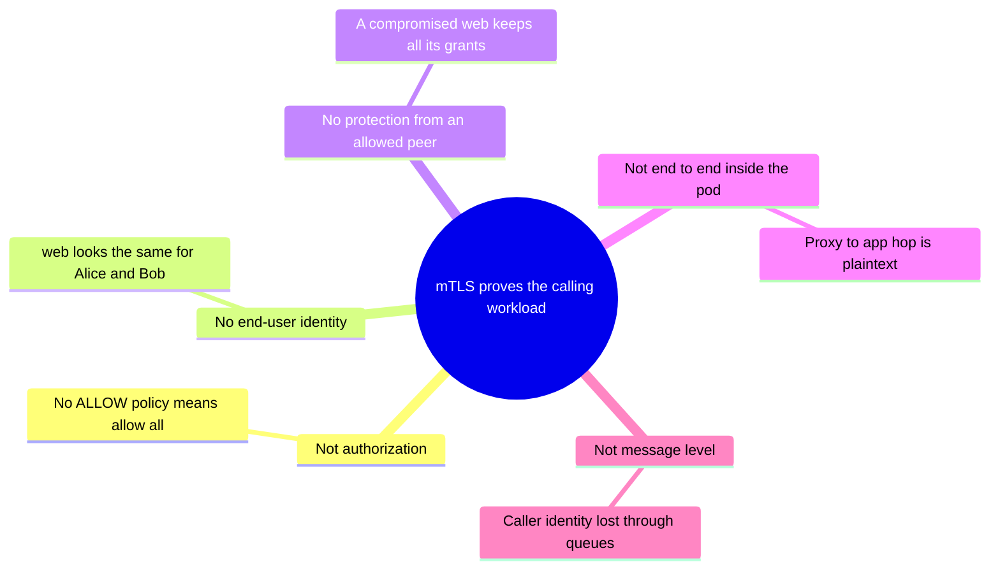

+++
title = 'Mutual TLS between services'
description = 'Mutual TLS gives every service-to-service call a verified, short-lived peer identity, which lets authorization follow workloads instead of IP addresses. It authenticates the caller; it does not decide what the caller may do or for whom.'
question = 'How do services authenticate each other, and why is an identity policy better than an IP allowlist?'
weight = 4
difficulty = 3
prerequisites = ['/notes/infrastructure-security/workload-identity/02-attestation-and-spiffe', '/notes/cryptography/public-key-cryptography/04-the-tls-handshake']
date = 2026-07-08
lastmod = 2026-10-30
verified = 2026-07-08
+++

## The idea in one minute

In ordinary TLS only the server proves who it is. In **mutual TLS** (mTLS) the
client also presents a certificate and proves it holds the matching private
key, so at the end of the handshake each side knows the other's identity. When
those certificates carry SPIFFE IDs and are issued for a day or less, every
connection inside a cluster carries a verified answer to "which workload is
calling?"

That answer is what makes **identity-based authorization** possible: "the
`web` service account in `frontend` may `GET /accounts/*` on payments." The
older alternative, an IP allowlist, breaks in environments where pods are
rescheduled and addresses are reused within minutes. A **service mesh** such as
Istio or Linkerd deploys mTLS without changing application code: proxies next
to each workload obtain certificates, rotate them, terminate mTLS, and enforce
policy.

The consequence to act on: mTLS answers **who the calling workload is**, and
nothing else. It does not decide what that workload may do, and it does not
know which end user the request is for. Those need policy and a user token
on top.

## A picture

```mermaid {title="mTLS through mesh proxies, then an authorization decision"}
flowchart LR
  W["<b>web</b><br/><small>ns frontend, sa web</small>"] --> PW["<b>web proxy</b><br/><small>holds 24h cert</small>"]
  PW -- "mTLS: both present certs" --> PP["<b>payments proxy</b><br/><small>verifies chain, expiry</small>"]
  PP --> AZ{"<b>Policy</b><br/><small>peer ID + method + path</small>"}
  AZ -- allow --> P["<b>payments</b>"]
  AZ -- deny --> X["<b>403</b>"]
  CA["<b>Mesh CA</b><br/><small>istiod / Linkerd identity</small>"] -. "issues, rotates" .-> PW
  CA -. "trust bundle" .-> PP
  class W,P compute
  class PW,PP queue
  class AZ,X good
  class CA memory
```

The application containers speak plain HTTP to their local proxy. The proxies
do the mutual TLS and the policy check.

## How it really works

### What the handshake gives you

The handshake mechanics (key exchange, certificate verification, the
`CertificateRequest` and `CertificateVerify` messages that make it mutual) are
covered in [The TLS handshake](/notes/cryptography/public-key-cryptography/04-the-tls-handshake/),
and certificate chains in
[Certificates and PKI](/notes/cryptography/public-key-cryptography/03-certificates-and-pki/).
For this lesson, the result is what matters. When a mutual TLS 1.3 handshake
completes:

- Each side has verified the other's certificate chain up to a CA in its
  **trust bundle**, and checked that the certificate is within its validity
  period.
- Each side has seen the other sign the handshake transcript with the private
  key matching that certificate. A copied certificate without its key is
  useless.
- The traffic is encrypted and integrity-protected in both directions.
- The server knows the client's identity, read from the certificate. In a
  SPIFFE-based mesh that is the URI SAN, such as
  `spiffe://cluster.local/ns/frontend/sa/web`.

The abbreviated message flow shows where the mutual part comes in: the server
asks, and the client answers with its own certificate and signature.

```mermaid {title="Mutual TLS 1.3: the server requests a certificate and reads the peer SPIFFE ID"}
sequenceDiagram
  autonumber
  participant C as web proxy (client)
  participant S as payments proxy (server)
  C->>S: ClientHello, key share
  S-->>C: ServerHello, key share
  S-->>C: CertificateRequest
  S-->>C: Certificate (payments SVID), CertificateVerify, Finished
  C->>C: verify chain to the trust bundle and validity period
  rect rgb(226, 239, 216)
  C->>S: Certificate (web SVID), CertificateVerify, Finished
  S->>S: verify chain, check the signature over the transcript
  Note over S: peer is spiffe://cluster.local/ns/frontend/sa/web
  end
  C->>S: encrypted HTTP request
```

That last point is the one ordinary TLS lacks. With server-only TLS, the
payments service knows it is talking to *someone* over an encrypted channel.
With mTLS it knows *which workload*, as vouched for by the mesh CA.

### Why a mesh

You can do mTLS in application code: load a certificate, configure the TLS
library to request and verify client certificates, read the peer's SAN, rotate
the certificate before it expires, reload the trust bundle when the CA rotates.
Doing this correctly in every service, in every language, is where it usually
falls apart. A service mesh moves it into infrastructure.

**Istio** runs an Envoy proxy beside each workload (sidecar mode) or a per-node
proxy called ztunnel for layer-4 mTLS, with optional per-namespace "waypoint"
proxies for layer-7 policy (ambient mode). Its control plane, istiod, acts as
the CA by default. The proxy generates a private key locally, sends a
certificate signing request to istiod authenticated with the pod's Kubernetes
service account token, and receives a certificate whose URI SAN is
`spiffe://<trust domain>/ns/<namespace>/sa/<service account>`. Workload
certificates are valid for 24 hours by default and are rotated automatically
before expiry. istiod can also chain to an external CA.

In sidecar mode the pieces sit like this: each pod carries its own Envoy, and
only the Envoys talk to istiod.

```mermaid {title="Istio sidecar mode: apps speak plain HTTP, Envoys hold the certificates"}
flowchart TB
  subgraph g_cluster["Cluster"]
    n_istiod["istiod CA"]
    n_apis["API server"]
    subgraph g_podw["web pod"]
      n_appw["web app"]
      n_envw["Envoy"]
    end
    subgraph g_podp["payments pod"]
      n_envp["Envoy"]
      n_appp["payments app"]
    end
  end
  n_appw --> n_envw
  n_envw --> n_envp
  n_envp --> n_appp
  n_envw --> n_istiod
  n_envp --> n_istiod
  n_istiod --- n_apis
```

**Linkerd** enables mTLS automatically for traffic between meshed pods. Each
proxy gets a certificate from Linkerd's identity service for its pod's service
account, valid for 24 hours by default and rotated automatically. The identity
service's issuer certificate chains to a **trust anchor** that the operator
provides and is responsible for rotating.

In both, the identity is derived from the Kubernetes service account, which is
the attestation step from
[Attestation and SPIFFE](/notes/infrastructure-security/workload-identity/02-attestation-and-spiffe/)
in a simpler form: the CA trusts the API server's statement about which pod
holds which service account. SPIRE can also supply the identities in some mesh
deployments, which extends the same IDs to workloads outside Kubernetes.

### Strict versus permissive

Rolling out mTLS to a running system means some clients are not yet in the
mesh. Meshes therefore support a mode that accepts both:

- Istio's `PeerAuthentication` has modes `STRICT` (mTLS only), `PERMISSIVE`
  (accept mTLS and plaintext), and `DISABLE`. **PERMISSIVE is the default**, so
  that installing the mesh does not break existing traffic.
- Linkerd lets you mark ports or workloads as requiring identity through its
  policy resources; unmeshed clients can otherwise still connect.

A permissive service still accepts plaintext connections, which carry no
identity. If its authorization policy is written in terms of peer identity,
those connections will fail that policy, which is good. If its policy is
written in terms of IP addresses, they pass. Plan the migration so that
permissive mode ends: measure the remaining plaintext traffic and switch to
strict.

The Istio modes as a lifecycle; the goal is to leave the default state, not to
live in it.

```mermaid {title="PERMISSIVE is where a mesh starts, STRICT is where it should end"}
stateDiagram-v2
  [*] --> PERMISSIVE: mesh installed, the default
  PERMISSIVE --> PERMISSIVE: measure remaining plaintext
  PERMISSIVE --> STRICT: every client is meshed
  PERMISSIVE --> DISABLE: opt a workload out
  note right of PERMISSIVE
    accepts mTLS and plaintext, plaintext carries no identity
  end note
  note right of STRICT
    mTLS only, every connection has a peer ID
  end note
```

### Identity-based authorization

Once each request has a verified peer identity, the server-side proxy can
evaluate policy on it. Istio's `AuthorizationPolicy` is a representative
example:

```yaml {title="Istio AuthorizationPolicy for payments"}
apiVersion: security.istio.io/v1
kind: AuthorizationPolicy
metadata:
  name: payments-allow
  namespace: payments
spec:
  selector:
    matchLabels:
      app: payments
  action: ALLOW
  rules:
  - from:
    - source:
        principals: ["cluster.local/ns/frontend/sa/web"]
    to:
    - operation:
        methods: ["GET"]
        paths: ["/accounts/*"]
  - from:
    - source:
        principals: ["cluster.local/ns/billing/sa/refunds"]
    to:
    - operation:
        methods: ["POST"]
        paths: ["/refunds"]
```

Istio writes principals without the `spiffe://` prefix. Its evaluation order
is: `CUSTOM` policies, then `DENY` policies, then `ALLOW` policies; if any
`ALLOW` policy applies to the workload and none matches the request, the
request is denied. Linkerd expresses the same idea with `Server`,
`AuthorizationPolicy`, and `MeshTLSAuthentication` resources that list allowed
identities such as `web.frontend.serviceaccount.identity.linkerd.cluster.local`.

Istio's evaluation order as a decision tree; note the `no` branch under "Any
ALLOW policy", which allows everything.

```mermaid {title="Istio checks CUSTOM, then DENY, then ALLOW, and allows when no ALLOW policy exists"}
flowchart TB
  R["<b>Request</b><br/><small>verified peer ID, method, path</small>"] --> C{"CUSTOM check denies?"}
  C -- yes --> X1["Deny"]
  C -- no --> D{"A DENY policy matches?"}
  D -- yes --> X2["Deny"]
  D -- no --> H{"Any ALLOW policy on this workload?"}
  H -- no --> OPEN["<b>Allow</b><br/><small>no policy, mesh default</small>"]
  H -- yes --> M{"An ALLOW rule matches?"}
  M -- yes --> OK["<b>Allow</b>"]
  M -- no --> X3["Deny"]
  class OPEN warn
  class OK good
  class X1,X2,X3 neutral
```

NIST SP 800-204B describes this model for microservices: authorization decided
per request, on attributes of the authenticated service and the request,
enforced by the mesh proxies.

### Why not IP allowlists

| Question | IP allowlist | Identity policy |
| --- | --- | --- |
| What does it name? | An address, which belongs to whoever has it right now | A workload, as vouched for by the CA |
| Pod rescheduled to a new address | Legitimate traffic breaks until someone edits the list | Nothing changes |
| Address reused by another pod | That pod inherits the access | It presents its own identity and is denied |
| Traffic through NAT or a shared gateway | Many workloads look like one address | Identity survives, since it is carried in the TLS session |
| Can a reader understand it? | "10.0.3.7 may call payments" means nothing six months later | "frontend/web may GET /accounts/*" is self-describing |
| Granularity | Host or subnet, L3/L4 | Workload, method, path |

The program below replays this with one address and three moments; the
timeline shows who owns `10.0.3.7` and what each policy does about it.

```mermaid {title="One address changes hands; the IP allowlist follows it and gets it wrong twice"}
timeline
  Hour 1 : web runs at 10.0.3.7 : both policies allow web
  Hour 6 : batch pod receives 10.0.3.7 : IP allowlist admits batch : identity policy denies it
  Hour 30 : web rescheduled to 10.0.3.8 : IP allowlist blocks web : identity policy allows it
```

Network-layer controls still have a place: Kubernetes NetworkPolicy, security
groups, and segmentation reduce what an attacker can reach even before a
handshake, and they protect things outside the mesh. Use them as a coarse outer
layer, and make the fine-grained decision on identity. Segmentation is covered
in [Network segmentation and zero trust](/notes/infrastructure-security/isolation/04-network-segmentation-and-zero-trust/).

### Rotation

Short-lived certificates only help if rotation is boring.

- **Leaf certificates** rotate continuously. The proxy requests a new one well
  before the old one expires, and new connections use it; existing connections
  carry on. A stolen certificate and key are useful only until that leaf
  expires, which bounds the damage to hours, not years.
- **Intermediate and root CAs** rotate rarely, and this is where outages come
  from. The safe sequence is: add the new CA to every trust bundle; wait until
  every proxy has the updated bundle; start issuing leaves from the new CA;
  wait until every leaf from the old CA has expired; remove the old CA. Removing
  a CA from the bundle too early rejects every certificate it signed.
- **Monitoring** should alert on certificates near expiry and on proxies that
  failed to rotate, since a stuck proxy fails closed once its certificate
  expires.

The CA rotation sequence on a calendar. The spacing is illustrative; the fixed
point is that old-CA leaves live 24 hours, and the red bar is when removing the
old CA would break them.

```mermaid {title="Overlap the trust bundles, and remove the old CA only after its last leaf expires"}
gantt
  dateFormat YYYY-MM-DD
  axisFormat %b %d
  section Trust bundle
  Old CA trusted                   :b1, 2026-01-01, 4d
  New CA trusted                   :b2, 2026-01-01, 6d
  section Issuing
  Old CA issues leaves             :i1, 2026-01-01, 2d
  Bundle reaches every proxy       :i0, 2026-01-01, 2d
  New CA issues leaves             :i2, after i1, 4d
  section Leaves
  Last old-CA leaf, 24h            :l1, 2026-01-03, 1d
  Removing the old CA breaks leaves :crit, x1, 2026-01-01, 3d
  Old CA removed                   :milestone, m1, 2026-01-05, 0d
```

Revocation lists and OCSP are rarely used inside meshes. Short lifetimes are
the revocation mechanism: to cut off a workload, stop issuing to it and wait at
most one certificate lifetime, or deny its identity in policy immediately.

### What mTLS does not give you

> [!WARNING]
> mTLS authenticates the calling workload. It is not authorization, it carries
> no end-user identity, and it trusts whatever an authenticated peer sends.

The five gaps at a glance, each expanded in the list below:



- **Authorization.** A mesh with mTLS on and no policy still lets every meshed
  workload call every other. Encryption is not access control. Without an
  `ALLOW` policy, the default is to allow.
- **End-user identity.** The `web` service calls payments on behalf of many
  users. The peer certificate says `web`, every time. If `web` is compromised
  or buggy and asks for Bob's balance while serving Alice, the mesh sees an
  allowed workload calling an allowed path. Object-level checks need the user's
  identity, typically a JWT that the service (or the proxy, through Istio's
  `RequestAuthentication`) validates, and checks in the application. See
  [Broken object level authorization](/notes/application-security/authorization/01-broken-object-level-authorization/).
- **Protection from an allowed peer.** If `web` is compromised, everything
  `web` may call is exposed. Identity policy limits that to `web`'s grants.
- **End-to-end protection inside the pod.** The proxy terminates TLS. The hop
  between the proxy and the application on the loopback interface is
  plaintext, and anyone with access to the pod's network namespace sees it.
- **Message-level guarantees.** mTLS protects a connection, hop by hop. A
  request that passes through a queue or a second service loses the original
  caller's identity unless it is carried explicitly.

## Code

The program models a payments service that authorizes requests two ways: with
an IP allowlist and with an identity policy on the verified peer SPIFFE ID. A
mesh CA issues 24-hour certificates that sidecars rotate every 12 hours. An
attacker copies the web proxy's certificate and key at hour 1. Pods move, and
one IP address changes hands.

```python {title="mesh_authz.py"}
"""mesh_authz.py: identity-based authorization in a simulated service mesh.

A mesh CA issues 24-hour workload certificates that sidecars rotate every 12
hours. The payments sidecar authorizes each request twice: once with an IP
allowlist, once with an identity policy on the verified peer SPIFFE ID.
HMAC stands in for certificate signatures. Standard library only; offline.
"""

from __future__ import annotations

import hashlib
import hmac
from dataclasses import dataclass

HOUR = 3600
CERT_TTL, ROTATE_EVERY = 24 * HOUR, 12 * HOUR
TD = "spiffe://cluster.local"
TRUST_BUNDLE = {"mesh-ca": b"simulated mesh CA key"}


@dataclass(frozen=True)
class Cert:
    spiffe_id: str
    not_before: int
    not_after: int
    issuer: str
    sig: str


def mac(key: bytes, spiffe_id: str, nb: int, na: int) -> str:
    return hmac.new(key, f"{spiffe_id}|{nb}|{na}".encode(), hashlib.sha256).hexdigest()


def issue(spiffe_id: str, at: int, issuer: str = "mesh-ca", key: bytes | None = None) -> Cert:
    key = key or TRUST_BUNDLE[issuer]
    return Cert(spiffe_id, at, at + CERT_TTL, issuer, mac(key, spiffe_id, at, at + CERT_TTL))


def sidecar_cert(spiffe_id: str, t: int) -> Cert:
    """The certificate a healthy sidecar holds at time t (rotated on schedule)."""
    return issue(spiffe_id, (t // ROTATE_EVERY) * ROTATE_EVERY)


def peer_identity(cert: Cert | None, t: int) -> tuple[str | None, str]:
    """What the mTLS handshake establishes about the caller."""
    if cert is None:
        return None, "no client certificate"
    key = TRUST_BUNDLE.get(cert.issuer)
    if key is None or not hmac.compare_digest(
            cert.sig, mac(key, cert.spiffe_id, cert.not_before, cert.not_after)):
        return None, "certificate not signed by a trusted CA"
    if not cert.not_before <= t < cert.not_after:
        return None, "certificate expired"
    return cert.spiffe_id, "verified"


# The two policies for the payments service.
IP_ALLOW = {"10.0.3.7"}  # "the web pod's address", written down months ago
IDENTITY_ALLOW = [
    # (allowed peer identities, methods, path prefix)
    ({f"{TD}/ns/frontend/sa/web"}, {"GET"}, "/accounts/"),
    ({f"{TD}/ns/billing/sa/refunds"}, {"POST"}, "/refunds"),
]


@dataclass
class Request:
    label: str
    t: int
    src_ip: str
    cert: Cert | None
    method: str
    path: str


def by_ip(r: Request) -> str:
    return "allow" if r.src_ip in IP_ALLOW else "deny"


def by_identity(r: Request) -> str:
    peer, why = peer_identity(r.cert, r.t)
    if peer is None:
        return f"deny ({why})"
    for principals, methods, prefix in IDENTITY_ALLOW:
        if peer in principals and r.method in methods and r.path.startswith(prefix):
            return "allow"
    return "deny (no rule for this peer)"  # default deny once an ALLOW policy exists


if __name__ == "__main__":
    web, batch = f"{TD}/ns/frontend/sa/web", f"{TD}/ns/jobs/sa/batch"
    stolen = sidecar_cert(web, 1 * HOUR)  # copied off the web node at hour 1
    forged = issue(web, 1 * HOUR, key=b"attacker's own CA key")
    requests = [
        Request("web reads alice's balance", 1 * HOUR, "10.0.3.7",
                sidecar_cert(web, 1 * HOUR), "GET", "/accounts/alice/balance"),
        Request("batch job posts a refund", 2 * HOUR, "10.0.5.2",
                sidecar_cert(batch, 2 * HOUR), "POST", "/refunds"),
        Request("batch pod gets web's old IP", 6 * HOUR, "10.0.3.7",
                sidecar_cert(batch, 6 * HOUR), "GET", "/accounts/alice/balance"),
        Request("plaintext from web's old IP", 6 * HOUR, "10.0.3.7",
                None, "GET", "/accounts/alice/balance"),
        Request("self-signed cert naming web", 6 * HOUR, "10.0.9.9",
                forged, "GET", "/accounts/alice/balance"),
        Request("stolen web cert, hour 5", 5 * HOUR, "10.0.9.9",
                stolen, "GET", "/accounts/alice/balance"),
        Request("stolen web cert, hour 30", 30 * HOUR, "10.0.9.9",
                stolen, "GET", "/accounts/alice/balance"),
        Request("web at hour 30 (rotated)", 30 * HOUR, "10.0.3.8",
                sidecar_cert(web, 30 * HOUR), "GET", "/accounts/alice/balance"),
        Request("web, for alice, reads bob", 31 * HOUR, "10.0.3.8",
                sidecar_cert(web, 31 * HOUR), "GET", "/accounts/bob/balance"),
    ]
    print(f"{'request':<30}{'IP allowlist':<14}identity policy")
    for r in requests:
        print(f"{r.label:<30}{by_ip(r):<14}{by_identity(r)}")
    c = sidecar_cert(web, 30 * HOUR)
    print(f"\nweb's cert at hour 30: issued hour {c.not_before // HOUR}, "
          f"expires hour {c.not_after // HOUR}")
```

Run it with `python3 mesh_authz.py`:

```text
request                       IP allowlist  identity policy
web reads alice's balance     allow         allow
batch job posts a refund      deny          deny (no rule for this peer)
batch pod gets web's old IP   allow         deny (no rule for this peer)
plaintext from web's old IP   allow         deny (no client certificate)
self-signed cert naming web   deny          deny (certificate not signed by a trusted CA)
stolen web cert, hour 5       deny          allow
stolen web cert, hour 30      deny          deny (certificate expired)
web at hour 30 (rotated)      deny          allow
web, for alice, reads bob     deny          allow

web's cert at hour 30: issued hour 24, expires hour 48
```

Where the two policies disagree is where the lesson is:

- **IP reuse.** The batch pod received web's old address and the IP allowlist
  admitted it. The identity policy saw the batch certificate and denied it.
- **Plaintext under permissive mode.** A connection without a client
  certificate from the allowed address passes the IP check. It has no identity,
  so the identity policy denies it.
- **Rescheduled web.** At hour 30, web runs at a new address. The IP list
  blocks the legitimate service; the identity policy, using web's rotated
  certificate, allows it.
- **The stolen certificate** works at hour 5 under the identity policy: the
  attacker holds the key, so the handshake succeeds. By hour 30 it has expired,
  while the real web proxy has rotated twice. The certificate lifetime is the
  damage bound.
- **The forged certificate** names web's SPIFFE ID but is signed by a CA that
  is not in the trust bundle, so it carries no identity at all.
- **The last row** is the boundary of the whole approach. `web`, serving Alice,
  asks for Bob's balance. Both policies allow it. Nothing in mTLS knows about
  Alice or Bob.

## Where it breaks

- **Policy, not encryption, is the control.** Turning on strict mTLS without
  writing `ALLOW` policies encrypts traffic between workloads that can all
  still call each other. Audit for workloads with no applicable policy.
- **Service accounts are the identities.** If many deployments share the
  `default` service account in a namespace, they share one identity, and
  policy cannot tell them apart. Give each workload its own service account and
  control who can use it.
- **The mesh CA and control plane are high-value.** Whoever controls istiod or
  Linkerd's identity issuer can issue any identity in the mesh, and whoever can
  edit authorization policies can open any path. Protect the CA key (an
  external CA or HSM-backed issuer for production) and restrict policy edits.
- **Traffic that bypasses the proxy bypasses the policy.** Ports excluded from
  interception, host-network pods, and direct node access do not go through
  the proxy. A compromised pod with enough privilege can change its own
  traffic redirection rules. Pair the mesh with network policy.
- **The simulation is generous.** It models expiry and trust, not the
  handshake itself, and HMAC stands in for certificate signatures, so a
  verifier here could also forge. It also treats a stolen key as usable from
  any address; in practice an attacker also needs network reach to the
  service, which segmentation reduces.

## Remember this

- mTLS gives each connection a verified peer identity, proven by possession of
  a private key.
- A mesh issues, rotates, and verifies short-lived workload certificates and
  enforces policy in proxies, without application changes.
- Identity policies follow workloads; IP allowlists follow addresses that are
  reused and reassigned.
- Permissive mode accepts plaintext; plan to end it and switch to strict.
- Rotate leaves continuously; rotate CAs by overlapping trust bundles.
- mTLS is not authorization and carries no end-user identity; add policy and
  user tokens on top.

## Try it

1. Run `mesh_authz.py`. Change `CERT_TTL` to 365 days. Which rows change, and
   what does that tell you about long-lived mesh certificates?
2. Add a CA rotation: a second CA `mesh-ca-2` that starts issuing at hour 48.
   Show that removing `mesh-ca` from the trust bundle at hour 50 rejects web's
   still-valid certificate, and find the earliest safe removal time.
3. Add a `DENY` rule list evaluated before the `ALLOW` rules, and use it to
   block the `jobs` namespace from every path, even if an `ALLOW` rule matches.
4. Add an end-user token to `Request` (a dict with `sub`) and a check in the
   payments handler that the account in the path belongs to that user. Make the
   last row fail.
5. In a cluster with Istio or Linkerd, list workloads that have no
   authorization policy applied. How many services can call your most
   sensitive one?

## Check yourself

1. What does the server learn from a mutual TLS handshake that it does not
   learn from ordinary TLS?

   
   The client's identity, as stated in a certificate the server has verified
   against its trust bundle, together with proof that the client holds the
   matching private key. In a SPIFFE-based mesh that identity is the workload's
   SPIFFE ID in the certificate's URI SAN.
   

2. Why does an IP allowlist fail in a Kubernetes cluster even without an
   attacker?

   
   Pod addresses are assigned when pods start and reused after they stop. A
   rescheduled service loses its access when its address changes, and an
   unrelated pod that receives the old address gains access it was never
   meant to have. NAT and shared gateways also hide which workload sent a
   connection.
   

3. A team enables strict mTLS across the mesh and declares service-to-service
   authorization done. What is missing?

   
   Authorization policies. Strict mTLS ensures every connection is encrypted
   and authenticated, but without `ALLOW` policies every authenticated workload
   can still call every other. They need per-service policies listing which
   identities may call which methods and paths.
   

4. Why is removing an old root CA from the trust bundle the riskiest step of a
   CA rotation?

   
   Every certificate signed by that CA stops verifying the moment the CA leaves
   the bundle. If any proxy still holds a leaf from the old CA, its connections
   fail. Removal must wait until every old leaf has expired or been replaced.
   

5. The `web` service is allowed to `GET /accounts/*` on payments. How can a bug
   in `web` leak another user's data, and what stops it?

   
   The mesh sees only that `web` is calling an allowed path; it cannot tell
   which user the request is for. A bug or an attacker in `web` can request any
   account. The fix is to propagate the end user's identity, for example a
   validated JWT, and to check in payments that the requested account belongs
   to that user.
   

## Sources

- E. Rescorla, [RFC 8446: The Transport Layer Security (TLS) Protocol Version 1.3](https://www.rfc-editor.org/rfc/rfc8446), IETF, August 2018.
- R. Chandramouli, [NIST SP 800-204A: Building Secure Microservices-based Applications Using Service-Mesh Architecture](https://csrc.nist.gov/pubs/sp/800/204/a/final), May 2020.
- R. Chandramouli, Z. Butcher, A. Chetal, [NIST SP 800-204B: Attribute-based Access Control for Microservices-based Applications Using a Service Mesh](https://csrc.nist.gov/pubs/sp/800/204/b/final), August 2021.
- Istio, [Security concepts](https://istio.io/latest/docs/concepts/security/), [PeerAuthentication](https://istio.io/latest/docs/reference/config/security/peer_authentication/), and [Authorization policy](https://istio.io/latest/docs/reference/config/security/authorization-policy/).
- Linkerd, [Automatic mTLS](https://linkerd.io/2/features/automatic-mtls/) and [Authorization policy](https://linkerd.io/2/features/server-policy/).
- SPIFFE project, [X.509-SVID specification](https://github.com/spiffe/spiffe/blob/main/standards/X509-SVID.md).
