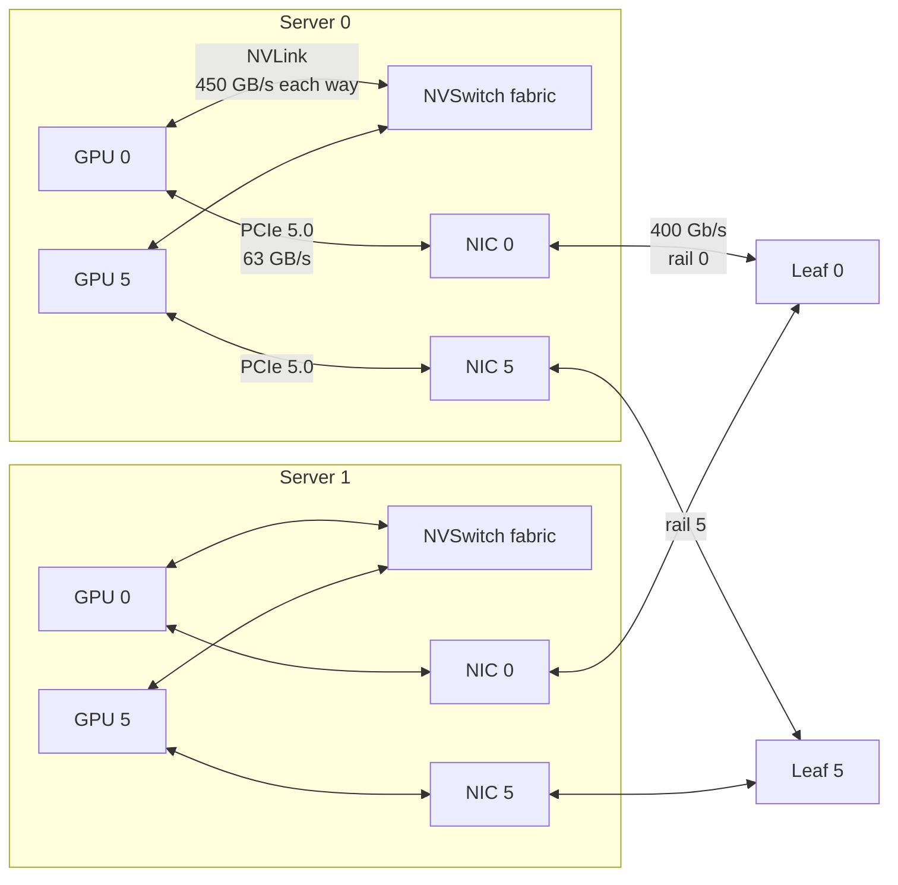
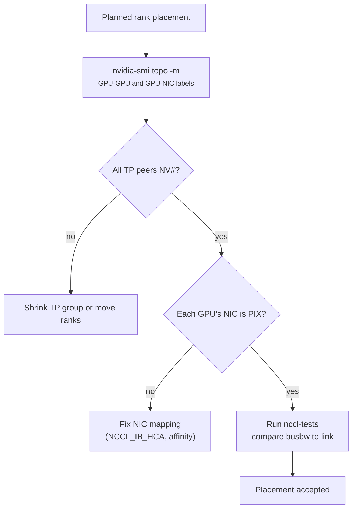

+++
title = 'NVLink, PCIe, and topology'
description = 'GPUs in one job talk over three tiers of wire: NVLink inside a server or rack, PCIe to the host and network card, and the cluster fabric between servers. Which pairs share which wires decides the bottleneck, often by a factor of ten.'
question = 'Which link limits traffic between two GPUs, and how do you find out before the job is slow?'
weight = 1
difficulty = 3
prerequisites = ['/notes/inference-engineering/distributed-inference/01-tensor-pipeline-and-expert-parallelism']
date = 2026-10-30T06:05:00Z
lastmod = 2026-10-30T06:05:00Z
verified = 2026-10-30
+++

## The idea in one minute

Data that moves between GPUs crosses one of three tiers. **NVLink** connects
GPUs inside a server (or, on rack-scale systems, a whole rack) at hundreds of
GB/s per direction. **PCIe** connects a GPU to its host CPU and network card at
about 63 GB/s per direction for a PCIe 5.0 x16 slot. The **cluster fabric**
(InfiniBand or RDMA Ethernet) connects servers at 400 Gb/s, which is 50 GB/s,
per port.

A transfer runs at the speed of the narrowest link on its path, so the
**topology** (which devices hang off which switch, which socket, which network
rail) is part of performance. Two GPUs on the same NVSwitch exchange 1 GiB in
about 2.4 ms. The same two GPUs on opposite CPU sockets of a PCIe-only server
take fifteen times longer, and nothing reports an error. Placement decisions,
from tensor-parallel group size to which rank talks to which network card,
follow from this map.

## A picture



## How it really works

### The three tiers, with numbers

| Link (as of October 2026) | Connects | Per-direction bandwidth | Source |
|---|---|---|---|
| HBM3 on H100 SXM | GPU to its own memory | 3.35 TB/s | H100 datasheet |
| NVLink 4 (H100) | GPU to NVSwitch, 18 links | 450 GB/s (900 GB/s both ways) | H100 architecture whitepaper |
| NVLink 5 (Blackwell) | GPU to NVSwitch, 18 links | 900 GB/s (1.8 TB/s both ways) | GB200 NVL72 page |
| PCIe 5.0 x16 | GPU to CPU, NIC, or PCIe switch | ~63 GB/s | PCI-SIG 5.0 base spec |
| InfiniBand NDR / 400 GbE | NIC to leaf switch | 50 GB/s | ConnectX-7 datasheet |

The PCIe figure is arithmetic: 32 GT/s per lane, 16 lanes, 128b/130b encoding,
divided by 8 bits gives 63 GB/s before protocol overhead; measured copies reach
roughly 50–55 GB/s. NVIDIA quotes NVLink as the sum of both directions, so
"900 GB/s" is 450 GB/s each way. Always check which convention a number uses
before you divide by it.

Even NVLink is about seven times slower than the GPU's own memory. Any
parallelism scheme that crosses a link every layer pays for it on every layer.

### NVLink and NVSwitch

In an eight-GPU HGX H100 board, each GPU's 18 NVLink links fan out to four
NVSwitch chips, so every GPU reaches every other GPU in two hops (GPU, switch,
GPU) at the full 450 GB/s per direction. All pairs are equidistant. That is the
property tensor parallelism needs: an all-reduce after every attention and MLP
block, among eight peers, with no slow pair.

Rack-scale systems extend the same domain. A GB200 NVL72 rack puts 72 Blackwell
GPUs behind NVLink switch trays, giving one NVLink domain of 72 GPUs. Beyond
the domain, traffic drops to the network tier. The size of the NVLink domain is
therefore the natural ceiling for tensor parallelism and, increasingly, for
expert parallelism.

Many cloud instances and all consumer cards have **no NVLink**, or only a
bridge between pairs. Their peer-to-peer traffic crosses PCIe, often through
the CPU. The same code that scales on HGX can stall on such a machine.

### PCIe trees, sockets, and the topology matrix

A server's PCIe is a tree. GPUs and NICs sit behind PCIe switches, the switches
hang off a CPU socket, and two sockets talk over an inter-socket link (UPI on
Intel, Infinity Fabric on AMD). Three things go wrong silently:

- **Cross-socket paths.** GPU 0 on socket 0 and GPU 7 on socket 1 share no
  switch, so peer traffic crosses the inter-socket link, which is slower and
  shared with everything else.
- **Shared uplinks.** Four GPUs behind one switch share its single x16 uplink
  to the CPU. Loading weights into all four at once divides the bandwidth by
  four.
- **Degraded links.** A card that trained at x8 or Gen4 works at half speed
  forever. `nvidia-smi -q` shows the current and maximum link width and
  generation.

`nvidia-smi topo -m` prints the matrix for every GPU and NIC pair. The labels,
in decreasing order of closeness: `NV#` (# NVLink links), `PIX` (one PCIe
switch), `PXB` (several PCIe switches), `PHB` (through the host bridge),
`NODE` (across host bridges in one NUMA node), `SYS` (across sockets). NCCL
reads the same information to build its rings and trees. Also pin each rank's
CPU threads and memory to the socket that owns its GPU (`numactl`), or every
host-to-device copy crosses sockets.

### Between servers: RDMA and rails

Between servers, NICs use **RDMA**: the NIC reads and writes registered memory
directly, without kernel copies. With **GPUDirect RDMA** the NIC reads GPU
memory over PCIe, so bytes go GPU, PCIe switch, NIC, wire, NIC, GPU. That only
works well when the NIC and GPU share a PCIe switch (`PIX`); if they are `SYS`
apart, the path crosses sockets and bandwidth collapses.

Training clusters therefore pair each GPU with its own NIC (eight 400 Gb/s NICs
in a DGX H100) and wire NIC *i* of every server to leaf switch *i*. This is a
**rail-optimized** fabric: GPU 0 in every server is on rail 0. Traffic between
GPU 0s stays on one leaf. Traffic from GPU 0 to GPU 5 on another server either
climbs to the spine, or, as NCCL's PXN feature does, first moves over NVLink to
local GPU 5 and then goes out on rail 5. NVLink is cheap enough that the extra
hop is worth avoiding a spine crossing.

### The cost of a transfer

The simplest useful model is

```text
time = latency + bytes / bottleneck_bandwidth
```

Latency is around a microsecond over NVLink and a few microseconds across an
RDMA fabric. For a 1 GiB gradient bucket bandwidth dominates; for the 64 KiB
activations of tensor-parallel decode, latency does. That split matters in the
next lesson, where it decides between ring and tree algorithms.



## Code

The program models three machines as graphs with per-direction bandwidths and
finds the widest path (the one whose narrowest link is largest) between GPU
pairs. It ignores contention: real traffic shares links.

```python {title="topology.py"}
"""topology.py: hops and bottleneck bandwidth between GPUs on three machine shapes."""
from __future__ import annotations
from dataclasses import dataclass, field
import heapq

@dataclass
class Graph:
    name: str
    edges: dict[str, dict[str, float]] = field(default_factory=dict)  # GB/s per direction

    def link(self, a: str, b: str, gbps: float) -> None:
        self.edges.setdefault(a, {})[b] = gbps
        self.edges.setdefault(b, {})[a] = gbps

    def widest_path(self, src: str, dst: str) -> tuple[float, list[str]]:
        """Max-bottleneck path (ties broken by fewer hops)."""
        best = {src: (float("inf"), 0)}
        heap = [(-float("inf"), 0, src, [src])]
        while heap:
            neg_bw, hops, node, path = heapq.heappop(heap)
            if node == dst:
                return -neg_bw, path
            for nxt, bw in self.edges[node].items():
                cand = (min(-neg_bw, bw), hops + 1)
                old = best.get(nxt)
                if old is None or cand[0] > old[0] or (cand[0] == old[0] and cand[1] < old[1]):
                    best[nxt] = cand
                    heapq.heappush(heap, (-cand[0], cand[1], nxt, path + [nxt]))
        raise ValueError("unreachable")

def hgx_h100() -> Graph:
    g = Graph("8x H100 SXM, NVSwitch")
    for i in range(8):
        g.link(f"gpu{i}", "nvswitch", 450.0)   # 900 GB/s bidirectional = 450 each way
    return g

def pcie_box() -> Graph:
    g = Graph("8x PCIe GPU, 2 sockets, no NVLink")
    for i in range(8):
        sw = f"plx{i // 4}"
        g.link(f"gpu{i}", sw, 63.0)            # PCIe 5.0 x16, ~63 GB/s each way
    g.link("plx0", "cpu0", 63.0)
    g.link("plx1", "cpu1", 63.0)
    g.link("cpu0", "cpu1", 30.0)               # inter-socket link, assumed effective rate
    return g

def two_nodes() -> Graph:
    g = Graph("2 nodes x 8 H100, 8x 400G IB rails")
    for n in range(2):
        for i in range(8):
            g.link(f"n{n}gpu{i}", f"n{n}nvs", 450.0)
            g.link(f"n{n}gpu{i}", f"n{n}nic{i}", 63.0)  # NIC behind PCIe 5.0 switch
            g.link(f"n{n}nic{i}", f"leaf{i}", 50.0)      # 400 Gb/s = 50 GB/s
    return g

def report(g: Graph, pairs: list[tuple[str, str]], gib: float = 1.0) -> None:
    print(g.name)
    for a, b in pairs:
        bw, path = g.widest_path(a, b)
        ms = gib * 1.0737 / bw * 1e3
        print(f"  {a:>7} -> {b:<7} hops={len(path)-1}  bottleneck={bw:6.1f} GB/s  "
              f"1 GiB in {ms:6.1f} ms  via {'>'.join(path[1:-1])}")

if __name__ == "__main__":
    report(hgx_h100(), [("gpu0", "gpu1"), ("gpu0", "gpu7")])
    report(pcie_box(), [("gpu0", "gpu1"), ("gpu0", "gpu7")])
    report(two_nodes(), [("n0gpu0", "n0gpu5"), ("n0gpu0", "n1gpu0"), ("n0gpu0", "n1gpu5")])
```

Run it with `python3 topology.py`:

```text
8x H100 SXM, NVSwitch
     gpu0 -> gpu1    hops=2  bottleneck= 450.0 GB/s  1 GiB in    2.4 ms  via nvswitch
     gpu0 -> gpu7    hops=2  bottleneck= 450.0 GB/s  1 GiB in    2.4 ms  via nvswitch
8x PCIe GPU, 2 sockets, no NVLink
     gpu0 -> gpu1    hops=2  bottleneck=  63.0 GB/s  1 GiB in   17.0 ms  via plx0
     gpu0 -> gpu7    hops=5  bottleneck=  30.0 GB/s  1 GiB in   35.8 ms  via plx0>cpu0>cpu1>plx1
2 nodes x 8 H100, 8x 400G IB rails
   n0gpu0 -> n0gpu5  hops=2  bottleneck= 450.0 GB/s  1 GiB in    2.4 ms  via n0nvs
   n0gpu0 -> n1gpu0  hops=4  bottleneck=  50.0 GB/s  1 GiB in   21.5 ms  via n0nic0>leaf0>n1nic0
   n0gpu0 -> n1gpu5  hops=6  bottleneck=  50.0 GB/s  1 GiB in   21.5 ms  via n0nvs>n0gpu5>n0nic5>leaf5>n1nic5
```

On NVSwitch every pair is two hops at 450 GB/s. On the PCIe box, the
cross-socket pair is limited by the inter-socket link (an assumed effective
30 GB/s) and needs 15 times as long as an NVLink pair. Across servers the
400 Gb/s rail caps traffic at 50 GB/s, and the cheapest route to a GPU on a
different rail goes over NVLink first, which is what PXN does.

## Where it breaks

- **Contention.** Widest-path ignores that eight GPUs sharing one PCIe uplink,
  or every rank in an all-to-all crossing the spine at once, divide the link.
  Real collective bandwidth comes from measurement with `nccl-tests`.
- **Oversubscribed fabrics.** A rail-optimized design assumes a non-blocking
  spine. Many clusters oversubscribe the spine 2:1 or more to save cost; jobs
  that cross it get a fraction of line rate.
- **Virtualized topology.** In VMs and containers the matrix you see may not be
  the physical one. Cloud images sometimes hide PCIe switches or present NICs
  as `SYS` to every GPU.
- **Not a security boundary.** Peer-to-peer access and shared NVLink domains
  are performance features; the isolation questions are covered in
  [multi-tenant GPU isolation](/notes/infrastructure-security/securing-gpu-clusters/01-multi-tenant-gpu-isolation/).

## Remember this

- Three tiers: NVLink (hundreds of GB/s), PCIe (~63 GB/s), fabric (50 GB/s per 400G port).
- NVIDIA's NVLink figures add both directions; halve them for one-way transfers.
- The NVLink domain (8 GPUs on HGX, 72 on NVL72) caps tensor-parallel size.
- `nvidia-smi topo -m` before launch: TP peers on `NV#`, each GPU's NIC on `PIX`.
- Rail-optimized fabrics keep same-index GPUs on one leaf; NVLink hops route around rails.

## Try it

1. Change the inter-socket bandwidth in `pcie_box` to 60 GB/s. Which link is
   now the bottleneck for `gpu0 -> gpu7`?
2. Add a second NIC per server shared by two GPUs behind one switch. Model the
   sharing by halving the link and compare cross-server times.
3. On a GPU server, run `nvidia-smi topo -m` and draw the PCIe tree from it.
   Mark which GPU pairs you would put in one tensor-parallel group.

## Check yourself

1. An HGX H100 board advertises 900 GB/s NVLink per GPU. How long does a 9 GB
   one-way transfer between two GPUs take, ignoring latency?
   
   900 GB/s is the bidirectional sum, so one direction is 450 GB/s: 9 / 450 = 20 ms.
   
2. Why does a GPU whose NIC shows `SYS` in the topology matrix get poor
   GPUDirect RDMA bandwidth?
   
   The NIC must read GPU memory across the CPU sockets instead of through a
   shared PCIe switch, so traffic crosses the inter-socket link and host
   bridges, which are slower and shared.
   
3. In a rail-optimized cluster, why might NCCL route GPU 0 on server A to GPU 5
   on server B through GPU 5 on server A?
   
   GPU 5's NIC is on rail 5, the same leaf as server B's GPU 5. One NVLink hop
   inside server A avoids crossing the spine, which may be oversubscribed and
   adds switch hops.
   
4. Why is the NVLink domain size, not the cluster size, the usual upper bound
   for tensor parallelism?
   
   Tensor parallelism all-reduces activations after every block, which needs
   NVLink-class bandwidth and microsecond latency. Outside the domain each
   collective would run at network speed, roughly ten times slower.
   

## Sources

- NVIDIA, *NVIDIA H100 Tensor Core GPU Architecture* whitepaper (2022): NVLink 4, 18 links, 900 GB/s, NVSwitch topology. <https://resources.nvidia.com/en-us-tensor-core>
- NVIDIA, *GB200 NVL72* product page (accessed October 2026): 72-GPU NVLink domain, NVLink 5 at 1.8 TB/s per GPU. <https://www.nvidia.com/en-us/data-center/gb200-nvl72/>
- PCI-SIG, *PCI Express Base Specification Revision 5.0* (2019): 32 GT/s, 128b/130b encoding. <https://pcisig.com/specifications>
- NVIDIA, *DGX H100 User Guide*: eight ConnectX-7 400 Gb/s compute-fabric ports. <https://docs.nvidia.com/dgx/dgxh100-user-guide/>
- NVIDIA, *NCCL User Guide*, environment variables (`NCCL_IB_HCA`, `NCCL_P2P_LEVEL`, PXN). <https://docs.nvidia.com/deeplearning/nccl/user-guide/docs/>
- NVIDIA, *GPUDirect RDMA* documentation. <https://docs.nvidia.com/cuda/gpudirect-rdma/>
